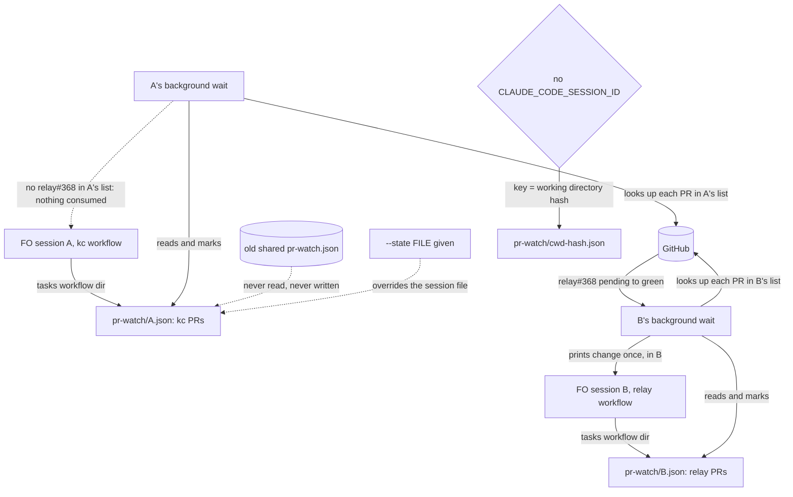

Filed from a package-issue candidate the Captain approved on 2026-10-14 (「1,3」). On 2026-10-14 this workflow's FO ran `pr_watch.py wait` for its own PR and was woken by spacedock-dev/subspace-relay#368 ("checks pending -> green"), a PR the relay FO session had added; the wake consumed that change, so the relay FO's own `check` or `wait` would no longer report it.

## Scope

- `pr_watch.py` keeps one machine-local state file (`~/.local/state/kc-dev-flow-2/pr-watch.json`) for every session; `check` and `wait` report changes "since the last look" and record the look, so concurrent FO sessions in different repositories read and mark each other's PRs.
- Containment used here: `--state /tmp/jm-fo/pr-watch.json` for this session; the relay FO was not told.
- Candidate fix: a per-workflow or per-session default state path (for example keyed by the workflow directory), or per-PR seen markers per caller; plus the Delivery authority and mod text that name the command.
- Related: `fo-lifecycle-mod` (its idle and startup steps run `pr_watch.py add` and `wait`).
- Second report, from the relay FO (task `owner-sees-all-feedback-page`, PR spacedock-dev/subspace-relay#368, 2026-10-14): its `pr_watch.py add` printed "watching 3 PR(s)" because the default state already held iamcxa/kc-claude-plugins#642 and #643 from this workflow's FO; it used a per-session `--state` file. It suggests defaulting the state per session (for example keyed by a session id environment variable) or naming `--state` in the Delivery authority step.
- Non-goals: set in `## Design` under Limits.

## Acceptance criteria

`<package>` is the kc-dev-flow-2 package root; paths are relative to `kc-dev-flow-2/` in `iamcxa/kc-claude-plugins`. A "caller" is one FO session and the workers it dispatches (they share its `CLAUDE_CODE_SESSION_ID`, see Design). New tests go in `scripts/test_pr_watch.py`, which CI already runs (`.github/workflows/kc-dev-flow-2-tests.yml`, step `test_pr_watch.py`). Every new test sets `HOME` to a temp directory and passes no `--state`.

**AC-1** Two callers watching the same PR each see a change the other already read.
Verified by: a new test where callers `A` and `B` (`CLAUDE_CODE_SESSION_ID=A`, `=B`) both run `add o/r#1` while its checks are pending; the checks turn green; `A` runs `wait 1` and prints `checks pending -> green`; then `B` runs `check` and prints the same change line. A second case with `B`'s file fresh has `B`'s `wait 1` (sleep stubbed to stop) return that line instead of `check`. `python3 <package>/scripts/test_pr_watch.py` exits 0.
Falsifier: make the default path one constant for every caller; `B`'s `check` prints `no change since the last look` and the test fails. Limit: a stubbed `look`; GitHub is not called.

**AC-2** The 2026-10-14 loss does not recur: one session's `wait` no longer consumes relay#368's `checks pending -> green`.
Verified by: a new test replaying it with two callers: `B` (relay FO) runs `add spacedock-dev/subspace-relay#368`, `A` (this workflow's FO) runs `add iamcxa/kc-claude-plugins#643`, relay#368's checks turn green; `A`'s `check` output and `A`'s state file hold no `subspace-relay#368`, and `B`'s `wait 1` returns `checks pending -> green` for it. Exit 0.
Falsifier: replayed on origin/main `c545b896` (the unchanged base) on 2026-10-15 with the same steps and no `--state`: `A`'s `wait` printed `o/relay#368 ... checks pending -> green` and `B`'s later `check` printed `no change since the last look`. The loss reproduces on base; the new test must fail there. Limit: the replay script (`/tmp/prw-ideation/replay.py`) is machine-local; the committed test is the reproducible form.

**AC-3** The default state path is chosen per caller without FO passing `--state`.
Verified by: a new test asserting, under a temp `HOME`: with `CLAUDE_CODE_SESSION_ID=S` the file is `$HOME/.local/state/kc-dev-flow-2/pr-watch/S.json`; with no id the file is `.../pr-watch/cwd-<12 hex>.json` from the real path of the working directory, equal for one directory and different for two; an id holding `/`, `..` or nothing falls to the working-directory key and writes no file outside `.../pr-watch/`; an explicit `--state FILE` wins over all of them.
Falsifier: use the id unsanitised (`CLAUDE_CODE_SESSION_ID=../x` writes outside the directory) or skip the working-directory fallback; the matching assertion fails. Limit: only the Claude Code variable is bound (decision D2); a Codex or Pi session without it is per working directory, so two such sessions in one directory still share.

**AC-4** FO reads no more words at any lifecycle moment than on the base; the `tasks` output is byte-identical to the base's in the default case.
Verified by: at validation, run `pr_watch.py tasks <fixture workflow dir>` at base `c545b896` and at the candidate on the same fixture (the `TasksTests` setup, `gh` stubbed), once each for an open task PR, a merged task PR with the observer report committed, and a workflow with no task PR, and compare `wc -w` of stdout per case (startup and idle on an open PR share the first; idle on a merged PR is the second; after the archive and the merge ask read nothing from this script: the third prints nothing, and `delivery_gate.py` is not in the diff). Equal in all three. `git diff --name-only origin/main` lists `kc-dev-flow-2/scripts/pr_watch.py` and `kc-dev-flow-2/scripts/test_pr_watch.py` and no `references/`, `skills/`, `extensions/` or `docs/dev2/` file. The existing assertion that the printed `wait` line carries `--state` only when one was given still passes.
Falsifier: print `--state <path>` on the `wait` line in the default case; the open-PR count rises and the byte comparison fails. Limit: counts the script output and the diff, not a measured FO session; the learning rule's "below its base" is met as "not above" because no text moves.

**AC-5** Entries already in `~/.local/state/kc-dev-flow-2/pr-watch.json` are neither read, changed nor deleted, and a new caller starts empty and rebuilds from `tasks`.
Verified by: a new test seeds `$HOME/.local/state/kc-dev-flow-2/pr-watch.json` with two PR entries, runs `check`, `add` and `tasks` as a caller with an id, and asserts the old file's bytes are unchanged, the new caller's `check` before any `add` lists neither entry, and after `tasks` its file holds only the task PR and `tasks` printed that PR's `fact:` line.
Falsifier: copy the old entries into the new file on first use; the first assertion about the new caller's list fails. Limit: a `wait` started before the upgrade keeps running the old code on the old file until it exits.

**AC-6** A worker FO dispatches reaches the same state file as FO.
Verified by: at validation, on a Claude Code session, FO runs `printenv CLAUDE_CODE_SESSION_ID` in a foreground Bash, in a background Bash and from a dispatched worker; all three print one value. Current evidence (2026-10-15, this ideation worker): the value in this worker's environment, `5c030106-8d82-4542-855e-1498b2563c69`, is the prefix of all 32 `/tmp/spacedock-dispatch/5c030106-...` files FO wrote, and a background Bash printed the same first eight characters; a second FO session's files carry a different prefix (`14efebc1`).
Falsifier: a worker printing a different value, or none, means the learn skill's bare `add` and `check` read another list than FO's `wait`; then AC-6 fails and D1 reopens. Not yet verified: Codex, Pi, and a session resumed after a restart.

## Design

### Chain check (read 2026-10-15)

- **Spacedock** (0.27.x installed): `spacedock --help` lists no PR watcher; `status` has no `pr` watch field beyond the recorded `pr:` value. Nothing to reuse.
- **kc-dev-flow-2** at origin/main `c545b896` (package 0.22.1; #643 merged at `ab9334ed`): the capability is `scripts/pr_watch.py` and it is the only home. Its `--state` flag already works and `tasks` already prints `--state` on the `wait` line when one was given. `$CLAUDE_CODE_SESSION_ID` is already the package's session identity (`extensions/peers/EXTENSION.md` Host bindings). `references/sd/workflow.md` no longer names `pr_watch.py` after #643; only the mod (`references/sd/mods/kc-dev-flow-2.md`, step 1, `tasks <workflow dir>`), `skills/learn/SKILL.md` (bare `add` and `check`) and `extensions/learn/EXTENSION.md` do, and an adopter README synced at 0.22.1 still carries the older paragraph naming bare `add` and `wait`.
- **Sibling adopters**: the relay FO's `--state` per-session file and this workflow's `--state /tmp/jm-fo/pr-watch.json` are both per-FO containments (task Scope). They are not a contract: each needs the FO to remember a flag the mod never prints. No adopter fixes the default.
- ADRs: `docs/adr` has none on watch state (0013 concerns what a Copilot answer is, not where the state lives). `git -C <state> grep -n 'Override:'` on 2026-10-15 finds no gate override on this question.

### Existing-code capability check

Boundary: `pr_watch.py` `check`/`wait`/`tasks`/`add` as FO runs them from the mod. The capability exists and works (completeness: working code, wrong default); only the default path is the defect, so the change is one function and the flag's default, not a new mechanism. Observation: the base replay in AC-2 reproduces the loss with two callers and no flags, and `~/.local/state/kc-dev-flow-2/` on this machine holds `pr-watch.json` with one entry each from this workflow and relay and a separate `pr-watch-subspace-fo.json`.

### PRFAQ

**Press release.** Each FO session now watches its own pull requests. A session that runs `pr_watch.py wait` is woken only by what its own list contains, and a change one session reads is still there for another session that watches the same PR. FO runs the same commands as before; nothing new is printed.

**FAQ.**
- *What was wrong?* One file for the whole machine held both the PR list and "what was last seen". Any session's `wait` or `check` moved the second session's marker.
- *What is the key?* The session. `tasks`, `add`, `check` and `wait` take the file `~/.local/state/kc-dev-flow-2/pr-watch/<session id>.json`, where the id is `$CLAUDE_CODE_SESSION_ID`, which FO's workers and its background commands also see. Without that variable the key is the working directory. `--state` still overrides both.
- *Why not per workflow directory?* Only `tasks` is given the workflow directory; bare `add`, `check` and `wait` (the learn skill, adopter READMEs at 0.22.1) are not, so they would need a new flag or a guess. And two FO sessions on one workflow (a supported setup: concurrent sessions drive one state checkout) would still consume each other's changes. Per-caller markers inside one shared file need the same caller id plus a new file shape, so they add a schema and remove nothing.
- *What happens to the old `pr-watch.json`?* It is left alone and unread. Copying it in would hand each new session the other sessions' PRs. The first `tasks` in a session re-adds that workflow's open task PRs from the task files and prints their `fact:` lines, so the open task PRs are refilled; a PR added by a bare `add` (the learn skill's own) is not, and a worker's bare `add` after the upgrade lands in the file its id names; an outcome already present when a PR is added prints once as `already`.
- *What do FO and the workers read?* The same words. The mod, `workflow.md` and the learn skill keep their text; the `wait` line `tasks` prints is unchanged unless `--state` was given.
- *What does it not do?* It does not clean up files of ended sessions (a file holds only open PRs plus a lock file; nothing breaks without cleanup), does not cover a Codex or Pi session without the Claude variable beyond a per-directory key, and does not make a restarted session keep its list.

### Flow



Path choice in `pr_watch.py`: `--state` default becomes `None`; one function turns it into the session file (id fullmatch `[A-Za-z0-9][A-Za-z0-9._-]{0,127}`, else `cwd-<first 12 hex of sha256 of the real working directory>`), evaluated per run from `HOME` and the environment. `tasks` prints `--state` on its `wait` line only when the flag was given (today's test `test_an_open_pr_prints_its_facts_and_the_kept_step_then_keeps_one_wait_running` pins that form). The `--state` text in the module docstring gains one sentence for the default; that is `--help` text, not read at an FO moment.

### Text FO reads, counted under the learning rule

Rule: "Measure the words FO reads at each moment, not one file's size" (root `learning.md`, origin/main). This change adds and moves no instruction text: mod 0, `workflow.md` 0, learn skill 0, `tasks` output 0 in the default case. Moments, each counted as in AC-4: startup and idle on an open PR (mod plus `tasks` open-PR output), idle on a merged PR (`tasks` observer lines), after the archive (nothing from this script), the merge ask (`delivery_gate.py`, untouched). Per-file `WORKFLOW_WORD_BUDGET` in `scripts/lint-skills.py` is not relevant: no file it counts changes. The one wording worth a later look is `skills/learn/SKILL.md`'s "a watch state lost with the machine"; it stays true, and a session-keyed list makes a restarted session fit it better, so it is left alone.

### Files, and what is shared with the other task

Expected to change: `kc-dev-flow-2/scripts/pr_watch.py` and `kc-dev-flow-2/scripts/test_pr_watch.py`. `delivery-gate-verdict-form` is expected to change `scripts/delivery_gate.py` and its test (and possibly the validation stage text); I name no file both change. The only spot both could reach is `scripts/lint-skills.py` word budgets, if the other adds adopted text; mine adds none. Both are released by release-please from `fix(kc-dev-flow-2): ...` commits; neither edits a version or the changelog.

### Limits

- Session identity is bound for Claude Code only (verified 2026-10-15 for this worker and a background Bash; see AC-6). Codex's `CODEX_THREAD_ID` is named in the ensign contract as that host's marker but its stability across a FO and its workers is unverified; Pi has no session variable (`PI_CODING_AGENT_DIR` is a directory shared by sessions).
- Whether a resumed Claude session keeps its id is unmeasured. If it gets a new one it starts with an empty list that its next `tasks` refills; the `fact:` lines are state, so no step is lost, but an outcome that fired while no session watched is not reported as a change.
- Files of ended sessions stay: one small JSON and its lock file per session. No cleanup is added (without it nothing breaks); a later task may add one under its own approval, since deleting is the Captain's call.
- Non-goals (replacing the Scope bullet): changing what counts as an outcome, the settle rule, reviewer columns, the mod or README wording, or `delivery_gate.py`.

### Unresolved decisions for the Captain

- **D1: key the default state by session (recommended) or by workflow directory?** Session: each FO and its workers get their own markers, so even two sessions on one workflow stop consuming each other's changes, with no new flag and no text change. What gets worse: a session restart may start with an empty list (refilled by `tasks`), ended sessions leave small files, and the key depends on a host variable. Workflow-directory keying survives a restart but leaves the two-sessions-on-one-workflow case broken and needs a flag on bare `add`, `check` and `wait`. No past `Override:` or ADR bears on it.
- **D2: bind only `CLAUDE_CODE_SESSION_ID` now (recommended), or also `CODEX_THREAD_ID`?** Claude only: the one binding proved here; Codex and Pi fall back to a per-directory key. What gets worse: a Codex FO's session is not isolated from another Codex session in the same directory, and FO is split from its own workers (they run from the task worktree, FO from the workspace, so a worker's bare `add` or `check` reads another list than FO's `wait`), until someone shows its id reaches its workers and background commands (a one-line change plus one check then). Adding Codex now would bind an unverified assumption.

## FO alignment

Alignment: not needed before ideation; the Captain approved filing it.
Release review: not needed: workflow maintenance, on no journey map.
Surfaces: none
Visible change: none

## Stage Report: ideation

- DONE: A design (PRFAQ and Mermaid) for giving each caller of kc-dev-flow-2/scripts/pr_watch.py its own view of changes on main (after #643 merged at ab9334ed): the state key (per workflow directory, per session, or per-caller seen markers), how the default path is chosen without FO passing --state, how existing entries in ~/.local/state/kc-dev-flow-2/pr-watch.json migrate, and what the merged mod and README text need, if anything, counted under the task's learning rule (words FO reads at each moment must not rise)
  `## Design` (chain check, capability check, PRFAQ, Flow, text count, files, limits): key = session id (`$CLAUDE_CODE_SESSION_ID`, else working-directory hash, `--state` overrides); old file left unread; mod, workflow.md and learn skill need 0 words. `design_surfaces.py check` printed "design surfaces presentable", exit 0.
- DONE: Acceptance criteria with reproducible evidence clauses and falsifiers, including a test where two callers watch overlapping PRs and each still sees a change the other already read, and a replay of the 2026-10-14 loss (one session's wait consuming relay#368's checks pending -> green)
  Per criterion, current evidence:
  AC-1 (overlap test): not yet verified; the base shows the failure (AC-2 replay).
  AC-2 (replay): base replay at origin/main c545b896 on 2026-10-15 reproduced the loss: A's wait printed relay#368 `checks pending -> green`, B's check printed "no change since the last look". The candidate test is not yet written.
  AC-3 (default path): not yet verified; the `--state` default is the base's single constant (`DEFAULT_STATE`).
  AC-4 (words per moment, byte-identical `tasks` output): not yet verified; the base `tasks` test pins today's `wait` line form.
  AC-5 (old file untouched): not yet verified; the old file holds two entries on this machine (read-only look).
  AC-6 (workers share FO's id): partly verified 2026-10-15: this worker's `CLAUDE_CODE_SESSION_ID` equals the prefix of 32 FO dispatch files and a background Bash printed it; Codex, Pi and a resumed session are not verified.
- DONE: Unresolved decisions for the Captain, each with a recommendation and what gets worse under it
  D1 key by session or workflow directory (recommend session); D2 bind Claude only or also `CODEX_THREAD_ID` (recommend Claude only). No past `Override:` or ADR bears on them.

### Summary

pr_watch.py's one machine-wide state file lets any session's `wait` or `check` consume another's changes; the base replay reproduces the 2026-10-14 loss. The design keys the default state by session id (the Claude variable FO, its workers and its background commands share), falls back to a per-directory key, leaves the old file alone, and changes no text FO reads (only `pr_watch.py` and its test). Expected shared file with `delivery-gate-verdict-form`: none.

## Stage Report: implementation

- DONE: One Draft PR (fix(kc-dev-flow-2): ...) from a branch off origin/main changing only kc-dev-flow-2/scripts/pr_watch.py and kc-dev-flow-2/scripts/test_pr_watch.py as the approved design gives them (session-keyed default state, working-directory fallback, --state override, old shared file left unread); AC-1 to AC-5 green with each falsifier shown failing by a mutation run, including the two-session overlap test and the committed replay of the 2026-10-14 loss
  PR https://github.com/iamcxa/kc-claude-plugins/pull/646 (Draft), head e4fca6796 off origin/main c545b896; diff is those two files only. `python3 kc-dev-flow-2/scripts/test_pr_watch.py` 66 tests OK (8 new, `DefaultStateTests`, temp HOME, no --state).
  Mutations (python3 -B, each fails the named test, restored file passes): constant default path -> overlap/replay/keying/old-file tests fail (AC-1,2,3,5); unsanitised id -> `test_an_unusable_session_id_...` (AC-3); no cwd fallback -> `test_the_default_file_is_keyed_...` (AC-3); copy old entries -> `test_the_old_shared_file_...` (AC-5); always print --state -> `test_tasks_refills_...` (AC-4). New test file on base c545b896 pr_watch.py: 5 failures, 2 errors incl. `test_one_sessions_wait_does_not_consume_another_sessions_pr` (AC-2 replay).
- DONE: The words FO reads at each moment shown unchanged (the tasks output byte-identical in the default case), roborev evidence= line, CI green on the PR head, CI cost measured or stated as not measured
  AC-4: `tasks` at base vs candidate, same fixture, gh stubbed: open PR 27/27 words, merged PR with observer report 20/20, no task PR 0/0; identical after normalising script paths. No references/, skills/, extensions/ or docs/dev2 file in the diff.
  roborev: `clean on e4fca6796; evidence=roborev:684`. comment_ratio: 0 comment lines of 128 code lines, max 5% met. doc_impact: 0 documents listed. lint-skills passes.
  CI on head e4fca6796: unit tests (58s), version parity (51s), multi-profile route gate (6s), GitGuardian all pass. CI cost not measured beyond those job durations; no workflow file changed, the tests join an existing step.

### Summary

pr_watch.py's default state is now `~/.local/state/kc-dev-flow-2/pr-watch/<CLAUDE_CODE_SESSION_ID>.json`, else a `cwd-<12 hex>` key; `--state` overrides, the old shared file is never read or written, and `tasks` prints `--state` only when given. Limits: Claude Code only (D2); an old `wait` keeps the old file until it exits; ended sessions' files are not cleaned. AC-6 (worker prints FO's session id) was not run here and stays for validation on a live session.

## Stage Report: validation

- DONE: Independent verdict on #646 head e4fca679 against AC-1 to AC-6, re-running each evidence command and at least one falsifier per criterion yourself (the two-session overlap test, the replay of the 2026-10-14 loss, the default-path keying and fallback, the old shared file left unread, tasks output byte-identical in the default case, and AC-6 that a worker and a background command see FO's session id)
  Verdict PASSED (below). `python3 -B kc-dev-flow-2/scripts/test_pr_watch.py` at e4fca679 under a temp HOME: 66 tests OK. Every mutation ran on a copy, never the candidate; candidate PR #646 is Draft, CI 4/4 green on that head.
  AC-1/AC-2 (two callers; replay): `test_two_callers_watching_one_pr_...` asserts B's `check` prints the change A's `wait` already read, `test_one_sessions_wait_does_not_consume_...` asserts A's state holds no relay#368 and B's `wait` returns it. A constant default path fails both (plus 3 more); the same 8 new tests on base c545b896 code give 5 FAIL and 2 ERROR. Black-box on base (script below, step 1/2): B's `check` printed `no change since the last look` and B2's `wait` never returned (killed at 20s).
  AC-3 (keying, fallback): `test_the_default_file_is_keyed_...` and `test_an_unusable_session_id_...` assert `S.json`, `cwd-<12 hex>` for no id, `../x`, `a/b`, empty, `.`, `..`, `-x`, 129 chars fall to the cwd key with no file outside `pr-watch/`. Unsanitised id (`.*`) and a removed cwd fallback each fail both tests; `--state` wins (`test_an_explicit_state_file_wins`, and script step 5).
  AC-4 (words): `tasks` at base vs candidate, same fixture, gh stubbed, temp HOME, session id set: open task PR 27/27 words, merged PR with observer report 20/20, no task PR 0/0; stdout identical after normalising the script path. Diff is `kc-dev-flow-2/scripts/pr_watch.py` and `test_pr_watch.py` only; `delivery_gate.py`, references, skills, extensions untouched. Always printing `--state` fails `test_tasks_refills_...`.
  AC-5 (old file): `test_the_old_shared_file_...` and `test_tasks_refills_...` assert bytes unchanged and a new caller starts empty; copying the old entries into the new file fails both. Script step 4 shows `no change since the last look` for a new session over a seeded old file, hash unchanged; base code reads it (step 4 on base printed the old entry's traceback).
  AC-6 (worker and background see FO's id): in this dispatched worker, foreground `printenv CLAUDE_CODE_SESSION_ID` and a `run_in_background` Bash both print `5c030106-8d82-4542-855e-1498b2563c69`, the prefix of all 36 `/tmp/spacedock-dispatch/5c030106-...` files FO wrote (other FO sessions carry other prefixes). Not run: FO's own foreground `printenv` (a worker cannot see FO's environment; equality is inferred from the dispatch file names), Codex, Pi, a resumed session.
- DONE: A minimal acceptance script the Captain can run (three to six steps, exact commands, expected output), run by you exactly as written in a fresh bash shell from a named checkout, with its observed output
  Five steps below. Run as `cd <checkout of e4fca679> && bash --noprofile --norc /tmp/val-accept.sh` (needs python3, perl, shasum, bash; a stub `gh` is made in a temp dir; `HOME` is a temp dir, so no real state file is read). Observed on e4fca679: exit 0; step 1 prints `checks pending -> green` for A's wait and again for B's check; step 2 A2's check has no relay#368 and B2's wait prints `subspace-relay#368 feat: x: checks pending -> green`; step 3 lists `A.json A2.json B.json B2.json cwd-<12hex>.json` under `pr-watch/` only; step 4 `no change since the last look` then `old file unchanged`; step 5 prints `chosen.json` then `no D.json written`. On base c545b896 the same script shows `no change since the last look` in step 1, relay#368 in A2's list in step 2, the old file read in step 4.
- DONE: /Users/kent/.claude/plugins/cache/kc-claude-plugins/kc-dev-flow-2/0.22.1/scripts/adr_lint.py docs/adr --since <base> run with its exit code; verdict PASSED or REJECTED naming the head, with findings classified by the workflow's Review-finding disposition
  `adr_lint.py docs/adr --since c545b896` at the candidate: "15 ADR file(s) checked, 0 legacy", exit 0. `comment_ratio.py c545b896 e4fca679`: 128 code lines, 0 comment lines, exit 0. `doc_impact.py`: 0 documents listed, exit 0. `dispatch_records.py`: 3 records complete, exit 0. `design_surfaces.py check`: presentable, exit 0. No `## Number guards` section, so no guard check. PASSED on head e4fca679. Findings: none Material; none Deferred risk beyond the design's own Limits; Polish none; Needs decision none. I read the 17 added lines in `pr_watch.py` and the added test class: every change maps to an AC; the 4-line docstring paragraph is `--help` text.

### Summary

PASSED on head e4fca679 (base c545b896): the default state is per session with a working-directory fallback, `--state` still wins, the old shared file is neither read nor written, and `tasks` output is word-for-word the same in the default case. The loss reproduces on base and each falsifier fails exactly the tests meant to catch it. Limits: AC-6 for FO's own shell is inferred from dispatch-file names, and Codex, Pi and a resumed session are not verified; a `wait` started before the upgrade keeps reading the old file until it exits; ended sessions' files are not cleaned up (all stated in the design Limits).

### Minimal acceptance script

```bash
#!/usr/bin/env bash
# Run from a checkout of iamcxa/kc-claude-plugins PR #646 head e4fca679:
#   cd <that checkout> && bash --noprofile --norc /tmp/val-accept.sh
set -u
PW="$PWD/kc-dev-flow-2/scripts/pr_watch.py"
[ -f "$PW" ] || { echo "run from a checkout of PR #646 (kc-dev-flow-2/scripts/pr_watch.py not found)"; exit 2; }
W=$(mktemp -d); mkdir -p "$W/bin" "$W/gh" "$W/home"
cat > "$W/bin/gh" <<'GH'
#!/usr/bin/env python3
import json, os, sys
a = sys.argv[1:]  # pr view N --repo R --json ...
n, repo = a[2], a[a.index("--repo") + 1]
print(json.dumps({"state": "OPEN", "isDraft": False, "mergeable": "MERGEABLE", "headRefOid": "a" * 40, "title": "feat: x",
  "statusCheckRollup": [{"conclusion": open(f"{os.environ['GHDIR']}/{repo.replace('/', '_')}_{n}").read().strip()}]}))
GH
chmod +x "$W/bin/gh"
setc() { printf '%s' "$2" > "$W/gh/$(echo "$1" | sed 's#/#_#; s/#/_/')"; }   # setc o/r#1 SUCCESS|IN_PROGRESS
pw() { sess=$1; shift; perl -e 'alarm 20; exec @ARGV' env -u CLAUDE_CODE_SESSION_ID ${sess:+CLAUDE_CODE_SESSION_ID=$sess} HOME="$W/home" PATH="$W/bin:$PATH" GHDIR="$W/gh" python3 -B "$PW" "$@" || echo "(exit $? - a wait that never returns is killed after 20s)"; }
echo "== 1. two sessions watch o/r#1; A's wait reads the change; B still sees it"
setc o/r#1 IN_PROGRESS; pw A add o/r#1; pw B add o/r#1; setc o/r#1 SUCCESS
echo "-- A wait:"; pw A wait 1; echo "-- B check:"; pw B check
echo "== 2. replay of 2026-10-14: A's check must not mention relay#368; B must"
setc spacedock-dev/subspace-relay#368 IN_PROGRESS; setc iamcxa/kc-claude-plugins#643 IN_PROGRESS
pw B2 add spacedock-dev/subspace-relay#368; pw A2 add iamcxa/kc-claude-plugins#643; setc spacedock-dev/subspace-relay#368 SUCCESS
echo "-- A2 check:"; pw A2 check; echo "-- B2 wait:"; pw B2 wait 1
echo "== 3. default files (session id, no id, unsafe id)"
pw "" add o/r#1 >/dev/null; pw ../x add o/r#1 >/dev/null
( cd "$W/home" && find . -name '*.json' | sed 's#cwd-[0-9a-f]\{12\}#cwd-<12hex>#' | sort -u )
echo "== 4. old shared file untouched and unread"
mkdir -p "$W/home/.local/state/kc-dev-flow-2"; O="$W/home/.local/state/kc-dev-flow-2/pr-watch.json"
echo '{"x/y#1": {"state":"OPEN","draft":false,"mergeable":"MERGEABLE","checks":"green","head":"aaaaaaaaa","title":"t"}}' > "$O"
b=$(shasum "$O"); echo "-- new session C check:"; pw C check; [ "$b" = "$(shasum "$O")" ] && echo "old file unchanged"
echo "== 5. explicit --state wins"
pw D --state "$W/chosen.json" add o/r#1 >/dev/null; ls "$W/chosen.json"; [ -e "$W/home/.local/state/kc-dev-flow-2/pr-watch/D.json" ] && echo "FAIL: session file written" || echo "no D.json written"
rm -rf "$W"
```

Not covered: real GitHub (a stub `gh`), a real FO or worker session (AC-6), Codex and Pi, a resumed session, the old `wait` still running.
