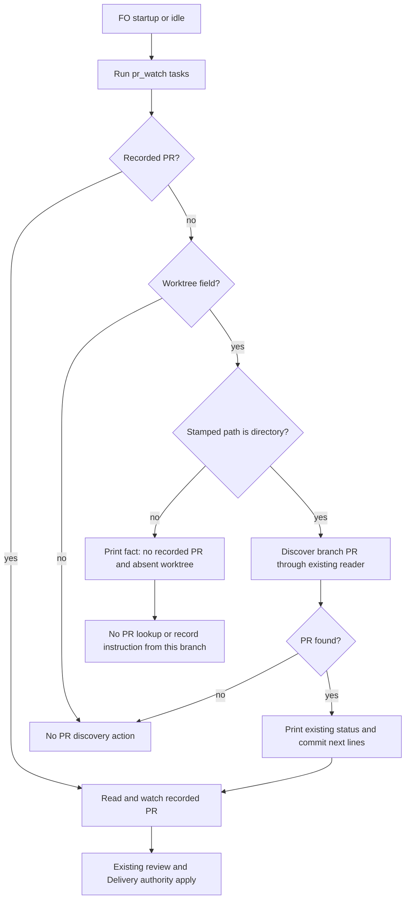

Filed on the Captain's 「開」 (chat, 2026-10-16), after FO's first run of the v0.23.0 lifecycle mod's idle step on this workflow.

## Scope

- Observed 2026-10-16, kc-dev-flow-2 0.23.0, `python3 <package>/scripts/pr_watch.py tasks <workflow dir>` on this workflow printed two `next:` lines: "record journey-server-host-pilot's PR with status --set journey-server-host-pilot pr=<owner/repo>#<N>; its worktree is not on this machine." and the same for pr-review-lite-value-pilot. Neither task is driven by the session that ran the mod (one is held at validation by another session, the other unchanged since 2026-09-22), and neither has a PR yet.
- The mod tells FO to do each `next:` line in order, so an FO that follows it may record a wrong PR on another session's task. Several FO sessions drive one workflow in adopters such as subspace-relay.
- Candidate fix: a task whose worktree is not on this machine is listed as a fact line, not a `next:` action; a test with such a task.
- Should land before subspace-relay syncs to the mod.
- Also seen 2026-10-16 on the same run: `next: run spacedock state commit amendment-form-check` while that task's implementation worker was still writing its report (the worker owns that commit), and `next: mark #649 ready if Delivery authority allows` before its validation had run. Both are `next:` lines an FO must not follow at that moment; whether they become facts too is for ideation.
- Non-goals: to be set at ideation.
- Trial (2026-11-13): admitted by the Captain's 「五張都准，授權代記設計關卡（建議）」 (host question dialog, 2026-11-13) as one of five tasks run by hand under the trial route rules: one worker builds a working probe during ideation and continues into implementation, a different worker validates, at most 3 build rounds counted by hand; stop for the Captain on an overturned premise, spent budget, two rounds without progress or a second validation rejection, a change of scope or criterion, or a component boundary or Prod trigger.

## Budget
1 implementation and 2 validation cycles, in one package PR.

## Stop condition
- A task whose worktree is not on this machine produces no `next:` line telling FO to record a PR; a test covers such a task. The two other `next:` lines seen on 2026-10-16 are decided in the design, not assumed in scope.

## FO alignment

Alignment: not needed before ideation: one observed defect with a candidate fix; the Captain filed it.
Surfaces: none
Visible change: none
Release review: not needed: workflow maintenance, on no journey map.

## Design

### Before building

- **Need and failure.** Yes. The approved Stop condition is still unmet on released 0.39.1 source: the missing-worktree branch tells FO to record a PR, and the startup/idle mod tells FO to do every `next:` line. Following it can attach a guessed PR to another session's task. The narrow outcome is removal of that PR-recording instruction while retaining the fact.
- **What exists, in dependency order.** Spacedock first: its own `internal/dispatch/build.go:468-484` at `12e7bccb270ce30d6ba77c683074fac0a482cfe7` resolves the stamped worktree and refuses a missing directory; it does not invent a PR. The installed CLI reports 0.27.2; that source checkout is independently inspected, not asserted to be its binary revision. Its ensign split-root contract already supports path-scoped state evidence. Package second: fetched `origin/main` is `8125e6d516d32abbf79c6772de10cde2c20900a8`, manifest version 0.39.1. `pr_watch.py:tasks` already distinguishes absent worktrees, local discovery and recorded PRs; `test_pr_watch.py` explicitly expects the defective action. The package mod consumes `next:` rather than `fact:`. Sibling adopters last: read-only inventories and bounded replays are in `ideation/adopters.json`; all three have zero tracked copies of this watcher, so no sibling replacement was found. One inspected adopter has two matching records, both replayed successfully; the other two have none. No adopter task name, title, ruling or raw output is retained.
- **RFC or public standard.** No relevant RFC was identified in those inspected sources. This is an existing package-local text protocol (`fact:` for observation, `next:` for action), not a new standard or remote API. Repair its existing branch rather than add an ownership protocol.
- **Smaller or cheaper alternative.** Change one output line and the existing regression test. Removing the line altogether hides useful state. Adding session ownership or querying other machines would add a new contract and exceed this task. Retain the factual line.
- **Component boundary.** No new boundary is crossed: the same task metadata enters the same watcher and the existing mod reads its established prefixes. Existing contract: an empty `pr:` plus a stamped worktree that fails `is_dir()` yields observation, with no PR lookup, PR write command or watch-list entry from that branch. Existing PRs remain watchable without a local worktree. Spacedock schemas, gates and authority stay with their current owners. Stop if implementing this requires changing that contract.
- **New facts' home.** Design, criteria, limitations and this trial report live in this entity; run output and reproducer live in `pr-watch-tasks-foreign-worktree/ideation/`. Product changes remain on local `poc/pr-watch-tasks-foreign-worktree`, commit `fea415791256e5048bd3df11bb3ffe4490c3d927`, based on the fetched commit above. No product push or PR.

These answers consolidate the pre-edit reads; the written heading was added after the probe, rather than saved as a separate pre-build artifact. This is a sequencing variance, not evidence that the questions were written beforehand.

### Worth questions

The narrow change serves the Captain-approved Scope and Stop condition at backlog. Without it, the real two-case replay still gives two instructions to record an unknown PR (`ideation/baseline-ac3.json`). The falsifying premise is that the released watcher already emits facts: the baseline run and failing new regression (`ideation/baseline-ac1.log`, exit 1) disprove that. No new scope part serves an additional assumed Captain request.

### PRFAQ

**Proposition.** When FO looks at a shared workflow, a task whose worktree is absent and has no recorded PR remains visible as a fact; it does not tell FO to supply an unknown PR.

**What changes?** The missing-worktree branch prints `fact: <slug> has no recorded PR; its worktree is not on this machine.` It returns through the existing no-PR path. The docstring describes that behavior. The regression requires the exact fact, no action in the isolated case, and no watch-list file.

**What remains actionable?** A present worktree can still discover an existing PR and print the existing status/commit instructions. A recorded qualified or bare PR is still watched when its worktree is absent. A task with neither a PR nor a worktree field remains silent. Other diagnostics, such as a missing dispatch record or advisory role call, may still print `next:` for the same task: this design removes the instruction to record an unknown PR, not every action about that task.

**What does absent mean?** The stamped path is not a directory accessible from this workflow root. It is not proof that no clone exists elsewhere on the machine, nor proof of session ownership. No new remote lookup, persistent state or cleanup behavior is introduced.

**The two other Scope observations?** Keep them outside this repair. The `spacedock state commit` after a local PR is discovered depends on worker/state ownership; the draft-ready hint depends on Delivery authority and validation. This branch change supplies neither a liveness model nor a delivery-approval model. Changing them would require separate scope and evidence; this design makes no claim they are safe merely because the present fix passes.

**What did the probe show?** The current real records `journey-server-host-pilot/index.md` and `pr-review-lite-value-pilot.md` both have no recorded PR and absent stamped paths. A bounded run of the actual `tasks` implementation reads those original files in place, runs native Spacedock `status --next`, emits the two facts and creates no watch list (`ideation/accept-AC-3.log`). Only entity selection and unrelated archive/release scans are isolated; provider calls are forbidden by the harness. Two matching private-adopter cases were also exercised with output reduced to counts (`ideation/adopters.json`). All 136 watcher tests pass, with zero skips (`ideation/suite-result.json`).

**What lacks the Pilot bar?** This is a locally committed throwaway probe. The design gate, an implementation dispatch, independent validation on the integrated head, normal review/CI, publication and release/adopter use are still due under the existing route. Two concurrent PRs edit the same files; a passing probe does not accept their combined head. No CI trigger or recurring operation is added; cost per PR was not measured and CI configuration is unchanged.

Non-goals: session ownership, remote-machine discovery, suppressing all actions for a task, worker commit coordination, draft-ready authority changes, state/schema changes, Spacedock changes, adopter writes, PR comments, product push, PR creation or release.

### Words FO reads at each moment

`ideation/accept-AC-4.log` and `ideation/ac4.json` retain the paired before/after outputs and whitespace counts from the same script. Both include the unchanged source workflow and lifecycle mod as a common envelope, plus complete watcher output for a deterministic scenario containing two absent-worktree tasks. Startup is 6113 -> 6107 words; idle with an open PR 6142 -> 6136; idle with a merged PR 6113 -> 6107; after archive 6113 -> 6107; merge ask's carried idle result 6113 -> 6107. Each is six fewer words because each factual line is three words shorter. The merge ask does not add another watcher invocation.

These are measured bounded envelopes, not totals of a live fleet conversation. Unchanged observer, external-review, merge-hook and delivery-check output is not included in the absolute counts; its delta is zero because neither those passages nor their branches change. The complete unfiltered provider-backed reading total is not claimed. No workflow/mod prose or loading moment is added, and the source workflow word budget is unchanged (applicable ruling: `docs/adr/0020-a-rise-in-the-workflow-word-budget-needs-a-captain-ruling-recorded-with-it.md`, Accepted at the base). Root learning's per-moment comparison is used instead of a one-file size claim.

### Existing rulings and package pins

Read Accepted records 0020 (workflow word budget), 0037 (shared-work/early-FO discipline), 0048 (Paseo final-reply completion) and 0072 (counts cite saved output) at the base; exact paths, commits and hashes are in `ideation/source-pins.json`. This task has no `Override:` entry. This task-local wording repair introduces no new enduring Captain ruling and proposes no ADR.

The assignment's operational package is `/Users/kent/.claude/plugins/cache/kc-claude-plugins/kc-dev-flow-2/0.39.1`; its `references/sd/workflow.md` SHA-256 is `a884a1079841eeff80a0b3a27fecc21379562077ce8e783b70ccbce0cd5b6ca1`. The actual Codex host copy read is `/Users/kent/.codex/plugins/cache/kc-claude-plugins/kc-dev-flow-2/0.39.1/references/sd/workflow.md`, SHA-256 `075005be5d2ba9e8ac2a30400faba8324754aef47077e5f7301462c3e19623eb`. They differ: the Codex copy includes the task-timeline outside-gate ask instruction (`ideation/installed-workflow-diff.txt`); neither install was edited or substituted. The adopted workflow and fetched stage definition govern this dispatch; package scripts used the assigned operational root, while the probe executes the explicitly authorized source copy.

### Not provable now

- The unfiltered live provider-backed fleet output and actual FO behavior after a released upgrade: no publication/adopter write is authorized; bounded replay is not that claim.
- Combined behavior after the overlapping PRs land: independent validation must rerun on their integrated head.
- Whether either historical state-commit/draft-ready hint was correct at the instant of 2026-10-16: current state cannot prove historical worker liveness or validation authority. Their behavior is explicitly excluded here.
- A fresh remote snapshot of the two overlapping PRs: initial read-only queries observed both open at the heads below, but later artifact refreshes failed with `error connecting to api.github.com`. Their local commits and changed paths are verifiable; FO must refresh remote state before integration.

### Unresolved decisions for the Captain

None for the narrow Stop condition. Recommendation: keep the two other hints out of this PR; the cost is that their coordination/authority questions remain unresolved by this repair. Expanding either is a scope change and returns to the Captain rather than being silently folded into this trial.

### Batch overlap

Only `kc-dev-flow-2/scripts/pr_watch.py` and `kc-dev-flow-2/scripts/test_pr_watch.py` would change. No workflow template, mod, ADR/index, package version, state schema or CI file changes.

- `design-surfaces-task-dir-crash`: `design_surfaces.py` and its tests; no shared edited file, common package lint only.
- `new-work-checks-what-exists-first`: profile/stage instructions and their routing checks; no shared edited file identified from its current record; common package lint.
- `delivery-gate-s4-skips-removed-scratch`: `delivery_gate.py` and tests; no shared edited file. Watcher tests import its fixture helpers, so rerun them after integration.
- `observer-check-learn-only-when-listed`: `observer_check.py` and tests; no shared edited file presently identified. Watcher integration invokes that checker, so rerun after integration.
- `pr-watch-tasks-foreign-worktree`: owns the two files named above; this local probe is not another task's implementation.
- `dispatch-close-out-archives-evidence-and-removes-scratch` (PR #854): direct overlap in both watcher files; initially observed head `d4fe39e54dc7069b099d61c4b0e3fa2e5aecd8c6`. Its scratch sweep changes the same `tasks` function and tests. Preserve its blocks; rebase this small branch after it.
- `held-and-closed-tasks-leave-the-design-queue` (PR #856): direct overlap in both watcher files; initially observed head `455846c6d30d4ab650c1c4503bc591722231586d`. Preserve its held-task diagnostics and tests when rebasing.
- `adoption-asks-which-extensions`: its accepted narrowing now owns dispatch-record extension history (`dispatch_records.py`, number guards, related tests/laws); no direct watcher-file change in its current design, despite older references naming this watcher. Its changed coverage result can affect watcher diagnostics; rerun integration checks.
- `adr-required-statement`: workflow/ADR checks and lint budget; no shared edited file, shared lint check. Current record is held/stale; no ownership assumed.
- `adr-silent-undo-probe`: read-only experiment; no shared edited file/check identified.
- `comment-check-reaches-delivery-gate`: current design edits `delivery_gate.py`, `test_delivery_gate.py` and validation principles; no direct watcher-file overlap despite older overlap prose. Shared package checks only.
- `journey-canvas-hosted-poc`: hosted journey work; no shared watcher file/check identified from current record.
- `journey-server-host-pilot`: held validation in a folder task; no shared watcher implementation. Its metadata is a read-only real case, not an authorization to act on its printed next lines.
- `ops-inbox-r1-setup-and-isolation`: inbox/setup files; no shared watcher file/check identified.
- `pr-review-lite-value-pilot`: separate review-journey work; no shared watcher file/check identified. Its metadata is the other read-only real case.

Recommended order: land #854, then #856 under their owners' existing authority, then rebase/integrate this task and rerun all watcher tests and the acceptance script. The four other trial tasks can proceed independently; their later integration reruns the noted shared checks. No other task or session was messaged or edited.

## Acceptance criteria

Commands below use `P` = the retained probe worktree, `W` = `/Users/kent/conductor/workspaces/kc-claude-plugins/colombo/.context/dev2-adoption/worktree/docs/dev2`, `E` = this task folder's `ideation`, and `SD` = `/Users/kent/.local/bin/spacedock`. Absolute argv and original exits are in `ideation/commands.json`. Reproducible fresh-shell entrance: `bash --noprofile --norc "$E/accept.sh" "$P" "$W" "$SD"`; exit 0, saved `ideation/accept.log`. Python 3, Git, source test helpers and the declared Spacedock binary are required; no provider credentials are required by this bounded proof.

**AC-1**: An empty PR plus an absent stamped worktree yields the factual line, no PR-recording `next:` and no watch entry; no-worktree-field/no-PR remains silent.
Verified by: `python3 -B "$E/probe_checks.py" AC-1 --repo "$P"`; exit 0, `ideation/accept-AC-1.log`. Falsifier: restore the original `next: record` line, remove the fact, or create a watch file; the test fails. Executing the new test against the original branch returned exit 1 (`ideation/baseline-ac1.log`).

**AC-2**: Local-worktree PR discovery still prints the status and commit steps and watches the discovered PR; closed-only branches record nothing; a recorded bare PR is still watched without its worktree.
Verified by: `python3 -B "$E/probe_checks.py" AC-2 --repo "$P"`; exit 0, `ideation/accept-AC-2.log` (three existing behavior tests). Falsifier: move the absence guard ahead of recorded-PR handling, suppress local lookup, or remove either local instruction.

**AC-3**: Both named real Scope records produce facts and no instructions to record an unknown PR, with no provider query or watch-list write from the selected tasks.
Verified by: `python3 -B "$E/probe_checks.py" AC-3 --repo "$P" --workflow "$W" --sd-bin "$SD"`; exit 0, `ideation/accept-AC-3.log`; actual input-byte hashes and selection limits are in that output. Before evidence: `ideation/baseline-ac3.json` contains the original two instructions, exit 0 under before expectations. Falsifier: revert either factual output, add a PR lookup, or emit a `--set <slug> pr=` action for either absent case. The native status read is real; unrelated archive/release scans are intentionally excluded.

**AC-4**: The change adds no workflow/mod loading text, and paired watcher output does not grow at any named lifecycle moment in the bounded scenario.
Verified by: `python3 -B "$E/probe_checks.py" AC-4 --repo "$P"`; exit 0, `ideation/accept-AC-4.log` (before/after text and counts, same counter). Falsifier: grow the missing-worktree line enough that the paired output exceeds its baseline, or alter the declared common passages. This is not acceptance of a complete live-fleet word total; that limitation is stated above.

## Stage Report: ideation

- DONE: Load the ensign and profile-routed ideation operating contracts.
  Read shared/Codex ensign, assigned ideation skill, Pilot principles, stage principles, source rulings and the exact fetched stage definition; the trial explicitly permits this local probe.
- DONE: Answer need, existing code/upstream/siblings, standard, smaller outcome, boundary and facts' home under Before building.
  `## Design` contains each answer, PRFAQ, matching flow diagram, explicit non-goals and the two other Scope hints' disposition; read-only adopter evidence is counts only (`ideation/adopters.json`).
- SKIPPED: Saving the Before building answers as a written checkpoint before building.
  The source checks informed the probe, but the heading was written afterward; the design discloses that sequencing variance, and no evidence is backdated to claim otherwise.
- DONE: Build a working throwaway probe, commit locally, never push or open a PR; retain its worktree and branch.
  `poc/pr-watch-tasks-foreign-worktree` at `fea415791256e5048bd3df11bb3ffe4490c3d927`, base `8125e6d516d32abbf79c6772de10cde2c20900a8`; two named product paths only, clean tree; PR lookup returned none.
- DONE: AC-1 — absent worktree is a fact, with no PR-recording instruction or new watch list.
  `ideation/accept-AC-1.log`, exit 0; restoring the old output fails the new test (`ideation/baseline-ac1.log`, exit 1).
- DONE: AC-2 — local discovery, closed-only branch and recorded bare-PR fallback remain functional.
  `ideation/accept-AC-2.log`, exit 0; three existing tests fail if their local actions, branch filtering or recorded-PR handling are removed.
- DONE: AC-3 — run the probe against the real cases in Scope and save the result.
  Both original records read in place, native SD status, zero provider queries/watch writes: `ideation/accept-AC-3.log`, exit 0; before has both bad actions (`ideation/baseline-ac3.json`).
- DONE: AC-4 — lifecycle words before/after, evidence clauses, falsifiers and honest limits.
  `ideation/accept-AC-4.log`, exit 0; each paired scenario is six words shorter and common workflow/mod bytes match base; this is not a live-fleet total.
- DONE: Run each acceptance evidence command once and record command, exit and saved output; identify Not provable now.
  Final fresh-shell `ideation/accept.sh` exits 0 (`ideation/accept.log`); exact commands/results in `ideation/verification.json`, initial attempts in `ideation/commands.json`; one overly broad harness predicate was corrected, with its first failure retained.
- DONE: A Batch overlap section names each proposed file, all five trial tasks and every named live/held peer task, with implementation order.
  Direct overlap: #854 and #856, both watcher files; `ideation/overlap-local.json`; later remote refresh failed, so FO refreshes before integration. No peer/session message or other task edit.
- DONE: Package workflow hash, presentable design and current local checks.
  Actual Codex workflow SHA-256 `075005be5d2ba9e8ac2a30400faba8324754aef47077e5f7301462c3e19623eb`; assigned operational copy `a884a1079841eeff80a0b3a27fecc21379562077ce8e783b70ccbce0cd5b6ca1` (`ideation/source-pins.json`). `design-surfaces.log` and `lint-skills.log` exit 0; `doc-impact.log` lists zero affected retained docs; docstring updated.
- DONE: Verify full watcher suite, public evidence and scratch cleanup.
  `ideation/suite-result.json`: 136 tests, zero failures/errors/skips. No private task-name/title matches in saved evidence; no raw private logs. Test-owned temporary roots are gone; exact paths are listed in `ideation/suite-cleanup.json` and `ideation/scratch-*.json`; no hand-created /tmp scratch.
- SKIPPED: Independent validation, integrated-head CI, product publication, design-gate application and release/adopter delivery.
  These remain under the existing FO/Captain route after this ideation handback; the probe supplies no such authority. No CI change; cost per PR unmeasured.

### Summary

The local probe meets the narrow Stop condition and preserves local/recorded-PR behavior. The written pre-build checkpoint was recorded late, and the report exposes that process variance; FO must also refresh and integrate the two overlapping PRs before relying on this probe as an implementation candidate.

### Trial round 1

Premise tested: current released watcher still issues an unsafe unknown-PR instruction for absent stamped worktrees; baseline reproduced it and the probe's goal check passes. Start: 2026-11-13 01:04:54.277 Asia/Taipei, native Codex `session_meta.payload.timestamp` (`2026-11-12T17:04:54.277Z`); end of evidence: 2026-11-13 01:20:52 Asia/Taipei, `clock.curr_time` (`2026-11-12 17:20:52 UTC`), both UTC converted +08:00. Base: `8125e6d516d32abbf79c6772de10cde2c20900a8`; probe: `fea415791256e5048bd3df11bb3ffe4490c3d927`. Check: `bash --noprofile --norc "$E/accept.sh" "$P" "$W" "$SD"`, exact argv in `ideation/verification.json`, exit 0 and saved `ideation/accept.log`. Blocked: no code/proof blocker; remote overlap refresh unavailable and pre-build written ordering not met, as disclosed. Stop triggers fired: none — no overturned premise, new Captain-only scope/criterion/trade-off, uncontracted component boundary, Production trigger or out-of-budget/file change. This is build round 1; implementation and independent validation remain subject to the trial's gate and budget.
