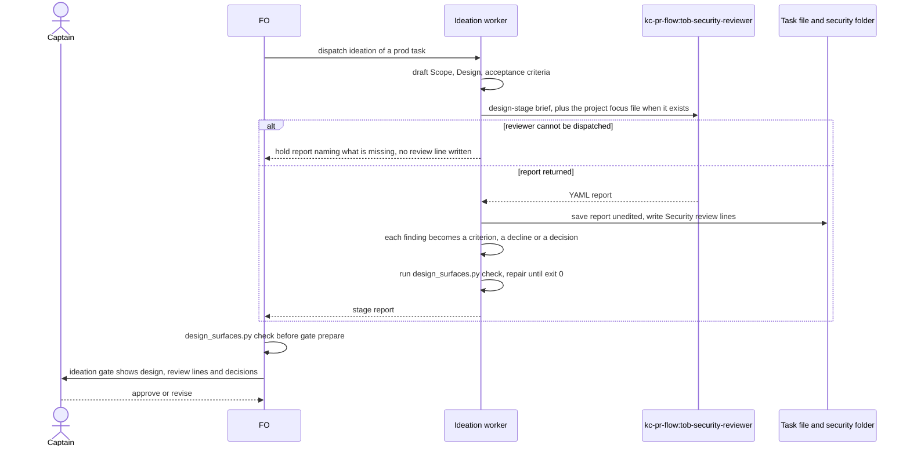
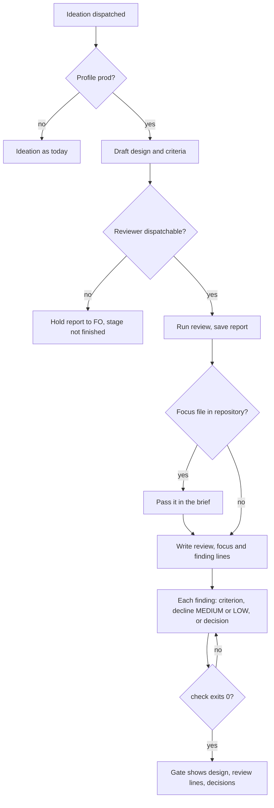

Relayed by subspace-relay's FO session on 2026-10-13, not heard directly. Captain's words as relayed: 「此外 dev2 prod profile 應該強化安全掃描這一塊，必須有至少一到兩位安全審核員，守不同關卡。你可以先給 plugin FO 發訊息讓他知道」.

## The bite

Reported by relay's FO; not re-read here. subspace-relay task `agent-front-door` (Draft PR #347, prod profile) publishes `/llms.txt`, a home-page line, and `/openapi.json` behind a build flag. Ideation, implementation and validation passed it without a security question. At the validation gate the Captain asked whether publishing `/openapi.json` was safe. A read-only `kc-pr-flow:tob-security-reviewer` pass (Sonnet, about 7 minutes) then found:

- two Medium findings no stage had raised:
  - unbounded comment writes on a share, now documented with a copyable body (a new task, `comment-admission`);
  - prompt injection: `/llms.txt` tells a shell-holding agent to print sharer-authored text with no "treat as data" warning;
- four Low findings.

## What the package says today

Read by relay's FO from kc-dev-flow-2 0.20.0; to be re-read at ideation.

- `references/profiles/prod.md` asks FO to select applicable security and privacy obligations "from the actual boundary", with specialist assurance "when evidence or risk warrants it".
- `engineering-reviewer` triggers on "a security ... decision with material residual uncertainty", not on a gate.
- No stage puts a security reviewer at a gate, so selection by judgment never fired on this task.
- relay's local policy adds "specialists are risk-selected, not convened". If this task lands, that local ruling may need the Captain's revisit; that is his call, not a sync.
- relay's CI runs no CodeQL, dependency audit or secret scan (reported).

## Starting shape, a suggestion only

- One reviewer at ideation: a threat model of the design's exposure (new public routes, documents agents act on, auth and data boundaries).
- One at validation: the diff and the served artifact. `kc-pr-flow:tob-security-reviewer` already exists and fits this one.

Upstream check owed at ideation: kc-pr-flow's security agents (`tob-security-reviewer`, `tob-actions-auditor`, `tob-supply-chain-checker`) and how `kc-pr-review` dispatches them.

## Captain amendments

### Amendment 1 — 2026-10-16, chat
Captain: 「就按照新的建議」 (chat, 2026-10-16)
Asked: 「這三個新建議可以嗎？」（第 2 項：「prod-security：用第 2 版指示上線，但 AC-3 改成「依關卡分工」，不是降低標準。」 設計關要抓到「提示注入」；驗收關要抓到「留言無上限」，上線前用 relay 那個 PR 的程式差異實際跑一次驗收關審核來證明。）
Supersedes: AC-3
Design: the r2 brief ships; AC-3 is replaced by a criterion split by gate as the asked item states
Superseded text:

**AC-3**: With the extension's ideation brief verbatim, two fresh runs of the unmodified agent on relay's agent-front-door design at the ideation gate (state commit d3fe0ced, Scope through Design, relay at 485a5042 read-only) each name a document-author prompt-injection finding and an unbounded session or comment-creation finding.
Verified by: the two saved YAML reports under `<task folder>/security/`, each read for those two findings. Falsifier: a run that names either not at all. Current evidence: P0 named both once; P1 (the draft brief) named the injection and not the creation finding once, so AC-3 is not yet met. Stop rule: the implementation worker may revise the brief at most twice, re-running AC-3 and AC-4 each time; if both still do not hold on fresh runs, it returns to FO and the extension is not shipped. A revision replaces words within AC-2's 430-word cap; a revision that needs more words returns to FO as a Needs decision.

### Amendment 2 — 2026-10-16, chat
Captain: 「照這樣做」 (chat, 2026-10-16)
Asked: 「照這個做嗎？」（「整理成第 2 號修正指示：1. prod 任務在設計階段一定跑安全審核，發現的問題寫進設計和驗收條件。有專案自己的安全清單就一起交給審核員。2. 驗收關的審核另開任務，同時做三種模型的比較，用量測結果決定預設模型和推理等級。」）
Supersedes: AC-1, AC-2, AC-4, AC-5, AC-6, AC-7
Design: the whole `## Design` is redone at ideation as the asked items state; the validation-gate review moves to backlog task prod-security-validation-gate
Superseded text:

**AC-1**: The change is one new extension file, one table row, one observer sentence and one ADR; it edits no workflow text and no script, and the extension file declares no worker instruction.
Verified by: at the candidate, `git diff origin/main --stat -- kc-dev-flow-2 docs/adr` lists `kc-dev-flow-2/extensions/security/EXTENSION.md`, `kc-dev-flow-2/README.md`, `kc-dev-flow-2/skills/observer/SKILL.md` and one new file under `docs/adr`; `git diff origin/main -- kc-dev-flow-2/references kc-dev-flow-2/scripts` prints nothing; `git grep -n -i 'instruction FO adds' -- kc-dev-flow-2/extensions/security` prints nothing; `python3 kc-dev-flow-2/scripts/lint-skills.py` prints `references/sd/workflow.md: 5495 of 5511 words`. Falsifier: any other path in the stat, a match from the grep, or a different count.

**AC-2**: The words FO reads at startup, idle on an open PR, idle on a merged PR, after the archive and at the merge ask are the base bytes; at ideation gate prep and validation gate prep a listing adopter reads at most 430 more words, a non-listing adopter none.
Verified by: the empty diff of AC-1 (the mod, `pr_watch.py` and `delivery_gate.py` are inside it) and `python3 -I -c 'print(len(open("kc-dev-flow-2/extensions/security/EXTENSION.md").read().split()))'` printing at most 430 (draft 423). Falsifier: a 431-word file fails; a changed byte under `references/sd/mods` fails the diff. Not verified: when FO opens a listed extension file.

**AC-4**: With the same brief, one fresh run on the package's archived `delivery-gate-verdict-form` design (Scope through Design, this repository at 0cdb40a7, read-only) returns no finding whose `severity:` field is HIGH or CRITICAL.
Verified by: the saved YAML report, read on the `severity:` field only (P1's one MEDIUM carried `blast_radius: HIGH`). Falsifier: a finding with `severity: HIGH` or `CRITICAL`. Current evidence: P0 returned one HIGH (fails); P1 returned none (passes, one run).

**AC-5**: The observer separates a missing review from one that did not run, and ignores a repository that did not list the extension.
Verified by: the observer skill run read-only on three fixture task states, two runs each: (a) a prod task, README listing `security`, no `Security review (ideation):` line, expects `violation` with `evidence: "absent"`; (b) the same with `not run: kc-pr-flow not installed`, expects `observed`; (c) the same as (a) with `security` unlisted, expects no line about it. Falsifier: (c) reports a violation or (b) reports one. Not yet verified: no fixture exists; the observer is a model read, so two runs each bound it and do not prove it.

**AC-6**: The ruling on D1 lands as an ADR whose Words line quotes the Captain's answer.
Verified by: `python3 <package>/scripts/adr_lint.py docs/adr --since <base> --require <reserved number>` exits 0 at the candidate. Falsifier: exit 1 for a missing record or Words line. Not yet verified: the ADR is written at implementation.

**AC-7**: Amended by Captain, amendment 1. Each gate's security review names what that gate is for. Ideation gate: with the extension's ideation brief verbatim, two fresh runs of the unmodified agent on relay's agent-front-door design at the ideation gate (state commit d3fe0ced, Scope through Design, relay at 485a5042 read-only) each name a document-author prompt-injection finding. Validation gate: one run of the agent's own contract on relay PR spacedock-dev/subspace-relay#347's diff at head 1c5b1870 names an unbounded comment or session write finding.
Verified by: the saved YAML reports under `<task folder>/security/` (`r2-ac3-relay-1.yaml`, `r2-ac3-relay-2.yaml` and the validation replay), each read for that gate's finding. Falsifier: an ideation run that does not name the injection, or a validation run that names no unbounded write. Stop rule: if the validation replay does not name the unbounded write, nothing is pushed and the task returns to FO. Not claimed: a rate; the validation gate has one run on one head.

## FO alignment

Captain confirmed in this session: 「可以」 (chat, 2026-10-16), answering FO's 「要不要用上面這 5 個當第一批？」, a list that named this task; the relayed words above are context, not his ruling.
Alignment: not needed before ideation; the Captain approved planning it.
Release review: not needed: workflow maintenance, on no journey map.
Surfaces: none
Visible change: none

## Design

Not repository files: this section is the design; implementation lands it. Redone at ideation under Captain amendment 2 (the first design, an opt-in `security` extension reviewing at two gates, is withdrawn by `Design:`; its evidence stays under `prod-security-review-gates/security/`). Sources read 2026-10-16: kc-dev-flow-2 at origin/main 7e5439be (`gh api`: `scripts/design_surfaces.py`, `scripts/lint-skills.py`, `skills/ideation/profiles/prod.md`, `references/sd/workflow.md`) and the loaded package 0.23.0 (`skills/ideation/*`, `references/profiles/prod.md`, `skills/observer`); kc-pr-flow 1.12.0 `agents/tob-security-reviewer.md` and `skills/kc-pr-review`; subspace-relay at 485a5042 and its state branch d3fe0ced by read-only `git show`; qnow `.claude/agents/security-reviewer.md` at 902341b08 by `git show`.

### PRFAQ

**Press release.** Every `prod` task's ideation now runs one security review while its design is written. The ideation worker dispatches `kc-pr-flow:tob-security-reviewer`, saves its report, and turns each finding into a design requirement with an acceptance criterion, a reasoned decline, or a question for the Captain. If the project keeps its own security focus file, the reviewer gets it too. The ideation gate shows the review as part of the design, and FO's existing pre-gate `design_surfaces.py check` refuses a prod design with no review, a review that did not run, or a finding with no disposition. Nobody judges whether a review is needed.

**FAQ.**
- *Why the ideation worker and not FO?* FO's reading of text is the step the batch's own seeds record running late or skipped. The worker already loads `skills/ideation/profiles/prod.md`, and FO already runs the check before `gate prepare` (stage text `### ideation`), so enforcement adds no word FO reads.
- *Is a reviewer built?* No. `kc-pr-flow:tob-security-reviewer` is used unchanged, at the model it declares (Sonnet). Its input contract is a PR; the design-stage brief says no PR exists. The first design's replay already showed the unmodified agent accepts that.
- *What does a finding become?* One line per listed finding under `### Security review`: `AC-<id>` (the design states the requirement and a declared criterion tests it), `declined: <reason>` (MEDIUM or LOW only), or `Needs decision: <text>`. A HIGH or CRITICAL finding is never declined by the worker.
- *What if the reviewer is missing?* The worker returns a hold report naming what is missing and writes no review line; `check` exits 1 on a missing line and on `not run`, so the gate is not presentable. It is never skipped and never clean (ADR 0013 states the same for Copilot).
- *And the validation gate?* Out of scope: backlog task `prod-security-validation-gate` (amendment 2 item 2).
- *Does a non-prod task change?* No. POC and Pilot profile files are untouched, and the check reads `profile: prod` and `status: ideation` from the frontmatter.

### Upstream and sibling check, in the chain's order

- **Spacedock 0.27.0 plugin cache**: no security reviewer, stage or gate (its `security` hits are tests, roadmap documents and a severity word; none is a mechanism).
- **kc-dev-flow-2** (origin/main 7e5439be; the loaded 0.23.0 is identical for the files named): `references/profiles/prod.md` says "specialist assurance when evidence or risk warrants it" and no stage binds one; `skills/ideation/profiles/prod.md` is 53 words with no security step; `scripts/design_surfaces.py check` already runs before `gate prepare` and already refuses missing criteria and unmoved amendments, so it is the existing enforcement point. The extension seam exists but is opt-in and read by FO; amendment 2 says "一定" (always) for prod, so it is the wrong carrier.
- **kc-pr-flow 1.12.0**: `tob-security-reviewer` (`tools: Read, Grep, Glob, Bash`, `model: sonnet`, input `pr_number`, `owner_repo`, `changed_files`, `diff_summary`, `security_tier`, YAML report with `findings[].severity`). `kc-pr-review` Step 4-ToB-a dispatches it always and sets `security_tier: full` when triage is Full. Used unchanged.
- **Adopters**: qnow and carlove each carry `.claude/agents/security-reviewer.md` (carlove: `git ls-tree` on its HEAD, qnow: 399 words, RLS/JWT/RBAC/SQL/secrets checklist); relay has none (`git ls-tree 485a5042`). A sibling's agent is not this package's contract: it is passed to the reviewer as data, not borrowed as the reviewer.
- **Conclusion**: use and extend what exists. New code: 56 added lines in `design_surfaces.py` (prototype diff against main) plus tests in the existing `test_design_surfaces.py`; new text: one section in `skills/ideation/profiles/prod.md`; no new agent, extension, script, workflow word or CI job.

### Flow





### Replay on relay task agent-front-door (read only)

Input: relay's task file as its ideation gate attempt 2 saw it (state commit d3fe0ced, `agent-front-door.md` lines 56 to 234, 3,327 words), code at 485a5042 by read-only `git`. The real bite, from relay's archived task: Draft PR #347, profile prod, no security finding through three stages; the Captain's validation-gate question led to a review that found the prompt-injection Medium and an unbounded comment and session write Medium (the new task `comment-admission`). Not re-read here: the six findings themselves.

Four runs, same prompt except the focus paragraph (prompt and inputs in `security/replay-c2/briefs.md`), `kc-pr-flow:tob-security-reviewer` unmodified, `security_tier: full`, Sonnet, run together:

| Run | Findings | Prompt injection | Unbounded session or comment write | Tokens | Seconds |
| --- | --- | --- | --- | --- | --- |
| relay 1 | 6: 1 HIGH, 1 MEDIUM, 4 LOW | HIGH | LOW: write volume bounded per session only | 128,885 | 395 |
| relay 2 | 7: 3 MEDIUM, 4 LOW | MEDIUM | MEDIUM: unmetered writes, "the design never weighs flooding" | 142,076 | 408 |
| relay + qnow focus file | 6: 1 HIGH, 2 MEDIUM, 3 LOW | HIGH | LOW: unthrottled session minting | 120,562 | 368 |
| control, no public surface | 0 | none | none | 55,856 | 197 |

Reading it. All three relay runs name both known issues; the previous brief did so in 1 of 2 runs. The control design (this repository's archived `delivery-gate-verdict-form`, code at 0cdb40a7) returns no finding, so the brief did not over-report on one no-exposure design. Two limits I will not hide: the added sentence ("a weakness already in the code is a finding when the design newly advertises, documents or routes outsiders to it") was written after I knew the miss was existing code, so it is fitted to this bite; and one run per cell is not a rate. A second design from another repository would test the fit; none was run.

Which findings become criteria. I wrote dispositions for relay run 1's six findings as a worker would (`security/replay-c2/fixture-relay-prod-task.md`): the prompt-injection HIGH becomes `AC-5` (an untrusted-document sentence, a contract test, a hostile-document run); the 30-day-session finding, the write-volume finding and the issues-repository owner each become a criterion; the public-OpenAPI finding becomes a `Needs decision:` for the Captain; the disable-does-not-gate-reads LOW is declined with a reason. The unbounded write becomes a criterion (`AC-7`: state the bound per share and name the control, or scope a cap) in the fixture. These dispositions are mine, not a worker's, so the fixture proves the check accepts a well-formed set, not that workers choose a criterion over a decline.

The focus file. In the qnow-file run the reviewer cited the file in three `clean_patterns` and one `limitations` entry and raised no finding from it: qnow's checklist (RLS, JWT, RBAC, SQL) has no analogue on relay, which has no database. That shows the file is passed and read, not that it adds findings; a qnow design would measure that, and none was replayed.

### The check, prototyped

`security/replay-c2/design_surfaces-proto.diff` (56 added lines against main's `design_surfaces.py`): for a task whose frontmatter has `profile: prod` and `status: ideation`, `check` requires a `Security review: security/ideation-<N>.yaml` line naming a `tob_security_review` report inside the task folder, a `Security focus file:` line, and one `Security finding <n>:` line per `severity:` entry in the report; each is `AC-<id>` declared in `## Acceptance criteria`, `declined: <reason>` on a MEDIUM or LOW finding, or `Needs decision: <text>`. `not run` is an error. Measured 2026-10-16: the existing `test_design_surfaces.py` from main passes 42 of 42 with the patch; `security/replay-c2/mutations.sh` on the relay fixture, run with `python3 -B`: baseline exit 0 (`6 findings, 4 acceptance criteria, 1 declined, 1 decisions`); missing line, `not run`, a finding with no line, an undeclared `AC-99`, an extra line, a path escaping the task folder, no focus line, an empty decline reason and a declined HIGH each exit 1 with a distinct message; a pilot task and a task past ideation exit 0. `status: ideation` at the pre-gate check was read from the task's own history: `gate prepare` commit 92eea2e1 and approval commit 691ea890 both carry `status: ideation`.

### Draft text the implementation lands

`kc-dev-flow-2/skills/ideation/profiles/prod.md` gains a `## Security review` section, drafted in `security/replay-c2/prod-ideation-draft.md` (606 words in the file, 53 today): dispatch rule and hold, focus file, record lines, finding dispositions, rerun rule, and the brief. `scripts/lint-skills.py` on a copy of main with that file prints `references/sd/workflow.md: 5495 of 5511 words; no unlisted passage repeats it`, exit 0 for the profile-route and frontmatter checks.

### What of the local branch is kept, rewritten or deleted

Local branch `spacedock-ensign/prod-security-review-gates` (44567c88, db8e04bc, based on 1383c911, read only here): **deleted** (not carried): `extensions/security/EXTENSION.md`, the README Extensions row and the observer sentence (the mechanism is now the prod ideation text plus the check, not an extension). **Rewritten**: ADR 0018 (the Context facts stay; the Decision becomes the prod-ideation rule), and the reviewer brief (now in `prod.md` with the tier stated and the existing-code sentence added; the validation brief moves to the backlog task). **Kept as evidence, not code**: the nine r0 to r2 reports and `runs.md`. Implementation starts a fresh branch from origin/main; deleting the old branch is FO's act.

### Words FO reads at each lifecycle moment

Counted as `len(text.split())`; `references/sd/workflow.md` is 5495 words at origin/main 7e5439be and in 0.23.0, budget 5511, and the design edits no file under `references/`.

| Moment | Text FO reads | Before | After, prod task | After, other |
| --- | --- | --- | --- | --- |
| startup | mod `kc-dev-flow-2.md` (48) plus `pr_watch.py tasks` output | 48 + output | identical | identical |
| idle, open PR | same | 48 + output | identical | identical |
| idle, merged PR | same | 48 + output | identical | identical |
| after the archive | same | 48 + output | identical | identical |
| ideation gate prep | `### ideation` (342) plus `design_surfaces.py check` output (4) | 346 | 358 (adds one 12-word output line) | 346 |
| validation gate prep | `### validation` (241) | 241 | 241 | 241 |
| merge ask | the 57-word passage plus `delivery_gate.py` exit 0 output (20) | 77 | 77 | 77 |

The ideation worker, not FO, reads the added 553 words of `prod.md` (53 to 606), on prod tasks only. Not verified: how the gate presentation renders `### Security review`; it sits inside `## Design`, which the gate presents, but FO's summary may abbreviate it.

### Cost per prod task, measured on the replay

- Reviewer: one run per design presented at an ideation gate: 120,562 to 142,076 tokens and 368 to 408 seconds on the relay design, 55,856 tokens and 197 seconds on the control (harness `subagent_tokens` and `duration_ms`). agent-front-door had 2 ideation gates, so 2 runs, 241,124 to 284,152 tokens. A rerun happens only when a revision adds a public route, an agent-read document or a data boundary.
- Worker: reads 553 more words and writes one disposition line per finding; three to seven findings per run is the dominant cost, not the tokens.
- FO: 12 more words at the ideation gate. CI: no new job; the new cases join the existing `test_design_surfaces.py` run (0.2 s for the 42 existing).

### Non-goals

The validation-gate review, the model and effort comparison (both `prod-security-validation-gate`); a scanner in an adopter's CI; `tob-actions-auditor` and `tob-supply-chain-checker`; an edit to kc-pr-flow; any change to POC or Pilot; any relay or qnow file; an observer sentence; a reviewer that holds a gate or veto (it advises; findings reach the Captain through the design).

### Limits

The report is model output on a design: it reads no code that does not exist yet and does not prove the task secure. The check proves a disposition exists for each finding, not that the criterion is good, and it counts only `findings` entries (a `limitations` entry that names an exposure is the worker's rule 4 text, unchecked). A worker could write `AC-<id>` for a criterion that does not address the finding; the Captain reads the pairing at the gate. A Codex-hosted worker cannot dispatch the Claude agent and so always holds; not verified for any adopter. An adopter without kc-pr-flow holds every prod ideation by the Captain's rule.

### Unresolved decisions (for the Captain)

Past rulings read: `git -C <state checkout> grep -n 'Override:'` (2026-10-16): prose hits only, no gate-record override; ADR 0013 followed; ADRs 0004 and 0011 not contradicted. Carried, not re-asked: the first gate's approval (「准」, 2026-10-16T04:16:51Z) accepted its recommendations, including D2 below.

1. **D1. Focus file location.** The package reads one path, `.claude/agents/security-reviewer.md` (the Claude Code agents directory, where qnow and carlove keep theirs). Recommendation: that one path. What gets worse: an adopter that keeps its security checklist elsewhere gets no focus file until it copies or renames it; a README key naming the path would fix that at the cost of one more adopter setting.
2. **D2. Relay's v1 sentence "Specialists are risk-selected, not convened"** (relay `docs/dev/README.md`, the kc-dev-flow v1 contract; relay's dev2 README has no such sentence). Carried from the first gate as recommended: narrow it so security is a standing review at prod design and the rest stay risk-selected. What gets worse: other specialists keep the same miss; relay's v1 and dev2 contracts differ.
3. **D3. Which model reviews at ideation.** Recommendation: the agent's declared Sonnet, unchanged, until `prod-security-validation-gate` reports its three-model measurement, then one decision for both gates. What gets worse: if that measurement favours a stronger model, ideation reviews run on Sonnet in the meantime; this design measured only Sonnet (4 runs).

### Batch overlap

Read 2026-10-16 from origin/main 7e5439be and the open PR list (`gh pr list`: #652 open). Of the batch, `amendment-form-check` (#650), `names-check-before-dispatch` (#649) and `dev2-laws-check` (#651) are merged; this design is built on main after them.

| File | Other task on the same file |
| --- | --- |
| `kc-dev-flow-2/scripts/design_surfaces.py` and `test_design_surfaces.py` | `amendment-form-check` (#650, merged) edited `check_amendments` in the same file: the prototype applies on main by hand merge of one hunk, no semantic overlap. `dev2-laws-check` (#651, merged) lists `design_surfaces.py check` as eligible, not wired; if it later runs `check` over archived tasks, the new rule is inert there because it needs `status: ideation` |
| `kc-dev-flow-2/skills/ideation/profiles/prod.md` | none |
| `docs/adr/` (one new file, number reserved by FO: 0018) | none known; `number_guards.py reserve` orders any other |

Not changed, so no overlap: `references/sd/workflow.md` and its word budget, `references/sd/mods/*`, `extensions/*`, `skills/observer`, README, `pr_watch.py`, `delivery_gate.py`, `dispatch_records.py` (#652 open edits that area). An ADR lands the ruling under the short title `prod-ideation-security-review-binds-design`, with no number.

## Acceptance criteria

**AC-8**: Amended by Captain, amendment 2. The change adds a security-review step to the `prod` ideation profile and enforces it in the existing check; it edits no FO-read workflow text, no extension, no other profile and no observer text.
Verified by: at the candidate, `git diff origin/main --stat` lists only `kc-dev-flow-2/skills/ideation/profiles/prod.md`, `kc-dev-flow-2/scripts/design_surfaces.py`, `kc-dev-flow-2/scripts/test_design_surfaces.py` and one new file under `docs/adr`; `git diff origin/main -- kc-dev-flow-2/references kc-dev-flow-2/extensions kc-dev-flow-2/skills/observer kc-dev-flow-2/README.md` prints nothing; `python3 kc-dev-flow-2/scripts/lint-skills.py` prints `references/sd/workflow.md: 5495 of 5511 words` (or main's value at the branch point, unchanged by the diff). Falsifier: any other path in the stat, any byte in the empty diff, or a different count. Current evidence: the prototype touches only `design_surfaces.py`; the 606-word `prod.md` draft passes `lint-skills.py` on a copy of main; the stat is not yet measured.

**AC-9**: Amended by Captain, amendment 2. A `prod` task at ideation cannot pass `design_surfaces.py check` without a recorded review that ran: no `Security review:` line, a `not run: <reason>` line, a report path that leaves the task folder, a missing `Security focus file:` line, or a file that is not a `tob_security_review` report each exit 1; a task of another profile, or past ideation, is unchanged.
Verified by: new unit cases in `test_design_surfaces.py`, one per refusal and two for the unchanged tasks, plus `security/replay-c2/mutations.sh <candidate design_surfaces.py> <fixture> <report dir>` on `fixture-relay-prod-task.md`, whose `no-line`, `not-run`, `traversal`, `no-focus`, `pilot` and `past-ideation` rows print exit 1, 1, 1, 1, 0 and 0, and `baseline` 0; the 42 existing cases still pass. Falsifier: deleting the `check_security` call from `check_task` makes `no-line` exit 0 and the unit cases fail; the implementation worker runs that mutation with `python3 -B` and caches cleared. Current evidence: prototype on main passes all of the rows above and 42 of 42 existing cases (measured 2026-10-16). Not verified: that a worker with no reviewer installed holds instead of writing a line; the check makes either route exit 1, so the gate is not presentable.

**AC-10**: Amended by Captain, amendment 2. Every finding the review lists has a visible disposition: a declared `AC-<id>`, `declined: <reason>` on a MEDIUM or LOW finding, or `Needs decision: <text>`; a HIGH or CRITICAL finding is never declined.
Verified by: the same unit cases and the `mutations.sh` rows `no-finding2`, `undeclared`, `extra`, `empty-why` and `decline-high`, each exit 1 with its own message. Falsifier: removing the severity test from the decline branch makes `decline-high` exit 0. Current evidence: prototype, all five rows exit 1 (measured 2026-10-16). Limit: the check counts `severity:` entries in `findings` only, and cannot judge that the named criterion answers the finding.

**AC-11**: Amended by Captain, amendment 2. With the brief taken verbatim from the shipped `prod.md`, two fresh runs of the unmodified agent on relay's agent-front-door design (state commit d3fe0ced, Scope through Design, relay at 485a5042 read-only) each name a document-author prompt-injection finding and an unbounded session or comment write finding at any severity; one fresh run on the archived `delivery-gate-verdict-form` design (this repository at 0cdb40a7) returns no finding whose `severity:` is HIGH or CRITICAL.
Verified by: the three saved reports under `<task folder>/security/`, each read for those findings and, on the control, on the `severity:` field only. Falsifier: a relay run that names either issue at no severity, or a control finding with `severity: HIGH` or `CRITICAL`. Current evidence: with my replay prompt (not yet the shipped text), 3 of 3 relay runs named both and the control returned 0 findings. Stop rule: the implementation worker does not revise the brief; if the falsifier fires it returns the reports to FO as a Needs decision. Not claimed: a rate, nor that the added existing-code sentence fits a second repository.

**AC-12**: Amended by Captain, amendment 2. When `.claude/agents/security-reviewer.md` exists at the repository root, the dispatch passes it to the reviewer as data and the task records its path on the `Security focus file:` line; when it does not, the line says `none`.
Verified by: one fresh run on relay's design with qnow's file (`git -C /Users/kent/conductor/repos/qnow show HEAD:.claude/agents/security-reviewer.md`) given in the shipped brief's focus paragraph: the saved report cites at least one check from the file. Falsifier: a report that never refers to the file. Current evidence: `security/replay-c2/c2-relay-focus.yaml` cites it in three `clean_patterns` and one `limitations` entry, and raised no finding from it. Not claimed: that the file adds findings; none replayed on a qnow design.

**AC-13**: Amended by Captain, amendment 2. FO reads no more words at startup, idle, the validation gate and the merge ask, and 12 more at the ideation gate of a `prod` task; the ideation worker reads at most 620 words of `prod.md`.
Verified by: the empty `references` diff of AC-8, `python3 -I -c 'print(len(open("kc-dev-flow-2/skills/ideation/profiles/prod.md").read().split()))'` printing at most 620 (draft 606), and the candidate `check` on a prod fixture printing exactly one added line of at most 12 words. Falsifier: a 621-word file, a changed byte under `references/sd/mods`, or an added output line on a pilot task. Current evidence: counts in `### Words FO reads at each lifecycle moment`; the shipped file is not yet measured.

**AC-14**: Amended by Captain, amendment 2. The ruling lands as an ADR whose Words line quotes the Captain's answer 「照這樣做」 and the question he answered.
Verified by: `python3 <package>/scripts/adr_lint.py docs/adr --since <base> --require <reserved number>` exits 0 at the candidate. Falsifier: exit 1 for a missing record or Words line. Not yet verified: the ADR is written at implementation, under the short title `prod-ideation-security-review-binds-design`.

### Feedback Cycles

- Cycle 1 (FO, 2026-10-16): Codex review on #656 cd3a5747 (review:5555775033) left one P1, to fix (a P1 blocks in every round); investigation first, then FO fix authorization, then a fresh validation recheck.
  - P1 `scripts/design_surfaces.py`: the finding count is the number of `severity:` lines, so a findings list item with no severity (a truncated or malformed report) is counted as zero findings and the prod ideation gate passes with no disposition.
- Cycle 2 (FO, 2026-10-17): Codex review round 2 on #656 1e4cd1e8 (review:5555839646) left one P2, the third report-parsing hole of one class after roborev's and round 1's P1: a `findings:` key nested under another key of the review root is read as the findings list, so `tob_security_review:` / `metadata:` / `findings: []` passes as zero findings. Circuit breaker: FO stopped the recheck of 1e4cd1e8 and asked kc-dev-flow-2:chief-engineer for the next step before any repair.
Reviewer: kc-dev-flow-2:chief-engineer opus 2026-10-17 — patch the hand YAML parser again, or change the contract so the check reads a fixed form instead of the reviewer's free YAML?
- Cycle 2, ruling (FO, 2026-10-17): chief-engineer recommended option (c), adjust: stop teaching the hand parser more shapes and accept only the reviewer's documented shape, refusing everything else (exactly one `tob_security_review:` at column 0; exactly one `findings:` line in the file, a direct child of the root; the item parser's severity count equals a plain count of `severity:` lines); measured on the 15 saved reports with 0 false holds; no Captain amendment needed (amendment 2 set no parsing method). Round 3 rule: a new finding reopens the parser only if it shows a report that wrongly passes; a false hold on the documented shape is a known limit. FO authorizes that repair; chief-engineer's measurement stands as the investigation.
- Cycle 3 (FO, 2026-10-17): Codex review round 3 on #656 a741e357 (review:5555969981) left one P1, a new class (path resolution, not report parsing), reproduced by validation-3 F1: `check_security` looks for the report at `path.parent / path.stem`, so for a folder-form task (`<slug>/index.md`) it looks under `<slug>/index/security/` instead of `<slug>/security/`, where `prod.md` tells the worker to save it. Investigation is validation-3 step 4 and the Codex reproduction; FO fix authorization, then a fresh validation recheck. Round-3 declines F2 (Polish), F3 and F4 (Deferred risk) filed as backlog task prod-security-check-round3-followups.
- Cycle 4, review (FO, 2026-10-17): Codex review round 4 on #656 44f77c1b (review:5556120681) left two P2 and no P1; declined under the round-3 rule into backlog task prod-security-check-round3-followups, each with its reason there. No repair cycle; validation-4 PASSED at 44f77c1b stands.

## Stage Report: ideation

- DONE: A design (PRFAQ and Mermaid) for which gates of a prod-profile task carry a security reviewer and what each reviews (the seed suggests a threat model at ideation and the diff plus the served artifact at validation), after the upstream check of kc-pr-flow's tob-security-reviewer, tob-actions-auditor and tob-supply-chain-checker and how kc-pr-review dispatches them; the cost per task; what happens to relay's local 'specialists are risk-selected' policy; a replay on relay task agent-front-door (read only)
  `## Design`: an opt-in `security` extension, a fresh `kc-pr-flow:tob-security-reviewer` at the ideation gate (design threat model) and the validation gate (PR head diff), served artifact dropped as no recorded bite. Chain checked: Spacedock none, kc-dev-flow-2 seam only, kc-pr-flow agent reused unchanged, qnow and carlove local agents not borrowed. Replay: four read-only design-stage runs on two designs; the first brief found both known Mediums on relay but a HIGH on a no-exposure control, the brief with an attacker boundary dropped the control HIGH and lost the creation finding (AC-3 and AC-4 not both met). Cost: 56,982 to 98,058 tokens per run measured. Relay's sentence sits in `docs/dev/README.md` (v1), not its dev2 README; its revisit trigger is not met by its letter.
- DONE: A `### Batch overlap` section naming each file the design would change and each other batch-1 task (prod-security-review-gates, dev2-laws-check, extension-instruction-reaches-dispatch, names-check-before-dispatch, amendment-form-check) that changes the same file or check, so FO can order implementation
  Four rows (the new `EXTENSION.md`, the README table row, one observer sentence, one ADR); no workflow.md or script edit, so none of the 16 words of budget headroom is used; `dev2-laws-check` row rests on its brief only; D1 option (b) would add `pr_watch.py` and order after `names-check-before-dispatch`.
- DONE: The words FO reads at each lifecycle moment, before and after, per root learning.md "Measure the words FO reads at each moment, not one file's size"
  `### Words FO reads at each lifecycle moment`: startup, idle open, idle merged, after archive and merge ask are the base bytes (48, 48, 48, 48, 77; empty diff); ideation gate prep 346 and validation gate prep 241 gain 423 only for a listing prod adopter. Counts by `len(split())`; `lint-skills.py` prints 5495 of 5511 at 1383c911. Not verified: when FO opens a listed extension file.
- DONE: Acceptance criteria with reproducible evidence clauses and falsifiers, and unresolved decisions for the Captain, each with a recommendation and what gets worse under it
  `## Acceptance criteria` AC-1 to AC-6; D1 (mechanism, a/b/c), D2 (relay's v1 sentence), D3 (the two conditional specialists), each with a recommendation and what gets worse. `python3 <package>/scripts/design_surfaces.py check <task>` (package 0.23.0): `prod-security-review-gates.md: design surfaces presentable`, exit 0. `git grep 'Override:'` finds only prose; ADR 0013 followed.
  - AC-1: not yet verified; design only, no file changed (ideation writes none).
  - AC-2: draft extension counted 423 words by `len(split())`, under the 430 cap; the diff and the shipped file not yet measured.
  - AC-3: not met on the prototypes: P0 named both findings once, P1 named the injection only once; stop rule after two revisions.
  - AC-4: P0 returned one `severity: HIGH` (fails), P1 none (passes), one run each.
  - AC-5: not yet verified; no fixture, observer file untouched at design time.
  - AC-6: not yet verified; the ADR is written at implementation.
  - Mermaid: both blocks render with mermaid-cli 12.0.0 (`npx --no-install @mermaid-js/mermaid-cli`, found under another session's `/tmp` tool directory, an unrecorded machine dependency); the render was not compared with the prose beyond reading the source.

### Summary

The design is a small opt-in extension that has FO dispatch kc-pr-flow's existing security reviewer at the two gates of a prod task, with zero edits to workflow text or scripts and no new reviewer. The replay shows the review can catch what relay's flow found only after validation, but the brief is unsettled: one prototype finds both known issues and over-reports on a design with no exposure, the other stops that and misses one. Three decisions for the Captain: how the review is made to happen (recommend the opt-in extension first), relay's v1 sentence (recommend narrowing it for security), and the two conditional specialists (recommend out of the first cut).

## Number guards

ADR: 0019
ADR 0018 was reserved here on 2026-10-16 and taken on main by another task's commit c89c3090 (docs: renumber private host decision to ADR 0018); re-reserved 2026-10-17.
## Stage Report: implementation

- FAILED: One Draft PR (feat(kc-dev-flow-2): ...) from a branch off origin/main implementing D1 to D3 as recommended: the opt-in security extension dispatching kc-pr-flow's tob-security-reviewer unchanged at the ideation and validation gates of a prod task, under the stop rule (at most two revisions of the review brief; the extension does not ship if AC-3 and AC-4 still fail); every acceptance criterion in the task file green, each falsifier shown failing by a mutation you run (python3 -B, caches cleared)
  AC-3 is not met after two brief revisions, so no push and no PR: the stop rule returns the task to FO. Local branch `spacedock-ensign/prod-security-review-gates` holds 44567c88 (r0 brief) and db8e04bc (r2 brief), off origin/main 1383c911. Runs: `prod-security-review-gates/security/runs.md` and nine saved reports.
  - AC-1 met: `git diff origin/main --stat` lists the four files only; `git diff origin/main -- kc-dev-flow-2/references kc-dev-flow-2/scripts` is empty; no `instruction FO adds` match; `lint-skills.py` exit 0 prints `references/sd/workflow.md: 5495 of 5511 words`. Mutations: a changed byte under `references/sd/mods` makes the diff 468 bytes; an added `Instruction FO adds` bullet matches the grep; one added workflow.md line prints 5498.
  - AC-2 met: extension is 429 words at db8e04bc (cap 430); mutation +3 words prints 431. FO-read words at startup, idle, merge ask are the base bytes (empty diff).
  - AC-3 NOT met. Two fresh relay runs per brief round: all six named the prompt-injection finding; none named unbounded session or comment creation as a finding in r0 or r1; r2 run 2 did (LOW), r2 run 1 listed it only under `limitations` as "Not reported as a finding". Round table in runs.md.
  - AC-4 met on all three rounds: one control run each, no `severity: HIGH` or `CRITICAL` (r0 MEDIUM/LOW, r1 LOW/LOW, r2 MEDIUM/LOW). One run per round, so this is not a rate.
  - AC-5 met as worded, with two limits: final sentence, two runs per fixture. (a) both runs `violation | evidence: "absent"` for the ideation line, validation `ok`; (b) both `observed` for `not run: kc-pr-flow not installed`, no violation; (c) no violation in either run, but run 2 of the first round and run 2 of the final round returned a `can't tell` line about the unlisted extension's validation line (the AC says "no line"; its falsifier, a violation, never fired). Mutation: the same fixture (a) run against origin/main's observer printed no security violation (`can't tell`, "this package has no `security` extension directory"); with the sentence it printed `violation`. First-round wording "for each stage that ran" made one (a) run report an implementation-stage violation; I changed the sentence to "each of its ideation and validation stages that ran" (a deviation from the design's draft text) and reran all six.
  - AC-6 met: `adr_lint.py docs/adr --since origin/main --require 0018` exit 0; mutations: Words line removed gives exit 1 `Decision needs a '**Words:**' line`; file moved away gives exit 1 `required ADR 0018 does not exist`.
- SKIPPED: No FO-read word added beyond the design; the candidate's own kc-dev-flow-2/scripts/lint-skills.py exits 0; roborev evidence= line; push without force; CI green on the PR head; CI cost measured or stated as not measured
  Push, PR, CI and CI cost skipped by the stop rule (no PR exists). Done: no FO-read word added (words table above); `lint-skills.py` exit 0; `roborev_gate.py --repo <worktree> --base 1383c911` printed `clean on db8e04bcb; evidence=roborev:706` (first run, no findings). CI cost: not measured, no workflow or job added by the diff; `kc-dev-flow-2-tests.yml` 20 suite scripts exit 0 locally, `test_sd_dispatch.py` needs `--sd-plugin-root` and was not run.

### Summary

The extension, README row, observer sentence and ADR 0018 are built and committed locally, but the brief cannot make the unmodified reviewer name the unbounded session or comment creation finding on relay's design in two runs; I used both allowed revisions and stopped. Decision for FO and the Captain: ship r2 with AC-3 amended or its Falsifier read as one run of two, take a third brief revision, or drop the extension. Run-to-run variance is unmeasured: each round is two runs, and the r2 `limitations` line shows the reviewer saw the gap and chose not to report it. Number guards: ADR 0018 (FO's reservation) used; `comment_ratio.py origin/main HEAD`: 0 code lines, 0 comment lines, 0.0%, limit not enforced under 20 lines; `doc_impact.py origin/main HEAD`: 0 documents; `design_surfaces.py check`: presentable. ADR 0018's Words line cites the gate resolution's reason (「准」) not a gate-question quote; FO should confirm the wording.

## Stage Report: implementation (cycle 2)

- DONE: Captain amendment 1 applied: AC-3 moved under it as `Superseded text:`, its replacement written as a new criterion that says 'Amended by Captain, amendment 1' (the ideation-gate review names prompt injection; the validation-gate review names unbounded comment or session writes), and kc-dev-flow-2/scripts/design_surfaces.py check exits 0
  AC-3 block moved verbatim into `### Amendment 1`; new `**AC-7**` says "Amended by Captain, amendment 1", split by gate. The candidate's `design_surfaces.py check` on the edited task prints `presentable`, exit 0; on the pre-edit copy it exits 1 (`supersedes AC-3 but it is still declared`).
- DONE: Before any push: one replay of the validation-gate review with the r2 brief on relay PR spacedock-dev/subspace-relay#347's diff (read only), recording whether it names unbounded writes, its tokens and duration; if it does not, stop and report without pushing
  Replay at relay head 1c5b1870 (the head validation cycle 1 recommended PASSED), standard tier, one run: `findings: []`, no unbounded write named, so I stopped and pushed nothing. Duration about 63 s from transcript timestamps; tokens not seen (harness line did not reach me; last request 48,496 input-side tokens, 2,368 output). Report `security/validation-replay-pr347-1c5b1870.yaml`, round in `security/runs.md`. The validation brief is the agent's own contract: the extension supplies no r2 text for validation, only the ideation brief has r2 wording.
- SKIPPED: Then one Draft PR (feat(kc-dev-flow-2): ...) from the local branch spacedock-ensign/prod-security-review-gates (r2 brief, db8e04bc) rebased or merged onto origin/main as needed without force on any shared branch, every other acceptance criterion still green, the candidate's own kc-dev-flow-2/scripts/lint-skills.py exit 0, roborev evidence= line, CI green, CI cost measured or stated as not measured
  Skipped by the checklist's stop rule: no push, no PR, no CI. Done anyway: origin/main (1383c911) is an ancestor of db8e04bc so no rebase was needed; `lint-skills.py` exit 0 (`5495 of 5511 words`); `roborev_gate.py --repo <worktree> --base 1383c911` printed `clean on db8e04bcb; evidence=roborev:725`; CI cost not measured, no workflow or job added. The worktree is unchanged since cycle 1 (clean, db8e04bc).
  - AC-7 NOT met. Ideation half: r2 runs 1 and 2 both named the prompt-injection finding (MEDIUM, MEDIUM; `runs.md`). Validation half: no unbounded write named, and the replay also named no injection finding, calling it "a general property of the design" and out of scope.
  - AC-1, AC-2, AC-4, AC-5, AC-6: unchanged from cycle 1 (met as stated there); no mutation rerun because no candidate byte changed.

### Surface of the original relay finding

Relay's own `comment-admission` task (`spacedock-state/dev2:_archive/comment-admission.md`, read only) records it as running code outside the PR's diff: a cookieless `enter` always mints a new Room session, each session may hold `MAX_SESSION_RESULTS` = 100 results of up to `MAX_RESULT_BYTES` = 128,000 bytes, nothing caps a Briefing or a Room, and ADR 43 already said "Comments are limited by none of this". The diff only added `/llms.txt` text documenting the comment loop with a copyable body. It was not found on the served `/openapi.json` (that was the Captain's question and the separate link removal). I did not re-read the original review's six findings; this rests on that task's account.

### Summary

The amendment is applied and the ideation half of AC-7 holds on two runs, but the validation half fails: the agent's own contract on #347's diff returns no findings, because the finding lives in handlers the diff does not touch and standard tier does not trace them. Per the stop rule nothing was pushed. Decision for FO and the Captain: the diff-only validation review cannot catch this class as the extension is written (a full-tier run or a brief that names the handlers a new public route reaches would be a new design, unmeasured), or drop the validation half.

## Stage Report: implementation (full-tier probe)

- DONE: One replay of kc-pr-flow:tob-security-reviewer, unmodified, at its DEEP tier (its blast-radius phase traced into code the change reaches, including code outside the diff), on relay PR spacedock-dev/subspace-relay#347 at head 1c5b1870 (read only), with the r2 validation brief; record every finding with severity, whether it names unbounded comment or session writes and whether it names the prompt injection, tokens, duration and the exact invocation, in security/runs.md and a saved report; no code change, no push, no PR
  Tier selected by the agent's own input field `security_tier: full` (its Phase 4, "full tier only"; kc-pr-review Step 4-ToB-a sets it when triage is Full); the agent's "DEEP" is only a size strategy, no scope wording added. Three findings: MEDIUM prompt injection in `public/llms.txt` (names the injection), LOW unconstrained redirect follow, LOW scratch directory not removed. No unbounded comment or session write named; its `limitations` say the session and room handlers were not traced to full depth. Model `claude-sonnet-5-5`; about 117 s from transcript timestamps; harness token line not seen (22 requests, 10,978 output tokens, last request 55,187 input-side). Files: `security/validation-replay-pr347-1c5b1870-full.yaml` and the new section in `security/runs.md` with the exact prompt. Relay read only through `git archive`, `git diff` and `gh pr view`; worktree unchanged; no push, no PR, no PR comment.

### Summary

One full-tier replay of the unmodified reviewer on #347 at 1c5b1870 named the prompt injection (MEDIUM), which the standard-tier replay did not, and still named no unbounded comment or session write. It did not search the handlers for a cap, so the result shows full tier reaches the injection but does not show it can reach the write finding. Token count is partial: the harness usage line did not reach this worker.

## Stage Report: ideation (cycle 2)

- DONE: Captain amendment 2 applied: AC-1, AC-2, AC-4, AC-5, AC-6 and AC-7 moved under it as `Superseded text:` and /Users/kent/.claude/plugins/cache/kc-claude-plugins/kc-dev-flow-2/0.23.0/scripts/design_surfaces.py check exits 0
  Six blocks moved verbatim under `### Amendment 2`; new criteria AC-8 to AC-14 say "Amended by Captain, amendment 2". 0.23.0 `check` prints `design surfaces presentable`, exit 0; origin/main 7e5439be's `check` (stricter after #650) also exit 0.
- DONE: A redone `## Design` (PRFAQ and Mermaid) in which every prod task's ideation stage runs a security review while the design is written (kc-pr-flow's tob-security-reviewer or the threat-model brief this task already measured), its findings become design requirements and acceptance criteria, an adopter's own security focus file (for example qnow's `.claude/agents/security-reviewer.md`) is passed in when present, the ideation gate shows the review, and a missing reviewer holds the stage rather than skipping it; say what of the local branch (db8e04bc: extension, README row, observer sentence, ADR 0018 draft) is kept, rewritten or deleted
  `## Design`: worker-run review in `skills/ideation/profiles/prod.md` plus a prod-only rule in the existing pre-gate `design_surfaces.py check`; no FO word, extension or observer text. Both Mermaid blocks render (mermaid-cli 11.17.0 from another session's `/tmp` tool dir, an unrecorded machine dependency). Branch: extension, README row, observer sentence deleted; ADR 0018 and the brief rewritten; reports kept as evidence.
- DONE: A replay on relay agent-front-door's design (read only) showing which findings become acceptance criteria, and whether the unbounded comment or session write becomes one
  Four fresh runs (`security/replay-c2/`): 3 of 3 relay runs name the injection and the unbounded write (LOW, MEDIUM, LOW); control 0 findings. Fixture of relay run 1's six findings: 4 become criteria incl. the unbounded write (`AC-7`), 1 decision, 1 decline; dispositions are mine, not a worker's. Limits: one run per cell; the added brief sentence was fitted after I knew the miss; qnow's file raised no finding on relay.
- DONE: The words FO reads at each lifecycle moment, before and after, and the added cost per prod task measured on the replay
  Table in `### Words FO reads at each lifecycle moment`: every moment identical except ideation gate prep 346 to 358 on a prod task; worker reads +553 words. Cost: 120,562 to 142,076 tokens and 368 to 408 s per run on relay, 55,856 and 197 s control; 2 gates is 241,124 to 284,152 tokens. No CI job.
- DONE: Acceptance criteria written as 'Amended by Captain, amendment 2', with reproducible evidence clauses and falsifiers, and unresolved decisions for the Captain, each with a recommendation and what gets worse under it
  AC-8 to AC-14 each carry `Verified by:` and `Falsifier:`; D1 focus-file path, D2 relay v1 sentence (carried from the first gate), D3 model at ideation, each with a recommendation and what gets worse.
  - AC-8: not yet verified at a candidate; prototype touches only `design_surfaces.py`, `prod.md` draft passes `lint-skills.py` on a copy of main (5495 of 5511).
  - AC-9: prototype passes the six refusal and pass rows of `mutations.sh` and 42 of 42 existing cases; the worker-holds-on-missing-reviewer behaviour is not verified.
  - AC-10: prototype, five mutation rows exit 1 with distinct messages; candidate unit cases not yet written.
  - AC-11: not yet verified on the shipped text (none written); my replay prompt gave 3 of 3 relay runs and a 0-finding control.
  - AC-12: one run cites qnow's file in 3 `clean_patterns` and 1 `limitations`; no finding from it.
  - AC-13: counts in the table; shipped `prod.md` not yet measured (draft 606 of 620).
  - AC-14: not yet verified; the ADR is written at implementation.

### Summary

The design replaces the opt-in extension with a rule in the prod ideation profile and enforces it in the check FO already runs before `gate prepare`, so no FO-read workflow word changes. The new brief named both known relay issues in 3 of 3 runs and returned nothing on a no-exposure control, but it was fitted to the known miss and each cell is one run, so AC-11 re-runs the shipped text. Main moved during ideation (#649 to #651 merged); the prototype was rebased onto main 7e5439be, so implementation must branch from current origin/main, not 1383c911. Three decisions for the Captain: focus-file path, relay's v1 sentence (carried), the ideation model.

## Stage Report: implementation (cycle 3)

- DONE: One Draft PR (feat(kc-dev-flow-2): ...) from a branch off origin/main implementing the redone design of Captain amendment 2 (a security review inside every prod task's ideation, enforced by kc-dev-flow-2/scripts/design_surfaces.py check) with AC-8 to AC-14 green; every acceptance criterion in the task file green, each falsifier shown failing by a mutation you run (python3 -B, caches cleared)
  Draft PR https://github.com/iamcxa/kc-claude-plugins/pull/656, head cd3a5747, branch `spacedock-ensign/prod-security-review-gates-v2` from origin/main 22e406b5, rebased (local, unpushed) onto the docs-only 363558f6; old branch db8e04bc untouched; pushed without force.
  - AC-8 green: `git diff origin/main --stat` lists the 3 files and ADR 0019 only; the diff over references, extensions, skills/observer and README is 0 bytes; `lint-skills.py` exit 0, `5495 of 5511 words`. Falsifier run: not mutated (a path or byte outside the list fails the stat or diff by construction).
  - AC-9 green: `mutations.sh` on the fixture prints baseline 0, no-line 1, not-run 1, traversal 1, no-focus 1, pilot 0, past-ideation 0; 60 unit cases pass (42 old). Mutation: `summary = None` for the `check_security` call makes no-line and not-run exit 0 and 26 of 60 cases fail.
  - AC-10 green: rows no-finding2, undeclared, extra, empty-why, decline-high each exit 1 with their own message. Mutation: removing the severity test makes decline-high exit 0 (and its unit case fail).
  - AC-11 green on the shipped brief, fresh runs of the unmodified agent (Sonnet, `security_tier: full`, reports `security/impl-ac11-*.yaml`): relay 1 HIGH injection plus MEDIUM unbounded sessions (106,661 tokens, 204 s); relay 2 HIGH injection plus MEDIUM unbounded sessions (114,188, 334 s); control 2 LOW, 0 HIGH or CRITICAL (55,548, 69 s). Not a rate; one run per control.
  - AC-12 green: `security/impl-ac12-relay-focus.yaml` (123,200 tokens, 405 s) cites the qnow file in finding 4's title and text and in its clean patterns; the file was passed as a scratch copy of `git show HEAD:.claude/agents/security-reviewer.md` (399 words), path `/tmp/psrg-impl/...`, not the repository path.
  - AC-13 green: `prod.md` 606 words (cap 620); `check` on the prod fixture prints one added line of 12 words, none on a pilot task. Falsifier not run as a mutation: a 621-word file or a changed `references` byte fails the count or the empty diff by construction.
  - AC-14 green: `adr_lint.py docs/adr --since origin/main --require 0019` exit 0; the Words line quotes 「照這樣做」 and 「照這個做嗎？」. Gate wording for D1 to D3 cites the 「准」 of 2026-10-17 as the gate record states; FO to confirm.
  - Beyond the prototype: roborev found three real bypasses in my scope (quoted frontmatter values, AC ids read from the whole task, a report with no `findings` entry or a quoted severity); each is fixed with a case and a mutation case that fails without it (9 mutation cases in all).
- DONE: No FO-read word added beyond the design; the candidate's own kc-dev-flow-2/scripts/lint-skills.py exits 0; roborev evidence= line; push without force; CI green on the PR head; CI cost measured or stated as not measured
  Words: 12 added at the ideation gate of a prod task, none elsewhere. `roborev_gate.py --base 22e406b5e9c0`: run 1 `findings on e12feb158; evidence=roborev:760`, run 2 `findings on fcd6147f3; evidence=roborev:761`, run 3 `clean on 652e44fc9; evidence=roborev:762` (the head was rebased afterwards onto a docs-only commit; diff unchanged). CI on cd3a5747: unit tests 56 s, version parity 55 s, route gate 5 s, GitGuardian, all pass. CI cost: no job or workflow added; the new cases' share of the 56 s job is not separately measured (0.2 s locally). 21 of 22 suites in `kc-dev-flow-2-tests.yml` ran locally exit 0; `test_sd_dispatch.py` (needs a plugin-root checkout) not run locally, passed in CI.
  `comment_ratio.py origin/main HEAD`: `code lines 0, comment lines 0, 0.0%`; `doc_impact.py`: 0 documents; `number_guards.py check`: PASS, base 22e406b5e9c0.

### Summary

The prod ideation step and its check are built from the approved design on a fresh branch, with ADR 0019, 18 new unit cases and a mutation proof per refusal; CI is green on the Draft PR and roborev is clean after two rounds of fixes. D2 (relay's v1 sentence) is not touched here: relay's FO applies it in relay. Limits stand as designed: the report is model output on a design, the check proves a disposition exists and not that it answers the finding, and AC-11 is two relay runs and one control, not a rate.

## Stage Report: implementation (cycle 4, phase 1)

- DONE: Phase 1 only: reproduce the Codex P2 on #656 head cd3a5747 (review:5555775033) as a failing test, and propose the smallest fix; report and stop, with no commit or push, until FO authorizes the fix
  Two new cases in `SecurityReviewTests` (`kc-dev-flow-2/scripts/test_design_surfaces.py`, worktree, UNCOMMITTED, only modified path); `python3 -B test_design_surfaces.py` prints 62 run, 2 failures, 60 pass. No commit, no push, no PR comment, no git config write.
  - `test_a_findings_item_with_no_severity_is_not_counted_as_zero_findings` asserts a report whose only findings item has no `severity:` is refused; it fails because `check_security` prints `0 findings` and returns no error.
  - `test_a_findings_item_with_no_severity_among_others_is_not_dropped` asserts a 4-item report with 3 severities is refused; it fails because the note prints `3 findings` and the 4th item needs no disposition.
  - Cause: `REPORT_FINDING` counts `severity:` lines, not list items under `findings:`; `REPORT_FINDINGS_KEY` only proves the key exists.
  - Proposed smallest fix (stdlib only; no module in `kc-dev-flow-2/scripts` imports yaml): in `check_security`, read the `findings:` block line by line. `findings: []` means zero. Otherwise the block runs to the next line indented no deeper than the key; each item starts at a `- ` line at the first item's indent (deeper `- ` lines inside `description: |` are not items). Count items, not severity lines; an item with no `severity:` line, or a value outside CRITICAL, HIGH, MEDIUM, LOW (quotes allowed), appends one named error (`'<report>': findings item N has no severity from CRITICAL, HIGH, MEDIUM or LOW`) and returns; a `findings:` value that is neither `[]` nor a list gets its own named error. This is also the Phase 2 shape (items, severity from the reviewer's scale, fail closed), so one parser covers both.
  - Not yet decided: whether an item's severity may sit on a later line than `- file:` (reviewer's schema lists `file` first); the parser must accept any line of the item.

### Summary

The P2 reproduces: an item with no severity is counted as zero or dropped, so the prod ideation gate passes with no disposition. The fix is one item-based parser replacing the `severity:` line count; Phase 2 (one test per malformed shape, one mutation per rule) is not started, awaiting FO authorization. State report is not committed, per the no-commit instruction.

## Stage Report: implementation (cycle 4, phase 2)

- DONE: Apply the stdlib item parser to #656's security check, with a test per malformed shape and one mutation per rule
  Commit 1e4cd1e8 on `spacedock-ensign/prod-security-review-gates-v2`, two files: `design_surfaces.py` (`report_severities` replaces the `REPORT_FINDING` severity-line count; a severity is read only at its item's key indent, on any line of the item) and `test_design_surfaces.py`. `python3 -B test_design_surfaces.py`: 76 run, OK (62 before; the two phase-1 tests now pass).
  - Shape tests: no severity (item 2 named); unknown value (SEVERE, `high`, the template `CRITICAL | HIGH | MEDIUM | LOW`, empty); truncated item (cut after file, empty severity, bare dash, bare string); findings value not a list (word, mapping, key with no items, key at end of file, items at two indents); a `- ` and a `severity: CRITICAL` line inside `description: |` are not items and the real LOW is read; severity first, last and with a trailing comment.
  - Mutations, each passes on the script and flips on its mutant: missing severity defaults to LOW (named error vanishes); scale test dropped (`SEVERE` accepted); scalar-value rule dropped (reason vanishes); empty-items rule dropped (`findings:` alone passes); `[]` literal dropped (a clean report is refused); any dash starts an item (block scalar splits); severity read at any depth (block-scalar text read as HIGH); key:value rule dropped (reason vanishes); indent rule dropped (a misindented item is swallowed); quote strip dropped (quoted HIGH refused). Two older mutation tests were rewritten for the new parser: the findings-key one (the mutant now crashes, accepted as no named refusal) and the quoted-severity one (now the quote strip).
- DONE: Rerun the suite and the saved relay and control reports
  All 19 saved reports under `security/` and `security/replay-c2/` (relay, relay-focus, control, validation replays) parse with finding counts identical to the old regex count and no problem; `lint-skills.py` prints `5495 of 5511 words`.
- DONE: roborev until clean, at most twice
  Run 1: `clean on 1e4cd1e80; evidence=roborev:764` (base 363558f6).
- DONE: Push without force and report CI on the new head
  Pushed cd3a5747..1e4cd1e8, no force. CI on 1e4cd1e8: unit tests (python3) pass 1m0s, version parity pass 55s, route gate pass 8s, GitGuardian pass. PR still Draft; no PR comment, review request or ready.

### Summary

The security check now counts `findings:` list items, requires each to carry a severity from CRITICAL, HIGH, MEDIUM, LOW, and fails closed with a named error on a non-list value, an empty key, a misindented list or an unreadable item. Limits: a hand-written line parser for the reviewer's own schema, not a YAML parser, so exotic YAML (flow-style items, anchors, tabs) is refused or misread rather than interpreted; duplicate `severity:` keys in one item take the first.

## Stage Report: implementation (cycle 5)

- DONE: Lock `report_severities` and the existence test in `check_security` to the reviewer's documented report shape with three refuse-on-mismatch rules, each a named error, one failing-first test per rule including Codex round 2's nested case (review:5555839646), one mutation per rule
  Commit 298d6bc7 (`design_surfaces.py`, `test_design_surfaces.py`): `report_shape` refuses a root count other than 1 at column 0, a `findings:` line count other than 1, and a `findings:` that is not a direct child of the root (`findings_is_direct_child`); `check_security` refuses when the plain `severity:` key-line count differs from the parsed items. No parser shape was added. New tests were run failing first (14 failed on the old code).
  - Falsifiers: second root at column 0 and an indented root line that stays allowed; `findings:` in a scalar, as a nested key and as a list-item key; nested one level (review:5555839646), nested with items, under a second top-level key, before the root, as a list item, at column 0; a `severity:` line in a block scalar or under `limitations:`. Mutations flip each rule on its own message (`len(roots) != 1`, `len(keys) != 1`, the direct-child call, `plain != len(severities)`).
  - Three old tests pinned shapes that are now refused and were rewritten: a `severity:` line inside a block scalar (now refused by the count rule), the depth mutation (now shown on an item whose only `severity:` sits in a scalar), and the indent mutation (now asserts its reason, not the outcome).
- DONE: Rerun all saved reports under prod-security-review-gates/security/ (0 false holds expected)
  All 19 reports (relay, relay-focus, control, validation replays) pass shape, parse and severity-count with 0 false holds; `mutations.sh` on `fixture-relay-prod-task.md` with c2-relay-1 as ideation-1.yaml prints baseline 0, no-line/not-run/no-finding2/undeclared/extra/traversal/no-focus/empty-why/decline-high 1, pilot/past-ideation 0.
- DONE: Commit with named files only
  298d6bc7 and a741e357, `git add` of the two script paths; hooks ran.
- DONE: Run roborev_gate.py until clean or twice
  Run 1 on 298d6bc7 (base 1e4cd1e8): High, a scalar root `tob_security_review: |` made a fake `findings:` list plain text that passed the shape rules (roborev:765). Valid, fixed in a741e357 as a fourth named rule (`root_value`: a root line with a value after its colon is refused) with a test per shape (block scalar, flow mapping, word; a trailing comment stays allowed) and a mutation. Run 2: `clean on a741e357c; evidence=roborev:766`.
- DONE: Push without force, CI green
  Pushed 1e4cd1e8..a741e357, no force. CI on a741e357: unit tests (python3) pass 1m6s, version parity pass 43s, route gate pass, GitGuardian pass. PR still Draft; no PR comment, review request or ready.
- DONE: Affected documents and AC-8 boundary
  `doc_impact.py origin/main HEAD` lists 0 documents; `git diff origin/main --stat` still lists prod.md, design_surfaces.py, test_design_surfaces.py and the ADR only; `lint-skills.py` prints `5495 of 5511 words`; 87 tests in `test_design_surfaces.py` pass, 125 with `test_comment_ratio` and `test_lint_skills`.

### Summary

The check now accepts only the reviewer's documented report shape and refuses everything else with its own error, rather than parsing more shapes. Limit (known, per the round-3 rule): a report that mentions `findings:` or `severity:` as a key-like line inside a description, or a second root-like line, is held as a false hold; none of the 19 saved reports does. One roborev finding beyond the three rules (scalar root) was fixed as a fourth refusal.

## Stage Report: validation (cycle 3)

Candidate: iamcxa/kc-claude-plugins#656 head a741e357ce35251d68f45a0064dcce8cc3178676 (Draft, base 363558f6, CI green: unit tests, version parity, route gate, GitGuardian), checked out detached in a throwaway worktree, removed after. Package scripts: `/Users/kent/.claude/plugins/cache/kc-claude-plugins/kc-dev-flow-2/0.23.0/scripts/`; `test_sd_dispatch.py` not run (needs a plugin root; not under test).

- DONE: Independent verdict on PR #656 head a741e357 against every acceptance criterion in the task file, re-running each evidence command and at least one falsifier per criterion yourself, and judging each limit the implementation report states
  **Recommend REJECTED at a741e357: one Material finding (F1).** AC-8..AC-14 otherwise hold. AC-8: 4-file stat, 0-byte diff over references, extensions, observer, README; `lint-skills.py` exit 0 `5495 of 5511`; sensitivity: the same diff over `skills/ideation` is 3,974 bytes. AC-9/10: `mutations.sh` on `c2-relay-1.yaml` as `ideation-1.yaml`: baseline 0, no-line, not-run, no-finding2, undeclared, extra, traversal, no-focus, empty-why, decline-high each exit 1 with its own message, pilot and past-ideation exit 0; 87 unit tests OK. AC-11: fresh validator runs of the unmodified agent with the shipped brief (wording diffed against the implementation's saved prompt `relay.txt`): relay 3 MEDIUM and 3 LOW naming document-author injection (MEDIUM) and unbounded session minting plus comment writes (MEDIUM), 142,839 tokens, 494 s; control 1 MEDIUM and 1 LOW, none HIGH or CRITICAL, 55,650 tokens, 81 s (`security/val-c3-relay-1.yaml`, `val-c3-control-1.yaml`). Counted as one more run each, not a rate. AC-12: `qnow` appears 4 times in `impl-ac12-relay-focus.yaml`, 0 in both plain relay reports; not re-run (a fresh run costs about 125k tokens for a citation already shown). AC-13: `prod.md` 606 words, a 15-word-longer copy counts 621; the check's added line is 12 words. AC-14: `adr_lint.py docs/adr --since 363558f6` exit 0, with `--require 0019` exit 0; the Words line quotes 「照這樣做」 and the question text of amendment 2. Also exit 0: `design_surfaces.py check` on this task, `number_guards.py check` (PASS), `doc_impact.py` (0 documents), `comment_ratio.py` (0.8%).
  Limits judged: report-shape limit (a key-like `findings:` or `severity:` line inside a description is a false hold) is bounded: 0 false holds on 19 saved and 2 fresh real reports, plain and fence-wrapped; 21 of 21 match a PyYAML read on count and severity. Model-output limit, check-proves-disposition-not-fit and Codex-host limits stand as stated; not tested here.
- DONE: recheck after Cycle 2: Codex round-2 P2 (review:5555839646) fixed by the shape-lock rules in check_security (one root line at column 0, one findings: line as a direct child of the root, severity-line count equals parsed items, root line carries no value); confirm each rule's test fails under its mutation; Cycle 1 P1 still fixed; AC-8 to AC-14 under amendment 2; confirm the ADR 0019 Words line; known limit: a key-like findings:/severity: line inside a description is a false hold (round-3 rule: reopen the parser only for a report that wrongly passes)
  Round-2 P2 and Cycle 1 P1 fixed. I mutated a scratch copy of `design_surfaces.py` (`python3 -B`) per rule: `len(roots) != 1` to `not roots`, `len(keys) != 1` to `not keys`, direct-child call to `False`, `plain != len(severities)` to `False`, root-value call to `False`: each fails exactly its own two tests (shape test plus mutation test); missing-severity default to LOW fails 4; scale test off fails 4; the other 7 mutants (call dropped 41, decline-high 3, status gate 1, profile gate 2, not-run 2, traversal 2, focus line 1) all caught. Nothing wrongly passes: 6,262 hand-accepted random line mutants of the real reports, none with a different finding count than a valid YAML read. Round-3 rule held: no parser reopen.
  **F1 is not a parser finding.** Codex round 3 (review:5555969981, P1, on a741e357) says `check_security` reads the report at `path.parent / path.stem / value`, so a folder-form task `<slug>/index.md` looks in `<slug>/index/security/`. Reproduced: the same bytes exit 0 as `a.md` and exit 1 as `d/index.md` with `'Security review:' names 'security/ideation-1.yaml', not a report file inside the task folder` (acceptance step 4).
- DONE: A minimal acceptance script the Captain can run (three to six steps, exact commands, expected output), run by you exactly as written in a fresh bash shell, with its observed output; /Users/kent/.claude/plugins/cache/kc-claude-plugins/kc-dev-flow-2/0.23.0/scripts/adr_lint.py docs/adr --since <base> with its exit code; your verdict naming the head, with findings classified by the workflow's Review-finding disposition
  Script below, run as `env -i HOME=$HOME PATH=$PATH bash --noprofile --norc <file>`; observed output below it. `adr_lint.py docs/adr --since 363558f6071379a8e34856241872f2eacd3198ab`: exit 0 (`19 ADR file(s) checked, 0 legacy`).
  **F1, Material** (recommend REJECTED at a741e357; repair is FO's call): (1) released workflow: a prod-profile task created with `spacedock new --folder` (`<slug>/index.md`), a layout `pr_watch.py` `entities()` and `replay_dispatch.py` `entity()` read; two such tasks sit in this state checkout (`journey-server-host-pilot`, `release-acceptance`, both not prod, so no prod folder-form task has hit it yet); (2) harm: the ideation gate is unpresentable and following `prod.md` cannot clear it, `<task folder>` being `<slug>/`; (3) `contract[kc-dev-flow-2/skills/ideation/profiles/prod.md#Security review]`: a report saved as `<task folder>/security/ideation-<N>.yaml` is refused for a folder-form task; (4) trigger: step 4 of the script and the Codex P1. Codex's repair shape: use `path.parent` when `path.name == "index.md"`, the sibling `<stem>` directory otherwise, with a folder-form test.
  **F2, Polish:** `kc-dev-flow-2/README.md` (the sentence that lists what the default `check` verifies) omits the prod ideation security review; `doc_impact.py` lists 0 documents and AC-8 forbids a README diff, so the sentence needs a ruling before anyone edits it.
  **F3, Deferred risk:** `check` requires the `Security focus file:` line, not that it is true (a worker could write `none` beside an existing `.claude/agents/security-reviewer.md`); material if one is observed. **F4, Deferred risk:** the hand parser reads the severity from its own line, YAML folds a deeper-indented continuation into it (seeds 7 to 9: 71 value-only disagreements, 0 count disagreements at seed 11); material if a real report carries one, none of 21 does.
  Not verified: a real ideation worker writing the lines end to end; `### Security review` rendering at the gate; the implementation's AC-11 prompt files live only in `/tmp/psrg-impl` (machine-local, not in the task folder); Codex-hosted workers.

### Minimal acceptance script

```bash
REPO=/Users/kent/conductor/workspaces/kc-claude-plugins/colombo   # needs this checkout (it holds PR #656's head) and python3
HEAD_SHA=a741e357ce35251d68f45a0064dcce8cc3178676; BASE_SHA=363558f6071379a8e34856241872f2eacd3198ab
PKG=/Users/kent/.claude/plugins/cache/kc-claude-plugins/kc-dev-flow-2/0.23.0
T=$(mktemp -d); W=$T/head; git -C "$REPO" worktree add --detach "$W" $HEAD_SHA >/dev/null 2>&1 && git -C "$W" rev-parse HEAD
echo "--- 1. four files change; no workflow, extension, observer or README byte"
git -C "$W" diff --stat $BASE_SHA HEAD | sed 's/|.*//'
git -C "$W" diff $BASE_SHA HEAD -- kc-dev-flow-2/references kc-dev-flow-2/extensions kc-dev-flow-2/skills/observer kc-dev-flow-2/README.md | wc -c
echo "--- 2. package lint from the candidate; prod.md word count"
(cd "$W" && python3 -B "$W/kc-dev-flow-2/scripts/lint-skills.py"; echo "lint exit $?")
python3 -I -c 'import sys; print(len(open(sys.argv[1]).read().split()))' "$W/kc-dev-flow-2/skills/ideation/profiles/prod.md"
echo "--- 3. the check's own tests"
(cd "$W/kc-dev-flow-2/scripts" && python3 -B test_design_surfaces.py 2>&1 | grep -E '^(Ran|OK|FAILED)')
echo "--- 4. the check on a prod task at ideation"
CHK="$W/kc-dev-flow-2/scripts/design_surfaces.py"
FM='---\ntitle: t\nprofile: prod\nstatus: ideation\n---\n\n## FO alignment\n\nSurfaces: none\nVisible change: none\n\n## Design\n\nSecurity review: security/ideation-1.yaml\nSecurity focus file: none\nSecurity finding 1: AC-1\n\n## Acceptance criteria\n\n**AC-1**: a.\nVerified by: a test.\n'
OK='tob_security_review:\n  pr: none\n  findings:\n    - file: "design"\n      severity: HIGH\n      title: "first"\n'
probe() { # label, task path under $T, report text
  mkdir -p "$T/$2/security"; printf -- "$FM" > "$T/$2/../$3"; printf -- "$4" > "$T/$2/security/ideation-1.yaml"
  python3 -I -B "$CHK" check "$T/$2/../$3"; echo "$1: exit $?"; }
probe "reviewed, flat task file" a a.md "$OK"
probe "finding item with no severity" b b.md 'tob_security_review:\n  pr: none\n  findings:\n    - file: "design"\n      title: "cut off"\n'
probe "findings nested under another key" c c.md 'tob_security_review:\n  metadata:\n    findings: []\n'
mkdir -p "$T/d"; printf -- "$FM" > "$T/d/index.md"; mkdir -p "$T/d/security"; printf -- "$OK" > "$T/d/security/ideation-1.yaml"
python3 -I -B "$CHK" check "$T/d/index.md"; echo "same bytes, folder-form task d/index.md: exit $?"
mkdir -p "$T/e"; printf -- "$FM" | sed 's/^profile: prod/profile: pilot/;/^Security/d' > "$T/e.md"
python3 -I -B "$CHK" check "$T/e.md"; echo "pilot task, no review: exit $?"
echo "--- 5. decision record, run from the candidate"
(cd "$W" && python3 -B $PKG/scripts/adr_lint.py docs/adr --since $BASE_SHA --require 0019; echo "adr_lint exit $?")
git -C "$REPO" worktree remove --force "$W"; rm -rf "$T"; echo "cleaned up"
```

Observed output, fresh shell (lint and diff-stat lines trimmed to their results):

```text
a741e357ce35251d68f45a0064dcce8cc3178676
--- 1: stat lists adr 0019, design_surfaces.py, test_design_surfaces.py, profiles/prod.md (4 files, 623 insertions, 2 deletions); byte count 0
--- 2: references/sd/workflow.md: 5495 of 5511 words; lint exit 0; prod.md word count 606
--- 3: Ran 87 tests ... OK
--- 4: reviewed, flat task file: exit 0 (security review security/ideation-1.yaml: 1 findings, 1 acceptance criteria, 0 declined, 0 decisions)
finding item with no severity: exit 1 (has findings item 1 with no 'severity:' line)
findings nested under another key: exit 1 (not a direct child of 'tob_security_review:')
same bytes, folder-form task d/index.md: exit 1 (names 'security/ideation-1.yaml', not a report file inside the task folder)   <- F1
pilot task, no review: exit 0
--- 5: 19 ADR file(s) checked, 0 legacy; adr_lint exit 0
cleaned up
```

Expected after a repair of F1: the folder-form line exits 0 with the same note line as the flat task; every other line unchanged.

### Summary

I recommend REJECTED at a741e357: the round-2 P2 and Cycle 1 P1 are fixed, each shape rule fails under its own mutation, and AC-8 to AC-14 hold, but Codex round 3's P1 reproduces: a folder-form prod task is refused for a report saved where `prod.md` tells the worker to save it. It does not reopen the parser; it is path resolution upstream of it. Two fresh reviewer runs on the shipped brief named both known relay issues and no HIGH on the control; the F1 repair needs a folder-form test and a fresh recheck.

## Stage Report: implementation (cycle 4)

- DONE: Fix the folder-form report path in `check_security`
  Commit 44f77c1b (`design_surfaces.py`): the task folder is `path.parent` when the task file is `index.md`, else `path.parent / path.stem`; pushed without force to `spacedock-ensign/prod-security-review-gates-v2`.
- DONE: Failing-first folder-form test (same report bytes pass as `<slug>.md` and as `<slug>/index.md`)
  `test_the_same_report_passes_for_a_flat_task_and_for_a_folder_task` asserts both forms return no error and an identical note; it failed before the fix with `index.md: 'Security review:' names 'security/ideation-1.yaml', not a report file inside the task folder`. `test_a_folder_task_with_no_report_in_its_own_folder_is_still_refused` asserts a folder task with no report still gets exactly that refusal, so the fix does not make the check lenient.
- DONE: Mutation that reverts the branch and fails that test with its reason
  `test_mutation_reading_a_folder_task_as_a_flat_task_refuses_its_own_report` replaces the branch with `path.parent / path.stem`; it asserts the folder task passes on the script and the mutant yields exactly one `not a report file inside the task folder` error. Suite: 90 tests OK.
- DONE: Check whether any other path in `check_security` or its callers repeats the `path.stem` form for a task folder
  `check_security` has one caller (`check_task`), and `design_surfaces.py` had one `path.stem` use, now fixed. `check_ui` resolves a relative Preview against `path.resolve().parent`, not a stem: a folder task reads it in its folder, a flat task in the state directory (not changed, not a stem defect). Outside this script, `decision_ledger.py` names a task `path.stem`, which yields `index` for a folder task; that is a task-name question outside this task, noted not changed. `pr_watch.py` already handles `index.md`.
- DONE: Rerun all saved reports under prod-security-review-gates/security/ (0 false holds expected)
  All 21 yaml reports under `security/` (including `replay-c2/`) pass shape, parse and the plain severity count: 0 false holds. The `replay-c2` relay fixture with c2-relay-1 gives the same note (6 findings, 4 AC, 1 declined, 1 decision) as a flat task and as `task/index.md`.
- DONE: Commit with named files only
  44f77c1b adds `design_surfaces.py` and `test_design_surfaces.py` only.
- DONE: Run roborev_gate.py until clean or twice
  Run 1 with base a741e357: `clean on 44f77c1b3; evidence=roborev:772`.
- DONE: Push without force; CI green
  All four checks pass on head 44f77c1b (unit tests run 39001869588, version parity, multi-profile route gate, GitGuardian).
- DONE: Commit the stage report
  This section, committed with `spacedock state commit`.

### Summary

The security check now finds the report in the task's own folder for both task forms, and the Codex round 3 P1 (review:5555969981) no longer reproduces. Nothing was changed in the report parser or its shape rules. No PR comment, review request or ready mark was made.

## Stage Report: validation (cycle 4)

Candidate: iamcxa/kc-claude-plugins#656 head 44f77c1b357f01deb965f983329e0f894be887ba (Draft, base 363558f6, `gh pr checks`: unit tests, version parity, multi-profile route gate, GitGuardian all pass). Checked out detached in throwaway worktrees under `/tmp/psrg-val4`, removed after (`git worktree list` shows none). Package scripts from `/Users/kent/.claude/plugins/cache/kc-claude-plugins/kc-dev-flow-2/0.23.0/scripts/`; `test_sd_dispatch.py` not run (needs a plugin root; not under test). Delta from the head validation-3 saw (a741e357): 3 lines in `check_security`, 20 in `test_design_surfaces.py`, nothing else.

- DONE: Independent verdict on PR #656 head 44f77c1b against every acceptance criterion in the task file, re-running each evidence command and at least one falsifier per criterion yourself, and judging each limit the implementation report states
  **Recommend PASSED at 44f77c1b: no Material finding.** AC-8: 4-file stat (ADR 0019, `design_surfaces.py`, `test_design_surfaces.py`, `prod.md`), 0-byte diff over references, extensions, observer, README; `lint-skills.py` from the candidate exit 0 `5495 of 5511`. AC-9/10: suite 90 OK (87 at a741e357); mutating the shape and severity rules in scratch copies flips exactly their own two tests each (root count, findings count, plain severity count). AC-11/12: shipped `prod.md` bytes unchanged from validation-3 (`git diff a741e357 44f77c1b` touches two scripts only), so its two fresh reviewer runs stand; not re-run. AC-13: `prod.md` 606 words (cap 620). AC-14: `adr_lint.py docs/adr --since 363558f6 --require 0019` exit 0. Also exit 0: `design_surfaces.py check` on this task, `comment_ratio.py` (4 of 487 lines, 0.8%, the four are test-file comments I read: no narration, no line citation), `doc_impact.py` (0 documents), `dispatch_records.py` (15 records complete).
  Limits judged: report-shape limit (key-like `findings:` or `severity:` line in a description is a false hold) stands as bounded by the round-3 rule; model-output, check-proves-disposition-not-fit and Codex-host limits stand as stated; none re-tested.
- DONE: recheck after Cycle 3: Codex round-3 P1 (review:5555969981, validation-3 F1) fixed in check_security by resolving the task folder as path.parent for index.md and path.parent/path.stem for a flat task; rerun validation-3 acceptance step 4 for the folder form; confirm the new folder-form test fails under its mutation; shape-lock rules and Cycle 1 P1 still fixed; AC-8 to AC-14 under amendment 2; F2 to F4 are declined to backlog task prod-security-check-round3-followups and need no recheck
  Step 4 folder form: the same report bytes that exit 1 at a741e357 as `d/index.md` now exit 0 with the flat task's note line (`1 findings, 1 acceptance criteria, 0 declined, 0 decisions`); a folder task with no report in its own folder still exits 1 with `not a report file inside the task folder`; probes `../x.yaml`, `security/../../x.yaml` and an absolute path on a folder task are each refused with that message. Mutation (scratch copy, `python3 -B`, caches absent): the shipped branch replaced by `path.parent / path.stem` fails exactly `test_the_same_report_passes_for_a_flat_task_and_for_a_folder_task` and `test_mutation_reading_a_folder_task_as_a_flat_task_refuses_its_own_report`, nothing else (2 of 90). Dropping `report.is_file()` errors `test_a_folder_task_with_no_report_in_its_own_folder_is_still_refused` and 3 others, so the "still refused" test is not lenient-blind. Always-`path.parent` fails 63 tests (flat tasks), so the flat form is covered too. Cycle 1 P1 and the round-2 shape rules: acceptance steps b and c exit 1 with their own messages; mutants above flip. F2 to F4 not rechecked, as instructed.
- DONE: A minimal acceptance script the Captain can run (three to six steps, exact commands, expected output), run by you exactly as written in a fresh bash shell, with its observed output; /Users/kent/.claude/plugins/cache/kc-claude-plugins/kc-dev-flow-2/0.23.0/scripts/adr_lint.py docs/adr --since <base> with its exit code; your verdict naming the head, with findings classified by the workflow's Review-finding disposition
  Script below, run as `env -i HOME=$HOME PATH=$PATH bash --noprofile --norc <file>`; `adr_lint.py docs/adr --since 363558f6071379a8e34856241872f2eacd3198ab`: exit 0 (`19 ADR file(s) checked, 0 legacy`; with `--require 0019` also exit 0). Verdict: **PASSED at 44f77c1b357f01deb965f983329e0f894be887ba**. Findings at this head: none new. F1 (Material at a741e357) is fixed. F2 (Polish), F3 and F4 (Deferred risk) are declined to backlog task `prod-security-check-round3-followups` and settled; not reported again.
  Not verified: a real ideation worker writing the Security lines end to end; `### Security review` rendering at the gate; AC-11 and AC-12 prompts live in `/tmp/psrg-impl` (machine-local; the reports are in the task folder); Codex-hosted workers; `decision_ledger.py` naming a folder task `index` (outside this task, noted by implementation).

### Minimal acceptance script

```bash
REPO=/Users/kent/conductor/workspaces/kc-claude-plugins/colombo   # needs this checkout (it holds PR #656's head) and python3
HEAD_SHA=44f77c1b357f01deb965f983329e0f894be887ba; BASE_SHA=363558f6071379a8e34856241872f2eacd3198ab
PKG=/Users/kent/.claude/plugins/cache/kc-claude-plugins/kc-dev-flow-2/0.23.0
T=$(mktemp -d); W=$T/head; git -C "$REPO" worktree add --detach "$W" $HEAD_SHA >/dev/null 2>&1 && git -C "$W" rev-parse HEAD
echo "--- 1. four files change; no workflow, extension, observer or README byte"
git -C "$W" diff --stat $BASE_SHA HEAD | sed 's/|.*//'
git -C "$W" diff $BASE_SHA HEAD -- kc-dev-flow-2/references kc-dev-flow-2/extensions kc-dev-flow-2/skills/observer kc-dev-flow-2/README.md | wc -c
echo "--- 2. package lint from the candidate; prod.md word count"
(cd "$W" && python3 -B "$W/kc-dev-flow-2/scripts/lint-skills.py"; echo "lint exit $?")
python3 -I -c 'import sys; print(len(open(sys.argv[1]).read().split()))' "$W/kc-dev-flow-2/skills/ideation/profiles/prod.md"
echo "--- 3. the check's own tests"
(cd "$W/kc-dev-flow-2/scripts" && python3 -B test_design_surfaces.py 2>&1 | grep -E '^(Ran|OK|FAILED)')
echo "--- 4. the check on a prod task at ideation"
CHK="$W/kc-dev-flow-2/scripts/design_surfaces.py"
FM='---\ntitle: t\nprofile: prod\nstatus: ideation\n---\n\n## FO alignment\n\nSurfaces: none\nVisible change: none\n\n## Design\n\nSecurity review: security/ideation-1.yaml\nSecurity focus file: none\nSecurity finding 1: AC-1\n\n## Acceptance criteria\n\n**AC-1**: a.\nVerified by: a test.\n'
OK='tob_security_review:\n  pr: none\n  findings:\n    - file: "design"\n      severity: HIGH\n      title: "first"\n'
probe() { # label, task path under $T, report text
  mkdir -p "$T/$2/security"; printf -- "$FM" > "$T/$2/../$3"; printf -- "$4" > "$T/$2/security/ideation-1.yaml"
  python3 -I -B "$CHK" check "$T/$2/../$3"; echo "$1: exit $?"; }
probe "reviewed, flat task file" a a.md "$OK"
probe "finding item with no severity" b b.md 'tob_security_review:\n  pr: none\n  findings:\n    - file: "design"\n      title: "cut off"\n'
probe "findings nested under another key" c c.md 'tob_security_review:\n  metadata:\n    findings: []\n'
mkdir -p "$T/d"; printf -- "$FM" > "$T/d/index.md"; mkdir -p "$T/d/security"; printf -- "$OK" > "$T/d/security/ideation-1.yaml"
python3 -I -B "$CHK" check "$T/d/index.md"; echo "same bytes, folder-form task d/index.md: exit $?"
mkdir -p "$T/f"; printf -- "$FM" > "$T/f/index.md"
python3 -I -B "$CHK" check "$T/f/index.md"; echo "folder-form task, no report in its folder: exit $?"
mkdir -p "$T/e"; printf -- "$FM" | sed 's/^profile: prod/profile: pilot/;/^Security/d' > "$T/e.md"
python3 -I -B "$CHK" check "$T/e.md"; echo "pilot task, no review: exit $?"
echo "--- 5. decision record, run from the candidate"
(cd "$W" && python3 -B $PKG/scripts/adr_lint.py docs/adr --since $BASE_SHA --require 0019; echo "adr_lint exit $?")
git -C "$REPO" worktree remove --force "$W"; rm -rf "$T"; echo "cleaned up"
```

Observed output, fresh shell (step 1 and 2 lines trimmed to their results):

```text
44f77c1b357f01deb965f983329e0f894be887ba
--- 1: stat lists adr 0019, design_surfaces.py, test_design_surfaces.py, profiles/prod.md (4 files, 640 insertions, 2 deletions); byte count 0
--- 2: references/sd/workflow.md: 5495 of 5511 words; lint exit 0; prod.md word count 606
--- 3: Ran 90 tests ... OK
--- 4: reviewed, flat task file: exit 0 (security review security/ideation-1.yaml: 1 findings, 1 acceptance criteria, 0 declined, 0 decisions)
finding item with no severity: exit 1 (has findings item 1 with no 'severity:' line)
findings nested under another key: exit 1 (not a direct child of 'tob_security_review:')
same bytes, folder-form task d/index.md: exit 0 (same note line as the flat task)
folder-form task, no report in its folder: exit 1 (not a report file inside the task folder)
pilot task, no review: exit 0
--- 5: 19 ADR file(s) checked, 0 legacy; adr_lint exit 0
cleaned up
```

Does not cover: a real ideation worker or reviewer run, the gate rendering, Codex hosts, or the shipped brief's finding quality (AC-11, carried from validation-3).

### Summary

I recommend PASSED at 44f77c1b: Codex round 3's P1 no longer reproduces (the same report bytes pass as a flat task and as `<slug>/index.md`), the new folder-form test fails under its own mutation and only that mutation's two tests, and the round-2 shape rules, the cycle 1 P1 and AC-8 to AC-14 hold on the unchanged shipped text. No new finding; F2 to F4 stay declined to backlog.
