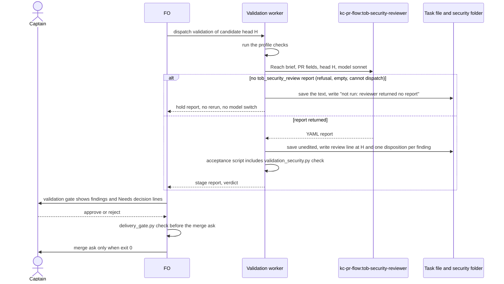
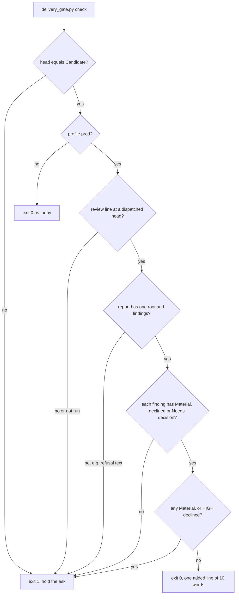

Filed on the Captain's 「照這樣做」 (chat, 2026-10-16), split out of `prod-security-review-gates` (its amendment 2 keeps the design-stage review there).

## Scope

- The bite: relay PR #347 (agent-front-door) exposed existing comment and session write paths with no cap; that code was outside the PR's diff. Replays on head 1c5b1870 with kc-pr-flow's `tob-security-reviewer` (declared model sonnet): standard tier found nothing; `security_tier: full` found the prompt injection (MEDIUM) and two LOW items but did not trace the session and room handlers, so it missed the unbounded writes. Evidence under `prod-security-review-gates/security/`.
- The bar stays the Captain's amendment-1 criterion of `prod-security-review-gates`: the validation-gate review names the unbounded comment or session write class (code reachable through the change but outside its diff).
- Evidence plan (engineering-reviewer disproof condition, 2026-10-16): at `security_tier: full`, two runs each on Sonnet 5.5, Opus 5.5 and Fable 5.1 on #347 at 1c5b1870, plus one control run per model on a PR with no public exposure; record findings, refusals (the `cyber` safety category), tokens, duration and cost per run.
- Then choose the default model and reasoning level from the measurement; a reasoning level is fixed per agent definition, so effort by complexity means two definitions FO chooses between by a written rule (for example public surface, auth or data access gets the higher one).
- Price per million tokens (input/output), Anthropic API table cached 2026-10-06: Fable 5.1 $10/$50, Opus 5.5 $4/$20, Sonnet 5.5 $2/$10.
- Gap (FO, 2026-10-17, from the Captain's question on #656): `kc-dev-flow-2/skills/ideation/profiles/prod.md` § Security review says nothing about a reviewer that refuses (the `cyber` safety category). A refusal has no `tob_security_review:` root line, so by the shape lock the check would refuse it and hold the ideation gate (inferred from the rule, not tested); the worker has no instruction and may stall or rerun. Decide the refusal handling with the model comparison.

## FO alignment

Alignment: not needed before ideation; the Captain approved filing it (his words are at the top of this file).
Release review: not needed: workflow maintenance, on no journey map.
Surfaces: none
Visible change: none

## Design

Not repository files: this section is the design; implementation lands it. Sources read 2026-10-17: kc-dev-flow-2 at origin/main 19fe3b5b (0.24.0: `skills/ideation/profiles/prod.md`, `skills/validation/{SKILL.md,principles.md,profiles/prod.md}`, `scripts/{design_surfaces,delivery_gate}.py`, `references/sd/workflow.md`), kc-pr-flow 1.12.0 `agents/tob-security-reviewer.md`, the five other batch-2 task files in the state checkout, and the archived `prod-security-review-gates` task. Measurement files are under `prod-security-validation-gate/security/` (`runs.md`, `reports/`, `prompts/`, `proto/`, `tools/`).

### The measurement first

14 runs of `kc-pr-flow:tob-security-reviewer`, `security_tier: full`, 2026-10-17. Full table with tokens, cache tokens, seconds and both dollar figures in `security/runs.md`.

| Question | Result |
| --- | --- |
| Does the agent's own contract at full tier name the unbounded outsider write on relay #347 at 1c5b1870? | No, 0 of 6: Sonnet 5.5, Opus 5.5 and Fable 5.1, two runs each, all name the prompt injection (MEDIUM) and none flags that sessions have no total cap |
| Does one added paragraph (the Reach brief, in `security/prompts/reach-relay.txt`) change that? | Yes, 4 of 4: Sonnet twice (HIGH, then MEDIUM), Opus once (MEDIUM), Fable once (HIGH); each names `share.mts` without a `rateLimit`, a new session per cookieless `enter`, 100 results per session and no total |
| Does the Reach brief over-report on a PR with no public surface (#555, a Python check script)? | No, Sonnet: `findings: []`, 20 s. Baseline controls: Sonnet MEDIUM and LOW, Opus 3 LOW, Fable 3 LOW |
| Refusals (`cyber` category)? | 0 of 14: every run returned one `tob_security_review:` report and none contains refusal prose (`grep -c -i -E "can't help|cannot assist|cyber"` is 0 on all 14) |
| Cost, Sonnet, relay-size PR | baseline 0.46 to 0.50 USD assumed (2.00 to 2.27 ceiling); Reach brief 0.86 to 0.91 (4.07 to 4.33); control 0.25 to 0.33. Opus about 3.2x the Sonnet baseline (1.48 to 1.69), Fable about 10x (4.83 to 5.18); Reach brief on Fable 12.28 |
| Seconds | Sonnet 104 to 139, Opus 249 to 314, Fable 293 to 368 on relay |

"Assumed" prices cache writes at 1.25x and reads at 0.1x the input price, and output tokens are estimated from characters; neither is verified (the transcript logs output only at stream start). "Ceiling" charges every input-side token at the full input price. Both figures rest on the task file's price table of 2026-10-06.

What this decides. The model is not the lever: three models fail the bar identically under the agent's contract and one cheap model clears it under the added paragraph. Effort was not measured: an agent definition fixes its reasoning level and the Agent tool's `effort` argument is for a Captain-named run only, so no second definition is justified by data. The default stays Sonnet.

Limits I will not hide. The Reach brief is derived from the ideation brief's sentences, which were written after the miss was known, so it is fitted to this one bite, on one PR from one repository; relay runs are 2 Sonnet, 1 Opus, 1 Fable, not a rate. The measured prompt reads an exported tree with Read and Grep; the draft below says read-only `git` at the head, so AC-2 re-runs the shipped words. A control with `findings: []` shows no over-reporting on one PR, not on prod PRs in general. Whether the unbounded-write finding is correct for relay is not mine to rule: the earlier worker recorded relay's own account of it (the `comment-admission` task), and these reports cite code that agrees (`rateLimit` only in `briefing.mts`, `reserveResultQuota` called only from `result.ts`).

### PRFAQ

**Press release.** A Production task's validation now carries one security review of the exact candidate, run with a brief that reaches past the diff: for each public route, file or document the change adds or advertises, it traces the handlers behind it and says how much an outsider can write and what caps it. The validation worker saves the report, writes one disposition per finding, and `delivery_gate.py check`, which FO already runs before the merge ask, refuses a prod task with no review, a review on another head, a refusal saved as a report, a finding with no disposition or an open Material finding. FO reads no new word.

**FAQ.**
- *Why not just use a stronger model?* Measured: Opus and Fable at full tier miss it exactly as Sonnet does (0 of 6); with the added paragraph Sonnet finds it for about 0.9 USD. A stronger model would cost 2.5x (Opus) to 14x (Fable) the Sonnet Reach-brief run for the same result.
- *Why the validation worker and not FO?* Same reason as ideation: the worker already loads `skills/validation/profiles/prod.md`; FO's words are at the budget (`workflow.md` 5495 of 5511).
- *Where is it enforced?* In `delivery_gate.py check`, run before every merge ask (workflow text, the paragraph after "Before the merge ask"), and in the worker's own minimal acceptance script, which FO runs at the validation gate. That is later than the validation gate for a worker that omits it; D3.
- *What happens when the reviewer refuses?* The worker saves the reply, writes `Security review (validation): not run: reviewer returned no report (<model>)`, and returns a hold report; it does not rerun and does not change model. The check exits 1 on that line, and on refusal text saved as a report (measured below). No refusal occurred in 14 runs, so this path has been exercised only on fixtures.
- *What if a finding is real and the Captain accepts the risk?* `Needs decision: <text>` carries his words; a HIGH or CRITICAL finding is never `declined`; `Material` stops the merge ask at this head until a repaired candidate is reviewed.
- *Does a non-prod task change?* No: the check returns before reading anything unless the frontmatter says `profile: prod`.

### Upstream and sibling check, in the chain's order

- **Spacedock 0.27.0 plugin cache**: no security reviewer, stage or gate; `grep -rIl -i -E 'security[ _-]review|security reviewer|tob_security'` hits eight test-fixture stream files only.
- **kc-dev-flow-2 0.24.0**: the ideation half exists (`skills/ideation/profiles/prod.md` `## Security review`, `design_surfaces.py check_security`, `report_shape`, `report_severities`, merged as #656). The validation half does not: `skills/validation/profiles/prod.md` is 52 words with no security step, and `delivery_gate.py` reads the validation dispatch record's `Candidate:` lines but no review. Reused unchanged: the agent, the report shape functions, the disposition grammar, `dispatched_candidates`.
- **kc-pr-flow 1.12.0**: `tob-security-reviewer` declares `model: sonnet`; `kc-pr-review` sets `security_tier: full` for Full triage. Unmodified; no kc-pr-flow edit.
- **Adopters**: relay is the bite (no `.claude/agents/security-reviewer.md`); qnow and carlove keep one, which the ideation half already passes as focus data. The validation brief does not pass it: unmeasured, so out of scope.
- **Conclusion**: use and extend. New: one 86-line script, one section of text, 11 lines in `delivery_gate.py`, one ADR. No agent, extension, workflow word or CI job beyond one test step.

### Flow





### The check, prototyped

`security/proto/validation_security.py` (86 lines) and `security/proto/delivery_gate.diff` (+11 lines in `check`: one call before the second-reviewer loop, one print before the closing `next:`), applied to a copy of 0.24.0. Measured 2026-10-17: the existing `test_delivery_gate.py` and `test_design_surfaces.py` pass 103 of 103 with the patch; `security/proto/validation_fixture.py` drives `delivery_gate.py check` through 14 cases (output in `validation_fixture.out`), using the real saved reports as fixtures: pass with three findings disposed, pass on an Opus report that carries markdown fences, pass on a zero-finding report, and exit 1 with its own message for no review line, `not run`, a review on another head, a short head, refusal text saved as the report, a finding with no line, a declined HIGH, an open Material, an extra finding line and a path outside the task folder; a pilot task exits 0 with the old 20-word output. One trap found: `python3 -I` fails the sibling import (`ModuleNotFoundError`), plain `python3 <package>/scripts/...` (what workflow.md prescribes) works; implementation must insert the script directory into `sys.path` or avoid the sibling import, and AC-6 runs both forms.

The ideation half's refusal behaviour, measured on 0.24.0 `design_surfaces.py check` (`security/tools/refusal_fixture.py`): refusal prose saved as `ideation-1.yaml` exits 1 (`0 'tob_security_review:' lines at column 0`), an empty report exits 1, no review line exits 1, `not run: reviewer refused (cyber)` exits 1 (`a missing reviewer holds the stage`), and a fabricated `findings: []` report exits 0. That last case is a limit, not a defect of this design: the check proves a report with this shape exists and is bound to a head, not that the reviewer ran, and not which brief it ran under.

### Draft text the implementation lands

- `kc-dev-flow-2/skills/validation/profiles/prod.md`: add `## Security review`, drafted in `security/proto/validation-prod-draft.md` (416 words added to 52). It carries the dispatch rule at `model: sonnet`, the record lines, the three dispositions, the refusal rule, the acceptance-script line, the rerun rule and the Reach brief.
- `kc-dev-flow-2/skills/ideation/profiles/prod.md`: add one step after the dispatch step (41 words, 606 to 647): "If the reply has no `tob_security_review:` report (a refusal or an empty reply), save the text as `security/ideation-<N>-no-report.txt`, write `Security review: not run: reviewer returned no report (<model>)` and return a hold report. Do not rerun and do not switch model." No script caps that file's words (`grep` of `kc-dev-flow-2/scripts` finds no cap; 620 was the earlier task's own acceptance criterion).
- `scripts/validation_security.py` and `scripts/test_validation_security.py` (new), `delivery_gate.py` and `test_delivery_gate.py` (+ cases), one CI step for the new test file, one ADR.

### Words FO reads at each lifecycle moment

Counted as `len(text.split())`. `references/sd/workflow.md` is 5495 words at origin/main 19fe3b5b and this design edits no file under `references/`.

| Moment | Text FO reads | Before | After, prod task | After, other |
| --- | --- | --- | --- | --- |
| startup | mod `kc-dev-flow-2.md` (48) plus `pr_watch.py tasks` output | 48 + output | identical | identical |
| idle, open PR | same | 48 + output | identical | identical |
| idle, merged PR | same | 48 + output | identical | identical |
| after the archive | same | 48 + output | identical | identical |
| ideation gate prep | `### ideation` (342) plus `design_surfaces.py check` output | 346 | 346 | 346 |
| validation gate prep | `### validation` | 241 | 241 | 241 |
| merge ask | the 57-word passage plus `delivery_gate.py` exit 0 output (measured 20 words on a pilot fixture, 30 on a prod fixture with a three-finding review) | 77 | 87 | 77 |

The validation worker, not FO, reads the added 416 words, on prod tasks only; the ideation worker 41 more. Not verified: how the validation gate presentation renders the `Security finding (validation N)` lines inside the stage report.

### Cost per prod task

Per review, Sonnet, relay-size PR: 0.86 to 0.91 USD assumed (4.07 to 4.33 ceiling), 133 to 139 s, 92k to 104k harness tokens; no-surface PR 0.25 (0.43 ceiling), 20 s. One review per candidate head: a task with a repair and a recheck pays twice. Worker: one disposition line per finding, three per relay run. FO: 10 more words at the merge ask. CI: one test step for the new file; the suite for the existing delivery-gate tests ran in 0.5 s with the patch.

### Non-goals

The ideation review (shipped, #656) beyond one refusal step; a model or effort comparison beyond the 14 runs; a scanner in an adopter's CI; `tob-actions-auditor` and `tob-supply-chain-checker`; an edit to kc-pr-flow or to `workflow.md`; any change to POC or Pilot; passing a project focus file to the validation review; a rerun or fallback model when the reviewer refuses.

### Limits

The report is model output on one head and does not prove the change secure; Reach brief evidence is one fitted PR (above). A worker that omits the review is caught at the merge ask, not at the validation gate (D3). The check cannot tell a genuine zero-finding report from a fabricated one, nor which brief produced it. A Codex-hosted worker cannot dispatch the Claude agent and so always holds; not verified for any adopter. An adopter without kc-pr-flow holds every prod validation, by the same rule as ideation. The shipped brief reads code with git commands where the measured prompt gave a file tree; AC-2 tests that difference.

### Unresolved decisions (for the Captain)

Past rulings read: `git grep -n 'Override:'` in the state checkout (2026-10-17) returns prose hits in active tasks and counts in the archive, none opened one by one and none a gate-record override on this subject; the task file's own words (「照這樣做」, 2026-10-16) and amendment 2 of the archived task (`prod-security-review-gates`: 「用量測結果決定預設模型和推理等級」) are the sources. ADR 0011 (no delegation of approval or merge) is not touched: the review advises, `delivery_gate.py` holds the ask, the Captain still decides.

1. **D1. Default model and effort.** Recommendation: `model: sonnet` for validation and (closing D3 of the archived task) ideation, one agent definition, no second definition by public surface. What gets worse: stronger models under the Reach brief are n=1 each, so a case where Opus or Fable would find more is unmeasured; effort was never varied, so "effort by complexity" stays an idea with no data behind it.
2. **D2. Refusal handling.** Recommendation: hold, no rerun and no model switch (draft text above). What gets worse: a task whose only reviewer refuses waits for the Captain to name another route; a rerun on Opus would unblock it automatically but is a policy never exercised (0 refusals in 14 runs) and would let the model that refused be swapped by a worker's judgment.
3. **D3. Enforcement point.** Recommendation: `delivery_gate.py check` at the merge ask plus the command in the worker's minimal acceptance script; no FO word changes. What gets worse: a worker that skips the review and a Captain who approves the validation gate on that report meet the hold only at the merge ask; adding an FO step to `### validation` would hold at the gate but costs about 25 words in a file 16 words under budget, against the batch's ratchet task.
4. **D4. Rerun rule.** Recommendation: a new review for every new candidate head (about 0.9 USD each on a relay-size PR). What gets worse: a docs-only repair pays again; a rule keyed to "touches a public surface" would save that but asks a worker to judge exposure, the step that failed on #347.

### Batch overlap

Read 2026-10-17 from origin/main 19fe3b5b and the five other batch-2 task files as committed or on disk in the state checkout.

Files this design would change: `kc-dev-flow-2/skills/validation/profiles/prod.md`; `kc-dev-flow-2/skills/ideation/profiles/prod.md` (one step); `kc-dev-flow-2/scripts/validation_security.py` and `test_validation_security.py` (new); `kc-dev-flow-2/scripts/delivery_gate.py` and `test_delivery_gate.py`; `.github/workflows/kc-dev-flow-2-tests.yml` (one step); `docs/adr/<reserved>.md`. Not changed: `references/sd/workflow.md` and its budget, `lint-skills.py`, `design_surfaces.py`, `references/sd/mods/*`, `extensions/*`, `skills/observer`, README, `pr_watch.py`, `dispatch_records.py`.

| File or check | Other batch-2 task on it | What collides |
| --- | --- | --- |
| `delivery_gate.py`, `test_delivery_gate.py` | `merge-gatekeeper` (new holds, points, class, record, grant line, `calibrate`) | the same `check` function: my hunk is one call before the second-reviewer loop and one print before the closing `next:`; land this task before it, as its own design recommends being last |
| `delivery_gate.dispatched_candidates` and `CANDIDATE` | `worker-loads-declared-package` (pins `CANDIDATE` by a parity test, edits `dispatch_records.py`) | I call `dispatched_candidates` and edit neither name nor behaviour; a rename there breaks my script |
| `design_surfaces.py` names `report_shape`, `report_severities`, `FM_PROFILE` | `ui-design-review-in-ideation` (parametrizes the first two) | I import them by name and edit nothing in that file; its parametrization must keep today's one-argument calls or `test_validation_security.py` fails. Its expectation that this task edits `design_surfaces.py` for refusal handling is wrong: refusal handling here is prose in `prod.md` plus the existing check, so the two tasks do not share a file |
| `skills/ideation/profiles/prod.md` | none (`ui-design-review-in-ideation` edits `skills/ideation/principles.md` and a new `design-review.md`) | none |
| `references/sd/workflow.md` and `WORKFLOW_WORD_BUDGET` | `workflow-budget-ratchet` (its table says this task "adds validation text under the budget") | it adds none: the validation words live in `skills/validation/profiles/prod.md`, so the ratchet owes this task no budget step |
| `.github/workflows/kc-dev-flow-2-tests.yml` | `special-role-triggers`, `merge-gatekeeper` (a test step each) | one-line conflicts in one list |
| `docs/adr/` | any task landing an ADR | `number_guards.py reserve` orders the numbers |

Order for FO: independent of `workflow-budget-ratchet`, `worker-loads-declared-package`, `ui-design-review-in-ideation` and `special-role-triggers`; before `merge-gatekeeper`.

## Acceptance criteria

**AC-1**: The change touches only the files in Batch overlap and edits no workflow text.
Verified by: at the candidate, `git diff origin/main --stat -- kc-dev-flow-2 .github docs/adr` lists `skills/validation/profiles/prod.md`, `skills/ideation/profiles/prod.md`, `scripts/validation_security.py`, `scripts/test_validation_security.py`, `scripts/delivery_gate.py`, `scripts/test_delivery_gate.py`, `.github/workflows/kc-dev-flow-2-tests.yml` and one new file under `docs/adr`; `git diff origin/main -- kc-dev-flow-2/references kc-dev-flow-2/extensions kc-dev-flow-2/skills/observer kc-dev-flow-2/README.md kc-dev-flow-2/scripts/design_surfaces.py` prints nothing; `python3 kc-dev-flow-2/scripts/lint-skills.py` exits 0.
Falsifier: any other path in the stat, or any output from the second command.

**AC-2**: With the brief taken verbatim from the shipped validation `prod.md`, two fresh Sonnet runs of the unmodified agent on relay #347 at 1c5b1870 (inputs rebuilt by the commands in `security/runs.md`) each name an outsider write with no total cap (sessions or comments, only a per-session bound), at any severity; one fresh Sonnet run on kc-claude-plugins #555 at a822c3e3 returns no finding whose `severity:` is HIGH or CRITICAL.
Verified by: the three saved reports, each read for that sentence and, on the control, the `severity:` fields only. Falsifier: a relay run that names only the per-session cap or nothing, or a control HIGH or CRITICAL. Current evidence: draft-brief variant 2 of 2 on relay, 0 findings on the control; baseline contract 0 of 6. Stop rule: the brief may be revised at most twice, re-running both relay runs and the control each time; if it still fails, nothing ships and the task returns to FO. Not a rate; one PR, one repository, brief fitted to the known miss.

**AC-3**: `validation_security.py` and `delivery_gate.py` refuse each hole and pass the real shapes.
Verified by: `python3 kc-dev-flow-2/scripts/test_validation_security.py` and `test_delivery_gate.py` exit 0 with at least these cases, each asserting its own message: pass with every finding disposed (the saved Sonnet reach report), pass on a report with markdown fences (the saved Opus report), pass on `findings: []`; exit 1 for no review line, `not run`, a review at another head, a short head, refusal text saved as the report, a finding with no line, a declined HIGH, an open Material, an extra finding line; exit 0 and byte-identical output for a pilot task. Mutation: removing each rule's branch fails exactly its own case, run with `python3 -B` and `__pycache__` cleared. Falsifier: a prod task with no review that exits 0, a pilot task whose output differs from `origin/main`'s on the same fixture, or a mutation that fails no test. Current evidence: the prototype's 14-case run, `security/proto/validation_fixture.out`.

**AC-4**: A reviewer that returns no report holds both gates.
Verified by: at the candidate, `design_surfaces.py check` on a prod ideation fixture and `delivery_gate.py check` on a prod validation fixture each exit 1 when the saved report is refusal prose, is empty, or the review line is `not run: reviewer returned no report (<model>)`; and `grep -c 'Do not rerun and do not switch model'` over the two `prod.md` files prints 1 for each. Falsifier: any of the three inputs exiting 0, or a count other than 1. Current evidence: ideation half measured on 0.24.0 (`security/tools/refusal_fixture.py`); validation half by the prototype. Not verified: a real refusal; none occurred in 14 runs.

**AC-5**: FO reads no new word at startup, idle, after the archive, ideation gate prep or validation gate prep, and 10 more at the merge ask of a prod task only.
Verified by: `git diff origin/main -- kc-dev-flow-2/references` prints nothing; `delivery_gate.py check` on one fixture, run before and after the change with `--head` set, prints 20 words for a pilot task both times and 30 for a prod task with a three-finding review (`wc -w`). Current evidence: the 0.24.0 `delivery_gate.py` and the patched copy both print 20 words on the pilot fixture with byte-identical output; the patched copy prints 30 on the prod fixture, the unpatched script 20. Falsifier: any byte changed under `references/`, or a differing pilot output.

**AC-6**: The validation worker's minimal acceptance script carries the check, and it runs in the form workflow.md prescribes.
Verified by: `python3 kc-dev-flow-2/scripts/validation_security.py check <fixture task>` and `python3 kc-dev-flow-2/scripts/delivery_gate.py check <fixture task> --pr o/r#1 --text-file <file> --head <sha>` both exit 0 on the passing fixture, and the shipped validation `prod.md` contains the line "Add `python3 <package>/scripts/validation_security.py check <task>` to the minimal acceptance script". Falsifier: `ModuleNotFoundError` from either (the prototype raised it under `python3 -I`), or the line missing.

**AC-7**: The PR body states the measured cost with its labels.
Verified by: the body carries the per-run table or its totals from `security/runs.md` with "assumed" and "ceiling" named, and says output tokens are estimated. Falsifier: a dollar figure without its label, or a claim of a rate from n of 2.

**AC-8**: The rulings on D1 to D4 land as an ADR whose Words line quotes the Captain's answer.
Verified by: `python3 <package>/scripts/adr_lint.py docs/adr --since <base> --require <reserved number>` exits 0 at the candidate. Falsifier: exit 1 for a missing record or Words line. Not yet verified: the ADR is written at implementation.

Not verified by this design: a real validation worker writing the lines end to end, how the gate presentation renders them, a real refusal, a Codex-hosted worker, Opus and Fable beyond one Reach-brief run each, any effort level other than the agent's own.

## Number guards

ADR: 0021

## Stage Report: ideation

- DONE: A design (PRFAQ and Mermaid) for the prod validation-gate security review that reaches code the change exposes outside its diff (bar: relay #347's unbounded comment or session write class), starting with the measurement: two runs each of kc-pr-flow:tob-security-reviewer on Sonnet 5.5, Opus 5.5 and Fable 5.1 on relay #347 at 1c5b1870 at security_tier full, plus one control run per model, recording findings, refusals (cyber category), tokens, duration and cost; then the default model and effort, and what prod.md tells a worker when the reviewer refuses. Report the measured cost before choosing
  Design above; 14 runs in `security/runs.md` (9 required plus 5 Reach-brief runs): baseline 0 of 6 name the write class on all three models, Reach brief 4 of 4, 0 refusals; cost reported before the D1 recommendation (Sonnet); effort not varied (one agent definition at the agent's own level, D1 records that); refusal rule is hold, tested on the ideation check and a prototype for validation.
- DONE: A `### Batch overlap` section naming each file the design would change and each other batch-2 task (workflow-budget-ratchet, special-role-triggers, worker-loads-declared-package, prod-security-validation-gate, ui-design-review-in-ideation, merge-gatekeeper) that changes the same file or check, so FO can order implementation
  Section above, read against the five peer task files on 2026-10-17; it corrects two peer assumptions (this task edits neither `design_surfaces.py` nor `workflow.md`).
- DONE: The words FO reads at each lifecycle moment, before and after, per root learning.md "Measure the words FO reads at each moment, not one file's size"
  Table above; only the prod merge ask changes (77 to 87 words, measured by running `delivery_gate.py` on pilot and prod fixtures).
- DONE: Acceptance criteria with reproducible evidence clauses and falsifiers, and unresolved decisions for the Captain, each with a recommendation and what gets worse under it
  AC-1 to AC-8 with falsifiers; D1 to D4 with recommendations and the cost of each.

### Summary

The model is not the lever: Sonnet 5.5, Opus 5.5 and Fable 5.1 all miss the unbounded write at full tier under the agent's own contract (0 of 6), and one added paragraph makes Sonnet, Opus and Fable find it (4 of 4) with no finding on a no-surface control, at about 0.9 USD per review on Sonnet against about 2.2 on Opus and 12 on Fable. The design puts that paragraph in `skills/validation/profiles/prod.md`, enforces the review at the merge ask through `delivery_gate.py` with no new FO word, and treats a reviewer that returns no report as a hold. Evidence is one fitted PR with no refusal ever observed, so AC-2 re-runs the shipped words and D2 stays a Captain call.

## Stage Report: implementation

- DONE: One Draft PR (feat(kc-dev-flow-2): ...) from a branch off origin/main implementing D1 to D4 as recommended: the Reach brief in kc-dev-flow-2/skills/validation/profiles/prod.md, kc-dev-flow-2/scripts/validation_security.py, the check in kc-dev-flow-2/scripts/delivery_gate.py, and the refusal step in kc-dev-flow-2/skills/ideation/profiles/prod.md; AC-2 re-runs the shipped wording at most twice per the stop rule; the ADR is the one under ## Number guards, its Words line quoting the Captain; every acceptance criterion in the task file green, each falsifier shown failing by a mutation you run (python3 -B, caches cleared)
  Draft PR https://github.com/iamcxa/kc-claude-plugins/pull/659 at fce79ed7 (base 19fe3b5b, origin/main unchanged); ADR 0021 passes `adr_lint.py docs/adr --since origin/main --require 0021`, Words 「那就照建議」 (ideation gate, 2026-10-17).
  AC-1 stat lists exactly the 8 named files, `git diff origin/main -- references extensions skills/observer README design_surfaces.py` empty. AC-2: shipped brief verbatim, 0 of 2 revisions used; relay run 1 MEDIUM and run 2 HIGH name sessions/results with no total cap, control #555 `findings: []` (reports under `prod-security-validation-gate/security/ac2/`; relay runs were rate-limit-cut and resumed, so their tokens 105,130 and 109,814 and dollars (assumed 1.39/1.37, ceiling 4.46/4.59, no output tokens) are not comparable with runs.md; control 42,843 tokens, 28 s). AC-3: both test files exit 0; each rule removed on a copy fails its own cases (validation_security: 16 rules, delivery_gate: 3). AC-4: refusal prose, empty report and `not run` exit 1 at ideation (`design_surfaces.py`) and validation (`delivery_gate.py`); `Do not rerun and do not switch model` counts 1 in each prod.md. AC-5: pilot 20 words identical before/after, prod with 3 findings 30 words, `references/` untouched. AC-6: `python3` and `python3 -I` both exit 0 for both scripts. AC-7: PR body carries the labelled table. AC-8: ADR lint exit 0.
- DONE: No FO-read word added beyond the design; the candidate's own kc-dev-flow-2/scripts/lint-skills.py exits 0; roborev evidence= line; push without force; CI green on the PR head; CI cost measured or stated as not measured
  `lint-skills.py` exit 0 (workflow.md still 5495 of 5511); roborev: `clean on f0bee5dec; evidence=roborev:793`, then `findings on 56acc5081; evidence=roborev:795` (second `severity:` line in one finding hid a HIGH; fixed in fce79ed7 with failing-first test and mutation), final `clean on fce79ed7b; evidence=roborev:796`. CI on fce79ed7: all 5 checks pass; CI cost measured: new test step within one second, unit-tests job 1m8s.
- DONE: Coordinator's three review items, judged against the design
  1. Held: an unreadable or missing `profile:` (no frontmatter, trailing comment, BOM, unknown value) now holds the ask; only `poc` and `pilot` skip. Deviation from the design sentence "returns before reading anything unless prod": existing delivery-gate fixtures gained a pilot frontmatter (CRLF is not a hole: `read_text` normalises it). 2. Held: a repeated `Security finding (validation N) n:` line is refused. 3. Held: `delivery_gate.py` passes only the Candidate the PR head equals to the check; no match holds through the existing head-mismatch problem. The loose `{40}` head regex was dropped (membership in the dispatched candidates already decides, it was untestable alone). Each has a failing-first test and a mutation that fails only its cases.
- DONE: Implementation exit checks
  `comment_ratio.py origin/main HEAD`: `code lines 381, comment lines 2, 0.5%`, maximum 5% met. `number_guards.py check`: PASS: no findings (base 19fe3b5b3d34, head fce79ed7bd8a). `design_surfaces.py check`: presentable. `doc_impact.py` listed `kc-dev-flow-2/README.md` (via the CI workflow path): unaffected: its line "Every other test file is listed in the workflow" stays true.

### Summary

The validation half of the prod security review is landed as Draft PR 659: Reach brief in the validation prod.md, `validation_security.py` called from `delivery_gate.py check` for prod tasks only, a refusal step at ideation, ADR 0021, one CI step. Shipped wording found the unbounded write on both relay runs (n of 2, one fitted PR) with no finding on the control; two automated reviews raised four fail-open holes, all fixed. Not verified: a real refusal, a real validation worker end to end, gate-presentation rendering, a Codex-hosted worker; relay AC-2 cost figures are not comparable with runs.md.

## Stage Report: validation

- DONE: Independent verdict on PR #659 head fce79ed7 against every acceptance criterion in the task file, re-running each evidence command and at least one falsifier per criterion yourself, and judging each limit the implementation report states
  Recommend PASSED at fce79ed7bd8a1ed8b8684ba2a1be25e0aefc671c (PR head confirmed by `gh pr view`, Draft, base 19fe3b5b); no Material finding. AC-1: stat lists exactly the 8 named files; `git diff 19fe3b5b -- references extensions skills/observer README design_surfaces.py` is 0 bytes; candidate `lint-skills.py` exit 0 (workflow.md 5495 of 5511). AC-2: see next item. AC-3: `test_validation_security.py` (5 tests) and `test_delivery_gate.py` (20) exit 0, `test_design_surfaces.py` 90 OK; pilot output through `delivery_gate.py` is `cmp`-identical to origin/main's script (20 words); my falsifiers are the mutations in the next item. AC-4: `grep -c 'Do not rerun and do not switch model'` is 1 in each prod.md; at validation, refusal prose, an empty report and `not run` each exit 1 (acceptance steps 5, plus an empty report and a `not run` line run by me); at ideation, the 0.24.0 `design_surfaces.py check` exits 1 on refusal prose, empty report, no line and `not run`, and exits 0 on a fabricated `findings: []` (re-ran `tools/refusal_fixture.py` against the candidate, same five outcomes). AC-5: `references/` untouched, pilot 20 words both ways, prod 30 words asserted by `test_a_prod_task_with_a_disposed_review_gets_one_more_line_of_ten_words`. AC-6: both scripts exit 0 under `python3 -B` and `-I` (pilot fixture by me; prod by the new test's subprocess case); the prod.md line is present (grep count 1). AC-7: PR body carries the labelled table ("assumed", "ceiling", output tokens estimated) and claims no rate from n of 2. AC-8: `adr_lint.py docs/adr --since 19fe3b5b --require 0021` exit 0; Words line quotes 「那就照建議」 as recorded in the ideation gate record. Also: `comment_ratio.py` 381 code lines, 2 comment lines, 0.5%, exit 0; `number_guards.py check` PASS; `dispatch_records.py` 3 records complete; `design_surfaces.py check` presentable; `doc_impact.py` lists only `kc-dev-flow-2/README.md`, recorded unaffected in the implementation report and still true (the test file is listed in the workflow). Implementation-report limits judged: fitted brief on one PR, no real refusal, no end-to-end worker, no Codex-hosted worker, gate rendering unverified, relay AC-2 costs not comparable with runs.md: each is stated in the PR body and ADR 0021 and none is claimed as tested, so none blocks. The deviation "an unreadable `profile:` holds the ask" is safer than the design sentence and changes a no-frontmatter task from exit 0 to exit 1; real tasks carry `profile:`, so I class it Polish.
- DONE: first validation; confirm the three automated security-review items (frontmatter fail-closed, duplicate Security finding lines refused, review bound to the candidate equal to the PR head) each have a failing-first test and a mutation; AC-2 re-run of the shipped wording on relay #347 within the stop rule; the added CI step and its per-PR cost; do not run Opus or Fable
  Failing-first: candidate tests against f0bee5de sources of both scripts fail 7 checks in `test_validation_security` (unreadable profile x4, duplicate line, second severity line, the mutation test) and 8 in `test_delivery_gate` (profile x2, head binding x2, wiring mutations x4). Mutations I wrote on a copy (`python3 -B`, caches cleared): `if value != "prod":` to `if False:` fails the 4 unreadable-profile cases and the 2 delivery-gate profile cases; `if count > 1:` to `if False:` fails only `duplicate finding line` (+ the built-in mutation test); `m.group(3) in candidates` to `m` and `at_head = [c ...startswith(head)]` to all candidates or the first candidate each fail the other-head cases, `test_the_review_must_be_at_the_candidate_the_pr_head_equals` and the wiring mutations. AC-2 (Sonnet only, 0 brief revisions by me; shipped brief verbatim, inputs rebuilt from a fresh clone at 1c5b1870 and `git diff a5af7e3c...1c5b1870`, 440 lines, 14 files; control from `git diff a822c3e3^ a822c3e3`, 83 additions): relay run 1 returned MEDIUM, MEDIUM, LOW and names unlimited sessions per Room (`enter` with no cookie mints a session; no `rateLimit` on share.mts) and no Room-wide result total; relay run 2 returned MEDIUM, LOW and names no cap on sessions with only the per-session 100 results bound; control #555 returned `findings: []`. Both relay runs meet the criterion and the control has no HIGH or CRITICAL; n of 2 on one fitted PR, not a rate. Harness tokens/seconds: 113,455/212, 93,380/129, 42,912/21 (dollars not computed). CI step: `test_validation_security.py` added to `unit tests (python3)`, triggers unchanged (kc-dev-flow-2 paths only); on run 39028384206 the step started and ended in the same second and the job ran 68 s (11:21:29 to 11:22:37); marginal billed minutes not measured; no new job, no model call in CI.
- DONE: A minimal acceptance script the Captain can run (three to six steps, exact commands, expected output), run by you exactly as written in a fresh bash shell, with its observed output; /Users/kent/.claude/plugins/cache/kc-claude-plugins/kc-dev-flow-2/0.24.0/scripts/adr_lint.py docs/adr --since <base> with its exit code; your verdict naming the head, with findings classified by the workflow's Review-finding disposition
  Script below, run as `env -i HOME=$HOME PATH=$PATH bash --noprofile --norc <script>`: exit 0, all six steps matched their expected lines (observed output below the script). `adr_lint.py docs/adr --since 19fe3b5b` exit 0 ("20 ADR file(s) checked, 0 legacy"), also with `--require 0021` exit 0. Verdict: PASSED recommended at fce79ed7bd8a1ed8b8684ba2a1be25e0aefc671c. Findings: Material none; Needs decision none. Deferred risk: (1) the check cannot tell a fabricated `findings: []` report from a real one or say which brief ran (known limit; would become Material if a prod task is found merged with a fabricated report); (2) a worker that skips the review meets the hold at the merge ask, not at the validation gate (D3, ruled by the Captain); (3) Opus and Fable under the Reach brief are n=1 each and no real refusal has occurred. Polish: the no-frontmatter behaviour change above; the standalone `validation_security.py check` accepts a review at any dispatched head while `delivery_gate.py` binds it to the PR head. Throwaway worktree and clones removed; reviewer subagents ran read-only against my own checkouts.

### Minimal acceptance script

Needs git with network access to github.com, python3 and the installed kc-dev-flow-2 0.24.0 package (step 6 only). Save as a file and run `bash <file>` in a fresh shell. About one minute. Does not cover: a real model review, a real validation worker end to end, how the gate shows the lines, a real refusal, a Codex-hosted worker.

```bash
#!/usr/bin/env bash
HEAD=fce79ed7bd8a1ed8b8684ba2a1be25e0aefc671c
BASE=19fe3b5b3d34d54908d288860909d10db1ae9226
CO=/tmp/psvg-accept-checkout
FX=/tmp/psvg-accept-fixture
S=$CO/kc-dev-flow-2/scripts
set -u

echo "== Step 1: check out the PR head and list what it changes (expect 8 files, no references/ file)"
rm -rf "$CO" && mkdir "$CO" && git -C "$CO" init -q && git -C "$CO" fetch -q --depth 6 https://github.com/iamcxa/kc-claude-plugins.git "$HEAD" && git -C "$CO" checkout -q --detach FETCH_HEAD || { echo "step 1 FAILED"; exit 1; }
git -C "$CO" rev-parse HEAD
git -C "$CO" diff --name-only "$BASE" | sort

echo "== Step 2: run the new and changed tests (expect Ran 5 tests ... OK, then Ran 20 tests ... OK)"
python3 -B "$S/test_validation_security.py" 2>&1 | tail -3
python3 -B "$S/test_delivery_gate.py" 2>&1 | tail -3

echo "== Step 3: a prod task whose validation has no security review (expect exit 1, a 'needs a Security review' line, a 'next: hold the ask' line)"
rm -rf "$FX" && mkdir -p "$FX/task/dispatch" "$FX/task/security"
printf '# validation dispatch\n\nCandidate: %s\n\n## Checklist\n' "$HEAD" > "$FX/task/dispatch/validation-1.md"
printf -- '---\ntitle: x\nprofile: prod\n---\n\n## Stage Report: validation\n\nVerdict: pending\n' > "$FX/task.md"
printf 'Merge ask.' > "$FX/gate.txt"
python3 -B "$S/delivery_gate.py" check "$FX/task.md" --pr o/r#1 --text-file "$FX/gate.txt" --head "$HEAD"; echo "exit=$?"

echo "== Step 4: the same task with a saved review at that head and every finding disposed (expect exit 0 and 'validation security review security/validation-1.yaml: 3 findings, 1 declined, 2 decisions')"
cat > "$FX/task/security/validation-1.yaml" <<'YAML'
tob_security_review:
  pr: 1
  findings:
    - file: "public/llms.txt"
      severity: HIGH
      title: "no total cap on sessions"
    - file: "public/llms.txt"
      severity: MEDIUM
      title: "untrusted document"
    - file: "public/llms.txt"
      severity: LOW
      title: "identity unverified"
YAML
printf 'Security review (validation): security/validation-1.yaml at %s\nSecurity finding (validation 1) 1: Needs decision: cap sessions now, or file a task\nSecurity finding (validation 1) 2: Needs decision: add the untrusted-document sentence\nSecurity finding (validation 1) 3: declined: identity is stated unverified\n' "$HEAD" >> "$FX/task.md"
python3 -B "$S/delivery_gate.py" check "$FX/task.md" --pr o/r#1 --text-file "$FX/gate.txt" --head "$HEAD"; echo "exit=$?"

echo "== Step 5: refusal text saved as the report (expect exit 1 and 'is not a tob_security_review report')"
printf "I can't help with this request.\n" > "$FX/task/security/validation-1.yaml"
python3 -B "$S/validation_security.py" check "$FX/task.md"; echo "exit=$?"

echo "== Step 6: decision record lint (expect exit 0)"
cd "$CO" && python3 -B /Users/kent/.claude/plugins/cache/kc-claude-plugins/kc-dev-flow-2/0.24.0/scripts/adr_lint.py docs/adr --since "$BASE" --require 0021; echo "exit=$?"
```

Observed output (fresh `bash --noprofile --norc`, script exit 0, 2026-10-17):

```
== Step 1: ... (expect 8 files, no references/ file)
fce79ed7bd8a1ed8b8684ba2a1be25e0aefc671c
.github/workflows/kc-dev-flow-2-tests.yml
docs/adr/0021-prod-validation-security-review-reaches-past-the-diff.md
kc-dev-flow-2/scripts/delivery_gate.py
kc-dev-flow-2/scripts/test_delivery_gate.py
kc-dev-flow-2/scripts/test_validation_security.py
kc-dev-flow-2/scripts/validation_security.py
kc-dev-flow-2/skills/ideation/profiles/prod.md
kc-dev-flow-2/skills/validation/profiles/prod.md
== Step 2: ...
Ran 5 tests in 0.437s / OK
Ran 20 tests in 0.129s / OK
== Step 3: ...
task.md: a prod task needs a 'Security review (validation):' line naming the saved report and the head it ran on
next: hold the ask; run the validation security review at this head, or tell the Captain.
exit=1
== Step 4: ...
PR head fce79ed7... equals dispatched candidate fce79ed7...; no second reviewer outcome is missing
validation security review security/validation-1.yaml: 3 findings, 1 declined, 2 decisions
next: ask for merge with this text.
exit=0
== Step 5: ...
task.md: 'security/validation-1.yaml' is not a tob_security_review report: 0 'tob_security_review:' lines at column 0, expected exactly 1
task.md: 'security/validation-1.yaml' has 0 'findings:' lines, expected exactly 1
exit=1
== Step 6: ...
20 ADR file(s) checked, 0 legacy
exit=0
```

### Summary

Recommend PASSED at fce79ed7: all eight criteria re-run with my own falsifiers, the three fail-closed items each have a failing-first test and a mutation that fails only their cases, and the shipped wording found the unbounded session and comment write on both fresh relay runs with `findings: []` on the control. No Material finding; limits are the ones the PR and ADR 0021 already state (one fitted PR, n of 2, no real refusal, fabricated empty report undetectable). The acceptance script ran unchanged in a fresh shell with every step matching.
