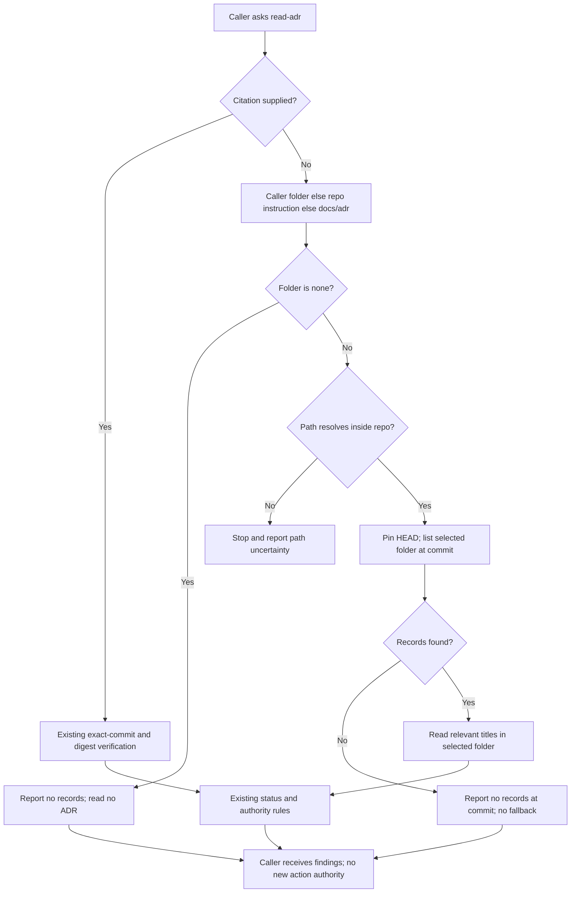

## Scope

- Source: FO, 2026-10-25. Codex review 5628338608 on iamcxa/kc-claude-plugins#713 head 037d2cf6 (2026-10-23T12:41:08Z), one P2, was not read before the merge: the merge ask named Codex as not read because `codex_review.py` reported `running` (a stuck security-review eyes reaction; see codex-review-hang-detected). The Captain approved the merge on that statement.
- Finding (P2, `kc-dev-flow-2/skills/read-adr/SKILL.md`, a byte copy of `kc-adr/skills/read-adr/SKILL.md`): when the caller passes an ADR folder other than `docs/adr`, or `ADR folder: none` (the design director does), the no-citation branch still lists `docs/adr/`, so it can miss the supplied rulings or apply rulings the caller declared absent.
- Shipped: the text is in kc-dev-flow-2 0.30.0 and kc-adr 0.2.0.
- Fix lives in kc-adr (the source); `scripts/kc-adr-copy-sync.sh sync` carries it to the dev2 copy in the same PR, per the D4 ruling of kc-adr-tools-with-dev2-copy.
- Non-goals: other read-adr wording.

- Added 2026-10-28 (FO routing): the implementation sandbox could start neither Claude (no login) nor Codex exec (in-process app-server: Operation not permitted, /tmp/read-adr-implementation-evidence/codex-runtime.stderr); validation runs both hosts' native traces from a Claude validator that can start `claude -p` and `codex exec`, as worker-knows-the-team-and-asks-early's validation did.
## FO alignment

Alignment: not needed: a reviewer finding in shipped text, fixed in its source.
Surfaces: none
Visible change: none
Release review: not needed: workflow maintenance, on no journey map.
Reviewer: kc-dev-flow-2:chief-engineer opus 2026-10-27 — batch 8 review at the ideation gate (the Captain's batch ruling 2026-10-27): per-task disposition, the Captain's decisions, order and batch risk.
Reviewer: kc-dev-flow-2:engineering-reviewer opus 2026-10-28 — do these amendments withdraw what the Captain approved, and what changes in the build? Answer: no; Amendment 1 drops only the two things the batch-8 question named and the shipped step 1 promises neither; F1 means amended AC-8's falsifier fails on Claude, so the merge ask must put F1 to the Captain as its own ruling; stale Design text is FO's to repair.

## Design

### PRFAQ

**Proposition.** A caller of either read-adr skill will get the rulings from the ADR (architecture decision record) folder it supplied. When it supplies `none`, the skill reports no records and reads none. A design director can therefore review a product without accidentally importing the repository's default-folder rulings.

**What changes?** Replace only step 1 of `Read a ruling` in `kc-adr/skills/read-adr/SKILL.md`, then carry the identical bytes to `kc-dev-flow-2/skills/read-adr/SKILL.md` with the existing sync script. No new helper, runtime hook, ADR, schema, workflow rule or CI job is needed.

**Which folder wins?** In the no-citation branch: the caller's `ADR folder:` first, otherwise the repo instruction file's folder, otherwise `docs/adr`. The literal value `none` ends this lookup; it is not a directory name or permission to discover another folder. Paths are interpreted against the already selected repository, not the process's working directory. An absolute path inside that repository is converted to its repository-relative path. An outside or ambiguous path is reported to the coordinator rather than guessed.

**What if the folder is empty or absent?** Report no records at the pinned commit, naming the selected folder. Do not fall back to `docs/adr`. This is different from `none`: `none` needs no listing at all; an absent directory was actually checked at a particular commit. Uncommitted records remain outside the existing committed-tree reading contract.

**What stays governed by the existing rule?** Explicit citations still select their exact repository, path, commit and digest, followed by the existing status and supersession checks. This fix is confined to uncited discovery; it does not redefine contradictory citation inputs, make a ruling grant permission, or change where new information belongs. The existing design-director caller already passes the needed value and requires no edit.

### Proposed step 1

The following is the proposed replacement, kept here as design text until the ideation gate is approved:

> 1. No citation: use the caller's `ADR folder:` when supplied; otherwise use the folder named by the repo's instruction file, defaulting to `docs/adr`. `none` means no records: report that and do not list or read ADRs. For a folder, set `D` to its repo-relative path in `R` (convert an absolute path inside `R`; stop and report an outside or ambiguous path). Pin `C=$(git -C "$R" rev-parse HEAD)`, record that id, list `git -C "$R" ls-tree --name-only "$C" "${D%/}/"` (titles are file names) and open the relevant ADRs there at `C`. An empty or missing folder yields no records at `C`; do not fall back to another folder.

`R` remains the repository already defined by the skill; `C` is its pinned commit; `D` is the selected folder. Treat a supplied path as data, quoted as one argument, never as shell code.

### Flow



Rendering: Mermaid CLI 12.0.0 with local Chrome rendered the exact block to PNG on 2026-10-27; visual inspection confirmed the caller, citation branch, folder precedence, `none` exit, invalid-path stop and no-fallback exit agree with the prose. The first sandboxed Chrome launch failed; the approved retry rendered successfully. Temporary rendering files are not a delivery dependency: extract this block and render with `mmdc -i flow.mmd -o flow.png` on a setup with Mermaid CLI and Chromium. No hosted artifact or application interface is introduced.

### Chain check and evidence

Checked in order: Spacedock, package source, then sibling adopters. `git fetch origin` succeeded; source is pinned to `origin/main` **8bf4f3582411e8e4238f19fbadda8ddeca6767be**, whose `kc-dev-flow-2/.claude-plugin/plugin.json` says **0.32.0**. The Codex review finding is the FO-supplied review 5628338608 on PR #713 at 037d2cf6; it was not independently fetched from GitHub in this stage.

- **Spacedock 0.27.3:** its own `skills/ensign/references/ensign-shared-core.md` and `skills/first-officer/references/fo-dispatch-core.md` own dispatch, stage reports and split-root state. A package-wide search for `ADR folder` and `read-adr` found neither. There is no folder-discovery mechanism there to repair; no Spacedock change is proposed.
- **kc-adr and dev2:** source step 1 literally lists `docs/adr/`; both skill files are byte-equal. `kc-dev-flow-2/skills/design-director/SKILL.md` explicitly invokes the skill with `ADR folder: <path>` or `none`. This is an existing broken caller/callee seam, not a missing general discovery feature. The bounded capability audit is inapplicable to this named-seam repair; these two source reads directly establish it.
- **Copy contract:** `_archive/kc-adr-tools-with-dev2-copy.md`, the Captain's single-install and copied-rule rulings plus its D4 (source change and copy ship together), require editing kc-adr and shipping both copies in one PR. `scripts/kc-adr-copy-sync.sh sync` copies the whole skill folder; `check` compares it with `diff -rq`. `.github/workflows/marketplace-parity.yml` already runs that check and its test on all PRs. This checks equality, not whether a model follows the words. No version file is hand-edited; release-please owns release versions.
- **Adopters, read only:** relay `/Users/kent/conductor/workspaces/subspace-relay/dhaka`, web `/Users/kent/conductor/workspaces/subspace-web/dev2-fo`, and qnow `/Users/kent/conductor/repos/qnow-adopt-dev2`: their `AGENTS.md` and `docs/dev2{,-poc}/README.md` were inspected. The README decision/numbering passages use `docs/adr` and allow the existing `adr-path` default; no `read-adr` folder-selection repair was found in those inspected files. This is a bounded file inspection, not a claim about every private wrapper or historical review. No adopter edit is needed.
- **Rulings:** ADR 0030 requires the design director to read the product's accepted rulings; ADR 0020 governs workflow word-budget changes. Neither is changed. State `Override:` records include the single-install decision above and the governing-ADR task's refusal of branch refs and deferral of a title hook. This design keeps the copied skill, adds no hook, and reads a pinned commit. No contrary folder-selection ruling was found in the inspected records.

### Command observation and reproducible fixture

A disposable local Git repository contained three committed Accepted records: `docs/adr/0001-default-decoy.md`, `decisions/product rules/0001-caller-rule.md`, and `policy/adr/0001-instruction-rule.md`. No project checkout was edited for the probe. With `C` pinned to that fixture's HEAD, the command `git -C "$R" ls-tree --name-only "$C" "${D%/}/"` returned:

| D | Observed output |
| --- | --- |
| `docs/adr` | `docs/adr/0001-default-decoy.md` |
| `decisions/product rules` | `decisions/product rules/0001-caller-rule.md` |
| `policy/adr` | `policy/adr/0001-instruction-rule.md` |
| `missing/adr` | empty output, exit 0 |

The unchanged step-1 command returned the default decoy even for the custom-folder case. Reproduce by creating those three files in `mktemp -d`, running `git init`, committing the three named files with fixture-only author/committer environment variables, then executing the two commands above against that fixture. No shared-repository Git configuration is needed. This proves Git's selection and the current hardcoded-command failure, not a model's folder resolution, absolute-path normalization, or `none` compliance; those remain acceptance checks below.

### Words FO reads at each lifecycle moment

Method: `len(text.split())` on the pinned source and on the proposed step-1 replacement above, excluding this task's design/report. Compare identical caller/task/PR inputs on base and candidate; variable record content is not a fixed word budget. FO means First Officer. This is a behavior repair, not a claim to reduce reading.

| Moment / passage or output | Before | Proposed after |
| --- | --- | --- |
| Startup/resume: full `references/sd/workflow.md` | 5565 words | 5565 words |
| Startup/resume: dev2 lifecycle mod | 48 words | 48 words |
| Idle on an open PR: changed rule/output words | 0 | 0; mod, `pr_watch.py`, reviewer scripts unchanged |
| Idle on a merged PR: changed rule/output words | 0 | 0; mod, `pr_watch.py`, `observer_check.py` unchanged |
| After archive: changed rule/output words | 0 | 0; learn extension, mod and learning scripts unchanged |
| Merge ask: changed rule/output words | 0 | 0; delivery authority, reviewer extensions and `delivery_gate.py` unchanged |
| Any moment an FO or worker actually invokes read-adr: complete skill | 775 words | 848 words (+73) |
| Design-director invocation: complete director skill plus read-adr | 1211 + 775 = 1986 | 1211 + 848 = 2059 (+73) |

The zero rows count the task's added reading, not the total lifecycle transcript. All pre-existing passages and outputs remain in each before/after total; their byte-identical sources and identical inputs give zero change. They were not re-executed against real PRs for this task. The skill description is unchanged, so discovery adds no words. No extra startup load is proposed. The larger skill is paid when it is invoked, including during a lifecycle moment if FO explicitly invokes it there. No CI trigger or job changes; hosted cost per PR was not measured and no savings are claimed.

### Batch overlap

Planned product files: **only** `kc-adr/skills/read-adr/SKILL.md` and `kc-dev-flow-2/skills/read-adr/SKILL.md`. State deliverable: this task's body/report only. Existing `scripts/kc-adr-copy-sync.sh`, its test and package lint are reused, not edited. No ADR number, shared ADR index, workflow word-budget table or release manifest changes in the feature PR.

| Task (purpose) | Same file or check, from current task record |
| --- | --- |
| `archive-waits-for-observer-report` (require observer before archive) | No shared edited file; owns archive/observer/learn integration. |
| `idle-hook-names-merged-tasks-without-learn` (find missed learning jobs) | No shared edited file; owns watcher/learn notices. |
| `copilot-not-run-line-carries-quote` (verify missing-review explanation) | No shared edited file; owns delivery/reviewer checks. |
| `dispatch-carries-reserved-adr-number` (carry reserved record number) | No shared edited file; owns dispatch/number checks. This task reserves no ADR. |
| `seed-check-requires-schema-fields` (validate required seed fields) | No shared edited file; shared verification tool `design_surfaces.py`. Run the assigned package's version and have FO rerun the gate check after integration. |
| `journey-probe-finds-nested-maps` (discover nested journey maps) | No shared edited file; owns adoption probe. |
| `read-adr-honors-adr-folder` (this folder-selection repair) | Sole owner of these two proposed skill-file edits. |
| `adr-required-statement` (require ruling ledger) | No shared edited file; former `adr_lint.py`/workflow work, recorded closed 2026-10-20 despite stale validation frontmatter. Do not revive it. |
| `journey-server-host-pilot` (private journey server) | No shared edited file; journey server/adapters. Common repository checks only. |
| `ops-inbox-r1-setup-and-isolation` (isolated operations inbox) | No shared edited file; kc-ops-inbox and its own ADRs/CI. May consume ADR readings; no skill edit declared. |
| `pr-review-lite-value-pilot` (bounded PR-review trial) | No shared edited file; review-capability scripts and journey artifacts. |
| `adr-silent-undo-probe` (measure protected-choice regressions) | No shared edited file; experimental harness only, moved to dev2-poc by Captain amendment. Shared measurement input: read-adr skill revision. Pin its baseline and treatment bytes; do not reinterpret runs across this change. |
| `comment-check-reaches-delivery-gate` (bind comment evidence to delivery) | No shared edited file; recorded closed 2026-10-20, archive blocked. Its prior design concerns delivery/comment checks. |
| `journey-canvas-hosted-poc` (hosted canvas experiment) | No shared edited file; disposable canvas/service proof. |

These are read-only task-record findings, not current hosted PR-diff verification. Sibling batch designs were not yet written in the records inspected; FO should recheck their final file lists before implementation. Recommended order: no file-level dependency on the six other batch tasks; land this source-and-copy change together. Coordinate the separate ADR experiment's revision pin before comparing its runs; whichever task last changes the gate-check tool requires a fresh gate check. Do not edit a sibling task to record that coordination.

## Acceptance criteria

**AC-6** Amended by Captain, amendment 1. A no-citation caller folder wins over both an instruction-file folder and `docs/adr`, and reads relevant records only at the pinned commit in that folder. Evidence: use the three-record fixture above, set the instruction file to `policy/adr`, and supply `ADR folder: decisions/product rules`; retain the actual agent tool trace, selected path, full commit, opened record and answer for both skill namespaces on Claude and Codex. Repeat with a trailing slash. Absolute-path conversion is withdrawn; require a repo-relative path and report an absolute path without conversion. Falsifier: restore the hardcoded command, or resolve from process cwd, and the chosen/opened path is wrong.

**AC-7** Amended by Captain, amendment 1. `ADR folder: none` reports no records without listing or reading either populated ADR folder, and supplies no ADR-backed ruling to the caller. Evidence: invoke each skill namespace in the same decoy-filled fixture on Claude and Codex; inspect tool traces as well as the final answer. Exercise the design-director caller on one host, Codex, once with `none` and once with the custom folder, checking `adrs_read` and cited ruling paths. Falsifier: remove the early `none` exit; any ADR enumeration/read or default-decoy ruling fails.

**AC-8** Amended by Captain, amendment 1. Omitting the caller field uses the instruction-file folder, then `docs/adr` if no folder is declared; an explicitly missing folder returns no records without fallback. An absolute, outside or ambiguous supplied path stops and reports the unresolved path, without absolute-path conversion. Evidence: repeat the fixture sessions for these inputs for both skill namespaces on Claude and Codex, retaining output and read trace; compare base/candidate using the same fixture, prompt and host settings. Falsifiers: always use docs/adr, fall back after an empty listing, or silently reinterpret an unusable path. Design-director evidence is the one-host check in AC-7.

**AC-4** Both installed skill copies carry identical corrected bytes and the remaining citation/status/writing instructions are unchanged. Evidence: in an owned implementation checkout run `scripts/kc-adr-copy-sync.sh sync`, `scripts/kc-adr-copy-sync.sh check`, `scripts/kc-adr-copy-sync.test.sh`, and `python3 kc-dev-flow-2/scripts/lint-skills.py`; compare the final diff outside step 1, and bind the host runs to those skill bytes. In a disposable copy append one byte to either skill: `check` must exit 1 naming the source/copy; resync must return 0. Falsifier: edit only the dev2 copy or suppress the comparison; the mismatch case must fail. Current evidence: pinned base copies equal and existing check is wired into CI; candidate checks are future work.

**AC-5** The delivered change has only the two planned skill files, carries the caller correction through the existing source/copy release route, and adds no routine FO lifecycle reading. Evidence: compare named files against the pinned base; independently recount the skill and the lifecycle sources/outputs under identical inputs. Expected full skill is 848 words for the exact proposal, workflow 5565, mod 48; routine lifecycle delta is zero, conditional read-adr delta +73. Falsifier: add a startup rule or fallback helper, change a lifecycle-producing script, or desynchronize the copies. Current evidence: proposal counted; delivered diff and release are not yet present. A later released version must be observed, never predicted.

## Captain decisions and limits

No additional material scope or authority question is unresolved. Recommend approving this narrow repair at the normal ideation gate, retaining the existing source/copy policy and stopping on an unusable explicit path. What gets worse: each read-adr invocation loads 73 more words; an invalid explicit path requires correction rather than silently producing default-folder records. Choosing implicit fallback would restore the reviewed failure, so it is not recommended.

This is pilot scope: no new service, secret, migration, ongoing support obligation or provider write. Native model adherence, integration checks and the release remain future evidence, not outcomes of ideation. The current proof is the source diagnosis, the local Git-command observation and the rendered design; no implementation, PR or repository-code commit was made.

## Captain amendments

### Amendment 1 — 2026-10-27, chat
Captain: 「其他全照建議」 (chat, 2026-10-27)
Asked: 「需要你決定：第 8 批的設計，照首席工程師的建議一起處理，可以嗎？6 張進入實作，1 張直接關掉，再送一份 issue 給 Spacedock。我和首席工程師都建議照這樣做。」, with this task's row 「read-adr 照指定資料夾讀 ｜ 照設計做，減少驗證 ｜ 拿掉沒人用過的絕對路徑轉換；設計總監的測試只跑一種環境」
Supersedes: the absolute-path conversion and the two-host, two-namespace design-director none evidence in AC-1, AC-2 and AC-3 (the implementation worker restates them for one host)

Superseded text:

**AC-1** A no-citation caller folder wins over both an instruction-file folder and `docs/adr`, and reads relevant records only at the pinned commit in that folder. Evidence: use the three-record fixture above, set the instruction file to `policy/adr`, and supply `ADR folder: decisions/product rules`; retain the actual agent tool trace, selected path, full commit, opened record and answer for both skill namespaces on Claude and Codex. Repeat with the absolute path to the same directory and a trailing slash. Falsifier: restore the hardcoded command, or resolve from process cwd, and the chosen/opened path is wrong. Current evidence: quoted Git listing with spaces passes; agent selection and normalization are not yet verified.

**AC-2** `ADR folder: none` reports no records without listing or reading either populated ADR folder, and supplies no ADR-backed ruling to the caller. Evidence: invoke each skill namespace in the same decoy-filled fixture on both hosts; inspect tool traces as well as the final answer. Exercise the design-director caller once with `none` and once with the custom folder, checking `adrs_read` and cited ruling paths. Falsifier: remove the early `none` exit; any ADR enumeration/read or default-decoy ruling fails. Current evidence: design only; no model/director run claimed.

**AC-3** Omitting the caller field uses the instruction-file folder, then `docs/adr` if no folder is declared; an explicitly missing folder returns no records without fallback. An outside or ambiguous supplied path stops and reports the unresolved path. Evidence: repeat the fixture sessions for these four inputs, retaining output and read trace; compare base/candidate using the same fixture, prompt and host settings. Falsifiers: always use docs/adr, fall back after an empty listing, or silently reinterpret an outside path. Current evidence: all three Git listings and the missing-folder result observed; model precedence/refusal remains unverified.

## Stage Report: ideation

- DONE: A design for the read-adr skill (kc-adr's skill and the kc-dev-flow-2 copy) to list the ADR folder its caller names and to treat none as no records, read from the Codex P2 on iamcxa/kc-claude-plugins#713, with how the two copies stay identical
  Source 8bf4f358 (dev2 0.32.0) confirms FO's supplied finding; PRFAQ, rendered Mermaid and exact proposed step reuse source-first sync/check. Git fixture selects the custom folder; the hardcoded base selects its default decoy.
- DONE: A `### Batch overlap` section naming each file the design would change and each other batch task (archive-waits-for-observer-report, idle-hook-names-merged-tasks-without-learn, copilot-not-run-line-carries-quote, dispatch-carries-reserved-adr-number, seed-check-requires-schema-fields, journey-probe-finds-nested-maps, read-adr-honors-adr-folder) and live task of other sessions (adr-required-statement, journey-server-host-pilot, ops-inbox-r1-setup-and-isolation, pr-review-lite-value-pilot, adr-silent-undo-probe, comment-check-reaches-delivery-gate, journey-canvas-hosted-poc (driven by other sessions; read only)) that changes the same file or check, so FO can order implementation
  All named records inspected; only two skill files proposed, shared design-check/version-pinning dependencies recorded, stale closed-task frontmatter distinguished from Captain closure.
- DONE: The words FO reads at each lifecycle moment, before and after, per root learning.md "Measure the words FO reads at each moment, not one file's size"
  Same-input lifecycle source/output delta 0; full workflow 5565 to 5565, mod 48 to 48; conditional skill 775 to 848 (+73), director plus skill 1986 to 2059. No total live-PR transcript or CI-cost claim.
- DONE: Acceptance criteria with reproducible evidence clauses and falsifiers, and unresolved decisions for the Captain, each with a recommendation and what gets worse under it
  Five criteria above distinguish observed Git behavior from future agent/candidate proof; recommend the narrow repair, with +73 on-demand words and explicit-path refusal as tradeoffs; no extra material decision.
- DONE: AC-1 design and current-evidence mapping
  Custom-folder Git listing including spaces observed; hardcoded-path control returns wrong decoy. Actual host/namespace selection and absolute normalization remain unverified.
- DONE: AC-2 design and current-evidence mapping
  None/no-read trace and design-director cases specified; removing the early exit must fail. Native behavior not run at ideation.
- DONE: AC-3 design and current-evidence mapping
  Default, instruction folder and missing-folder Git outputs observed; precedence/outside-path agent cases remain unverified. Wrong default or fallback is the falsifier.
- DONE: AC-4 design and current-evidence mapping
  Base copies byte-equal and existing CI comparison inspected; candidate sync/lint and deliberate one-byte mismatch are future checks, not claimed passed.
- DONE: AC-5 design and current-evidence mapping
  Exact proposed text counted and changed surfaces bounded; delivered-diff/output verification remains future work. Extra lifecycle instructions or changed output producers falsify zero added routine reading.
- DONE: Presentability and rendered artifact checks
  Assigned package `design_surfaces.py check` printed `read-adr-honors-adr-folder.md: design surfaces presentable` (exit 0); exact Mermaid block rendered and visually checked; `git diff --check` passed.

### Summary

The pilot design repairs uncited ADR discovery in kc-adr and carries it unchanged to dev2 with the existing copy mechanism. The task records source evidence, all requested overlaps, reading cost and falsifiable acceptance plans; native agent behavior and delivery remain unverified until later stages. Only this split-root task body/report was changed; frontmatter and sibling tasks were preserved.

## Stage Report: implementation

- SKIPPED: One Draft PR (Conventional Commit title scoped to the plugin) from a branch off origin/main (8bf4f3582411e8e4238f19fbadda8ddeca6767be) implementing the approved design and acceptance criteria in the task file; the read-adr skill change in both copies the design names, with Captain amendment 1 applied: no absolute-path conversion, and the design-director none case on one host; restate AC-1 to AC-3 as amendment 1 says, marking each 'Amended by Captain, amendment 1'; only the files the design names
  Code 813e0b09cb641b82b8ca04630879cc69e922288e changes only the two named skills and is pushed; FO opens the Draft PR from /tmp/impl-read-adr-honors-adr-folder-pr.md. Full acceptance remains pending Claude validation.
- SKIPPED: Every acceptance criterion green with the evidence each names; each falsifier shown failing by a mutation you run (python3 -B, caches cleared)
  Codex behavior and the command/comparison falsifiers below pass; Claude traces are deferred by implementation-2. No all-criteria-green claim; native hardcoded/custom and cwd controls compensate rather than discriminate.
- SKIPPED: kc-dev-flow-2/scripts/lint-skills.py (the repository copy CI runs), /Users/kent/.claude/plugins/cache/kc-claude-plugins/kc-dev-flow-2/0.32.0/scripts/adr_lint.py docs/adr --since <base> exit 0; /Users/kent/.claude/plugins/cache/kc-claude-plugins/kc-dev-flow-2/0.32.0/scripts/number_guards.py check exit 0; /Users/kent/.claude/plugins/cache/kc-claude-plugins/kc-dev-flow-2/0.32.0/scripts/comment_ratio.py within its maximum; roborev evidence= line; push without force and without -u; PR body written for FO; FO reads CI on the PR head; CI cost measured or stated as not measured
  All runnable checks exit 0 using the assigned Codex package path; RoboRev evidence and hosted CI belong to FO, so this combined delivery checklist is incomplete. CI cost per PR was not measured.
- DONE: Captain amendment 1 applied to the task and the two skill files
  Original AC-1/2/3 moved verbatim into amendment 1; fresh AC-6/7/8 each say “Amended by Captain, amendment 1”. No absolute-path conversion; Codex alone runs director none/custom. design_surfaces.py check exits 0 after FO's explicit Supersedes-id repair.
- DONE: Codex portion of AC-6 and AC-8: selected folder, pinned bytes, precedence, missing folder and path refusal
  /tmp/read-adr-implementation-evidence/{kc-adr,kc-dev-flow-2}-matrix.jsonl retains actual tools/results for eight cases per namespace; both read amber at fixture 04bb7e2046a55b9ee8b36f5d3acc482bc5b69c2e despite an orange uncommitted file, use green/violet for instruction/default, and refuse invalid inputs. Hardcoded listing selects violet; cwd listing is empty.
- DONE: Codex portion of AC-7 and the unchanged design-director caller
  Both *-none.jsonl traces contain no ADR enumeration/read; director-none.jsonl returns adrs_read: none and director-custom.jsonl lists decisions/product rules/0001-caller-rule.md (Accepted). Removing none behavior opens green, so the no-read/no-ruling assertion fails.
- DONE: Native fallback/path falsifiers and literal-command selection controls
  Native mutation-fallback and mutation-invalid return violet and fail acceptance; literal-command-controls.json executes extracted candidate/base/cwd commands, accepting only candidate. Native hardcoded/custom and cwd runs instead return amber: they do not prove a causal adherence gain.
- DONE: AC-4 source/copy equality and unchanged remaining instructions
  sync/check and kc-adr-copy-sync.test.sh pass (12/12); local_checks.py verifies every byte outside step 1 unchanged. One-byte source/copy mutations each make real check exit 1, resync exits 0; suppressing comparison makes the mismatch assertion fail. Candidate skill sha256:5a76ac946fecc7bb6524699f6742e1b93bf41fe05dd9316ec73703f3079bf5d8.
- DONE: AC-5 bounded diff and measured reading cost
  local-checks.json confirms only the two planned files changed; skill 775→852 (+77, amended wording), workflow 5565→5565, mod 48→48, watcher/observer/delivery sources unchanged. Injected startup text fails the byte-equality control; routine source-reading delta 0. No published version observed.
- DONE: Repository lint, ADR/number/comment guards and affected documents
  Repository lint exits 0 at 5565/5565 workflow words; assigned-package adr_lint checks 39 records with 0 legacy; number_guards passes at 813e0b09 against 8bf4f358; comment_ratio reports 0 code/0 comment, 0.0%, maximum 5% not enforced below the 20-line floor; doc_impact lists 0 documents; diff --check passes. No ADR added or changed.
- DONE: Reproducible local evidence, cache discipline and source-bound native runs
  Evidence directory /tmp/read-adr-implementation-evidence retains replay.py, fixture commit, raw JSONL/prompts/stderr, assess_native.py/native-assessment.json, local_checks.py/local-checks.json and literal-command-controls.json. Python probes use -B after clearing fixture caches; native runs are read-only, exact source paths, one matrix/session per namespace, not a published install test.
- SKIPPED: Native Claude traces for AC-6, AC-7 and AC-8
  native Claude traces run at validation (FO, 2026-10-28): the implementation sandbox has no Claude login. No credentials touched; Codex startup required approved escalation, then used its read-only sandbox.
- SKIPPED: RoboRev local daemon review and its evidence= line
  Not run: the implementation sandbox cannot reach the RoboRev daemon, per FO dispatch; FO runs it. No substitute evidence= or incomplete: line fabricated.
- DONE: Named-file code delivery and PR draft text
  Commit 813e0b09 was pushed with git push origin spacedock-ensign/read-adr-honors-adr-folder, no force and no -u; ls-remote confirms the exact SHA. /tmp/impl-read-adr-honors-adr-folder-pr.md has the scoped Conventional Commit title and body for FO; no gh run.
- SKIPPED: FO opens the Draft PR and reads CI on its head
  Explicitly delegated by dispatch; neither PR creation nor hosted CI is claimed here.

### Summary

Implemented the approved Pilot repair in source and copy, applied amendment 1, and pushed 813e0b09. Candidate Codex behavior, existing checks and direct command/comparison mutation controls pass; two native mutation arms compensate, so their causal evidence is limited. Native Claude, RoboRev, the Draft PR and hosted CI remain with FO/validation; this is not an all-acceptance-green report.

## Stage Report: validation

- DONE: Independent verdict on PR #735 head 813e0b09 against every acceptance criterion in the task file, re-running each evidence command and at least one falsifier per criterion yourself, and judging each limit the implementation report states
  Candidate 813e0b09 (two files: kc-adr and kc-dev-flow-2 read-adr SKILL.md, step 1 only; copies byte-identical, outside-step-1 diff empty). AC-4, AC-5 (except F2), AC-7 met; AC-6 met; AC-8 met on Codex and on Claude except one clause (F1). Every implementation limit judged under "Limits judged".
- DONE: Run the native Claude traces (claude -p) the implementation skipped, and rerun the Codex ones; the implementation found its native custom-folder control non-discriminating (Codex picked the supplied folder even with the old hardcoded skill), so design and run a control that the old skill fails on at least one host, or report plainly that no such control was found; RoboRev on this head (FO, 2026-10-28): clean on 813e0b09c, evidence=roborev:1262; CI on this head read by FO: 4 of 4 pass
  Found a control the old skill fails on both hosts: `ADR folder: none` with a natural prompt, base skill 8bf4f358 vs candidate, own fixture, native `claude -p --plugin-dir <skill dir>` (sonnet-5-5, auto permission mode, Skill tool, Bash/Read only) and `codex exec` (0.162.1, read-only). See "Native evidence". RoboRev evidence=roborev:1262 clean and CI 4 of 4 pass were read by FO; not re-run.
- DONE: A minimal acceptance script the Captain can run (three to six steps, exact commands, expected output), run by you exactly as written in a fresh bash shell, with its observed output; /Users/kent/.claude/plugins/cache/kc-claude-plugins/kc-dev-flow-2/0.32.0/scripts/adr_lint.py docs/adr --since <base> with its exit code; your verdict naming the head, with findings classified by the workflow's Review-finding disposition
  Script and its observed output below; adr_lint ran exit 0 (39 records, 0 legacy); verdict PASSED for head 813e0b09cb641b82b8ca04630879cc69e922288e with F1 as a Needs decision for the Captain.

### Findings

- F1 Needs decision: AC-8 (amended): an absolute path INSIDE R is silently converted to repo-relative by Claude (4 of 4 sessions, both namespaces; reported folder `decisions/product rules`, read the caller's record, said nothing of conversion), though step 1 says "stop and report an absolute ... path". Codex stops and reports (1 of 1 per namespace). Absolute path OUTSIDE R stops on both hosts (3 of 3 Claude, 2 of 2 Codex). Observable harm: none (the right record in the right folder is read; no wrong ruling), so not Material; whether to accept or add words (+~5) is the Captain's call (the amendment removed conversion; the skill text already forbids it). Evidence fields: user/workflow = design-director or any caller passing an absolute path; harm = none observed; boundary = value-ac[AC-8] falsifier "silently reinterpret an unusable path"; trigger = out/new.*.absolute.nat.1..2 traces.
- F2 Polish: AC-5 says 848 words for the proposal; delivered skill is 852 (+77 over 775) because amendment 1 reworded step 1. Design text "Which folder wins?" still describes absolute conversion; amendment 1 Supersedes names only AC-1..3. Bookkeeping, no behaviour at risk.
- F3 Polish: the implementation's natural-prompt custom-folder control is non-discriminating (confirmed: base 2 of 2 amber on a natural prompt); not a defect in the candidate, see limits.

### Native evidence (own fixture; my scripts and 100+ raw traces kept under /tmp/val-read-adr, session-local)

Fixture: git repo with docs/adr (violet decoy), decisions/product rules (amber), policy/adr (green, named by AGENTS.md), plus an uncommitted "orange" edit; no session ever read orange (pinned commit honoured). Claude sessions are one case per session.
- Candidate, Claude (natural prompt, 2 per case per namespace): custom 4/4 amber, trailing 4/4 amber, instruction 4/4 green, default 4/4 violet, none 7/7 no ADR read, missing 4/4 no record and no fallback, outside 4/4 stop, ambiguous 4/4 stop, absolute-outside-R 3/3 stop, absolute-inside-R 0/4 stop (F1). Literal-adherence prompt: custom, instruction, missing, none 2/2 each.
- Candidate, Codex (1 per case per namespace, 18 sessions plus 2 absolute-outside): all expected (absolute stops).
- Control (base skill): `none` natural prompt reads the violet decoy 7/7 on Claude (5 kc-adr, 2 kc-dev-flow-2; plus 3 of 3 in my acceptance script) and enumerates docs/adr (and policy/adr) 2/2 on Codex. Literal-adherence prompt: base custom 0/2 and missing 0/2 correct. Natural-prompt custom, instruction, missing: base passes (models compensate). So the discriminating control is `none` and literal custom/missing; natural custom folder is not.
- Design director (Codex, AC-7 one host): candidate custom 2/2 `adrs_read` lists the caller record (Accepted) at the pinned commit; candidate none 2/2 `adrs_read: none` with zero ls-tree; base none 2/2 same answer but enumerates docs/adr (trace-only difference).

### Local checks I ran (candidate 813e0b09 vs base 8bf4f358, throwaway worktrees, removed)

kc-adr-copy-sync check exit 0; its test 12 passed 0 failed; lint-skills PASS (5565 of 5565 words); number_guards PASS (no migrations-path); comment_ratio 0 code/0 comment, exit 0; doc_impact 0 documents; dispatch_records 4 complete; design_surfaces presentable; git diff --check clean. Mutations (disposable archive copy): one byte on dev2 copy then on source, each `check` exit 1 naming the pair, resync exit 0; dev2 copy set to OLD step 1 only, `check` exit 1. Not re-run by me: workflow/mod word recount (relied on lint-skills 5565/5565) and a startup-rule injection mutation.

### Limits judged

- Implementation: native custom control non-discriminating: confirmed and bounded by the `none` control above.
- Codex samples were 1 per case (impl: 1 session per namespace); Claude 2 to 7: small samples, stochastic models; sonnet-5-5 only; Codex 0.162.1 only.
- Candidate bytes loaded by `--plugin-dir` or exact path, not a published install; release and published version not observed.
- Absolute-inside-R behaviour differs by host (F1). Uncommitted-record reading and cwd-resolution falsifier (impl literal-command control) not re-run natively by me.

### Acceptance script (run by me as `bash --noprofile --norc`, fresh shell, observed output follows; it needs a checkout at REPO, `claude` logged in, python3, network for the one fetch; not covered: Codex, the other cases, published install)

```bash
set -u
REPO=/Users/kent/Project/kc-claude-workspace/kc-claude-plugins   # any checkout of iamcxa/kc-claude-plugins
CAND=813e0b09cb641b82b8ca04630879cc69e922288e; BASE=8bf4f3582411e8e4238f19fbadda8ddeca6767be
PKG=/Users/kent/.claude/plugins/cache/kc-claude-plugins/kc-dev-flow-2/0.32.0

echo "## Step 1: check out the candidate and its base, and build a two-record fixture repo"
W=$(mktemp -d); git -C "$REPO" fetch -q origin $CAND
git -C "$REPO" worktree add -q --detach "$W/cand" $CAND && git -C "$REPO" worktree add -q --detach "$W/base" $BASE
FX="$W/fx"; git init -q "$FX"; cd "$FX"
export GIT_AUTHOR_NAME=fx GIT_AUTHOR_EMAIL=fx@example.invalid GIT_COMMITTER_NAME=fx GIT_COMMITTER_EMAIL=fx@example.invalid
for p in "docs/adr/0001-default-decoy.md violet" "decisions/product rules/0001-caller-rule.md amber"; do f=${p% *}; c=${p##* }
  mkdir -p "$(dirname "$f")"; printf '# 0001. rule\n\n## Status\n\nAccepted\n\n## Decision\n\nUse %s buttons.\n' "$c" > "$f"; done
git add -A && git commit -q -m fixture && C=$(git rev-parse HEAD); echo "fixture commit $C"

echo "## Step 2: the two skill copies are byte-identical and CI's copy check passes (expect: cmp silent, exit=0)"
cmp "$W/cand/kc-adr/skills/read-adr/SKILL.md" "$W/cand/kc-dev-flow-2/skills/read-adr/SKILL.md"; "$W/cand/scripts/kc-adr-copy-sync.sh" check; echo "exit=$?"

echo "## Step 3: the candidate's listing command picks the named folder; a missing folder lists nothing (expect: the caller-rule path then exit=0; then only exit=0, nothing listed)"
for D in "decisions/product rules/" "missing/adr"; do git -C "$FX" ls-tree --name-only "$C" "${D%/}/"; echo "exit=$?"; done

echo "## Step 4: Claude with ADR folder: none (expect: base runs 1 or more Bash commands and reads the docs/adr record; candidate runs 0)"
for arm in base cand; do
  P="Invoke the skill kc-adr:read-adr with the Skill tool and apply it. Context: R=$FX; no citation; ADR folder: none. Question: what button color does the relevant ruling require? Read-only tools only. Report the selected folder, the opened path and the ruling, or why no record can be used."
  n=$(cd "$W" && claude -p --model sonnet --no-session-persistence --setting-sources "" --strict-mcp-config --plugin-dir "$W/$arm/kc-adr" --permission-mode auto --tools Bash,Read,Skill --allowedTools Skill Read "Bash(git *)" "Bash(R=*)" "Bash(C=*)" "Bash(echo *)" --output-format stream-json --verbose "$P" </dev/null | grep -o '"name":"Bash"' | wc -l)
  echo "$arm: Bash commands run = $n"
done

echo "## Step 5: ADR lint on the candidate (expect: exit=0), then clean up"
(cd "$W/cand" && python3 -B "$PKG/scripts/adr_lint.py" docs/adr --since $BASE; echo "exit=$?")
git -C "$REPO" worktree remove --force "$W/cand"; git -C "$REPO" worktree remove --force "$W/base"; rm -rf "$W"
```

Observed output (adr_lint line included):

```
## Step 1: check out the candidate and its base, and build a two-record fixture repo
fixture commit a3cc0ea403042058b1e93c588f78d6f2ba5b7722
## Step 2: the two skill copies are byte-identical and CI's copy check passes (expect: cmp silent, exit=0)
exit=0
## Step 3: the candidate's listing command picks the named folder; a missing folder lists nothing (expect: the caller-rule path then exit=0; then only exit=0, nothing listed)
decisions/product rules/0001-caller-rule.md
exit=0
exit=0
## Step 4: Claude with ADR folder: none (expect: base runs 1 or more Bash commands and reads the docs/adr record; candidate runs 0)
base: Bash commands run =        2
cand: Bash commands run =        0
## Step 5: ADR lint on the candidate (expect: exit=0), then clean up
39 ADR file(s) checked, 0 legacy
exit=0
```

`python3 /Users/kent/.claude/plugins/cache/kc-claude-plugins/kc-dev-flow-2/0.32.0/scripts/adr_lint.py docs/adr --since 8bf4f3582411e8e4238f19fbadda8ddeca6767be`: "39 ADR file(s) checked, 0 legacy", exit 0. Package note: the loaded validation skill resolves to 0.29.0; I ran package scripts from the 0.32.0 path the checklist names.

### Summary

Recommend PASSED for head 813e0b09cb641b82b8ca04630879cc69e922288e: both copies carry the intended step 1; Codex and Claude native traces select the caller folder, honour `none` with no ADR enumeration, never fall back, and refuse outside or ambiguous paths. The old skill fails the `none` control on both hosts, so the change has a measured effect. One Needs decision (F1: Claude converts an in-repo absolute path) and two Polish items go to FO and the Captain.
