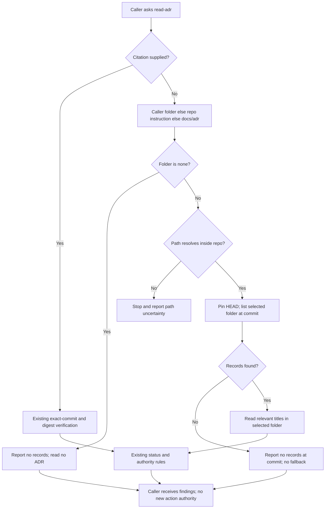

## Scope

- Source: FO, 2026-10-25. Codex review 5628338608 on iamcxa/kc-claude-plugins#713 head 037d2cf6 (2026-10-23T12:41:08Z), one P2, was not read before the merge: the merge ask named Codex as not read because `codex_review.py` reported `running` (a stuck security-review eyes reaction; see codex-review-hang-detected). The Captain approved the merge on that statement.
- Finding (P2, `kc-dev-flow-2/skills/read-adr/SKILL.md`, a byte copy of `kc-adr/skills/read-adr/SKILL.md`): when the caller passes an ADR folder other than `docs/adr`, or `ADR folder: none` (the design director does), the no-citation branch still lists `docs/adr/`, so it can miss the supplied rulings or apply rulings the caller declared absent.
- Shipped: the text is in kc-dev-flow-2 0.30.0 and kc-adr 0.2.0.
- Fix lives in kc-adr (the source); `scripts/kc-adr-copy-sync.sh sync` carries it to the dev2 copy in the same PR, per the D4 ruling of kc-adr-tools-with-dev2-copy.
- Non-goals: other read-adr wording.

## FO alignment

Alignment: not needed: a reviewer finding in shipped text, fixed in its source.
Surfaces: none
Visible change: none
Release review: not needed: workflow maintenance, on no journey map.
Reviewer: kc-dev-flow-2:chief-engineer opus 2026-10-27 — batch 8 review at the ideation gate (the Captain's batch ruling 2026-10-27): per-task disposition, the Captain's decisions, order and batch risk.

## Design

### PRFAQ

**Proposition.** A caller of either read-adr skill will get the rulings from the ADR (architecture decision record) folder it supplied. When it supplies `none`, the skill reports no records and reads none. A design director can therefore review a product without accidentally importing the repository's default-folder rulings.

**What changes?** Replace only step 1 of `Read a ruling` in `kc-adr/skills/read-adr/SKILL.md`, then carry the identical bytes to `kc-dev-flow-2/skills/read-adr/SKILL.md` with the existing sync script. No new helper, runtime hook, ADR, schema, workflow rule or CI job is needed.

**Which folder wins?** In the no-citation branch: the caller's `ADR folder:` first, otherwise the repo instruction file's folder, otherwise `docs/adr`. The literal value `none` ends this lookup; it is not a directory name or permission to discover another folder. Paths are interpreted against the already selected repository, not the process's working directory. An absolute path inside that repository is converted to its repository-relative path. An outside or ambiguous path is reported to the coordinator rather than guessed.

**What if the folder is empty or absent?** Report no records at the pinned commit, naming the selected folder. Do not fall back to `docs/adr`. This is different from `none`: `none` needs no listing at all; an absent directory was actually checked at a particular commit. Uncommitted records remain outside the existing committed-tree reading contract.

**What stays governed by the existing rule?** Explicit citations still select their exact repository, path, commit and digest, followed by the existing status and supersession checks. This fix is confined to uncited discovery; it does not redefine contradictory citation inputs, make a ruling grant permission, or change where new information belongs. The existing design-director caller already passes the needed value and requires no edit.

### Proposed step 1

The following is the proposed replacement, kept here as design text until the ideation gate is approved:

> 1. No citation: use the caller's `ADR folder:` when supplied; otherwise use the folder named by the repo's instruction file, defaulting to `docs/adr`. `none` means no records: report that and do not list or read ADRs. For a folder, set `D` to its repo-relative path in `R` (convert an absolute path inside `R`; stop and report an outside or ambiguous path). Pin `C=$(git -C "$R" rev-parse HEAD)`, record that id, list `git -C "$R" ls-tree --name-only "$C" "${D%/}/"` (titles are file names) and open the relevant ADRs there at `C`. An empty or missing folder yields no records at `C`; do not fall back to another folder.

`R` remains the repository already defined by the skill; `C` is its pinned commit; `D` is the selected folder. Treat a supplied path as data, quoted as one argument, never as shell code.

### Flow

Rendering: Mermaid CLI 12.0.0 with local Chrome rendered the exact block to PNG on 2026-10-27; visual inspection confirmed the caller, citation branch, folder precedence, `none` exit, invalid-path stop and no-fallback exit agree with the prose. The first sandboxed Chrome launch failed; the approved retry rendered successfully. Temporary rendering files are not a delivery dependency: extract this block and render with `mmdc -i flow.mmd -o flow.png` on a setup with Mermaid CLI and Chromium. No hosted artifact or application interface is introduced.

### Chain check and evidence

Checked in order: Spacedock, package source, then sibling adopters. `git fetch origin` succeeded; source is pinned to `origin/main` **8bf4f3582411e8e4238f19fbadda8ddeca6767be**, whose `kc-dev-flow-2/.claude-plugin/plugin.json` says **0.32.0**. The Codex review finding is the FO-supplied review 5628338608 on PR #713 at 037d2cf6; it was not independently fetched from GitHub in this stage.

- **Spacedock 0.27.3:** its own `skills/ensign/references/ensign-shared-core.md` and `skills/first-officer/references/fo-dispatch-core.md` own dispatch, stage reports and split-root state. A package-wide search for `ADR folder` and `read-adr` found neither. There is no folder-discovery mechanism there to repair; no Spacedock change is proposed.
- **kc-adr and dev2:** source step 1 literally lists `docs/adr/`; both skill files are byte-equal. `kc-dev-flow-2/skills/design-director/SKILL.md` explicitly invokes the skill with `ADR folder: <path>` or `none`. This is an existing broken caller/callee seam, not a missing general discovery feature. The bounded capability audit is inapplicable to this named-seam repair; these two source reads directly establish it.
- **Copy contract:** `_archive/kc-adr-tools-with-dev2-copy.md`, the Captain's single-install and copied-rule rulings plus its D4 (source change and copy ship together), require editing kc-adr and shipping both copies in one PR. `scripts/kc-adr-copy-sync.sh sync` copies the whole skill folder; `check` compares it with `diff -rq`. `.github/workflows/marketplace-parity.yml` already runs that check and its test on all PRs. This checks equality, not whether a model follows the words. No version file is hand-edited; release-please owns release versions.
- **Adopters, read only:** relay `/Users/kent/conductor/workspaces/subspace-relay/dhaka`, web `/Users/kent/conductor/workspaces/subspace-web/dev2-fo`, and qnow `/Users/kent/conductor/repos/qnow-adopt-dev2`: their `AGENTS.md` and `docs/dev2{,-poc}/README.md` were inspected. The README decision/numbering passages use `docs/adr` and allow the existing `adr-path` default; no `read-adr` folder-selection repair was found in those inspected files. This is a bounded file inspection, not a claim about every private wrapper or historical review. No adopter edit is needed.
- **Rulings:** ADR 0030 requires the design director to read the product's accepted rulings; ADR 0020 governs workflow word-budget changes. Neither is changed. State `Override:` records include the single-install decision above and the governing-ADR task's refusal of branch refs and deferral of a title hook. This design keeps the copied skill, adds no hook, and reads a pinned commit. No contrary folder-selection ruling was found in the inspected records.

### Command observation and reproducible fixture

A disposable local Git repository contained three committed Accepted records: `docs/adr/0001-default-decoy.md`, `decisions/product rules/0001-caller-rule.md`, and `policy/adr/0001-instruction-rule.md`. No project checkout was edited for the probe. With `C` pinned to that fixture's HEAD, the command `git -C "$R" ls-tree --name-only "$C" "${D%/}/"` returned:

| D | Observed output |
| --- | --- |
| `docs/adr` | `docs/adr/0001-default-decoy.md` |
| `decisions/product rules` | `decisions/product rules/0001-caller-rule.md` |
| `policy/adr` | `policy/adr/0001-instruction-rule.md` |
| `missing/adr` | empty output, exit 0 |

The unchanged step-1 command returned the default decoy even for the custom-folder case. Reproduce by creating those three files in `mktemp -d`, running `git init`, committing the three named files with fixture-only author/committer environment variables, then executing the two commands above against that fixture. No shared-repository Git configuration is needed. This proves Git's selection and the current hardcoded-command failure, not a model's folder resolution, absolute-path normalization, or `none` compliance; those remain acceptance checks below.

### Words FO reads at each lifecycle moment

Method: `len(text.split())` on the pinned source and on the proposed step-1 replacement above, excluding this task's design/report. Compare identical caller/task/PR inputs on base and candidate; variable record content is not a fixed word budget. FO means First Officer. This is a behavior repair, not a claim to reduce reading.

| Moment / passage or output | Before | Proposed after |
| --- | --- | --- |
| Startup/resume: full `references/sd/workflow.md` | 5565 words | 5565 words |
| Startup/resume: dev2 lifecycle mod | 48 words | 48 words |
| Idle on an open PR: changed rule/output words | 0 | 0; mod, `pr_watch.py`, reviewer scripts unchanged |
| Idle on a merged PR: changed rule/output words | 0 | 0; mod, `pr_watch.py`, `observer_check.py` unchanged |
| After archive: changed rule/output words | 0 | 0; learn extension, mod and learning scripts unchanged |
| Merge ask: changed rule/output words | 0 | 0; delivery authority, reviewer extensions and `delivery_gate.py` unchanged |
| Any moment an FO or worker actually invokes read-adr: complete skill | 775 words | 848 words (+73) |
| Design-director invocation: complete director skill plus read-adr | 1211 + 775 = 1986 | 1211 + 848 = 2059 (+73) |

The zero rows count the task's added reading, not the total lifecycle transcript. All pre-existing passages and outputs remain in each before/after total; their byte-identical sources and identical inputs give zero change. They were not re-executed against real PRs for this task. The skill description is unchanged, so discovery adds no words. No extra startup load is proposed. The larger skill is paid when it is invoked, including during a lifecycle moment if FO explicitly invokes it there. No CI trigger or job changes; hosted cost per PR was not measured and no savings are claimed.

### Batch overlap

Planned product files: **only** `kc-adr/skills/read-adr/SKILL.md` and `kc-dev-flow-2/skills/read-adr/SKILL.md`. State deliverable: this task's body/report only. Existing `scripts/kc-adr-copy-sync.sh`, its test and package lint are reused, not edited. No ADR number, shared ADR index, workflow word-budget table or release manifest changes in the feature PR.

| Task (purpose) | Same file or check, from current task record |
| --- | --- |
| `archive-waits-for-observer-report` (require observer before archive) | No shared edited file; owns archive/observer/learn integration. |
| `idle-hook-names-merged-tasks-without-learn` (find missed learning jobs) | No shared edited file; owns watcher/learn notices. |
| `copilot-not-run-line-carries-quote` (verify missing-review explanation) | No shared edited file; owns delivery/reviewer checks. |
| `dispatch-carries-reserved-adr-number` (carry reserved record number) | No shared edited file; owns dispatch/number checks. This task reserves no ADR. |
| `seed-check-requires-schema-fields` (validate required seed fields) | No shared edited file; shared verification tool `design_surfaces.py`. Run the assigned package's version and have FO rerun the gate check after integration. |
| `journey-probe-finds-nested-maps` (discover nested journey maps) | No shared edited file; owns adoption probe. |
| `read-adr-honors-adr-folder` (this folder-selection repair) | Sole owner of these two proposed skill-file edits. |
| `adr-required-statement` (require ruling ledger) | No shared edited file; former `adr_lint.py`/workflow work, recorded closed 2026-10-20 despite stale validation frontmatter. Do not revive it. |
| `journey-server-host-pilot` (private journey server) | No shared edited file; journey server/adapters. Common repository checks only. |
| `ops-inbox-r1-setup-and-isolation` (isolated operations inbox) | No shared edited file; kc-ops-inbox and its own ADRs/CI. May consume ADR readings; no skill edit declared. |
| `pr-review-lite-value-pilot` (bounded PR-review trial) | No shared edited file; review-capability scripts and journey artifacts. |
| `adr-silent-undo-probe` (measure protected-choice regressions) | No shared edited file; experimental harness only, moved to dev2-poc by Captain amendment. Shared measurement input: read-adr skill revision. Pin its baseline and treatment bytes; do not reinterpret runs across this change. |
| `comment-check-reaches-delivery-gate` (bind comment evidence to delivery) | No shared edited file; recorded closed 2026-10-20, archive blocked. Its prior design concerns delivery/comment checks. |
| `journey-canvas-hosted-poc` (hosted canvas experiment) | No shared edited file; disposable canvas/service proof. |

These are read-only task-record findings, not current hosted PR-diff verification. Sibling batch designs were not yet written in the records inspected; FO should recheck their final file lists before implementation. Recommended order: no file-level dependency on the six other batch tasks; land this source-and-copy change together. Coordinate the separate ADR experiment's revision pin before comparing its runs; whichever task last changes the gate-check tool requires a fresh gate check. Do not edit a sibling task to record that coordination.

## Acceptance criteria

**AC-1** A no-citation caller folder wins over both an instruction-file folder and `docs/adr`, and reads relevant records only at the pinned commit in that folder. Evidence: use the three-record fixture above, set the instruction file to `policy/adr`, and supply `ADR folder: decisions/product rules`; retain the actual agent tool trace, selected path, full commit, opened record and answer for both skill namespaces on Claude and Codex. Repeat with the absolute path to the same directory and a trailing slash. Falsifier: restore the hardcoded command, or resolve from process cwd, and the chosen/opened path is wrong. Current evidence: quoted Git listing with spaces passes; agent selection and normalization are not yet verified.

**AC-2** `ADR folder: none` reports no records without listing or reading either populated ADR folder, and supplies no ADR-backed ruling to the caller. Evidence: invoke each skill namespace in the same decoy-filled fixture on both hosts; inspect tool traces as well as the final answer. Exercise the design-director caller once with `none` and once with the custom folder, checking `adrs_read` and cited ruling paths. Falsifier: remove the early `none` exit; any ADR enumeration/read or default-decoy ruling fails. Current evidence: design only; no model/director run claimed.

**AC-3** Omitting the caller field uses the instruction-file folder, then `docs/adr` if no folder is declared; an explicitly missing folder returns no records without fallback. An outside or ambiguous supplied path stops and reports the unresolved path. Evidence: repeat the fixture sessions for these four inputs, retaining output and read trace; compare base/candidate using the same fixture, prompt and host settings. Falsifiers: always use docs/adr, fall back after an empty listing, or silently reinterpret an outside path. Current evidence: all three Git listings and the missing-folder result observed; model precedence/refusal remains unverified.

**AC-4** Both installed skill copies carry identical corrected bytes and the remaining citation/status/writing instructions are unchanged. Evidence: in an owned implementation checkout run `scripts/kc-adr-copy-sync.sh sync`, `scripts/kc-adr-copy-sync.sh check`, `scripts/kc-adr-copy-sync.test.sh`, and `python3 kc-dev-flow-2/scripts/lint-skills.py`; compare the final diff outside step 1, and bind the host runs to those skill bytes. In a disposable copy append one byte to either skill: `check` must exit 1 naming the source/copy; resync must return 0. Falsifier: edit only the dev2 copy or suppress the comparison; the mismatch case must fail. Current evidence: pinned base copies equal and existing check is wired into CI; candidate checks are future work.

**AC-5** The delivered change has only the two planned skill files, carries the caller correction through the existing source/copy release route, and adds no routine FO lifecycle reading. Evidence: compare named files against the pinned base; independently recount the skill and the lifecycle sources/outputs under identical inputs. Expected full skill is 848 words for the exact proposal, workflow 5565, mod 48; routine lifecycle delta is zero, conditional read-adr delta +73. Falsifier: add a startup rule or fallback helper, change a lifecycle-producing script, or desynchronize the copies. Current evidence: proposal counted; delivered diff and release are not yet present. A later released version must be observed, never predicted.

## Captain decisions and limits

No additional material scope or authority question is unresolved. Recommend approving this narrow repair at the normal ideation gate, retaining the existing source/copy policy and stopping on an unusable explicit path. What gets worse: each read-adr invocation loads 73 more words; an invalid explicit path requires correction rather than silently producing default-folder records. Choosing implicit fallback would restore the reviewed failure, so it is not recommended.

This is pilot scope: no new service, secret, migration, ongoing support obligation or provider write. Native model adherence, integration checks and the release remain future evidence, not outcomes of ideation. The current proof is the source diagnosis, the local Git-command observation and the rendered design; no implementation, PR or repository-code commit was made.

## Stage Report: ideation

- DONE: A design for the read-adr skill (kc-adr's skill and the kc-dev-flow-2 copy) to list the ADR folder its caller names and to treat none as no records, read from the Codex P2 on iamcxa/kc-claude-plugins#713, with how the two copies stay identical
  Source 8bf4f358 (dev2 0.32.0) confirms FO's supplied finding; PRFAQ, rendered Mermaid and exact proposed step reuse source-first sync/check. Git fixture selects the custom folder; the hardcoded base selects its default decoy.
- DONE: A `### Batch overlap` section naming each file the design would change and each other batch task (archive-waits-for-observer-report, idle-hook-names-merged-tasks-without-learn, copilot-not-run-line-carries-quote, dispatch-carries-reserved-adr-number, seed-check-requires-schema-fields, journey-probe-finds-nested-maps, read-adr-honors-adr-folder) and live task of other sessions (adr-required-statement, journey-server-host-pilot, ops-inbox-r1-setup-and-isolation, pr-review-lite-value-pilot, adr-silent-undo-probe, comment-check-reaches-delivery-gate, journey-canvas-hosted-poc (driven by other sessions; read only)) that changes the same file or check, so FO can order implementation
  All named records inspected; only two skill files proposed, shared design-check/version-pinning dependencies recorded, stale closed-task frontmatter distinguished from Captain closure.
- DONE: The words FO reads at each lifecycle moment, before and after, per root learning.md "Measure the words FO reads at each moment, not one file's size"
  Same-input lifecycle source/output delta 0; full workflow 5565 to 5565, mod 48 to 48; conditional skill 775 to 848 (+73), director plus skill 1986 to 2059. No total live-PR transcript or CI-cost claim.
- DONE: Acceptance criteria with reproducible evidence clauses and falsifiers, and unresolved decisions for the Captain, each with a recommendation and what gets worse under it
  Five criteria above distinguish observed Git behavior from future agent/candidate proof; recommend the narrow repair, with +73 on-demand words and explicit-path refusal as tradeoffs; no extra material decision.
- DONE: AC-1 design and current-evidence mapping
  Custom-folder Git listing including spaces observed; hardcoded-path control returns wrong decoy. Actual host/namespace selection and absolute normalization remain unverified.
- DONE: AC-2 design and current-evidence mapping
  None/no-read trace and design-director cases specified; removing the early exit must fail. Native behavior not run at ideation.
- DONE: AC-3 design and current-evidence mapping
  Default, instruction folder and missing-folder Git outputs observed; precedence/outside-path agent cases remain unverified. Wrong default or fallback is the falsifier.
- DONE: AC-4 design and current-evidence mapping
  Base copies byte-equal and existing CI comparison inspected; candidate sync/lint and deliberate one-byte mismatch are future checks, not claimed passed.
- DONE: AC-5 design and current-evidence mapping
  Exact proposed text counted and changed surfaces bounded; delivered-diff/output verification remains future work. Extra lifecycle instructions or changed output producers falsify zero added routine reading.
- DONE: Presentability and rendered artifact checks
  Assigned package `design_surfaces.py check` printed `read-adr-honors-adr-folder.md: design surfaces presentable` (exit 0); exact Mermaid block rendered and visually checked; `git diff --check` passed.

### Summary

The pilot design repairs uncited ADR discovery in kc-adr and carries it unchanged to dev2 with the existing copy mechanism. The task records source evidence, all requested overlaps, reading cost and falsifiable acceptance plans; native agent behavior and delivery remain unverified until later stages. Only this split-root task body/report was changed; frontmatter and sibling tasks were preserved.
