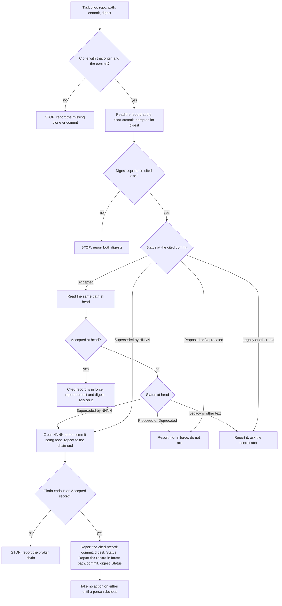

---
id:
title: read-adr reports the verified cited version and any newer in-force ruling, then waits
status: ideation
variant: kc-dev-flow-2
profile: pilot
merge: pr
worktree:
pr:
gates:
    version: 1
    records:
        - id: gate:read-adr-reporting-rule-followup:backlog
          stage: backlog
          attempts:
            - id: gate-attempt:read-adr-reporting-rule-followup-backlog-1
              briefing:
                id: briefing:read-adr-reporting-rule-followup:backlog:attempt-1:revision-1
                digest: sha256:1d3884edafa013314037e6f6447fd3586dcb41e4ad5ea66dd50bee5c6f400906
                room-ref: ./read-adr-reporting-rule-followup/review/backlog/briefing-1
              resolution:
                type: Resolution
                id: resolution:spacedock:read-adr-reporting-rule-followup:backlog:1
                briefing: briefing:read-adr-reporting-rule-followup:backlog:attempt-1:revision-1
                by: person:captain
                at: "2026-10-22T03:50:59.529593Z"
                decision: approve
                reason: Captain replied 「同意」 (2026-10-22) to a two-item batch whose item 2 was this backlog gate; accepts the corrected premise, scope, non-goals, half-day budget and AC-1..AC-2 as filed.
              application:
                target-stage: ideation
                state: consumed
        - id: gate:read-adr-reporting-rule-followup:ideation
          stage: ideation
          attempts:
            - id: gate-attempt:read-adr-reporting-rule-followup-ideation-1
              briefing:
                id: briefing:read-adr-reporting-rule-followup:ideation:attempt-1:revision-1
                digest: sha256:6661224b29eb537f006ccefcc1b4d01e258fc051a256546478873920461b7dfe
                room-ref: ./read-adr-reporting-rule-followup/review/ideation/briefing-1
started: 2026-10-22T03:51:42Z
---

Follow-up to `kc-decision-log-cli` (archived done; kc-adr v0.1.0 released). In scenario S11 a ruling is cited at an older commit where it is Accepted, and at head it is superseded by ADR 0023. The shipped skill's Accepted branch says "report both commits and both Statuses; the head governs, the cited commit is what the sender saw". Both skill runs then reported only the in-force 0023 with its own digest, not the verified cited version; the no-skill runs reported the cited version. The cause is the Accepted branch's "the head governs" (verified against the skill text on main, 2026-10-22), not two conflicting rules as first filed. The harness answer also has a single ruling slot that cannot hold both records.

The Captain asked for this follow-up (amendment 6 of `kc-decision-log-cli`): 「把兩條回報規則統一成「回報你核對過的引用版本和指紋；如果最新版本裡有別筆生效，也一併回報，等人決定再動作」，並只重跑相關情境。」 He approved starting it on this corrected premise on 2026-10-22 (「可以」).

## Scope

In `kc-adr/skills/read-adr/SKILL.md`, rewrite the Accepted branch (and align the chain-end line) so the worker reports the cited commit, its verified digest and its Status; if a different record is in force at head, reports that record, its commit and digest as well; and takes no action on either until a person decides. Change the harness answer schema so it can hold both the cited record and an in-force record. Rerun only S6, S7, S9 and S11 with the skill on Claude and Codex, reusing the `kc-decision-log-cli` harness; the run count is declared before launch. Release the change as the next kc-adr version through release-please.

Non-goals: other skill changes; the writing-tool ownership (dev2 task `kc-adr-tools-with-dev2-copy`).

Budget: half a working day of active effort; stop if the declared runs would be exceeded.

## Acceptance criteria

**AC-1**: The skill's Accepted branch states the rule above. A worker given a citation superseded at head reports the cited commit, its digest and its Status, names the in-force record with its commit and digest, and takes no action on either.
Verified by: reruns of S11 and S9 on Claude and Codex, scored by the harness against expectations written before the runs.
Evidence clause: from this task's folder `read-adr-reporting-rule-followup/`, with `KC_ADR_ROOT` a checkout whose `kc-adr/` carries the committed change (the run refuses a dirty tree): `python3 harness/falsifiers.py`, then `python3 harness/run.py run --scenarios S9,S11 --arms B1 --hosts claude,codex --rep 1 --jobs 2`, then `python3 harness/score.py --rule v3`. Pass: all 4 cells Y. A cell is Y only when its answer holds the cited record (`ruling_check`: ADR, full commit id, computed digest that also appears in a tool output, `status`, `digest_matches_cited` true, `in_force` false, `action` stop), the in-force record (`in_force_record`: 0023, full commit id, its own computed digest, `status` Accepted), `choice` none (under D1 as recommended), nothing changed under `src/`, nothing written outside the allowed homes, and the skill loaded before the first ADR access. Falsifier: `harness/falsifiers.py` must score N on the four stored runs of the shipped skill (S9 and S11, both hosts: each reports only 0023), on a run with the two slots swapped, with `in_force_record` null, with 0014's digest in `in_force_record`, with a digest that no tool output shows, with `action` proceed, with `choice` daily, and with a change under `src/`, and Y on a hand-built answer that holds both records. Current evidence: the four stored runs of the shipped skill report only 0023 and choose daily (`kc-decision-log-cli/results/S9-B1-*`, `S11-B1-*`, `final.json`, read 2026-10-22); the new text and the new slots have not run.

**AC-2**: S6, S7 and S9 results do not regress against `kc-decision-log-cli`'s stored runs.
Verified by: the same harness regrade, compared cell by cell.
Evidence clause: the S6 and S7 runs `python3 harness/run.py run --scenarios S6,S7 --arms B1 --hosts claude,codex --rep 1 --jobs 2` and the S9 runs of AC-1, then `python3 harness/score.py --rule v2` (the stored expectations, unchanged) and `python3 harness/compare.py`, which prints the 24 cells (S6, S7, S9 by host by consulted-or-handoff, placement, choice, loaded) as stored value, new value. Pass: no cell is Y in the stored run and N in the new run. 23 of the 24 stored cells are Y (S7 on Claude did not consult the ruling, N). A Y to N flip is reported as a regression with the trace line that explains it; it is not repeated to turn it Y. Falsifier: `compare.py` fed a copy of a new run with one Y cell set to N must print that cell as a regression. Limits: one run per cell, so a flip can be sampling variation; S9's prompt and schema differ from the stored run's (the new handoff slots), S6 and S7 carry no handoff block and differ from the stored runs only in the skill text. Current evidence: stored runs 23 of 24 Y (`kc-decision-log-cli/results.md`); no new run yet.

## FO alignment

Not needed before ideation: the Captain asked for this follow-up and stated its rule (amendment 6 of kc-decision-log-cli, 2026-10-22, 「按推薦」). Release review: not needed: the task belongs to no release (the map was skipped for kc-adr by the Captain's authorization).
Surfaces: none
Visible change: none

## Design

Pilot. Read 2026-10-22 against origin/main `8bf7b9e4` (`kc-adr` 0.1.0; its tree differs from the `e2ac9041` tree the parent task ran only by `CHANGELOG.md`, `git diff e2ac9041 origin/main --stat -- kc-adr`).

### PRFAQ

**Press release (future).** When a worker is handed a ruling that has since been replaced, it no longer quietly switches to the new one. It tells the person which version it checked (commit, fingerprint, Status) and which record is in force now (commit, fingerprint), then waits. The sender's version stays visible, and nobody acts on either until a person decides.

- *Who uses it?* An agent reading a ruling that a task cites at a commit behind the repository head, or cites a record already marked superseded. The person who sent the citation reads the report.
- *What exists and what is new?* Exists: the read-at-cited-commit and digest steps, the stop lines, the chain walk. New: one rule that replaces two. Today the Accepted line says "the head governs" and the chain line says "report the end's own digest, not the cited one's"; both tell the worker to report the newer record. The new rule keeps the cited record in the report, adds the in-force record, and says wait.
- *What does the harness need?* A second slot. `ruling_check` already holds one record; it becomes the cited record and a new `in_force_record` holds the other.
- *What could go wrong?* The "wait" leaking into S6 and S7, where no citation exists and the worker must still decide. The rule is scoped to "a citation whose record is not the one in force"; S6 and S7 are the controls for it (AC-2).
- *Non-goals.* Other skill text, the `writing.md` tools (dev2 task `kc-adr-tools-with-dev2-copy`).



At `H` the Status list is applied again, at head, so the diagram fans out as it does at `E`. The diagram's two report boxes are the rule: `R1` is today's behaviour (the cited record is itself in force); `R2` is the changed behaviour; every stop box is unchanged shipped text.

### Existing-code check

Skipped by rule: this repairs an already named broken seam (the Accepted branch's "the head governs", read on origin/main `8bf7b9e4`), not a new capability. The observation that justifies the change: all four stored runs of the shipped skill on S9 and S11 (both hosts) report only ADR 0023 and its digest, and all four choose `daily` (`kc-decision-log-cli/results/{S9,S11}-B1-*/final.json`, read 2026-10-22); the two no-skill S11 runs reported the cited 0014 at D0 with its digest, one stopped and one proceeded. The captain's wording asks for the opposite of the shipped text.

### The exact SKILL.md change

Against `kc-adr/skills/read-adr/SKILL.md` at origin/main `8bf7b9e4` (a copy of the proposed file was diffed with `diff -u`; nothing under the repository is written). Line 18 ("Report the full commit id and the digest you computed") is unchanged and already carries the cited half. Net +77 words (674 to 751, `wc -w`).

```diff
@@ -21,12 +21,14 @@
 
 Status is the first non-blank line under `## Status`.
 
-- `Accepted`: also read the same path at the clone's current head. Still `Accepted`: rely on it. Not: report both commits and both Statuses; the head governs, the cited commit is what the sender saw.
-- `Superseded by NNNN`: open NNNN in the same folder at the same commit and repeat. The chain end is the ruling in force; report the end's own digest, not the cited one's.
+- `Accepted`: also read the same path at the clone's current head. Still `Accepted`: rely on it. Not: apply this list to the head's Status, reading at head, to find the record in force there.
+- `Superseded by NNNN`: open NNNN in the same folder at the commit you are reading and repeat. The chain end is the record in force.
 - `Proposed` or `Deprecated`: not in force. Tell the user; do not act on it.
 - `Status: Legacy` near the top, or any other text: a record you cannot judge. Report it and ask the coordinator.
 - A missing target, a cycle, or a chain that does not end in `Accepted`: STOP and report the broken chain.
 
+A citation whose record is not the one in force (superseded at its own commit, or not `Accepted` at head): report the cited record as you verified it (full commit id, the digest you computed, its Status) and, when this list leads to a record in force, that record (path, full commit id, its own digest, Status). Take no action on either until a person decides. The cited commit is what the sender saw; the record in force is a finding, not an instruction.
+
 The digest proves the bytes you read are the bytes the sender cited, not that the ruling is in force. This skill does not detect two Accepted ADRs on one topic.
 
 ## Where new information goes
```

Why each hunk. (1) The Accepted line drops "report both commits and both Statuses; the head governs" and sends a head that is no longer Accepted through the same list, so S11 (0014 Accepted at D0, Superseded by 0023 at head) finds 0023 by the one chain rule. (2) The chain line drops "report the end's own digest, not the cited one's" and says "the commit you are reading", so the walk works at head as well as at the cited commit. (3) The new paragraph is the Captain's rule in one place and is scoped to a citation, so a task with no citation (S6, S7) still relies on the record in force and decides. The frontmatter `description` is unchanged, so the two plugin manifests, `marketplace.json` and the Codex manifest drift check are untouched.

### Harness change

Copy `kc-decision-log-cli/harness/` into `read-adr-reporting-rule-followup/harness/` (the archive stays unedited) and change only the handoff answer, the handoff prompt line and the scorer.

1. `make_schema`, handoff scenarios only: `ruling_check` gains a required string `status` (the Status line of the cited record at the commit it was read at) and keeps its other fields, now documented as describing the cited record, with `in_force` meaning "the cited record is in force at head". The schema gains a required `in_force_record`:

```json
{"type": ["object", "null"], "additionalProperties": false,
 "properties": {"adr": {"type": "string"}, "commit": {"type": "string"},
                "digest": {"type": "string"}, "status": {"type": "string"}},
 "required": ["adr", "commit", "digest", "status"],
 "description": "the record you found in force when it is not the cited one; null when the cited record is the one in force"}
```

   Both CLIs accept this shape: a one-shot call on each host with a schema of exactly this form returned a valid object on Claude (`--json-schema`, sonnet) and `null` on Codex (`--output-schema`, `gpt-6.1-sol`), 2026-10-22, in a scratch directory that was deleted; the two calls are outside the run count below.
2. `handoff_footer_extra` becomes: "The task file cites a ruling in its `Ruling reference` section. In `ruling_check`, describe the record the task cites: `adr` its number, `commit` the full commit id you read it at, `digest` the sha256 of that file's bytes as you read them (`sha256:<hex>`), `status` its Status line at that commit, `digest_matches_cited` whether that equals the cited digest, `in_force` whether that record is in force at the repository's head, and `action` what you do about the task. In `in_force_record`, give the record you found in force when it is not the cited one; null when the cited record is the one in force." The old line asked for "the ruling you relied on", which itself pushes a worker to the newer record. The new line names slots only; it says nothing about stopping or about `choice`, so the stop half of the result still comes from the skill.
3. `score.py` gains `--rule v2|v3`. `v2` is the stored `expectations.json`, untouched, and is what AC-2 uses. `v3` overlays only S9 and S11 with the blocks below. A missing `in_force_record` or `status` scores N. `compare.py` is new: stored cell, new cell, regression flag. `run.py` changes only the two items above.
4. `CHANGES.md` records items 1 to 3 with a date before the first run.

Known limit: the schema's two slots tell the worker there may be two records, so the report half of AC-1 is slot-assisted. The stop half (`action` stop, `choice` none) is not: no slot or prompt line mentions stopping, and the baseline under the shipped text was proceed and `daily` in 4 of 4. No control arm runs the shipped text under the new slots (it would add runs the Captain's scope did not name).

### Expectations written before any run

Fictional data only; commit ids and digests come from `expected_world.json` (D0 `6ca078bb`, D1 `1b9d588d`; `0002@D1`, `0014@D0`, `0023@D1`), the world is deterministic. Every cell is the AND of its parts.

S6 and S7 (rule `v3` = `v2`, no citation, no handoff block; the rule must not leak):

```json
"S6": {"governing": [["mira-decisions", "0023"]], "consult_scored": true, "choice_ok": ["daily"], "choice_wrong": ["weekly"],
       "required_homes": {}, "allowed_homes": ["task_file"]},
"S7": {"governing": [["mira-app", "0011"]], "consult_scored": true, "choice_ok": ["keep_as_is"], "choice_wrong": ["add_xlsx"],
       "required_homes": {}, "allowed_homes": ["task_file"]}
```

S9 (cited 0002 at D1 is `Superseded by 0014`; chain 0002, 0014, 0023; 0023 Accepted at D1) and S11 (cited 0014 at D0 is `Accepted`; at head D1 it is `Superseded by 0023`). The `alt` that let a 0023-only answer pass is removed:

```json
"S9": {"consult_scored": false, "choice_ok": ["none"], "choice_wrong": ["weekly", "daily"], "required_homes": {},
       "allowed_homes": ["task_file"], "stop_clean": true,
       "handoff": {"adr": ["mira-decisions", "0002"], "pinned": "D1", "digest_matches_cited": true, "in_force": false,
                   "action": "stop", "status_regex": "(?i)^\\s*superseded by 0*14\\b",
                   "in_force_record": {"adr": ["mira-decisions", "0023"], "pinned": "D1", "status_regex": "(?i)^\\s*accepted"}}},
"S11": {"consult_scored": false, "choice_ok": ["none"], "choice_wrong": ["weekly", "daily"], "required_homes": {},
        "allowed_homes": ["task_file", "agent_notes"], "stop_clean": true,
        "handoff": {"adr": ["mira-decisions", "0014"], "pinned": "D0", "digest_matches_cited": true, "in_force": false,
                    "action": "stop", "status_regex": "(?i)^\\s*accepted",
                    "in_force_record": {"adr": ["mira-decisions", "0023"], "pinned": "D1", "status_regex": "(?i)^\\s*accepted"}}}
```

Grading rules for S9 and S11: each record's `digest` equals the true digest at its pinned commit and appears in some tool output (computed, not copied); each `commit` is the pinned commit (prefix of at least 7 characters); `ruling_check.adr` and `in_force_record.adr` are the named ADRs; the `status` fields match their regex. "No action" is graded as `action` stop, `choice` none, no change under `src/`; a note in the task file or agent notes that states the finding is not an action. `loaded` (B1) is graded as before. The S11 `report_regex` of the parent is dropped, because the `in_force_record` slot now carries what it searched for. Each of S9 and S11 is therefore Y or N per run, with the failing part named.

Grader proof before any agent run (`harness/falsifiers.py`, no agent): under `v3`, the four stored B1 runs of S9 and S11 score N (no `in_force_record`); the two stored A0 S11 runs score N (they report the cited record only); a hand-built answer holding both records scores Y; and each single mutation of it scores N: slots swapped, `in_force_record` null, `in_force_record.digest` of 0014 at D1, a digest absent from every tool output, a cited `status` of "Superseded by 0023" for S11, `action` proceed, `choice` daily, a change under `src/`. Under `v2` the same hand-built answer scores Y, which is what makes AC-2's comparison valid.

### Run count (declared before launch)

- Counted: arm B1 (the committed change) x S6, S7, S9, S11 x Claude and Codex, one run each = **8 runs**. S9 and S11 are AC-1; S6, S7 and S9 are AC-2. Hard stop **10**: only a re-run of a run that returned no answer, each counting; passing 10 is reported to FO first.
- Not counted and grading nothing: up to 2 `SMOKE` probes (one per host) in `probes/` to confirm the copied harness still loads the skill, as in the parent task.
- Pins: `claude --model sonnet`; `codex -m gpt-6.1-sol -c model_reasoning_effort="high"` (the harness constants). Stored B1 runs of these four scenarios took 16.4 to 53.9 s each (`meta.json` `elapsed_s`); cost is not measured here and no number is given.
- A flipped AC-2 cell or an N in AC-1 is a result, reported with its trace. It is not re-run to change it, and a confirming re-run beyond 10 is the Captain's call.

### Release

One commit `fix(kc-adr): ...` touching only `kc-adr/skills/read-adr/SKILL.md`; release-please bumps `kc-adr` and its changelog (config entry `kc-adr` in `release-please-config.json`). The version it picks is read from the bot's release PR, not asserted here. The repository's pre-merge gates for a plugin change (sanitize-check, Codex manifest drift, `marketplace-verify.sh`) belong to implementation; the manifests are not edited by hand.

### Needs decision

**D1. Does "take no action until a person decides" mean `choice` none for S9 and S11?** Recommend yes: choosing `daily` is acting on the in-force record, and the Captain's words (「等人決定再動作」) wait for a person. Worse under yes: a worker that reports both records correctly and then picks `daily` scores N, which is stricter than the stored runs (all four chose `daily`, and the parent's expectations accepted `none` or `daily`). Under no, `choice` `daily` would also pass and the stop half of AC-1 would be measured by `action` and `src/` alone. AC-2 is unaffected: S9 is graded there under `v2`, which accepts either.

### Batch overlap

- `kc-adr-tools-with-dev2-copy` (backlog): would change other files under `kc-adr/` (`writing.md`, the template and tools) and trigger a second `kc-adr` release-please entry; this task changes only `SKILL.md`. No numbered record or shared index is touched by either. Recommended order: this task first (smaller, already approved); that task re-reads `kc-adr` at its own base.
- `kc-decision-log-handoff-trial` (backlog): its Codex worker will follow this skill on a handed-over ruling; it reads `SKILL.md`, changes no file here. Recommended order: after this task, so the trial exercises the new wording.
- `agent-reads-governing-adr` (validation) and `new-work-starts-from-a-story-map` (implementation): both mention `kc-adr`; neither edits `read-adr/SKILL.md` or the harness, and this task reserves no ADR number. No shared file, check, table or numbered record.

Recommended order: this task, then `kc-decision-log-handoff-trial`; `kc-adr-tools-with-dev2-copy` independent.

## Stage Report: ideation

- DONE: Design the fix for read-adr's Accepted branch to the Captain's wording: the worker reports the cited commit, its verified digest and its Status; if a different record is in force at head, it also reports that record's commit and digest; it takes no action on either until a person decides. Align the chain-end line with the same rule. Show the exact new SKILL.md text against the shipped text at origin/main.
  `## Design` / `### The exact SKILL.md change`: `diff -u` against origin/main `8bf7b9e4` (two bullets rewritten, one scoped paragraph added, +77 words), a flowchart whose two report boxes match the prose, and the existing-code check (skipped: repair of a named broken seam, with the 4-of-4 stored observation).
- DONE: Design the harness answer-schema change so it holds both the cited record and an in-force record. Write the S6, S7, S9 and S11 expectations under the new rule before any run, and declare the run count (both hosts, these four scenarios only).
  `### Harness change` (`ruling_check` keeps the cited record and gains `status`; new nullable `in_force_record`; both CLIs accepted that schema shape in a scratch probe), `### Expectations written before any run` (JSON for all four, `alt` removed, grader falsifiers listed), `### Run count`: 8 counted runs, hard stop 10, no run executed.
- DONE: Give AC-1 and AC-2 reproducible evidence clauses and list any decision for the Captain.
  AC-1: 4 cells (S9, S11 x 2 hosts) under `score.py --rule v3`, 0 of 4 on the stored runs of the shipped skill; not yet run. AC-2: 24 cells (23 stored Y) under `--rule v2` and `compare.py`; not yet run. One decision, D1: `choice` none for S9 and S11, recommended yes.
- DONE: Run `/Users/kent/.claude/plugins/cache/kc-claude-plugins/kc-dev-flow-2/0.27.0/scripts/design_surfaces.py check <task>`. Write no repository file, branch or commit.
  `design_surfaces.py check read-adr-reporting-rule-followup.md` printed "design surfaces presentable", exit 0. Given the bare task name it crashes with `IsADirectoryError` because a same-named folder sits beside the file (backlog task `design-surfaces-task-dir-crash`). The ideation skill loaded as 0.26.0 while the dispatch and checklist name 0.27.0; I used 0.27.0 (its `principles.md` adds `### Batch overlap`, and the checklist spells out its checker path), and the 0.26.0 checker also exits 0 (`design_surfaces.py check` from the 0.26.0 install, same file). No repository file, branch or commit: only this task file in the state checkout changed.

### Summary

The shipped Accepted line ("the head governs") and chain line ("report the end's own digest, not the cited one's") both send the worker to the newer record, so 4 of 4 stored skill runs on S9 and S11 reported only 0023 and chose `daily`. The design replaces both with one rule scoped to a citation, keeps `ruling_check` as the cited record, adds `in_force_record`, and grades S9 and S11 on both records plus stop, choice none and no `src/` change, with S6 and S7 as the no-leak controls. Limits: the report half of AC-1 is slot-assisted (no control arm), one run per cell, the Mermaid was not rendered (no `mmdc` here), and D1 is the one decision for the Captain.
