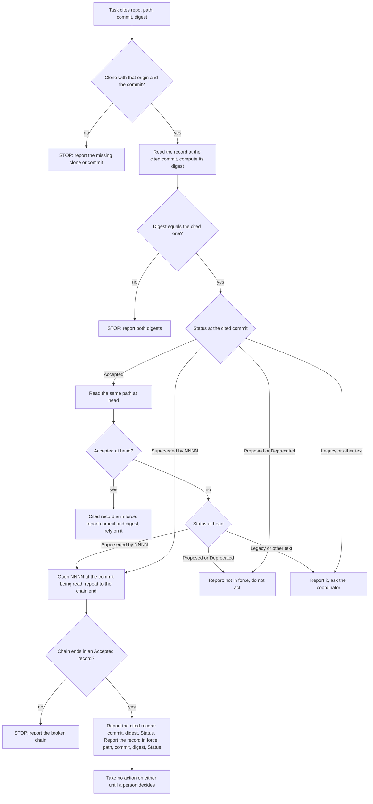

---
id:
title: read-adr reports the verified cited version and any newer in-force ruling, then waits
status: validation
variant: kc-dev-flow-2
profile: pilot
merge: pr
worktree: .worktrees/spacedock-ensign-read-adr-reporting-rule-followup
pr:
gates:
    version: 1
    records:
        - id: gate:read-adr-reporting-rule-followup:backlog
          stage: backlog
          attempts:
            - id: gate-attempt:read-adr-reporting-rule-followup-backlog-1
              briefing:
                id: briefing:read-adr-reporting-rule-followup:backlog:attempt-1:revision-1
                digest: sha256:1d3884edafa013314037e6f6447fd3586dcb41e4ad5ea66dd50bee5c6f400906
                room-ref: ./read-adr-reporting-rule-followup/review/backlog/briefing-1
              resolution:
                type: Resolution
                id: resolution:spacedock:read-adr-reporting-rule-followup:backlog:1
                briefing: briefing:read-adr-reporting-rule-followup:backlog:attempt-1:revision-1
                by: person:captain
                at: "2026-10-22T03:50:59.529593Z"
                decision: approve
                reason: Captain replied 「同意」 (2026-10-22) to a two-item batch whose item 2 was this backlog gate; accepts the corrected premise, scope, non-goals, half-day budget and AC-1..AC-2 as filed.
              application:
                target-stage: ideation
                state: consumed
        - id: gate:read-adr-reporting-rule-followup:ideation
          stage: ideation
          attempts:
            - id: gate-attempt:read-adr-reporting-rule-followup-ideation-1
              briefing:
                id: briefing:read-adr-reporting-rule-followup:ideation:attempt-1:revision-1
                digest: sha256:6661224b29eb537f006ccefcc1b4d01e258fc051a256546478873920461b7dfe
                room-ref: ./read-adr-reporting-rule-followup/review/ideation/briefing-1
              resolution:
                type: Resolution
                id: resolution:spacedock:read-adr-reporting-rule-followup:ideation:1
                briefing: briefing:read-adr-reporting-rule-followup:ideation:attempt-1:revision-1
                by: person:captain
                at: "2026-10-22T04:16:47.676976Z"
                decision: approve
                reason: Captain replied 「准設計關卡」 (2026-10-22) to the ideation gate; accepts the SKILL.md change, harness schema change, expectations, the 8-run plan and the D1 recommendation as stated in the gate question.
              application:
                target-stage: implementation
                state: consumed
        - id: gate:read-adr-reporting-rule-followup:validation
          stage: validation
          attempts:
            - id: gate-attempt:read-adr-reporting-rule-followup-validation-1
              briefing:
                id: briefing:read-adr-reporting-rule-followup:validation:attempt-1:revision-1
                digest: sha256:7f2bc36d1b0adbd512685154ea6759e5ceeaebcc7ac4582473c6b852deb9da6c
                room-ref: ./read-adr-reporting-rule-followup/review/validation/briefing-1
started: 2026-10-22T03:51:42Z
---

Follow-up to `kc-decision-log-cli` (archived done; kc-adr v0.1.0 released). In scenario S11 a ruling is cited at an older commit where it is Accepted, and at head it is superseded by ADR 0023. The shipped skill's Accepted branch says "report both commits and both Statuses; the head governs, the cited commit is what the sender saw". Both skill runs then reported only the in-force 0023 with its own digest, not the verified cited version; the no-skill runs reported the cited version. The cause is the Accepted branch's "the head governs" (verified against the skill text on main, 2026-10-22), not two conflicting rules as first filed. The harness answer also has a single ruling slot that cannot hold both records.

The Captain asked for this follow-up (amendment 6 of `kc-decision-log-cli`): 「把兩條回報規則統一成「回報你核對過的引用版本和指紋；如果最新版本裡有別筆生效，也一併回報，等人決定再動作」，並只重跑相關情境。」 He approved starting it on this corrected premise on 2026-10-22 (「可以」).

## Scope

In `kc-adr/skills/read-adr/SKILL.md`, rewrite the Accepted branch (and align the chain-end line) so the worker reports the cited commit, its verified digest and its Status; if a different record is in force at head, reports that record, its commit and digest as well; and takes no action on either until a person decides. Change the harness answer schema so it can hold both the cited record and an in-force record. Rerun only S6, S7, S9 and S11 with the skill on Claude and Codex, reusing the `kc-decision-log-cli` harness; the run count is declared before launch. Release the change as the next kc-adr version through release-please.

Non-goals: other skill changes; the writing-tool ownership (dev2 task `kc-adr-tools-with-dev2-copy`).

Budget: half a working day of active effort; stop if the declared runs would be exceeded.

## Acceptance criteria

**AC-1**: The skill's Accepted branch states the rule above. A worker given a citation superseded at head reports the cited commit, its digest and its Status, names the in-force record with its commit and digest, and takes no action on either.
Verified by: reruns of S11 and S9 on Claude and Codex, scored by the harness against expectations written before the runs.
Evidence clause: from this task's folder `read-adr-reporting-rule-followup/`, with `KC_ADR_ROOT` a checkout whose `kc-adr/` carries the committed change (the run refuses a dirty tree): `python3 harness/falsifiers.py`, then `python3 harness/run.py run --scenarios S9,S11 --arms B1 --hosts claude,codex --rep 1 --jobs 2`, then `python3 harness/score.py --rule v3`. Pass: all 4 cells Y. A cell is Y only when its answer holds the cited record (`ruling_check`: ADR, full commit id, computed digest that also appears in a tool output, `status`, `digest_matches_cited` true, `in_force` false, `action` stop), the in-force record (`in_force_record`: 0023, full commit id, its own computed digest, `status` Accepted), `choice` none (under D1 as recommended), nothing changed under `src/`, nothing written outside the allowed homes, and the skill loaded before the first ADR access. Falsifier: `harness/falsifiers.py` must score N on the four stored runs of the shipped skill (S9 and S11, both hosts: each reports only 0023), on a run with the two slots swapped, with `in_force_record` null, with 0014's digest in `in_force_record`, with a digest that no tool output shows, with `action` proceed, with `choice` daily, and with a change under `src/`, and Y on a hand-built answer that holds both records. Current evidence: the four stored runs of the shipped skill report only 0023 and choose daily (`kc-decision-log-cli/results/S9-B1-*`, `S11-B1-*`, `final.json`, read 2026-10-22); the new text and the new slots have not run.

**AC-2**: S6, S7 and S9 results do not regress against `kc-decision-log-cli`'s stored runs.
Verified by: the same harness regrade, compared cell by cell.
Evidence clause: the S6 and S7 runs `python3 harness/run.py run --scenarios S6,S7 --arms B1 --hosts claude,codex --rep 1 --jobs 2` and the S9 runs of AC-1, then `python3 harness/score.py --rule v2` (the stored expectations, unchanged) and `python3 harness/compare.py`, which prints the 24 cells (S6, S7, S9 by host by consulted-or-handoff, placement, choice, loaded) as stored value, new value. Pass: no cell is Y in the stored run and N in the new run. 23 of the 24 stored cells are Y (S7 on Claude did not consult the ruling, N). A Y to N flip is reported as a regression with the trace line that explains it; it is not repeated to turn it Y. Falsifier: `compare.py` fed a copy of a new run with one Y cell set to N must print that cell as a regression. Limits: one run per cell, so a flip can be sampling variation; S9's prompt and schema differ from the stored run's (the new handoff slots), S6 and S7 carry no handoff block and differ from the stored runs only in the skill text. Current evidence: stored runs 23 of 24 Y (`kc-decision-log-cli/results.md`); no new run yet.

## FO alignment

Not needed before ideation: the Captain asked for this follow-up and stated its rule (amendment 6 of kc-decision-log-cli, 2026-10-22, 「按推薦」). Release review: not needed: the task belongs to no release (the map was skipped for kc-adr by the Captain's authorization).
Surfaces: none
Visible change: none

## Design

Pilot. Read 2026-10-22 against origin/main `8bf7b9e4` (`kc-adr` 0.1.0; its tree differs from the `e2ac9041` tree the parent task ran only by `CHANGELOG.md`, `git diff e2ac9041 origin/main --stat -- kc-adr`).

### PRFAQ

**Press release (future).** When a worker is handed a ruling that has since been replaced, it no longer quietly switches to the new one. It tells the person which version it checked (commit, fingerprint, Status) and which record is in force now (commit, fingerprint), then waits. The sender's version stays visible, and nobody acts on either until a person decides.

- *Who uses it?* An agent reading a ruling that a task cites at a commit behind the repository head, or cites a record already marked superseded. The person who sent the citation reads the report.
- *What exists and what is new?* Exists: the read-at-cited-commit and digest steps, the stop lines, the chain walk. New: one rule that replaces two. Today the Accepted line says "the head governs" and the chain line says "report the end's own digest, not the cited one's"; both tell the worker to report the newer record. The new rule keeps the cited record in the report, adds the in-force record, and says wait.
- *What does the harness need?* A second slot. `ruling_check` already holds one record; it becomes the cited record and a new `in_force_record` holds the other.
- *What could go wrong?* The "wait" leaking into S6 and S7, where no citation exists and the worker must still decide. The rule is scoped to "a citation whose record is not the one in force"; S6 and S7 are the controls for it (AC-2).
- *Non-goals.* Other skill text, the `writing.md` tools (dev2 task `kc-adr-tools-with-dev2-copy`).



At `H` the Status list is applied again, at head, so the diagram fans out as it does at `E`. The diagram's two report boxes are the rule: `R1` is today's behaviour (the cited record is itself in force); `R2` is the changed behaviour; every stop box is unchanged shipped text.

### Existing-code check

Skipped by rule: this repairs an already named broken seam (the Accepted branch's "the head governs", read on origin/main `8bf7b9e4`), not a new capability. The observation that justifies the change: all four stored runs of the shipped skill on S9 and S11 (both hosts) report only ADR 0023 and its digest, and all four choose `daily` (`kc-decision-log-cli/results/{S9,S11}-B1-*/final.json`, read 2026-10-22); the two no-skill S11 runs reported the cited 0014 at D0 with its digest, one stopped and one proceeded. The captain's wording asks for the opposite of the shipped text.

### The exact SKILL.md change

Against `kc-adr/skills/read-adr/SKILL.md` at origin/main `8bf7b9e4` (a copy of the proposed file was diffed with `diff -u`; nothing under the repository is written). Line 18 ("Report the full commit id and the digest you computed") is unchanged and already carries the cited half. Net +77 words (674 to 751, `wc -w`).

```diff
@@ -21,12 +21,14 @@
 
 Status is the first non-blank line under `## Status`.
 
-- `Accepted`: also read the same path at the clone's current head. Still `Accepted`: rely on it. Not: report both commits and both Statuses; the head governs, the cited commit is what the sender saw.
-- `Superseded by NNNN`: open NNNN in the same folder at the same commit and repeat. The chain end is the ruling in force; report the end's own digest, not the cited one's.
+- `Accepted`: also read the same path at the clone's current head. Still `Accepted`: rely on it. Not: apply this list to the head's Status, reading at head, to find the record in force there.
+- `Superseded by NNNN`: open NNNN in the same folder at the commit you are reading and repeat. The chain end is the record in force.
 - `Proposed` or `Deprecated`: not in force. Tell the user; do not act on it.
 - `Status: Legacy` near the top, or any other text: a record you cannot judge. Report it and ask the coordinator.
 - A missing target, a cycle, or a chain that does not end in `Accepted`: STOP and report the broken chain.
 
+A citation whose record is not the one in force (superseded at its own commit, or not `Accepted` at head): report the cited record as you verified it (full commit id, the digest you computed, its Status) and, when this list leads to a record in force, that record (path, full commit id, its own digest, Status). Take no action on either until a person decides. The cited commit is what the sender saw; the record in force is a finding, not an instruction.
+
 The digest proves the bytes you read are the bytes the sender cited, not that the ruling is in force. This skill does not detect two Accepted ADRs on one topic.
 
 ## Where new information goes
```

Why each hunk. (1) The Accepted line drops "report both commits and both Statuses; the head governs" and sends a head that is no longer Accepted through the same list, so S11 (0014 Accepted at D0, Superseded by 0023 at head) finds 0023 by the one chain rule. (2) The chain line drops "report the end's own digest, not the cited one's" and says "the commit you are reading", so the walk works at head as well as at the cited commit. (3) The new paragraph is the Captain's rule in one place and is scoped to a citation, so a task with no citation (S6, S7) still relies on the record in force and decides. The frontmatter `description` is unchanged, so the two plugin manifests, `marketplace.json` and the Codex manifest drift check are untouched.

### Harness change

Copy `kc-decision-log-cli/harness/` into `read-adr-reporting-rule-followup/harness/` (the archive stays unedited) and change only the handoff answer, the handoff prompt line and the scorer.

1. `make_schema`, handoff scenarios only: `ruling_check` gains a required string `status` (the Status line of the cited record at the commit it was read at) and keeps its other fields, now documented as describing the cited record, with `in_force` meaning "the cited record is in force at head". The schema gains a required `in_force_record`:

```json
{"type": ["object", "null"], "additionalProperties": false,
 "properties": {"adr": {"type": "string"}, "commit": {"type": "string"},
                "digest": {"type": "string"}, "status": {"type": "string"}},
 "required": ["adr", "commit", "digest", "status"],
 "description": "the record you found in force when it is not the cited one; null when the cited record is the one in force"}
```

   Both CLIs accept this shape: a one-shot call on each host with a schema of exactly this form returned a valid object on Claude (`--json-schema`, sonnet) and `null` on Codex (`--output-schema`, `gpt-6.1-sol`), 2026-10-22, in a scratch directory that was deleted; the two calls are outside the run count below.
2. `handoff_footer_extra` becomes: "The task file cites a ruling in its `Ruling reference` section. In `ruling_check`, describe the record the task cites: `adr` its number, `commit` the full commit id you read it at, `digest` the sha256 of that file's bytes as you read them (`sha256:<hex>`), `status` its Status line at that commit, `digest_matches_cited` whether that equals the cited digest, `in_force` whether that record is in force at the repository's head, and `action` what you do about the task. In `in_force_record`, give the record you found in force when it is not the cited one; null when the cited record is the one in force." The old line asked for "the ruling you relied on", which itself pushes a worker to the newer record. The new line names slots only; it says nothing about stopping or about `choice`, so the stop half of the result still comes from the skill.
3. `score.py` gains `--rule v2|v3`. `v2` is the stored `expectations.json`, untouched, and is what AC-2 uses. `v3` overlays only S9 and S11 with the blocks below. A missing `in_force_record` or `status` scores N. `compare.py` is new: stored cell, new cell, regression flag. `run.py` changes only the two items above.
4. `CHANGES.md` records items 1 to 3 with a date before the first run.

Known limit: the schema's two slots tell the worker there may be two records, so the report half of AC-1 is slot-assisted. The stop half (`action` stop, `choice` none) is not: no slot or prompt line mentions stopping, and the baseline under the shipped text was proceed and `daily` in 4 of 4. No control arm runs the shipped text under the new slots (it would add runs the Captain's scope did not name).

### Expectations written before any run

Fictional data only; commit ids and digests come from `expected_world.json` (D0 `6ca078bb`, D1 `1b9d588d`; `0002@D1`, `0014@D0`, `0023@D1`), the world is deterministic. Every cell is the AND of its parts.

S6 and S7 (rule `v3` = `v2`, no citation, no handoff block; the rule must not leak):

```json
"S6": {"governing": [["mira-decisions", "0023"]], "consult_scored": true, "choice_ok": ["daily"], "choice_wrong": ["weekly"],
       "required_homes": {}, "allowed_homes": ["task_file"]},
"S7": {"governing": [["mira-app", "0011"]], "consult_scored": true, "choice_ok": ["keep_as_is"], "choice_wrong": ["add_xlsx"],
       "required_homes": {}, "allowed_homes": ["task_file"]}
```

S9 (cited 0002 at D1 is `Superseded by 0014`; chain 0002, 0014, 0023; 0023 Accepted at D1) and S11 (cited 0014 at D0 is `Accepted`; at head D1 it is `Superseded by 0023`). The `alt` that let a 0023-only answer pass is removed:

```json
"S9": {"consult_scored": false, "choice_ok": ["none"], "choice_wrong": ["weekly", "daily"], "required_homes": {},
       "allowed_homes": ["task_file"], "stop_clean": true,
       "handoff": {"adr": ["mira-decisions", "0002"], "pinned": "D1", "digest_matches_cited": true, "in_force": false,
                   "action": "stop", "status_regex": "(?i)^\\s*superseded by 0*14\\b",
                   "in_force_record": {"adr": ["mira-decisions", "0023"], "pinned": "D1", "status_regex": "(?i)^\\s*accepted"}}},
"S11": {"consult_scored": false, "choice_ok": ["none"], "choice_wrong": ["weekly", "daily"], "required_homes": {},
        "allowed_homes": ["task_file", "agent_notes"], "stop_clean": true,
        "handoff": {"adr": ["mira-decisions", "0014"], "pinned": "D0", "digest_matches_cited": true, "in_force": false,
                    "action": "stop", "status_regex": "(?i)^\\s*accepted",
                    "in_force_record": {"adr": ["mira-decisions", "0023"], "pinned": "D1", "status_regex": "(?i)^\\s*accepted"}}}
```

Grading rules for S9 and S11: each record's `digest` equals the true digest at its pinned commit and appears in some tool output (computed, not copied); each `commit` is the pinned commit (prefix of at least 7 characters); `ruling_check.adr` and `in_force_record.adr` are the named ADRs; the `status` fields match their regex. "No action" is graded as `action` stop, `choice` none, no change under `src/`; a note in the task file or agent notes that states the finding is not an action. `loaded` (B1) is graded as before. The S11 `report_regex` of the parent is dropped, because the `in_force_record` slot now carries what it searched for. Each of S9 and S11 is therefore Y or N per run, with the failing part named.

Grader proof before any agent run (`harness/falsifiers.py`, no agent): under `v3`, the four stored B1 runs of S9 and S11 score N (no `in_force_record`); the two stored A0 S11 runs score N (they report the cited record only); a hand-built answer holding both records scores Y; and each single mutation of it scores N: slots swapped, `in_force_record` null, `in_force_record.digest` of 0014 at D1, a digest absent from every tool output, a cited `status` of "Superseded by 0023" for S11, `action` proceed, `choice` daily, a change under `src/`. Under `v2` the same hand-built answer scores Y, which is what makes AC-2's comparison valid.

### Run count (declared before launch)

- Counted: arm B1 (the committed change) x S6, S7, S9, S11 x Claude and Codex, one run each = **8 runs**. S9 and S11 are AC-1; S6, S7 and S9 are AC-2. Hard stop **10**: only a re-run of a run that returned no answer, each counting; passing 10 is reported to FO first.
- Not counted and grading nothing: up to 2 `SMOKE` probes (one per host) in `probes/` to confirm the copied harness still loads the skill, as in the parent task.
- Pins: `claude --model sonnet`; `codex -m gpt-6.1-sol -c model_reasoning_effort="high"` (the harness constants). Stored B1 runs of these four scenarios took 16.4 to 53.9 s each (`meta.json` `elapsed_s`); cost is not measured here and no number is given.
- A flipped AC-2 cell or an N in AC-1 is a result, reported with its trace. It is not re-run to change it, and a confirming re-run beyond 10 is the Captain's call.

### Release

One commit `fix(kc-adr): ...` touching only `kc-adr/skills/read-adr/SKILL.md`; release-please bumps `kc-adr` and its changelog (config entry `kc-adr` in `release-please-config.json`). The version it picks is read from the bot's release PR, not asserted here. The repository's pre-merge gates for a plugin change (sanitize-check, Codex manifest drift, `marketplace-verify.sh`) belong to implementation; the manifests are not edited by hand.

### Needs decision

**D1. Does "take no action until a person decides" mean `choice` none for S9 and S11?** Recommend yes: choosing `daily` is acting on the in-force record, and the Captain's words (「等人決定再動作」) wait for a person. Worse under yes: a worker that reports both records correctly and then picks `daily` scores N, which is stricter than the stored runs (all four chose `daily`, and the parent's expectations accepted `none` or `daily`). Under no, `choice` `daily` would also pass and the stop half of AC-1 would be measured by `action` and `src/` alone. AC-2 is unaffected: S9 is graded there under `v2`, which accepts either.

### Batch overlap

- `kc-adr-tools-with-dev2-copy` (backlog): would change other files under `kc-adr/` (`writing.md`, the template and tools) and trigger a second `kc-adr` release-please entry; this task changes only `SKILL.md`. No numbered record or shared index is touched by either. Recommended order: this task first (smaller, already approved); that task re-reads `kc-adr` at its own base.
- `kc-decision-log-handoff-trial` (backlog): its Codex worker will follow this skill on a handed-over ruling; it reads `SKILL.md`, changes no file here. Recommended order: after this task, so the trial exercises the new wording.
- `agent-reads-governing-adr` (validation) and `new-work-starts-from-a-story-map` (implementation): both mention `kc-adr`; neither edits `read-adr/SKILL.md` or the harness, and this task reserves no ADR number. No shared file, check, table or numbered record.

Recommended order: this task, then `kc-decision-log-handoff-trial`; `kc-adr-tools-with-dev2-copy` independent.

## Captain amendments

### Amendment 1 — 2026-10-22, chat
Captain: 「照建議」 (this FO's Paseo session, reply to a two-item batch after implementation reported one AC-2 regression)
Asked: 「1. S7 退步：授權多跑 2 次 S7 的 Claude，判斷規則先講好：兩次都過，就記為情境本身模糊造成的偶發，AC-2 照實記錄；只要有一次不過，就當成真的退步，回頭查 skill。代價是超出原本宣告的 8 次，多 2 次執行。」
Supersedes: none

### Amendment 2 — 2026-10-22, chat
Captain: 「跑對照組」 (this FO's Paseo session, after the two confirming S7 runs also scored N)
Asked: 「請你決定一件事：先跑對照組嗎？」 with 「用舊版 skill（0.1.0）在同樣的設定下跑 S7 的 Claude 3 次，當對照組」「舊版 3 次裡有 2 次以上也寫進故事地圖，代表不是這次改動造成的，退步記為「原本的比較基準只有 1 次、不可靠」。S7 預期答案對不對，另外交給你裁。」「舊版 3 次都沒寫進故事地圖，代表是這次改動造成的，回頭修 skill。」「代價是再多 3 次執行，共 13 次，需要你批准超出宣告的次數。」
Supersedes: none

### Amendment 3 — 2026-10-22, chat
Captain: 「修」 (this FO's Paseo session, after the control showed the change caused the S7 regression)
Asked: 「請你決定一件事：修 skill 嗎？」 with 「改法：在「寫到哪裡」第 3 問補一句：「ADR 已經拒絕的需求不算延後的功能，只記在任務檔。」這直接針對錯誤行為，不用先查出是哪一句引起的。」「重跑：S7 的 Claude 3 次：要 3/3 正確才算修好，因為舊版是 4/4。S9、S11 兩邊各 1 次：確認主要目標不被改壞，要維持 4/4。共 7 次，上限 9 次，多出的只用在沒回答時重試。」「如果修完還是不過，就停下來，回頭查是哪一句造成的。」
Supersedes: none
Design: the "Where new information goes" routing list in SKILL.md, question 3

## Stage Report: ideation

- DONE: Design the fix for read-adr's Accepted branch to the Captain's wording: the worker reports the cited commit, its verified digest and its Status; if a different record is in force at head, it also reports that record's commit and digest; it takes no action on either until a person decides. Align the chain-end line with the same rule. Show the exact new SKILL.md text against the shipped text at origin/main.
  `## Design` / `### The exact SKILL.md change`: `diff -u` against origin/main `8bf7b9e4` (two bullets rewritten, one scoped paragraph added, +77 words), a flowchart whose two report boxes match the prose, and the existing-code check (skipped: repair of a named broken seam, with the 4-of-4 stored observation).
- DONE: Design the harness answer-schema change so it holds both the cited record and an in-force record. Write the S6, S7, S9 and S11 expectations under the new rule before any run, and declare the run count (both hosts, these four scenarios only).
  `### Harness change` (`ruling_check` keeps the cited record and gains `status`; new nullable `in_force_record`; both CLIs accepted that schema shape in a scratch probe), `### Expectations written before any run` (JSON for all four, `alt` removed, grader falsifiers listed), `### Run count`: 8 counted runs, hard stop 10, no run executed.
- DONE: Give AC-1 and AC-2 reproducible evidence clauses and list any decision for the Captain.
  AC-1: 4 cells (S9, S11 x 2 hosts) under `score.py --rule v3`, 0 of 4 on the stored runs of the shipped skill; not yet run. AC-2: 24 cells (23 stored Y) under `--rule v2` and `compare.py`; not yet run. One decision, D1: `choice` none for S9 and S11, recommended yes.
- DONE: Run `/Users/kent/.claude/plugins/cache/kc-claude-plugins/kc-dev-flow-2/0.27.0/scripts/design_surfaces.py check <task>`. Write no repository file, branch or commit.
  `design_surfaces.py check read-adr-reporting-rule-followup.md` printed "design surfaces presentable", exit 0. Given the bare task name it crashes with `IsADirectoryError` because a same-named folder sits beside the file (backlog task `design-surfaces-task-dir-crash`). The ideation skill loaded as 0.26.0 while the dispatch and checklist name 0.27.0; I used 0.27.0 (its `principles.md` adds `### Batch overlap`, and the checklist spells out its checker path), and the 0.26.0 checker also exits 0 (`design_surfaces.py check` from the 0.26.0 install, same file). No repository file, branch or commit: only this task file in the state checkout changed.

### Summary

The shipped Accepted line ("the head governs") and chain line ("report the end's own digest, not the cited one's") both send the worker to the newer record, so 4 of 4 stored skill runs on S9 and S11 reported only 0023 and chose `daily`. The design replaces both with one rule scoped to a citation, keeps `ruling_check` as the cited record, adds `in_force_record`, and grades S9 and S11 on both records plus stop, choice none and no `src/` change, with S6 and S7 as the no-leak controls. Limits: the report half of AC-1 is slot-assisted (no control arm), one run per cell, the Mermaid was not rendered (no `mmdc` here), and D1 is the one decision for the Captain.

## Stage Report: implementation

- DONE: Apply the approved SKILL.md change to kc-adr/skills/read-adr/SKILL.md exactly as shown in the task's Design (frontmatter unchanged). Apply the harness schema change (ruling_check gains status; nullable in_force_record; S9 alt removed) in this task's copied harness, with expectations already committed before the first run.
  Worktree commit `5a2e901f` (`fix(kc-adr): ...`, only `kc-adr/skills/read-adr/SKILL.md`, +4/-2 lines, 674 to 751 words as designed); harness, `expectations-v3.json` (S9/S11, no alt) and `CHANGES.md` committed in the state checkout before any run (state commit `4635a858`, "harness copy ... (before any run)", earlier than the first run in `ledger.jsonl`); 2 SMOKE3 probes (not counted, `probes/`) showed `kc-adr:read-adr` loaded on both hosts, and the Codex-installed SKILL.md is byte-identical to the worktree file.
- DONE: Run the declared 8 runs (B1 x S6, S7, S9, S11 x Claude and Codex; hard stop 10, retries for no answer only), installing the candidate kc-adr as a user would on both hosts, and report AC-1 and AC-2 per cell with the falsifiers. Report honestly any criterion not met.
  8 runs, 0 retries, all answered, each `meta.json` records kc-adr tree `a1991d0e` at `5a2e901f`. Install deviation below. AC-1 met 4 of 4; AC-2 NOT met: 1 regression (S7 Claude placement).
- DONE: Closing checks: version-parity-check.sh, skill-frontmatter-lint.sh, comment_ratio.py on the diff, design_surfaces.py check, and the roborev step in the scope notes.
  Pre-merge gates named in the Design's `### Release`: `kc-plugin-forge-sanitize-check kc-adr` on the worktree files (`CHANGELOG.md`, `skills/read-adr/*.md`) with the rules in `~/.claude/kc-plugins-config/sanitize-rules.yaml`: 0 REJECT, 0 BLOCK, 0 WARN. Codex manifest drift and `marketplace-verify.sh` not run: `git diff cebd0ab9 HEAD --stat` shows one file, `kc-adr/skills/read-adr/SKILL.md`, so no manifest, frontmatter or `marketplace.json` byte changed (`version-parity-check.sh` below confirms parity).
  `scripts/version-parity-check.sh` exit 0 (kc-adr 0.1.0 parity, untouched); `scripts/skill-frontmatter-lint.sh` exit 0 (57 files); `comment_ratio.py cebd0ab9 HEAD`: "code lines 0, comment lines 0, 0.0%"; `design_surfaces.py check` on the task: "design surfaces presentable"; roborev_gate.py `clean on 5a2e901f3; evidence=roborev:1011` (first pass, no findings).

### AC-1 (rule v3; `harness/falsifiers.py` first, then S9 and S11, then `score.py --rule v3`)

Falsifiers: 32 cases, all as expected (`harness/falsifiers-output.txt`). N for the four stored shipped-skill runs (S9, S11 x 2 hosts, each reports only 0023) and for the two stored no-skill S11 runs; Y for the hand-built both-records answer (S9, S11, and Codex host); N for each mutation, asserting the failing part: slots swapped, `in_force_record` null, 0014's head digest, a digest no tool output shows, action proceed, choice daily, change under `src/`, skill not loaded, cited status "Superseded by 0023", cited commit at D1. The same answer scores Y under v2.

| Cell | both records | action stop | choice none | no src/ change | placement | loaded | Y/N |
| --- | --- | --- | --- | --- | --- | --- | --- |
| S9 Claude | Y | Y | Y | Y | Y | Y | Y |
| S9 Codex | Y | Y | Y | Y | Y | Y | Y |
| S11 Claude | Y | Y | Y | Y | Y | Y | Y |
| S11 Codex | Y | Y | Y | Y | Y | Y | Y |

I read all four answers: each reports the cited record (0002 at D1 "Superseded by 0014", or 0014 at D0 "Accepted") with its computed digest, 0023 at D1 as in force with its own digest, `choice` none, and wrote only a blocker note to the task file. AC-1: pass, 4 of 4. Limit as designed: the report half is slot-assisted (no control arm under the new slots); the stop half is not (nothing in the prompt mentions stopping).

### AC-2 (rule v2, `compare.py`, `results-compare.md`)

24 cells, stored Y 23, new Y 23, one Y-to-N flip. Not met.
- REGRESSION S7 Claude placement (stored Y, new N): the worker wrote a deferred story S10 to `mira-app/docs/journey/story-map.md` besides the task file; S7 allows only the task file. Trace: the Bash call `python3 - <<'E' p='docs/journey/story-map.md' ...` appending "- S10 A shop owner downloads the report as an XLSX file ...". Choice `keep_as_is`, loaded Y.
- Same cell group moved the other way: S7 Claude consulted N to Y (it read ADR 0011 this time).
- Amendment 1 follow-up (2 more S7 Claude runs): both N on placement too, so all three S7 Claude runs wrote the story map; per the pre-agreed rule this is a real regression. See `## Stage Report: implementation (cycle 2)`.
- Amendment 2 control (shipped 0.1.0 skill, 3 S7 Claude runs r4 to r6): 0 of 3 wrote the story map, so by the pre-agreed rule the change caused it. See `## Stage Report: implementation (cycle 3)`.
- Amendment 3 fix (commit `45dcf093`, one sentence in routing question 3): S7 Claude placement 3 of 3 Y on the new bytes; see `## Stage Report: implementation (cycle 4)`.
- All other 22 cells Y to Y, including S9 under v2. Not repeated to turn it Y (task rule). Likely cause is sampling: S7 carries no handoff block and no citation, the changed skill lines are the Accepted and chain bullets plus the citation paragraph, and routing line 3 ("A deferred feature a user will see? The story map") is unchanged; one run per cell cannot separate that from an effect of the new text. Compare falsifier: unchanged copy, 0 regressions and 23 stored Y; one Y cell set to N prints that cell as `REGRESSION` and no other.

### Limits and deviations

- Claude B1 installs with `--plugin-dir <worktree>/kc-adr` as in the parent harness, not a real-HOME marketplace install: the harness runs `--setting-sources project`, so user-installed plugins are not read (`probes/SMOKE3-B1-claude-r1/final.json` lists `kc-adr:read-adr` and built-ins only, while the user's enabled kc-dev-flow-2 appears only in the Codex probe, which installs per run), and re-pointing the user's `kc-claude-plugins` marketplace would change every live session here. The user's kc-adr 0.1.0 install was never touched, so nothing to restore. Codex installs through a per-run `CODEX_HOME` marketplace add of the worktree. Recorded in `CHANGES.md` item 5.
- Comment ratio covers only the worktree diff; the harness copy lives in the state checkout and was not measured.
- ADRs added or changed: none; the task reserves no number (D1 was accepted at the ideation gate per its resolution reason).
- No push, no PR (no grant in the scope notes). Release is release-please's, version not asserted.

### Summary

The skill change is committed (`5a2e901f`) and AC-1 passes 4 of 4 with the falsifiers showing the grader rejects the old behaviour and each single-part failure. AC-2 is not met: S7 Claude wrote a deferred story to the story map, 23 of 24 cells Y to Y otherwise; this is reported, not re-run. FO decides whether one regression in one run, probably sampling, blocks the gate. Needs decision for FO: accept AC-2 as a known limit, or authorise a confirming S7 Claude re-run (beyond the declared 8, hard stop 10 allows only no-answer retries).

## Stage Report: implementation (cycle 2)

- DONE: Run exactly 2 more S7 B1 Claude runs with the same skill bytes (worktree commit 5a2e901f), the same harness and model claude --model sonnet.
  `S7-B1-claude-r2` (21.0 s) and `S7-B1-claude-r3` (24.3 s), both answered, 0 retries; each `meta.json` records commit `5a2e901f`, kc-adr tree `a1991d0e`; `git status --porcelain -- kc-adr` clean before the runs. Count is now 10 counted runs; none further.
- DONE: Record the two runs in the ledger and in CHANGES.md.
  `read-adr-reporting-rule-followup/ledger.jsonl` has 10 lines; `CHANGES.md` item 6 states the rule before the runs, item 7 the outcome.
- FAILED: S7 placement must not regress against the stored run (AC-2): the decision rule calls it a real regression.
  S7 Claude placement: r1 N, r2 N, r3 N (stored run Y). Every run wrote deferred story S10 to `mira-app/docs/journey/story-map.md` (forbidden home under S7) besides `tasks/TASK-016.md`. Other measures on all three runs: consulted Y, choice `keep_as_is` Y, skill loaded Y. Stopped, skill not edited, per the rule.
- DONE: Update the AC-2 evidence line and the stage report.
  AC-2 evidence: 24 cells, stored Y 23, new Y 22 at rep 1, one regression (S7 Claude placement), now 0 of 3 Y on re-runs. Transcripts: `results/S7-B1-claude-r{1,2,3}/trace.jsonl` (the story-map write is the Bash `python3 - <<'E'` call that opens `docs/journey/story-map.md`), final answers in `final.json`, graded fields via `python3 harness/score.py --rule v2 --run S7-B1-claude-r2`.

### Summary

All three S7 Claude runs on the candidate skill put the deferred XLSX story in the story map; the stored run of the shipped skill wrote only the task file. The rule the Captain agreed makes this a real regression, so I stopped, left the skill unchanged and made no more runs. Limit: the stored side is one run, and there is no control arm of the shipped skill under the same prompt now, so I cannot say which skill line causes it; routing line 3 (deferred feature goes to the story map) is unchanged text, so the new paragraph or the reworded bullets are suspects, not proven. Next step for FO and the Captain: a skill repair or accepting the limit, which needs a new ruling (and new runs if repaired).

## Stage Report: implementation (cycle 3)

- DONE: Run the control: exactly 3 S7 B1 Claude runs with the shipped kc-adr 0.1.0 skill (SKILL.md as released at origin/main 8bf7b9e4), loaded through a separate `--plugin-dir` copy of kc-adr at 8bf7b9e4, candidate commit 5a2e901f untouched, same harness, prompt and model.
  `S7-B1-claude-r4`, `r5`, `r6` in `results-control/`; each `meta.json` records commit `8bf7b9e4`, kc-adr tree `6628f335`, `--plugin-dir /tmp/kc-adr-control-8bf7b9e4/kc-adr` (a detached worktree, removed afterwards); all answered, 0 retries (23.2 s, 19.4 s, 19.8 s). Count is 13; no further run.
- DONE: Apply the decision rule, fixed before the runs.
  0 of 3 control runs wrote the story map (placement Y x3, only `tasks/TASK-016.md` written, choice `keep_as_is` x3, consulted Y Y N, loaded Y x3), against 3 of 3 candidate runs (r1 to r3). The rule's 0-of-3 branch: the change caused it. Skill not edited.
- DONE: Record the runs in the ledger and CHANGES.md, update the AC-2 evidence and the stage report.
  `ledger.jsonl` 13 lines; `CHANGES.md` items 8 to 10 (rule before, outcome after); `score.py` gained `--results` (item 9). AC-2 evidence: S7 Claude placement is a real regression of the candidate skill, stored/control 4 of 4 Y (stored r1, control r4 to r6), candidate 0 of 3 Y. AC-2 remains not met. Grade a run with `python3 harness/score.py --rule v2 --results results-control --run S7-B1-claude-r4`.

### Summary

Four runs of the shipped skill wrote only the task file on S7 and three of three runs of the candidate also wrote the story map, so the new text causes the extra write; I did not edit the skill, as the rule says. What the data does not show is which line does it: all three candidate story-map entries say "blocked by ADR 0011", and the candidate runs all read ADR 0011 while one control run did not, so the paragraph "the record in force is a finding" or the rewritten Accepted bullet may have made workers record the blocked XLSX request. That is a hypothesis, not tested. Needs the Captain: repair the skill (new runs and a new ruling) or accept the S7 Claude placement regression as a known limit.

## Stage Report: implementation (cycle 4)

- DONE: In kc-adr/skills/read-adr/SKILL.md, add one sentence to routing question 3 meaning "A request an ADR has already turned down is not a deferred feature; note it in the task file only." Change nothing else, including the frontmatter. Commit on the worktree branch.
  Worktree commit `45dcf093`: one sentence appended to question 3 ("A request an ADR has already turned down is not a deferred feature either; note it in the task file only."), +1/-1 line, 751 to 772 words; frontmatter and every other line unchanged.
- DONE: Run exactly 7 runs with the new bytes: S7 B1 Claude x3, plus S9 and S11 B1 x Claude and Codex x1 each (hard stop 9, spares only for no-answer retries).
  `S7-B1-claude-r7`, `r8`, `r9` and `S9`/`S11` x claude/codex `-r7` in `results-fix/`; 7 runs, all answered, 0 retries, each `meta.json` has commit `45dcf093` and kc-adr tree `1079b77b`; falsifiers re-run first, 32 of 32 ok. Count is 20 counted in total; none further.
- DONE: Apply the decision rule (fix holds only if S7 Claude placement is 3/3 Y and AC-1 stays 4/4).
  The rule is met. S7 Claude placement Y x3 (only `tasks/TASK-016.md` written; the shipped skill was 4 of 4 Y, the candidate before the fix 0 of 3); AC-1 under `score.py --rule v3 --results results-fix`: S9 Claude, S9 Codex, S11 Claude, S11 Codex all Y (both records, action stop, choice none, no `src/` change, placement, skill loaded). I read the four answers: each reports the cited record with its Status and 0023 at D1 Accepted in `in_force_record`.
- DONE: Record the runs in the ledger and CHANGES.md, and update the AC-1 and AC-2 evidence and the stage report.
  `ledger.jsonl` 20 lines; `CHANGES.md` items 11 to 13 (rule before, outcome after; `score.py` writes `results-v3-results-fix.md` for this set). AC-1: 4 of 4 on the original `5a2e901f` runs and 4 of 4 again on `45dcf093`. AC-2: S7 Claude placement 3 of 3 Y on the fix; S9 under v2 Y on every measure on both hosts; S6 and the S7 Codex cell were not re-run on `45dcf093` (not in the 7), their Y results are from `5a2e901f`, which differs only by this one sentence in the Where-new-information-goes list. With the 3 failing runs of `5a2e901f` kept in the record, AC-2 is met on the final bytes by the Captain's rule, not by a fresh 24-cell compare (`compare.py` reads rep 1 only).
- DONE: Re-run the closing checks on the new head, plus the roborev step.
  `version-parity-check.sh` exit 0; `skill-frontmatter-lint.sh` exit 0; `comment_ratio.py cebd0ab9 HEAD`: 0 code lines, 0 comment lines; `design_surfaces.py check`: presentable; sanitize scan of the changed file clean (0 REJECT/BLOCK/WARN); roborev_gate.py `clean on 45dcf0931; evidence=roborev:1020`. No ADR added or changed; no push or PR (no grant).

### Summary

One sentence in routing question 3 fixed the S7 placement regression (0 of 3 before, 3 of 3 after) without disturbing the main goal (S9 and S11 4 of 4 again). Limits: one run per cell, 3 runs for S7; the cause was found by the control runs, and the sentence targets the observed behaviour (workers recording the ADR-blocked XLSX request as a deferred story) rather than a proven line; S6 and S7 Codex were not re-run on the final bytes. The skill branch head is `45dcf093`; FO handles push, PR and release.

## Stage Report: validation

Verdict: PASSED on candidate `45dcf0931b150561bd944b9ec52b8fafecef3136` (read only; I wrote nothing to it). No agent scenario was re-run.

- DONE: Independent verdict on candidate 45dcf0931b150561bd944b9ec52b8fafecef3136 against AC-1 and AC-2, the approved design, and Captain amendment 1, Captain amendment 2 and Captain amendment 3. Regrade the stored runs offline (score.py, compare.py, falsifiers.py) and confirm the reported counts: AC-1 4/4 on 45dcf093, S7 Claude 3/3 after the fix, control 0/3 story-map writes on the shipped skill, 20 counted runs. Re-run no agent scenario.
  Regraded in a scratch copy (no write to the state checkout): `falsifiers.py` 32 of 32 ok and byte-identical to the stored `falsifiers-output.txt`; `score.py --rule v3` AC-1 4 of 4 Y on `results/` (5a2e901f) and 4 of 4 Y on `results-fix/` (45dcf093; each `meta.json` plugin.commit `45dcf093`, kc-adr tree `1079b77b` = `git rev-parse 45dcf093:kc-adr`); S7 Claude placement per run: r1-r3 (5a2e901f) N, control r4-r6 (8bf7b9e4, tree `6628f335`) Y x3 (only `tasks/TASK-016.md`), fixed r7-r9 Y x3; `compare.py` on the stored rep 1 gives 24 cells, stored Y 23, new Y 23, 1 regression (S7 Claude placement), exit 1; ledger 20 lines = 10 + 3 + 7. I also read the four fix-run AC-1 answers: each holds the cited record (0002 at D1 "Superseded by 0014", or 0014 at D0 "Accepted") with its digest, 0023 at D1 Accepted with its own digest, action stop, choice none, only `tasks/TASK-021.md` or `TASK-023.md` changed.
- DONE: Review the code change itself: the full SKILL.md diff against base cebd0ab93c7f9b681d55434cfc99c19b2d9dd8ba matches the approved design plus amendment 3's one sentence, and nothing else changed. Also review the dated CHANGES.md items and the decision rules recorded before each extra run set.
  `git diff cebd0ab9 45dcf093 --stat` is one file (`kc-adr/skills/read-adr/SKILL.md`, +5/-3, 674 to 772 words); the Accepted bullet, chain bullet and citation paragraph are word for word the design's diff, and the one added sentence in routing question 3 matches Amendment 3 (「ADR 已經拒絕的需求不算延後的功能，只記在任務檔」); frontmatter untouched, `version-parity-check.sh` and `skill-frontmatter-lint.sh` exit 0. Decision rules: each Amendment (1, 2, 3) states its rule in the Captain's words and was state-committed before its run set (12:37:58, 12:49:44, 12:55:54 +08 vs first run 12:38:39, 12:50:42, 12:56:53 +08), and CHANGES.md items 6, 8, 11 repeat them faithfully; but those CHANGES items were committed together with the outcomes (after the runs started), so the pre-run record is the amendment, not CHANGES.md. Item 8's "exactly 1 of 3: not decisive" is not in Amendment 2; it was never exercised (result was 0 of 3).
- DONE: A minimal acceptance script FO can run in a fresh shell, and `/Users/kent/.claude/plugins/cache/kc-claude-plugins/kc-dev-flow-2/0.27.0/scripts/adr_lint.py docs/adr --since cebd0ab93c7f9b681d55434cfc99c19b2d9dd8ba` run with its exit code. Write REJECTED with the remedy if any criterion is unmet.
  Script below, also saved as `read-adr-reporting-rule-followup/acceptance.sh`; I ran it with `env -i ... bash --noprofile --norc`: all 8 steps PASS, "ALL PASS", exit 0. `adr_lint.py docs/adr --since cebd0ab9` run in the candidate worktree: "28 ADR file(s) checked, 0 legacy", exit 0. No ADR was added or changed (the task reserves no number).

### Limits and unverified obligations (judged, not hidden)

- S6 Codex and S7 Codex were not re-run on 45dcf093; their Y cells come from 5a2e901f, which differs only by the one routing-question-3 sentence. Amendment 3 set the fix proof as S7 Claude 3/3 plus S9/S11 4/4, which is met, so I do not reject on this. Residual risk: the sentence could change Codex S6/S7 placement; unmeasured.
- `compare.py` reads rep 1 only. The AC-2 "final bytes" grid in script step 6 is my derived mix (S6 and S7 Codex from 5a2e901f; S7 Claude, S9 from 45dcf093 with the rep renamed to 1): 24 cells, stored Y 23, new Y 24, 0 regressions. It is a regrade aid, not a fresh 24-cell run; the 3 failing runs of 5a2e901f stay in the record.
- One run per cell; S7 Claude after the fix is 3 of 3 against 4 of 4 for the shipped skill (n is small). The sentence targets the observed behaviour; which earlier line caused the story-map write was never isolated (control proved the change did, not which line).
- AC-1's report half is slot-assisted (no control arm under the new slots); the stop half is not (nothing in the prompt mentions stopping). Claude installs through `--plugin-dir`, not a real-HOME marketplace install (CHANGES item 5).
- The Design said one `fix(kc-adr)` commit; there are two (`5a2e901f`, `45dcf093`). Squash at merge makes it one. No push, no PR, no release yet; the release-please version is read from the bot PR.

### Acceptance script (`read-adr-reporting-rule-followup/acceptance.sh`)

```bash
#!/usr/bin/env bash
# Offline acceptance for read-adr-reporting-rule-followup, candidate 45dcf093. Runs no agent. Writes only under a mktemp dir.
set -eu
WT=/Users/kent/conductor/workspaces/kc-claude-plugins/colombo/.context/dev2-adoption/worktree
CAND=$WT/.worktrees/spacedock-ensign-read-adr-reporting-rule-followup
STATE=$WT/docs/dev2/.spacedock-state
PKG=/Users/kent/.claude/plugins/cache/kc-claude-plugins/kc-dev-flow-2/0.27.0
BASE=cebd0ab93c7f9b681d55434cfc99c19b2d9dd8ba
HEAD_SHA=45dcf0931b150561bd944b9ec52b8fafecef3136
ok() { echo "PASS $*"; }; bad() { echo "FAIL $*"; exit 1; }

# 1. candidate is the pinned commit; only SKILL.md changed
[ "$(git -C "$CAND" rev-parse HEAD)" = "$HEAD_SHA" ] || bad "candidate HEAD is not $HEAD_SHA"
[ "$(git -C "$CAND" diff --name-only $BASE $HEAD_SHA)" = "kc-adr/skills/read-adr/SKILL.md" ] || bad "diff touches more than SKILL.md"
ok "1 pinned commit, one file changed"

# 2. scratch copy so score.py cannot write into the state checkout
T=$(mktemp -d /tmp/acc-readadr.XXXXXX)
mkdir -p "$T/_archive/kc-decision-log-cli"
cp -R "$STATE/_archive/kc-decision-log-cli/results" "$T/_archive/kc-decision-log-cli/results"
cp -R "$STATE/read-adr-reporting-rule-followup" "$T/task"
cd "$T/task"

# 3. grader falsifiers: 32 cases, all as expected
python3 -B harness/falsifiers.py > "$T/fals.txt"
[ "$(grep -c '^ok' "$T/fals.txt")" = 32 ] && [ "$(grep -vc '^ok' "$T/fals.txt")" = 0 ] || bad "falsifiers not 32/32"
ok "3 falsifiers 32 of 32"

# 4. AC-1: 4 of 4 cells Y on the original runs (5a2e901f) and on the final bytes (45dcf093)
python3 -B harness/score.py --rule v3 >/dev/null
python3 -B harness/score.py --rule v3 --results results-fix >/dev/null
for f in results-v3.md results-v3-results-fix.md; do
  [ "$(grep -c '^| S\(9\|11\) \(claude\|codex\) .*| Y | - |$' $f)" = 4 ] || bad "AC-1 not 4/4 in $f"
done
for r in results-fix/S9-B1-claude-r7 results-fix/S9-B1-codex-r7 results-fix/S11-B1-claude-r7 results-fix/S11-B1-codex-r7; do
  grep -q '"commit": "45dcf0931b150561bd944b9ec52b8fafecef3136"' $r/meta.json || bad "$r not run on 45dcf093"
done
ok "4 AC-1 4/4 on both byte versions; fix runs carry commit 45dcf093"

# 5. S7 Claude placement: candidate before fix 0/3, shipped control 0/3 wrote story map (3/3 Y), fixed 3/3 Y
place() { python3 -B harness/score.py --rule v2 --results "$1" --run "$2" | python3 -I -c 'import sys,json;d=json.load(sys.stdin);g=d if isinstance(d,dict) else d[0];print(g["placement"]["ok"])'; }
for r in r1 r2 r3; do [ "$(place results S7-B1-claude-$r)" = False ] || bad "S7 $r expected N"; done
for r in r4 r5 r6; do [ "$(place results-control S7-B1-claude-$r)" = True ] || bad "control $r expected Y"; done
for r in r7 r8 r9; do [ "$(place results-fix S7-B1-claude-$r)" = True ] || bad "fixed S7 $r expected Y"; done
ok "5 S7 Claude placement: 5a2e901f 0/3, shipped control 3/3, 45dcf093 3/3"

# 6. AC-2: rep-1 compare on the original runs shows exactly the one S7 regression; the final-bytes grid shows none
set +e; python3 -B harness/compare.py > "$T/c1.txt"; c1=$?; set -e
[ "$c1" = 1 ] && [ "$(grep -c REGRESSION "$T/c1.txt")" = 1 ] && grep -q 'S7 | claude | placement | Y | N | REGRESSION' "$T/c1.txt" || bad "original compare not the one expected regression"
mkdir "$T/final"
for r in S6-B1-claude-r1 S6-B1-codex-r1 S7-B1-codex-r1; do cp -R results/$r "$T/final/"; done
cp -R results-fix/S7-B1-claude-r7 "$T/final/S7-B1-claude-r1"; cp -R results-fix/S9-B1-claude-r7 "$T/final/S9-B1-claude-r1"; cp -R results-fix/S9-B1-codex-r7 "$T/final/S9-B1-codex-r1"
python3 -I - "$T/final" <<'PY'
import json,sys
for r in ("S7-B1-claude-r1","S9-B1-claude-r1","S9-B1-codex-r1"):
    p=f"{sys.argv[1]}/{r}/meta.json"; m=json.load(open(p)); m["rep"]=1; m["run"]=r; json.dump(m,open(p,"w"))
PY
python3 -B harness/compare.py --new "$T/final" | tail -1 | grep -q 'stored Y 23, new Y 24, regressions 0' || bad "final-bytes grid has a regression"
ok "6 AC-2: original rep 1 = 1 regression; final-bytes grid = 0 (S6 and S7 Codex cells are from 5a2e901f)"

# 7. run counts: 20 ledger lines
[ "$(wc -l < ledger.jsonl | tr -d ' ')" = 20 ] || bad "ledger is not 20 runs"
ok "7 ledger 20 runs"

# 8. adr_lint at the candidate, exit code printed
cd "$CAND"
set +e; python3 -I "$PKG/scripts/adr_lint.py" docs/adr --since $BASE; rc=$?; set -e
echo "adr_lint exit $rc"; [ "$rc" = 0 ] || bad "adr_lint exit $rc"
ok "8 adr_lint exit 0"
rm -rf "$T"; echo "ALL PASS"
```

### Summary

PASSED. AC-1 holds 4 of 4 on both 5a2e901f and the final 45dcf093, the grader's 32 falsifiers pass, S7 Claude is 3 of 3 after the fix (0 of 3 before, shipped control 3 of 3 clean), the diff is the approved design plus the one amendment sentence and nothing else, and `adr_lint` exits 0. Limits are the unmeasured Codex S6/S7 cells on the final bytes, one run per cell, and CHANGES.md rules committed with their outcomes rather than before the runs.
