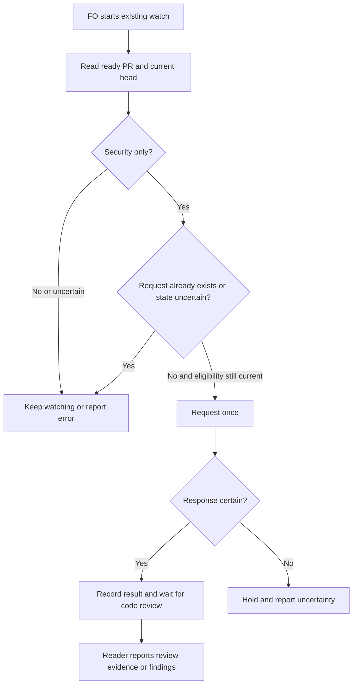

## Scope

- Source: the Captain 「3. 要」 (chat, 2026-11-13), answering FO's item 3: 「下一輪顧問試跑要不要現在開始準備，以及是否把「合併前這一段」的三個摩擦點各開一張任務。」 Evidence: the route trial of 2026-11-13, FO's hand-kept log and result (worker stages took 15 to 30 minutes; validated to merge ask took 85 to 120 minutes on three tasks).
- Bite: on 2026-11-13 Codex answered three of four ready PRs with a security-only pass; the reader already prints the next line telling FO to comment once, but nothing ran it until FO looked, and FO's wait loop held two ready PRs about 40 minutes behind the third.
- Upstream first, open for the design: what the delivery check, the validation skill text and the listed extensions already do for this, and whether a smaller change to one of them is enough.
- Non-goals: to be set at ideation.

## Budget
1 implementation and 2 validation cycles, in one package PR.

## Stop condition
- In a replay of the four recorded PR states, the security-only ones get exactly one trigger and none gets two, with no FO step between ready and the trigger.

## FO alignment

Alignment: not needed before ideation: an observed friction with counts; the mechanism is compared in the design.
Surfaces: none
Visible change: none
Release review: not needed: workflow maintenance, on no journey map.
Reviewer: kc-dev-flow-2:engineering-reviewer not run 2026-11-13: amendment 1 withdraws the automation and its exactly-once condition and replaces them with one sentence of extension text the Captain worded himself; nothing is built that a reviewer could find withdrawn behaviour in.

## Captain amendments

### Amendment 1 — 2026-11-13, chat
Captain: 「「自動觸發 Codex 審查」改成一句規則：FO 標成可審查時同時留言請 Codex 審查一次；原本的自動化和「恰好一次」條件作廢」 (chat, 2026-11-13)
Asked: 「「自動觸發 Codex 審查」這張要怎麼走？ 同意第一個選項即接受：這張的範圍從「程式自動觸發」改成「在 Codex 擴充的說明加一句：FO 把 PR 標成可審查時同時留言請 Codex 審查一次」，我自己的出貨腳本現在就照做；記成這張的修正案，原本「恰好一次」的停止條件作廢。變差的是：仍然靠 FO 記得做（但和標成可審查是同一個動作）；偶爾會讓 Codex 對同一版多審一次，我沒量過這個成本。」
Supersedes: AC-1, AC-2, AC-3, AC-4
Superseded text:

**AC-1** In a replay of the actual four pre-request recorded states, the security-only PRs receive exactly one simulated trigger each, all others receive zero, without an FO step between ready and trigger. Verified by a test-double replay from preserved immutable per-case snapshots, with command, exit and output path. Falsifier: delete a trigger, duplicate one, or substitute a reconstructed state for a recorded one. Current: not provable; only three reconstructions and one synthetic control were run, exit 0, `evidence/ideation-1/probe-output.json`.

**AC-2** A repeated poll, restart, concurrent watcher and lost response cannot silently duplicate a request; uncertain delivery is surfaced rather than treated as a completed review. Verified by double-backed interleavings and lost-response injection with observed request counts and persisted states. Falsifier: server accepts and response is lost, followed by retry producing two. Current: FAILED on the probe: two accepted fake requests; same output, command and exit as Probe.

**AC-3** Only an open, ready PR at the current head with a security-only result and no existing request qualifies; existing findings remain findings and a request is not a review round. Verified by the package's reader/watch doubles with pre-existing request, draft, closed, moved-head, clean and findings controls. Falsifier: any ineligible control posts or a request yields `evidence=`. Current: not verified as a whole; the synthetic clean control posted zero.

**AC-4** State and review changes add no unintended FO instructions, with before/after total words at startup, open and merged PR idle, archive and merge ask measured by the same complete method. Verify with reproducible per-moment recount including applicable outputs, independently checked. Falsifier: omitted passage/output or a claimed count without its artifact. Current: not measured.

## Design

**Status: HOLD — stop condition not established; do not present as a finished design.**

### PRFAQ

**Proposition.** While FO's existing watcher is running for a ready PR, a completed security-only review causes one code-review request without FO intervening; it remains no review round. This is desired, not proved.

**Why?** The Captain approved investigating the delay. Without an automatic trigger, the three public timelines show the code review requests occurring after the security completion. Without the need to avoid duplicate requests this would be an ordinary watcher change; the cheap failed-response replay below disproves that simpler premise.

**How?** Candidate direction only: extend `kc-dev-flow-2/scripts/pr_watch.py` and its existing tests, not the delivery check. Eligibility needs an open, ready PR, an exact current head and a fresh security-only reader result, no existing code-review request for that head, and safe handling of races, session restart, ambiguous remote results and concurrent watchers. Preserve the reader's evidence and review-round behavior. Real GitHub comment creation is an external write; no live write was attempted. Fail closed and report uncertainty where the write outcome is unknowable; that sacrifices automatic recovery until someone resolves it. Existing `gh` authentication would be needed in real use, not in this probe. Do not merge, mark ready, modify existing comments, change review policy, or build a new hosted daemon.

The diagram is a proposal, not a proven cross-session exactly-once protocol. A lock local to one machine cannot coordinate another machine or an unrelated human; a remote create followed by a lost response cannot be atomically committed with local state. Reading comments later may help recovery but its freshness, author identity, same-head attribution, and race limits require a tested contract. GitHub's documented create-comment endpoint exposes a body and a creation response, not a documented idempotency key: https://docs.github.com/en/rest/issues/comments#create-an-issue-comment . OpenAI documents `@codex review` as a comment trigger: https://learn.chatgpt.com/docs/third-party/github . No provider guarantee of exactly-once was found in those pages.

### Worth questions

- Trigger: serves the Captain's request to remove the ready-to-review delay; without it FO continues to intervene. If ready reliably starts a code review, the task is unnecessary; compare the historical code/security completion times and requests in `evidence/ideation-1/timeline-summary.json`.
- Duplicate avoidance and uncertainty: serves the explicit stop condition; without it repeated or concurrent watchers may trigger twice. A provider idempotency guarantee would simplify this; the published comment API did not document one and the local lost-response falsifier produced two accepted calls.

### Existing chain and limits

Spacedock's FO contract orchestrates and delegates, not Codex triggering. The package at origin/main `6a1eaf837bd6087cd0b8b665dc19beaed3c44dff`, version 0.41.0, already has `codex_review.py` returning exit 4 with `security-only=` and no `evidence=`, and `pr_watch.py wait` prints an FO request once per head **per session**, recording the marker before FO acts. The delivery check runs at merge ask, too late for the ready-to-trigger gap; validation principles concern validation records, not PR watching. The Codex extension documents the existing request. Reuse the reader and watcher, not replace them. Relay and QNow have four and two tracked README references respectively (read-only searches; counts only); their behavior was not exercised. Web adopter state was not checked. No claim of absence outside these bounded searches.

ADR 0015 (Draft PR and watch ownership), ADR 0039 (findings on the same head remain held), and ADR 0084 (local Pilot probe) are accepted at the pinned base. None proves remote duplicate safety. Review outcomes and merge authority remain unchanged.

### Probe

Probe: `poc/ready-pr-gets-a-codex-code-review-without-fo-noticing`; base `6a1eaf837bd6087cd0b8b665dc19beaed3c44dff`; last commit `fc0f411302cd7a474de975532b67ff72813cb226`; portable diff `evidence/ideation-1/probe.patch`.

- Hypothesis: an existing active wait can request without another FO step. Three independently named **reconstructions** of security-only state each produced one fake request across two waits; a synthetic already-reviewed control produced zero. These are not the original four captured states, and the doubles call the watch loop but replace the remote writer, not GitHub.
- Hypothesis: the trivial post-then-record extension provides exactly once after an uncertain result. **False:** a fake server accepted the request and lost the response on each of two attempts; the probe produced two accepted calls and exits 2, 2. The probe is unsafe for real use and omits multi-session locking, comment reconciliation and head race checks.
- The latest public summary for each of PRs 858–860 now reports both reviews completed, but its table dates security completion before the manual code request. PR 861 had its request before ready; PR 864 likewise; PR 866 was still draft with no ready event in the read timeline. The three old security-only JSON marker bodies and the identity/state of the fourth case are not recoverable from those mutable summaries alone. No original snapshot was supplied. Do not describe these reconstructions as recorded states.
- Evidence command, run once on the probe: `TMPDIR=<scratch> PYTHONDONTWRITEBYTECODE=1 python3 -B kc-dev-flow-2/scripts/probe_ready_review.py <scratch>/run`; exit 0; output `evidence/ideation-1/probe-output.json`, stderr `probe-error.txt`. A zero exit means the script reproduced the duplicate, not that the product criterion passed.

### Not provable now

- AC-1: replay of four actual recorded pre-request states, including identification of the fourth, lacks immutable snapshots; no claim that the stop condition passed.
- AC-2: exactly one delivered request through ambiguous network completion, multiple sessions, another machine and human race; provider and coordination contract unresolved. No live credentials or shared environment were used.
- AC-3: all readiness transitions, head changes and existing-request races; only the stated synthetic control was exercised.
- AC-4: total FO words at each moment, before and after, have not been measured; the probe did not implement final documentation or outputs.

### Words FO reads at each moment

| Moment | Before | After | Evidence |
| --- | --- | --- | --- |
| Startup | not measured | not measured | full applicable instructions and outputs need a common recount |
| Idle, open PR | not measured | not measured | synthetic wait output exists; it is not a total lifecycle count |
| Idle, merged PR | not measured | not measured | full applicable instructions and outputs need recount |
| After archive | not measured | not measured | full applicable instructions and outputs need recount |
| Merge ask | not measured | not measured | full applicable instructions and outputs need recount |

### Unresolved decision for the Captain

Recommend a bounded at-most-once attempt with a visible hold after an uncertain write, then reconcile before any retry. This avoids automatic duplicate retries but can leave a PR without a trigger until a person or a separately proven recovery resolves the uncertainty; it does not satisfy the current unconditional exactly-one stop condition. Does the Captain accept that trade-off and adjust the stop condition, or require an independently specified coordination/provider mechanism that establishes the original condition? An unattended recurring external write also needs the profile and operational ownership decision; do not start implementation before FO routes the decision.

### Batch overlap

Proposed files: `kc-dev-flow-2/scripts/pr_watch.py`, `kc-dev-flow-2/scripts/test_pr_watch.py`, `kc-dev-flow-2/extensions/codex/EXTENSION.md` (and any other documentation only if measurement requires it). No final file set is approved.

- `merge-ask-is-produced-from-records` and `validator-commands-fit-the-delivery-check`: their scopes both name the delivery check, not the proposed watcher files; no overlap observed so far. They are ordered first then third by the dispatch.
- `ready-pr-gets-a-codex-code-review-without-fo-noticing`: this task owns the watcher files above.
- `adoption-asks-which-extensions`: its design mentions `pr_watch.py` as an unchanged output; no shared changed file identified at the state read.
- `adr-required-statement`: changes workflow/ADR checking, no shared changed file identified; `adr-silent-undo-probe`: fictional ADR harness, none identified.
- `comment-check-reaches-delivery-gate`: its proposed delivery check, test and validation principles do not overlap the watcher files.
- `journey-canvas-hosted-poc`, `journey-server-host-pilot`, `ops-inbox-r1-setup-and-isolation`, `pr-review-lite-value-pilot`: no overlapping changed file established from the available task records; the server task has a folder but no top-level task file at this state. Recheck before implementation as live work can change.

Recommended order: first `merge-ask-is-produced-from-records`, then `validator-commands-fit-the-delivery-check`; this held task can be ordered independently after its decision, with a fresh overlap check.

## Acceptance criteria

**AC-5** Amended by Captain, amendment 1. FO 標成可審查時同時留言請 Codex 審查一次。 The Codex extension's text carries that sentence at the step where FO marks a PR ready, and the package lint passes with it. Evidence: to be run on the candidate by the build worker (a search of `kc-dev-flow-2/extensions/codex/EXTENSION.md` for the sentence, and `lint-skills.py`), recording command, exit and output path. Falsifier: removing the sentence makes the search exit non-zero.

## Stage Report: ideation

- DONE: Check the chain first (Spacedock, then kc-dev-flow-2, then sibling adopters) and say what you found; for a third-party mechanism read its own docs or source, not an adopter's workaround.
  Chain and bounded searches in Design; Web adopter not checked; provider links and accepted ADRs are named there.
- FAILED: Run this ideation probe-first, as the text merged on origin/main by PR 864 (ADR 0084, not yet released) asks: before writing the design, build a throwaway probe of this task's outcome on the local branch from origin/main, run it on the real cases the task's Scope and Stop condition name, and save what it showed in the task folder.
  Probe committed and preserved as a local branch and patch; immutable original four states unavailable, so three reconstructed inputs plus one synthetic control do not meet this item; uncertain response reproduced two accepted fake calls.
- DONE: Under a Probe: line in the design record the branch, base and last commit and each hypothesis with its result; remove the probe worktree before reporting and keep the branch.
  Branch and patch are pinned under Probe; worktree removed, branch retained.
- FAILED: Every criterion's evidence command runs once on it, recording command, exit and output path per criterion, provenance included; what cannot run goes under Not provable now with the criterion named.
  The stated command was run once; actual historical replay, race-safe delivery, complete controls and word recount remain unprovable or unrun as listed by AC; no invented passes.
- DONE: A `### Batch overlap` section naming each file the design would change and each other batch task and live task of other sessions that changes the same file or check, so FO can order implementation.
  See Batch overlap; order needs a fresh check before building.
- FAILED: The words FO reads at each lifecycle moment, before and after, per root learning.md "Measure the words FO reads at each moment, not one file's size".
  All five moments are explicitly not measured; the probe output alone cannot establish complete totals.
- DONE: Acceptance criteria with reproducible evidence clauses and falsifiers, and unresolved decisions for the Captain, each with a recommendation and what gets worse under it.
  AC-1 through AC-4 have falsifiers; the one material decision and trade-off are recorded. All are current failures or unverified, as individually stated.
- DONE: Before reporting, run the design surfaces check and the scratch close command.
  `design_surfaces.py check` exit 0, evidence/ideation-1/design-check.txt; this syntax check does not override the hold. Scratch output: `Scratch removed: /private/tmp/dev2/kc-claude-plugins-3042bb224e995ded/ready-pr-gets-a-codex-code-review-without-fo-noticing/ideation-1 (26037 bytes)` and `Evidence: evidence/ideation-1/ (5 files, 9.6 KiB)`.
- FAILED: AC-1.
  Actual four historical snapshots unavailable; synthetic inputs do not prove the replay stop condition.
- FAILED: AC-2.
  Lost-response falsifier yielded 2 accepted fake requests; `evidence/ideation-1/probe-output.json`.
- FAILED: AC-3.
  Synthetic clean control was zero; draft, prior-request, moved-head and findings controls not run.
- FAILED: AC-4.
  Per-moment word totals not measured.

### Summary

Do not advance this design: the naive watcher probe duplicates a trigger after an ambiguous response and does not establish the requested real-case replay. FO should route the one bounded-delivery trade-off and obtain immutable original snapshots or an explicit acceptance change before another probe; no implementation, live review comment, or product PR was made.

### Round 1

Start 2026-11-13 21:43:22; end 2026-11-13 21:48:49 Asia/Taipei (system `date`, CST); base `6a1eaf837bd6087cd0b8b665dc19beaed3c44dff`; probe `fc0f411302cd7a474de975532b67ff72813cb226`. Fired: premise overturned (naive exactly-once); Captain decision on criterion/trade-off; boundary without an atomic provider/local-state contract; unattended external write and ownership/profile decision. No screen or stored product data touched; no unapproved scope or budget change.

## Stage Report: implementation

- DONE: Build Captain amendment 1 and nothing else: add to kc-dev-flow-2/extensions/codex/EXTENSION.md, at the step where FO marks a PR ready, one sentence saying FO comments a Codex review request on the PR once, keeping the existing after-a-repair sentence consistent with it.
  Base `6a1eaf837bd6087cd0b8b665dc19beaed3c44dff`; candidate `1c8a29faf402ef6d7018c298f59bad58d38cfb1d`; branch `spacedock-ensign/ready-pr-gets-a-codex-code-review-without-fo-noticing`; one insertion in one named file, no product script or test changes. Probe branch deleted after commit; saved probe patch remains in the ideation evidence.
- DONE: Run AC-5's evidence on the candidate and record command, exit and output path.
  The sentence search exit 0 in `evidence/implementation-1/ac5-candidate.log`; package lint exit 0 in `lint.log`; full commands and provenance in `commands.md`. Extension count 325 to 343 whitespace words; the lint budget applies to unchanged workflow.md, 6099/6099, so no raise.
- DONE: Every acceptance criterion green with the evidence each names; each falsifier shown failing by a mutation you run (python3 -B, caches cleared).
  AC-5 alone remains active. Removing its added line in a scratch copy made the same sentence search exit 1, as required, `evidence/implementation-1/falsifier-candidate.log`; the mutation used `python3 -B` and a fresh cache prefix. AC-1 through AC-4 were superseded by amendment 1, with their original text retained there.
- DONE: kc-dev-flow-2/scripts/lint-skills.py (the repository copy CI runs), /Users/kent/.claude/plugins/cache/kc-claude-plugins/kc-dev-flow-2/0.41.0/scripts/adr_lint.py docs/adr --since <base> exit 0; /Users/kent/.claude/plugins/cache/kc-claude-plugins/kc-dev-flow-2/0.41.0/scripts/number_guards.py check exit 0; /Users/kent/.claude/plugins/cache/kc-claude-plugins/kc-dev-flow-2/0.41.0/scripts/comment_ratio.py within its maximum; commit locally, no push; PR text written for FO; FO pushes, opens the Draft PR, runs RoboRev and reads CI; CI cost measured or stated as not measured.
  All four commands exit 0 with logs in `evidence/implementation-1/`; the first number-guard run could not refresh remote state, and a second passed with the remote read. Comment ratio is 0 added code and 0 comments; its 5% threshold is not enforced below 20 code lines. PR text: `implementation/pr.md`. CI cost not measured. No product branch push or PR; RoboRev and hosted CI not run (FO-owned).
- DONE: Run design and affected-document checks, retain evidence and close scratch.
  `design_surfaces.py check` exit 0, `doc_impact.py <base> <candidate>` exit 0 and lists zero documents; `EXTENSION.md` itself updated. Logs and commands in `evidence/implementation-1/`. Scratch output: `Scratch removed: /private/tmp/dev2/kc-claude-plugins-3042bb224e995ded/ready-pr-gets-a-codex-code-review-without-fo-noticing/implementation-1 (9361 bytes)` and `Evidence: evidence/implementation-1/ (10 files, 3.8 KiB)`.
- SKIPPED: One Draft PR from a branch off origin/main.
  The explicit dispatch delegates pushing and opening the PR to FO; the local candidate and PR text are ready. `roborev not run: FO runs RoboRev after you report`.

### Summary

One approved sentence was committed locally; AC-5 and the required local checks passed. No implementation of the withdrawn automation was carried forward. Start 2026-11-13 21:59:08; end 2026-11-13 22:02:45 Asia/Taipei, system `date` (CST). Validation, RoboRev, hosted CI, Draft PR and merge remain FO-owned and unverified.

## Stage Report: validation

- DONE: Independent verdict on PR #867 head 1c8a29fa against every acceptance criterion in the task file, re-running each evidence command and at least one falsifier per criterion yourself, and judging each limit the implementation report states
  PASSED at `1c8a29faf402ef6d7018c298f59bad58d38cfb1d`, base `6a1eaf837bd6087cd0b8b665dc19beaed3c44dff`; AC-5 alone is active. Exact rerun commands/exits and limits: `evidence/validation-1/commands.md`, `results.json`; live public Draft PR pin: `pr.json`, `repository.json`.
- DONE: The change is one sentence of text in kc-dev-flow-2/extensions/codex/EXTENSION.md under Captain amendment 1 (criteria AC-1 to AC-4 are superseded; AC-5 is the only criterion).
  `candidate.diff` proves one insertion only; the English text preserves FO, ready event, review comment and once at that event, with no new guarantee. Its ready-event entry immediately precedes the unchanged repair-event rule; both agree.
- DONE: Judge that the sentence says what the Captain's words say and adds nothing, that it sits at the step where FO marks a PR ready, that the existing after-a-repair sentence still agrees with it, and that the package lint and the extension's own tests pass; run AC-5's evidence and its falsifier.
  `ac5.log` exit 0; removing only that line in a scratch copy makes the same search exit 1 (`falsifier.log`, `results.json`). Exported-candidate `lint.log` exit 0 and `codex-tests.log` 36/36 pass; reader tests do not detect removed prose, so the separate falsifier supplies that proof.
- DONE: A minimal acceptance script the Captain can run (three to six steps, exact commands, expected output), run by you exactly as written in a fresh bash shell, with its observed output
  Four steps in retained `evidence/validation-1/acceptance.sh`, exact Captain command in `commands.md`; fresh `bash --noprofile --norc` downloaded the public pinned archive, search/negative/lint/36 tests passed, exit 0 in `acceptance.log`. Independent of product worktree and removed scratch; no live review is claimed.
- DONE: /Users/kent/.claude/plugins/cache/kc-claude-plugins/kc-dev-flow-2/0.41.0/scripts/adr_lint.py docs/adr --since <base> with its exit code; your verdict naming the head, with findings classified by the workflow's Review-finding disposition
  `python3 -B /Users/kent/.claude/plugins/cache/kc-claude-plugins/kc-dev-flow-2/0.41.0/scripts/adr_lint.py docs/adr --since 6a1eaf837bd6087cd0b8b665dc19beaed3c44dff` exit 0, 77 records (`adr-lint.log`). No Material, Deferred risk, Polish, or Needs decision findings.
- DONE: Required document, comment and dispatch checks; preserve evidence and close assigned scratch.
  `doc-impact.log`, `comment-ratio.log`, `design-check.log`, `dispatch-records.log` exit 0; extension updated, no other affected documents. Role-trigger check exited 0. Public evidence retained; cleanup output in `validation-close.log`.
- SKIPPED: Do not rerun the full package suite or build mutants for unrelated code; say what you did not run and why that is proportionate
  No full suite, unrelated mutants, automation replay, browser run, live Codex review, RoboRev or hosted CI: one documentation sentence only. No Number guards section or changed/reserved ADR exists, so no number-guard rerun. CI and duplicate-review costs not measured.

### Summary

PASSED for amendment 1's text-only outcome at `1c8a29faf402ef6d7018c298f59bad58d38cfb1d`: the addition is sufficient, and removing it loses the ready-event instruction. Implementation limits are assessed in `evidence/validation-1/commands.md`; FO still owns review, Captain gate and delivery; green local checks do not prove merge/adoption. Start 2026-11-13 22:05:06 Asia/Taipei, clock tool UTC converted +08:00.

Scratch removed: /private/tmp/dev2/kc-claude-plugins-3042bb224e995ded/ready-pr-gets-a-codex-code-review-without-fo-noticing/validation-1 (32986888 bytes)
Evidence: evidence/validation-1/ (17 files, 19.0 KiB)
