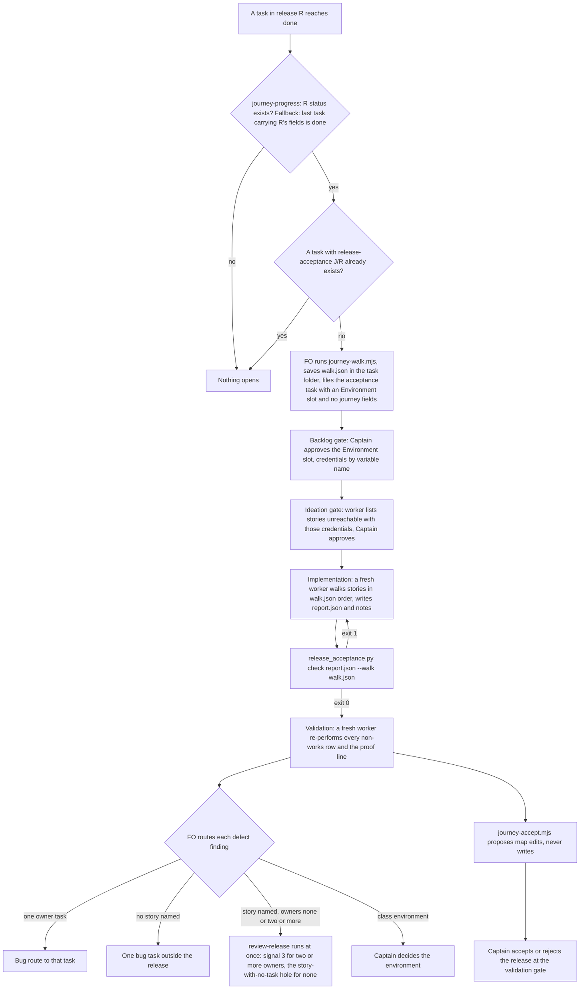
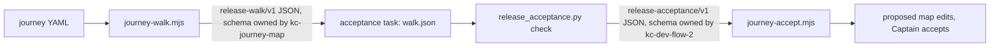

Issue iamcxa/kc-claude-plugins#571: a release is reviewed as one journey before its tasks are split, but nothing enforces that review, and nothing walks a release as a whole after its stories are built.

## Scope

Captain 2026-10-09 (qnow session), asking where the release-scale acceptance he had discussed lives: 「我們有討論過一個改進是，每個 release 應該要在故事都完成後，立一張票做 release scale 的驗收，目的是發現單獨故事做完之後是否仍有不可用的狀況，例如沒想到的問題，或是功能做完但流程不能走，沒有進入點...諸如此類，目前這個在哪裡？」; then 「可以」 to filing #571 and running the acceptance by hand on R3; 「照這樣核准。此外release 整版驗收要加入成為 workflow 的標準機制，應該加到哪個套件？」 (2026-10-10); then 「現在開」 to the FO's recommendation: the mechanism's main body in kc-dev-flow-2 (when the task opens, who walks, what the report carries, how failures route back to release review) paired with a kc-journey-map mode that produces the walk list from the map and takes the result back, joined by a declared contract, not shared code.
Evidence (copied into this task's folder): r3-acceptance.md (RELEASE 3 walk, 2026-10-09: found the office 確認 action off-screen at common laptop widths, which no single task's validation saw) and r4-acceptance.md (RELEASE 4 walk, 2026-10-10: R4's proof line could not be performed on staging until the opt-in operator secret was found; found the owner tab-bar icon font served as HTML).
Non-goals: rewriting the existing review-release mode; adopter-specific environments.
Budget and stop condition: to be set at ideation.

## Design

Base read: origin/main 2256b2288e8c15a1ecd2b7356859249d75b4d6f6 (`kc-dev-flow-2/references/sd/workflow.md` backlog bullet "Release review", `kc-journey-map/skills/kc-journey-map/references/release-review.md`, `kc-journey-map/lib/progress.mjs`, issue #571 read with `gh issue view 571`, 2026-10-10). Profile pilot holds: the mechanism adds a published upgrade consumers absorb, no production data, no credential held by the package, no recurring unattended operation.

### PRFAQ

**Press release (future).** A release is no longer finished when its last story task is done. A fresh worker walks the whole release on the hosted environment, story by story, in the map's order, and reports each story as works, broken, missing an entry point, or not reachable with the credentials given. A flow that crosses tasks goes back to release review at once. And an implementation can no longer start while a release the Captain changed has not been reviewed: the check refuses, and says which change is unreviewed.

**FAQ.**

- *What does the Captain get that he does not have today?* Today a release walk exists only because he asks (R3, R4 were hand-run, 2026-10-09 and 10-10), and the pre-implementation review is a prose line "no script checks" (workflow.md). After this: the walk opens by rule, and the review line is checked.
- *Why is the main body in kc-dev-flow-2?* Captain 2026-10-10: the mechanism's main body (when the task opens, who walks, what the report carries, how failures route back) is dev2's; kc-journey-map only produces the walk list and takes the result back.
- *Why is enforcement a script and not a refusal in `spacedock dispatch build`?* `dispatch build` belongs to Spacedock, a separate repository. Its `--help` (0.27.2) lists no precondition input, and `internal/dispatch/build.go` and `stamp.go` refuse only on their own conditions (entity path, status vs stage), so this package cannot add a refusal there. The issue's own alternative is "a package script the FO must run, with the same check". The package already has this pattern: the Seed check (`design_surfaces.py check --seed`) runs before `gate prepare`, and the worker's own check is the backstop.
- *What does the script not prove?* That a review was done well. It proves the line exists, has the right release and a plausible commit, and is newer than every recorded change. An FO that records no `Release changed:` line is not caught (named, not hidden).
- *Why does the acceptance task carry no `journey*` fields?* `findOrphans` in `progress.mjs` keys on journey+release+story; a task with journey and release but no story is listed as an orphan and `journey-progress.mjs` exits 1. The acceptance task names its release in its body and in one new frontmatter field, `release-acceptance: <journey>/<release-id>`, which no journey reader reads.
- *Cost?* Two PRs, no new CI job (both plugins already have a test workflow, `kc-dev-flow-2-tests.yml`, `kc-journey-map-tests.yml`). A walk is one fresh worker and one validation worker per release; the per-release token cost is not measured.

### Existing-code check (recorded conclusion)

- **Release review.** Journey: signal → mark → single checkpoint → `review-release`. Completeness: procedure only; workflow.md says "no script checks that line"; the archived design chose this on purpose ("advisory, named plainly"). Need: a falsifier exists now, R4 (issue #571 item 1: implementation dispatched with signals 1 and 2 recorded and no review). Decision: add a checker for the line; do not touch `review-release`.
- **Release acceptance.** Completeness: a display label only. `progress.mjs` sets `releases[].acceptance = 'pending delivery acceptance'` when every story is done, `records.mjs` draws it, `progress.test.mjs` asserts it; two bounded searches (`git grep -i "delivery acceptance"` and `git grep -i -E "release.{0,12}(acceptance|walk)|acceptance (task|walk)"` over kc-dev-flow-2 and kc-journey-map, CHANGELOGs excluded) found no consumer that opens work from it. Need: the Captain's request and the two hand walks. Decision: use that label as the trigger; build only the task, report and contract. Exclusions and unknowns: adopter repositories were not searched; adopters that track no completion (`journey-required-tasks` absent) cannot emit the label (see Captain decision 4).

### Part 1: kc-dev-flow-2 (the main body)

- **When it opens.** Trigger 1 (preferred): after any task in release R reaches `done`, FO runs `journey-progress.mjs <journey.yaml> --workflow-dir <dir>`; release R `status: exists` (its `acceptance` reads `pending delivery acceptance`) with no task carrying `release-acceptance: <journey>/<R>` opens one task. Trigger 2 (fallback, only where the adopter tracks no completion): the last task carrying `journey-release: R` reached `done`; the backlog gate then lists stories with no done task. Duplicate guard: `spacedock status --workflow-dir <dir> --archived --all-fields --json` shows the `release-acceptance` field (same mechanism `progress.mjs` already uses for the `journey*` fields).
- **The task.** Ordinary five-stage `pilot` task, slug `<release>-acceptance`, body `Acceptance of: <journey>/<R> at <journey-file commit>`, `Walk list: walk.json` (the snapshot FO produced, pinned to that commit), and an `Environment:` block (target, deployed ref, `<wrapper>` command, opt-in variable NAMES, test identities by role; never a value). It carries no `journey`, `journey-release` or `journey-story`.
- **Who walks.** A fresh worker dispatched without reuse (no `--advance`) in the implementation stage; validation is already `fresh: true`. FO checks that the walker's dispatch is not the worker of any story task in R; no script enforces this (procedure, named plainly). The walker starts from the persona's first situation in `walk.json` and, for each story, reaches it by navigation from where the previous story left the person, never from a URL handed to it. Failing to find a way in is the finding `missing entry point`. A story whose step `command` or `system` line names an API or operator action is reached by that command with the `Environment:` credentials, and the `entry` recorded is that command (R4's onboarding and add-branch stories). The walker runs `release_acceptance.py check` before it signals completion; validation runs it again.
- **What the report carries.** `report.json` (`release-acceptance/v1`, schema below) plus free notes beside it for observations. Per story: `works | broken | missing-entry-point | not-reachable`, the entry used, evidence file names, and finding ids. A `not-reachable` row needs a `cause` (R4's four rows: the operator API needed an opt-in secret the wrapper did not export). Then the proof line result (`performed | not-performed | failed`), findings, `not_tested`, `data_left`.
- **How failures route.** Per `defect` finding: exactly one owner task, route to that task; no story named (R4 C-2, icon font served as HTML), one bug task outside the release; a story named with two or more owners is signal 3 as workflow.md defines it (a failure crossing two or more tasks); a story named with no owner (R4 C-3, nobody owns a path to a manager on the seeded branch) is the "story with no task" hole that `review-release` already names. Both go to the same place: FO runs `review-release` at once and splits new tasks from its output. The workflow.md edit says this in one sentence and does not widen the definition of signal 3. `known-gap` findings name the gap story on the map. `environment` findings go to the Captain. The walk worker triages nothing; FO triages (as for R3, "FO triage").
- **Validation.** A fresh worker re-performs every row that is not `works` and the proof line, and re-runs the check script. `works` rows are accepted on their cited evidence file and are not re-performed; that is the stated limit. The Captain's gate decision is the release acceptance.
- **Enforcing the pre-implementation review (second half of #571).** `scripts/release_review.py check <task> --workflow-dir <dir>`. Marks and reviews are lines in any task's `## FO alignment` (live or `_archive/`), at line start:
  `Release changed: <journey>/<release-id> signal <1|2> at <YYYY-MM-DDTHH:MMZ>: <reason>`
  `Release review: <journey>/<release-id> at <journey-file commit> on <YYYY-MM-DDTHH:MMZ>`
  The task's frontmatter `journey` and `journey-release` select the release; a task with neither is outside the check (exit 0, as the rule already says for bugs). The check exits 1 when the latest mark for that release is not older than the latest review (or no review exists), printing the marking task, signal and time; an unparsable time or a review commit that is not a hex SHA of 7 to 40 characters also exits 1, naming the file. `Release review: not needed: <reason>` stays as is. FO runs it before building the first implementation dispatch of a task in a release; the implementation skill runs it first on a cycle-1 dispatch and holds, quoting the output, on exit 1. The FO step is the gate; the worker step is the backstop for an FO that skipped it, as the Seed check's worker backstop does. A repair dispatch (cycle 2 and later) is not re-checked. Signal 3 needs no mark: it runs the review at once.
- **R4 as the failing case.** Fixture shape: release `r4` has task A in implementation-ready state; a `Release changed: ... signal 1` line sits in task A, a `signal 2` line sits in another task a few hours later; no review line. Today the FO dispatches (it did). With the check: exit 1 naming both marks. After a review line dated after both: exit 0. A later signal-2 mark: exit 1 again.

### Part 2: kc-journey-map (the mode)

- **Mode `accept-release`**, new row in the `SKILL.md` mode table and `references/accept-release.md`. It leaves `review-release` unchanged (Scope non-goal).
- **`lib/journey-walk.mjs <journey.yaml> <releaseId>`** prints `release-walk/v1` JSON. Stories are those with `release: <releaseId>`, ordered by step order then story order inside the step. `proof_line` is the release `goal`, verbatim (the same text `release-contract.mjs` prints); no new field. The map stores no URL or route, so the list gives each story's step `card` and `activity`, `status`, `evidence` symbol when present, the step's `system` lines and applicable `rules`; the walker finds the entry itself and the report says what it used. A map-level `entry` field is a Captain decision (6), not part of this design.
- **`lib/journey-accept.mjs <journey.yaml> <report.json>`** reads `release-acceptance/v1` and prints proposed map edits; it writes nothing (map-first, the Captain accepts, as `review-release` step 1 already requires). Rules, from `cell-contract.md` ("`exists` ... does not mean delivery acceptance"): `works` changes nothing, because acceptance is not a status and `exists` needs an evidence symbol; `broken` on a story whose status is `exists` proposes `unverified`; `missing-entry-point` on `exists` or `unverified` proposes `gap` (the contract's own rule: a handler with no route is `gap`); `not-reachable` changes nothing and its stories plus `not_tested` are proposed as the text of the status card's `unproven` line. It refuses (exit 1) a report whose schema string is not `release-acceptance/v1` or whose story ids are not all on the release.

### Part 3: the declared contract

Per the Captain's 2026-09-06 rule (plan / dev / ship connect only by declared input and output contracts, schemas live with the producer), neither plugin imports the other's files. Each side pins the other's schema string, refuses anything else, and tests against the example JSON that its own producer-side doc prints (so a doc edit that breaks the consumer fails a test).

`release-walk/v1` (documented in `accept-release.md`): `schema`, `journey`, `persona`, `one_journey`, `release{id,name,goal}`, `source{file,commit}`, `proof_line`, `stories[{order,id,card,step{id,card,activity},status,evidence,system[],rules[{id,text}]}]`.

`release-acceptance/v1` (documented in `kc-dev-flow-2/references/sd/release-acceptance.md`): `schema`, `walk{journey,release,source_commit}`, `target{environment,ref}`, `stories[{id,result,entry,evidence[],cause,findings[]}]`, `proof_line{result,evidence[],cause}`, `findings[{id,class,stories[],owners[],summary}]` with class one of `defect | known-gap | environment | by-design | not-defect`, `not_tested[]`, `data_left[]`.

`release_acceptance.py check <report.json> --walk <walk.json>` exits 1 when: a schema string differs; report journey/release/commit differ from the walk's; a walk story is missing, duplicated or unknown in the report; a result is outside the four; a `not-reachable` row has no `cause`; a non-`works` row names no finding; a `works` row has no evidence; a finding id is referenced but not defined; a `defect` has no `owners` key; the proof line is absent. On exit 0 it prints counts, one routing line per defect (`route: <owner>`, `route: bug task, no story`, `route: review-release`), `Captain decision: environment` for an `environment` finding, and `clean: yes|no` (yes only when every story works, the proof line was performed and no `defect` remains). It decides nothing; the Captain accepts.

### Fixtures, and what they can and cannot show

The two hand walks (`r3-acceptance.md`, `r4-acceptance.md`) live in this task's folder, not in the public package, and name an adopter's staging host and shop data. The implementation copies their shape, not their text, into the package as synthetic fixtures on the `journey.example.yaml` book-pickup journey: R3-shape (9 stories: 8 works, 1 not-reachable by choice; one defect with one owner; one known gap; one not-defect; one by-design; proof performed), R4-morning-shape (6 stories: 2 works, 4 not-reachable with one cause; one environment finding; proof not-performed), R4-evening-shape (6 works; proof performed; one defect with no owner and a story, one defect with no story, one defect with one owner). The real qnow task files were not available to this ideation, so the R4 enforcement fixture is reconstructed from the issue text and `r4-acceptance.md`, not from the qnow tasks.

### ADR (draft, no number)

`docs/adr/`: "A release is accepted by walking it, and the two plugins meet only at two named schemas". Ruling: the walk list and the acceptance report are versioned JSON documents owned by their producers; no shared code; the map is changed only by a proposal the Captain accepts.

### Non-goals and limits

Not touched: `review-release`, Spacedock, any adopter environment or secret. Not claimed: that a worker obeys the cycle-1 check (instruction, covered by one live rehearsal, AC-5); that the walker was independent of the implementers (procedure); `works` rows are not re-walked at validation.

### Budget and stop condition (proposed; Scope left as the Captain wrote it)

Two PRs, one per plugin, either may merge first because the contract is pinned by string. Stop and return to FO if the work needs a third plugin file set, a Spacedock change, a second new frontmatter field, or a model-judged check inside a script.

## Acceptance criteria

**AC-5**: `journey-walk.mjs` prints `release-walk/v1` for one release of the book-pickup example: only that release's stories, step order then story order, `proof_line` equal to the release goal, and the same bytes on a second run.
Source: Captain 2026-10-10 (a mode that produces the walk list from the map); issue #571 ("along the journey map's story order").
Verified by: `node --test kc-journey-map/lib/journey-walk.test.mjs` on the example (r1 yields reserve-copy, check-ready, collect-book in that order); a mutated copy with two steps swapped yields the swapped order.

**AC-6**: `release_acceptance.py check` accepts the R3-shape report and routes it: the one-owner defect to its owner, the known gap to its gap story, 8 works, `clean: no`.
Source: `r3-acceptance.md` (results table, X-1 routed to a single task).
Verified by: `python3 kc-dev-flow-2/scripts/test_release_acceptance.py` asserts exit 0 and each of those output lines for the R3-shape fixture. Falsifier: deleting the `owners` entry of the defect makes it print `route: review-release` instead.

**AC-7**: The R4-shape reports separate environment from defect and route cross-task holes to `review-release`: the morning report (4 not-reachable, one cause) prints `Captain decision: environment` and `clean: no`; the evening report (6 works, proof performed) prints `route: review-release` for the defect with a story and no owner, `route: bug task, no story` for the defect with no story, and `route: <owner>` for the one-owner defect.
Source: `r4-acceptance.md` (four "not reachable" rows, C-1, C-2, C-3); issue #571 item 2 ("A failure that crosses tasks feeds back into a release review (signal 3)"); Captain decision on the environment question below.
Verified by: the same test file, two fixtures, asserting those lines.

**AC-8**: A malformed report is refused: each of a schema string other than `release-acceptance/v1`, a walk story missing, a duplicate or unknown story, a result outside the four, a `not-reachable` row without `cause`, a non-works row naming no finding, a `works` row without evidence, an undefined finding id, a `defect` without `owners`, and an absent proof line exits 1 with its own message.
Source: the Captain's wording 「功能做完但流程不能走，沒有進入點」 requires every story to carry a result; the contract rule that consumers refuse unknown schemas.
Verified by: `test_release_acceptance.py`, one mutation of the R3-shape fixture per bullet, each asserting exit 1 and the message.

**AC-9**: `journey-accept.mjs` turns a report into map proposals only: on a map whose six stories are `exists`, a `broken` row proposes `unverified`, a `missing-entry-point` row proposes `gap`, `works` and `not-reachable` propose no status change, `not-reachable` stories and `not_tested` appear in the proposed `unproven` text; the journey file bytes are unchanged afterwards; a wrong schema string or a story not on the release exits 1.
Source: Captain 2026-10-10 ("takes the result back"); `cell-contract.md` ("`exists` ... does not mean delivery acceptance").
Verified by: `node --test kc-journey-map/lib/journey-accept.test.mjs` with a sha256 comparison of the YAML before and after.

**AC-10**: The acceptance task cannot become a journey orphan: with the task's frontmatter as specified (`release-acceptance` set, no `journey*` fields), `findOrphans` lists nothing; the same task with `journey` and `journey-release` set and no story is listed.
Source: Captain 2026-10-10 (「現在開」 on the acceptance task as a normal workflow task); `progress.mjs` `findOrphans` (journey-progress exits 1 on an orphan).
Verified by: a case in `kc-journey-map/lib/progress.test.mjs`. Limit: unit level; AC-11 covers the live listing.

**AC-11**: The trigger and its duplicate guard work on a real Spacedock listing: in a disposable workflow, `spacedock new <release>-acceptance` plus `status --set <task> release-acceptance=<journey>/<R>` makes `status --archived --all-fields --json` show the field, and the documented guard finds it; `journey-progress.mjs` on that workflow reports release R `acceptance: pending delivery acceptance` once all its story tasks are done.
Source: Captain 2026-10-09 ("每個 release 應該要在故事都完成後，立一張票做 release scale 的驗收").
Verified by: a scratch-workflow run recorded in the implementation Stage Report, in the style of the archived `release-review` rehearsal ("a scratch-workflow rehearsal ... `status --set`"). Not yet verified: whether Spacedock 0.27.2 keeps an unknown frontmatter field through `state commit`.

**AC-12**: The plugins stay joined only by the two documented schemas: neither imports files from the other plugin directory; each doc prints an example JSON that its consumer's test loads; `review-release` text is unchanged; both plugins pass the sanitize check with no adopter name, host or data in docs or fixtures; no version file is edited; the ADR passes `adr_lint.py`.
Source: Captain 2026-09-06 (contracts only, schemas with the producer); Scope non-goal ("rewriting the existing review-release mode"); repository rule on public plugins.
Verified by: an import-scan test in each plugin; `git diff --stat origin/main -- kc-journey-map/skills/kc-journey-map/references/release-review.md` empty; `Skill: kc-plugin-forge:kc-plugin-forge-sanitize-check kc-dev-flow-2` and `... kc-journey-map` clean; `python3 kc-dev-flow-2/scripts/adr_lint.py` exit 0; both existing CI suites green.

## Captain decisions

1. **Environment and credentials for the walk (the R4 question).** Recommend: the package defines only the slot (`Environment:` block with variable names, never values), FO fills it from the adopter's own documents, the Captain approves it at the acceptance task's backlog gate, and the ideation worker lists the stories that credentials do not reach before any walk starts; the adopter owns documenting its opt-in secret (R4 C-1). What gets worse: if the adopter documents nothing, the walk still stops at `not-reachable`, now at ideation instead of mid-walk.
2. **Result back to the map.** Recommend proposals only: downgrade `exists` on broken or no-entry stories, record `not-reachable` and `not_tested` on the status card's `unproven` line, and leave nothing on a story that works. What gets worse: a clean walk leaves no mark on the map, so "accepted" lives only in the validation gate record. The alternative is a new orthogonal story field; it fails the without-it test today.
3. **Enforcement by script, not by Spacedock.** Recommend the package script plus worker backstop now. What gets worse: an FO that records no `Release changed:` line is invisible to it. The alternative, a precondition input to `spacedock dispatch build`, needs a request to the Spacedock repository and a release of it; say if you want that filed.
4. **Trigger where an adopter tracks no completion.** Recommend the fallback (last task carrying the release's fields is done) with the backlog gate listing stories that have no done task. What gets worse: it can open early when a story has no task yet.
5. **Ideation for the acceptance task.** Recommend keeping it, as a short walk plan that checks the environment, because the five-stage route has no skip and R4's surprise is exactly what that stage catches. What gets worse: one more gate per release.
6. **Map-level entry points.** Recommend no new field now: the walker finds the entry and the report records it. What gets worse: a missing entry point is found by the walker, not read off the map.
7. **Budget and stop condition** as written under Design. Recommend accept.

## Captain amendments

### Amendment 1 — 2026-10-22, chat
Captain: 「按你建議」 (chat, 2026-10-22, the design-director-runs-ui-design-review ideation sitting, D-1)
Asked: 「「整個畫面實際操作審一次」要不要變成正式的一關？」, with FO's recommendation that it belongs to this task: a second pass over the same operated walk, run by kc-dev-flow-2:design-director, with a finding class for works but unusable.
Supersedes: none
Design: the release walk gains a second pass over the same operated walk, run by the design director, judging whether each story is usable, not only whether it works; its findings carry a class for works but unusable.

### Amendment 2 — 2026-10-23, chat
Captain: 「照更正後的建議退回設計重做」 (chat, 2026-10-23)
Asked: 「「擋派工」這一段，是照我更正後的建議退回設計重做（不涵蓋），還是照 D2 不做（涵蓋）？」, where FO's corrected recommendation was: ADR 0029 D2 does not cover the dispatch-time hold, because D2's seed hold had no recorded bite while this one has R4 (issue #571 item 1); only the dispatch-hold part returns to design, rebuilt on #704's review-record file by comparing the map at the record's commit with the map now.
Supersedes: AC-1, AC-2, AC-3, AC-4
Design: the pre-implementation review hold (design `Enforcing the pre-implementation review (second half of #571)` and AC-1 to AC-4) leaves this task and is redesigned in its own task, release-review-staleness-held-at-dispatch; this task keeps the release walk: PR 1 (kc-journey-map, #709) and PR 2 (kc-dev-flow-2, after #708).
Superseded text:

**AC-1**: At the first implementation dispatch of a task in a release, a recorded `Release changed:` line newer than the latest `Release review:` line (or with no review) is refused with exit 1 naming the marking task, signal and time; a newer review line makes it pass; a later mark refuses again.
Source: issue #571 item 1 ("The FO dispatched that task's implementation without the signal-4 review"); Captain 「現在開」 2026-10-10.
Verified by: `python3 kc-dev-flow-2/scripts/test_release_review.py` builds the R4-shape state in a temp directory (task A with a signal 1 mark, another task with a signal 2 mark three hours later, no review) and asserts exit 1 with both marks named; appends a review line dated after both and asserts exit 0; appends a later mark and asserts exit 1. Falsifier: replacing the time comparison with "any review line exists" makes the third assertion fail.

**AC-2**: The check fails closed and stays out of the way: a task with no `journey` or `journey-release` exits 0; a release with no marks exits 0; an unparsable time, a missing release id, or a review commit that is not 7 to 40 hex characters exits 1 naming the file and line; a `Release changed:` line outside a `## FO alignment` section is ignored.
Source: workflow.md Release review ("a task with no release, such as a bug ... is outside it"); the ensign rule that a check refuses rather than guesses.
Verified by: the same test file, one case per bullet; the last case plants the grammar inside a task's `## Scope` and a fenced block and asserts exit 0.

**AC-3**: The check runs where this package can place it: workflow.md's Release review bullet names the FO step and the cycle-1 worker backstop, replacing "no script checks that line" with what the script does and does not prove, and one sentence says a defect with a story and no owner goes to `review-release` as the "story with no task" hole, without widening signal 3.
Source: issue #571 ("a package script the FO must run, with the same check").
Verified by: `test_sd_dispatch.py` in a disposable repo extracts the command line from the workflow.md text and runs it against the AC-1 fixture (exit 1, then 0); `lint-skills.py` stays green. Limit: this proves the documented command works, not that an FO runs it.

**AC-4**: The implementation skill's cycle-1 instruction holds the worker when the check exits 1.
Source: same as AC-3; the Seed-check precedent (worker check as backstop).
Verified by: one live rehearsal, recorded in the implementation Stage Report: a disposable repository with the AC-1 fixture state and a dispatched implementation worker; the worker's report holds and quotes the check output; the same dispatch after the review line proceeds past the check. Limit: one model run, not a gate on every model.

### Amendment 3 — 2026-10-23, chat
Captain: 「並進去」 (chat, 2026-10-23)
Asked: 「挑剔使用者流程要不要併進「版本驗收」的第二個 PR？」, where FO stated: the people who operate the walk become at least two picky-user reviewers on different models with different personas; the design director reads their reports and rules per item whether to solve it, how and when, proposing at most three backlog tasks; findings earlier tasks deferred to the Captain's UAT feed it; projects without several model tools fall back to one; a fixture smoke check runs before the reviewers.
Supersedes: none
Design: the release walk's second pass (Amendment 1) is run by at least two picky-user reviewers on different providers or models and personas, then the design director's ruling table with at most three backlog tasks; deferred-to-UAT findings feed both; a fixture smoke check precedes the reviewers; a single-model fallback where only one provider is available. Source of the proposal: dev2 task product-review-path-before-backlog (intake/method-notes-for-dev2.md).

## FO alignment

Reviewer: kc-dev-flow-2:chief-engineer opus 2026-10-23 — the implementation phase-1 drift check found the approved design's review-record premise replaced on main (#704) and recommends returning the kc-dev-flow-2 half to ideation; what is the smallest next step?

Release: none (package workflow change; kc-claude-plugins has no journey map).
Release review: not needed: no release.
Needed at ideation: the design of both halves (the kc-dev-flow-2 rule and task, the kc-journey-map mode) and the contract between them, against the existing Release review rule in kc-dev-flow-2 references/sd/workflow.md and kc-journey-map's review-release mode.
Surfaces: none
Visible change: none

## Number guards

ADR: 0031

## Stage Report: ideation

- DONE: Design (PRFAQ with Mermaid) for release-scale acceptance as a standard mechanism, per the Captain's ruling recorded in ## Scope: the kc-dev-flow-2 half (when the acceptance task opens, who walks it, what the report carries, how a cross-task failure routes back to release review as signal 3), the kc-journey-map half (a mode that produces the walk list: stories in order, entry points, the release proof line; and takes the result back to card status), and the declared contract between them, read against origin/main 2256b2288e8c15a1ecd2b7356859249d75b4d6f6 (kc-dev-flow-2 references/sd/workflow.md § Release review; kc-journey-map's review-release mode)
  `## Design` Parts 1-3 with two Mermaid diagrams (both rendered with mermaid-cli); the map carries no entry-point field, so the walk list gives step card and activity and the walker finds the entry (Captain decision 6).
- DONE: Issue #571's second half designed too: enforcing the pre-implementation release review at implementation dispatch, with the R4 instance (an implementation dispatched without the signal-4 review) as the failing case
  `release_review.py check` plus cycle-1 worker backstop; `spacedock dispatch build --help` (0.27.2) and `build.go`/`stamp.go` show no precondition input, so Spacedock-side refusal is Captain decision 3. The R4 fixture is reconstructed from the issue text, not the adopter's task files.
- DONE: Acceptance criteria with reproducible Verified-by clauses, each traceable to the Captain's words or the issue, using the two hand-run walks in this task's folder (r3-acceptance.md, r4-acceptance.md) as fixtures; and Captain decisions one per line with a recommendation, including the environment question the R4 walk raised (credentials the walk needs, such as an opt-in secret)
  12 criteria each with `Source:` and `Verified by:`; 7 Captain decisions, decision 1 is the environment question; walks are copied as shape-only synthetic fixtures (public repo).
- DONE: AC-1 refuse a newer unreviewed mark: not yet verified; `test_release_review.py` with the R4-shape state is implementation evidence.
  Current evidence: design only; grammar and exit rules specified under Part 1.
- DONE: AC-2 fail closed and out of the way: not yet verified; one test case per rule, implementation evidence.
  Current evidence: design only.
- DONE: AC-3 check placed at FO step and worker backstop in workflow.md: not yet verified; `test_sd_dispatch.py` extracts and runs the documented command.
  Current evidence: confirmed no Spacedock precondition input exists (`spacedock dispatch build --help`, 0.27.2).
- DONE: AC-4 cycle-1 worker holds on exit 1: not yet verified; needs one live rehearsal run.
  Current evidence: none; this is the only criterion that depends on model behavior.
- DONE: AC-5 walk list for one release in map order: not yet verified; `journey-walk.test.mjs`.
  Current evidence: read `journey.example.yaml`: r1 holds reserve-copy, check-ready, collect-book in step order.
- DONE: AC-6 R3-shape report routed: not yet verified; `test_release_acceptance.py`.
  Current evidence: `r3-acceptance.md` read (9 stories, 8 works, 1 not reachable, X-1 single owner).
- DONE: AC-7 R4-shape reports, environment vs defect vs signal 3: not yet verified; same test file.
  Current evidence: `r4-acceptance.md` read (morning 4 not-reachable rows, evening C-2 no story, C-3 no owner).
- DONE: AC-8 malformed report refused, ten mutations: not yet verified; same test file.
  Current evidence: design only.
- DONE: AC-9 map proposals only, bytes unchanged: not yet verified; `journey-accept.test.mjs`.
  Current evidence: `cell-contract.md` read: `exists` is not delivery acceptance; handler without route is `gap`.
- DONE: AC-10 acceptance task is not an orphan: not yet verified; case in `progress.test.mjs`.
  Current evidence: `findOrphans` in `progress.mjs` read: keyed on journey, release, story; a story-less task is an orphan.
- DONE: AC-11 trigger and duplicate guard on a real Spacedock listing: not yet verified; scratch-workflow run.
  Current evidence: `progress.mjs` already reads `journey*` fields via `status --all-fields`; whether `state commit` keeps the new `release-acceptance` field is unproven.
- DONE: AC-12 plugins joined only by two schemas, sanitize, ADR, unchanged review-release: not yet verified; import-scan tests, sanitize-check, `adr_lint.py`.
  Current evidence: docs/adr holds 0001-0009 (kc-journey-map's are 0006-0008); the draft ADR carries no number.
- DONE: Design surfaces check
  `python3 <package>/scripts/design_surfaces.py check index.md` exit 0: "index.md: design surfaces presentable" (Surfaces: none).

### Summary

The design puts the main body in kc-dev-flow-2 (acceptance task opened from the existing `pending delivery acceptance` label, a fresh walker, a `release-acceptance/v1` report, defect routing with signal 3 for cross-task holes, and a `release_review.py` check run by FO and as a worker backstop) and a kc-journey-map `accept-release` mode (`release-walk/v1` list out, map proposals back, never a write), joined by two producer-owned JSON schemas. Seven Captain decisions are listed with recommendations; decision 3 (script vs a Spacedock-side refusal) and decision 1 (environment slot and credentials) are the ones that change the shape. Limits: the R4 enforcement fixture is rebuilt from the issue text; the walker's independence and an FO that records no mark are procedure, not checked.

## Stage Report: implementation

- DONE: Phase 1 only, no code, no commit, no push: compare the approved design (## Design, ## Acceptance criteria, written 2026-10-10 against kc-dev-flow-2 0.21) with current origin/main (c3514876339cb732d0bea8b2d2dd45c234bcdeaf, which holds kc-dev-flow-2 0.28.0 plus merged #702 to #706: the story-map release review with interrogation step 0 and journey-review.mjs, delivery_gate hold C, the Codex reader); list each premise, file, function or AC the design relies on that has since moved, been renamed, been built by another task, or now conflicts, with the file and symbol at origin/main
  16 items under `### Moved premises` (11 moved, built or conflicting, 3 hold, 1 proven, 1 unaddressed); no code written, no code commit, no code pushed; state committed and pushed by `spacedock state commit` as the scope notes direct. Read via `git show origin/main:<path>` after `git fetch origin`; #708 read at head f3ac6101 (its ref is pruned by a peer fetch, so the SHA is the handle).
- DONE: Propose how Captain Amendment 1 (a second pass over the same operated walk, run by kc-dev-flow-2:design-director, with a works-but-unusable finding class) joins the design, noting that the design-director agent is in open PR #708 and not yet on main; and propose the delivery split (this repository's rule: a feature PR touches only its plugin's files), naming which PR merges first and that the ADR lands in the first-merging PR
  `### Amendment 1` and `### Delivery split`: journey-map PR merges first and carries the ADR; the kc-dev-flow-2 PR follows #708.
- DONE: Report and stop: FO decides whether the design returns to ideation or proceeds to the fix authorization
  Recommendation under `### Summary`: the kc-dev-flow-2 half returns to ideation; the kc-journey-map half does not.

### Moved premises

Keys: MOVED = changed since 10-10; BUILT = another task now provides it; CONFLICT = the design contradicts main; HOLDS = checked, unchanged.

1. CONFLICT, review record. Design: `Release review: <journey>/<release-id> at <commit> on <time>` and `Release changed: ... signal <1|2> at <time>` lines in `## FO alignment`. Main: `Release changed:` appears nowhere (`git grep`). `release-review.md` § Record now writes a file at `journey-review.mjs path` (`reviews/<journey>/<release-id>.md`) with `Reviewed: <YYYY-MM-DD>; map at <commit>`, checked by `checkRecord`. A date cannot order against a minute-stamped mark. The only real mark in this workflow's state, `_archive/kc-decision-log-p1/index.md`, reads `Release review: P1 changed, signal 1 (...)`: the design's parser would refuse it as a review line whose commit is not hex.
2. CONFLICT, Captain ruling. ADR 0029 (`docs/adr/0029-a-release-is-interrogated-...`) Options: "No seed hold on the `Release review:` line, only a question at the dev entry (chosen, D2); a seed check that holds a task without the line was not chosen". The design's hold at first implementation dispatch is a later point on the same line family. The Captain should say whether D2 covers it; the design's ADR would need to amend 0029.
3. MOVED, staleness is checkable without marks. `workflow.md` § Release review says an unchanged release passes: same story ids, same release and story `goal` text since the latest review. With the record pinning `map at <commit>`, a script can compare the map at that commit with the map now (no wall clock, no new `## FO alignment` grammar). This covers marks from map edits; a Captain ruling that changes a goal in prose only is still FO's to mark.
4. MOVED, word budget. ADR 0020 and `lint-skills.py` `WORKFLOW_BUDGET_STEPS`: `workflow.md` is 5374 words at main; every raise needs a quoted Captain ruling. #708 already adds +15 (5389) in the same list, so the later PR conflicts and recounts. The design edits the Release review bullet, the template frontmatter (`release-acceptance`, near `Optional frontmatter` at `## Task Template`) and an FO step: net words unplanned.
5. BUILT, the home for it. `## Extensions` in `workflow.md` is generic: for a listed extension FO follows its `EXTENSION.md` and adds its instruction line to the stage's scope notes (roborev precedent, "implementation, before the report"). `extensions/journey-map/EXTENSION.md` already serves the same population (repositories that keep a map) and already carries `contract-versions.json`. A release-acceptance extension costs zero `workflow.md` words and replaces the design's "workflow.md names the FO step" and "implementation skill cycle-1 instruction".
6. BUILT, FO steps are printed by scripts. `references/sd/mods/kc-dev-flow-2.md` idle hook: run `pr_watch.py tasks`, do each `next:` line (#643); `seeds()` in `pr_watch.py` is the precedent (a check over backlog rows, one `next:` line naming failures); ADR 0027 states the rule. `spacedock status --next --json` returns a `dispatchable` list (observed, empty now), a possible row selector for "about to enter implementation"; whether `ready_rows` exposes it was not read.
7. CONFLICT, the seed-backstop analogy. The worker-side check the design cites lives in `skills/ideation/principles.md` (`design_surfaces.py check`), not in `skills/implementation/SKILL.md` (46 lines, profile routing only). A cycle-1 hold would go in `skills/implementation/principles.md` under `lint-skills.py` `DUPLICATE_RUN = 12` duplicate-text rules, or ride an extension instruction line (5).
8. BUILT, contract mechanism. Design Part 3 ("each side pins the other's schema string ... example JSON in docs") re-invents ADR 0012: `kc-journey-map/lib/schemas.mjs` `SCHEMAS`/`versionProblem` + `lib/contract-versions.json`; `extensions/journey-map/map_footprint.py schema` + `contract-versions.json`. A hash-bound field table, MINOR/MAJOR rules, CHANGELOG history, an ADR for a first shape. `release-walk` belongs in the first, `release-acceptance` in the second; AC-12's example-JSON tests stay as an addition.
9. MOVED, signal 3 route. `release-review.md` now begins with step 0, interrogation (`interrogation.md`), which needs `codex` and refuses with `interrogation not run: <reason>`. "FO runs `review-release` at once" from a walk finding therefore runs an interrogation first unless the record's `Interrogation:` date postdates the last story change. The design's routing text omits it. `interrogation.md` § When also already covers "stories that already exist" (code-read gaps, not an operated walk); `accept-release.md` should say which to use when.
10. HOLDS, journey-map symbols. `progress.mjs` `calculateProgress`/`readProgress` set `acceptance: 'pending delivery acceptance'` (line 108), `findOrphans` keys on journey+release+story (AC-10 holds), `release-contract.mjs` prints `release.goal`, `model.mjs` `iterStories`/`normalizeStory`, `cell-contract.md` "does not mean delivery acceptance". `journey.example.yaml` r1 = reserve-copy, check-ready, collect-book.
11. HOLDS, existing-code check. Re-ran both bounded searches (`git grep -i "delivery acceptance"`; `git grep -i -E 'release.{0,12}(acceptance|walk)|acceptance (task|walk)'`, CHANGELOGs excluded) over kc-dev-flow-2, kc-journey-map and docs: no consumer opens work from the label; unchanged. Adopters not searched (same exclusion).
12. HOLDS, Spacedock. CLI here is 0.27.2 (CI pins v0.27.2); `dispatch build --help` lists no precondition input; `dispatch` has build, show-stage-def, trunk, reconcile; the 0.27.3 plugin cache lists mod hooks startup, idle, merge, shutdown only. Decision 3 stands.
13. PROVEN, AC-11's open question. Scratch inline workflow (deleted): on 0.27.2 `status --set <task> release-acceptance=j/r1`, `status --archived --all-fields --json` shows `"release-acceptance":"j/r1"`, and `state commit` kept it. Split-root was not tested.
14. MOVED, CI wiring. `.github/workflows/kc-dev-flow-2-tests.yml` lists each `test_*.py` as its own step with no drift guard, so `test_release_review.py` and `test_release_acceptance.py` run nowhere until steps are added (precedent: #664, #659, #651 edited it in feat PRs); journey-map uses `node --test lib/*.test.mjs`, so its tests are picked up. Also `test_sd_dispatch.py` `FIXES` (`goal-change`, `clear-release-fields`) regex-match the Release review bullet's prose, so any edit to it must keep them matching, and AC-3's extraction test must coexist.
15. MOVED, ADR number. 0029 is highest on main; 0030 is reserved by #708 (`ADR: 0030` in `design-director-runs-ui-design-review.md`, status Proposed there). The draft here has no number; reserve at implementation dispatch, next free after both (0031 if nothing else lands). `adr_lint.py --require` needs Words, Options and Recommended lines. Also stale: `## FO alignment` says "kc-claude-plugins has no journey map"; `docs/journey/kc-decision-log/journey.yaml` and `docs/journey/kc-journey-map/draw-a-journey.yaml` are on main, so AC-11's trigger can be dogfooded on a real map.
16. UNADDRESSED, found while reading (not moved). (a) Design says "the walk worker triages nothing; FO triages", yet `release_acceptance.py check` at the walker's exit needs each finding's `class` and a `defect`'s `owners`: who writes them is unstated. (b) The task is report-only (no candidate, no PR) but every task here is `merge: pr` and `delivery_gate.py check` needs `--pr` and a `Candidate:` line; how the validation gate's acceptance reaches `done` through `merge guard` is not stated and I found no no-PR precedent in the time spent. Also the dev2 workflow checkout's README marker reads 0.27.0 while the package is 0.28.0 (FO's #610 check).

### Amendment 1

Facts at #708 head f3ac6101: `agents/design-director.md` (sonnet) and `skills/design-director/SKILL.md` define passes 1a, 1b, 2a, 2b; inputs are only the lines the caller names (no task file, no diff); it returns YAML; findings carry MAJOR or MINOR over eight dimensions (`review-brief.md`); the decline check rules upheld, overruled or decision; at validation a `Surfaces: ui` task owes a built-screen review (`validation/principles.md`, `design_surfaces.py check`). No finding class or pass reads an operated walk.

Proposal, all in the kc-dev-flow-2 half and none in the journey map:
- Join point: validation. After the walker's report passes `release_acceptance.py check`, the fresh validation worker calls the director once per release with a new pass `3` and inputs `Walk:` (`walk.json` story id, card, activity), `Screenshots:` (each story's `evidence` path, relative to `Task folder:`), `Task folder:`, `ADR folder:`. It sees pictures and the map's words, not the walker's prose, matching the director's own input rule.
- Report: `release-acceptance/v1` gains `usability[{story, verdict: usable|unusable|not-judged, cause, findings[]}]` and `findings[].class` gains `works-but-unusable`. The story `result` stays `works`; the class lives on the finding. The schema is unpublished, so this is part of the first shape, not a bump.
- Check rules added: every story has a usability row; `not-judged` needs a `cause` (a story reached by command, as R4's onboarding stories were, has no picture); `unusable` needs a finding; a MAJOR `works-but-unusable` routes like `defect` and blocks `clean: yes`, a MINOR is listed and does not.
- The acceptance task carries `Surfaces: none`: `ui` would owe a `UI proposal:` and previews (`design_surfaces.py` "needs a 'UI proposal:' line"), and its built-screen refusal would not fit a walk. The usability rule is owned by `release_acceptance.py`, not `design_surfaces.py`.
- Dependency: pass 3 edits `skills/design-director/SKILL.md`, which #708 creates, so the kc-dev-flow-2 PR cannot merge, or be written on a branch, before #708 merges. Until then the Amendment is design-only.
- Limits: a screenshot shows a state, not an interaction; the walker must save one per screen story (add to the walk's evidence rule); the director advises and holds no gate.

### Delivery split

- PR 1, `feat(kc-journey-map)`, merges first: `journey-walk.mjs`, `journey-accept.mjs`, their tests, `accept-release.md`, the SKILL.md mode row, the README references row, `schemas.mjs` + `contract-versions.json` entry for `release-walk`, the `progress.test.mjs` case (AC-10), and the ADR (reserved number per item 15, Status Proposed until PR 2 merges, as #708 does). Reason: no dependency on #708, the budget list or a Captain reading of D2, and it is the producer whose schema PR 2 pins. The ADR lands here as the first-merging PR; Precedent: ADR 0012 (#627) and ADR 0029 (#705) each rode inside one plugin's feat PR.
- PR 2, `feat(kc-dev-flow-2)`, merges after #708 and PR 1: `release_acceptance.py` + test, the extension (item 5), the `pr_watch.py` next-line, the `release-acceptance` contract entry, the director pass 3, the CI steps (item 14), and the enforcement half only if the Captain's D2 reading allows it.
- Budget: Captain decision 7 approved two PRs; if the enforcement half is split out as a third (it is independent of the walk), that changes an approved budget and needs his word.
- Neither PR edits `release-review.md` content or versions; AC-12 baseline is c3514876, not 2256b228.

### Summary

The kc-journey-map half (AC-5, AC-9, AC-10) stands as designed; it only gains the contract registration of item 8. The kc-dev-flow-2 half has moved premises that change ACs 1 to 4 and 12 (items 1 to 9, 14) and Part 3, plus a ruling (ADR 0029 D2) only the Captain can read, so I recommend it return to ideation as a narrow amendment, with Amendment 1 folded in; PR 1 could be authorized for fix now. Not checked: the `pr_watch.py` row selector for dispatchable tasks, split-root retention of the new field, and how a report-only task closes through `merge guard`.

## Stage Report: implementation (cycle 2)

- DONE: Build PR 1 only, feat(kc-journey-map): AC-5 (journey-walk.mjs prints release-walk/v1), AC-9 (journey-accept.mjs turns a report into map proposals only), AC-10 (the acceptance task cannot become a journey orphan), the accept-release mode doc, release-walk registered in kc-journey-map/lib/schemas.mjs and contract-versions.json by the ADR 0012 mechanism, and ADR 0031 in this PR; one Draft PR from a branch off origin/main (c3514876339cb732d0bea8b2d2dd45c234bcdeaf); only kc-journey-map files and docs/adr/0031
  Draft PR https://github.com/iamcxa/kc-claude-plugins/pull/709, one commit e3a92e98 on c3514876 (branch fast-forwarded, it had no commits of its own); 12 files, all under kc-journey-map/ plus docs/adr/0031; ADR 0031 Status Proposed; no version edit.
- DONE: Every one of AC-5, AC-9 and AC-10 green with the evidence each names, each falsifier shown failing by a mutation you run; the full kc-journey-map lib/*.test.mjs suite and journey-dev2-loop-smoke.sh pass
  `node --test lib/*.test.mjs` 263 pass; smoke "all steps passed"; typecheck clean. 9 mutations run, all caught: AC-5 no release filter / sort by id / proof line from name (r1 test asserts list, order, goal), AC-9 broken->gap / works proposes / schema unchecked / off-release unchecked / writes the map (six-story and refusal tests, sha256 compare), AC-10 `release-acceptance` read as a journey field (orphan test). The AC-10 live case found the listing returns `''` for an absent field, so the test expects `story: ''`.
- DONE: Do not build the kc-dev-flow-2 half (AC-1 to AC-4 wait on the Captain's D2 reading; AC-6 to AC-8, AC-11, AC-12 and Amendment 1 wait on PR 2 after #708); in the stage report answer item 16a (who writes each finding's class and owners) and item 16b (how a report-only task reaches done under merge: pr), so PR 2 can be written
  Nothing under kc-dev-flow-2 touched. Answers under `### Items 16a and 16b`.
- DONE: roborev evidence= line; push without force and without -u; CI green on the PR head; CI cost measured or stated as not measured
  `evidence=roborev:1068` (clean on e3a92e987, exit 0, first run); `git push origin spacedock-ensign/release-acceptance:spacedock-ensign/release-acceptance`, no -u, no force; all 6 checks pass on the head (38s, 27s, 44s, 5s, 7s, 1s wall per job); no workflow, job or step added; billed minutes not measured.

### Items 16a and 16b

16a, who writes class and owners. Evidence: `r3-acceptance.md` headings its cross-story findings "with FO triage" and routes X-1 to its single task, so in the hand walk the walker observed and FO classified. Proposal for PR 2: split the report. `findings[]` is the walker's (`id`, `stories[]`, `summary`) and carries no class or owners; a `triage[{finding, class, owners[]}]` block is FO's, written after the walk. `release_acceptance.py check` runs in two tiers: at the walker's exit it checks structure only (schema, every walk story once, results, `cause` on `not-reachable`, evidence on `works`, finding ids defined, proof line); before validation it also requires a `triage` row for every finding and an `owners` key on each `defect`. The design's one exit list is divided, not changed. The director's `works-but-unusable` findings (Amendment 1) are written by the director as the observer of the picture, with owners still FO's.

16b, report-only task under `merge: pr`. Verified: `spacedock merge guard <slug> --verdict passed|rejected` is the sole terminal consumer and drives the pr-merge hook, which reads the task's `pr:`; the sentinel is "retained through archive as durable delivery proof"; of 74 archived tasks here, 54 hold a `pr-merge:` sentinel and the 20 blank ones are never-worked follow-ups, so there is no report-only precedent. Proposal, not verified: the acceptance task's candidate is a docs-only pull request in the adopter repository holding the report and, where `journey-accept.mjs` proposes edits, the journey-file edit (the route `release-review.md` step 1 already uses). A clean walk still commits the report file. The validation gate question then carries the merge of the validated head (ADR 0023), so the Captain merging that PR is the release's acceptance, `delivery_gate.py` runs on it as a docs-only candidate and `merge guard` finalizes. Open for PR 2 or ideation: where the report file lives in the adopter repository, and that the walker's evidence (screenshots) stays in the task folder, not the PR.

### Summary

PR 1 is open as Draft #709 with AC-5, AC-9, AC-10, the accept-release doc, the `release-walk` registration and ADR 0031; local suite, smoke, roborev and CI are green. Decisions: output of `journey-accept` is plain JSON with no schema of its own, `source.commit` is null while the map is uncommitted, and the consumer test uses a synthetic report because `release-acceptance/v1` ships with PR 2. Not covered: AC-12's import scan and the producer-doc example pin, which wait for PR 2.

## Stage Report: implementation (cycle 3)

- DONE: Phase 1 for PR 2 (kc-dev-flow-2), no code, no commit, no push: against current origin/main (0701aa8debd45b3fe7eab7e930141319d52f3aa2, which now holds #708's kc-dev-flow-2:design-director agent and skill), propose the PR 2 design for the walk part: AC-6 to AC-8, AC-11 and AC-12 rewired as your earlier drift report found (extension or pr_watch next: lines rather than workflow.md words, the ADR 0012 contract registry, interrogation step 0 before review-release, CI steps), with Captain Amendment 1 (a design-director pass over the walk, works-but-unusable class) and Amendment 3 (at least two picky-user reviewers on different providers or models and personas, then the director's ruling table with at most three backlog tasks; deferred-to-UAT findings feed both; a fixture smoke check first; a single-model fallback); answer how the report-only task closes (your item 16b) and who writes class and owners (16a)
  Proposal under `### PR 2 design`; no code, no code commit, nothing pushed. Read at 0701aa8d: `skills/design-director/SKILL.md`, `agents/design-director.md` (model sonnet), `skills/validation/principles.md`, `pr_watch.py`, the extension README table, `workflow.md` (5389 words), `product-review-path-before-backlog` and its `intake/method-notes-for-dev2.md`.
- DONE: Move AC-1 to AC-4 under Superseded text: in Captain Amendment 2 per ADR 0005 (they moved to task release-review-staleness-held-at-dispatch, no replacement here), and retitle nothing; list any criterion Amendments 1 and 3 need written as a replacement, for FO and the Captain, without writing it
  AC-1 to AC-4 moved verbatim under `Superseded text:` in Amendment 2; `## Acceptance criteria` now starts at AC-5; nothing retitled, nothing written. `design_surfaces.py check` exits 1: "supersedes AC-1..AC-4 but no criterion says 'Amended by Captain, amendment 2' and its 'Supersedes:' line does not say 'no replacement'". That line is FO's entry; it needs "(no replacement: moved to release-review-staleness-held-at-dispatch)". I did not edit it. Needed replacements are under `### Criteria Amendments 1 and 3 need`.
- DONE: Report and stop: FO decides whether PR 2's design returns to ideation for a Captain gate or proceeds to the build
  Recommendation under `### Summary`: return to ideation for a Captain gate.

### PR 2 design

Premise changes since the cycle-2 report: #708 is on main, so the director has no merge dependency; `workflow.md` is 5389 words under a budget that needs a quoted Captain ruling per raise; the staleness hold left this task (Amendment 2), so PR 2 is the walk only.

1. **Home.** A new extension `kc-dev-flow-2/extensions/release-acceptance/` (`EXTENSION.md`, `release_acceptance.py`, `test_release_acceptance.py`, `contract-versions.json`), listed by an adopter under `extensions:`. `workflow.md` is not edited, so no budget step. The generic `## Extensions` section already tells FO to follow a listed extension's `EXTENSION.md` and to add its instruction line to a stage's scope notes (roborev precedent). The kc-dev-flow-2 README extension table gains one row. Not folded into `extensions/journey-map/`: different join points, and it needs a browser or reviewer tooling the map extension does not.
2. **Trigger (AC-11 rewired).** `release_acceptance.py due <journey.yaml> --workflow-dir <dir>` runs `node <kc-journey-map>/lib/journey-progress.mjs`, takes each release whose `acceptance` reads `pending delivery acceptance`, and drops those with a task carrying `release-acceptance: <journey>/<release>` (read from `spacedock status --archived --all-fields --json`; the field survives `status --set`, the listing and `state commit` on 0.27.2 inline, proven 2026-10-23, split-root still untested). It prints `next: file the acceptance task for <journey>/<release>` lines. `pr_watch.py tasks` calls it when `release-acceptance` is listed, as it gates `learn` on the listed set, so FO sees it from the idle hook. Open: where `due` learns the journey file path; precedent is a README key (`adr-path:`, `second-reviewer:`), so a `journeys:` key. Missing node or kc-journey-map prints `release-acceptance not run: <reason>` as `journey-map` does. The fallback trigger for adopters that track no completion stays out of PR 2 (Captain decision 4 as a later increment).
3. **Contract registry (AC-12 rewired).** `release-acceptance` is registered in the extension's own `contract-versions.json` with a `schema release-acceptance` subcommand printing the field table, version and where history lives (ADR 0012 pattern; about 25 lines mirrored from `map_footprint.py`, not imported, because the two extensions are independent). A test fails when the table changes without a version bump. First shape is covered by ADR 0031, flipped from Proposed to Accepted in this PR. `release-walk/v1` is consumed by string only; this plugin never imports kc-journey-map files (import-scan test). Both linters exist now (`kc-dev-flow-2/scripts/adr_lint.py` and `kc-adr/scripts/adr_lint.py` from #710); PR 2 uses the one `workflow.md` names, `adr_lint.py --require 0031`.
4. **The task.** Pilot five-stage task `<release>-acceptance`, `Surfaces: none` (it builds no screen; `ui` would owe a `UI proposal:` and the built-screen refusal), body `Acceptance of: <journey>/<R> at <commit>`, `Walk list: walk.json`, and an `Environment:` slot of names only: target and ref, wrapper command, opt-in variable names, test identities by role, the `Smoke:` check, and `Reviewers:` (provider, model, persona, how each is launched). Backlog gate approves the slot; ideation lists stories the credentials cannot reach.
5. **Operators and the second pass (Amendments 1 and 3 merged).** The operators are the picky-user reviewers; there is no separate walker. At least two reviewers, each with a distinct persona (for example experienced and newcomer, as the hand run used) and a distinct model; each walks `walk.json` in order and returns per-story results (the original four), ranked complaints, a verdict on each deferred finding, what they would miss, and a recommend or not. The base path is reachable with Claude models alone (for example opus and sonnet as two subagents with `model` set), which meets "different models" without any other provider. A non-Claude reviewer (a Codex or Gemini run that operates the product and saves screenshots) is a slot entry, not an assumption: the only precedent in this package is `codex exec --sandbox read-only` in `interrogation.md`, which reads code and cannot operate a browser, so an operating non-Claude reviewer needs its own POC task before anything depends on it. Single-model fallback: where `Reviewers:` names one model, the two personas run on it and the report records `diversity: single-model`; the check prints "model consensus is not independent". The script checks declared persona and model are distinct; it cannot prove the models differ in fact.
6. **Order inside the task.** Fixture smoke first: the `Smoke:` check (one passing path through the proof line) runs and its result and evidence go in the report; `check` refuses reviewer reports while `smoke.result` is not `passed` (the hand run lost a round to a fixture with no values; the report's order is declared, not timed). Then reviewers; then FO collects deferred findings; then the director.
7. **Deferred-to-UAT feed.** `release_acceptance.py deferred <journey>/<release> --workflow-dir <dir>` lists, from tasks with `journey-release: <R>` (live and archived), each `- F<N> Deferred risk:` and `- F<N> Polish:` bullet (the form `delivery_gate.py` already parses), each `declined:` and `Needs decision:` item and each `Built screen finding` line. The list goes into every reviewer's brief and the director's inputs; each item must end with a verdict (reviewers) and a ruling (director), and `check` refuses a deferred item with none. The scan reads the committed Stage Reports, so a report not yet state-committed is not seen.
8. **Director pass 3.** `skills/design-director/SKILL.md` gains pass `3` (release walk): inputs `Reviewer reports:` (saved YAML, relative to `Task folder:`), `Deferred:` (the list in 7), `Screenshots:` the reports cite, `Walk:` (story id, card, activity from `walk.json`), `ADR folder:`. Output `release_ruling` in a new `review-brief` section: per merged complaint `real: yes|no`, `ruling: solve|do-not-solve|decision`, `how`, `when: this-round|next-release|later|never`, `class: works-but-unusable|defect|polish`, `reported_by[]`, and where the two reviewers disagreed `sides` with the director's pick and why; and `tasks[]`, at most three, each with scope and `after:` sequencing. It rules by opening the screenshots a complaint cites, as the decline check does, and does not itself re-review whole screens (the reviewers do). Two conflicts in the shipped skill to settle at ideation: (a) it reads "no task file, no diff, no source code" while the hand run's director reproduced doubtful items and read code; (b) `agents/design-director.md` declares `model: sonnet` while the hand run used Opus. Recommend keeping both as shipped and adding what is missing only if the first real run needs it; the Captain decides if not.
9. **Report and checks (AC-6 to AC-8 rewired).** `release-acceptance/v1`: `walk{journey,release,source_commit}`, `target`, `smoke`, `reviewers[{id,provider,model,persona}]`, `walks[{reviewer, stories[{id,result,entry,evidence[],cause,findings[]}], proof_line}]`, `findings[{id,stories[],summary,reported_by[]}]`, `triage[{finding,class,owners[]}]`, `ruling` (item 8), `not_tested[]`, `data_left[]`. `check` has two tiers (see 16a): at the reviewers' exit, structure only; before validation, triage and ruling completeness. Added refusals over the original ten: fewer than two reviewers or two equal personas, equal models without `diversity: single-model`, smoke not `passed`, a deferred item with no verdict or ruling, more than three `tasks[]`, a `real: yes` ruling with no `when`. `clean: yes` needs every story `works` on every walk, proof performed, no open defect and no `real: yes, ruling: solve` item with `when: this-round`. Counts print `reviewers: N (models: M)`. The R3 and R4 fixtures keep their shapes as one-reviewer walks plus a two-reviewer fixture; AC-7 and AC-8 keep their assertions per walk.
10. **Signal 3 route.** A walk finding that crosses two or more tasks, or names a story with no task, goes to `review-release`, whose step 0 interrogation needs `codex` and may stop with `interrogation not run: <reason>`; EXTENSION.md says so, since `workflow.md` is not touched.
11. **CI.** Add steps for `extensions/release-acceptance/test_release_acceptance.py` to `.github/workflows/kc-dev-flow-2-tests.yml` (each test file is its own step with no drift guard, so an unlisted test runs nowhere; #664, #659 and #651 edited that file in feat PRs). No new job. Cost not measured.
12. **Not claimed.** That a reviewer obeyed its persona; that two models disagree meaningfully; that the director's rulings are right (it advises, the Captain keeps the final say); that `works` rows are re-walked (validation re-performs only non-works rows and the proof line, as designed).

### Items 16a and 16b, updated

16a. Unchanged in shape, extended by Amendment 3. Reviewers write `findings[]` and their complaints, with no class or owners. The director writes the class of each complaint it rules (`works-but-unusable`, `defect` or `polish`) and its `when`. FO writes `triage[]` for result-level findings (a story `broken`, `missing-entry-point` or `not-reachable`): `class` of `defect | known-gap | environment | by-design | not-defect` and `owners[]`. Evidence: `r3-acceptance.md` "Cross-story findings, with FO triage".

16b. Open for the Captain's gate, one proposal. The task's candidate is a docs-only PR in the adopter repository holding `report.json`, the director's ruling table and, where `journey-accept.mjs` proposes edits, the journey-file edit. The validation gate question carries the merge of the validated head (ADR 0023); the Captain merging it is the acceptance; `delivery_gate.py` runs on it as a docs-only candidate and `merge guard --verdict passed` finalizes. The at most three backlog tasks are filed by FO with `spacedock new` at the Captain's approval, not in the PR. Verified: `merge guard` needs the `pr:` sentinel and no report-only task exists in this workflow's archive (54 sentinel, 20 blank follow-ups). Unverified: that `delivery_gate.py` accepts a PR whose changed paths are a report file and a map edit (its `class:` allowlist was not read for these paths). Where the report file lives in the adopter repository, and that screenshots stay in the task folder, are PR 2 decisions.

### Criteria Amendments 1 and 3 need

Each is a replacement for FO and the Captain to word under a fresh id marked "Amended by Captain, amendment N"; none is written here.
- R-a (Amendment 3): reviewer count and diversity: two or more reviewers, distinct personas, distinct models or declared single-model fallback, each refusal and the fallback line shown by a test and a mutation.
- R-b (Amendment 3): smoke before reviewers: a report with `smoke` absent or not `passed` is refused; the check detects the hand run's empty-fixture failure.
- R-c (Amendment 3): deferred findings feed both: the `deferred` listing reads F-bullets, `declined:` and `Needs decision:` from tasks of the release, and an item with no reviewer verdict or director ruling is refused.
- R-d (Amendments 1 and 3): director pass 3 and ruling table: the pass exists in the skill, the ruling table has the named fields and at most three tasks, a complaint class `works-but-unusable` blocks `clean: yes`; evidence must include one live run of the shipped agent on a fixture, as #708 recorded for its own.
- R-e (Amendment 3): non-Claude reviewer operating the product: only if the Captain wants it in PR 2; otherwise a POC task, and no criterion here.
- R-f (16b): the closing path: the acceptance task's candidate PR carries the report and ruling, and `delivery_gate.py check` passes it.
- R-g (Amendment 2 consequence): AC-5, AC-9 and AC-10 are delivered by #709; AC-12 loses the `release-review.md`-unchanged line only if the review-record work touches it, which is the other task's call.
AC-6 to AC-8, AC-11 and AC-12 stay as written but are rewired as above; if FO prefers their text to follow the rewiring (two-tier check, `due` and registry in place of the `workflow.md` and `docs/` examples), that is an amendment too.

### Summary

PR 2 becomes one extension plus a director pass: trigger by `due` and a `pr_watch.py` next-line, registry by ADR 0012, reviewers operating the walk on at least two Claude models with a declared single-model fallback, deferred findings fed to both reviewers and director, a ruling table capped at three tasks, and closure through a docs-only PR. I recommend returning to ideation for a Captain gate: Amendment 3 turns the walker into reviewers and adds the director's ruling table, which changes the report shape, three of the five remaining criteria and the budget he approved (two PRs, one now large), and four points are his: the 16b closing path, the director's model and input rule (item 8), a non-Claude operating reviewer (R-e), and the `journeys:` README key. AC-1 to AC-4 are moved; `design_surfaces.py check` stays red until FO adds "no replacement" to Amendment 2's `Supersedes:` line.
