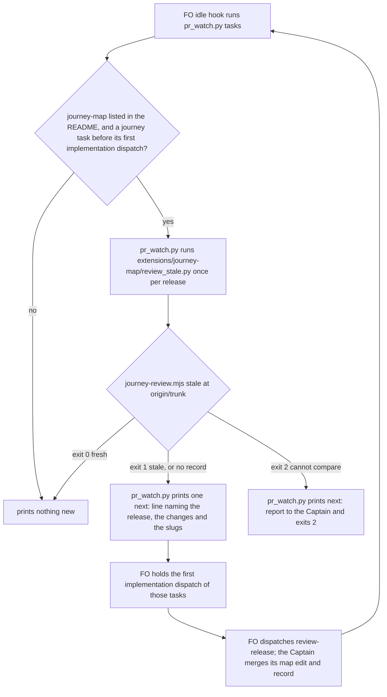

## Scope

- Source: the Captain 「照更正後的建議退回設計重做」 (chat, 2026-10-23), answering FO's 「「擋派工」這一段，是照我更正後的建議退回設計重做（不涵蓋），還是照 D2 不做（涵蓋）？」; recorded as release-acceptance Captain Amendment 2, which moves that task's AC-1 to AC-4 here.
- Bite: issue #571 item 1, qnow R4 (2026-10-10): an implementation was dispatched after the release changed (signals 1 and 2 recorded) with no new review. Evidence copies: release-acceptance/r4-acceptance.md.
- What exists (release-acceptance implementation phase-1 report, 2026-10-23): since #704 the review record is a file `reviews/<journey>/<release-id>.md` with `Reviewed:` and `map at <commit>`, checked by kc-journey-map/lib/journey-review.mjs; the design's `Release changed:` and timed `Release review:` marks do not exist on main; staleness can be read by comparing the map at the record's commit with the map now; workflow.md is under a word budget (ADR 0020) while extensions and pr_watch.py next: lines cost no README words; ADR 0029 D2 (no seed hold) is a different moment, ruled not to cover this.
- Shape asked for: hold the first implementation dispatch of a task in a release while its review record is stale, with the check placed where this package can run it.
- Upstream first: Spacedock dispatch build (no precondition input as of 0.27.2), kc-journey-map journey-review.mjs and the review record, kc-dev-flow-2 pr_watch.py and extensions.
- Non-goals: the release walk (release-acceptance keeps it); a seed-time hold (D2).

## FO alignment

Alignment: needed at ideation; where the check lives and whether it raises the word budget are his to accept.
Surfaces: none
Visible change: none
Release review: not needed: workflow maintenance, on no journey map.

## Design

Base read: origin/main a476b5ff69c27627220e96af27ee898641c6f100 (kc-dev-flow-2 0.28.0, kc-journey-map 1.7.0), after `git fetch origin`, 2026-10-23. Package scripts were read from that commit with `git show`; the ideation skill loaded from the 0.27.0 cache (the skill's own root, as Dispatch facts say) while the dispatch names 0.28.0. Profile pilot holds: the change adds a normal published upgrade consumers absorb, no production data, no credential, no unattended recurring operation.

### PRFAQ

**Press release.** When a first officer is about to start the first implementation of a task that belongs to a release on a journey map, and the release's review record no longer matches the map, FO is told before the dispatch, by name, what changed. It holds the dispatch until a new review lands.

**FAQ.**
- *What counts as "no longer matches"?* The release's story ids, each story's `card`, which stories sit on the release, and the release `goal`, read from the map at the commit that landed the record and from the map on the trunk now. A status or evidence edit does not count, and neither does an edit to another release.
- *Does it catch R4?* Not as R4 happened. R4's signals were a task filed into the release and a Captain ruling not yet in the map (measured below); neither changes the map. It catches the next dispatch after a ruling reaches the map, and a release that was never reviewed (Decision 2).
- *Is it a gate?* No. Spacedock 0.27.2 `dispatch build --help` lists no precondition input (read 2026-10-23; 0.27.3 was not probed). It is a `next:` line FO owes at the idle hook, the same strength as the seed line.
- *What does it cost the workflow README?* 0 words. `workflow.md` is not edited.

The prose below follows the same order: the idle hook runs the script, the script runs the node reader, and only a stale verdict or an unreadable one prints a line.

### Existing-code check (recorded conclusion)

- **Review record.** `kc-journey-map/lib/journey-review.mjs`: `recordPath`, `checkRecord`. Complete for shape and order; it never reads `map at <commit>` and has no staleness reader. Need: R4 (issue #571 item 1). Decision: add a `stale` mode beside `path` and `check`; leave `check` alone.
- **FO idle line.** `kc-dev-flow-2/scripts/pr_watch.py` `seeds()` (backlog tasks failing the seed check) and the idle hook in `references/sd/mods/kc-dev-flow-2.md` ("do each `next:` line"). Complete; ADR 0027's rule ("checked by the script FO already runs") names it. Decision: add one sibling function, no new FO step.
- **Extension worker instruction.** `dispatch_records.py` `declared_instructions`/`extension_errors` checks an extension's scope-notes line, but only in the folder run, not the pre-send `--names` run (archived `extension-instruction-reaches-dispatch`, Decision 1: "a miss is found at validation, after the implementation ran"). Rejected as the hold: it would find a missing line after the worker ran, and it would put a line in every implementation record of every task in a listing repository.
- **Spacedock precondition.** Absent (`dispatch build --help`, 2026-10-23). Not designed; release-acceptance Captain decision 3 already ruled "script now, a Spacedock request only if he wants it filed".
- **Python YAML.** No script under `kc-dev-flow-2/` imports yaml (checked: every `.py` file read with `git show`), so the comparison is written in node beside the model it reads (`model.mjs` `normalizeStory`).

### How staleness is read

**The record's own commit, not `map at`.** `release-review.md` § Record writes `Reviewed: <date>; map at <commit read>` and says the record is proposed "in the same docs PR as the map edit". So `map at` is the commit the reviewer read, before its edit; the edit lands in the same commit as the record. Compared at `map at`, every record is stale the moment it lands. Reproduced 2026-10-23 in a scratch repository built from `journey.example.yaml`: map commit C1, review reads C1, one commit L holds a membership edit plus the record naming C1: the release's stories at C1 and at L differ. The baseline is therefore the trunk commit that introduced the record's current `Reviewed:` line, found with `git log -1 --format=%H -S<that line> <ref> -- <record path>`. Reproduced in the same repository: the last commit touching the record was a later typo commit, the pickaxe commit was L.

**The comparison.** For release R, from the map at that commit and from the map at `<ref>` (the tip of `origin/<trunk>`), take: the set of `(story id, card)` for stories with `release: R`, and the release's `goal`. Stale when the sets differ (a story added, removed or moved off R, a card changed) or the goal differs, naming each. `workflow.md` says "story `goal`"; the model has `card` (`normalizeStory` returns `card`, no `goal`), so the check compares `card`. A story's `status`, `evidence` and `questions`, other releases, and step order are outside it; the unchanged-release rule in `workflow.md` lists the same things.

**Verdict and exits** (`node lib/journey-review.mjs stale <journey.yaml> <release-id> --ref <git-ref>`):

| Exit | Meaning | Line |
| --- | --- | --- |
| 0 | fresh | `fresh: record landed at <sha9>, <n> stories unchanged on <ref>` |
| 1 | stale, or no record on `<ref>` | `stale: card of <id> changed since the record landed at <sha9>` (at most 3 reasons, then `and <n> more`); `stale: no review record at <path> on <ref>` |
| 2 | cannot compare | `cannot compare: <reason>`: bad ref, journey file absent at that commit or at the tip, record without a `Reviewed:` line, unparsable YAML |

A prototype of this exact logic (scratch, not committed) gave these verdicts on the scratch repository: edit and record in one commit then a record typo: fresh; a card edit afterwards: stale naming the story; reverting that edit: fresh; a status-only edit: fresh; an edit to the other release's goal: fresh; an edit to this release's goal: stale; record deleted: stale, no record; unknown ref: exit 2.

**Every input the verdict reads** (learning.md "List every input before promising a verdict survives later history"): the task's `journey`, `journey-release` and `journey-story`; the journey file at `<ref>` and at the landing commit; the record at `<ref>`; its `Reviewed:` line; the history of `<ref>` for the pickaxe; kc-journey-map's `normalizeStory`; `node`; and the local copy of `<ref>`. The verdict is a function of two map blobs, so a later revert restores `fresh` and a later record typo changes nothing. Two inputs are not pinned: a local `origin/<trunk>` older than the real trunk reads fresh against a map that has since moved (`workflow_checkout.py`, which `workflow.md` has FO run before each dispatch, fetches `origin/<trunk>`; the fresh line names the ref, so a stale ref is visible), and two reviews with the same `Reviewed:` line (same day, same `map at`, same `code at`) read as one.

### Where it runs, and the words FO reads

| Placement | Moment | Strength | Cost to FO's reading | Verdict |
| --- | --- | --- | --- | --- |
| `pr_watch.py tasks` `next:` line (journey-map listed) | every idle from admission to dispatch | FO obeys `next:` lines by the mod's rule; no script stops `dispatch build` | 0 README words, 0 when fresh, one line when stale | chosen |
| Extension worker instruction | worker start, after dispatch | the presence check runs only at validation | a scope-notes line in every implementation record of a listing repository | rejected |
| Implementation skill, cycle 1 | worker start | prose | every adopter's implementation worker reads it, map or not | rejected |
| Spacedock precondition | `dispatch build` | a real gate | none | not available; Spacedock request is the Captain's call |

**Why no worker backstop.** R4's failure was FO's, the only script-checked worker line is found missing at validation (above), and a worker running node on the dispatch machine adds a hidden dependency (a cloud worker has no kc-journey-map). What gets worse: an FO that never idles between admission and dispatch, or ignores the line, still dispatches; the same limit the seed line carries.

**What pr_watch runs.** For each live task whose frontmatter has `journey`, `journey-release` and `journey-story`, whose `status` is `backlog`, `ideation`, or `implementation` with no `<task>/dispatch/implementation-1.md`, and only when the README lists `journey-map`, group by `(journey, release)` and run `python3 <package>/extensions/journey-map/review_stale.py` once per group. That script: locates the journey file with `git grep -l -E '^journey: <id>[ \t]*$' <ref> -- '*.yaml' '*.yml'` (none or two or more: exit 2), finds kc-journey-map by `KC_JOURNEY_MAP_ROOT`, else the sibling directory beside `<package>` (local-install layout) or `<cache>/kc-journey-map/<highest version>` (cache layout), then runs `node <root>/lib/journey-review.mjs stale ...` and maps its exit codes unchanged. A missing node, root, or a kc-journey-map without `stale` (its usage exit 2) is exit 2 with `journey-map not run: <reason>`. The install-layout probe is a convention of the two plugin managers, not a contract of either; it fails visibly.

**The line** (one per stale release, never per task): `next: the review record of release <journey>/<release> is stale: <verdict>. Hold the first implementation dispatch of <slugs> until review-release lands a new record, then run pr_watch.py tasks again.` Fixed text 25 words, plus the release token, the verdict (at most 3 reasons) and one word per slug. A cannot-compare group prints `next: report <slug> to the Captain: journey-map not run: <reason>.` and `tasks` exits 2, the existing shape for a task `tasks` cannot read.

### Words FO reads at each lifecycle moment

Rule (as in the archived `idle-names-failing-seeds` design): `len(text.split())` of the output of `pr_watch.py tasks` on a checkout, and `wc -w` of each passage FO reads, base against candidate; the base is today's origin/main files.

| Moment | What FO reads | Base (measured 2026-10-23) | Candidate |
| --- | --- | --- | --- |
| Startup and resume | `workflow.md`; the mod hook; `journey-map/EXTENSION.md` where listed; the `tasks` output | 5374; 48; 593; 486 on this checkout (0.28.0 `pr_watch.py tasks`, scratch `--state`) | 5374; 48; at most 593 + 60; same 486, because this checkout does not list `journey-map` |
| Idle on an open PR | the `tasks` output | as startup | +0 with every release fresh; +25 fixed words plus verdict and slugs per stale release |
| Idle on a merged PR | the `tasks` output | as startup | same as the row above |
| First implementation dispatch | scope notes FO writes; the roborev instruction is 79 words in a listing repository | unchanged | unchanged: no instruction line is added |
| After the archive; the merge ask | `after pr-merge:` lines; `delivery_gate.py` output | unchanged | unchanged: no file those moments read is edited |

qnow and relay list `journey-map` (read from `origin/next` and `origin/main` of their clones, 2026-10-23); their `tasks` output was not measured, so the candidate column is a ceiling there, not a count. The base `workflow.md` count is 5374 and `WORKFLOW_BUDGET_START` plus its steps is not raised: this design edits no line of it. A one-sentence pointer in the Release review bullet would cost words and a quoted Captain ruling under ADR 0020; it is not proposed (see Decision 1).

### The R4 shape, measured

Source: one adopter's committed history, read with `git log` and `git show` on a local clone (2026-10-23); there was no record then, so this is a replay with a synthetic record. R4's task was filed into the release at 2026-10-08 11:25 (signal 1, a `Release:` mark in its `## FO alignment`; the map file did not change). Between the release's cut commit (2026-09-30) and its first implementation dispatch (not before the ideation gate was consumed at 15:32), the release's `(id, card)` set changed once: a feature commit at 14:57 reworded the card of `office-header-shows-phone`. The Captain's signal-2 ruling (remove "decline" from the invitation story) was not in the map at 2026-10-09 12:00 (the card still read 「接受或拒絕」) and reached it in the feature commit of 2026-10-09 22:28. Of the map file's 11 edits from 2026-09-24 to the day the adopter merged two maps (2026-10-11), 3 changed the release's tuple: the 2026-09-30 cut and two card rewords, both inside feature commits; the other 8 changed nothing in this release's ids, cards or goal.

So against that history: a record landed at the cut would read fresh at 11:25 (task filed, map unchanged), stale at the 15:32 dispatch (the 14:57 card reword), stale again after 2026-10-09 22:28. It would have held R4's first dispatch, by the builder's reword and not by either of R4's signals; a Captain ruling stays invisible to it until it is written into the map.

### Non-goals and limits

- Not built: a Spacedock precondition; a worker-side check; a waiver line (no observed need: add one when a stale line proves unclearable by a Captain "go ahead"); the release walk (release-acceptance keeps it); a seed-time hold (ADR 0029 D2: the Captain ruled 2026-10-23 that D2 does not cover this moment).
- Invisible to it: a Captain ruling, or a task admitted into an already-mapped story, that has not reached the map (workflow.md says the second passes with one check); a record merged in a different commit from its map edit reads stale (safe direction, one review rerun); a squash is assumed.
- `workflow.md` says an unchanged release is judged "since its latest `Release review:` line"; this check reads the record file. The bullet's claim "no script checks that line" stays true (this check does not read the line), so no word is edited; the two readings of "since the last review" now coexist.
- A hold is a `next:` line plus FO's obedience; no script refuses a dispatch.

### ADR (draft, no number)

Ruling: a release's review record is stale when its story ids, cards, membership or goal differ from the map at the commit that landed the record; the first implementation dispatch of a task in that release is held on a `next:` line from the idle script. Short title: "A release review record is stale when the map has moved since it landed". It records the landing-commit baseline, the tuple, the exit codes, and the limits above; it amends no ADR (0029 D2 is another moment). FO reserves the number at implementation dispatch.

### Delivery split

PR 1 `feat(kc-journey-map)`: `lib/journey-review.mjs` (`stale`), `lib/journey-review.test.mjs`, `references/release-review.md` § Record (the `Reviewed:` line is now read by a second consumer), `README.md` command list. PR 2 `feat(kc-dev-flow-2)`, after PR 1 is published: `extensions/journey-map/review_stale.py` and its test, `extensions/journey-map/EXTENSION.md` (join, how to read the line, the capability needed: a kc-journey-map that ships `journey-review.mjs stale`; no version number is written before a tag exists), `pr_watch.py`, `test_pr_watch.py`, the `kc-dev-flow-2/README.md` extensions table row, one step in `.github/workflows/kc-dev-flow-2-tests.yml`, and the ADR. Stop and return to FO if the work needs a Spacedock change, a `workflow.md` edit, a schema entry in `contract-versions.json`, or a model-judged check.

### Batch overlap

Files this design would change: `kc-journey-map/lib/journey-review.mjs`, `kc-journey-map/lib/journey-review.test.mjs`, `kc-journey-map/skills/kc-journey-map/references/release-review.md`, `kc-journey-map/README.md`; `kc-dev-flow-2/extensions/journey-map/review_stale.py` (new), `kc-dev-flow-2/extensions/journey-map/test_review_stale.py` (new), `kc-dev-flow-2/extensions/journey-map/EXTENSION.md`, `kc-dev-flow-2/scripts/pr_watch.py`, `kc-dev-flow-2/scripts/test_pr_watch.py`, `kc-dev-flow-2/README.md`, `.github/workflows/kc-dev-flow-2-tests.yml`, one new file under `docs/adr/`. Not touched: `workflow.md`, `lint-skills.py`, `dispatch_records.py`, `delivery_gate.py`, the implementation skill, `kc-journey-map/lib/schemas.mjs`, `contract-versions.json`.

- new-work-starts-from-a-story-map (#705), codex-reader-reads-receipt-marker (#693), merge-ask-holds-missing-clauses (#703), idle-names-failing-seeds (#694), agent-reads-governing-adr (#698): all merged and archived; their changes are in the base read above. #694 is the precedent for the idle line and its word table; no file is shared now.
- fo-write-checks-parse-top-level (live, ideation): `design_surfaces.py`, `delivery_gate.py`, `lint-skills.py`, `workflow.md` and their tests. No shared file or check.
- release-acceptance (live, implementation; PR 1 is Draft #709; PR 2 is not written): #709 edits `kc-journey-map/README.md` (the same command list) and `SKILL.md`: a textual conflict in `README.md`, the later PR rebases. Its PR 2 plans a `pr_watch.py` next-line, a `release-acceptance` contract entry, CI steps and an extension: shared `pr_watch.py`, `test_pr_watch.py`, `kc-dev-flow-2-tests.yml` and the tail of `tasks()`. Its task title still says "the pre-implementation release review is enforced at dispatch": Amendment 2 moved that here, so FO retitles it.
- journey-server-host-pilot (validation, other session): `kc-journey-map/README.md` and `docs/private-host.md`; a possible `README.md` conflict only.
- journey-canvas-hosted-poc (ideation, other session): `kc-journey-map/server/canvas-server.ts`; none. pr-review-lite-value-pilot (implementation): `kc-pr-flow/scripts/review-capability.py`, `kc-journey-map/lib/storymap.test.mjs`; none. kc-decision-log-p1, kc-decision-log-cli (archived) and kc-decision-log-handoff-trial (backlog): the kc-decision-log plugin and `docs/journey/kc-decision-log/`; none, but a journey file there could be this check's first real input.
- Open PRs: #708 (design director) edits `workflow.md`, `lint-skills.py`, `kc-dev-flow-2/README.md` and reserves ADR 0030; #709 uses ADR 0031; this design's ADR takes the next free number at its dispatch. #674 edits `kc-dev-flow-2-tests.yml` and `kc-dev-flow-2/README.md`.

Recommended order: #709 first (it carries release-acceptance PR 1 and ADR 0031); then this task's PR 1 (journey-map), then its PR 2 (kc-dev-flow-2) once PR 1 is published; release-acceptance PR 2 last, rebasing onto this PR 2's `pr_watch.py` and CI edits; #708 and #674 are independent of the order and only need a `README.md` and CI-file rebase.

## Acceptance criteria

All run from a candidate worktree off origin/main with the node and python3 the two CI jobs already use. "Fixture" means a scratch git repository built inside the test, with a synthetic journey (the `journey.example.yaml` shape) and no adopter name, host or data. Every criterion is not yet verified: ideation ran a prototype of the reader only (the scratch results under Design).

**AC-1**: The baseline is the commit that introduced the record's current `Reviewed:` line, not `map at` and not the last commit touching the record. Evidence: a fixture where one commit holds a membership edit plus the record (its `map at` names the commit before) makes `stale` exit 0; a later commit that only edits the record's body does not change the verdict in either direction.
Source: `release-review.md` § Record ("proposed in the same docs PR as the map edit"); release-acceptance Amendment 2, whose recommendation the Captain accepted (「comparing the map at the record's commit with the map now」, FO's words); reproduced 2026-10-23 in a scratch repository.
Verified by: `node --test lib/journey-review.test.mjs`. Falsifier: reading the map at `map at` makes the one-commit fixture exit 1; taking the last commit touching the record makes a typo commit refresh a stale verdict, and each is a mutation the test must fail on.

**AC-2**: The comparison reads exactly the release's story ids, their `card`, their membership of the release, and the release `goal`. Stale (exit 1, naming each): a card edit, a story added to the release, a story removed from it or moved to another release, the release goal edited. Fresh (exit 0): a `status`, `evidence` or `questions` edit, an edit to another release's stories or goal, a revert of a stale edit.
Source: `workflow.md` Release review ("same story ids and the same release and story goal text"; the model's story text field is `card`); the 2026-10-23 prototype verdicts.
Verified by: the same test file, one fixture commit per bullet. Falsifier: comparing story ids only passes the card-edit fixture (the R4 shape, AC-7); comparing the whole file's bytes refuses the status-only fixture.

**AC-3**: With no record at `<ref>` the verdict is exit 1 and `stale: no review record at <path> on <ref>`, where `<path>` equals `node lib/journey-review.mjs path`; a record present only in the working tree counts as none. This criterion is replaced if the Captain picks the pass option of Decision 2.
Source: issue #571 item 1 (the dispatch happened with no signal-4 review before it); ADR 0029 D2 is the other moment.
Verified by: a fixture with no record, and one whose record exists only uncommitted. Falsifier: reading the record from the working tree makes the second fixture exit 0.

**AC-4**: A comparison that cannot be made exits 2 with `cannot compare: <reason>`, never 0 and never 1: unknown ref, journey file absent at the landing commit or at the tip, record without a `Reviewed:` line, unparsable YAML at either commit.
Source: the repository's refuse-rather-than-guess rule for checks; learning.md "List every input".
Verified by: one fixture per cause, asserting the exit code and the reason. Falsifier: the existing catch-all in `journey-review.mjs` main (any error sets exit 1) would turn each into a false hold.

**AC-5**: The `Reviewed:` line has one reader. `check` and `stale` take the line from the same function, and a record built from the template in `release-review.md` § Record (extracted from the doc by the test) is accepted by `check` and read by `stale`.
Source: the record now has a second consumer; ADR 0012's rule that a producer's shape is pinned where it is consumed.
Verified by: the test extracts the fenced template from `release-review.md`, fills it, and runs both modes. Falsifier: renaming `Reviewed:` in the doc template, or in only one of the two readers, fails it.

**AC-6**: `review_stale.py <task file> --ref <ref>` is silent and exits 0 for a task without `journey`, `journey-release` and `journey-story`; finds the journey file at `<ref>` by `journey:` value (none or two found: exit 2 naming the files); finds kc-journey-map by `KC_JOURNEY_MAP_ROOT`, then the two sibling layouts, else exit 2 `journey-map not run: <reason>`; maps the node reader's exit codes unchanged; treats a kc-journey-map without `stale` (usage exit 2) as `journey-map not run`.
Source: the extension contract ("a listed extension that cannot run is reported as `<name> not run: <reason>`, never a clean result"); ADR 0012 (contract by exit code, not shared code).
Verified by: `python3 kc-dev-flow-2/extensions/journey-map/test_review_stale.py` with a stub node library (the kc-dev-flow-2 CI job installs no kc-journey-map dependencies). Falsifier: mapping a missing root to exit 0 fails the root cases.

**AC-7**: The R4 shape, on a synthetic journey. Fixture: a record landed at the release cut (commit L). Then (a) a task file with the release's journey fields is added and the map is untouched: exit 0 (named limit: a task admission and a ruling not in the map are invisible); (b) a feature-style commit rewords one card: exit 1 naming the story and L; (c) a later commit edits another card: exit 1 naming both; (d) a fixture with no record at all: exit 1 (AC-3).
Source: the measured replay under Design (3 of the map file's 11 edits changed the release's tuple, 2 of them card rewords inside feature commits; the Captain's ruling reached the map a day after the dispatch); issue #571 item 1.
Verified by: `lib/journey-review.test.mjs` for (b) to (d) and `test_review_stale.py` for (a) with a task file. Falsifier: ids-only comparison passes (b), so the test fails on it; case (a) asserting exit 0 is the recorded limit, and a change that makes it exit 1 must update this criterion.

**AC-8**: `pr_watch.py tasks` prints one line per stale release in the form under Design (25 fixed words plus the release token, the verdict and one word per slug) after the sitting and seed lines and before `next: run ... wait`; prints nothing when every release is fresh or `journey-map` is not listed; counts a task only when it is `backlog`, `ideation`, or `implementation` with no `dispatch/implementation-1.md`; prints `next: report <slug> to the Captain: journey-map not run: <reason>.` and exits 2 on exit 2 from the script; runs the script once per `(journey, release)`.
Source: ADR 0027 (the script FO already runs); the idle-hook rule in `references/sd/mods/kc-dev-flow-2.md`.
Verified by: new cases in `test_pr_watch.py`'s `TasksTests` with a stub `review_stale.py` recording its calls. Falsifier: counting an `implementation` task that already has its record prints a line after the dispatch; dropping the release grouping makes the call-count assertion fail.

**AC-9**: Words FO reads. `git diff --stat origin/main -- kc-dev-flow-2/references/sd/workflow.md kc-dev-flow-2/scripts/lint-skills.py` is empty; `pr_watch.py tasks` output on a checkout whose README does not list `journey-map` is byte-identical to base; `wc -w` of `extensions/journey-map/EXTENSION.md` is at most 653 (base 593); the stale line's fixed text is 25 words.
Source: learning.md "Measure the words FO reads at each moment"; ADR 0020; the Words table under Design.
Verified by: the commands, run by the validator with `wc -w` and `len(line.split())` independently of the implementation's counter (the archived recount-script lesson). Falsifier: any workflow.md edit changes the diff stat and the budget lint.

**AC-10**: Wiring, once, for real. In a scratch repository with a real map and record, the real `journey-review.mjs`, the real `review_stale.py` and the real `pr_watch.py tasks` print the stale line for a reworded card and nothing after a new record lands.
Source: the global rule that unit tests prove isolated logic, not wiring; the two CI jobs cannot run the whole chain (the kc-dev-flow-2 job installs no node dependencies).
Verified by: a scratch run recorded in the implementation Stage Report with the commands and the printed lines. Not covered: a model run of FO obeying the line, and the plugin-cache sibling layout on another host.

**AC-11**: The change stays inside the listed files, adds no `workflow.md` word and no schema entry, and the ADR passes `python3 kc-dev-flow-2/scripts/adr_lint.py --require`; CI adds one python step and no job (kc-journey-map's `node --test lib/*.test.mjs` already picks up its test); the wall time of the new `tasks` work is measured, not assumed.
Source: Delivery split under Design; repository CI-cost rule.
Verified by: `git diff --stat origin/main` against the file list; `adr_lint.py`; the PR's check list. Falsifier: a file outside the list in the diff.

## Captain decisions

1. **Where the check lives, and the README budget.** Recommend: an idle `next:` line from `pr_watch.py tasks`, run only where `journey-map` is listed, the comparison in node beside the record format, and `workflow.md` untouched (0 words). What gets worse: it is advice FO must obey, not a gate; an FO that does not idle between admission and dispatch, or ignores the line, still dispatches; there is no worker backstop (a worker instruction is checked only at validation); no waiver exists, so a Captain "go ahead" leaves the line printing until a record lands. The Spacedock precondition stays unrequested unless he asks for it. Cost of the other choice: a pointer sentence in `workflow.md` buys visibility for about 25 words and needs a quoted ruling under ADR 0020.
2. **A release with no record at all.** Recommend: hold (exit 1). Issue #571 says R4's dispatch had no signal-4 review before it and the review ran a day later; whether R4 had an earlier review is not in what I read, so a pass may not have held it. Signal 4 already asks for the review at that dispatch. What gets worse: every release an adopter built before the record format existed (no real record exists in qnow, relay or web on their trunks, 2026-10-23) holds the first implementation dispatch of each of its tasks until one `review-release` lands, which interrogates with Codex and asks him questions; a release is reviewed once, not per task. The alternative, pass with a printed `no review record`, matches ADR 0029 D2's spirit and leaves R4's literal shape unprotected.
3. **Whether a card-text edit makes the record stale.** Recommend: yes. A Captain ruling reaches the map as a card edit (R4's signal 2 did), and the rule says a changed goal is signal 2. What gets worse: a builder's own card reword in a feature commit also holds the next dispatch (2 of the 3 tuple changes in the measured window), and `review-release` step 0 reruns the interrogation when a story changed after its last `Interrogation:` date; the cost of a rerun is unmeasured. The alternative, ids and membership only, would have passed R4's later card edits.
4. **The baseline reading of 「the record's commit」.** Recommend: the commit that landed the record, found by its `Reviewed:` line, not the `map at` commit the record names. The accepted recommendation says "the map at the record's commit"; `map at` is the commit the reviewer read, before the review's own map edit, so comparing at it makes every record stale when it lands (reproduced, AC-1). What gets worse: a record merged in a commit separate from its map edit reads stale (one review rerun, safe direction), and two reviews with an identical `Reviewed:` line read as one.

## Stage Report: ideation

- DONE: Design the dispatch-time hold on current origin/main: read the review record format (kc-journey-map release-review.md Record section, kc-journey-map/lib/journey-review.mjs), decide how staleness is read (the map at the record's map-at commit against the map now, by story ids and goals), where the check runs (a kc-dev-flow-2/scripts/pr_watch.py next: line, an extension, the implementation skill, or a Spacedock precondition, with the words FO reads at each moment and whether the workflow.md budget rises), and acceptance criteria with falsifiers including the R4 shape; read release-acceptance/index.md for the superseded AC-1 to AC-4 and the phase-1 drift report
  `## Design` at origin/main a476b5ff: baseline is the record's landing commit, not `map at` (reproduced born-stale in a scratch repo); placement table of the four options, chosen `pr_watch.py tasks` line, `workflow.md` +0 words; R4 measured from one adopter's history (map unchanged by both signals); superseded AC-1 to AC-4 and drift items 1 to 9, 14 read in `release-acceptance/index.md`.
- DONE: A `### Batch overlap` section naming each file the design would change and each other batch task (new-work-starts-from-a-story-map, codex-reader-reads-receipt-marker, merge-ask-holds-missing-clauses, fo-write-checks-parse-top-level, idle-names-failing-seeds, agent-reads-governing-adr) and live task of other sessions (kc-decision-log-p1, kc-decision-log-cli, kc-decision-log-handoff-trial, pr-review-lite-value-pilot, release-acceptance, journey-canvas-hosted-poc, journey-server-host-pilot (driven by other sessions; read only)) that changes the same file or check, so FO can order implementation
  `### Batch overlap` under Design: 12 files named; five of the six batch tasks are merged (#705, #693, #703, #694, #698); real overlaps are release-acceptance (README.md, pr_watch.py, test_pr_watch.py, CI file), #708, #674; ends with `Recommended order:`.
- DONE: The words FO reads at each lifecycle moment, before and after, per root learning.md "Measure the words FO reads at each moment, not one file's size"
  `### Words FO reads at each lifecycle moment`: base measured with `wc -w` and 0.28.0 `pr_watch.py tasks` (5374, 48, 593, 486); candidate is +0 README words, +0 when fresh, 25 fixed words per stale release; qnow and relay outputs not measured (ceiling stated).
- DONE: Acceptance criteria with reproducible evidence clauses and falsifiers, and unresolved decisions for the Captain, each with a recommendation and what gets worse under it
  Four decisions under `## Captain decisions`; the checker output is below. Per criterion, all not yet verified (implementation owes each): AC-1 not yet verified (the same logic was prototyped in scratch: one-commit edit+record fresh, record typo changes nothing); AC-2 not yet verified (prototype gave card edit stale, status-only fresh, other-release goal fresh, this-release goal stale, revert fresh); AC-3 not yet verified (prototype: deleted record gave stale, no record); AC-4 not yet verified (prototype: unknown ref gave exit 2); AC-5 not yet verified (no code written); AC-6 not yet verified (no code written); AC-7 not yet verified (history replay measured, fixture not built); AC-8 not yet verified (no code written); AC-9 base counts measured 2026-10-23, candidate not yet; AC-10 not yet verified (needs the built chain); AC-11 not yet verified (no code written).
- DONE: `design_surfaces.py check` run on the task before reporting
  `python3 .../kc-dev-flow-2/0.27.0/scripts/design_surfaces.py check <task>` and the 0.28.0 copy both printed `release-review-staleness-held-at-dispatch.md: design surfaces presentable`, exit 0 (the skill's root is 0.27.0, the dispatch names 0.28.0).

### Summary

I designed the hold as an idle `next:` line from `pr_watch.py tasks`, comparing the map at the commit that landed the review record with the trunk's map (not the `map at` commit, which makes every record stale on landing), in node beside the record format, with `workflow.md` untouched. The most material finding is that the map comparison would not have caught R4 as it happened (task admission and the Captain's ruling left the map unchanged); it would have held R4's first dispatch only through a builder's card reword, and a never-reviewed release holds only if the Captain picks Decision 2. Notes for FO: `## FO alignment` records alignment as needed with no `Result:` line, and I treated the dispatch checklist as that direction rather than stopping; I ran `git fetch origin` in three adopter clones (qnow, subspace-relay, subspace-web) to read their trunks, which updates their remote-tracking refs and nothing else; scratch files are under `/tmp/ens-scratch`, outside every repository.
