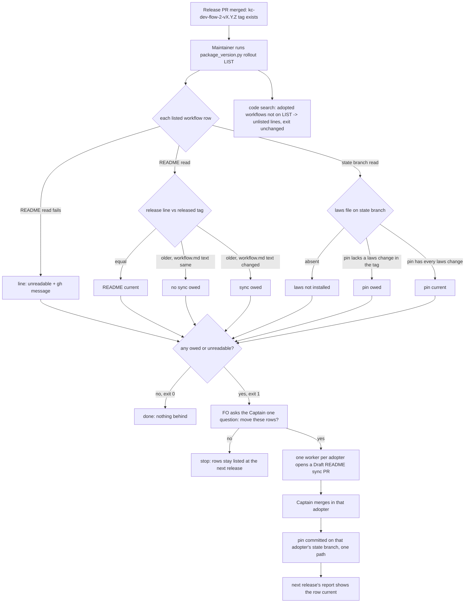

## Scope

- Source: the Captain 「也派工去其他採用的 repo 升級到最新版，此外說明這個法規升級是怎樣，之前好幾個版本都沒做，是否採用的 repo 也都沒升級？」 and 「說明法規如果安裝到每個repo會改變什麼？為何不是預設安裝？」 (chat with this FO, 2026-11-10).
- Selected for batch 21: the Captain chose 「放 1 到 5（建議）」 (host question dialog, 2026-11-11), answering 「第 21 批要放哪幾張？我建議放清單的 1 到 5：故事做完回報切片進度、發版後鋪開到採用 repo 與法規檢查、超預算要停與重大發現先對照不做清單、狀態提交自動推送與派工單矛盾、拒絕一個指令不等於全停。選完後我只為被選中的建任務檔，再一次請你過待辦關卡；選進來不代表接受任何設計。」.
- Bite (FO read at each source, 2026-11-10): this repository's `.github/workflows/dev2-laws.yml` on `spacedock-state/dev2` pinned the kc-dev-flow-2-v0.26.0 tag commit while the package reached 0.38.0, with six commits to `scripts/laws_check.py` in between that never ran hosted; nothing reported it. On the trunks, qnow's workflow README was at 0.37.0 and me-company, subspace-relay, subspace-web and subspace-v0 at 0.35.0; none of the five state branches held the laws workflow. The sync was done by hand that day (kc-claude-plugins PR #833, qnow #1350, relay #498, web #240, v0 #98, me-company #22) from prompts FO keeps outside the package.
- Package fact (kc-dev-flow-2 0.38.1 references/sd/adoption.md, "State laws check"): "Roll it out once per adopter, on the Captain's word"; it names no step after a later release, and states as not verified "the minutes a private adopter pays per run".
- Trial in progress: the laws workflow was installed on iamcxa/qnow `spacedock-state/dev2` at 77b0d1902 on 2026-11-10, on the Captain's choice 「裝 qnow（建議）」, to measure cost; its first run took 28 seconds wall clock (run 42848648288). The design reads the runs since.
- Non-goals: changing what the laws judge; making a failed laws run block a push, dispatch or merge; syncing an adopter without its Captain's merge.

## Budget
- One package PR (the release and adoption references, and a check or script only if the design shows prose cannot report a repository left behind).

## Stop condition
- For a release, one command or named step lists each known adopter with its README marker and laws pin against the released tag, and the design says who moves each and on whose word; or the design shows why not and says what was learned.

## FO alignment

Alignment: needed at ideation; whether the laws check is installed by default, whether its pin follows each release, and who may open an adopter's sync PR are the Captain's call.
Result: the Captain chose 「先報落後，預設與否等數字（建議）」 (host question dialog, 2026-11-11), answering 「「發版後鋪開到採用 repo 與法規檢查」這張任務的設計方向要怎麼定？我建議：設計先做「每次發版列出每個採用 repo 的說明檔版本和法規釘選、落後的報出來」，法規檢查要不要預設安裝、釘選要不要自動跟著發版走，等 qnow 的費用量出來、在設計關卡用數字讓你選。這是設計的方向，細節與證明仍在設計關卡由你核准。」.
Surfaces: none
Visible change: none
Release review: not needed: workflow maintenance, on no journey map.

## Design

### PRFAQ

**After a kc-dev-flow-2 release, one command shows which adopted workflows owe a README sync or a laws pin move, and nothing behind goes unreported.** When the Release PR merges, the maintainer of the package repository runs `python3 <package>/scripts/package_version.py rollout <adopter list>`. It prints one line per listed workflow (repository, workflow directory): the README's release line against the released tag, whether the package's `references/sd/workflow.md` text changed in between (sync owed) or only the release line moved (no sync owed), and the state laws check: installed or not, and whether its pinned package commit lacks a change to `laws_check.py`, `laws.md` or `state-laws.workflow.yml` that the released tag has (pin owed). A repository it cannot read is printed as unreadable and exits 1, never as current. A code search also prints adopted workflows the list does not name, as `unlisted:` lines. FO puts the owed rows to the Captain as one question; on his word each owed README sync is a Draft PR in that adopter that he merges, and the pin follows that merge.

- **Who uses it:** the maintainer / FO of the package repository's `docs/dev2` workflow, once per kc-dev-flow-2 release. No adopter FO reads anything new.
- **Why a script, not prose (budget test):** the hand read for this design took about 40 `gh api` calls: each README's `trunk:`, its release line, the state branch, the pin, the pin's tag, and the workflow.md text between two tags. It also went wrong twice in ways the script must refuse: one loop hid stderr, and an unpaginated branch list showed qnow with no state branch while its laws file was readable. On 2026-11-10 the bite went unreported for twelve releases.
- **FAQ: why not the existing per-dispatch check?** `package_version.py <README>` already prints `README synced from X is behind the loaded package Y: re-sync it` before each worker dispatch. It exits 0, and the workflow tells FO to act only on exit 1. It runs only in a session that has already loaded the newer package, and leaves no record (it is on the observer's chat-only list). Whether adopter FOs saw it cannot be measured. The laws pin has no reader at all. The new step does not depend on any adopter FO noticing.
- **FAQ: what does it not do?** It does not change any law, block anything, write any adopter, or open any PR. It reads and reports. Non-goals are unchanged.

### Flow

The unreadable branch has no automatic retry. FO shows the Captain the gh message.

### Existing chain and current evidence

- **Spacedock 0.27.3 (first):** no adopter registry and no post-release step. A grep of `skills/`, `mods/` and `docs/` for adopter, fleet or downstream finds only roadmap and spec prose. Its `refit` re-syncs one workflow on request.
- **kc-dev-flow-2 0.38.1 at origin/main (second):** `scripts/package_version.py` holds the README release-line regex (`MARK`) and compares one local README with the loaded package. `scripts/workflow_checkout.py` compares a local README with `origin/<trunk>`. `skills/maintain-flow/SKILL.md` § Observe adopters already says "after each release the maintainer reads the first task each adopter archives on it", which makes it the existing after-release adopter step. `references/sd/adoption.md` § State laws check says "Roll it out once per adopter, on the Captain's word" and names no later step. Archived `batch10-after-release-obligations` moved one pin by hand as a one-off. Conclusion of the bounded existing-code check: extend `package_version.py` with a `rollout` mode that reuses `MARK`, and put the step in § Observe adopters. Build no new script. Two searches: `git grep x-release-please-version origin/main` (consumers are package_version.py and the release-please parity scripts) and `git grep dev2-laws origin/main` (only adoption.md and the template). Exclusion: FO's off-package prompts hold the hand list today, and they cannot be read.
- **Adopters (third, read-only via `gh api`, 2026-11-11):** release 0.38.1 is tag commit `2d827798`. Trunk READMEs (each README's own `trunk:`, all `main`): kc-claude-plugins `docs/dev2` and `docs/dev2-poc` at 0.38.1. qnow, me-company, subspace-relay, subspace-web and subspace-v0 `docs/dev2` at 0.38.0, and qnow, me-company, relay and web `docs/dev2-poc` at 0.38.0. Laws: kc-claude-plugins and qnow pin `ec2bae0d`, the v0.38.0 tag commit; laws files are identical between v0.38.0 and v0.38.1. me-company, relay, web and v0 have `spacedock-state/dev2` but no `.github/workflows` (branch read 200, directory 404, stderr shown). Workflow.md text between 0.38.0 and 0.38.1 is unchanged apart from the release line, so today's expected report owes nothing for the listed rows. Code search (`gh search code x-release-please-version --owner iamcxa --owner spacedock-dev`) also found 4 adopted workflow READMEs FO's hand list lacks: kc-paseo-plugins `docs/dev2` and `docs/dev2-poc` (0.36.0 and 0.34.0, public), and two private repositories this public file does not name (0.21.0 and 0.36.0, one with a non-`main` trunk and a non-`dev2` state branch). It also **missed** subspace-relay and subspace-web, so search cannot be the list (falsifier for discovery-only).
- **Release cadence:** 16 kc-dev-flow-2 tags from 2026-10-20 to 2026-11-11. Across the last 15 releases, workflow.md text changed in 13 and the laws files changed in 5 (0.31.0, 0.33.1, 0.34.0, 0.35.0, 0.38.0). From the 0.26.0 pin to 0.38.1, `laws_check.py` + `laws.md` differ by 298 changed lines.

### The qnow laws trial, measured (read-only, 2026-11-11)

`gh run list --repo iamcxa/qnow --workflow dev2-laws.yml`: 14 runs (42848648288 … 42939515685), 2026-11-10T15:50Z to 2026-11-11T01:31Z. 13 succeeded and 1 failed. Job time was 26–38 s, with one at 69 s, from `gh api …/runs/<id>/jobs` started_at→completed_at. 14 state commits in that window, so 14 of 14 commits were separate pushes. The one failure, run 42855594782, was L3 amendment-append-only, commit `0960af2b`. Read the diff: FO rewrote an already-recorded Captain amendment's `Design:` line, so it is a true violation and the hosted run was its only report.

Package repository for comparison (public): the most recent 500 runs (the `--limit`, not a total, since 2026-11-07) show 90 failed, not classified here.

What GitHub bills, from pages read 2026-11-11:
- **Rate and rounding:** docs.github.com/en/billing/reference/actions-runner-pricing gives "Linux 2-core (x64) | `actions_linux` | $0.006" and says "GitHub rounds the minutes and partial minutes each job uses up to the nearest whole minute". So the 14 runs are 15 billed minutes, about 1.07 per push.
- **Included allowance and public repositories:** docs.github.com/en/billing/concepts/product-billing/github-actions lists GitHub Pro's included usage as "$18 USD" a month (3,000 such minutes), and makes "Standard GitHub-hosted runners in public repositories" free.
- **When the allowance runs out:** the same page: "If your account does not have a valid payment method on file, usage is blocked once you consume the included compute usage". That would stop the account's other private CI too.
- **The timing endpoint is not evidence:** `GET …/runs/<id>/timing` returned `total_ms: 0` for every run. Its page says "This endpoint is in the process of closing down".
- **Who pays:** "Usage is charged to the repository owner". The spacedock-dev adopters bill to that organization, whose usage was not read.

The arithmetic that decides the pick (a calculation on a 10-hour sample, not a measurement): qnow's state branch took 2,045 commits from 2026-10-12 to 2026-11-11. At one push per commit and 1.07 billed minutes per push, that is about 2,190 laws minutes a month, about $13. qnow's own October hosted Linux use before laws was 1,577 minutes (GitHub's billing usage report for the owner account), and the owner's other private repositories added under 20. Laws on qnow alone would take the account from about 1,600 to about 3,800 minutes, past the 3,000 included. The overrun would be billed, or blocked if no payment method is on file. Whether one is on file was not read: the budgets endpoint returned 404. Public adopters (kc-claude-plugins, kc-paseo-plugins) pay nothing. A pin move costs no minutes, because minutes follow pushes, not the pin.

### Side by side for the Captain (decision D1)

| | A: installed by default, pin follows | B: installed on the Captain's word, pin follows (recommended) | C: both on the Captain's word only (today's text) |
| --- | --- | --- | --- |
| Hosted laws on | every adopter with a state branch | the adopters he picks: kc-claude-plugins and qnow today | the same as B |
| Minutes | about 1.07 per state push on each private adopter: qnow ≈ 2,190 a month (arithmetic above). Org adopters billed to the org, not measured | only where picked | the same as B |
| Pin | moved after each README sync merge when a laws file changed (5 of the last 15 releases) | the same | moved only on his word. The 0.26.0 pin sat 298 changed laws lines behind, unreported |
| Report row for an uninstalled adopter | `laws: not installed` owes an install | `laws: not installed`, owes nothing | the same as B, but a pin row never owes |
| Gets worse | qnow-scale adopters overrun the included allowance, and the org bill is unknown | adopters not picked keep no hosted check. Their violations surface only through observer reads | new laws never reach an installed adopter unless he remembers to ask |

### Who moves each, on whose word (decision D3)

- **README (`docs/dev2`, `docs/dev2-poc`):** a three-way-merge sync PR in that adopter, per adoption.md. The report's `sync owed` rows reach the Captain as one question per release. On his yes, the package-repository FO dispatches one worker per owed adopter, and the worker opens a Draft PR. He merges it in that adopter (non-goal kept: no sync without his merge). This is the route that worked on 2026-11-10 (six PRs).
- **Laws pin:** after that adopter's sync PR merges, the same FO commits `.github/workflows/dev2-laws.yml` with the pin set to the commit of the tag the merged README names. It is a one-path, path-scoped commit pushed to that adopter's state branch, as adoption.md's rollout already does, and only for an adopter where laws is installed. The pin never moves ahead of the README, so new laws never judge records written under older README rules.
- **List:** FO edits the list file when the Captain names an adopter, and on an `unlisted:` line only after he says to list it (decision D2).

### Where the list lives (decision D2)

Recommended: `.notes/adopters.md` on this repository's state branch `spacedock-state/dev2`, beside `.notes/fo-feedback/`. Each line holds `owner/repo workflow-dir [state-branch]`. The state branch defaults to `spacedock-state/<basename of workflow-dir>`, and the README's own `trunk:` is read, not stored. That gives 11 rows today: kc-claude-plugins, qnow, me-company, relay and web each with dev2 and dev2-poc, plus v0 dev2. That branch is public. The six repositories already appear there, in 6 to 720 files each, but the two private repositories search found have never appeared there, so they are not listed without his word, and their `unlisted:` lines print only in the maintainer's terminal. Rejected: a file in the package, which would ship a private fleet to every adopter; a trunk file, which needs a PR per list edit; and a file on this machine, which is a hidden machine dependency.

### Words FO reads at each moment

Counted with `wc -w` on origin/main `e8664a72` text and on the script's output for this README:
- **Before each worker dispatch, in every adopter:** `package_version.py <README>` prints 12 words. Unchanged. `references/sd/workflow.md` is unchanged, and so is its lint word budget.
- **Startup, idle on an open or merged PR, after archive, the merge ask:** unchanged (0 words). Nothing is added to workflow.md, the mod or any FO-run script output.
- **Adoption / re-sync (adoption.md):** the 70-word "Roll it out once per adopter…" paragraph is replaced by the D1 ruling and the pin-follows-sync rule. Estimate: 70 → about 90.
- **After a kc-dev-flow-2 release (package repository only):**
  - Before: root `CLAUDE.md` § Post-merge 289 words + `kc-plugin-release` SKILL.md 284 + maintain-flow § Observe adopters 189 = 762, plus FO's off-package prompts, which cannot be counted.
  - After: 762 + a one-row CLAUDE.md pointer (about 25) + about 60 in § Observe adopters + the report, at most 16 words per row (11 rows ≈ 176) + `unlisted:` lines.
  - This moment grows on purpose. It replaces the uncountable prompts, and implementation reports the exact before/after counts with an independent recount.

### ADR draft (no number; FO reserves it at implementation dispatch)

Short title: "After a release the laws pin follows each adopter's README sync, and installing the laws check is the Captain's word" (wording follows his D1 pick). Ruling, the Captain's D1 words verbatim. Options considered: A, B, C above. Consequences: the uninstalled-adopter gap or the minutes, whichever he accepts. Reopen when an adopter's laws pin is found behind a merged README, or when private laws minutes exceed the included allowance.

### Batch overlap

- **adr-required-statement (validation):** changes `references/sd/adoption.md` (§ Captain rulings ledger) and `references/sd/workflow.md`. Shared file: adoption.md, a different section. Also the ADR index.
- **merge-guard-stops-unasked-merges (validation, PR #794):** changes `references/sd/adoption.md` (a new section about 140 words, and § Secret reads), `delivery_gate.py`, `merge_guard.py`, ADR 0063 and `.github/workflows/kc-dev-flow-2-tests.yml`. Shared: adoption.md, a different section, and the ADR index. The CI file is not shared: `test_package_version.py` is already a step.
- **worker-push-words-match-state-commit (ideation):** names `adoption.md` once, and `workflow.md`. Possible shared file: adoption.md.
- **dispatch-carries-reserved-adr-number (ideation):** reads `laws_check.py` and `laws.md` and states no package change. It shares the ADR number reservation only.
- **budget-overrun-holds-and-findings-meet-non-goals (ideation):** `workflow.md` only. None shared.
- **story-done-reports-release-remaining, denied-command-denies-only-that-command (ideation), ops-inbox-r1-setup-and-isolation (implementation), journey-server-host-pilot (validation):** no shared file or check found in their task text.
- **pr-review-lite-value-pilot (implementation):** mentions root `CLAUDE.md` as hashed context, not as an edit. Hashed only: an edit here changes its recorded ancestor hash if its runs re-read it.
- This design changes: `kc-dev-flow-2/scripts/package_version.py`, `kc-dev-flow-2/scripts/test_package_version.py`, `kc-dev-flow-2/skills/maintain-flow/SKILL.md`, `kc-dev-flow-2/references/sd/adoption.md` (§ State laws check), root `CLAUDE.md` (§ Post-merge table, one row), one ADR, and the state-branch file `.notes/adopters.md`.

Recommended order: after adr-required-statement and merge-guard-stops-unasked-merges land their adoption.md edits, rebased on them; independent of the rest.

### Unresolved decisions for the Captain

- **D1, laws install and pin:** recommend B (installed on his word, pin follows each README sync merge). Worse under B: adopters he does not pick keep no hosted laws check.
- **D2, list home and naming:** recommend `.notes/adopters.md` on `spacedock-state/dev2`, naming only repositories already named on that public branch. Worse: the two private adopters search found stay unlisted and appear only as terminal `unlisted:` lines each release.
- **D3, who opens sync PRs and moves pins:** recommend that the package-repository FO dispatches, on his one word per release, Draft sync PRs he merges, then commits each pin after the merge. Worse: this FO writes other adopters' state branches, one disjoint path each, as a concurrent writer with their FOs, and each release with a workflow.md change asks him for up to 6 merges (13 of the last 15 releases changed it).

## Acceptance criteria

**AC-1** `package_version.py rollout <list>` prints one line per list row naming repository, workflow directory, README release line, released version, sync status and laws status. Evidence: a `test_package_version.py` case with a fake `gh` on `PATH` serving fixture READMEs and state files for 3 rows, asserting each printed line. Falsifier: dropping a row or printing a status from the wrong row fails it.

**AC-2** An unreadable row is never current. Evidence: the fake `gh` exits 1 with `Not Found (HTTP 404)` for one README. The line says `unreadable` and quotes the message, and the run exits 1. Falsifier: a mutation that treats a failed read as an empty README (no release line), and so as nothing owed, fails the test.

**AC-3** Sync is owed exactly when the package's workflow.md text differs between the README's tag and the released tag, ignoring the release line. Evidence: two fixtures, release line only (prints `no sync owed`, exit 0) and one changed sentence (prints `sync owed`, exit 1). Falsifier: comparing whole files, release line included, turns the first into `sync owed` and fails.

**AC-4** A pin is owed exactly when `laws_check.py`, `laws.md` or `state-laws.workflow.yml` differ between the pinned commit and the released tag. A pin that is no `kc-dev-flow-2-v*` tag commit prints `pin unrecognised` and is owed. A state branch with no laws file prints `laws: not installed`, owed only under D1 option A. Evidence: fixtures for each of these four cases. Falsifier: comparing pin to tag by equality alone makes the identical-laws fixture owed and fails.

**AC-5** The single-README mode is unchanged. Evidence: the existing `test_package_version.py` cases pass unedited, and for each existing case the script's stdout bytes at base and candidate compare equal (`cmp`). Falsifier: any change to the 12-word per-dispatch output fails.

**AC-6** Search-found workflows missing from the list print as `unlisted: <repo> <path>` and do not change the exit code. A failed search prints `search: unavailable <message>`, not nothing. Evidence: fake `gh search code` fixtures, one success and one exit 1. Falsifier: silence on a failed search fails.

**AC-7** The step and rules are written once each: maintain-flow § Observe adopters names the command, the list path, who moves the README and the pin and on whose word; root `CLAUDE.md` § Post-merge carries one pointer row; adoption.md § State laws check states the D1 ruling. Evidence: `python3 kc-dev-flow-2/scripts/lint-skills.py` exits 0, including its 12-word repeat check. Implementation reports per-moment word counts at base `e8664a72` and candidate, recounted by an independent copy. Falsifier: a lint failure, or a moment other than release and adoption whose count rises.

**AC-8** A live run against the real list at the candidate. Evidence: the command, date and full output saved in the task's implementation folder. Two rows chosen by the validator match a by-hand `gh api` read of the same README and laws file. Falsifier: a row whose printed release line or pin differs from the hand read.

**AC-9** The list exists at the D2 home with the rows he approves. Evidence: `git show origin/spacedock-state/dev2:.notes/adopters.md` (or the chosen path) lists them, and the AC-8 run reads that file. Falsifier: a row in the AC-8 output that is not in the file, or the reverse.

## Stage Report: ideation

- DONE: Per the Captain's Result line: design the step that, for a release, lists each known adopter's workflow README marker and laws pin against the released tag and reports those behind, and say where the list of adopters lives; measure the qnow laws trial read-only (gh run list --repo iamcxa/qnow --workflow dev2-laws.yml: runs, durations, failures since 2026-11-10) and present default install and pin-follows-release versus Captain's-word-only side by side with that cost for him to pick at the gate, saying what GitHub bills for those runs only from a source you read
  `package_version.py rollout <list>` in § Design. List: `.notes/adopters.md` on `spacedock-state/dev2` (D2). qnow: 14 runs, 26–69 s jobs, 15 billed minutes, 1 true L3 violation (commit 0960af2b). A/B/C table; billing quoted from two docs.github.com pages read 2026-11-11; org billing and payment method stated as not read.
- DONE: A `### Batch overlap` section naming each file the design would change and each other batch task (story-done-reports-release-remaining, release-rollout-reaches-adopters-and-laws-pin, budget-overrun-holds-and-findings-meet-non-goals, worker-push-words-match-state-commit, denied-command-denies-only-that-command) and live task of other sessions (adr-required-statement, dispatch-carries-reserved-adr-number, journey-server-host-pilot, merge-guard-stops-unasked-merges, ops-inbox-r1-setup-and-isolation, pr-review-lite-value-pilot (driven by other sessions or held; read only)) that changes the same file or check, so FO can order implementation
  Shared adoption.md with adr-required-statement, merge-guard-stops-unasked-merges and possibly worker-push-words-match-state-commit; shared ADR index. Recommended order: after the first two.
- DONE: The words FO reads at each lifecycle moment, before and after, per root learning.md "Measure the words FO reads at each moment, not one file's size"
  Per-dispatch 12 words unchanged; startup/idle/archive/merge ask unchanged; adoption 70 → about 90; release moment 762 + about 85 + report ≤16 words/row; off-package prompts cannot be counted.
- DONE: Acceptance criteria with reproducible evidence clauses and falsifiers, and unresolved decisions for the Captain, each with a recommendation and what gets worse under it
  AC-1..AC-9 under `## Acceptance criteria`; D1 (B), D2 (state-branch notes file), D3 (package FO on one word per release), each with what gets worse.
- DONE: AC-1 per-row report line — not yet verified (future fake-gh test); today's expected rows derived by hand read in § Existing chain.
- DONE: AC-2 unreadable never current — not yet verified; the falsifier class was observed in this design's own hand read (hidden stderr).
- DONE: AC-3 sync owed only on workflow.md text change — not yet verified; current fact: 0.38.0→0.38.1 workflow.md differs only in the release line (diff with that line stripped).
- DONE: AC-4 pin owed only on laws file change — not yet verified; current fact: laws files identical v0.38.0→v0.38.1 (`git diff --quiet`).
- DONE: AC-5 single-README mode unchanged — not yet verified; base output measured at 12 words.
- DONE: AC-6 unlisted and search-failure lines — not yet verified; current fact: search found 4 unlisted workflows and missed relay and web.
- DONE: AC-7 rules written once, lint passes, word counts per moment — not yet verified; base counts above at e8664a72.
- DONE: AC-8 live run matches hand reads — not yet verified (implementation).
- DONE: AC-9 list file at the decided home — not yet verified; awaits D2.
- DONE: design_surfaces.py check
  `python3 <package>/scripts/design_surfaces.py check <task>` → "design surfaces presentable", exit 0. The Mermaid rendered with mermaid-cli 11 (syntax only; actors and branches compared with the prose by hand).

### Summary

The design extends the existing `package_version.py` with a read-only `rollout` mode the package maintainer runs after each kc-dev-flow-2 release. It reports, per listed adopter workflow, whether a README sync or a laws pin move is owed. It counts a mismatched version as owed only when the package text actually changed, and it never reports an unreadable repository as current. The measured qnow trial (15 billed minutes for 14 pushes, one true violation caught) and GitHub's published rates put default install over the Pro allowance by arithmetic. So the recommendation is that installing stays on the Captain's word and the pin follows each README sync merge. Code search found four adopted workflows missing from FO's hand list, and it also missed two listed ones, so the list is a file, with search as a cross-check. No repository file, branch or commit was written outside this task file.
