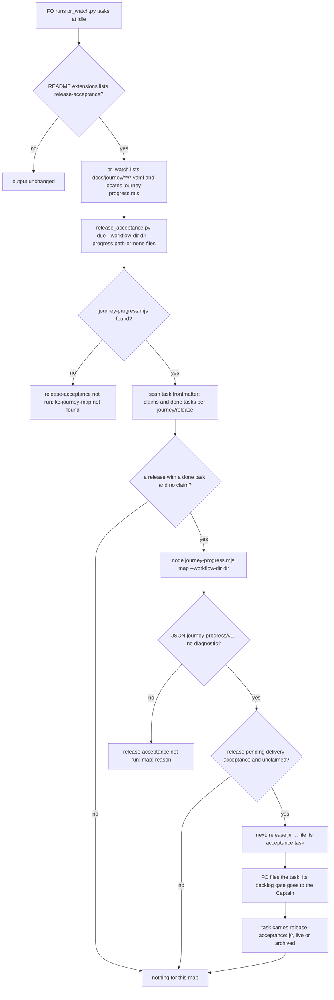

## Scope

- Source: the Captain 「拆」 (chat, 2026-10-23), answering FO's 「這張任務要不要拆成兩半？」 on release-walk-picky-reviewers-and-director D5: Part B of that design (the due trigger, a `journeys:` README key, the pr_watch.py line) becomes this follow-up, after that task's PR and #711 merge; D4 (how the idle script learns where the journey file is) comes with it.
- Bite: release-acceptance r3-acceptance.md and r4-acceptance.md were walked only because the Captain asked.
- Starting design: release-walk-picky-reviewers-and-director `## Design` Part B and its D4 options, and the moved AC-11 there.
- Carried from release-walk-picky-reviewers-and-director (state, 2026-10-23), its section `### Moved to release-walk-due-trigger`, verbatim:

  ### Moved to release-walk-due-trigger (Captain D5)

  Part B and D4 are not in this task: the `due` subcommand, the README `journeys:` key, the `pr_watch.py tasks` line and their tests. Their design stays in that task's own ideation; the text of the criterion that moves, for FO to carry (an amendment-free move, this task still being in ideation; that task's file is not edited from here): "AC-11: `due` prints one `next:` line for a release whose `acceptance` is `pending delivery acceptance` and which no live or archived task file claims with `release-acceptance: <journey>/<release>`, prints nothing for a claimed release, and prints `release-acceptance not run: kc-journey-map not found` when the sibling install is absent; `pr_watch.py tasks` includes the line only when `release-acceptance` is listed. Verified by `test_release_acceptance.py` against real `journey-progress.mjs` output on the example with all stories' tasks done, and `test_pr_watch.py` for the listing condition; a split-root scratch run of `spacedock new`, `status --set` and `state commit` repeated in the implementation report. Falsifier: removing the field from the claiming task makes the line reappear." Measured today (2026-10-23, Spacedock 0.27.2, scratch split-root repo in `/tmp`, deleted): `spacedock new r1-acceptance`, `status --set r1-acceptance release-acceptance=book-pickup/r1`, `state commit` kept the field and `status --archived --all-fields --json` listed it; an empty custom key is not listed, only a set value. That task depends on this one landing first, since `due` extends `release_acceptance.py`.

- Non-goals: the walk itself.
- Batch 13: the Captain 「可以」 (chat, 2026-11-03), answering 「決定：這批加入那 3 張，共 7 張一起進 backlog gate 嗎？」, which named this task. It pairs with release-walk-off-production-before-release in the same batch: that task decides where the walk runs and that production waits; this one says when it is due.

## Budget
- One package PR. Workflow word budget unchanged unless the design names a raise for the Captain.

## Stop condition
- The moved AC-11 holds: `due` prints one `next:` line for a release pending delivery acceptance that no task claims, nothing for a claimed release, and `release-acceptance not run: kc-journey-map not found` when the sibling install is absent, and `pr_watch.py tasks` shows it.

## FO alignment

Alignment: needed at ideation; D4 is his.
Result: aligned at backlog: Batch 13 backlog sitting, the Captain 「進」 (chat, 2026-11-03), answering 「決定：這批七張（A 權限、B 同症狀計數、C 改寫條件比對原話、D release 驗收不在正式站、來源標註、FO 先自己試、release 驗收到期提醒）都用 Pilot，照各自寫下的範圍、預算與停止條件進入構思嗎？要改哪張直接說。」, approved the outcome and bounds in this file.
Surfaces: none
Visible change: none
Release review: not needed: workflow maintenance, on no journey map.
Delivery: two PRs per Captain amendment 1: iamcxa/kc-claude-plugins#774 (kc-journey-map registration, base main, merges first) and #775 (kc-dev-flow-2, stacked on #772); the `pr:` field names #775.

## Design

Base read: origin/main 713d4e6ed6381e65fa6d8305e08b282ceb56a8fb (kc-dev-flow-2 0.34.0) after `git fetch origin`, 2026-11-03; kc-journey-map 1.8.0 (the installed version) in the plugin cache; Spacedock 0.27.3. Starting design: release-walk-picky-reviewers-and-director cycle-1 `### Part B: the trigger` and D4 (state commit b7d6e9e92), its moved AC-11 (carried in Scope), and its engineering-reviewer note that this task "needs its own re-walk signal" (archived file, `## FO alignment`). Where this section differs from them, this section is the design. Profile pilot holds: FO runs the idle look while it works, so this is attended, not unattended recurring operation; no production data, credential or migration.

### PRFAQ

**Press release.** A finished release no longer waits for someone to remember it. When every story of a release has its tasks done and no task walks it yet, the idle look FO already runs prints one line saying so and pointing at how to file the acceptance task. When the walk is filed, the line stops. When the tool that reads the map is missing or cannot read the tasks, the idle look says so instead of going quiet. Nothing changes for a workflow that does not list release-acceptance.

**FAQ.**
- *What does the Captain get?* R3 and R4 were walked only because he asked; with this, FO is told the moment a release is due, so the walk reaches his backlog gate without his asking.
- *Where does the idle look find the map?* Decision D4 below. Recommended: every `.yaml` file under `docs/journey/` of the code checkout, which is where both journey extensions already say a map must be and what the adoption probe already finds. No new README key.
- *Why does a done release stay "due" forever unless a task claims it?* The map has no "accepted" field on purpose (ADR 0031 rejected one), so the only durable sign a walk happened is a task carrying `release-acceptance: <journey>/<release>`, live or archived. A release the Captain chooses not to walk is quieted the same way: its acceptance task is declined at its backlog gate and archived, still carrying the field.
- *Does it re-run the walk after fixes?* Not in this design; decision D6.
- *Cost?* Measured below: about 6 to 8 seconds per map per idle look on this workflow's 190 tasks, paid only while some release of that map has a done task and no acceptance task.

### Existing-code check (recorded conclusion)

Order: Spacedock, kc-dev-flow-2, kc-journey-map, adopters.
- **Spacedock 0.27.3.** Owns task listing (`status --archived --all-fields --json`) and the idle mod hook FO runs; has no release or journey concept. A custom frontmatter key set by `status --set` survives `state commit` and appears in `--all-fields` only when non-empty (measured 2026-10-23, carried in Scope).
- **kc-journey-map 1.8.0.** `lib/journey-progress.mjs <journey.yaml> --workflow-dir <dir>` prints `journey-progress/v1` JSON whose `releases[]` carry `release` and `acceptance`, the latter `pending delivery acceptance` exactly when every story of the release has status `exists` (`readProgress` in `lib/progress.mjs`). It shells out to `spacedock` found on PATH (not `SPACEDOCK_BIN`), and exits 1 in the normal case (any unverified story or orphan: all four real maps run today exited 1 with full stdout JSON), 2 on a usage or load error with JSON on stderr. `journey-progress/v1` is not registered in `lib/contract-versions.json` (only `journey-map-question` and `release-walk` are). It imports `yaml` and `@tldraw/tlschema`, so it runs only where kc-journey-map's dependencies are installed (the plugin cache has them; a bare monorepo checkout may not; kc-dev-flow-2's CI sets up no node).
- **kc-dev-flow-2 0.34.0.** (1) `extensions/release-acceptance/release_acceptance.py` has `schema`, `deferred`, `check`, `director-model`, `build`, `render`; no `due`. Its `release_tasks()` cannot serve the claim scan: it drops every task carrying `release-acceptance` (the ones `due` must see) and globs only `<slug>.md`, missing folder-form `<slug>/index.md` tasks (3 in this workflow today: `_archive/kc-decision-log-p1`, `_archive/release-acceptance`, `journey-server-host-pilot`). That second gap also affects shipped `deferred` and owner routing; it is reported to FO as a finding, not fixed here. (2) `test_release_acceptance.py` `test_no_released_file_names_a_kc_journey_map_path` refuses `kc-journey-map/` in `release_acceptance.py`, `EXTENSION.md` and `contract-versions.json`, so locating the sibling install belongs in `scripts/pr_watch.py`, which passes the file path to `due`. (3) `test_extension_md_stays_within_its_word_budget` caps `EXTENSION.md` at 600 words and it is at 600 now; this design adds no word there. (4) `pr_watch.py tasks` already runs extension and package scripts as subprocesses and appends their `next:` lines (`role_triggers.py`, `observer_check.py`), and gates extension behaviour on the README `extensions:` list (`codex`, `copilot`, `learn`). (5) `references/sd/adoption.md` § Extensions step 1 already probes maps with `find docs/journey -type f -name '*.yaml' -print`, and `test_lint_skills.py` `test_documented_journey_probe_finds_regular_yaml_at_each_depth` runs that probe; both journey extensions' EXTENSION.md say they apply "only when it keeps a kc-journey-map file under `docs/journey/`". (6) CI already runs `test_release_acceptance.py` and `test_pr_watch.py` as named steps; no CI change.
- **Adopters (read-only, 2026-11-03).** Map files: qnow `docs/journey/qnow.yaml` (main, next) and `qnow-owner.yaml` (a local next checkout); subspace-relay `docs/journey/spacedock-review.yaml`, `spacedock-review-ops.yaml`; this repository `docs/journey/kc-decision-log/journey.yaml`, `docs/journey/kc-journey-map/draw-a-journey.yaml`. Every one is under `docs/journey/`, two repositories hold two maps, and no workflow README checked (this one, qnow's `docs/dev`, relay's `docs/dev2`) has a `journeys:` key. No acceptance task (`release-acceptance:` frontmatter) and no `Prior walk:` line exists in this workflow's state.
- **Decision.** Add one `due` subcommand to `release_acceptance.py` and one call in `pr_watch.py tasks`; reuse `journey-progress.mjs`, the docs/journey convention, and the subprocess pattern. Build no README key (under the recommended D4), no cache, no map field, no re-walk line (D6), no `EXTENSION.md` text.

### Flow

### The `due` subcommand

`release_acceptance.py due --workflow-dir <dir> [--progress <journey-progress.mjs>] <journey file>...`, exit 0 when it ran (lines or none), 2 on a usage error.
1. **Claims and done tasks.** Read the frontmatter of every task in the state directory (`state:` of the README, as `state_dir()` reads it), live and `_archive/`, both `<slug>.md` and `<slug>/index.md` (the shape of `pr_watch.entities()`). Claimed = the set of `release-acceptance` values. A pair `(journey, release)` is a candidate when some task has `journey: <journey>`, `journey-release: <release>`, `status: done`, and the pair is not claimed. This is a necessary condition for `pending delivery acceptance` (that label needs every story's required tasks done, so at least one done task names the pair), so it can skip a map, never hide a due release; AC-13 tests it against the producer's own output.
2. **Map identity.** The `journey:` value is read from each file's top-level `journey:` line by a regular expression (no YAML library); a file with no such line is skipped without a line, so a non-map YAML under `docs/journey/` costs nothing.
3. **Not found.** With no `--progress`, or a path that is not a file, and at least one map file given, print `release-acceptance not run: kc-journey-map not found` once, before any candidate check (AC-11's sentence, independent of the scan).
4. **Run.** For each map with a candidate: `node <progress> <file> --workflow-dir <dir>`, timeout 60 s, `PATH` prefixed with the directory of `SPACEDOCK_BIN` when that is set (the producer finds `spacedock` on PATH only). Exit 0 or 1 with stdout JSON whose `schema` is `journey-progress/v1` is a read; anything else, or a non-null `diagnostic`, prints `release-acceptance not run: <file>: <first line of the reason, 120 chars>`, so a failed task read is never silent.
5. **Due.** For each `releases[]` row with `acceptance` equal to `pending delivery acceptance` and its pair unclaimed: `next: release <journey>/<release> has every story's tasks done and no task claims its walk; file its acceptance task as the release-acceptance extension's "File the task" says, with release-acceptance: <journey>/<release> in its frontmatter.` (32 words.)

### The `pr_watch.py tasks` call

Only when `release-acceptance` is in the README `extensions:` list: list map files as `find docs/journey -type f -name '*.yaml'` does, from `toplevel(workflow)` (the code checkout), sorted; locate `journey-progress.mjs` as the first that exists of `<package root>/../kc-journey-map/lib/` (a monorepo checkout, and the Codex rsync layout `~/.codex/local-plugins/<plugin>/`) and the highest-version `<package root>/../../kc-journey-map/<version>/lib/` (the Claude plugin cache); run `due` and append its stdout lines to `out`. `due` exiting 2 is appended to `errors` as `next: report release-acceptance due to the Captain: <reason>.` With no map file, `due` is not run and nothing prints. The docstring gains one sentence naming the line. A workflow that does not list the extension runs none of this, so its output is byte-identical (AC-14).

### D4: where the idle look finds the map (open, the Captain's)

Recommended: C, the `docs/journey/` probe, described above. Options and what gets worse are under `### Decisions for the Captain`. Under A the only change is step one of the `pr_watch.py` call (read a README `journeys:` list of paths, relative to the code root, and run nothing when it is absent or empty), plus one sentence in `adoption.md` § Extensions and one README frontmatter key in each adopter; `due` is unchanged.

### Fit with release-walk-off-production-before-release (batch 13)

That task decides where the walk runs (not production; a repository with no preview or staging walks locally) and that production waits for an accepted walk; this one says when the walk is owed. The `next:` line names only `<journey>/<release>` and points at "File the task", so the environment the filed task names follows whatever that task puts in `EXTENSION.md` at filing time, and nothing here needs to change when it lands. This design adds no `EXTENSION.md` word, so the 600-word cap is that task's alone to manage. Shared files are textual only: `release_acceptance.py` and `test_release_acceptance.py` (a new subcommand and test class here; whatever check it adds there) and the release-acceptance row of `kc-dev-flow-2/README.md`. Recommended order: that task first, so the first acceptance task a due line prompts is filed under its environment rule; this task rebases.

### Cost (measured 2026-11-03, this machine)

`node journey-progress.mjs` with kc-journey-map 1.8.0 against this workflow (190 tasks listed): 8.0 s for `draw-a-journey.yaml`, 5.9 s for `kc-decision-log/journey.yaml`; one `spacedock status --archived --all-fields --limit 0 --json` took 4.0 s and the producer runs two, plus one `--resolve` and one `--read` per mapped task (none mapped here, so a mapped workflow costs more; not measured). Against relay's `docs/dev2` with no state checkout on this machine: 0.2 s. The scan in step 1 reads frontmatter only (pr_watch already reads every live task); it was not timed. So a workflow that lists the extension pays about 6 to 8 s per idle look per map that has a done task and no acceptance task, which during development is most of a release's life; a cache keyed on the tasks' statuses is the follow-up if that bites, not built now. No CI cost change (no new step; the new tests run inside the two existing steps, and the live producer test skips with a printed `not run:` where node, the producer's dependencies or `spacedock` are absent, which is CI).

### ADR (draft, no number)

"The idle look says a release walk is due from `journey-progress/v1`, read by string, for every map under `docs/journey/`." Ruling: with `release-acceptance` listed, `pr_watch.py tasks` prints one `next:` line per release that `journey-progress.mjs` reports `pending delivery acceptance` and no task claims with `release-acceptance: <journey>/<release>`; the map is found by the D4 ruling; a missing producer or a failed task read prints a `not run:` line; a release is quieted only by a claiming task. It names the third meeting point beside ADR 0031's two schemas: `journey-progress/v1` consumed by string and not registered by its producer (D7). FO reserves the number when it dispatches implementation.

### Not claimed

That the highest cached kc-journey-map version is the enabled one (here they agree, 1.8.0, per `installed_plugins.json`; another host may differ); that the map read from FO's checkout is the trunk's map (a stale checkout reads an older map); that a mapped workflow's cost is 6 to 8 s (only unmapped ones were measured); that `journey-progress/v1` keeps its field names or the `pending delivery acceptance` label (D7); that a release walked by hand before the extension was listed is known to be walked (it prints until a task claims it); that a re-walk is ever prompted (D6).

## Acceptance criteria

Source for all: the moved AC-11 (Captain 「拆」, 2026-10-23, carried in Scope), the batch-13 backlog approval (the Captain 「進」, 2026-11-03), and this design; AC-12 to AC-17 are this design's and bind only once the Captain approves this ideation gate. Test files: `kc-dev-flow-2/extensions/release-acceptance/test_release_acceptance.py` (`T`) and `kc-dev-flow-2/scripts/test_pr_watch.py` (`P`). Current evidence for every criterion: not yet built, except where a measurement is named.

**AC-11** (moved from release-walk-picky-reviewers-and-director, text verbatim): `due` prints one `next:` line for a release whose `acceptance` is `pending delivery acceptance` and which no live or archived task file claims with `release-acceptance: <journey>/<release>`, prints nothing for a claimed release, and prints `release-acceptance not run: kc-journey-map not found` when the sibling install is absent; `pr_watch.py tasks` includes the line only when `release-acceptance` is listed.
Verified by: `test_release_acceptance.py` against real `journey-progress.mjs` output on the example with all stories' tasks done, and `test_pr_watch.py` for the listing condition; a split-root scratch run of `spacedock new`, `status --set` and `state commit` repeated in the implementation report. Falsifier: removing the field from the claiming task makes the line reappear.

**AC-12** (claim scan reads every task shape): a claim held by an archived folder-form task (`_archive/<slug>/index.md`) silences the line, and so does one held by a live `<slug>.md`; an empty `release-acceptance:` value claims nothing.
Verified by: `T`, a temporary split-root workflow with the claim in each shape. Falsifier: globbing only `*.md` (as shipped `release_tasks()` does) makes the folder-form case print the line and fail.

**AC-13** (the scan never hides a due release): on the `journey.example.yaml` workflow whose every story's tasks are done, the candidate rule keeps the release; with no task of the release done it skips the producer and prints nothing; each case checked against what the real producer prints for the same workflow.
Verified by: `T` live case (runs `journey-progress.mjs` with `spacedock` on PATH; prints `not run: node, kc-journey-map dependencies or spacedock missing` and skips otherwise) plus a recorded-output case that runs everywhere, using a `journey-progress/v1` JSON captured from that live run and committed as a fixture (its `source` and `observedAt` rewritten to fixed values first), with the producer path pointing at a stub that prints it. Falsifier: requiring an archived task instead of a done one drops the done-but-live case and fails.

**AC-14** (silent when unlisted, wired when listed): for a workflow whose README does not list `release-acceptance`, `pr_watch.py tasks` output is byte-identical to the base on the same fixture and `due` is never run; when listed with one map file and a pending unclaimed release (the producer stubbed), the output holds the `next:` line once; when listed with no map file, `due` is not run.
Verified by: `P`, three cases, asserting the subprocess argv the test records. Falsifier: dropping the listing condition makes the unlisted case run `due` and fail.

**AC-15** (failures are never silent): a producer exit 2, stdout that is not JSON, a `schema` other than `journey-progress/v1`, a non-null `diagnostic`, and a timeout each print `release-acceptance not run: <file>: <reason>` and no `next:` line; a non-map YAML (no `journey:` line) prints nothing; `SPACEDOCK_BIN`'s directory leads `PATH` in the producer's environment.
Verified by: `T`, one stub per case and an environment assertion. Falsifier: treating exit 1 as a failure makes the normal-case fixture (every real map ran with exit 1 on 2026-11-03) print `not run:` and fail; ignoring `diagnostic` makes that case print nothing and fail.

**AC-16** (weight): `kc-dev-flow-2/references/sd/workflow.md` and `extensions/release-acceptance/EXTENSION.md` are unchanged (`git diff --stat origin/main...HEAD` lists neither); the README release-acceptance row's "when it joins" cell names the idle look; no version file and no kc-journey-map file is edited; `kc-plugin-forge-sanitize-check kc-dev-flow-2` is clean.
Verified by: the named commands at the PR head. Falsifier: any `EXTENSION.md` edit fails `test_extension_md_stays_within_its_word_budget` once over 600 words, and appears in the diff stat in any case.

**AC-17** (cost recorded, not assumed): the implementation report re-times `journey-progress.mjs` on one unmapped and, where one is readable, one mapped workflow, and states the per-idle cost the `due` call adds on each.
Verified by: the commands and timings in the implementation report. Falsifier: a report giving a cost with no command is not evidence and fails this criterion.

### Words FO reads at each lifecycle moment

Counted with `len(text.split())` on 2026-11-03 at origin/main 713d4e6e; new text is a draft to recount at implementation.

| Moment | Base | Candidate, extension not listed | Candidate, extension listed |
| --- | --- | --- | --- |
| startup (README, mods, `workflow.md`) | `workflow.md` 5781; `EXTENSION.md` 600 | unchanged | unchanged (no README key under D4 option C; option A adds one key) |
| idle look (`pr_watch.py tasks`) | no due line | byte-identical (AC-14) | +32 words per due release; +6 words when the producer is not found; +about 11 per failed map; nothing when none is due |
| filing the acceptance task | `EXTENSION.md` "File the task" | unchanged | unchanged |
| gates, merge ask, archive | unchanged | unchanged | unchanged |

No existing moment rises for a workflow that does not list the extension; for one that does, only the idle look rises, and only while a release is due or a read fails. No passage is removed, so none falls.

### Decisions for the Captain

Past rulings read: ADR 0012 (a schema lives with its producer), ADR 0027 (a rule is checked by the script FO already runs), ADR 0031 (two named schemas; a map field recording acceptance was not chosen), ADR 0034 (an acceptance task closes locally). `git -C <state checkout> grep -n 'Override:'` found no ruling on a journeys key, a due line, a re-walk trigger or an unregistered schema; the cycle-1 D4 recommendation (option A) was never ruled, since D5 moved it here.

- **D4. Where does the idle look find the map?** Recommended: C, every `.yaml` under `docs/journey/` of the code checkout. Options: A, a README `journeys:` key listing map paths (the cycle-1 recommendation; the approved title's "the journey file the workflow names" reads this way); B, no discovery, FO passes the file to `due` by hand; C, the `docs/journey/` probe. Why C: both journey extensions already apply only to maps under `docs/journey/`, the adoption probe already finds them, every map in three repositories sits there, and no README has the key, so under A each adopter must add it and a missing key prints nothing — the bite again, silently. What gets worse under C: a map under `docs/journey/` whose tasks live in another workflow of the same repository is read by both workflows (it costs nothing and prints nothing unless that workflow has a done task naming it); a map kept elsewhere is never seen; the title's "the workflow names" no longer describes the mechanism. Under B the walk opens only when FO remembers, which ADR 0027 exists to avoid.
- **D6. Should the idle look also say a re-walk is due?** Recommended: no, not in this task. The re-walk (a second acceptance task with `Prior walk:`, Amendment 1 point 2 of the parent task) would be due when every task carrying `Walk complaints:` and the release's `journey-release` is done and no acceptance task with `Prior walk:` names the first walk; AC-11 cannot express it, since the first walk's task claims the release for good. Why not now: no walk has run in this workflow, so no re-walk has been missed, and it adds a second line type and scan to a one-PR budget. What gets worse: after fix tasks land, a re-walk opens only when the Captain or FO asks, which is how R3 and R4 were walked.
- **D7. May `due` read `journey-progress/v1`, which kc-journey-map does not register as a versioned contract?** Recommended: yes, by schema string, with the ADR draft naming it as a third meeting point and the live producer test (AC-13) as the guard; registering it in kc-journey-map's `contract-versions.json` would be a second package change, outside this task's one-PR budget. What gets worse: a kc-journey-map change to the `acceptance` label or `releases[]` shape passes kc-journey-map's own tests and silently ends every due line; only the live test, which skips in CI, would see it.

Routine, left to implementation: the exact `next:` wording within the 32-word draft, the 60 s timeout, the stub layout of the tests.

Finding for FO (not in scope): shipped `release_tasks()` in `release_acceptance.py` reads only `<slug>.md`, so `deferred`, owner routing, `director-model` and complaint links miss folder-form tasks (`<slug>/index.md`); 3 exist in this workflow today.

### Batch overlap

Files this design would change: `kc-dev-flow-2/extensions/release-acceptance/release_acceptance.py` (new `due` subcommand and its scan), `test_release_acceptance.py` (new test class, one committed `journey-progress/v1` fixture); `kc-dev-flow-2/scripts/pr_watch.py` (`tasks()` call and docstring sentence), `test_pr_watch.py` (three cases); `kc-dev-flow-2/README.md` (the release-acceptance row's "when it joins" cell); one new ADR file. Under D4 option A also `references/sd/adoption.md` (one sentence). Not changed: `workflow.md`, `EXTENSION.md`, CI workflow, any kc-journey-map or version file.

| Task | State | Same file or check? | What FO needs |
| --- | --- | --- | --- |
| release-walk-off-production-before-release | batch 13, ideation | edit, likely: release-acceptance `EXTENSION.md` (600-word cap, which this design leaves to it), `adoption.md`, and possibly `release_acceptance.py`, its tests and the README row | textual only; recommended first (Fit section) |
| diagnosis-rounds-count-toward-step-back | batch 13, ideation | names `pr_watch.py` as an upstream read; may edit `role_triggers.py`, which `tasks()` calls | if it edits `tasks()`, a textual conflict in a different block; either order |
| rewritten-criteria-checked-against-captain-words | batch 13, ideation | no shared file; its check may read this task's criteria, where AC-11 is verbatim and AC-12 to AC-17 are new | none |
| fo-answers-own-worker-permissions-by-listed-id, claims-name-their-source, fo-tries-what-it-asks-the-captain | batch 13, ideation | no shared file or check found (`grep` of each task file for the files above, 2026-11-03) | none |
| archive-waits-for-observer-report | live, implementation | edit: `kc-dev-flow-2/README.md` (enforcement and capability claims), `adoption.md`; reads `pr_watch.py` | textual README conflict; whichever merges second rebases |
| adr-required-statement | live, validation | `adoption.md`, CI workflow (read); shares only the ADR number sequence | reserve this task's ADR number after its |
| dispatch-carries-reserved-adr-number | live, ideation | reads `pr_watch.py --newest` output, unchanged here; touches how ADR numbers reach dispatch | none beyond the number sequence |
| picky-reviewers-may-run-on-gemini | live, ideation, on a POC-first stop route | would edit release-acceptance `EXTENSION.md` and possibly `release_acceptance.py` if reopened | none now; if reopened, textual |
| seed-check-requires-alignment-result, fo-write-checks-parse-top-level, captain-ruling-sources-checked, comment-check-reaches-delivery-gate, adoption-asks-which-extensions | live, ideation | read `pr_watch.py` or run `test_pr_watch.py` as consumers; edit `design_surfaces.py`, `delivery_gate.py`, `dispatch_records.py`, `laws.md` and others, none of this design's files | none |
| journey-canvas-hosted-poc, journey-server-host-pilot, ops-inbox-r1-setup-and-isolation, pr-review-lite-value-pilot | live | read or add files under `docs/journey/`; under option C a new map there would be read by a workflow that lists release-acceptance (this one does not) | none |
| adr-silent-undo-probe | live, ideation | none found | none |

Recommended order: release-walk-off-production-before-release, then this task; archive-waits-for-observer-report and diagnosis-rounds-count-toward-step-back in any order, rebasing the later; reserve the ADR number at implementation dispatch.

## Captain amendments

### Amendment 1 — 2026-11-03, chat
Captain: 「可以」 (chat, 2026-11-03)
Asked: 「決定：七張設計照建議進實作，但驗收到期提醒的 D7 改成『在 kc-journey-map 登記 journey-progress/v1，預算放寬為兩個 PR，kc-journey-map 那個先合併』，可以嗎？」
Supersedes: none

## Number guards

ADR: 0056

## Stage Report: ideation

- DONE: Start from release-walk-picky-reviewers-and-director's Part B, its D4 options and the moved AC-11; design the due subcommand, the README journeys: key and the /Users/kent/.claude/plugins/cache/kc-claude-plugins/kc-dev-flow-2/0.34.0/scripts/pr_watch.py line, and how this fits release-walk-off-production-before-release in this batch
  `## Design` read at origin/main 713d4e6e: Part B and D4 from state commit b7d6e9e92; `### The due subcommand`, `### The pr_watch.py tasks call`, D4 with options A/B/C (the `journeys:` key is option A; C recommended), `### Fit with release-walk-off-production-before-release`; existing-code check found the import scan, the 600-word cap and the folder-form gap that shape it.
- DONE: A `### Batch overlap` section naming each file the design would change and each other batch task (fo-answers-own-worker-permissions-by-listed-id, diagnosis-rounds-count-toward-step-back, rewritten-criteria-checked-against-captain-words, release-walk-off-production-before-release, claims-name-their-source, fo-tries-what-it-asks-the-captain, release-walk-due-trigger) and live task of other sessions (adoption-asks-which-extensions, adr-required-statement, adr-silent-undo-probe, archive-waits-for-observer-report, captain-ruling-sources-checked, comment-check-reaches-delivery-gate, dispatch-carries-reserved-adr-number, fo-write-checks-parse-top-level, journey-canvas-hosted-poc, journey-server-host-pilot, ops-inbox-r1-setup-and-isolation, picky-reviewers-may-run-on-gemini, pr-review-lite-value-pilot, seed-check-requires-alignment-result (live tasks; read only)) that changes the same file or check, so FO can order implementation
  Each task file grepped for the changed files (2026-11-03), hits classified edit vs read; real edit overlaps: off-production (EXTENSION.md cap, release_acceptance.py, README row), archive-waits (README), diagnosis-rounds (possible `tasks()` block). Recommended order stated.
- DONE: The words FO reads at each lifecycle moment, before and after, per root learning.md "Measure the words FO reads at each moment, not one file's size"
  `### Words FO reads at each lifecycle moment`: only the idle look rises, +32 words per due release, +6 or about 11 on a not-run line; `workflow.md` 5781 and `EXTENSION.md` 600 unchanged; unlisted workflows byte-identical.
- DONE: Acceptance criteria with reproducible evidence clauses and falsifiers, and unresolved decisions for the Captain, each with a recommendation and what gets worse under it
  AC-11 (verbatim, moved) and AC-12 to AC-17, each with `Verified by:` and a falsifier; D4, D6, D7 open with recommendations and what gets worse.
- DONE: AC-11 — not yet built; the split-root persistence of `release-acceptance` measured 2026-10-23 (carried); live producer output shape measured today (4 real maps, all exit 1 with full JSON).
- DONE: AC-12 — not yet built; folder-form tasks exist today (3 in this workflow), which is why it is needed.
- DONE: AC-13 — not yet built.
- DONE: AC-14 — not yet built.
- DONE: AC-15 — not yet built; the normal-case exit 1 it guards against misreading was observed today.
- DONE: AC-16 — not yet built; `EXTENSION.md` measured at 600 words at 713d4e6e.
- DONE: AC-17 — not yet built; first timings recorded in `### Cost` (8.0 s, 5.9 s, 0.2 s; listing 4.0 s).
- DONE: Design surfaces check
  `python3 <package>/scripts/design_surfaces.py check release-walk-due-trigger.md`: "design surfaces presentable", exit 0.

### Summary

Designed `release_acceptance.py due` and one `pr_watch.py tasks` call: with release-acceptance listed, the idle look prints one `next:` line per release that `journey-progress.mjs` reports pending delivery acceptance and no task claims, prints `not run:` instead of going quiet on a missing producer or failed read, and skips the producer unless some release has a done task and no claim. The sibling locator lives in `pr_watch.py` because a shipped test forbids kc-journey-map paths in the extension, and no `EXTENSION.md` word is added because it sits at its 600-word cap. Open for the Captain: D4 (recommend the existing `docs/journey/` probe over a README `journeys:` key), D6 (no re-walk line yet), D7 (read the unregistered `journey-progress/v1` by string); one finding for FO: shipped `release_tasks()` misses folder-form tasks.

## Stage Report: implementation

- SKIPPED: Two Draft PRs, product pushes, exact-head RoboRev and hosted CI green on the PR heads.
  ADR 0042/0048 and FO's recorded replies (`dispatch/implementation-1-message-1.md`, 2026-11-03) assign publication and RoboRev to FO; neither was run here, and no review/CI result is claimed. FO must publish and verify both heads before validation; no version bump.
- DONE: Captain amendment 1's producer registration, with only the three kc-journey-map files FO confirmed in scope.
  Branch `spacedock-ensign/release-walk-due-trigger-contract`; base `713d4e6ed6381e65fa6d8305e08b282ceb56a8fb`; Candidate: b026e0d7e497f7dc0ae0bae03fb1558810a36db3. `node --test kc-journey-map/lib/schemas.test.mjs`: 8 passed; copied producer mutation changing the pending label exits 1; table-change mutation also exits 1. Local-only; merge this registration first.
- DONE: Approved due command, idle wiring, README row and ADR 0056 on the assigned stacked base; only the seven design-named files changed.
  Branch `spacedock-ensign/release-walk-due-trigger`; base `7144840845b83ab5d1b7fabd640d9c13c81d4d6a` (`origin/spacedock-ensign/release-walk-off-production-before-release`, PR #772); Candidate: ec87cd83807c734f6145a2022c0aca018654d35e. Depends on #772 and the producer registration; FO retargets/rebases after dependencies merge.
- DONE: AC-11 — pending unclaimed releases print, claims silence them, missing producers are explicit; split-root persistence was re-exercised.
  `python3 -B kc-dev-flow-2/extensions/release-acceptance/test_release_acceptance.py`: 109 passed, no skips. `DueTests.test_recorded_real_progress_exit_one_and_claim_removal` removes the field and observes the line return. Real `spacedock new r1-acceptance --workflow-dir <scratch>`, `status --set r1-acceptance release-acceptance=book-pickup/r1`, `state commit r1-acceptance`, then archived/all-fields status and `git show HEAD:r1-acceptance.md` all exited 0 and retained the field (`/tmp/release-walk-due-trigger/split-root.json`).
- DONE: AC-12 — every live/archive flat/folder claim works, and an empty field claims nothing.
  `DueTests.test_live_archived_flat_and_folder_claims_and_empty_value`; removing `*/index.md` from a copied scanner exits 1 with assertion failures (`AC-12-flat-only.log`). This does not broaden the older release_tasks scan.
- DONE: AC-13 — done-but-live tasks retain due releases, and no done task skips the producer.
  `DueTests.test_live_producer_keeps_done_but_live_release_and_agrees_on_unbuilt` runs the real checkout producer against the example with every story mapped, both done and unbuilt; the done JSON is the committed fixture with only source/observedAt fixed. Recorded-output tests run without node; an archived-only scanner mutation fails (`AC-13-archived-only.log`). Dependencies installed by `cd kc-journey-map && npm ci --ignore-scripts`.
- DONE: AC-14 — unlisted output equals the assigned base, listed maps invoke due once with explicit argv, and no maps invoke nothing.
  `python3 -B kc-dev-flow-2/scripts/test_pr_watch.py`: 133 passed. `TasksTests.test_release_walk_due_is_gated_by_listing_and_map_presence` invokes the real due command with a producer stub and records argv; the same unlisted fixture on base/candidate is byte-identical (`unlisted-base-comparison.json`); removing the listing condition fails (`AC-14-unconditional.log`).
- DONE: AC-15 — exit 2, invalid JSON/schema, a diagnostic and timeout print a reason; nonmaps stay silent and SPACEDOCK_BIN leads PATH.
  DueTests' failure/environment cases pass. Treating producer exit 1 as an error and ignoring diagnostic each cause assertion failures (`AC-15-exit-one-error.log`, `AC-15-ignore-diagnostic.log`); all copied Python mutations use `python3 -B`, no bytecode caches.
- DONE: AC-16 — no workflow, extension, CI or version file changed in this task's consumer range; first-PR kc-journey-map files are the Captain's amendment.
  `git diff --name-only 7144840845b83ab5d1b7fabd640d9c13c81d4d6a HEAD` names exactly the seven files; EXTENSION.md and workflow.md are byte-identical to that assigned base (origin/main includes #772's separate extension change). Sanitize-check rules: 33 files, 0 BLOCK/REJECT, 2 pre-existing unchanged WARNs (README.md:37, skills/evaluate-learning/SKILL.md:78); non-strict pass. Adding 601 extension words makes its cap test fail (`AC-16-extension-over-budget.log`).
- DONE: AC-17 — producer and added per-idle due cost re-timed on unmapped current state and a readable mapped five-task scratch workflow.
  Commands: `node kc-journey-map/lib/journey-progress.mjs <map> --workflow-dir <workflow>` and `python3 -B kc-dev-flow-2/extensions/release-acceptance/release_acceptance.py due --workflow-dir <workflow> --progress <absolute-producer> <map>`; full argv/output in `/tmp/release-walk-due-trigger/timings.json`. Current docs/dev2 + docs/journey/kc-journey-map/draw-a-journey.yaml: producer 4.0230 s, due 0.0833 s (prefilter skips producer); mapped example scratch: producer 0.2524 s, due 0.3044 s. One run each, no large mapped-workflow claim; CI cost per PR not measured, no CI trigger changed. Dropping command provenance from a timing record is rejected (`AC-17-no-command.log`).
- DONE: ADR 0056 quotes the Captain's words and the question; repository lint, reserved-number check and comment maximum pass.
  `python3 -B kc-dev-flow-2/scripts/lint-skills.py` exit 0; installed 0.34.0 `adr_lint.py docs/adr --since <assigned base> --require 0056` exit 0 (52 records); `number_guards.py check --repo <worktree> --workflow-dir <workflow> --task <this file> --base 7144840845b83ab5d1b7fabd640d9c13c81d4d6a` exit 0; `comment_ratio.py <base> HEAD --workflow-dir <workflow>`: consumer 1/292, 0.3%, producer 0/73, 0%, both below 5%. `design_surfaces.py check <this file>` exit 0; `git diff --check` exit 0.
- DONE: Affected documents and lifecycle reading counts, against each branch's own base.
  `doc_impact.py <base> <candidate>`: producer none; consumer ADR 0056 updated, ADR 0053 unaffected (its environment/production acceptance checks are unchanged). Startup workflow 5781 words and extension 529 words unchanged; unlisted idle byte-identical; listed idle +25 words per due release or +6 for missing producer; filing, gates, merge ask and archive unchanged. Base goal check exercises `due` on the base and exits 2 (absent subcommand).
- DONE: Both prepared PR texts, bases, heads and dependency order handed back locally.
  Full bodies at `/tmp/release-walk-due-trigger/pr-1.md`, `pr-2.md`; structured copy at `handoff.json`. Product commits required normal sandbox escalation because the git index is under the main repository's .git/worktrees; approved, with no config writes.
  Producer title: `feat(kc-journey-map): register the journey progress contract`. Body: Register existing journey-progress/v1 as contract 1.0.0 with a table hash; test actual producer keys/acceptance semantics and unversioned changes. Validation: 8 tests and failing producer mutation. No version bump; merge before consumer. CI cost per PR not measured, triggers unchanged.
  Consumer title: `feat(kc-dev-flow-2): prompt unclaimed release walks at idle`. Body: Listed workflows discover docs/journey maps and prompt unclaimed built releases; flat/folder live/archive claims silence them and failed reads diagnose. ADR 0056; 109 + 133 tests, six failing mutations, real producer/split-root proof and lint/number guards passed. Stack on #772, then retarget/rebase after #772 and producer merge. RoboRev/hosted CI delegated and unverified; no version bump or CI workflow change.

### Summary

Implemented both local candidates with the Captain's producer-first registration amendment. Independent validation, publication, exact-head RoboRev and hosted CI remain FO's steps under ADR 0042/0048; no product branch was pushed, PR opened, ready/merge action taken or other task changed. Evidence logs and failing-mutation records are under `/tmp/release-walk-due-trigger/`; tests and the recorded producer fixture are committed.
