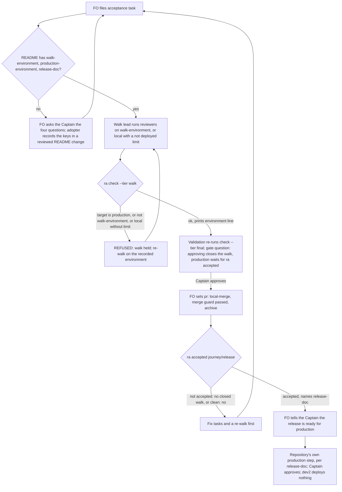

## Scope
- Source: the Captain, chat 2026-11-03: 「可以，都沒有測試或預覽站的人在本機驗收也很好，kc-ship-flow 確實不用了。」, answering 「決定：把這件開成這批的第 4 個任務 D：『release 驗收在正式站以外的環境上走；正式版等驗收通過才發』，跟 A、B、C 一起做嗎？」. Earlier: 「…心態上，在每個slice/batch做完才發布正式版才比較合理」 and 「要注意不是每個人都用 netlify 一類的基礎建設，未必有一樣的部署組合」. Then 「好」, answering 「決定：把『幫 repo 記下自己的部署環境，沒有就問那四個問題』併進任務 D 一起構思，暫時不另開擴充，可以嗎？」; the four questions FO named: which environments exist, how a change reaches each, who approves production, how to roll back.
- Outcome: the release-acceptance walk runs on an environment that is not production (a preview or staging deploy, named by the repository), and the repository's production release waits until that walk is accepted. A repository with no preview or staging environment walks locally and records that limit. The repository's environments are recorded once; when they are absent, adoption asks the four questions.
- Gap, read on origin/main 2026-11-03 with git grep: the release-acceptance extension names its `Environment:` target by name only and says nothing about which environment or about the production release; dev2 tasks end at merge and never deploy.
- Bite: the qnow FO's agent-observatory report of 2026-11-03 (the qnow FO confirmed it against its own work the same day): missing icons on staging and production returned HTTP 200 with HTML and only the Captain noticed, after release. subspace-relay set its own order in AGENTS.md (#441, #447): Deploy Preview, then staging, then production, with a two-merge release.
- Consumer: every adopter that lists the release-acceptance extension.
- Upstream first: `extensions/release-acceptance/EXTENSION.md`, `references/sd/adoption.md`; sibling subspace-relay AGENTS.md and docs/releasing.md; gstack `setup-deploy` detects a production platform only and is not reused.

## Non-goals
- dev2 deploying anything; platform-specific steps; reviving kc-ship-flow; a new deployment extension.

## Budget
- One package PR. Workflow word budget unchanged unless the design names a raise for the Captain.

## FO alignment
Alignment: needed before ideation; the scope is the Captain's ruling.
Result: aligned at backlog: Batch 13 backlog sitting, the Captain 「進」 (chat, 2026-11-03), answering 「決定：這批七張（A 權限、B 同症狀計數、C 改寫條件比對原話、D release 驗收不在正式站、來源標註、FO 先自己試、release 驗收到期提醒）都用 Pilot，照各自寫下的範圍、預算與停止條件進入構思嗎？要改哪張直接說。」, approved the outcome and bounds in this file.
Surfaces: none
Visible change: none
Release review: not needed: workflow maintenance, on no journey map.

## Stop condition
- A release-acceptance task whose environment is production is held, one naming a preview or staging target passes, a repository recording no such environment walks locally with the limit recorded, and the production-release step is reached only after an accepted walk.

## Design

### PRFAQ

**Proposition.** A release reaches production only after people walked it somewhere that is not production. The repository records once, in its workflow README, which deployed environment the walk uses (or `local` when it has none), which one is production, and which of its own documents says how a change reaches each, who approves production and how to roll back. `ra check` (`release_acceptance.py check`) refuses a walk whose target is production or is not the recorded walk environment, and refuses a local walk that does not record its limit. A new `ra accepted <journey>/<release>` says whether the newest closed walk of the release is clean; FO says a release is ready for production only on that line. dev2 still deploys nothing: the production step stays the repository's own.

**Why ordering first.** The bite (qnow, 2026-11-03) was broken icons on staging *and* production, seen only by the Captain after release. What would have caught it is the order: an accepted walk before production. The environment rule is what makes that order mean something, since a walk on production is the release already done.

**FAQ**
- *Who records the environments?* The adopter, once, in three flat keys of its workflow README frontmatter: `walk-environment:`, `production-environment:`, `release-doc:`. They are the adopter's own keys, like `comment-ratio-max:`; the template (`references/sd/workflow.md`) does not carry them, so a README re-sync never touches them and the workflow word budget does not move.
- *What if a repository has none of this?* `ra check` refuses with `environments not recorded`, naming the missing keys and pointing at the four questions. Adoption asks them when `release-acceptance` is chosen; an existing adopter (qnow main and subspace-relay list the extension today) meets the refusal at its first walk and FO asks them then. No walk has yet run in any adopter (no `walk/` folder on the state branches of qnow, subspace-relay or this repository, read 2026-11-03), so nothing in flight breaks.
- *No preview or staging?* `walk-environment: local`. The walk target must then be `local` and `meta.json` `not_tested` must hold an entry starting `not deployed:` naming what a deploy could break (served assets, headers, content types). `record.md` already renders `not_tested`, so the limit reaches the Captain with no schema change.
- *Does dev2 now block production?* No, and it cannot: production is the repository's step (subspace-relay: the Captain merges the production release pull request; this repository: the Captain merges the release-please pull request). What changes is that FO names a release ready for production only after `ra accepted` exits 0, and quotes its line. A Captain or a pipeline that releases without asking is not stopped (D1).
- *Is an approved walk an accepted release?* Not by itself. ADR 0034 closes a walk with complaints the same way as a clean one, then fix tasks and a re-walk follow. `ra accepted` therefore needs the newest archived acceptance task of the release to carry `pr: local-merge:<sha>` and a `walk/report.json` for which the existing `is_clean` is true (D3).
- *Profile?* Pilot holds: dev2 takes no release or rollback ownership; it records the repository's own answers and reads them.

### Flow

### Mechanism

1. **Record (README frontmatter, adopter-owned, flat).** `number_guards.frontmatter` reads flat `key: value` lines only, the same reader `ra` already imports, so the keys are flat scalars. `walk-environment` equal to `production-environment` is itself refused.
2. **Hold (`ra check`, both tiers, before the existing structure checks).** In order: missing key(s) → `REFUSED: environments not recorded in <README>: <keys>; ask the four questions (references/sd/adoption.md, Release environments)`; walk equal to production → `REFUSED: walk-environment is production-environment (<name>)`; `target.environment` equal to production → `REFUSED: the walk ran on production (<name>); walk on <walk-environment>`; any other mismatch → `REFUSED: the walk ran on <x>; the README records <walk-environment>`; `local` without a `not deployed:` entry in `not_tested` → `REFUSED: a local walk records its limit as a not_tested entry starting "not deployed:"`. On success it prints `environment: <name> (production: <name>)` or `environment: local (not deployed)`.
3. **Wait (`ra accepted <journey>/<release> --workflow-dir <dir>`).** Scans live and `_archive/` tasks whose frontmatter `release-acceptance` equals the release (the same scan `Task` already does). Exit 1 with one `not accepted: <journey>/<release>: <reason>` line for: no acceptance task; newest one not archived; archived without `pr: local-merge:`; its `walk/report.json` missing or `is_clean` false. Exit 0 with `accepted: <journey>/<release> by <task> (local-merge:<sha>); production release per <release-doc>`. Newest is fixed by the `Prior walk:` chain, not by file order (the scan sorts by slug): it is the one acceptance task of the release whose `walk/report.json` no other acceptance task names in its `Prior walk:` line. Two or more such tasks (neither names the other) exit 1 with `not accepted: <journey>/<release>: <task>, <task> are both newest; name the prior walk`.
4. **Docs.** `EXTENSION.md`: Needs (the three keys, the four-question route), File the task (`Environment:` target is the README's `walk-environment`), the scope note (walk only there; the local limit entry), Validation (gate question adds that production then waits for `ra accepted`), a new **Production waits** line under Close, `check`'s `environment:` line under Read, and two Cannot-see items. `adoption.md`: a short `## Release environments` section that the Extensions step points to when `release-acceptance` is chosen.
5. **Schema.** No `release-acceptance/v1` field changes: `target {environment, ref}` and `not_tested` already exist, so `FIELDS`, the table hash and `contract-versions.json` (1.0.0) stay as they are and `ra schema release-acceptance` keeps exiting 0.
6. **ADR.** One new ADR, short title "A release walk runs off production and the production release waits for a clean closed walk", number reserved by FO at implementation dispatch. It extends ADR 0031 and 0034 without editing them.

### Existing-code check

- Chain, read 2026-11-03: a filename search of Spacedock 0.27.3 for staging, production deploy or environments hit only merge, state-sync and marketplace code, their tests and roadmap documents, none a stage or dispatch surface; kc-dev-flow-2 at origin/main 0.34.0 names `Environment:` by name only and `release_acceptance.py` requires only a non-empty `target.environment` and `ref`; kc-journey-map carries no walk-environment notion; gstack `setup-deploy` detects a production platform only (task Scope) and is not reused. Sibling subspace-relay (origin/main 77bf170f): AGENTS.md "A change a person can see goes Deploy Preview, then staging, then production", and docs/releasing.md's two-merge release with `promote-production` refusing anything but `staging-verified` success. That is one sibling's platform practice; the package takes from it only the order and the "who approves production" question.
- Observation (scratch copy of origin/main in `/tmp/rwop`, `build_world` from `test_release_acceptance.py`, README given `production-environment: production`): `ra check --tier walk` exits 0 with `tier walk: ok` both for `target.environment` `staging` and `production`. Nothing reads the recorded production name today, so the hold needs code, not wording.
- Reused, not replaced: `frontmatter` (README keys), `Task` and the state scan (accepted), `is_clean` (what accepted means), `not_tested` and `render` (the local limit). New: one subcommand and one check function.

### Words FO reads at each moment

Counted with `normalized_words` from `scripts/lint-skills.py` on origin/main; candidate figures are this design's drafted sentences, recounted at implementation with an independent copy.

| Moment | Read | Base | Candidate |
| --- | --- | --- | --- |
| Startup, idle on open or merged PR, after archive, merge ask | `references/sd/workflow.md`, `pr_watch.py` output | 5834 | 5834, delta 0 (no README, no `pr_watch.py` change) |
| Adoption, once per adopter | `references/sd/adoption.md` | 2267 | ≈2365, +98 |
| Filing and first implementation dispatch of an acceptance task | `extensions/release-acceptance/EXTENSION.md` | 605 | ≈768, +163 drafted; implementation trims toward ≤740 |
| Each `ra check` run | its output | `reviewers:` and `tier` lines | +1 `environment:` line (≈6 words) |
| Validation gate of an acceptance task | gate question | ADR 0034 sentence | +1 clause naming `ra accepted` (≈10 words) |
| Before FO names a release ready for production | `ra accepted` output | nothing (no step) | 1 line (≈12 words) |

### Unresolved decisions for the Captain

- **D1. Production waits by FO's word plus `ra accepted`, not by a refusal inside the repository's release pipeline.** Recommend yes: wiring a refusal into each adopter's release job is platform-specific, a Non-goal, and the adopter's CI does not have the package. Worse under it: a Captain or pipeline that releases without asking FO is not stopped; the record shows only that FO never said "ready". An adopter may still call `ra accepted` from its own release step later.
- **D2. The three non-environment answers (how a change reaches each, who approves production, rollback) live in the repository's own release document named by `release-doc:`; a repository with none gets `docs/releasing.md` from its adoption change.** Recommend yes: the frontmatter survives README re-sync, a body section in the README would conflict at every three-way merge (`adoption.md`), and subspace-relay already has such a document. Worse under it: a small repository gains one file, and `ra` checks only that the key is set, not that the document answers the questions.
- **D3. "Accepted" means the newest closed walk is clean (`is_clean`), not merely closed.** Recommend yes: ADR 0034 closes a walk with complaints the same way, so "closed" would let a walk with to-fix complaints admit production, which is the bite. Worse under it: when the Captain wants to ship with known complaints, `ra accepted` still says `not accepted`; his explicit word overrides it and FO records it, but the script never says yes.

Past rulings read: ADR 0031 (walk accepts a release, two schemas), 0033 (reviewers and director), 0034 (local-merge close); `git -C <state> grep -n 'Override:'` (2026-11-03) hits only ADR-path, hook, Codex and backlog-task areas, none on release environments or production order. D1 follows ADR 0034's lean that dev2 closes walks locally and opens nothing outward.

### Batch overlap

| Task | Shared file or check | Nature |
| --- | --- | --- |
| release-walk-due-trigger (batch 13) | `extensions/release-acceptance/release_acceptance.py` (its `due` subcommand, my `accepted` subcommand and environment check), `test_release_acceptance.py` (`build_world`), `EXTENSION.md`, adopter README frontmatter keys (its `journeys:`, my three) | textual; both add subcommands and EXTENSION lines |
| picky-reviewers-may-run-on-gemini (live) | none on its stop route; `EXTENSION.md` if reopened | none now |
| adoption-asks-which-extensions (live) | `references/sd/adoption.md` § Extensions | textual; my step points from it to the new section |
| adr-required-statement (validation) | `references/sd/adoption.md`; the shared `docs/adr/` index | textual; one ADR number each |
| archive-waits-for-observer-report (implementation) | `references/sd/adoption.md` | textual |
| captain-ruling-sources-checked (live) | `references/sd/adoption.md` mention | textual |
| dispatch-carries-reserved-adr-number (live) | `docs/adr/` index only through FO's reservation | none in files |
| fo-answers-own-worker-permissions-by-listed-id, diagnosis-rounds-count-toward-step-back, rewritten-criteria-checked-against-captain-words, claims-name-their-source, fo-tries-what-it-asks-the-captain (batch 13); adr-silent-undo-probe, comment-check-reaches-delivery-gate, fo-write-checks-parse-top-level, journey-canvas-hosted-poc, ops-inbox-r1-setup-and-isolation, pr-review-lite-value-pilot, seed-check-requires-alignment-result (live) | none: their named files are peers/paseo EXTENSION, role_triggers/pr_watch, dispatch_records/design_surfaces, delivery_gate, validation principles, comment_ratio, kc-journey-map, kc-ops-inbox | none |
| journey-server-host-pilot (live) | state checkout holds only its folder, no task file, so no named file | none found |

Recommended order: this task before release-walk-due-trigger (its `due` line can then name the recorded walk environment, and both edit `release_acceptance.py` and `EXTENSION.md`); after adr-required-statement and archive-waits-for-observer-report, which are further along and touch `adoption.md`; the rest in any order.

## Acceptance criteria

All `ra` runs use `kc-dev-flow-2/extensions/release-acceptance/release_acceptance.py` at the candidate, on `build_world` from `test_release_acceptance.py` with its README given `walk-environment: staging`, `production-environment: production`, `release-doc: docs/releasing.md` unless a criterion says otherwise; each is a case in `test_release_acceptance.py`.

**AC-1** A walk whose target is production is held. Verified by: `meta.json` `target.environment` `production`, `ra check <folder> --tier walk --workflow-dir <wf>` exits 1 printing `REFUSED: the walk ran on production (production); walk on staging` and `clean: no`; the same at `--tier final` on a built report. Falsifier: at origin/main the same run exits 0 (observed above); removing the comparison restores exit 0.

**AC-2** A walk on the recorded non-production environment passes. Verified by: target `staging`, `check --tier walk` exits 0 and prints `environment: staging (production: production)`. Falsifier: target `staging-2` exits 1 with `the README records staging`.

**AC-3** Absent environments hold the walk and point at the four questions. Verified by: each of the three keys removed in turn, `check --tier walk` exits 1 with `environments not recorded` naming that key and `references/sd/adoption.md`; `walk-environment` set equal to `production-environment` exits 1. Falsifier: restoring the key returns exit 0.

**AC-4** A local walk passes only with its limit recorded, and the record shows it. Verified by: `walk-environment: local`, target `local`, `not_tested` holding `not deployed: served assets, headers and content types not seen`, `check --tier walk` exits 0 printing `environment: local (not deployed)`, and after `build` the `render` output's `## Not tested` lists that line. Falsifier: dropping the entry exits 1 with `a local walk records its limit`.

**AC-5** Production waits for a clean closed walk. Verified by `ra accepted book-pickup/r1 --workflow-dir <wf>`: exit 1 with `not accepted` and a reason for (a) no acceptance task, (b) a live unarchived one, (c) archived without `pr: local-merge:`, (d) archived with `local-merge:` but a report for which `is_clean` is false; exit 0 with `accepted: book-pickup/r1 by r1-acceptance (local-merge:<sha>); production release per docs/releasing.md` for an archived clean one; with a clean first walk and an archived re-walk naming it in `Prior walk:` that is not clean, exit 1; with two archived clean walks neither naming the other, exit 1 naming both. Falsifier: changing any one of the four conditions flips its case.

**AC-6** The report schema does not change. Verified by: `ra schema release-acceptance` exits 0 printing `release-acceptance 1.0.0`, and `git diff <base> -- kc-dev-flow-2/extensions/release-acceptance/contract-versions.json` is empty. Falsifier: adding a field to `FIELDS` makes `schema` exit 1.

**AC-7** The docs carry the route, and the workflow README does not move. Verified by: `EXTENSION.md` holds the three keys, the four-question route, the scope-note walk rule and local limit, the gate-question clause, a **Production waits** line saying dev2 releases nothing, and the two Cannot-see items; `adoption.md` holds `## Release environments` with the four questions and the `docs/releasing.md` fallback, and § Extensions points to it; `git diff <base> -- kc-dev-flow-2/references/sd/workflow.md` is empty and `python3 kc-dev-flow-2/scripts/lint-skills.py` exits 0 with no budget step added. Falsifier: any workflow.md edit makes lint report the budget mismatch.

**AC-8** The words FO reads move only where the table says. Verified by: an independent recount with `normalized_words` of base and candidate for each moment in `### Words FO reads at each moment`, recorded in the implementation report: workflow.md delta 0, `EXTENSION.md` at most 740, `adoption.md` at most 2375. Falsifier: either file over its ceiling.

**AC-9** The ruling lands as one ADR. Verified by: `python3 kc-dev-flow-2/scripts/adr_lint.py docs/adr --since <base> --require <reserved number>` exits 0, the ADR naming ADR 0031 and 0034 and the Captain's words for D1 to D3. Falsifier: the record missing or lint exit 1.

**AC-10** Existing behaviour holds. Verified by: `python3 -B kc-dev-flow-2/extensions/release-acceptance/test_release_acceptance.py` passes with `build_world` writing the three keys and no other existing case changed. Falsifier: an existing case needing a changed expectation besides the README keys.

## Number guards

ADR: 0053

## Stage Report: ideation

- DONE: Design where a repository records its environments, how the release-acceptance walk is held off production, how the production release waits for an accepted walk, the local-only path with its recorded limit, and the four adoption questions when the environments are absent; read subspace-relay's AGENTS.md and docs/releasing.md as one sibling's practice, not as the contract
  `## Design` § PRFAQ, Flow, Mechanism 1-6: three flat README keys, `ra check` hold, `ra accepted`, `not deployed:` limit, adoption.md § Release environments; relay read at origin/main 77bf170f for order only.
- DONE: A `### Batch overlap` section naming each file the design would change and each other batch task and live task that changes the same file or check, so FO can order implementation
  Table covers all 7 batch and 13 live tasks; shared: release-walk-due-trigger (release_acceptance.py, EXTENSION.md), adoption.md with four tasks, ADR index; `Recommended order:` line present.
- DONE: The words FO reads at each lifecycle moment, before and after, per root learning.md "Measure the words FO reads at each moment, not one file's size"
  `### Words FO reads at each moment`: workflow.md 5834 delta 0; adoption.md 2267 to ≈2365; EXTENSION.md 605 to ≈768 drafted, ceiling 740; check, gate and accepted lines.
- DONE: Acceptance criteria with reproducible evidence clauses and falsifiers, and unresolved decisions for the Captain, each with a recommendation and what gets worse under it
  AC-1..AC-10 below, each with verification and falsifier; D1-D3 each with a recommendation and its cost; Override: lines and ADR 0031/0033/0034 read.
- DONE: AC-1 production target held
  Not yet verified on a candidate; base gap observed: origin/main `ra check --tier walk` exits 0 for target `production` (scratch `/tmp/rwop/probe2.py`).
- DONE: AC-2 recorded non-production target passes
  Not yet verified; future test case.
- DONE: AC-3 absent keys hold and point at the four questions
  Not yet verified; future test case.
- DONE: AC-4 local walk needs its `not deployed:` limit and renders it
  Not yet verified; base render already lists `not_tested` (`render_text`, `## Not tested`).
- DONE: AC-5 `ra accepted` needs a clean closed walk
  Not yet verified; reuses `is_clean` and the `Task` scan, both read at origin/main.
- DONE: AC-6 schema unchanged
  Not yet verified; design adds no `FIELDS` entry.
- DONE: AC-7 docs carry the route, workflow.md unchanged
  Not yet verified; drafted sentences counted in the words table.
- DONE: AC-8 words per moment within ceilings
  Not yet verified; base counts measured on origin/main with `normalized_words`.
- DONE: AC-9 one ADR lands
  Not yet verified; title named, no number.
- DONE: AC-10 existing suite holds
  Not yet verified.
- DONE: design_surfaces.py check run
  `release-walk-off-production-before-release.md: design surfaces presentable`, exit 0.

### Summary

The design records three adopter-owned README keys, makes `ra check` refuse a walk on production, off the recorded environment, or local without a `not deployed:` limit, and adds `ra accepted`, which says a release is ready for production only after its newest closed walk is clean. dev2 still deploys nothing; the production step stays the repository's own (D1). The report schema and the workflow README do not change. The base gap was observed: origin/main accepts a walk whose target is production. Three Captain decisions (D1 advisory wait, D2 `release-doc:` home, D3 clean-not-just-closed) carry recommendations. Order: before release-walk-due-trigger.

## Stage Report: implementation

- DONE: Implement the approved three README keys, ra check refusals and ra accepted, with production waiting on FO's word, the repository's release document and the newest clean closed walk.
  Branch `spacedock-ensign/release-walk-off-production-before-release`; base `713d4e6ed6381e65fa6d8305e08b282ceb56a8fb`; candidate `6d998a29c01ebb5779943663c3ad30533b3856a4`; five changed design-named files; clean code worktree.
- SKIPPED: One Draft PR in iamcxa/kc-claude-plugins from the branch off origin/main.
  ADR 0042/0048 and FO's 2026-11-03 reply assign push, Draft PR and local review to FO; no product push or PR attempted. Prepared title/body below; no versions changed.
- DONE: ADR 0053 records the ruling the design names, quoting the Captain's words from the task file and its gate records.
  `docs/adr/0053-a-release-walk-runs-off-production-and-production-waits-for-a-clean-closed-walk.md` extends 0031/0034, records the three approved recommendations; package adr_lint --since base --require 0053: exit 0.
- DONE: AC-1 production target is held at both tiers.
  `RecordedEnvironmentTests.test_production_is_refused_at_both_tiers`; native base-production-{walk,final} exit 0 versus candidate exit 1 with the specified REFUSED and clean:no; removing its refusal makes the test fail.
- DONE: AC-2 recorded non-production target passes and another staging target fails.
  RecordedEnvironmentTests staging case and native staging exit 0 print `environment: staging (production: production)`; target staging-2 exits 1; bypassing the mismatch check fails the test.
- DONE: AC-3 absent or blank keys hold and point at the four questions; equal environment names hold.
  RecordedEnvironmentTests removes/blanks each key, asserts its name and adoption pointer, restores it to exit 0; removing release-doc from required keys makes this test fail.
- DONE: AC-4 local walk passes only with its recorded deployment limit, and render shows it.
  RecordedEnvironmentTests local case plus native local/build/render exit 0 with the specified limit; removing it holds both tiers; bypassing the limit check fails the test.
- DONE: AC-5 production waits for the newest clean closed walk.
  AcceptedTests covers absent/live task, archive without local-merge, missing/malformed/unclean report, clean acceptance, newer dirty/live re-walk and unnamed parallel walks; mutations allowing live, unsentinelled, unclean, older or parallel walks each fail; native acceptance/newest-dirty exits 0/1.
- DONE: AC-6 the report schema does not change.
  Native schema prints `release-acceptance 1.0.0`, exit 0; FIELDS and contract-versions.json unchanged from base; adding a field makes schema exit 1.
- DONE: AC-7 docs carry the route and workflow README does not move.
  EXTENSION.md retains the lifecycle and adds keys, four-question pointer, local limit, gate clause, Production waits and both blind spots; adoption.md adds Release environments and its Extensions pointer; workflow.md diff empty; repository lint exits 0; adding one workflow word makes lint exit 1.
- DONE: AC-8 independent normalized_words recount is within each ceiling at each lifecycle moment.
  Startup, idle(open/merged), archive and merge ask: workflow 5834->5834 and pr_watch unchanged; adoption 2267->2372; filing/first dispatch EXTENSION 605->525 (512 whitespace words, below existing 600 test); check adds 4 words, gate clause 5, accepted output 10; both ceiling mutations exit 1.
- DONE: AC-9 one ADR lands, names 0031/0034 and the Captain's words for the three accepted recommendations.
  Package ADR lint exits 0; temporarily removing 0053 makes --require 0053 exit 1; nine ADR-document tests pass.
- DONE: AC-10 existing behaviour holds without changed expectations.
  `python3 -B kc-dev-flow-2/extensions/release-acceptance/test_release_acceptance.py`: 92 run, 91 passed, 1 skip; AST comparison proves every existing test/helper unchanged except build_world README keys; removing the existing schema check makes its original test fail.
- SKIPPED: Existing journey-map interoperability test requiring YAML.
  It skips because the declared YAML dependency is not installed in this worktree; no replacement proof or changed expectation; schema/native tests above still pass.
- DONE: Repository lint, package number guards and comment ratio pass at the candidate.
  lint-skills exit 0 (5781/5781 budget), number_guards exit 0 with base/head above, comment_ratio exit 0: 240 code lines, 2 comment lines, 0.8% <= 5%; design_surfaces exits 0.
- DONE: Affected documents assessed and proof retained.
  doc_impact lists only ADR 0053: updated; EXTENSION/adoption claims updated; no retained diagram changed. `/tmp/release-walk-proof/` holds 18 acceptance/mutation checks, 11 native checks, words and pinned-ruling digests; `.context/release-walk-proof/{mutations,native}.py` reproduces them (python3 -B, caches cleared); remove scratch after validation.
- SKIPPED: RoboRev evidence= line and CI green on the PR head.
  Not run/delegated to FO under ADR 0042/0048 and FO confirmation, not clean; FO must review exact base/candidate before fresh validation. CI cost not measured; no CI configuration changed.

### Summary

The candidate holds release walks off production and announces readiness only after the newest locally closed walk is clean; dev2 still deploys nothing. Local checks and falsifiers pass, with the existing YAML-dependent integration skip; FO owns publication, exact-head RoboRev and hosted CI.

Prepared PR title: `feat(kc-dev-flow-2): hold production readiness for a clean release walk`

Prepared PR body (verbatim):
Release walks now refuse production, any target other than the repository's recorded walk environment, missing environment keys, and local walks without a recorded deployment limit. The new `accepted JOURNEY/RELEASE` command requires the newest walk, determined by `Prior walk:`, to be archived with a local-merge sentinel and a clean report before FO announces production readiness.

The extension and adoption instructions record three adopter-owned README keys and the repository's own release document. ADR 0053 records the Captain's ruling. The schema, workflow template and versions are unchanged; production remains the repository's own approved procedure.

Validation: 91 release-acceptance tests passed; one existing journey-map interoperability test skipped because its YAML dependency is absent. Nine ADR tests, 11 native CLI checks, 18 acceptance/mutation checks, skill lint, ADR lint, number guards and comment ratio passed. Added comments are 0.8% against the 5% maximum. Hosted CI and exact-head RoboRev remain pending; CI cost was not measured and no CI configuration changed.

## Stage Report: implementation

- DONE: Implement the approved three README keys, ra check refusals and ra accepted, with production waiting on FO's word, the repository's release document and the newest clean closed walk.
  Branch `spacedock-ensign/release-walk-off-production-before-release`; base `713d4e6ed6381e65fa6d8305e08b282ceb56a8fb`; candidate `6d998a29c01ebb5779943663c3ad30533b3856a4`; five changed design-named files; clean code worktree.
- SKIPPED: One Draft PR in iamcxa/kc-claude-plugins from the branch off origin/main.
  ADR 0042/0048 and FO's 2026-11-03 reply assign push, Draft PR and local review to FO; no product push or PR attempted. Prepared title/body below; no versions changed.
- DONE: ADR 0053 records the ruling the design names, quoting the Captain's words from the task file and its gate records.
  `docs/adr/0053-a-release-walk-runs-off-production-and-production-waits-for-a-clean-closed-walk.md` extends 0031/0034, records the three approved recommendations; package adr_lint --since base --require 0053: exit 0.
- DONE: AC-1 production target is held at both tiers.
  `RecordedEnvironmentTests.test_production_is_refused_at_both_tiers`; native base-production-{walk,final} exit 0 versus candidate exit 1 with the specified REFUSED and clean:no; removing its refusal makes the test fail.
- DONE: AC-2 recorded non-production target passes and another staging target fails.
  RecordedEnvironmentTests staging case and native staging exit 0 print `environment: staging (production: production)`; target staging-2 exits 1; bypassing the mismatch check fails the test.
- DONE: AC-3 absent or blank keys hold and point at the four questions; equal environment names hold.
  RecordedEnvironmentTests removes/blanks each key, asserts its name and adoption pointer, restores it to exit 0; removing release-doc from required keys makes this test fail.
- DONE: AC-4 local walk passes only with its recorded deployment limit, and render shows it.
  RecordedEnvironmentTests local case plus native local/build/render exit 0 with the specified limit; removing it holds both tiers; bypassing the limit check fails the test.
- DONE: AC-5 production waits for the newest clean closed walk.
  AcceptedTests covers absent/live task, archive without local-merge, missing/malformed/unclean report, clean acceptance, newer dirty/live re-walk and unnamed parallel walks; mutations allowing live, unsentinelled, unclean, older or parallel walks each fail; native acceptance/newest-dirty exits 0/1.
- DONE: AC-6 the report schema does not change.
  Native schema prints `release-acceptance 1.0.0`, exit 0; FIELDS and contract-versions.json unchanged from base; adding a field makes schema exit 1.
- DONE: AC-7 docs carry the route and workflow README does not move.
  EXTENSION.md retains the lifecycle and adds keys, four-question pointer, local limit, gate clause, Production waits and both blind spots; adoption.md adds Release environments and its Extensions pointer; workflow.md diff empty; repository lint exits 0; adding one workflow word makes lint exit 1.
- DONE: AC-8 independent normalized_words recount is within each ceiling at each lifecycle moment.
  Startup, idle(open/merged), archive and merge ask: workflow 5834->5834 and pr_watch unchanged; adoption 2267->2372; filing/first dispatch EXTENSION 605->525 (512 whitespace words, below existing 600 test); check adds 4 words, gate clause 5, accepted output 10; both ceiling mutations exit 1.
- DONE: AC-9 one ADR lands, names 0031/0034 and the Captain's words for the three accepted recommendations.
  Package ADR lint exits 0; temporarily removing 0053 makes --require 0053 exit 1; nine ADR-document tests pass.
- DONE: AC-10 existing behaviour holds without changed expectations.
  `python3 -B kc-dev-flow-2/extensions/release-acceptance/test_release_acceptance.py`: 92 run, 91 passed, 1 skip; AST comparison proves every existing test/helper unchanged except build_world README keys; removing the existing schema check makes its original test fail.
- SKIPPED: Existing journey-map interoperability test requiring YAML.
  It skips because the declared YAML dependency is not installed in this worktree; no replacement proof or changed expectation; schema/native tests above still pass.
- DONE: Repository lint, package number guards and comment ratio pass at the candidate.
  lint-skills exit 0 (5781/5781 budget), number_guards exit 0 with base/head above, comment_ratio exit 0: 240 code lines, 2 comment lines, 0.8% <= 5%; design_surfaces exits 0.
- DONE: Affected documents assessed and proof retained.
  doc_impact lists only ADR 0053: updated; EXTENSION/adoption claims updated; no retained diagram changed. `/tmp/release-walk-proof/` holds 18 acceptance/mutation checks, 11 native checks, words and pinned-ruling digests; `.context/release-walk-proof/{mutations,native}.py` reproduces them (python3 -B, caches cleared); remove scratch after validation.
- SKIPPED: RoboRev evidence= line and CI green on the PR head.
  Not run/delegated to FO under ADR 0042/0048 and FO confirmation, not clean; FO must review exact base/candidate before fresh validation. CI cost not measured; no CI configuration changed.

- SKIPPED: Push the path-scoped state report to spacedock-state/dev2.
  Local report commit `40845b1de`; push exited 128: `Could not resolve host: github.com`; no retry or alternate route attempted. FO must sync the local report.

### Summary

The candidate holds release walks off production and announces readiness only after the newest locally closed walk is clean; dev2 still deploys nothing. Local checks and falsifiers pass, with the existing YAML-dependent integration skip; FO owns publication, exact-head RoboRev, hosted CI and the failed state sync.

Prepared PR title: `feat(kc-dev-flow-2): hold production readiness for a clean release walk`

Prepared PR body (verbatim):
Release walks now refuse production, any target other than the repository's recorded walk environment, missing environment keys, and local walks without a recorded deployment limit. The new `accepted JOURNEY/RELEASE` command requires the newest walk, determined by `Prior walk:`, to be archived with a local-merge sentinel and a clean report before FO announces production readiness.

The extension and adoption instructions record three adopter-owned README keys and the repository's own release document. ADR 0053 records the Captain's ruling. The schema, workflow template and versions are unchanged; production remains the repository's own approved procedure.

Validation: 91 release-acceptance tests passed; one existing journey-map interoperability test skipped because its YAML dependency is absent. Nine ADR tests, 11 native CLI checks, 18 acceptance/mutation checks, skill lint, ADR lint, number guards and comment ratio passed. Added comments are 0.8% against the 5% maximum. Hosted CI and exact-head RoboRev remain pending; CI cost was not measured and no CI configuration changed.

This complete report supersedes the earlier implementation report; the only change is the recorded state-push DNS failure.
