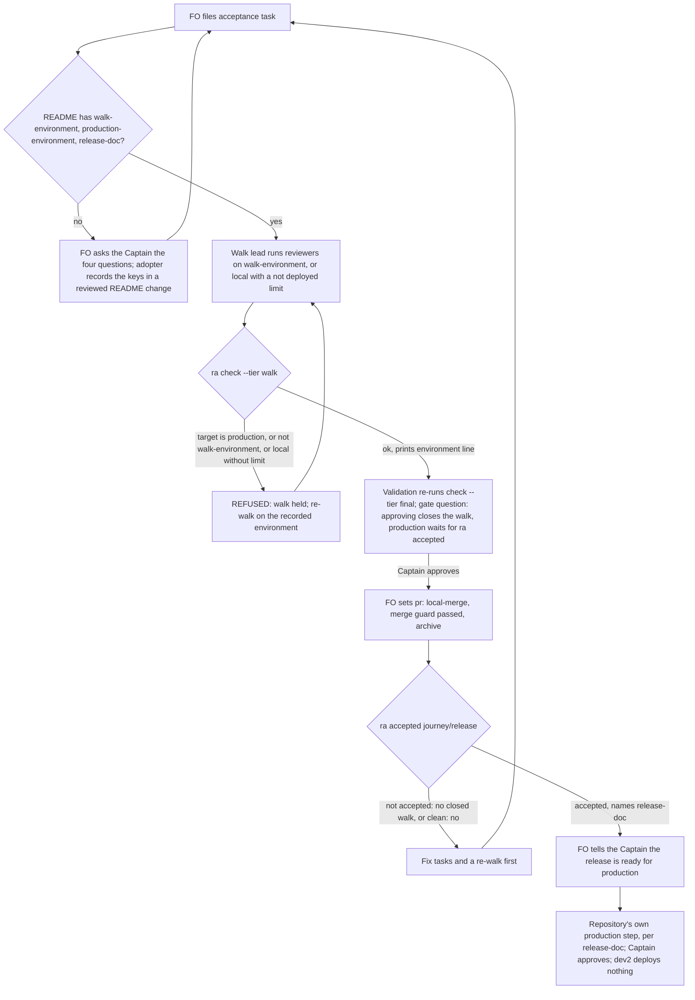

## Scope
- Source: the Captain, chat 2026-11-03: 「可以，都沒有測試或預覽站的人在本機驗收也很好，kc-ship-flow 確實不用了。」, answering 「決定：把這件開成這批的第 4 個任務 D：『release 驗收在正式站以外的環境上走；正式版等驗收通過才發』，跟 A、B、C 一起做嗎？」. Earlier: 「…心態上，在每個slice/batch做完才發布正式版才比較合理」 and 「要注意不是每個人都用 netlify 一類的基礎建設，未必有一樣的部署組合」. Then 「好」, answering 「決定：把『幫 repo 記下自己的部署環境，沒有就問那四個問題』併進任務 D 一起構思，暫時不另開擴充，可以嗎？」; the four questions FO named: which environments exist, how a change reaches each, who approves production, how to roll back.
- Outcome: the release-acceptance walk runs on an environment that is not production (a preview or staging deploy, named by the repository), and the repository's production release waits until that walk is accepted. A repository with no preview or staging environment walks locally and records that limit. The repository's environments are recorded once; when they are absent, adoption asks the four questions.
- Gap, read on origin/main 2026-11-03 with git grep: the release-acceptance extension names its `Environment:` target by name only and says nothing about which environment or about the production release; dev2 tasks end at merge and never deploy.
- Bite: the qnow FO's agent-observatory report of 2026-11-03 (the qnow FO confirmed it against its own work the same day): missing icons on staging and production returned HTTP 200 with HTML and only the Captain noticed, after release. subspace-relay set its own order in AGENTS.md (#441, #447): Deploy Preview, then staging, then production, with a two-merge release.
- Consumer: every adopter that lists the release-acceptance extension.
- Upstream first: `extensions/release-acceptance/EXTENSION.md`, `references/sd/adoption.md`; sibling subspace-relay AGENTS.md and docs/releasing.md; gstack `setup-deploy` detects a production platform only and is not reused.

## Non-goals
- dev2 deploying anything; platform-specific steps; reviving kc-ship-flow; a new deployment extension.

## Budget
- One package PR. Workflow word budget unchanged unless the design names a raise for the Captain.

## FO alignment
Alignment: needed before ideation; the scope is the Captain's ruling.
Result: aligned at backlog: Batch 13 backlog sitting, the Captain 「進」 (chat, 2026-11-03), answering 「決定：這批七張（A 權限、B 同症狀計數、C 改寫條件比對原話、D release 驗收不在正式站、來源標註、FO 先自己試、release 驗收到期提醒）都用 Pilot，照各自寫下的範圍、預算與停止條件進入構思嗎？要改哪張直接說。」, approved the outcome and bounds in this file.
Surfaces: none
Visible change: none
Release review: not needed: workflow maintenance, on no journey map.
Reviewer: kc-dev-flow-2:chief-engineer opus 2026-11-04 — what is the smallest next step, given the findings so far? (batch 13 delivery review) Advice: merge #771 and #772; #770 merges main after #771 and adds Symptom fixtures, then revalidates; report review/chief-engineer-batch13.md.

## Stop condition
- A release-acceptance task whose environment is production is held, one naming a preview or staging target passes, a repository recording no such environment walks locally with the limit recorded, and the production-release step is reached only after an accepted walk.

## Design

### PRFAQ

**Proposition.** A release reaches production only after people walked it somewhere that is not production. The repository records once, in its workflow README, which deployed environment the walk uses (or `local` when it has none), which one is production, and which of its own documents says how a change reaches each, who approves production and how to roll back. `ra check` (`release_acceptance.py check`) refuses a walk whose target is production or is not the recorded walk environment, and refuses a local walk that does not record its limit. A new `ra accepted <journey>/<release>` says whether the newest closed walk of the release is clean; FO says a release is ready for production only on that line. dev2 still deploys nothing: the production step stays the repository's own.

**Why ordering first.** The bite (qnow, 2026-11-03) was broken icons on staging *and* production, seen only by the Captain after release. What would have caught it is the order: an accepted walk before production. The environment rule is what makes that order mean something, since a walk on production is the release already done.

**FAQ**
- *Who records the environments?* The adopter, once, in three flat keys of its workflow README frontmatter: `walk-environment:`, `production-environment:`, `release-doc:`. They are the adopter's own keys, like `comment-ratio-max:`; the template (`references/sd/workflow.md`) does not carry them, so a README re-sync never touches them and the workflow word budget does not move.
- *What if a repository has none of this?* `ra check` refuses with `environments not recorded`, naming the missing keys and pointing at the four questions. Adoption asks them when `release-acceptance` is chosen; an existing adopter (qnow main and subspace-relay list the extension today) meets the refusal at its first walk and FO asks them then. No walk has yet run in any adopter (no `walk/` folder on the state branches of qnow, subspace-relay or this repository, read 2026-11-03), so nothing in flight breaks.
- *No preview or staging?* `walk-environment: local`. The walk target must then be `local` and `meta.json` `not_tested` must hold an entry starting `not deployed:` naming what a deploy could break (served assets, headers, content types). `record.md` already renders `not_tested`, so the limit reaches the Captain with no schema change.
- *Does dev2 now block production?* No, and it cannot: production is the repository's step (subspace-relay: the Captain merges the production release pull request; this repository: the Captain merges the release-please pull request). What changes is that FO names a release ready for production only after `ra accepted` exits 0, and quotes its line. A Captain or a pipeline that releases without asking is not stopped (D1).
- *Is an approved walk an accepted release?* Not by itself. ADR 0034 closes a walk with complaints the same way as a clean one, then fix tasks and a re-walk follow. `ra accepted` therefore needs the newest archived acceptance task of the release to carry `pr: local-merge:<sha>` and a `walk/report.json` for which the existing `is_clean` is true (D3).
- *Profile?* Pilot holds: dev2 takes no release or rollback ownership; it records the repository's own answers and reads them.

### Flow



### Mechanism

1. **Record (README frontmatter, adopter-owned, flat).** `number_guards.frontmatter` reads flat `key: value` lines only, the same reader `ra` already imports, so the keys are flat scalars. `walk-environment` equal to `production-environment` is itself refused.
2. **Hold (`ra check`, both tiers, before the existing structure checks).** In order: missing key(s) → `REFUSED: environments not recorded in <README>: <keys>; ask the four questions (references/sd/adoption.md, Release environments)`; walk equal to production → `REFUSED: walk-environment is production-environment (<name>)`; `target.environment` equal to production → `REFUSED: the walk ran on production (<name>); walk on <walk-environment>`; any other mismatch → `REFUSED: the walk ran on <x>; the README records <walk-environment>`; `local` without a `not deployed:` entry in `not_tested` → `REFUSED: a local walk records its limit as a not_tested entry starting "not deployed:"`. On success it prints `environment: <name> (production: <name>)` or `environment: local (not deployed)`.
3. **Wait (`ra accepted <journey>/<release> --workflow-dir <dir>`).** Scans live and `_archive/` tasks whose frontmatter `release-acceptance` equals the release (the same scan `Task` already does). Exit 1 with one `not accepted: <journey>/<release>: <reason>` line for: no acceptance task; newest one not archived; archived without `pr: local-merge:`; its `walk/report.json` missing or `is_clean` false. Exit 0 with `accepted: <journey>/<release> by <task> (local-merge:<sha>); production release per <release-doc>`. Newest is fixed by the `Prior walk:` chain, not by file order (the scan sorts by slug): it is the one acceptance task of the release whose `walk/report.json` no other acceptance task names in its `Prior walk:` line. Two or more such tasks (neither names the other) exit 1 with `not accepted: <journey>/<release>: <task>, <task> are both newest; name the prior walk`.
4. **Docs.** `EXTENSION.md`: Needs (the three keys, the four-question route), File the task (`Environment:` target is the README's `walk-environment`), the scope note (walk only there; the local limit entry), Validation (gate question adds that production then waits for `ra accepted`), a new **Production waits** line under Close, `check`'s `environment:` line under Read, and two Cannot-see items. `adoption.md`: a short `## Release environments` section that the Extensions step points to when `release-acceptance` is chosen.
5. **Schema.** No `release-acceptance/v1` field changes: `target {environment, ref}` and `not_tested` already exist, so `FIELDS`, the table hash and `contract-versions.json` (1.0.0) stay as they are and `ra schema release-acceptance` keeps exiting 0.
6. **ADR.** One new ADR, short title "A release walk runs off production and the production release waits for a clean closed walk", number reserved by FO at implementation dispatch. It extends ADR 0031 and 0034 without editing them.

### Existing-code check

- Chain, read 2026-11-03: a filename search of Spacedock 0.27.3 for staging, production deploy or environments hit only merge, state-sync and marketplace code, their tests and roadmap documents, none a stage or dispatch surface; kc-dev-flow-2 at origin/main 0.34.0 names `Environment:` by name only and `release_acceptance.py` requires only a non-empty `target.environment` and `ref`; kc-journey-map carries no walk-environment notion; gstack `setup-deploy` detects a production platform only (task Scope) and is not reused. Sibling subspace-relay (origin/main 77bf170f): AGENTS.md "A change a person can see goes Deploy Preview, then staging, then production", and docs/releasing.md's two-merge release with `promote-production` refusing anything but `staging-verified` success. That is one sibling's platform practice; the package takes from it only the order and the "who approves production" question.
- Observation (scratch copy of origin/main in `/tmp/rwop`, `build_world` from `test_release_acceptance.py`, README given `production-environment: production`): `ra check --tier walk` exits 0 with `tier walk: ok` both for `target.environment` `staging` and `production`. Nothing reads the recorded production name today, so the hold needs code, not wording.
- Reused, not replaced: `frontmatter` (README keys), `Task` and the state scan (accepted), `is_clean` (what accepted means), `not_tested` and `render` (the local limit). New: one subcommand and one check function.

### Words FO reads at each moment

Counted with `normalized_words` from `scripts/lint-skills.py` on origin/main; candidate figures are this design's drafted sentences, recounted at implementation with an independent copy.

| Moment | Read | Base | Candidate |
| --- | --- | --- | --- |
| Startup, idle on open or merged PR, after archive, merge ask | `references/sd/workflow.md`, `pr_watch.py` output | 5834 | 5834, delta 0 (no README, no `pr_watch.py` change) |
| Adoption, once per adopter | `references/sd/adoption.md` | 2267 | ≈2365, +98 |
| Filing and first implementation dispatch of an acceptance task | `extensions/release-acceptance/EXTENSION.md` | 605 | ≈768, +163 drafted; implementation trims toward ≤740 |
| Each `ra check` run | its output | `reviewers:` and `tier` lines | +1 `environment:` line (≈6 words) |
| Validation gate of an acceptance task | gate question | ADR 0034 sentence | +1 clause naming `ra accepted` (≈10 words) |
| Before FO names a release ready for production | `ra accepted` output | nothing (no step) | 1 line (≈12 words) |

### Unresolved decisions for the Captain

- **D1. Production waits by FO's word plus `ra accepted`, not by a refusal inside the repository's release pipeline.** Recommend yes: wiring a refusal into each adopter's release job is platform-specific, a Non-goal, and the adopter's CI does not have the package. Worse under it: a Captain or pipeline that releases without asking FO is not stopped; the record shows only that FO never said "ready". An adopter may still call `ra accepted` from its own release step later.
- **D2. The three non-environment answers (how a change reaches each, who approves production, rollback) live in the repository's own release document named by `release-doc:`; a repository with none gets `docs/releasing.md` from its adoption change.** Recommend yes: the frontmatter survives README re-sync, a body section in the README would conflict at every three-way merge (`adoption.md`), and subspace-relay already has such a document. Worse under it: a small repository gains one file, and `ra` checks only that the key is set, not that the document answers the questions.
- **D3. "Accepted" means the newest closed walk is clean (`is_clean`), not merely closed.** Recommend yes: ADR 0034 closes a walk with complaints the same way, so "closed" would let a walk with to-fix complaints admit production, which is the bite. Worse under it: when the Captain wants to ship with known complaints, `ra accepted` still says `not accepted`; his explicit word overrides it and FO records it, but the script never says yes.

Past rulings read: ADR 0031 (walk accepts a release, two schemas), 0033 (reviewers and director), 0034 (local-merge close); `git -C <state> grep -n 'Override:'` (2026-11-03) hits only ADR-path, hook, Codex and backlog-task areas, none on release environments or production order. D1 follows ADR 0034's lean that dev2 closes walks locally and opens nothing outward.

### Batch overlap

| Task | Shared file or check | Nature |
| --- | --- | --- |
| release-walk-due-trigger (batch 13) | `extensions/release-acceptance/release_acceptance.py` (its `due` subcommand, my `accepted` subcommand and environment check), `test_release_acceptance.py` (`build_world`), `EXTENSION.md`, adopter README frontmatter keys (its `journeys:`, my three) | textual; both add subcommands and EXTENSION lines |
| picky-reviewers-may-run-on-gemini (live) | none on its stop route; `EXTENSION.md` if reopened | none now |
| adoption-asks-which-extensions (live) | `references/sd/adoption.md` § Extensions | textual; my step points from it to the new section |
| adr-required-statement (validation) | `references/sd/adoption.md`; the shared `docs/adr/` index | textual; one ADR number each |
| archive-waits-for-observer-report (implementation) | `references/sd/adoption.md` | textual |
| captain-ruling-sources-checked (live) | `references/sd/adoption.md` mention | textual |
| dispatch-carries-reserved-adr-number (live) | `docs/adr/` index only through FO's reservation | none in files |
| fo-answers-own-worker-permissions-by-listed-id, diagnosis-rounds-count-toward-step-back, rewritten-criteria-checked-against-captain-words, claims-name-their-source, fo-tries-what-it-asks-the-captain (batch 13); adr-silent-undo-probe, comment-check-reaches-delivery-gate, fo-write-checks-parse-top-level, journey-canvas-hosted-poc, ops-inbox-r1-setup-and-isolation, pr-review-lite-value-pilot, seed-check-requires-alignment-result (live) | none: their named files are peers/paseo EXTENSION, role_triggers/pr_watch, dispatch_records/design_surfaces, delivery_gate, validation principles, comment_ratio, kc-journey-map, kc-ops-inbox | none |
| journey-server-host-pilot (live) | state checkout holds only its folder, no task file, so no named file | none found |

Recommended order: this task before release-walk-due-trigger (its `due` line can then name the recorded walk environment, and both edit `release_acceptance.py` and `EXTENSION.md`); after adr-required-statement and archive-waits-for-observer-report, which are further along and touch `adoption.md`; the rest in any order.

## Acceptance criteria

All `ra` runs use `kc-dev-flow-2/extensions/release-acceptance/release_acceptance.py` at the candidate, on `build_world` from `test_release_acceptance.py` with its README given `walk-environment: staging`, `production-environment: production`, `release-doc: docs/releasing.md` unless a criterion says otherwise; each is a case in `test_release_acceptance.py`.

**AC-1** A walk whose target is production is held. Verified by: `meta.json` `target.environment` `production`, `ra check <folder> --tier walk --workflow-dir <wf>` exits 1 printing `REFUSED: the walk ran on production (production); walk on staging` and `clean: no`; the same at `--tier final` on a built report. Falsifier: at origin/main the same run exits 0 (observed above); removing the comparison restores exit 0.

**AC-2** A walk on the recorded non-production environment passes. Verified by: target `staging`, `check --tier walk` exits 0 and prints `environment: staging (production: production)`. Falsifier: target `staging-2` exits 1 with `the README records staging`.

**AC-3** Absent environments hold the walk and point at the four questions. Verified by: each of the three keys removed in turn, `check --tier walk` exits 1 with `environments not recorded` naming that key and `references/sd/adoption.md`; `walk-environment` set equal to `production-environment` exits 1. Falsifier: restoring the key returns exit 0.

**AC-4** A local walk passes only with its limit recorded, and the record shows it. Verified by: `walk-environment: local`, target `local`, `not_tested` holding `not deployed: served assets, headers and content types not seen`, `check --tier walk` exits 0 printing `environment: local (not deployed)`, and after `build` the `render` output's `## Not tested` lists that line. Falsifier: dropping the entry exits 1 with `a local walk records its limit`.

**AC-5** Production waits for a clean closed walk. Verified by `ra accepted book-pickup/r1 --workflow-dir <wf>`: exit 1 with `not accepted` and a reason for (a) no acceptance task, (b) a live unarchived one, (c) archived without `pr: local-merge:`, (d) archived with `local-merge:` but a report for which `is_clean` is false; exit 0 with `accepted: book-pickup/r1 by r1-acceptance (local-merge:<sha>); production release per docs/releasing.md` for an archived clean one; with a clean first walk and an archived re-walk naming it in `Prior walk:` that is not clean, exit 1; with two archived clean walks neither naming the other, exit 1 naming both. Falsifier: changing any one of the four conditions flips its case.

**AC-6** The report schema does not change. Verified by: `ra schema release-acceptance` exits 0 printing `release-acceptance 1.0.0`, and `git diff <base> -- kc-dev-flow-2/extensions/release-acceptance/contract-versions.json` is empty. Falsifier: adding a field to `FIELDS` makes `schema` exit 1.

**AC-7** The docs carry the route, and the workflow README does not move. Verified by: `EXTENSION.md` holds the three keys, the four-question route, the scope-note walk rule and local limit, the gate-question clause, a **Production waits** line saying dev2 releases nothing, and the two Cannot-see items; `adoption.md` holds `## Release environments` with the four questions and the `docs/releasing.md` fallback, and § Extensions points to it; `git diff <base> -- kc-dev-flow-2/references/sd/workflow.md` is empty and `python3 kc-dev-flow-2/scripts/lint-skills.py` exits 0 with no budget step added. Falsifier: any workflow.md edit makes lint report the budget mismatch.

**AC-8** The words FO reads move only where the table says. Verified by: an independent recount with `normalized_words` of base and candidate for each moment in `### Words FO reads at each moment`, recorded in the implementation report: workflow.md delta 0, `EXTENSION.md` at most 740, `adoption.md` at most 2375. Falsifier: either file over its ceiling.

**AC-9** The ruling lands as one ADR. Verified by: `python3 kc-dev-flow-2/scripts/adr_lint.py docs/adr --since <base> --require <reserved number>` exits 0, the ADR naming ADR 0031 and 0034 and the Captain's words for D1 to D3. Falsifier: the record missing or lint exit 1.

**AC-10** Existing behaviour holds. Verified by: `python3 -B kc-dev-flow-2/extensions/release-acceptance/test_release_acceptance.py` passes with `build_world` writing the three keys and no other existing case changed. Falsifier: an existing case needing a changed expectation besides the README keys.


## Number guards

ADR: 0053

## Stage Report: ideation

- DONE: Design where a repository records its environments, how the release-acceptance walk is held off production, how the production release waits for an accepted walk, the local-only path with its recorded limit, and the four adoption questions when the environments are absent; read subspace-relay's AGENTS.md and docs/releasing.md as one sibling's practice, not as the contract
  `## Design` § PRFAQ, Flow, Mechanism 1-6: three flat README keys, `ra check` hold, `ra accepted`, `not deployed:` limit, adoption.md § Release environments; relay read at origin/main 77bf170f for order only.
- DONE: A `### Batch overlap` section naming each file the design would change and each other batch task and live task that changes the same file or check, so FO can order implementation
  Table covers all 7 batch and 13 live tasks; shared: release-walk-due-trigger (release_acceptance.py, EXTENSION.md), adoption.md with four tasks, ADR index; `Recommended order:` line present.
- DONE: The words FO reads at each lifecycle moment, before and after, per root learning.md "Measure the words FO reads at each moment, not one file's size"
  `### Words FO reads at each moment`: workflow.md 5834 delta 0; adoption.md 2267 to ≈2365; EXTENSION.md 605 to ≈768 drafted, ceiling 740; check, gate and accepted lines.
- DONE: Acceptance criteria with reproducible evidence clauses and falsifiers, and unresolved decisions for the Captain, each with a recommendation and what gets worse under it
  AC-1..AC-10 below, each with verification and falsifier; D1-D3 each with a recommendation and its cost; Override: lines and ADR 0031/0033/0034 read.
- DONE: AC-1 production target held
  Not yet verified on a candidate; base gap observed: origin/main `ra check --tier walk` exits 0 for target `production` (scratch `/tmp/rwop/probe2.py`).
- DONE: AC-2 recorded non-production target passes
  Not yet verified; future test case.
- DONE: AC-3 absent keys hold and point at the four questions
  Not yet verified; future test case.
- DONE: AC-4 local walk needs its `not deployed:` limit and renders it
  Not yet verified; base render already lists `not_tested` (`render_text`, `## Not tested`).
- DONE: AC-5 `ra accepted` needs a clean closed walk
  Not yet verified; reuses `is_clean` and the `Task` scan, both read at origin/main.
- DONE: AC-6 schema unchanged
  Not yet verified; design adds no `FIELDS` entry.
- DONE: AC-7 docs carry the route, workflow.md unchanged
  Not yet verified; drafted sentences counted in the words table.
- DONE: AC-8 words per moment within ceilings
  Not yet verified; base counts measured on origin/main with `normalized_words`.
- DONE: AC-9 one ADR lands
  Not yet verified; title named, no number.
- DONE: AC-10 existing suite holds
  Not yet verified.
- DONE: design_surfaces.py check run
  `release-walk-off-production-before-release.md: design surfaces presentable`, exit 0.

### Summary

The design records three adopter-owned README keys, makes `ra check` refuse a walk on production, off the recorded environment, or local without a `not deployed:` limit, and adds `ra accepted`, which says a release is ready for production only after its newest closed walk is clean. dev2 still deploys nothing; the production step stays the repository's own (D1). The report schema and the workflow README do not change. The base gap was observed: origin/main accepts a walk whose target is production. Three Captain decisions (D1 advisory wait, D2 `release-doc:` home, D3 clean-not-just-closed) carry recommendations. Order: before release-walk-due-trigger.

## Stage Report: implementation

- DONE: Implement the approved three README keys, ra check refusals and ra accepted, with production waiting on FO's word, the repository's release document and the newest clean closed walk.
  Branch `spacedock-ensign/release-walk-off-production-before-release`; base `713d4e6ed6381e65fa6d8305e08b282ceb56a8fb`; candidate `6d998a29c01ebb5779943663c3ad30533b3856a4`; five changed design-named files; clean code worktree.
- SKIPPED: One Draft PR in iamcxa/kc-claude-plugins from the branch off origin/main.
  ADR 0042/0048 and FO's 2026-11-03 reply assign push, Draft PR and local review to FO; no product push or PR attempted. Prepared title/body below; no versions changed.
- DONE: ADR 0053 records the ruling the design names, quoting the Captain's words from the task file and its gate records.
  `docs/adr/0053-a-release-walk-runs-off-production-and-production-waits-for-a-clean-closed-walk.md` extends 0031/0034, records the three approved recommendations; package adr_lint --since base --require 0053: exit 0.
- DONE: AC-1 production target is held at both tiers.
  `RecordedEnvironmentTests.test_production_is_refused_at_both_tiers`; native base-production-{walk,final} exit 0 versus candidate exit 1 with the specified REFUSED and clean:no; removing its refusal makes the test fail.
- DONE: AC-2 recorded non-production target passes and another staging target fails.
  RecordedEnvironmentTests staging case and native staging exit 0 print `environment: staging (production: production)`; target staging-2 exits 1; bypassing the mismatch check fails the test.
- DONE: AC-3 absent or blank keys hold and point at the four questions; equal environment names hold.
  RecordedEnvironmentTests removes/blanks each key, asserts its name and adoption pointer, restores it to exit 0; removing release-doc from required keys makes this test fail.
- DONE: AC-4 local walk passes only with its recorded deployment limit, and render shows it.
  RecordedEnvironmentTests local case plus native local/build/render exit 0 with the specified limit; removing it holds both tiers; bypassing the limit check fails the test.
- DONE: AC-5 production waits for the newest clean closed walk.
  AcceptedTests covers absent/live task, archive without local-merge, missing/malformed/unclean report, clean acceptance, newer dirty/live re-walk and unnamed parallel walks; mutations allowing live, unsentinelled, unclean, older or parallel walks each fail; native acceptance/newest-dirty exits 0/1.
- DONE: AC-6 the report schema does not change.
  Native schema prints `release-acceptance 1.0.0`, exit 0; FIELDS and contract-versions.json unchanged from base; adding a field makes schema exit 1.
- DONE: AC-7 docs carry the route and workflow README does not move.
  EXTENSION.md retains the lifecycle and adds keys, four-question pointer, local limit, gate clause, Production waits and both blind spots; adoption.md adds Release environments and its Extensions pointer; workflow.md diff empty; repository lint exits 0; adding one workflow word makes lint exit 1.
- DONE: AC-8 independent normalized_words recount is within each ceiling at each lifecycle moment.
  Startup, idle(open/merged), archive and merge ask: workflow 5834->5834 and pr_watch unchanged; adoption 2267->2372; filing/first dispatch EXTENSION 605->525 (512 whitespace words, below existing 600 test); check adds 4 words, gate clause 5, accepted output 10; both ceiling mutations exit 1.
- DONE: AC-9 one ADR lands, names 0031/0034 and the Captain's words for the three accepted recommendations.
  Package ADR lint exits 0; temporarily removing 0053 makes --require 0053 exit 1; nine ADR-document tests pass.
- DONE: AC-10 existing behaviour holds without changed expectations.
  `python3 -B kc-dev-flow-2/extensions/release-acceptance/test_release_acceptance.py`: 92 run, 91 passed, 1 skip; AST comparison proves every existing test/helper unchanged except build_world README keys; removing the existing schema check makes its original test fail.
- SKIPPED: Existing journey-map interoperability test requiring YAML.
  It skips because the declared YAML dependency is not installed in this worktree; no replacement proof or changed expectation; schema/native tests above still pass.
- DONE: Repository lint, package number guards and comment ratio pass at the candidate.
  lint-skills exit 0 (5781/5781 budget), number_guards exit 0 with base/head above, comment_ratio exit 0: 240 code lines, 2 comment lines, 0.8% <= 5%; design_surfaces exits 0.
- DONE: Affected documents assessed and proof retained.
  doc_impact lists only ADR 0053: updated; EXTENSION/adoption claims updated; no retained diagram changed. `/tmp/release-walk-proof/` holds 18 acceptance/mutation checks, 11 native checks, words and pinned-ruling digests; `.context/release-walk-proof/{mutations,native}.py` reproduces them (python3 -B, caches cleared); remove scratch after validation.
- SKIPPED: RoboRev evidence= line and CI green on the PR head.
  Not run/delegated to FO under ADR 0042/0048 and FO confirmation, not clean; FO must review exact base/candidate before fresh validation. CI cost not measured; no CI configuration changed.

### Summary

The candidate holds release walks off production and announces readiness only after the newest locally closed walk is clean; dev2 still deploys nothing. Local checks and falsifiers pass, with the existing YAML-dependent integration skip; FO owns publication, exact-head RoboRev and hosted CI.

Prepared PR title: `feat(kc-dev-flow-2): hold production readiness for a clean release walk`

Prepared PR body (verbatim):
Release walks now refuse production, any target other than the repository's recorded walk environment, missing environment keys, and local walks without a recorded deployment limit. The new `accepted JOURNEY/RELEASE` command requires the newest walk, determined by `Prior walk:`, to be archived with a local-merge sentinel and a clean report before FO announces production readiness.

The extension and adoption instructions record three adopter-owned README keys and the repository's own release document. ADR 0053 records the Captain's ruling. The schema, workflow template and versions are unchanged; production remains the repository's own approved procedure.

Validation: 91 release-acceptance tests passed; one existing journey-map interoperability test skipped because its YAML dependency is absent. Nine ADR tests, 11 native CLI checks, 18 acceptance/mutation checks, skill lint, ADR lint, number guards and comment ratio passed. Added comments are 0.8% against the 5% maximum. Hosted CI and exact-head RoboRev remain pending; CI cost was not measured and no CI configuration changed.

## Stage Report: implementation

- DONE: Implement the approved three README keys, ra check refusals and ra accepted, with production waiting on FO's word, the repository's release document and the newest clean closed walk.
  Branch `spacedock-ensign/release-walk-off-production-before-release`; base `713d4e6ed6381e65fa6d8305e08b282ceb56a8fb`; candidate `6d998a29c01ebb5779943663c3ad30533b3856a4`; five changed design-named files; clean code worktree.
- SKIPPED: One Draft PR in iamcxa/kc-claude-plugins from the branch off origin/main.
  ADR 0042/0048 and FO's 2026-11-03 reply assign push, Draft PR and local review to FO; no product push or PR attempted. Prepared title/body below; no versions changed.
- DONE: ADR 0053 records the ruling the design names, quoting the Captain's words from the task file and its gate records.
  `docs/adr/0053-a-release-walk-runs-off-production-and-production-waits-for-a-clean-closed-walk.md` extends 0031/0034, records the three approved recommendations; package adr_lint --since base --require 0053: exit 0.
- DONE: AC-1 production target is held at both tiers.
  `RecordedEnvironmentTests.test_production_is_refused_at_both_tiers`; native base-production-{walk,final} exit 0 versus candidate exit 1 with the specified REFUSED and clean:no; removing its refusal makes the test fail.
- DONE: AC-2 recorded non-production target passes and another staging target fails.
  RecordedEnvironmentTests staging case and native staging exit 0 print `environment: staging (production: production)`; target staging-2 exits 1; bypassing the mismatch check fails the test.
- DONE: AC-3 absent or blank keys hold and point at the four questions; equal environment names hold.
  RecordedEnvironmentTests removes/blanks each key, asserts its name and adoption pointer, restores it to exit 0; removing release-doc from required keys makes this test fail.
- DONE: AC-4 local walk passes only with its recorded deployment limit, and render shows it.
  RecordedEnvironmentTests local case plus native local/build/render exit 0 with the specified limit; removing it holds both tiers; bypassing the limit check fails the test.
- DONE: AC-5 production waits for the newest clean closed walk.
  AcceptedTests covers absent/live task, archive without local-merge, missing/malformed/unclean report, clean acceptance, newer dirty/live re-walk and unnamed parallel walks; mutations allowing live, unsentinelled, unclean, older or parallel walks each fail; native acceptance/newest-dirty exits 0/1.
- DONE: AC-6 the report schema does not change.
  Native schema prints `release-acceptance 1.0.0`, exit 0; FIELDS and contract-versions.json unchanged from base; adding a field makes schema exit 1.
- DONE: AC-7 docs carry the route and workflow README does not move.
  EXTENSION.md retains the lifecycle and adds keys, four-question pointer, local limit, gate clause, Production waits and both blind spots; adoption.md adds Release environments and its Extensions pointer; workflow.md diff empty; repository lint exits 0; adding one workflow word makes lint exit 1.
- DONE: AC-8 independent normalized_words recount is within each ceiling at each lifecycle moment.
  Startup, idle(open/merged), archive and merge ask: workflow 5834->5834 and pr_watch unchanged; adoption 2267->2372; filing/first dispatch EXTENSION 605->525 (512 whitespace words, below existing 600 test); check adds 4 words, gate clause 5, accepted output 10; both ceiling mutations exit 1.
- DONE: AC-9 one ADR lands, names 0031/0034 and the Captain's words for the three accepted recommendations.
  Package ADR lint exits 0; temporarily removing 0053 makes --require 0053 exit 1; nine ADR-document tests pass.
- DONE: AC-10 existing behaviour holds without changed expectations.
  `python3 -B kc-dev-flow-2/extensions/release-acceptance/test_release_acceptance.py`: 92 run, 91 passed, 1 skip; AST comparison proves every existing test/helper unchanged except build_world README keys; removing the existing schema check makes its original test fail.
- SKIPPED: Existing journey-map interoperability test requiring YAML.
  It skips because the declared YAML dependency is not installed in this worktree; no replacement proof or changed expectation; schema/native tests above still pass.
- DONE: Repository lint, package number guards and comment ratio pass at the candidate.
  lint-skills exit 0 (5781/5781 budget), number_guards exit 0 with base/head above, comment_ratio exit 0: 240 code lines, 2 comment lines, 0.8% <= 5%; design_surfaces exits 0.
- DONE: Affected documents assessed and proof retained.
  doc_impact lists only ADR 0053: updated; EXTENSION/adoption claims updated; no retained diagram changed. `/tmp/release-walk-proof/` holds 18 acceptance/mutation checks, 11 native checks, words and pinned-ruling digests; `.context/release-walk-proof/{mutations,native}.py` reproduces them (python3 -B, caches cleared); remove scratch after validation.
- SKIPPED: RoboRev evidence= line and CI green on the PR head.
  Not run/delegated to FO under ADR 0042/0048 and FO confirmation, not clean; FO must review exact base/candidate before fresh validation. CI cost not measured; no CI configuration changed.

- SKIPPED: Push the path-scoped state report to spacedock-state/dev2.
  Local report commit `40845b1de`; push exited 128: `Could not resolve host: github.com`; no retry or alternate route attempted. FO must sync the local report.

### Summary

The candidate holds release walks off production and announces readiness only after the newest locally closed walk is clean; dev2 still deploys nothing. Local checks and falsifiers pass, with the existing YAML-dependent integration skip; FO owns publication, exact-head RoboRev, hosted CI and the failed state sync.

Prepared PR title: `feat(kc-dev-flow-2): hold production readiness for a clean release walk`

Prepared PR body (verbatim):
Release walks now refuse production, any target other than the repository's recorded walk environment, missing environment keys, and local walks without a recorded deployment limit. The new `accepted JOURNEY/RELEASE` command requires the newest walk, determined by `Prior walk:`, to be archived with a local-merge sentinel and a clean report before FO announces production readiness.

The extension and adoption instructions record three adopter-owned README keys and the repository's own release document. ADR 0053 records the Captain's ruling. The schema, workflow template and versions are unchanged; production remains the repository's own approved procedure.

Validation: 91 release-acceptance tests passed; one existing journey-map interoperability test skipped because its YAML dependency is absent. Nine ADR tests, 11 native CLI checks, 18 acceptance/mutation checks, skill lint, ADR lint, number guards and comment ratio passed. Added comments are 0.8% against the 5% maximum. Hosted CI and exact-head RoboRev remain pending; CI cost was not measured and no CI configuration changed.

This complete report supersedes the earlier implementation report; the only change is the recorded state-push DNS failure.

## Stage Report: implementation

- DONE: Implement the approved README keys, ra check refusals and ra accepted, with production waiting on FO's word, the repository's release document and the newest clean closed walk.
  Branch `spacedock-ensign/release-walk-off-production-before-release`; base `713d4e6ed6381e65fa6d8305e08b282ceb56a8fb`; candidate `444e6e6429213c94252dba44c150204c95b43539`; five design-named files total, repairs limited to the two Python files; no version edits; clean code tree.
- DONE: Repair the routed High findings from RoboRev 1414 and 1416 within the two authorized repair rounds.
  1414: FO readiness accepted production/forged reports (AC-1/AC-5); five red-to-green tests now require shared final validation. 1416: an unclean re-walk hid in a disconnected cycle (AC-5); two red-to-green tests and the native probe now require all tasks in one acyclic chain. Commits bfcc46325 and 444e6e642.
- SKIPPED: One Draft PR in iamcxa/kc-claude-plugins from the branch off origin/main.
  ADR 0042/0048 and FO's routing assign product push and Draft PR to FO; neither attempted by this worker. Prepared title/body below; independent validation still belongs to FO.
- DONE: ADR 0053 records the ruling the design names, quoting the Captain's words from the task file and gate records.
  It extends 0031/0034 and records the three accepted recommendations; package adr_lint docs/adr --since base --require 0053 exits 0; no further ruling was written.
- DONE: AC-1 production target is held at both tiers and cannot bypass acceptance.
  RecordedEnvironmentTests/native base exits 0 versus candidate 1 with the specified REFUSED and clean:no; archived-production acceptance now exits 1; removing target refusal or shared final validation fails the tests.
- DONE: AC-2 recorded non-production target passes and another staging target fails.
  Staging/native exits 0 with `environment: staging (production: production)`; staging-2 exits 1; removing mismatch comparison fails its test.
- DONE: AC-3 absent/blank keys point to the four questions and equal environment names hold.
  Each key is removed/blanked and restored by RecordedEnvironmentTests; required-release-doc mutation fails its test.
- DONE: AC-4 local walk needs its deployment limit and render shows it.
  Local check/build/render retain the specified not deployed line; dropping it holds both tiers and accepted; removing either corresponding guard fails the regression.
- DONE: AC-5 production waits for a valid newest clean closed walk on one acyclic chain.
  AcceptedTests cover absent/live task, missing sentinel/report, malformed/unclean/forged/production report, ruling/rows/prior digest, newer dirty/live re-walk, parallel walks and disconnected self/two-walk cycles. Valid clean re-walk passes; omitted final validation/chain coverage fails seven new regressions.
- DONE: AC-6 the report schema does not change.
  Native schema prints `release-acceptance 1.0.0`, exit 0; FIELDS/contract-versions.json unchanged; adding a field makes schema exit 1.
- DONE: AC-7 docs carry the route and workflow README does not move.
  EXTENSION/adoption retain keys, four questions, local limit, gate clause, Production waits and blind spots; workflow.md diff empty; repository lint exits 0; adding one workflow word makes lint exit 1.
- DONE: AC-8 normalized_words recount stays within each lifecycle moment's ceiling.
  Startup/idle(open,merged)/archive/merge ask: workflow 5834->5834, pr_watch unchanged; adoption 2267->2372; filing/first dispatch EXTENSION 605->525 (512 whitespace words); check adds 4 words, gate clause 5, accepted output 10; both ceiling mutations exit 1.
- DONE: AC-9 one reserved ADR lands and its falsifier fails.
  Package ADR lint exits 0; removing 0053 makes --require 0053 exit 1; ADR-document tests pass.
- DONE: AC-10 existing behaviour holds without changed base expectations.
  Release suite: 99 run, 98 passed, 1 existing skip; AST comparison preserves all base test classes/helpers except build_world README keys; original schema test catches its bypass. New re-walk fixture builds a real report with prior digest/reviewer marks.
- SKIPPED: Existing journey-map interoperability test requiring YAML.
  Its declared YAML dependency is absent; no changed expectation or substitute interoperability claim.
- DONE: Full package checks, repository lint, package number guards, comment ratio and document assessment.
  All 26 CI-listed commands exit 0 on this head (active Spacedock 0.27.3, CI pins 0.27.2); guards/ADR lint/design_surfaces exit 0; 342 code lines, 2 comments, 0.6% <= 5%. doc_impact: ADR 0053 updated from base; unchanged in repairs because its rule already covers acceptance.
- DONE: Exercise every acceptance falsifier and both routed review defects.
  `/tmp/release-walk-proof/mutations.json`: 20 checks, python3 -B/caches cleared; 11 original native checks, seven first-repair native cases and cycle probe pass. `/tmp/release-walk-chain-shapes.json`: all 700 one-to-four-task graphs match independent complete-chain permutations. Scratch .context/release-walk-proof may be removed after validation.
- DONE: Run the gate once on each authorized repair head and record the final outcome.
  bfcc46325: exit 1, evidence=roborev:1416 (cycle, now repaired); final 444e6e642: exit 1, `findings on 444e6e642; evidence=roborev:1421`; `/tmp/release-walk-final-roborev.log`. Local review is not clean; stopped at the authorized second repair round.
- SKIPPED: Add release-document existence and in-repository path checks requested by RoboRev 1421.
  Needs decision: native missing-document probe confirms accepted exits 0, but approved Design D2 says `ra` "checks only that the key is set, not that the document answers the questions." No AC promises the requested file guard. `/tmp/release-walk-release-doc-probe.log`; left open for FO disposition, not silently declined.
- SKIPPED: CI green on the PR head.
  FO must publish/open Draft before independent validation; hosted CI unverified. CI cost not measured; no CI configuration changed.

Prepared PR title: `feat(kc-dev-flow-2): hold production readiness for a clean release walk`
Prepared PR body (verbatim):
Release walks now refuse production, any target other than the recorded walk environment, missing environment keys, and local walks without a recorded deployment limit. The new `accepted JOURNEY/RELEASE` command requires every acceptance task to belong to one acyclic `Prior walk:` chain, and requires its newest archived walk to have a local-merge sentinel, a clean report and final-tier validation before FO announces production readiness.

Acceptance rechecks the environment, report structure, evidence, director ruling, complaint rows and prior-walk digest. Both reviewed bypasses are repaired: a clean-looking production/minimal report and a disconnected cycle hiding an unclean re-walk. The adoption instructions record three adopter-owned README keys and the repository's release document; ADR 0053 records the Captain's ruling. Schema, workflow template and versions stay unchanged; production remains the repository's approved procedure.

Validation: all 26 package check commands passed locally, using active Spacedock 0.27.3 for CLI tests (CI pins 0.27.2). Release-acceptance: 98 passed, one existing YAML-dependent interoperability skip. Seven regressions were observed failing before their repairs and fail again when the corresponding guard is removed; 20 mutation/acceptance checks, 11 original native checks, seven first-repair native cases and the cycle probe passed. All 700 prior-reference graphs with one to four tasks matched an independent complete-chain expectation. ADR lint, number guards and comment ratio passed; added comments are 0.6% against 5%.

Local review is not clean: evidence=roborev:1421 on 444e6e6429213c94252dba44c150204c95b43539 asks for release-document existence/path validation. This is left for FO disposition: the approved D2 explicitly says `ra` checks only that the key is set, and FO ended this worker's repair budget after the second round. Hosted CI remains pending. CI cost was not measured; no CI configuration changed.

### Summary

Both routed High findings are repaired and all local package commands, regression tests and mutations pass, with the existing YAML-dependent skip. Final review 1421 still has the release-document finding above; it is not clean and needs FO disposition under the approved key-only design. This complete report supersedes both earlier implementation reports; FO owns product publication, Draft PR, hosted CI and independent validation.

## Stage Report: implementation

- DONE: Implement the approved environment keys, walk refusals and production readiness from the newest clean closed walk.
  Branch `spacedock-ensign/release-walk-off-production-before-release`; base `713d4e6ed6381e65fa6d8305e08b282ceb56a8fb`; candidate `b4849e1e4716e74be4592f8bb78f3bf5cecc84c0`; five design-named files total, this repair only EXTENSION.md and test_release_acceptance.py; clean tree, no versions changed.
- DONE: Repair the assigned external-round-1 finding, separate from the two earlier RoboRev repair rounds.
  FO-routed PR #772, Codex review 5751336601/comment 4454043131 (P2): repeated re-walks following the first report produce two newest walks (AC-5). EXTENSION now requires the immediately preceding report for both Prior walk and --prior; the real three-walk fixture rejects the old branch and accepts the corrected chain.
- SKIPPED: Push the repaired head and update the existing PR #772.
  ADR 0042/0048 and FO's routing keep product publication with FO; neither attempted by this worker. Prepared PR title/body below; fresh hosted checks and independent validation remain with FO.
- DONE: ADR 0053 records the Captain's ruling and the reserved number is checked.
  The record extends 0031/0034 and holds the three approved recommendations; package adr_lint docs/adr --since base --require 0053 exits 0; this clarification adds no ruling or ADR.
- DONE: AC-1 production walks are held at both tiers and at acceptance.
  RecordedEnvironmentTests/AcceptedTests and the native base/candidate comparison hold; removing production refusal or accepted's shared final validation fails the corresponding regression.
- DONE: AC-2 the recorded non-production target passes, another staging name does not.
  Staging prints `environment: staging (production: production)` and exits 0; staging-2 exits 1; bypassing the mismatch comparison fails its test.
- DONE: AC-3 missing/blank keys hold with the adoption pointer; equal environment names hold.
  Every key is removed/blanked and restored in RecordedEnvironmentTests; removing required-release-doc enforcement fails its test.
- DONE: AC-4 local walks record and render their deployment limit.
  Check/build/render preserve the specified not deployed line; dropping it holds check/accepted, and bypassing either guard fails its regression.
- DONE: AC-5 only the newest valid clean closed walk on one acyclic chain admits readiness, including repeated re-walks.
  AcceptedTests cover absent/live/unsentinelled tasks, invalid reports/rulings/rows/digests, dirty/live re-walks, parallel walks and cycles. New three-walk test: old first-report branch exits 1; latest-report chain and final check exit 0; --prior first instead of second exits 1. Reverting its corrected fixture to first fails the test.
- DONE: AC-6 schema unchanged.
  Schema remains release-acceptance 1.0.0; FIELDS/contract-versions.json unchanged from base; the field-addition mutation makes schema exit 1.
- DONE: AC-7 docs carry the route and workflow README does not move.
  EXTENSION now says immediately preceding walk, same report for build/check --prior and extended chain; retained keys/questions/local limit/gate/production/blind spots remain. workflow.md diff empty; repository lint exits 0; one added workflow word makes lint exit 1.
- DONE: AC-8 independent normalized_words recount stays within the lifecycle ceilings.
  Startup/idle(open,merged)/archive/merge ask workflow 5834->5834, pr_watch unchanged; adoption 2267->2372; filing/first dispatch EXTENSION 605->538 (523 whitespace words); check +4 words, gate clause +5, accepted output 10. Both ceiling mutations exit 1; no budget raise step.
- DONE: AC-9 the single reserved ADR lands and missing-record control fails.
  Package ADR lint exits 0; removing 0053 makes --require 0053 exit 1; ADR-document tests pass.
- DONE: AC-10 original behavior and expectations hold.
  Release suite: 100 run, 99 passed, 1 existing skip; AST comparison retains all base test classes/helpers except build_world README keys. New fixture helper can name a predecessor; original callers keep their default. Existing schema test catches a validation bypass.
- SKIPPED: Existing journey-map interoperability test requiring YAML.
  The declared dependency is absent; no changed expectation or substitute interoperability claim.
- DONE: Full package commands, repository lint, number guards, comment ratio and affected documents checked.
  All 26 CI-listed commands exit 0 on this head (active Spacedock 0.27.3; CI pins 0.27.2); ADR/number/design checks exit 0; 364 code lines, 2 comments, 0.5% <= 5%. doc_impact repair delta is empty; the known affected EXTENSION claim is updated, no diagram changed.
- DONE: Acceptance falsifiers and the external finding exercised, without changing runtime code in this repair.
  `/tmp/release-walk-proof/mutations.json`: 21 checks, python3 -B/caches cleared; old first-report fixture mutation fails. `/tmp/release-walk-external-native/tests.json`: four real-command checks; 700 graph shapes match complete-chain permutations. Scratch .context/release-walk-proof may be removed after validation.
- DONE: Run the requested RoboRev gate once against the pinned base and committed new head.
  Exit 0: `clean on b4849e1e4; evidence=roborev:1424`; `/tmp/release-walk-external-roborev.log`. Earlier 1414/1416 were repaired; release-doc behavior stays key-only per approved D2, not a new file-existence guard.
- SKIPPED: Hosted CI green on the repaired PR head.
  FO must push the local head to PR #772 and obtain new-head checks/review/independent validation. CI cost not measured; CI configuration unchanged.

Prepared PR title: `feat(kc-dev-flow-2): hold production readiness for a clean release walk`
Prepared PR body (verbatim):
Release walks now refuse production, a target other than the recorded walk environment, missing environment keys and local walks without a deployment limit. `accepted JOURNEY/RELEASE` requires one acyclic chain of acceptance tasks and final-tier validation of its newest clean, archived, locally closed walk before FO announces production readiness.

Each re-walk now names the immediately preceding walk's report in `Prior walk:` and uses that same report for `--prior` in both build and check. A three-walk fixture demonstrates the old first-report branch being held as "both newest", then verifies the corrected chain passes and a mismatched `--prior` is rejected. The environment, report structure, ruling, complaint rows, prior digest and cycle safeguards remain intact. ADR 0053 records the accepted policy; schema, workflow template and versions are unchanged. Production remains the repository's own approved procedure, and release-doc validation remains the approved key-only check.

Validation: all 26 package commands passed locally, using active Spacedock 0.27.3 for CLI tests (CI pins 0.27.2). Release-acceptance: 99 passed and one existing YAML-dependent interoperability skip. Twenty-one acceptance/mutation checks passed; changing the corrected fixture back to the first report fails its acceptance expectation. Four native three-walk checks and all 700 one-to-four-task chain shapes passed. Skill lint, ADR lint, number guards and comment ratio passed: two comments in 364 code lines, 0.5% against 5%.

Local review: clean on b4849e1e4; evidence=roborev:1424. This repairs the assigned external-round-1 Codex comment 4454043131 from review 5751336601. Hosted checks and independent validation of this new head remain pending. CI cost was not measured; CI configuration did not change.

### Summary

The assigned external-round-1 finding is repaired: each re-walk links to its immediate predecessor and validates against that same report, so repeated walks form the required chain. Local commands and the exact-head RoboRev gate pass, with the existing YAML-dependent skip; publication, hosted checks and independent validation remain with FO. This complete report supersedes all earlier implementation reports.

## Stage Report: implementation

- DONE: Implement the approved environment keys, walk refusals and production readiness from the newest clean closed walk.
  Branch `spacedock-ensign/release-walk-off-production-before-release`; base `713d4e6ed6381e65fa6d8305e08b282ceb56a8fb`; candidate `7144840845b83ab5d1b7fabd640d9c13c81d4d6a`; five design-named files total, this repair only release_acceptance.py, its test and EXTENSION.md; no versions changed.
- DONE: Repair every assigned external-round-2 finding.
  FO-routed PR #772, Codex review 5751661922/comment 4454247665 (P2): prior_owned now retains inherited partly-fixed and deferred marks with their reviewer. The three-walk regression first failed because the old code accepted an omitted complaint; omission now holds build/accepted, rows and rendered record retain both complaints, and an explicit fix permits acceptance under the unchanged deferral policy.
- SKIPPED: Push the repaired head and update the existing PR #772.
  ADR 0042/0048 and FO routing reserve product publication to FO; neither attempted. Prepared PR title/body below; fresh hosted checks and independent validation remain with FO.
- DONE: ADR 0053 records the Captain's ruling and the reserved number is checked.
  The record extends 0031/0034 and holds the three approved recommendations; package adr_lint docs/adr --since base --require 0053 exits 0; this repair adds no ruling or ADR.
- DONE: AC-1 production walks are held at both tiers and at acceptance.
  RecordedEnvironmentTests/AcceptedTests and native base/candidate comparisons hold; removing production refusal or accepted's shared final validation fails its regression.
- DONE: AC-2 the recorded non-production target passes, another staging name does not.
  Staging check exits 0 with its environment line; staging-2 exits 1; bypassing the mismatch comparison fails its test.
- DONE: AC-3 missing/blank keys hold with the adoption pointer; equal environment names hold.
  Every key is removed/blanked and restored in RecordedEnvironmentTests; removing required-release-doc enforcement fails its test.
- DONE: AC-4 local walks record and render their deployment limit.
  Check/build/render retain the specified not deployed line; dropping it holds check/accepted, and bypassing either guard fails its regression.
- DONE: AC-5 only the newest valid clean closed walk on one acyclic chain admits readiness, carrying unresolved complaints across re-walks.
  AcceptedTests cover absent/live/unsentinelled tasks, invalid reports/rulings/rows/digests, dirty/live re-walks, parallel walks, cycles and repeated walks. The new three-walk test requires both inherited partly-fixed and deferred marks; three independent mutations dropping all/either status fail it. Fixed/will-not-fix marks may finish; deferred remains clean as before.
- DONE: AC-6 schema unchanged.
  Schema remains release-acceptance 1.0.0; FIELDS/contract-versions.json unchanged from base; a field-addition mutation makes schema exit 1.
- DONE: AC-7 docs carry the route and workflow README does not move.
  EXTENSION preserves the immediate-predecessor instruction and now names inherited unresolved marks; keys/questions/local limit/gate/production/blind spots remain. workflow.md diff empty; repository lint exits 0; one added workflow word makes lint exit 1.
- DONE: AC-8 independent normalized_words recount stays within lifecycle ceilings.
  Startup/idle(open,merged)/archive/merge ask workflow 5834->5834, pr_watch unchanged; adoption 2267->2372; filing/first dispatch EXTENSION 605->544 (529 whitespace words); check +4 words, gate clause +5, accepted output 10. Both ceiling mutations exit 1; no budget raise.
- DONE: AC-9 the single reserved ADR lands and missing-record control fails.
  Package ADR lint exits 0; removing 0053 makes --require 0053 exit 1; ADR-document tests pass.
- DONE: AC-10 original behavior and expectations hold.
  Release suite: 101 run, 100 passed, 1 existing skip; AST comparison retains every base test class/helper except build_world README keys. Existing schema test catches a validation bypass; terminal marks and named deferrals retain the existing clean semantics.
- SKIPPED: Existing journey-map interoperability test requiring YAML.
  The declared dependency is absent; no expectation changed and no substitute interoperability claim.
- DONE: Full package commands, repository lint, number guards, comment ratio and affected documents checked.
  All 26 CI-listed commands exit 0 on this head (active Spacedock 0.27.3; CI pins 0.27.2); five required checks exit 0; 420 code lines, 2 comments, 0.5% <= 5%. doc_impact names ADR 0053: its policy still holds; the EXTENSION re-walk instruction is updated, no diagram changed.
- DONE: Every acceptance falsifier and the external finding exercised.
  /tmp/release-walk-proof/mutations.json: 24 checks, python3 -B/caches cleared and source restored; /tmp/release-walk-round2-red.log records false acceptance before repair. /tmp/release-walk-round2-native: 15 real CLI calls; earlier native probes and all 700 graph shapes pass. Scratch .context/release-walk-proof is ignored and may be removed after validation.
- DONE: Run the requested RoboRev gate once against the pinned base and committed new head.
  Exit 0: `clean on 714484084; evidence=roborev:1434`; /tmp/release-walk-round2-roborev.log. This external review repair is separate from the two earlier local repair rounds; no additional gate run or unassigned policy change.
- SKIPPED: Hosted CI green on the repaired PR head.
  FO must push the local head to PR #772 and obtain fresh-head checks/review/independent validation. CI cost not measured; CI configuration unchanged.

Prepared PR title: `feat(kc-dev-flow-2): hold production readiness for a clean release walk`
Prepared PR body (verbatim):
Release walks now refuse production, a target other than the recorded walk environment, missing environment keys and local walks without a deployment limit. `accepted JOURNEY/RELEASE` requires one acyclic chain of acceptance tasks and final-tier validation of its newest clean, archived, locally closed walk before FO announces production readiness.

Each re-walk names the immediately preceding report in `Prior walk:` and uses that same report for build/check `--prior`. Unresolved complaints now carry forward from inherited `partly-fixed` and `deferred` marks under their original reviewer, alongside new complaints. Omitting them holds build and acceptance; their status and reason remain in complaint rows and the rendered record. A verified fix can clear the partly-fixed complaint while a named-release deferral keeps the existing clean semantics. ADR 0053 records the accepted policy; schema, workflow template and versions are unchanged. Production remains the repository's approved procedure; release-doc validation remains the approved key-only check.

Validation: all 26 package commands passed locally, using active Spacedock 0.27.3 for CLI tests (CI pins 0.27.2). Release-acceptance: 100 passed and one existing YAML-dependent interoperability skip. Twenty-four acceptance/mutation checks passed, including three mutations that drop all inherited marks, partly-fixed marks or deferred marks. The three-walk regression fails on the old implementation's false acceptance, passes after repair and passes through 15 real CLI calls. Earlier native environment/final-validation/chain checks and all 700 one-to-four-task chain shapes also pass. Skill lint, ADR lint, number guards, design checks and comment ratio pass: two comments in 420 code lines, 0.5% against 5%.

Local review: clean on 714484084; evidence=roborev:1434. This repairs external-round-2 Codex comment 4454247665 from review 5751661922 on PR #772, retaining the earlier immediate-predecessor instruction repair. Hosted checks and independent validation of this new head remain pending. CI cost was not measured; CI configuration did not change.

### Summary

External round 2 is repaired: unresolved complaints, including inherited partly-fixed and deferred marks, retain ownership and remain required in later walks; the three-walk test proves false acceptance before repair and refusal afterward. Full local commands and the exact-head RoboRev gate pass, with the existing YAML-dependent skip; publication, hosted checks and independent validation remain with FO. This complete report supersedes all earlier implementation reports.

## Stage Report: validation

- DONE: Independent verdict on PR #772 head 71448408 against every acceptance criterion in the task file, re-running each evidence command and at least one falsifier per criterion yourself, and judging each limit the implementation report states
  PASSED for AC-1–AC-10 at `7144840845b83ab5d1b7fabd640d9c13c81d4d6a`; `origin/main` = `713d4e6ed6381e65fa6d8305e08b282ceb56a8fb`. Detached checkout verified and removed; product branch/bytes unchanged. No Material finding; F1–F3 below require FO disposition.
- DONE: AC-1–AC-4 environment, missing-key and local-limit evidence independently replayed.
  RecordedEnvironmentTests: production held at both tiers; recorded staging passes and staging-2 fails; each removed/blank key and equal environments hold; restored keys pass; local limit survives build/render and omission holds. Corresponding guard-removal mutations all fail their tests; base production commands exit 0 while candidate exits 1.
- DONE: AC-5 closure, newest-walk chain and repeated-walk complaint continuity independently replayed.
  AcceptedTests (18) pass; absence/live/no sentinel/dirty latest/parallel/cyclic/invalid report/ruling/rows/digest/local limit all hold, a clean closed chain passes. Native replays: 11 environment/schema commands, 7 repaired-case pairs, 4 three-walk checks, 15 inherited-complaint commands; all 700 graph shapes match independent complete-chain permutations. Five readiness mutations and both final-validation/chain-bypass mutations fail their tests.
- DONE: AC-6–AC-9 schema, documents, lifecycle word counts and reserved ADR checked with falsifiers.
  Schema remains 1.0.0; schema/workflow/pr_watch/budget diffs empty; docs retain every required route. Independent normalized_words: workflow 5834→5834, adoption 2267→2372 (≤2375), extension 605→544 (≤740), check +4/gate +5/readiness +10 words. Field insertion, extra workflow word, each exceeded ceiling and removed ADR all exit 1. Added comments are the two ADR citations; comment_ratio: 420 code / 2 comments, 0.5% ≤5%.
- DONE: AC-10 existing expectations and complete package commands independently checked.
  All 26 CI-listed commands exit 0 (1047 tests run, 7 skips); release suite 101 run, 100 pass, one YAML-dependent interoperability skip. AST comparison preserves every existing test/helper except the specified build_world README keys; original schema/consolidation regression catches the bypass. All 24 mutation/structural checks pass and sources are restored.
- DONE: Required ADR, number, design, affected-document and dispatch checks run against this candidate.
  Both loaded Codex-package and dispatch-specified Claude-package `adr_lint.py docs/adr --since origin/main --require 0053`: exit 0, 51 records/0 legacy. Number/design/comment/diff checks exit 0; doc_impact names only updated ADR 0053, whose policy remains accurate. Candidate/Codex dispatch checker exits 1 on the abbreviated follow-up (F1); the older supplied Claude cache instead fails four completion lines, so that cache result is not attributed to the product.
- DONE: RoboRev 1421 (release-document existence) was listed as a proposed decline under approved D2; judge it on the current head, where RoboRev 1434 and 1436 are clean. Do not start agents you were not asked to
  Absent release-doc still accepts, exactly the approved key-only D2 boundary (F2); recommend decline, not an implicit repair grant. Read-only RoboRev records 1434/1436 cover base..candidate and say SEVERITY_THRESHOLD_MET (High/Critical threshold, not all-severity assurance). Hosted checks 5/5 pass; current-head Codex reader exits 0: evidence=summary:6602560193@714484084. No agents/reviews were started.
- DONE: A minimal acceptance script the Captain can run (three to six steps, exact commands, expected output), run by you exactly as written in a fresh bash shell, with its observed output; /Users/kent/.claude/plugins/cache/kc-claude-plugins/kc-dev-flow-2/0.34.0/scripts/adr_lint.py docs/adr --since <base> with its exit code; your verdict naming the head, with findings classified by the workflow's Review-finding disposition
  Five-step script below ran unchanged through `/bin/bash --noprofile --norc /tmp/release-walk-validation-772/acceptance.sh`, exit 0. Full observed output: `/tmp/release-walk-validation-772/acceptance.log`; all primary logs, mutations.json, suite/tests.json, words.json, checks.json and findings.json are under that evidence directory.
- DONE: Implementation limits assessed at the candidate and delivery ownership retained.
  Declared environment identity, real reviewer behavior and deployment quality remain unproven by fixture tests; FO readiness is advisory, not pipeline enforcement; named deferrals keep existing clean semantics. The YAML interoperability skip remains unverified; local tests used CLI 0.27.2 with plugin root 0.27.3, while hosted CI pins both to 0.27.2 and passes. CI cost not measured; configuration unchanged. No product push/PR comment/review request/ready/merge or production action performed. The explicitly requested state-commit helper committed and synced this report to spacedock-state/dev2.
- F1 Polish: follow-up dispatch completion sentence is incomplete for the checker. Released user/workflow: FO delivering the implementation follow-up; observable harm: parser exits 1, but parent dispatch already supplies final-reply completion and no lost delivery is shown; boundary: `contract[kc-dev-flow-2/skills/validation/principles.md#validation-principles]` requires complete dispatch records; trigger: `dispatch/implementation-1-message-1.md:22` abbreviates the literal sentence. FO owns a disposition or record correction; no product repair is justified by this observation.
- F2 Deferred risk: release-doc existence/path validation from RoboRev 1421. Released user/workflow: an adopter with a reviewed release document; observable harm: none in that supported route, although a fixture with a nonexistent path still prints accepted; boundary: none, because approved D2 expressly checks only a nonempty key; trigger: `/tmp/release-walk-validation-772/release-doc-boundary.log`. It becomes Material only if runtime document verification is promised or supported adoption loses a required document; recommend declining within D2.
- F3 Polish: schema table still describes `prior` as the first walk's report (`release_acceptance.py:46`). Released user/workflow: the operator reading `schema`; observable harm: no loss following EXTENSION's corrected immediate-predecessor route, but stale wording is confusing; boundary: AC-6 freezes this table, with no field-shape change; trigger: acceptance.log plus the native three-walk old-first-report refusal. Recommend recording the limitation within AC-6; no silent schema/hash change.

### Summary

The accepted Pilot goal is sufficient on this exact candidate: production and undeclared targets are refused, local limits survive the record, and only the newest valid clean closed walk admits readiness. Each retained code change has a failing without-it probe; the five changed files map to these behaviors, the adoption route or ADR 0053, and the compressed extension preserves its route. FO still owns finding dispositions and the delivery decision; validation does not authorize release.

### Minimal acceptance script

No application screen changes. This checks package CLI behavior using its committed fixtures, not a deployed site, actual reviewer operations, adoption execution or production enforcement. Requires the assigned checkout at the pinned head, Python 3 and the explicitly named installed package; the full schema table is expected output.

```bash
set -euo pipefail
# Step 1: Pin the reviewed checkout. Expect the exact candidate SHA.
WT="/Users/kent/conductor/workspaces/kc-claude-plugins/colombo/.context/dev2-adoption/worktree/.worktrees/spacedock-ensign-release-walk-off-production-before-release"
cd "$WT"
test "$(git -C "$WT" rev-parse HEAD)" = "7144840845b83ab5d1b7fabd640d9c13c81d4d6a"
git -C "$WT" rev-parse HEAD
# Step 2: Verify production refusal, staging and local limits. Expect five tests, OK.
python3 -B kc-dev-flow-2/extensions/release-acceptance/test_release_acceptance.py RecordedEnvironmentTests -v
# Step 3: Verify closure, newest chain and inherited complaints. Expect eighteen tests, OK.
python3 -B kc-dev-flow-2/extensions/release-acceptance/test_release_acceptance.py AcceptedTests -v
# Step 4: Verify the unchanged schema and workflow. Expect release-acceptance 1.0.0; no diff.
python3 -B kc-dev-flow-2/extensions/release-acceptance/release_acceptance.py schema release-acceptance
git -C "$WT" diff --exit-code 713d4e6ed6381e65fa6d8305e08b282ceb56a8fb HEAD -- kc-dev-flow-2/extensions/release-acceptance/contract-versions.json kc-dev-flow-2/references/sd/workflow.md
# Step 5: Verify package rules and required decision record. Expect OK; 51 ADR files, 0 legacy.
python3 -B kc-dev-flow-2/scripts/lint-skills.py
python3 -B /Users/kent/.claude/plugins/cache/kc-claude-plugins/kc-dev-flow-2/0.34.0/scripts/adr_lint.py docs/adr --since 713d4e6ed6381e65fa6d8305e08b282ceb56a8fb --require 0053
```

Observed, all steps exit 0: (1) `7144840845b83ab5d1b7fabd640d9c13c81d4d6a`; (2) five named environment tests, `OK`; (3) eighteen named acceptance tests, `OK`; (4) `release-acceptance 1.0.0` and its field table, no diff; (5) package `PASS`, workflow lint `5781 of 5781 words` (body count; whole-file normalized count is 5834), `51 ADR file(s) checked, 0 legacy`.

## Stage Report: implementation

- DONE: Implement the approved environment keys, walk refusals and production readiness from the newest clean closed walk.
  Branch `spacedock-ensign/release-walk-off-production-before-release`; base `713d4e6ed6381e65fa6d8305e08b282ceb56a8fb`; candidate `606781cbec3f684af5e7f9a74c90026e49c3e0a1`; five design-named files total, this repair only release_acceptance.py and its test; no versions changed.
- DONE: Repair the routed folder-form discovery finding and keep every existing caller test green.
  dispatch/implementation-1-message-2.md routes the #772 defect surfaced during #775 review. state_tasks reads live/archived flat and index forms; Task preserves slug/folder and accepted checks the normalized archive location. The new archived/live regressions first failed from false acceptance; clean archived folder acceptance and shared-caller parity now pass.
- SKIPPED: Push the repaired head and update the existing PR #772.
  ADR 0042/0048 and FO routing reserve product publication to FO; neither attempted. Prepared PR title/body below; fresh hosted checks and task D revalidation remain with FO.
- DONE: ADR 0053 records the Captain's ruling and the reserved number is checked.
  The record extends 0031/0034 and holds the three approved recommendations; package adr_lint docs/adr --since base --require 0053 exits 0; this repair adds no ruling or ADR.
- DONE: AC-1 production walks are held at both tiers and at acceptance.
  RecordedEnvironmentTests/AcceptedTests and native base/candidate comparisons hold; removing production refusal or accepted's shared final validation fails its regression.
- DONE: AC-2 the recorded non-production target passes, another staging name does not.
  Staging check exits 0 with its environment line; staging-2 exits 1; bypassing the mismatch comparison fails its test.
- DONE: AC-3 missing/blank keys hold with the adoption pointer; equal environment names hold.
  Every key is removed/blanked and restored in RecordedEnvironmentTests; removing required-release-doc enforcement fails its test.
- DONE: AC-4 local walks record and render their deployment limit.
  Check/build/render retain the specified not deployed line; dropping it holds check/accepted, and bypassing either guard fails its regression.
- DONE: AC-5 only the newest valid clean closed walk on one acyclic chain admits readiness, including live and archived folder-form tasks.
  AcceptedTests retain report/chain/inherited-mark safeguards and now reject the newer unclean archived index walk and a live index walk; restoring the archived walk to clean accepts its own slug. The flat-only scan mutation restores false acceptance and fails both regressions; folder path/slug/archive mutations also fail their controls.
- DONE: AC-6 schema unchanged.
  Schema remains release-acceptance 1.0.0; FIELDS/contract-versions.json unchanged from base; a field-addition mutation makes schema exit 1.
- DONE: AC-7 docs carry the route and workflow README does not move.
  EXTENSION preserves the immediate-predecessor instruction and inherited unresolved marks; keys/questions/local limit/gate/production/blind spots remain. workflow.md diff empty; repository lint exits 0; one added workflow word makes lint exit 1.
- DONE: AC-8 independent normalized_words recount stays within lifecycle ceilings.
  Startup/idle(open,merged)/archive/merge ask workflow 5834->5834, pr_watch unchanged; adoption 2267->2372; filing/first dispatch EXTENSION 605->544 (529 whitespace words); check +4 words, gate clause +5, accepted output 10. Both ceiling mutations exit 1; no budget raise.
- DONE: AC-9 the single reserved ADR lands and missing-record control fails.
  Package ADR lint exits 0; removing 0053 makes --require 0053 exit 1; ADR-document tests pass.
- DONE: AC-10 original behavior and expectations hold.
  Release suite: 104 run, 103 passed, 1 existing skip; AST comparison retains every base test class/helper except build_world README keys. New FolderTaskTests compares every state_tasks caller across flat/index representations and duplicate pairs; existing schema and clean-semantics tests remain unchanged.
- SKIPPED: Existing journey-map interoperability test requiring YAML.
  The declared dependency is absent; no expectation changed and no substitute interoperability claim.
- DONE: Full package commands, repository lint, number guards, comment ratio and affected documents checked.
  All 26 CI-listed commands exit 0 on this head (active Spacedock 0.27.3; CI pins 0.27.2); five required checks exit 0; 474 code lines, 2 comments, 0.4% <= 5%. doc_impact names ADR 0053: its policy still holds; the existing EXTENSION instructions still hold, no documentation or diagram changed in this repair.
- DONE: Every acceptance falsifier and the external finding exercised.
  /tmp/release-walk-folder-proof/mutations.json: 28 checks, python3 -B/caches cleared and source restored; /tmp/release-walk-folder-red.log records both false acceptances before repair. /tmp/release-walk-folder-native: 21 real CLI calls across three new cases; five existing native/chain probes, including all 700 graph shapes, pass. Scratch .context/release-walk-proof is ignored and may be removed after validation.
- DONE: Run the requested RoboRev gate once against the pinned base and committed new head.
  Exit 0: `clean on 606781cbe; evidence=roborev:1454`; /tmp/release-walk-folder-roborev.log. Exactly one gate run on the committed repair head against the pinned base; no unassigned policy change.
- SKIPPED: Hosted CI green on the repaired PR head.
  FO must push the local head to PR #772 and obtain fresh-head checks/review and revalidate D. CI cost not measured; CI configuration unchanged.

Prepared PR title: `feat(kc-dev-flow-2): hold production readiness for a clean release walk`
Prepared PR body (verbatim):
Release walks refuse production, a target other than the recorded walk environment, missing environment keys and local walks without a deployment limit. `accepted JOURNEY/RELEASE` requires one acyclic chain of acceptance tasks and final-tier validation of its newest clean, archived, locally closed walk before FO announces production readiness.

Task discovery now includes both `<slug>.md` and `<slug>/index.md` at the state root and under `_archive/`. Folder tasks retain their slug, walk/dispatch folder and archive classification; a flat/index pair in one folder is counted once, preferring index.md. A newer unclean archived folder-form re-walk holds readiness instead of disappearing behind an older clean flat walk. A live folder-form re-walk also holds readiness, while a valid clean archived folder walk can be accepted.

Each re-walk names the immediately preceding report in `Prior walk:` and uses the same report for build/check `--prior`. Inherited partly-fixed and deferred complaints retain their reviewer and remain required in later walks. ADR 0053 records the accepted policy; schema, workflow template and versions are unchanged. Production remains the repository's own procedure; release-doc validation remains the approved key-only check.

Validation: all 26 package commands passed locally using active Spacedock 0.27.3 for CLI tests (CI pins 0.27.2). Release-acceptance: 103 passed and one existing YAML-dependent interoperability skip. All 28 acceptance/mutation checks passed, including a flat-only discovery mutation that restores false acceptance and fails both folder-walk regressions. The three new cases also pass through 21 real CLI calls. The caller comparison preserves deferred findings, story owners, complaint links, director-model selection, built reports and final checks across flat, folder and duplicate representations. Existing native environment/final-validation/repeated-walk probes and all 700 one-to-four-task chain shapes pass. Skill lint, ADR lint, number guards, design checks and comment ratio pass: two comments in 474 code lines, 0.4% against 5%.

Local review: clean on 606781cbe; evidence=roborev:1454. This repairs the post-validation finding routed in dispatch/implementation-1-message-2.md, surfaced while reviewing PR #775 and affecting PR #772. FO must publish this head and revalidate task D; hosted checks and independent validation remain pending. CI cost was not measured; CI configuration did not change.

### Summary

The routed post-validation finding is repaired: live and archived folder-form tasks participate in the same acceptance chain as flat tasks, and the newer unclean archived re-walk now holds production readiness. Local proof and review results above bind the committed head; FO publication, hosted checks and task D revalidation remain pending. This complete report supersedes all earlier implementation reports.

## Stage Report: validation

- DONE: Independent verdict on PR #772 head 606781cb against every acceptance criterion in the task file, re-running each evidence command and at least one falsifier per criterion yourself, and judging each limit the implementation report states
  PASSED for AC-1–AC-10 at `606781cbec3f684af5e7f9a74c90026e49c3e0a1`; checked `origin/main` = `e1bee223c47a1cd534a665a47776b683375b34fc`, merge-base = `713d4e6ed6381e65fa6d8305e08b282ceb56a8fb`. Exact detached checkout verified and removed; product branch/bytes unchanged. No Material finding; F1–F3 remain for FO disposition.
- DONE: AC-1–AC-4 environment refusal, restoration and local-limit behavior independently replayed.
  RecordedEnvironmentTests (5) and native CLI prove production held at both tiers, recorded staging passes/other staging fails, each absent/blank key and equal names hold, restoration passes, and local limits survive build/render; guard-removal mutations fail each corresponding test. Base production commands exit 0, candidate exits 1. Evidence: `/tmp/release-walk-validation-606781cb/native`, `mutations/AC1-*` through `AC4-*`, `acceptance.log`.
- DONE: AC-5 only the newest valid clean closed walk admits readiness, including the repaired folder forms.
  AcceptedTests (20) plus FolderTaskTests pass; no task/live/no sentinel/dirty latest/parallel/cyclic/invalid report/ruling/rows/digest/local-limit cases hold and a clean complete chain passes. All 700 graph shapes match independent complete-chain permutations; 21 real CLI calls cover archived dirty-to-clean folder re-walk, live folder re-walk and every shared caller with flat/index/duplicate tasks. Four folder mutations and five readiness mutations fail their controls; removing discovery makes both regressions falsely accept the older walk. Evidence: `folder-native/`, `chain-shapes.json`, `mutations/` under the evidence directory above.
- DONE: AC-6–AC-9 unchanged schema, retained routes, word ceilings and reserved ADR checked with falsifiers.
  Schema remains 1.0.0; schema/workflow/pr_watch/lint-budget diffs from origin/main are empty. Docs preserve keys, four questions, local limit, gate, production and blind spots; independent normalized_words recount: workflow 5834→5834, adoption 2267→2372 (≤2375), extension 605→544 (≤740); check/gate/readiness add 4/5/10 words. Field insertion, an extra workflow word, each exceeded ceiling and missing ADR 0053 all exit 1. ADR quotes D1–D3 and names 0031/0034. Evidence: `words.json`, `mutations/`, `acceptance.log`.
- DONE: AC-10 original behavior and expectations hold; complete package commands independently rerun.
  All 26 CI-listed commands exit 0: 1050 tests run, 7 existing skips; release suite 104 run, 103 passed, one existing YAML interoperability skip. AST comparison preserves every base test/helper except the specified build_world README keys, and bypassing the original schema validation fails its existing regression. All 28 mutation/structural checks pass and source bytes are restored. Evidence: `suite/tests.json`, `suite/summary.json`, `mutations/mutations.json`.
- DONE: Required decision, number, design, affected-document, comment and dispatch checks run against the candidate.
  Loaded Codex-package and explicitly assigned Claude-package `adr_lint.py docs/adr --since origin/main --require 0053` both exit 0 (51 records, 0 legacy); number/design/diff checks exit 0. doc_impact names only ADR 0053: updated by this candidate, still accurate after the repair. Both added comments are ADR citations; 474 code lines/2 comments = 0.4%, below 5%. dispatch_records exits 1 solely on the earlier abbreviated follow-up (F1); the new repair dispatch passes. Evidence: `checks.json` and the corresponding logs.
- DONE: Revalidation after a post-validation repair: RoboRev found that state_tasks() read only flat tasks, so accepted ignored folder-form re-walks; judge the repair and every criterion at this head, and carry the earlier F2 (RoboRev 1421) and F3 judgments forward if they still hold. Do not start agents you were not asked to
  Repair is effective and necessary by the native and mutation evidence above. F2 key-only release-doc boundary and F3 frozen schema wording reproduce unchanged. Existing RoboRev job 1454 is done for merge-base..606781cb, verdict 1, `SEVERITY_THRESHOLD_MET` (threshold assurance only); read-only Codex reader exits 0, `evidence=summary:6602560193@606781cbe`. Hosted checks: six successful including GitGuardian, one expected deploy skip, none pending. No agent or review was started.
- DONE: A minimal acceptance script the Captain can run (three to six steps, exact commands, expected output), run by you exactly as written in a fresh bash shell, with its observed output; /Users/kent/.claude/plugins/cache/kc-claude-plugins/kc-dev-flow-2/0.34.0/scripts/adr_lint.py docs/adr --since <base> with its exit code; your verdict naming the head, with findings classified by the workflow's Review-finding disposition
  Five-step script below ran unchanged with `/bin/bash --noprofile --norc /tmp/release-walk-validation-606781cb/acceptance.sh`, exit 0; full observed output is `acceptance.log` in that directory. Both requested ADR invocations exit 0. Findings use the four evidence fields below.
- DONE: Judge every implementation limit and retain delivery authority.
  Fixture/CLI proof does not verify live environment identity, reviewer/model execution, deployment behavior, adoption execution or pipeline enforcement; these match approved D1/D2 and the documented blind spots. Explicit deferrals retain existing clean semantics. YAML interoperability remains unverified; local CLI is 0.27.2 with plugin 0.27.3, whereas hosted CI pins both to 0.27.2 and passes. CI cost was not measured; CI configuration unchanged. Product publication, gate and delivery remain FO/Captain-owned; no product push, PR comment, review request, ready/merge or production action performed.
- F1 Polish: the earlier follow-up dispatch still abbreviates completion instructions. Released user/workflow: FO delivering implementation-1-message-1; observable harm: record checker exits 1, but the parent supplies the full completion contract and no lost delivery is shown; boundary: `contract[kc-dev-flow-2/skills/validation/principles.md#validation-principles]` requires complete dispatch records; trigger: `dispatch/implementation-1-message-1.md:22`, `dispatch_records.log`. FO owns a record correction or disposition; no product repair is justified.
- F2 Deferred risk: retain RoboRev 1421's release-document existence/path concern. Released user/workflow: an adopter with a reviewed release document; observable harm: none observed on that supported route, while a nonexistent fixture path still prints accepted; boundary: none, approved D2 checks only a nonempty key; trigger: `release-doc-boundary.log`. Recommend decline within D2; becomes Material if runtime document validation is promised or a supported adoption loses its required document.
- F3 Polish: retain the schema table's stale description of `prior` as the first walk's report. Released user/workflow: operator reading `schema`; observable harm: confusing text, with no demonstrated loss following EXTENSION's immediate-predecessor route; boundary: `value-ac[AC-6]` freezes this table and field shape; trigger: `release_acceptance.py:46`, `acceptance.log`, and `three-walk-native/` proving the old first-report route is refused. Record the limitation; no silent schema/hash edit.

### Summary

The exact repaired candidate meets the accepted Pilot outcome and minimum necessary scope: environment guards, final validation, chain/complaint continuity and folder discovery each have a failing without-it control; the five changed files serve those behaviors, their adoption route or ADR 0053. This cycle-2 report supersedes the earlier validation report; FO still owns the three finding dispositions, its fresh-shell replay and the Captain's delivery decision.

### Minimal acceptance script

No application screen changes. This exercises the committed package fixtures and CLI, not a deployed site, real reviewers or production enforcement. Requires Python 3, the named checkout at this exact head and the explicitly named installed package; the schema's complete field table is expected output.

```bash
set -euo pipefail
# Step 1: Pin the reviewed checkout. Expect exactly 606781cbec3f684af5e7f9a74c90026e49c3e0a1.
WT="/Users/kent/conductor/workspaces/kc-claude-plugins/colombo/.context/dev2-adoption/worktree/.worktrees/spacedock-ensign-release-walk-off-production-before-release"
cd "$WT"
test "$(git -C "$WT" rev-parse HEAD)" = "606781cbec3f684af5e7f9a74c90026e49c3e0a1"
git -C "$WT" rev-parse HEAD
# Step 2: Check production refusal, staging and local limits. Expect 5 tests, OK.
python3 -B kc-dev-flow-2/extensions/release-acceptance/test_release_acceptance.py RecordedEnvironmentTests -v
# Step 3: Check closure, folder tasks, walk chains and inherited complaints. Expect 21 tests, OK.
python3 -B kc-dev-flow-2/extensions/release-acceptance/test_release_acceptance.py AcceptedTests FolderTaskTests -v
# Step 4: Check the unchanged schema and workflow. Expect release-acceptance 1.0.0 and its table; no diff output.
python3 -B kc-dev-flow-2/extensions/release-acceptance/release_acceptance.py schema release-acceptance
git -C "$WT" diff --exit-code e1bee223c47a1cd534a665a47776b683375b34fc HEAD -- kc-dev-flow-2/extensions/release-acceptance/contract-versions.json kc-dev-flow-2/references/sd/workflow.md
# Step 5: Check package rules and the reserved decision record. Expect PASS; 51 ADR files, 0 legacy.
python3 -B kc-dev-flow-2/scripts/lint-skills.py
python3 -B /Users/kent/.claude/plugins/cache/kc-claude-plugins/kc-dev-flow-2/0.34.0/scripts/adr_lint.py docs/adr --since e1bee223c47a1cd534a665a47776b683375b34fc --require 0053

```

Observed, every step exits 0: (1) exact head 606781cbec3f684af5e7f9a74c90026e49c3e0a1; (2) 5 environment tests, OK; (3) 21 closure/folder tests, OK; (4) release-acceptance 1.0.0 and field table, empty diff; (5) package PASS, workflow lint 5781 of 5781 body words, 51 ADR files checked and 0 legacy. Full output: /tmp/release-walk-validation-606781cb/acceptance.log.
