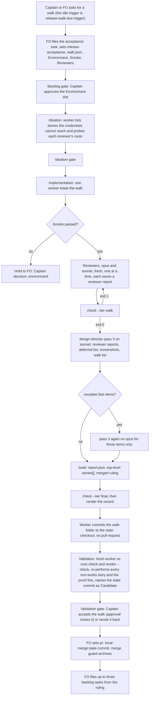

## Scope

- Source: the Captain 「可以」 (chat, 2026-10-23), answering 「把版本驗收的第二個 PR 拆成新任務、先過設計閘門，目前這張只用 #709 結案，可以嗎？」; recorded as release-acceptance Captain Amendment 4, which moves that task's AC-6, AC-7, AC-8, AC-11 and AC-12 here, with its Amendments 1 (a design-director pass over the walk, works-but-unusable class) and 3 (at least two picky-user reviewers on different models and personas, the director's ruling table with at most three backlog tasks, deferred-to-UAT findings fed in, a fixture smoke check first, a single-model fallback).
- Bite: release-acceptance r3-acceptance.md and r4-acceptance.md (hand walks that found what no task validation saw); the kc-paseo-plugins r1.5 critique (four blocking problems after six task gates, the Captain's 「這個 UX 完全不行」, relayed); the hand-run picky-user review (product-review-path-before-backlog intake/method-notes-for-dev2.md).
- Starting design: release-acceptance `### PR 2 design` and its implementation stage report (cycle 3): a release-acceptance extension, a due trigger through pr_watch.py, the walk report schema under ADR 0012, deferred-findings listing, director pass 3, the docs-only-PR close path, and the open points it names for the Captain (close path, director model and inputs, a non-Claude operating reviewer, a journeys README key, one larger PR).
- Depends on: #709 (kc-journey-map walk list and accept mode) and #708 (the design-director agent, merged 0701aa8d).
- Non-goals: the pre-implementation review hold (release-review-staleness-held-at-dispatch).

## FO alignment

Captain rulings on D1 to D5 (ideation sitting, 2026-10-23, chat, each given to FO's question one at a time; to be bound at the ideation gate):
- D5 「拆」, answering 「這張任務要不要拆成兩半？」 with FO's recommendation (option A): this task delivers Part A (the walk: smoke check, at least two reviewers, the director's ruling table, the record) in one PR; Part B (the due trigger, the journeys key, the pr_watch.py line) is a follow-up task, release-walk-due-trigger, after this PR and #711 merge. D4 goes with Part B to that task.
- D1 「好」, answering 「D1 改成「像 POC 一樣本機結案，地圖要改才開地圖 PR」，可以嗎？」 (raised by his 「可以，但退一步想，這是最好的嗎？」 on FO's first recommendation): an acceptance task closes like a dev2-poc task, with the record in the task folder and a `local-merge:<state commit>` sentinel through merge guard; a map edit the walk proposes goes in its own journey PR through the normal path; no docs-only record PR. This is his explicit choice of the no-PR finalize the workflow treats as an exception, to be landed as an ADR. Override: recommended option A, a docs-only record PR (design D1); Captain chose the POC-style local finalize; area: acceptance task close path.
- D2 「可以」, answering 「D2 照這樣做（驗收按任務的設計模型加三個條件，第 1 條另開任務改 #708），可以嗎？」 (after his 「可以，但我想動態改模型，預設 sonnet。條件應該按照什麼？」, 「這個可以，但是我想多一層，在一開始設計時，就跟著設計模型走，合理嗎？」 and 「一個版本是指什麼？我的理解是，一個任務一開始評估用 opus 做設計時，那它的設計總監就會是 opus」): director pass 3 starts on sonnet; an item goes to opus when its owning task's ideation worker ran on opus (read from that task's dispatch Model: line), when the two reviewers disagree on it, when sonnet rules it real: unverified, or when sonnet rules it a backlog task or a Captain decision; the ruling table names each item's model; AC-8 runs the designed cases on sonnet and opus to check the conditions catch where opus differs. The per-task design director following its task's ideation model is a separate task (design-director-model-follows-task). Override: recommended as shipped, sonnet with a flip on AC-8 (design D2); Captain chose per-item escalation by task design model and three conditions; area: director model.
- D3 「可以先用同模型。我在想這裡其實應該要用類似 ext 做法，我之前提過的，等於該 ext 會啟用不同模型的支援能力，這樣比較能排除問題」, answering FO's D3 question (Claude reviewers only now, non-Claude later): the walk's reviewers run on Claude models now (distinct personas, opus and sonnet); support for reviewers on other providers comes through an extension that enables multi-model support, the GPT partner proposal (backlog task gpt-partner-extension-proposal), not a POC inside this task. Override: recommended a POC task for a non-Claude operating reviewer (design D3); Captain chose an extension for multi-model support; area: non-Claude reviewers.

Alignment: needed at ideation; the open points named in the starting design are his.
Result: aligned 2026-10-23 by the Captain's rulings D1, D2, D3 and D5 recorded above; no decision is open.
Surfaces: none
Visible change: none
Release review: not needed: workflow maintenance, on no journey map.
Reviewer: kc-dev-flow-2:engineering-reviewer opus 2026-10-23 — do these amendments withdraw what the Captain approved, and what changes in the build?
  Result (adjust, medium): Amendment 1 withdraws nothing; AC-1 to AC-14 stay and new criteria take fresh ids. Open for the Captain: whether point 2's re-walk is a second run of the extension after the fix tasks land (no conflict) or holds this task open until they land (overrides D1, `### Close path` and AC-10). Build effects: a release named on deferrals (`when` names none), the complaint-to-task link recorded on the filed task, a re-walk mode with its refusals, record.md opening with the table; the AC-13 600-word cap is at risk; the re-walk ships tested on fixtures only; release-walk-due-trigger needs its own re-walk signal.
Captain ruling (chat, 2026-10-23): 「按你建議」, answering 「還在等你決定：「原本的使用者再走一次」要選讀法一（我建議），還是讀法二？」, where the readings put were 「讀法一（我建議）：走查任務照原計畫收尾。等修正任務都做完，再用同一個工具做第二次走查，就是圖上的 E。這跟你之前定的「走完就收」不衝突。」 and 「讀法二：走查任務一直開著，等修正都完成、原本的使用者重看過才收。這會推翻你之前定的「走完就收」，任務也會拖很久。」: Amendment 1 point 2 is a second run of the extension on the same release after the fix tasks land; this task closes per D1.
Reviewer: kc-dev-flow-2:chief-engineer opus 2026-10-23 — implementation marks AC-8(b) failed (escalation condition 4 catches every solved item; the opus pass cost more than an all-opus control); what is the smallest next step, given the findings so far?
  Result (escalate to the Captain): land #714 with escalation as D2 ruled; record AC-8 partly met with the measured tokens and AC-6's evidence restated as the design's upper bound; file one follow-up task for the escalation premise. Narrowing condition 4 cannot pass AC-8(b) on this fixture (condition 1 fires on the polish item, whose owning task's ideation ran on opus), and the opus pass cost is mostly fixed context reading (cache reads 242k to 300k of 294k to 358k), so escalation saves tokens only when nothing escalates. FO may accept alone: JSON for YAML, the EXTENSION.md bullet rename, the `Items:` line, AC-9 `not run:` in CI, the one-word release id.
Reviewer: kc-dev-flow-2:engineering-reviewer not run 2026-10-23: Amendment 2 is itself the withdrawal (its Supersedes line names it), and the chief-engineer result above already states the build effect of removing the per-item escalation.

## Design

Base read: origin/main 0701aa8debd45b3fe7eab7e930141319d52f3aa2 (kc-dev-flow-2 0.28.0, includes #708) after `git fetch origin`, 2026-10-23 (cycle 2, unchanged since cycle 1); #709 open, head e3a92e98; #711 open, head 62ba1e71; #674 Draft, head 0ced054c; Spacedock 0.27.2 (mods read in the 0.27.3 cache). Profile pilot holds: a normal published upgrade, no production data, no credential held by the package, no unattended recurring operation. Starting design: release-acceptance `### PR 2 design` and its Amendments 1, 3 and 4; where this section differs from them, this section is the design. Cycle 2 folds the Captain rulings D1, D2, D3 and D5 (`## FO alignment`): this task is Part A only.

### PRFAQ

**Press release.** A release is no longer finished when its last story task is done. Two picky-user reviewers, on two Claude models (opus and sonnet) with different personas, each walk the whole release in the map's order, after a smoke check proves the fixture can pass. The design director then reads their reports with every finding that earlier tasks deferred to the Captain's UAT, and rules, per merged complaint, whether it is real, whether to solve it, how, and when, in a table that proposes at most three backlog tasks. The director starts on sonnet; an item moves to opus when the task that owns it was designed on opus, when the reviewers disagree on it, or when sonnet's own ruling is unverified, a backlog task or a Captain decision. The Captain reads the table, not two transcripts. Approving the validation gate accepts the walk and closes the task like a dev2-poc task: the record stays in the task folder, no pull request is opened.

**FAQ.**
- *What does the Captain get that he lacks today?* R3 and R4 were hand walks that found what no task validation saw; the 2026-10-23 hand run on another product found that two models independently named the same top blocker an earlier task had deferred. Today nothing owns a deferred finding, and nothing makes the second reviewer different from the first.
- *Does it need a second provider?* No. Reviewers are Claude only (Captain D3); reviewers on other providers come through the GPT partner extension (backlog task gpt-partner-extension-proposal), not through this task, and the report carries no provider field until then.
- *Why an extension and not `workflow.md` text?* `workflow.md` is under a word budget (ADR 0020; 5389 words at main, #711 will lower it by 5), and the generic `## Extensions` rule already tells FO to follow a listed extension's `EXTENSION.md`. This change edits no `workflow.md` word.
- *Why does the walk's task end without a pull request?* The record is the walk's own evidence, not a change to the product or the package; the Captain chose the dev2-poc route (D1). The cost is that `workflow.md` Delivery authority treats a local finalize as an exception, so the validation gate question must say what approval does (ADR below).
- *Does the director read code, or reproduce a doubtful item?* No: pass 3 keeps the shipped rule (pictures and the lines the caller names). A complaint it cannot confirm from a picture is ruled `real: unverified`, which moves that item to opus and, if still unverified, to a decision.
- *Who writes the owner of a defect?* Nobody. The check derives it from the `journey-story` field of the release's tasks, so the cycle-3 open point 16a of release-acceptance is closed by deletion.

### Existing-code check (recorded conclusion)

Order: Spacedock, kc-dev-flow-2, sibling adopters and plugins.
- **Spacedock.** Dispatch binds a worker's host to the first officer's runtime (`skills/first-officer/references/fo-dispatch-core.md`, `«worker.spawn»`; 0.27.3 cache, read 2026-10-23); a Claude FO's workers are Claude. Spacedock owns the `local-merge:` sentinel: `mods/pr-merge.md` (its startup and idle hooks and its conflict bullet) treats `pr-merge:` and `local-merge:` rows as MERGED, bypasses `gh` and runs `merge guard` directly, and `merge guard --help` says the sentinel "is retained through archive as durable delivery proof". It has no walk, reviewer or ruling concept. The Agent tool's `model` argument "takes precedence over the agent definition's model frontmatter" (this session's tool description), so an opus pass needs no second agent file.
- **kc-dev-flow-2.** (1) The director exists (#708): `skills/design-director/SKILL.md` has passes 1a, 1b, 2a, 2b, reads pictures only, advises and holds no gate; ADR 0030 records "a release-level operated whole-screen review in this task — not chosen, release-acceptance owns it". (2) Deferred findings exist as `- F<N> Deferred risk:` and `- F<N> Polish:` bullets, `declined:` and `Needs decision:` lines and `Built screen finding` lines in validation Stage Reports; `delivery_gate.py` `FINDING` parses the first two; nothing lists them by release. (3) Dispatch records live at `<slug>/dispatch/<stage>-<N>.md` (live) and `_archive/<slug>/dispatch/` (archived) with a `Model:` line; `dispatch_records.py` `PARTS` tests only that it is present, so reading its value is a one-line regex in this extension. (4) The POC close route is practice, not text: `roborev-threshold-catches-pr-findings-poc` (state branch commits 4326d8fb `pr: local-merge:a763ba5d…`, a763ba5d the observer report commit, b5462eeb `archive … (merge guard)`), `merge: pr` frontmatter, no code PR; `workflow.md` documents nothing of it except the exception sentence in Delivery authority. (5) `learn` SKILL.md: "`local-merge:SHA` does not satisfy this original-GitHub-PR route", so a walk task closed this way is outside the learning loop. (6) `extensions/journey-map` shows the extension shape (EXTENSION.md, a script, a test, `contract-versions.json`, a `schema` subcommand in `map_footprint.py`).
- **Two bounded searches** (2026-10-23, origin/main, CHANGELOGs excluded): `git grep -n -i -E 'picky|release walk|release_ruling|works-but-unusable|usability'` over kc-dev-flow-2, kc-journey-map, kc-ship-flow, e2e-pipeline and kc-pr-flow found no consumer or producer of a reviewer walk or ruling; `git grep -n -i -E 'Deferred risk|Polish'` over `kc-dev-flow-2/scripts` found only the merge-ask count in `delivery_gate.py`. Unknowns: adopter repositories' task text beyond the corpus measure below; a Paseo-side harness (the hand run's) lives outside this repository.
- **Sibling plugins.** Browser operation exists in `e2e-pipeline` (`e2e-walkthrough`, `e2e-test`, the `agent-browser` CLI, present at `/Users/kent/.npm-global/bin/agent-browser` here). Checked, not proven for a reviewer subagent: the first real walk records which tool each reviewer used.
- **Decision.** Build one extension (`extensions/release-acceptance/`), one director pass with a per-item second run, and a task-folder record; reuse `journey-walk.mjs` and `journey-accept.mjs` (#709), `design-director`, the `FINDING` pattern, the `contract-versions.json` mechanism and Spacedock's `local-merge:` close. Do not build a reviewer launcher, a second contract mechanism, a browser driver, a pull-request path for the record, or any `workflow.md` text.

### Flow

The words follow the picture. The hold at smoke is the only stop before reviewers; a walk where fewer than two reviewers could operate the product is also a hold (check exit 1), because `not-reachable` is an environment result, not a product one.

### The walk (Part A, this task)

**Home.** `kc-dev-flow-2/extensions/release-acceptance/`: `EXTENSION.md`, `release_acceptance.py`, `test_release_acceptance.py`, `contract-versions.json`. The README extension table gains one row. An adopter lists `release-acceptance` under `extensions:`; unlisted, nothing changes. No `journeys:` key and no `due` subcommand (moved, below).

**The task.** Ordinary pilot five-stage task, `merge: pr` as every task, `Surfaces: none` (it builds no screen), frontmatter `release-acceptance: <journey>/<release>` and no `journey*` field (`findOrphans` in `progress.mjs` lists a task with journey and release but no story; #709's AC-10 proves the field is not read there). Body: `Acceptance of: <journey>/<R> at <journey-file commit>`, `Walk list: walk.json` (output of `journey-walk.mjs`), and an `Environment:` block of names, never values: target and deployed ref, `<wrapper>` command, opt-in variable names, test identities by role, `Smoke:` (one passing path through the proof line, and the condition under which it fails), and `Reviewers:` (id, model, persona, and how the reviewer operates the product).

**Who does what.**
- *Implementation worker* leads: runs `Smoke:`, runs `deferred`, launches each `Reviewers:` row fresh and one at a time with the Agent tool and its `model` argument (a reviewer sees its persona, `walk.json`, the deferred list and the environment, never the task file or another reviewer's report), runs pass 3, `escalate`, the opus pass, `build`, `check --tier final` and `render`, and commits the walk folder path-scoped to the state checkout. Workers already dispatch the director (`skills/validation/principles.md`, pass 2a), so a worker spawning a subagent has precedent. The worker opens no pull request and its code worktree stays unchanged.
- *Reviewers* write `walk/reviewer-<id>.yaml`: per story `result` (works, broken, missing-entry-point, not-reachable), `entry` used, `evidence[]` (screenshot file names), `cause` for not-reachable, and the complaint ids it raises; `proof_line{result,evidence,cause}`; `complaints[{id,stories[],rank,seen,evidence[]}]`; `deferred_verdicts[{item,verdict: agree|disagree|cannot-tell,why}]`; `would_miss`; `recommend`. They triage nothing and write no class or owner.
- *Director* (pass 3) writes the ruling; *the script* derives owners, consolidation and escalation; *FO* writes nothing into the report (FO does not author the candidate).

**Reviewer rules (Captain D3: Claude only).** At least two reviewers who operated the product (a reviewer whose every story row is `not-reachable` does not count); distinct personas; distinct `model` values, or `diversity.mode: single-model` declared, in which case the check prints `model consensus is not independent`. Printed: `reviewers: N (models: M)`. The script checks what is declared; it cannot show two models differ in fact or that a reviewer obeyed its persona. A later provider field belongs to the GPT partner extension and a report schema bump.

**Smoke.** `smoke.json` `{result: passed|failed|not-run, check: <the Smoke: line>, evidence[]}`; `check` refuses a report whose reviewers precede a `smoke.result` other than `passed`, or whose smoke evidence file is absent from the task folder. It cannot show the fixture is rich enough; the `Smoke:` line must name the condition it would fail on (the hand run's empty vault failed "every field Test fails" only after two reviewers wrote it up).

**Deferred feed.** `release_acceptance.py deferred <journey>/<R> --workflow-dir <dir>` lists, for every live and `_archive/` task whose frontmatter has `journey-release: <R>` (and `journey:` equal when present), from its newest `## Stage Report: validation`: each `- F<N> Deferred risk:` and `- F<N> Polish:` bullet, each `declined:` and `Needs decision:` item, and each `Built screen finding` line, as `<slug>#<id>: <text>`. The list goes to every reviewer and the director; `check` refuses a deferred item with no verdict from each reviewer or no director ruling. Measured prototype (read-only `git show` on a sibling adopter's state branch, 2026-10-23, regex over the whole task file so an upper bound): of 119 task files 25 carry `journey-release`; per release 0 to 37 matching items (r12: 8 tasks, 37 items; r3: 3 tasks, 9; r4: 4 tasks, 10). The reader scans committed state, so a report not yet state-committed is not seen; a pattern test pins the bullet regex to `delivery_gate.FINDING` so the two cannot drift.

**Consolidation and F1.** The report keeps top-level `stories[]` (one row per walk story, exactly the shape `journey-accept.mjs` reads: `id`, `result`) and top-level `walk{journey,release,source_commit}`, `not_tested[]`, `schema`; per-reviewer detail lives under `walks[]`. `stories[].result` is the most severe across walks, in the order `missing-entry-point > broken > not-reachable > works`, with `reported_by[]`; `build` computes it and `check` recomputes and refuses a mismatch. So `journey-accept.mjs` needs no change and this task touches no kc-journey-map file (F1 of the #709 validation, resolved by design). `works` stands only when every reviewer said so; disagreement is not lost, since the ruling item carries `sides`.

**Report `release-acceptance/v1`** (first shape, unpublished, so no bump): `schema`, `walk{journey,release,source_commit}`, `target{environment,ref}`, `smoke`, `diversity{mode,reviewers,models}`, `reviewers[{id,model,persona}]`, `stories[{id,result,reported_by[],entry,evidence[],cause}]`, `proof_line{result,evidence[],cause}`, `walks[...]`, `ruling{director{agent,models[]},items[],deferred[],tasks[]}`, `not_tested[]`, `data_left[]`.

**Ruling (pass 3 output, `release_ruling`).** `items[{id, from[] (reviewer complaint ids), stories[], real: yes|no|unverified, ruling: solve|do-not-solve|decision, how, when: this-round|next-release|later|never, class: defect|works-but-unusable|polish|known-gap|by-design|not-defect, sides[] (where reviewers disagree: reviewer, position, picked, why), why, model: sonnet|opus, escalated_for[], sonnet_ruling{real,ruling} (only on an item that moved to opus)}]`; `deferred[{item, ruling, how, when, model, escalated_for[]}]`; `tasks[{title, scope, after[], from_items[]}]`, at most three, `after` giving the sequence. The director writes `real`, `ruling` and the rest; `model`, `escalated_for` and `sonnet_ruling` are written by `build`. `check --tier final` refuses: a reviewer complaint id in no `from`; `real: unverified` with a ruling other than `decision`; `real: no` or `do-not-solve` with no `why`; `solve` with no `how` or `when`; more than three tasks; a task with no `from_items`; a deferred item with no ruling; an item that meets an escalation condition (below) and has `model: sonnet`. `works-but-unusable` is a class on an item; the story `result` stays `works`.

**Routing and `clean`.** For each item with a story list, the check derives owners = tasks of the release (live and archived, the acceptance task excluded) whose `journey-story` is in the list, and prints `route: <task>` for exactly one owner, `route: review-release` for none or two or more (`review-release` begins with an interrogation that needs `codex` and may print `interrogation not run: <reason>`; EXTENSION.md says so), `route: bug task, no story` for an item naming no story; a `not-reachable` cause prints `Captain decision: environment (<cause>)`. `clean: yes` only when every consolidated story is `works`, the proof line was performed, smoke passed, and no item has `real: yes`, `ruling: solve`, `when: this-round`; otherwise `clean: no`. Known limit: a story with a task and a later bug task counts two owners and over-routes to `review-release`.

**Checks have two tiers.** `check --tier walk` (at the reviewers' exit): structure, smoke, reviewer count and diversity. `check --tier final`: adds consolidation, ruling completeness, escalation, deferred coverage, routing, `clean`. It decides nothing; the Captain accepts.

**Contract.** `release-walk/v1` is consumed by string only (this plugin imports no kc-journey-map file; an import-scan test enforces it on this side). `release-acceptance/v1` is registered in the extension's own `contract-versions.json` with a `schema release-acceptance` subcommand and a test that fails when the field table changes without a version bump (the pattern of `map_footprint.py schema`, mirrored, not imported, because the two extensions are independent).

### Director pass 3 and per-item escalation (Captain D2)

`skills/design-director/SKILL.md` gains pass `3` (release walk): inputs `Reviewer reports:` (saved YAML paths relative to `Task folder:`), `Deferred:`, `Screenshots:` (those a complaint cites), `Walk:` (story id, card, activity from `walk.json`), `Task folder:`, `ADR folder:` (read first through `kc-adr:read-adr`, as today), and, on the second run, `Items:` (the ids to rule); output `release_ruling` above without the three script-written fields. It opens the screenshots a contested or high-ranked complaint cites, as the decline check opens its pictures. The skill's frontmatter and `agents/design-director.md` descriptions widen from "one ui task" to include the release walk; the shipped "no task file, no diff, no source code" line stays and the agent file's `model: sonnet` is unchanged. Boundaries: it advises, the Captain keeps the final say; it does not re-review whole screens (the reviewers do).

**Escalation.** Pass 3 first runs on sonnet over every item and writes `walk/ruling-sonnet.yaml`. `release_acceptance.py escalate <task folder> --workflow-dir <dir>` reads it with the reviewer reports and prints `escalate <item>: <reasons>` for each item meeting at least one condition, or `escalate: none`:
1. `design-opus:<task>`: an owner of the item ran its ideation on opus, read from `Model:` in any `dispatch/ideation-*.md` of that task (live or `_archive/`); owners are derived as under Routing, and for a deferred item the owner is the `<slug>` in `<slug>#<id>`. A `profile: poc` task has no ideation stage and prints `no ideation stage: <task>`; any other task with no ideation record or no `Model:` line prints `ideation model unrecorded: <task>`; neither counts as opus.
2. `reviewers-disagree`: two reviewers' results differ on a story of the item, or their verdicts differ on a deferred item.
3. `unverified`: sonnet ruled `real: unverified`.
4. `backlog-or-decision`: sonnet ruled `decision`, or the item is in a sonnet `tasks[].from_items`.

The worker then runs pass 3 on opus (the Agent tool's `model` argument) with the same inputs, none of sonnet's ruling, and `Items:` set to the listed ids; it writes `walk/ruling-opus.yaml`. `build` takes opus's rulings for those items and sonnet's for the rest, sets `model`, `escalated_for` and (for moved items) `sonnet_ruling`, and recomputes `tasks[]` as sonnet's tasks whose `from_items` are not all escalated plus opus's. There is no second escalation: opus's ruling stands, an `unverified` from opus goes to the Captain as a decision. The table names each item's model, so the Captain sees which rulings had a second look. Cost: one sonnet run per walk plus one opus run over a subset, tokens not measured; AC-8 records the reported tokens of its runs.

### Close path (Captain D1)

An acceptance task closes like a dev2-poc task. The record is the task folder `<slug>/walk/` on the state branch: `report.json`, the reviewer YAML, `ruling-sonnet.yaml`, `ruling-opus.yaml` where escalated, the screenshots the report cites, and `record.md` printed by `release_acceptance.py render` (counts, per-story consolidated results, the ruling table with each item's model, the deferred rulings, `clean`, and `Report digest: sha256:…` of `report.json`). The worker commits that folder to the state checkout path-scoped. No pull request is opened and no file outside the task folder is written. A map edit `journey-accept.mjs` proposes goes in its own journey PR through the normal path (`accept-release.md`, `review-release` step 1).

Validation names the state commit it read as `Candidate: <40 hex>` in its dispatch record (the line `delivery_gate.CANDIDATE` and `dispatch_records.py --names` already accept). The validation gate question for an acceptance task says: approving accepts this walk and closes the task with no pull request, FO setting `pr: local-merge:<sha>` and running `merge guard --verdict passed`. `<sha>` is the validated Candidate, or the observer report's commit where `learn` is listed (the roborev POC's sentinel named its observer report commit); a plain approval then authorizes that exact action because the question states it, the pattern ADR 0023 uses for the merge of a validated head. After the archive FO files the ruling's tasks (at most three) as backlog tasks, each with its own backlog gate; the director proposes, the Captain approves at those gates. A `clean: no` walk is still closed: the record is the walk's record, and `clean` tells the Captain whether the release is ready for his UAT.

Consequences, stated: `local-merge:` rows are outside the learning loop (`learn` SKILL.md), so acceptance tasks produce no learning evaluation; screenshots in the state branch grow it (size not measured); the exception sentence in `workflow.md` Delivery authority ("Do not invoke local fallback … unless the specific action is authorized") is met by the gate question, not edited.

### Moved to release-walk-due-trigger (Captain D5)

Part B and D4 are not in this task: the `due` subcommand, the README `journeys:` key, the `pr_watch.py tasks` line and their tests. Their design stays in that task's own ideation; the text of the criterion that moves, for FO to carry (an amendment-free move, this task still being in ideation; that task's file is not edited from here): "AC-11: `due` prints one `next:` line for a release whose `acceptance` is `pending delivery acceptance` and which no live or archived task file claims with `release-acceptance: <journey>/<release>`, prints nothing for a claimed release, and prints `release-acceptance not run: kc-journey-map not found` when the sibling install is absent; `pr_watch.py tasks` includes the line only when `release-acceptance` is listed. Verified by `test_release_acceptance.py` against real `journey-progress.mjs` output on the example with all stories' tasks done, and `test_pr_watch.py` for the listing condition; a split-root scratch run of `spacedock new`, `status --set` and `state commit` repeated in the implementation report. Falsifier: removing the field from the claiming task makes the line reappear." Measured today (2026-10-23, Spacedock 0.27.2, scratch split-root repo in `/tmp`, deleted): `spacedock new r1-acceptance`, `status --set r1-acceptance release-acceptance=book-pickup/r1`, `state commit` kept the field and `status --archived --all-fields --json` listed it; an empty custom key is not listed, only a set value. That task depends on this one landing first, since `due` extends `release_acceptance.py`.

### Fixtures, and what they can and cannot show

Synthetic, on `journey.example.yaml` r1 (reserve-copy, check-ready, collect-book); the hand walks name an adopter's host and data and stay in the release-acceptance folder. (1) `two-reviewer`: opus and sonnet rows with distinct personas; one story broken by both; one story `works` by one reviewer and `missing-entry-point` by the other (consolidates to `missing-entry-point`); one works-but-unusable complaint raised by both; two deferred items; a sonnet ruling covering the five designed cases (shared blocker, reviewer disagreement, a claim no picture supports, an item owned by a task whose ideation record says `Model: opus`, a plain polish item) and a ruling with two tasks. (2) `single-model`: the same personas on one model with the declaration. (3) `morning`: every row `not-reachable` with one cause. (4) a temporary workflow with tasks whose `journey-story` gives one, two and no owner, one with `dispatch/ideation-1.md` `Model: opus` and one archived. A fixture shows the checks; only the live run shows the director's rulings.

### ADRs (drafts, no numbers)

1. "A release walk is operated by reviewers on different models and ruled by the design director, who moves contested items to opus". Ruling: at least two operating reviewers on distinct personas and distinct models or a declared single-model fallback; the director rules each merged complaint and each deferred finding in a table of at most three tasks; director pass 3 starts on sonnet and an item moves to opus on four conditions the script derives, the table naming each item's model; the report keeps top-level `stories[]`. ADR 0031 (#709, Proposed) flips to Accepted in this PR; its heading says "only" while its filename says "meet at": align the heading with the bounded claim (this side's import-scan test enforces it here, the kc-journey-map side holds by inspection).
2. "An acceptance task closes like a dev2-poc task: the walk record stays in the task folder and the Captain's gate approval records a local-merge sentinel". Ruling (Captain D1, 2026-10-23, against the recommended docs-only record PR): no pull request for a release walk; the validation gate question states the finalize; a map edit is its own journey PR; `learn` does not evaluate such a task. It names the exception it takes in `workflow.md` Delivery authority.

FO reserves both numbers (after 0032 if #711 lands first) when it dispatches implementation.

### Not claimed

That reviewers obeyed their personas; that two models disagree meaningfully; that a declared model is the model that ran (including the opus pass); that the director's rulings are right (it advises); that the four escalation conditions catch every item where opus would differ (AC-8 measures this once, on one fixture); that `works` rows are re-walked at validation (only non-works rows and the proof line are); that the rendered record equals the report beyond the digest check; that a subagent reviewer can operate a browser in every adopter (the `Reviewers:` row says how, the ideation probe of the first acceptance task confirms); that a `local-merge:` close of a `merge: pr` pilot task archives (precedent: a `merge: pr` POC task; AC-10 exercises it).

## Acceptance criteria

Source for all: Captain 「並進去」 (release-acceptance Amendment 3, 2026-10-23), 「可以」 (Amendment 4, 2026-10-23), the D1, D2, D3 and D5 rulings under `## FO alignment`, plus the starting design; each criterion adds its own. Test file: `kc-dev-flow-2/extensions/release-acceptance/test_release_acceptance.py` (`T`). Current evidence for every criterion is "not yet built" unless stated.

**AC-1** (rewrites release-acceptance AC-6): `check --tier final` derives owners from the release's tasks and routes: the fixture item with one owning task prints `route: <task>`; an item whose stories have two owners or none prints `route: review-release`; an item naming no story prints `route: bug task, no story`.
Verified by: `T` builds a temporary workflow (state checkout with live and `_archive/` tasks carrying `journey-release` and `journey-story`) and asserts the three lines on the `two-reviewer` fixture. Falsifier: deleting one of two owning tasks flips `route: review-release` to `route: <task>`; replacing the derivation with a read of an `owners` key makes the owner-less fixture print no route and fails the test.

**AC-2** (rewrites AC-7): an environment block is separated from a defect. Verified by: `test_release_acceptance.py`, on the `morning` fixture (every row `not-reachable`, one cause) `check` exits 1 with `fewer than two reviewers operated the product` and prints `Captain decision: environment (<cause>)`, no `route:` line and `clean: no`. Falsifier: giving one reviewer a `works` row makes that reviewer count and the refusal changes to `reviewers: 1`.

**AC-3** (rewrites AC-8 of release-acceptance): a malformed report is refused, each with its own message and exit 1: a schema string other than `release-acceptance/v1`; a walk story missing, duplicated (release-acceptance #709 F2) or unknown in `stories[]` or in any walk; a result outside the four; a `not-reachable` row with no `cause`; a non-works row naming no complaint; a `works` row with no evidence; an undefined complaint id; an absent proof line; top-level `stories[].result` different from the recomputed consolidation.
Verified by: `test_release_acceptance.py`, one mutation of the `two-reviewer` fixture per case, asserting exit 1 and the message. Falsifier: removing the consolidation recompute makes the last mutation exit 0.

**AC-4** (new, reviewer count and diversity): fewer than two operating reviewers, two equal personas, equal `model` values under `diversity.mode: multi-model`, and equal models with no declaration are each refused; `single-model` is accepted with the line `model consensus is not independent`; the pass line reads `reviewers: N (models: M)`; a report with a `provider` key is refused as an unknown key.
Verified by: `T` on the `two-reviewer` and `single-model` fixtures plus one mutation per refusal. Not verified: that declared models differ in fact. Falsifier: ignoring the `declaration` makes the single-model fixture exit 1, and dropping the equal-model test makes its mutation exit 0.

**AC-5** (new, smoke before reviewers): a report with `smoke` absent, `result` not `passed`, or evidence missing from the task folder is refused at both tiers.
Verified by: `T`, three mutations. Limit stated in the criterion: this proves a smoke ran and left evidence, not that the fixture is rich enough; the acceptance task's `Smoke:` line must name the condition it fails on, and the ideation gate of the first acceptance task reads it.

**AC-6** (new, deferred findings feed both): `deferred` lists, for tasks of release R only, the newest validation report's F-bullets (`Deferred risk`, `Polish`), `declined:` and `Needs decision:` items and `Built screen finding` lines, each as `<slug>#<id>: <text>`; an item with no verdict from every reviewer or no director ruling is refused.
Verified by: `T` on a temporary workflow (an older report's bullet is not listed; a task of another release is not listed; an archived task is); a pattern test asserts the F-bullet regex equals `delivery_gate.FINDING.pattern`; the prototype count on a sibling adopter's state branch (0 to 37 items per release, 2026-10-23) is reproduced by `deferred` on a copy of that history at implementation. Falsifier: scanning only live tasks drops the archived item and fails the test.

**AC-7** (new, director pass 3 and the table): `skills/design-director/SKILL.md` has pass `3` with the inputs (including `Items:`) and the `release_ruling` shape above; the check refuses each case listed under Ruling (complaint in no `from`, `unverified` not a decision, `real: no` or `do-not-solve` with no `why`, `solve` without `how` or `when`, a fourth task, a task with no `from_items`, a deferred item unruled); a `works-but-unusable` item with `real: yes`, `solve`, `this-round` prints `clean: no`; `agents/design-director.md` still declares `model: sonnet`.
Verified by: `T`, one mutation per case, the skill file read by `lint-skills.py` (green) and `DUPLICATE_RUN` clean against `EXTENSION.md`; `git diff origin/main -- kc-dev-flow-2/agents/design-director.md` shows description lines only. Falsifier: removing the `clean` rule makes the `clean: no` assertion fail.

**AC-8** (new, one live run: sonnet against opus on the designed cases): the shipped `kc-dev-flow-2:design-director` is run on the `two-reviewer` fixture prompt on sonnet (its declared model) twice and on opus once over every item (the Agent tool's `model` argument, the control), as #708's AC-7 did for its replay. Pass: (a) the sonnet output passes `check --tier final` and rules the designed cases as designed (the shared blocker `real: yes`, `solve`; the disagreement carries `sides` with a pick and a `why`; a claim no picture supports `real: unverified`, `decision`); (b) `escalate` on the sonnet output lists exactly the disagreement item, the unsupported claim, the item owned by the opus-designed task and any item sonnet made a task or decision, and not the plain polish item; (c) for each item where the opus control differs from sonnet in `real`, `ruling` or `class`, `escalate` lists that item. The report records `subagent_tokens` as reported for each run.
Verified by: the implementation Stage Report quotes the saved outputs' ruling fields, the `escalate` lines and the check exit codes, in a table of item, sonnet, opus, escalated or not. If the two models never differ on the fixture, the report says `no difference observed`, which is not evidence the conditions are sufficient. Falsifier: an item where opus differs and `escalate` is silent fails (c) and sends D2 back to the Captain with that item. Honest limit: one fixture, three runs, so agreement is a signal, not a proof.

**AC-9** (new, F1 of the #709 validation): the report keeps top-level `stories[]` and `walk{}`, and the shipped `journey-accept.mjs` run on the `two-reviewer` report prints a non-empty `proposals` for the story consolidated to `missing-entry-point` and the story `broken` on an `exists` map, and writes no byte of the journey file.
Verified by: `T` runs `node <kc-journey-map>/lib/journey-accept.mjs <example yaml> <report.json>` from the repository checkout (pinned to #709's file once merged; skipped with a printed `not run: node or journey-accept.mjs missing` otherwise) and compares the YAML's sha256 before and after. Falsifier: moving `stories` under `walks[]` makes it print `proposals: []`, the F1 probe.

**AC-10** (replaces the cycle-1 close-path criterion; Captain D1): an acceptance task closes with no pull request. (a) `render` prints `record.md` from `report.json` with `Report digest: sha256:…`; `render --check` exits 0 when the committed `record.md` equals a fresh render and 1 otherwise; a mutated ruling field changes the digest. (b) In a scratch split-root workflow that copies `_mods/pr-merge.md` and registers it as dev2 does, a `merge: pr` task with `release-acceptance` set, a `Candidate:` validation record and `status --set <slug> pr=local-merge:<state commit>` followed by `spacedock merge guard <slug> --verdict passed` archives the task and keeps the `pr:` value. (c) `dispatch_records.py --names` exits 0 on a validation record whose `Candidate:` names that state commit. (d) After the walk the code worktree has no change against its base (`git status --short` empty) and no PR is opened.
Verified by: (a) `T`; (b) and (c) the commands above run in the implementation report with their exit codes and the archived file's `pr:` line; (d) `git status`. Current evidence: precedent only, the roborev POC (state commits 4326d8fb, b5462eeb) on `merge: pr` with profile poc. Falsifier: with `pr:` set to a bare number instead of the sentinel, `merge guard` reports armed or blocked and archives nothing (asserted on that output); editing `record.md` by one character fails (a).

AC-11 (moved to release-walk-due-trigger; text under "Moved to release-walk-due-trigger"; Captain D5).

**AC-12** (rewrites release-acceptance AC-12): the plugins meet only at the two named schemas, as far as this side can show: an import-scan test finds no file under `extensions/release-acceptance/` naming a path in `kc-journey-map/`; `release-walk/v1` is consumed by string and another string is refused; `schema release-acceptance` exits 1 when the field table changes without a version bump; the docs and fixtures hold no adopter name, host or data (`kc-plugin-forge-sanitize-check kc-dev-flow-2` clean); no version file is edited; ADR 0031 is Accepted and both new ADRs pass `adr_lint.py` (`--require` each reserved number); `review-release.md` bytes unchanged (`git diff --stat origin/main -- kc-journey-map` empty).
Verified by: the named commands at the PR head. Falsifier: adding `require('../kc-journey-map/...')` to the script fails the scan.

**AC-13** (new, wiring and weight): `.github/workflows/kc-dev-flow-2-tests.yml` gains one step for `test_release_acceptance.py` (each test file is its own step with no drift guard, so an unlisted test runs nowhere; #664, #659, #651 edited that file in feat PRs); `workflow.md` and `pr_watch.py` are not edited (both diffs empty at the PR's merge-base); `EXTENSION.md` is at most 600 words.
Verified by: `wc -w`, `git diff --stat -- kc-dev-flow-2/references/sd/workflow.md kc-dev-flow-2/scripts/pr_watch.py` empty, the CI step present. CI cost per PR: one added Python step; not measured.

**AC-14** (new, escalation conditions; Captain D2): `escalate` prints a reason for each of the four conditions and nothing for an item meeting none; `check --tier final` refuses an item that meets a condition and has `model: sonnet`, and accepts it with `model: opus`, `escalated_for` and `sonnet_ruling`; a `profile: poc` owner prints `no ideation stage: <task>` and a task whose ideation record has no `Model:` line prints `ideation model unrecorded: <task>`, neither escalated on condition 1; an archived task's `Model: opus` counts.
Verified by: `test_release_acceptance.py` on the `two-reviewer` fixture and the temporary workflow, one case per condition plus the unrecorded and archived cases. Falsifier: reading only live tasks drops the archived opus owner and fails; removing the reviewer-disagreement test leaves the disagreement item unlisted and fails.

**AC-15** (Amended by Captain, amendment 1, point 1): `record.md` renders one row per reviewer complaint id, with the task it went to, its status and its reason, as the first section after the title. The status is derived by the script, not written by FO: `to-fix`, `deferred:<release>`, `will-not-fix` or `decision` from the ruling item the complaint is in; a complaint no task covers shows task `none`; a filed task's one line `Walk complaints: <id>, <id>` (frontmatter `journey-release: <release>`) replaces the planned task title, found by the scan `deferred` uses for `journey-release`.
Verified by: `test_release_acceptance.py` `RecordTests.test_record_opens_with_one_row_per_complaint_with_task_status_and_reason`, `test_a_filed_task_s_one_line_links_a_complaint_to_it`, `test_a_hand_edited_row_is_refused`. Falsifier: ignoring the link line leaves the planned title in the row and fails the second test; dropping the row-set comparison lets an edited status pass and fails the third.

**AC-16** (Amended by Captain, amendment 1, point 2): `build` and `check` with `--prior <first report.json>` run a re-walk and refuse: a recorded prior digest that is not the digest of that file, a reviewer whose id is not in the prior walk or whose model or persona differs from the prior row, an own prior complaint left without a mark, a mark with an unknown status or no reason, a deferral naming no release id, and a new complaint reusing a prior id; marks without a prior walk are refused; new complaints are accepted. A mark is `fixed`, `partly-fixed`, `deferred` with `release`, or `will-not-fix`, each with a reason.
Verified by: `RewalkTests` (one test per refusal, and the accepting case through `build` then `check --tier final`). Falsifier: removing the digest comparison, the unmarked-complaint test, the row-equality test or the new-id test makes its own test fail (each removal run as a mutation).

**AC-17** (Amended by Captain, amendment 1, point 3): the re-walk `record.md` opens with the complaint table, whose rows are the prior complaints with the reviewers' marks and the new complaints with the ruling's status, and states the prior digest after it.
Verified by: `RewalkTests.test_a_rewalk_marks_every_own_complaint_accepts_new_ones_and_opens_with_the_table`. Falsifier: rendering the table after the summary fails it.

**AC-18** (Amended by Captain, amendment 1, point 1): a deferral names its release: a `solve` ruled `next-release` or `later` carries `release`, one word, on a ruling item and on a deferred entry, and `check --tier final` refuses one without it.
Verified by: `RulingTests.test_deferral_without_a_release_is_refused`. Falsifier: removing the test, or accepting a phrase such as 「the release after r1」 (a sonnet run wrote it), fails it.

### Words FO reads at each lifecycle moment

Counted per root `learning.md` "Measure the words FO reads at each moment": every passage and script output that instructs a step due at that moment. This is new capability, so the base is "adopter does not list the extension"; counts for new text are drafts (`len(text.split())`, 2026-10-23) to be recounted at implementation. Cycle 2 removes the idle line (Part B moved) and the docs-record merge route, and adds the escalation and the local close.

| Moment | Words FO reads, base | Candidate, extension not listed | Candidate, extension listed |
| --- | --- | --- | --- |
| startup (README, mods) | `workflow.md` 5389 words (5384 once #711 merges) and the 48-word idle mod | same, no `workflow.md` edit (AC-13) | +1 word in the README `extensions:` list |
| idle on an open PR / on a merged PR | `pr_watch.py tasks` output | byte-identical (file not edited, AC-13) | byte-identical; no due line until release-walk-due-trigger |
| after the archive | learn and observer text | same | same; `learn` skips the `local-merge:` row on its existing rule |
| merge ask | `delivery_gate.py check` output | same | same for ordinary tasks; not run for an acceptance task (no PR) |
| filing the acceptance task | not applicable | not applicable | `EXTENSION.md` "File the task" part, read in parts, at most 600 words in total (AC-13) |
| implementation dispatch | not applicable | not applicable | scope-notes instruction, draft 71 words (cycle 1: 62) |
| validation dispatch | not applicable | not applicable | scope-notes instruction, draft 33 words (cycle 1: 28) |
| validation gate question of an acceptance task | not applicable | not applicable | draft 34 words naming the local close; `check --tier final` prints about 35 words per run (cycle 1: 29) |
| close after approval | not applicable | not applicable | `EXTENSION.md` "Close" part, draft 55 words (cycle 1's docs-record merge text is gone) |

No existing moment rises for a workflow that does not list the extension; for one that lists it, only the acceptance task's own moments read new text, and no passage is removed, so none falls.

### Decisions for the Captain

Past rulings read (2026-10-23): ADR 0012 (contracts live with their producer), ADR 0023 (a gate question may carry the merge), ADR 0027 (a rule is checked by the script FO already runs), ADR 0029 (routing of a walk finding through `review-release`), ADR 0030 (the named director; opus not chosen for the decline check on measurement; a non-Claude helper dropped; the release-level operated review assigned to release-acceptance). `git -C <state checkout> grep -n 'Override:'` found no other ruling on a walk, reviewer set or close path than the four below.

Ruled (each recorded with its Captain words under `## FO alignment`, 2026-10-23):
- **D1 ruled:** an acceptance task closes like a dev2-poc task, the record in the task folder and a `local-merge:<state commit>` sentinel through merge guard; a map edit in its own journey PR; no docs-only record PR; landed as an ADR (ADR draft 2). Override of the recommended docs-only PR. What gets worse: stated under Close path (no learning evaluation, state branch grows, the Delivery authority exception).
- **D2 ruled:** director pass 3 starts on sonnet; per-item opus when the owning task's ideation ran on opus, the reviewers disagree, or sonnet rules `unverified`, a backlog task or a decision; the table names each item's model; AC-8 compares sonnet and opus on the designed cases (AC-14 checks the conditions). The per-task design director following its ideation model is design-director-model-follows-task. What gets worse: a second opus run over a subset (tokens unmeasured) and an item the four conditions miss keeps sonnet's ruling; AC-8 measures this once.
- **D3 ruled:** Claude reviewers only, opus and sonnet with distinct personas; other providers through gpt-partner-extension-proposal. What gets worse: a blind spot the two Claude models share is not tested.
- **D5 ruled:** this task is Part A only; Part B and D4 are release-walk-due-trigger. What gets worse: until that task lands, a walk opens only when the Captain or FO asks, which is how R3 and R4 happened.

Unresolved for the Captain: none. Routine wording left to implementation: reading the opus owner from any ideation record rather than the newest (chosen because a hard-to-reverse design flag set once should stay set), and the exact name of the extension subcommands.

### Batch overlap

Files this design would change: new `kc-dev-flow-2/extensions/release-acceptance/` (`EXTENSION.md`, `release_acceptance.py`, `test_release_acceptance.py`, `contract-versions.json`); `kc-dev-flow-2/README.md` (one extension-table row); `kc-dev-flow-2/skills/design-director/SKILL.md` and `kc-dev-flow-2/agents/design-director.md` (pass 3, descriptions only); `.github/workflows/kc-dev-flow-2-tests.yml` (one step); two new ADR files and `docs/adr/0031-…` (Status flip, heading). Not changed: `workflow.md`, `pr_watch.py`, `test_pr_watch.py`, any kc-journey-map file, any version file.

| Task | State | Same file or check? | What FO needs |
| --- | --- | --- | --- |
| release-acceptance (#709, kc-journey-map) | live, validation | produces `release-walk/v1`, `journey-accept.mjs` and ADR 0031 that this design consumes and flips; no shared file except ADR 0031 | #709 merges first; AC-9 pins its `journey-accept.mjs` |
| release-review-staleness-held-at-dispatch (#711) | live, validation | no longer a file overlap (`pr_watch.py` is not touched here); shares only the next ADR number (0032) | reserve this task's two ADR numbers after 0032 |
| release-walk-due-trigger | backlog | edits `release_acceptance.py`, `EXTENSION.md`, `pr_watch.py`, `test_pr_watch.py`, README; carries the moved AC-11 | after this PR and #711 merge; FO copies the AC-11 text above into its ideation brief |
| design-director-model-follows-task | backlog | `skills/design-director/SKILL.md` and `agents/design-director.md` (this task's pass 3 and description edits); both read the dispatch `Model:` line | either order; whichever lands second rebases the skill text. This task reads `Model:` inside its own script and imports nothing from the other |
| gpt-partner-extension-proposal | backlog, proposal | would add a provider field to reviewer rows (a `release-acceptance/v1` bump) | none now; reopening it must start from AC-4's refusal of an unknown `provider` key |
| #674 (Draft, Codex model policy) | open PR | yes: `kc-dev-flow-2-tests.yml` and `README.md` | textual, append-only conflicts in the workflow file's step list and near the README table; whichever merges second rebases |
| fo-write-checks-parse-top-level | live, ideation | tests here read `delivery_gate.FINDING` and `CANDIDATE`; it changes `DECLINE_END`, `declined_items`, `scope_lines` | none; neither `FINDING` nor `CANDIDATE` is in its list |
| new-work-starts-from-a-story-map, codex-reader-reads-receipt-marker, merge-ask-holds-missing-clauses, idle-names-failing-seeds, agent-reads-governing-adr | batch 5, merged (c3514876, 4befab1f, 126efaf0, cebd0ab9, b93612f8) | in the base this design reads | none |
| product-review-path-before-backlog | live, backlog | the proposal this task implements for releases; no shared file | FO decides whether it closes by reference when this lands |
| kc-decision-log-p1, kc-decision-log-cli, kc-decision-log-handoff-trial, pr-review-lite-value-pilot, journey-canvas-hosted-poc, journey-server-host-pilot (other sessions, read only) | live or archived | kc-journey-map `server/`, `lib/storymap*`, `docs/`; none edits a file above | none |

Recommended order: #709, then this task's PR (no #711 dependency now), then release-walk-due-trigger after this PR and #711; design-director-model-follows-task and #674 in any order, rebasing the later of each pair.

## Captain amendments

### Amendment 1 — 2026-10-23, chat
Captain: 「准」 (chat, 2026-10-23)
Asked: 「下一件要你決定：「版本走查」這個任務開工前，要不要把 project-env 那邊試跑後的教訓加進去？我建議加三點。」, with the three points: 「1. 設計總監的裁決附一張對照表：每個抱怨一行，寫明交給哪個任務、驗收時的狀態（修好、修一半、延到哪個版本、不修）和原因。」「2. 你試用之前，先讓原本那幾位挑剔使用者照他們自己的清單再走一次，逐條標記，也可以補新的抱怨。」「3. 你試用時，從這張對照表開始看。」 and 「第四點我建議不加：它要求每個任務的驗證者也重跑相關的抱怨步驟。第 2 點已經在最後找原本的人重看，再加一次只是多花一倍的錢。」
Supersedes: none
Design: (1) the director's ruling carries one row per reviewer complaint with the task it went to and its status at acceptance (fixed, partly fixed, deferred to a named release, will not fix) and the reason; (2) before the Captain's UAT, the original picky-user reviewers re-walk their own list, mark each item and may add new complaints; (3) the Captain's UAT starts from that table. A per-task validator re-running the reviewer steps is not included. Source of the proposal: intake/paseo-fo-addendum-2026-10-23.md, points 1 to 3.

### Amendment 2 — 2026-10-23, chat
Captain: 「好」 (chat, 2026-10-23)
Asked: 「要我照這個方向改嗎？」, after 「我的看法是：現在最有幫助的，是把「省錢的升級機制」拿掉，把剩下的走查工具收進來，然後找一次真的版本來跑。不要再在測試資料上打磨升級規則。」 and the recommendation 「設計總監每次走查只用一個模型：這次走查涉及的任務裡，只要有任何一個是用 opus 設計的，就用 opus，否則用 sonnet。這保留了你說的「跟著設計模型走」，只拿掉「逐項升級」這一層。這樣做會讓 #714 退回去小改一輪，還要重寫 ADR 0033，但之後每次走查都比較便宜，維護的東西也比較少。」
Supersedes: the per-item escalation in `### Director pass 3 and per-item escalation (Captain D2)`, AC-8 and AC-14 (no replacement for the per-item conditions)
Design: the design director runs on one model per walk: opus when any task the walk covers was designed on opus, otherwise sonnet.

## Number guards

ADR: 0033
ADR: 0034

## Stage Report: ideation

- DONE: Design the kc-dev-flow-2 half of the release walk from the starting design in release-acceptance/index.md (### PR 2 design and the implementation stage report cycle 3) and Captain Amendments 1 and 3 there, against current origin/main (#708 design-director merged; #709 kc-journey-map walk list open): the moved criteria AC-6, AC-7, AC-8, AC-11, AC-12 rewritten for the reviewer-and-director walk, plus criteria for reviewer count and diversity, the fixture smoke check, deferred findings feeding reviewers and director, director pass 3 and its ruling table with one live run, and the close path; a Captain decision with a recommendation and what gets worse for each open point (close path, director model and inputs, a non-Claude operating reviewer now or as a POC, a journeys README key, PR budget)
  `## Design` (read at 0701aa8d), `## Acceptance criteria` AC-1 to AC-13 (AC-1/2/3/11/12 rewrite AC-6/7/8/11/12; AC-4 diversity, AC-5 smoke, AC-6 deferred, AC-7 and AC-8 pass 3 and its live run, AC-9 the #709 F1 resolution, AC-10 close path, AC-13 wiring), `### Decisions for the Captain` D1 to D5. Current evidence: AC-1 to AC-9, AC-11 to AC-13 not yet built; AC-10's path classes and AC-11's split-root persistence measured today (below); AC-8 not yet run.
- DONE: A `### Batch overlap` section naming each file the design would change and each other batch task and live task of other sessions that changes the same file or check, so FO can order implementation
  `### Batch overlap`: #674 (CI yml, README) and #711 (`pr_watch.py`, Part B only) conflict; #709 must merge first; the other batch tasks are merged in the base. Recommended order stated.
- DONE: The words FO reads at each lifecycle moment, before and after, per root learning.md "Measure the words FO reads at each moment, not one file's size"
  `### Words FO reads at each lifecycle moment`: zero change for a workflow that does not list the extension (AC-13 byte-identical `pr_watch.py` output, no `workflow.md` edit); for a listing one, new text only at the acceptance task's own moments (drafts 28, 62, 28 words; EXTENSION.md at most 600).
- DONE: Acceptance criteria with reproducible evidence clauses and falsifiers, and unresolved decisions for the Captain, each with a recommendation and what gets worse under it
  13 criteria each with `Verified by:` and, where a mutation applies, a falsifier; D1 close path, D2 director model and inputs, D3 non-Claude reviewer, D4 `journeys:` key, D5 PR budget, each with options, a recommendation and what gets worse.
- DONE: `python3 <package>/scripts/design_surfaces.py check <task>` output cited
  `release-walk-picky-reviewers-and-director.md: design surfaces presentable`, exit 0 (package 0.28.0).

### Summary

The walk is a new `release-acceptance` extension plus director pass 3 and a docs-only record; `workflow.md` gains no word. The coordinator's #709 F1 is resolved by design and by AC-9: the report keeps top-level `stories[]` (most severe result across reviewers, recomputed by the check) and `journey-accept.mjs` is not changed. Measured today: `delivery_gate.classify` gives `docs-only` for one `.md` under `docs/journey/walks/…`, `other` once the journey `.yaml` is added, `never` under `docs/dev2`; split-root `spacedock new`, `status --set`, `state commit` and `--archived --all-fields --json` keep a `release-acceptance` field on 0.27.2; a prototype `deferred` count on a sibling adopter's history gives 0 to 37 items per release. Notes for FO: `## FO alignment` records alignment as needed at ideation and has no `Result:` line, so I treated the open points as the design's decisions; I did not edit it. Unverified: the live director run (AC-8), that a subagent reviewer can operate a browser in an adopter, and that `delivery_gate.py check` passes a real record PR.

## Stage Report: ideation (cycle 2)

- DONE: Cycle 2: fold the Captain rulings D1, D2, D3 and D5 recorded under FO alignment (2026-10-23) into ## Design and ## Acceptance criteria, then move each from the Captain decisions to a ruled line: D5 this task is Part A only (Part B and D4 moved to release-walk-due-trigger; AC-11 there by amendment-free move since this task is still in ideation); D1 close like a dev2-poc task with the record in the task folder and a local-merge state-commit sentinel, a map edit in its own journey PR, no docs-only record PR, landed as an ADR (replace AC-10 accordingly); D2 per-item escalation of director pass 3 from sonnet to opus when the owning task ideation ran on opus, the two reviewers disagree, sonnet rules real: unverified, or sonnet rules a backlog task or a Captain decision, the table naming each item model, AC-8 comparing sonnet and opus on the designed cases; D3 Claude reviewers only (opus and sonnet, distinct personas), multi-provider support left to gpt-partner-extension-proposal; recount the words FO reads
  D5: `### Moved to release-walk-due-trigger` carries the AC-11 text for FO to carry (that task's file not edited); `pr_watch.py` no longer in the file list (AC-13 diff empty). D1: `### Close path`, AC-10 replaced (render --check, scratch `merge guard` on a `local-merge:` sentinel, `Candidate:` accepted by `dispatch_records.py --names`, no PR), ADR draft 2. D2: `### Director pass 3 and per-item escalation`, `escalate` with four conditions, `model`/`escalated_for`/`sonnet_ruling` on the table, AC-8 sonnet-versus-opus-control and new AC-14. D3: `provider` field dropped, AC-4 refuses it. `### Decisions for the Captain` holds four ruled lines and no open decision.
- DONE: A `### Batch overlap` section naming each file the design would change and each other batch task and live task of other sessions that changes the same file or check, so FO can order implementation
  `### Batch overlap`: #711 file overlap gone; new rows release-walk-due-trigger (after this PR), design-director-model-follows-task (same two director files), gpt-partner-extension-proposal; #674 still conflicts on the CI yml and README; #709 first.
- DONE: The words FO reads at each lifecycle moment, before and after, per root learning.md "Measure the words FO reads at each moment, not one file's size"
  Table recounted with `len(text.split())` on drafted texts (2026-10-23): implementation instruction 71 (was 62), validation 33 (28), gate question 34, close 55, `check --tier final` output 35 (29); zero change for a workflow not listing the extension, idle line removed with Part B.
- DONE: Acceptance criteria with reproducible evidence clauses and falsifiers, and unresolved decisions for the Captain, each with a recommendation and what gets worse under it
  AC-1 to AC-10, AC-12 to AC-14 each with `Verified by:` and a falsifier where a mutation applies; current evidence: AC-10 has precedent only (roborev POC state commits 4326d8fb, b5462eeb), every other criterion is not yet built, AC-8 not yet run; no open decision remains, each ruled line states what gets worse.
- DONE: `python3 <package>/scripts/design_surfaces.py check <task>` output cited
  `release-walk-picky-reviewers-and-director.md: design surfaces presentable`, exit 0, run from the skill's package root 0.27.0 and from 0.28.0.

### Summary

The two reviewers, the director's table and the record are unchanged in shape; cycle 2 adds per-item opus escalation derived by a script (four conditions, AC-14, measured once against an opus control in AC-8), drops the provider field and Part B, and replaces the record PR with a task-folder record closed by a `local-merge:` sentinel (ADR draft 2). Notes for FO: `## FO alignment` records alignment as needed and still has no `Result:` line (the four rulings are there in prose); add it before `gate prepare`. The dispatch says package root 0.28.0 while the loaded skill says 0.27.0 (I used the skill's, and the check passes on both); the `local-merge:` close of a pilot-profile task has precedent only on a `merge: pr` POC task and is exercised by AC-10; acceptance tasks closed this way fall outside the `learn` loop; `spacedock status --ac-scan` flags AC-2, AC-3 and AC-14 as unevidenced (no citation of a built artifact yet), as expected at ideation.

## Stage Report: implementation

- DONE: One Draft PR (feat(kc-dev-flow-2): ...) from a branch off origin/main (1694ade349babde54f6c9791df77be8c63b48bbb) implementing the approved cycle-2 design (## Design: The walk, Director pass 3 and per-item escalation, Close path, Fixtures, ADRs) and AC-1 to AC-14; only the files the design names, ADRs 0033 and 0034 for its two ADR drafts
  PR https://github.com/iamcxa/kc-claude-plugins/pull/714 (Draft), head f86c40ce; the 11 changed files are the design's list (extension x4, SKILL.md, agent description, README row, CI step, ADR 0031/0033/0034); `git diff` of `workflow.md`, `pr_watch.py`, kc-journey-map and any version file against the base is empty. Files are JSON, not YAML (stdlib only; model output with unquoted colons already failed YAML in the design review); `meta.json` is a fifth file inside `walk/`, not a repository file.
- DONE: Captain Amendment 1 (2026-10-23, ## Captain amendments) and the Captain ruling under ## FO alignment that its point 2 is a second run of the extension on the same release after the fix tasks land (this task still closes per D1): add new criteria with fresh ids marked "Amended by Captain, amendment 1" for (a) record.md rendering one row per reviewer complaint id with the task it went to, its status and reason, (b) a re-walk mode refusing a prior report digest that does not match, a reviewer whose id, model or persona differs from the prior row, and an own prior complaint left unmarked, and accepting new complaints, (c) the re-walk record.md opening with that table; a deferral names its release (a field and a check --tier final refusal when none is named); the complaint-to-task link is one line on the filed task, found by scanning as deferred scans journey-release; leave AC-1 to AC-14 unchanged; if the AC-13 600-word EXTENSION.md cap cannot hold the second mode, stop and return to FO
  AC-15 to AC-18 written under ## Acceptance criteria (state commit 32f73a85); AC-1 to AC-14 text unchanged; EXTENSION.md is 588 words with the re-walk mode; the status rule is derived (`to-fix`, `deferred:<release>`, `will-not-fix`, `decision` from the ruling; the reviewer's mark on a re-walk); `design_surfaces.py check` prints "design surfaces presentable". Tests: `RecordTests`, `RewalkTests`, `RulingTests.test_deferral_without_a_release_is_refused`; a re-walk must also include every prior reviewer (roborev finding, fixed).
- FAILED: Every acceptance criterion green with the evidence each names; each falsifier shown failing by a mutation you run (python3 -B, caches cleared); the re-walk is tested on fixtures only and listed under ### Not claimed
  Green by tests and mutations: AC-1 to AC-7, AC-9 (local only), AC-10, AC-12 to AC-18. 75 tests; 50 mutations, one per refusal or rule (owners from an `owners` key, every reviewer counted, consolidation recompute, declaration ignored, smoke, archived tasks dropped, `clean` rule, each ruling refusal, stories dropped from the report, `--check` always passing, a sibling-plugin path, version guard, each escalation condition, each re-walk refusal, release id, evidence leaving the folder, target), all killed; harness outside the repo. NOT green: AC-8(b), its clause "not the plain polish item" was not exercised: both sonnet runs turned every item into a task or a decision, so `escalate` listed 5 of 5 items and 2 of 3 deferred (table below). AC-6: the sibling-adopter count is lower than the design's, not reproduced: r12 8 tasks, 10 items (design 37, a whole-file upper bound); journey `shop`/r4 3 items; `owner`/r3 0 (the design's r3/r4 ignored `journey:`); `declined:` lines of prod security findings are listed too.
  AC-8 table (item by complaint ids; real/ruling/class; sonnet-1 | sonnet-2 | opus control; all listed by `escalate` in both sonnet runs): o1,s1 yes/solve/defect all three; o2,s2 yes/solve/polish all three; o3 yes/solve/polish | unverified/decision/polish | yes/solve/polish; s3 yes/decision/defect | yes/solve/works-but-unusable | yes/decision/known-gap (`sides` with a pick and a why in all three); s4 unverified/decision in all three (class polish | not-defect | not-defect); deferred t-reserve#F1 solve/next-release | do-not-solve/never | solve/this-round, t-collect-a#declined-1 listed, t-ready#F1 same in all and not listed. (a) met by sonnet-2 and sonnet-3 (sonnet-1 wrote `release: "the release after r1"`, which the check now refuses; its merged report passed because opus replaced that item); after the opus `Items:` pass sonnet-1 and sonnet-2 each build and `check --tier final` exit 0, and sonnet-3 exits 0 with its own entries standing in for opus. (c) met: o3, s3, s4, t-reserve#F1 differ and were listed; run-to-run sonnet differences equal the sonnet-to-opus differences, so a difference is not evidence of a missing condition. Tokens as the CLI reported (input+output+cache): sonnet 289,166 / 233,594 / 231,215; opus control 292,603; opus `Items:` pass 357,795 / 293,715. SKILL.md seen: sonnet-1, sonnet-2, opus control at 4ca79983; sonnet-3 and the `Items:` runs at the committed text. Saved under `ac8/` in this task folder.
- DONE: lint-skills.py, adr_lint.py docs/adr --since <base> --require 0033 --require 0034 exit 0; number_guards.py check exit 0; comment_ratio.py within its maximum; roborev evidence= line; push without force and without -u; CI green on the PR head; CI cost measured or stated as not measured
  Repo `kc-dev-flow-2/scripts/lint-skills.py` 0 (the cached package copy exits 1 for an older budget and a missing repo script); `skill-frontmatter-lint.sh` 0; `adr_lint.py` 0; `number_guards.py check --repo <worktree> --base <base> --task <task>` "PASS: no findings" (no migrations-path declared); comment_ratio 1 comment line in 1517 added code lines. roborev: `evidence=roborev:1119` (re-walk could omit an original reviewer, fixed), `roborev:1120` (evidence paths leaving the walk folder; a repeated reviewer id, both fixed), `roborev:1121` (no `target` check, fixed at 35db62f9 and not re-run: the two re-runs were used). Push plain; CI green on f86c40ce (unit tests 2m29s; first run failed on `test_dispatch_records` because the EXTENSION.md bullet said "Instruction FO adds", fixed by rewording; I had not run that suite before the push). CI cost: the added step ran in about 1 s in one run.
  Words FO reads (recounted, `split()`): implementation instruction 118 (draft 71), validation 50 (draft 33, includes the gate question), close 52 (55), re-walk 76 (new); `check --tier final` prints about 35 words; zero change for an adopter not listing the extension. `doc_impact.py`: `kc-dev-flow-2/README.md` updated. AC-10(d): the extension writes only in the task folder and the PR carries no record; no acceptance code worktree existed here, the scratch run (split-root repo in /tmp, `merge guard --verdict passed` exit 0, archived, `pr: local-merge:<sha>` kept; `pr=7` gives `blocked: PR 7 is pending`, archives nothing) is the evidence.

### Summary

The extension, pass 3, the two ADRs and Amendment 1's criteria are built and CI is green; AC-8(b) and the AC-6 count are not met as written. For FO and the Captain: condition 4 of the escalation (sonnet made it a task or a decision) listed every solved item, so the opus pass cost about as much as an opus-only pass (358k and 294k tokens against 293k; recorded in ADR 0033); and pass 3 has no input naming the map's other release ids, so a director can only guess `r2`. The dispatch said package root 0.28.0, the loaded skill 0.27.0; I ran the checklist's 0.28.0 commands. The EXTENSION.md bullet is named "Acceptance task's implementation scope notes" on purpose: `dispatch_records.py` would require an "Instruction FO adds" bullet on every task's first implementation record of an adopter listing the extension.

### Not claimed

The re-walk is tested on fixtures only, never against a real second walk; that reviewers obeyed their personas, that a declared model is the model that ran, and that the director's rulings are right; that the four conditions catch every item where opus differs (one fixture, three sonnet runs); that AC-9 runs in CI (it needs node and kc-journey-map's dependency, skipped there with a printed `not run:`); that a local-merge close of a pilot task archives beyond the scratch run; that the fixture's pictures stand for a real product.
