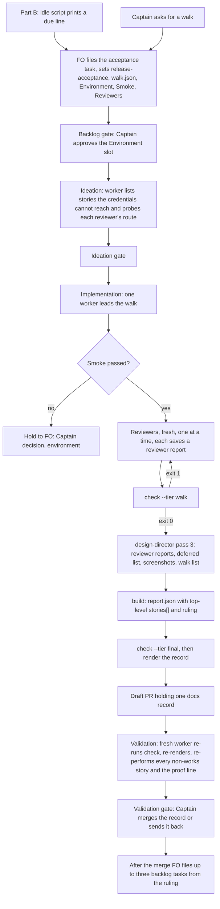

## Scope

- Source: the Captain 「可以」 (chat, 2026-10-23), answering 「把版本驗收的第二個 PR 拆成新任務、先過設計閘門，目前這張只用 #709 結案，可以嗎？」; recorded as release-acceptance Captain Amendment 4, which moves that task's AC-6, AC-7, AC-8, AC-11 and AC-12 here, with its Amendments 1 (a design-director pass over the walk, works-but-unusable class) and 3 (at least two picky-user reviewers on different models and personas, the director's ruling table with at most three backlog tasks, deferred-to-UAT findings fed in, a fixture smoke check first, a single-model fallback).
- Bite: release-acceptance r3-acceptance.md and r4-acceptance.md (hand walks that found what no task validation saw); the kc-paseo-plugins r1.5 critique (four blocking problems after six task gates, the Captain's 「這個 UX 完全不行」, relayed); the hand-run picky-user review (product-review-path-before-backlog intake/method-notes-for-dev2.md).
- Starting design: release-acceptance `### PR 2 design` and its implementation stage report (cycle 3): a release-acceptance extension, a due trigger through pr_watch.py, the walk report schema under ADR 0012, deferred-findings listing, director pass 3, the docs-only-PR close path, and the open points it names for the Captain (close path, director model and inputs, a non-Claude operating reviewer, a journeys README key, one larger PR).
- Depends on: #709 (kc-journey-map walk list and accept mode) and #708 (the design-director agent, merged 0701aa8d).
- Non-goals: the pre-implementation review hold (release-review-staleness-held-at-dispatch).

## FO alignment

Alignment: needed at ideation; the open points named in the starting design are his.
Surfaces: none
Visible change: none
Release review: not needed: workflow maintenance, on no journey map.

## Design

Base read: origin/main 0701aa8debd45b3fe7eab7e930141319d52f3aa2 (kc-dev-flow-2 0.28.0, includes #708) after `git fetch origin`, 2026-10-23; #709 read at head e3a92e98 (open, in validation); Spacedock 0.27.2. Profile pilot holds: a normal published upgrade, no production data, no credential held by the package, no unattended recurring operation. Starting design: release-acceptance `### PR 2 design` and its Amendments 1, 3 and 4; where this section differs from them, this section is the design.

### PRFAQ

**Press release.** A release is no longer finished when its last story task is done. Two picky-user reviewers, on different models and with different personas, each walk the whole release in the map's order, after a smoke check proves the fixture can pass. The design director then reads their reports with every finding that earlier tasks deferred to the Captain's UAT, and rules, per merged complaint, whether it is real, whether to solve it, how, and when, in a table that proposes at most three backlog tasks. The Captain reads the table, not two transcripts, and merges a docs-only record of the walk; that merge is the acceptance of the walk.

**FAQ.**
- *What does the Captain get that he lacks today?* R3 and R4 were hand walks that found what no task validation saw; the 2026-10-23 hand run on another product found that two models independently named the same top blocker an earlier task had deferred. Today nothing owns a deferred finding, and nothing makes the second reviewer different from the first.
- *Does it need a second provider?* No. The base path is reachable with Claude models alone (opus and sonnet as two fresh reviewers); a non-Claude reviewer that operates the product is a slot the design allows and does not depend on (Decision D3).
- *Why an extension and not `workflow.md` text?* `workflow.md` is under a word budget (ADR 0020; 5389 words at main, #711 will lower it by 5), and the generic `## Extensions` rule already tells FO to follow a listed extension's `EXTENSION.md`. This change edits no `workflow.md` word.
- *Does the director read code, or reproduce a doubtful item?* No: pass 3 keeps the shipped rule (pictures and the lines the caller names). A complaint it cannot confirm from a picture is ruled `real: unverified` and goes to a decision, not to a fix (Decision D2).
- *Who writes the owner of a defect?* Nobody. The check derives it from the `journey-story` field of the release's tasks, so the cycle-3 open point 16a is closed by deletion.

### Existing-code check (recorded conclusion)

Order: Spacedock, kc-dev-flow-2, sibling adopters and plugins.
- **Spacedock.** Dispatch binds a worker's host to the first officer's runtime (`skills/first-officer/references/fo-dispatch-core.md`, `«worker.spawn»`; 0.27.3 cache, read 2026-10-23). A Claude FO's workers are Claude; the other-provider path is the reviewer's own launch command, not a Spacedock dispatch. Spacedock has no walk, reviewer or ruling concept.
- **kc-dev-flow-2.** (1) The director exists (#708): `skills/design-director/SKILL.md` has passes 1a, 1b, 2a, 2b, reads pictures only, advises and holds no gate; no pass reads an operated walk, and ADR 0030 records "a release-level operated whole-screen review in this task — not chosen, release-acceptance owns it". Completeness: unit-level replay, one live run; need: this task is the named consumer. (2) The deferred findings exist as `- F<N> Deferred risk:` and `- F<N> Polish:` bullets, `declined:` and `Needs decision:` lines, and `Built screen finding` lines in validation Stage Reports; `delivery_gate.py` `FINDING` parses the first two and counts them against declined items at the merge ask, and nothing lists them by release. (3) `extensions/journey-map` shows the extension shape (EXTENSION.md, a script, a test, `contract-versions.json`, `schema` subcommand in `map_footprint.py`). (4) `pr_watch.py tasks` is the idle script FO runs (`seeds()`, and `holds()` in open #711).
- **Two bounded searches** (2026-10-23, origin/main, CHANGELOGs excluded): `git grep -n -i -E 'picky|release walk|release_ruling|works-but-unusable|usability'` over kc-dev-flow-2, kc-journey-map, kc-ship-flow, e2e-pipeline and kc-pr-flow found no consumer or producer of a reviewer walk or ruling (hits are `cell-contract.md` "does not prove target-user usability" and an unrelated progress line); `git grep -n -i -E 'Deferred risk|Polish'` over `kc-dev-flow-2/scripts` found only the merge-ask count in `delivery_gate.py`. Exclusions and unknowns: adopter repositories' own task text was not searched beyond the corpus measure below; a Paseo-side harness (the hand run's) lives outside this repository.
- **Sibling plugins.** Browser operation exists in `e2e-pipeline` (`e2e-walkthrough`, `e2e-test`, the `agent-browser` CLI, present at `/Users/kent/.npm-global/bin/agent-browser` here). Checked, not proven for a reviewer subagent: the first real walk records which tool each reviewer used. Non-Claude: `kc-journey-map` `interrogation.md` runs `codex exec --sandbox read-only` (reads code; operating a browser from it is unproven); `codex` and `agy` are installed here. ADR 0030 records "a gpt-6-astra helper — dropped by the Captain (Amendment 1)" for the director task.
- **Decision.** Build one extension (`extensions/release-acceptance/`), one director pass, and a docs-only record; reuse `journey-walk.mjs` and `journey-accept.mjs` (#709), `design-director`, the `FINDING` pattern and the `contract-versions.json` mechanism. Do not build a reviewer launcher, a second contract mechanism, a browser driver, or any `workflow.md` text.

### Flow

The words follow the picture. The hold at smoke is the only stop before reviewers; a walk where fewer than two reviewers could operate the product is also a hold (check exit 1), because `not-reachable` is an environment result, not a product one.

### Part A: the walk (the increment that works alone)

**Home.** `kc-dev-flow-2/extensions/release-acceptance/`: `EXTENSION.md`, `release_acceptance.py`, `test_release_acceptance.py`, `contract-versions.json`. The README extension table gains one row. An adopter lists `release-acceptance` under `extensions:`; unlisted, nothing changes.

**The task.** Ordinary pilot five-stage task, `Surfaces: none` (it builds no screen; `ui` would owe a `UI proposal:` and the built-screen refusal), frontmatter `release-acceptance: <journey>/<release>` and no `journey*` field (`findOrphans` in `progress.mjs` lists a task with journey and release but no story; #709's AC-10 proves the field is not read there). Body: `Acceptance of: <journey>/<R> at <journey-file commit>`, `Walk list: walk.json` (output of `journey-walk.mjs`), and an `Environment:` block of names, never values: target and deployed ref, `<wrapper>` command, opt-in variable names, test identities by role, `Smoke:` (one passing path through the proof line, and the condition under which it fails), and `Reviewers:` (id, provider, model, persona, and how the reviewer operates the product).

**Who does what.**
- *Implementation worker* leads: runs `Smoke:`, runs `deferred`, launches each `Reviewers:` row fresh and one at a time (a reviewer sees its persona, `walk.json`, the deferred list and the environment, never the task file or another reviewer's report), runs `build`, calls the director, runs `check --tier final`, renders the record, opens the Draft PR. Workers already dispatch the director (`skills/validation/principles.md`, pass 2a), so a worker spawning a subagent has precedent here.
- *Reviewers* write `walk/reviewer-<id>.yaml`: per story `result` (works, broken, missing-entry-point, not-reachable), `entry` used, `evidence[]` (screenshot file names), `cause` for not-reachable, and the complaint ids it raises; `proof_line{result,evidence,cause}`; `complaints[{id,stories[],rank,seen,evidence[]}]`; `deferred_verdicts[{item,verdict: agree|disagree|cannot-tell,why}]`; `would_miss`; `recommend`. They triage nothing and write no class or owner.
- *Director* (pass 3) writes the ruling; *the script* derives owners and consolidation; *FO* writes nothing into the report (FO does not author the candidate).

**Reviewer rules.** At least two reviewers who operated the product (a reviewer whose every story row is `not-reachable` does not count); distinct personas; distinct `(provider, model)` pairs, or `diversity.mode: single-model` declared, in which case the check prints `model consensus is not independent`. Printed: `reviewers: N (models: M, providers: P)`. The script checks what is declared; it cannot show two models differ in fact or that a reviewer obeyed its persona.

**Smoke.** `smoke.json` `{result: passed|failed|not-run, check: <the Smoke: line>, evidence[]}`; `check` refuses a report whose reviewers precede a `smoke.result` other than `passed`, or whose smoke evidence file is absent from the task folder. It cannot show the fixture is rich enough; the `Smoke:` line must name the condition it would fail on (the hand run's empty vault failed "every field Test fails" only after two reviewers wrote it up).

**Deferred feed.** `release_acceptance.py deferred <journey>/<R> --workflow-dir <dir>` lists, for every live and `_archive/` task whose frontmatter has `journey-release: <R>` (and `journey:` equal when present), from its newest `## Stage Report: validation`: each `- F<N> Deferred risk:` and `- F<N> Polish:` bullet, each `declined:` and `Needs decision:` item, and each `Built screen finding` line, as `<slug>#<id>: <text>`. The list goes to every reviewer and the director; `check` refuses a deferred item with no verdict from each reviewer or no director ruling. Measured prototype (read-only `git show` on a sibling adopter's state branch, 2026-10-23, regex over the whole task file so an upper bound): of 119 task files 25 carry `journey-release`; per release 0 to 37 matching items (r12: 8 tasks, 37 items; r3: 3 tasks, 9; r4: 4 tasks, 10). The reader scans committed state, so a report not yet state-committed is not seen; a pattern test pins the bullet regex to `delivery_gate.FINDING` so the two cannot drift.

**Consolidation and F1.** The report keeps top-level `stories[]` (one row per walk story, exactly the shape `journey-accept.mjs` reads: `id`, `result`) and top-level `walk{journey,release,source_commit}`, `not_tested[]`, `schema`; per-reviewer detail lives under `walks[]`. `stories[].result` is the most severe across walks, in the order `missing-entry-point > broken > not-reachable > works`, with `reported_by[]`; `build` computes it and `check` recomputes and refuses a mismatch. So `journey-accept.mjs` needs no change and this task touches no kc-journey-map file (F1 of the #709 validation, resolved by design). The order is conservative: `works` stands only when every reviewer said so. Disagreement is not lost: the director's ruling item carries `sides`.

**Report `release-acceptance/v1`** (first shape, unpublished, so no bump): `schema`, `walk{journey,release,source_commit}`, `target{environment,ref}`, `smoke`, `diversity{mode,reviewers,models,providers}`, `reviewers[{id,provider,model,persona}]`, `stories[{id,result,reported_by[],entry,evidence[],cause}]`, `proof_line{result,evidence[],cause}`, `walks[...]` (above), `ruling{director{agent,model},items[],deferred[],tasks[]}`, `not_tested[]`, `data_left[]`.

**Ruling (pass 3 output, `release_ruling`).** `items[{id, from[] (reviewer complaint ids), stories[], real: yes|no|unverified, ruling: solve|do-not-solve|decision, how, when: this-round|next-release|later|never, class: defect|works-but-unusable|polish|known-gap|by-design|not-defect, sides[] (where reviewers disagree: reviewer, position, picked, why), why}]`; `deferred[{item, ruling, how, when}]`; `tasks[{title, scope, after[]}]`, at most three, with `after` giving the sequence. `check --tier final` refuses: a reviewer complaint id in no `from`; `real: unverified` with a ruling other than `decision`; `real: no` or `do-not-solve` with no `why`; `solve` with no `how` or `when`; more than three tasks; a deferred item with no ruling. `works-but-unusable` is a class on an item, the story `result` stays `works`.

**Routing and `clean`.** For each item with a story list, the check derives owners = tasks of the release (live and archived, the acceptance task excluded) whose `journey-story` is in the list, and prints `route: <task>` for exactly one owner, `route: review-release` for none or two or more (`review-release` begins with an interrogation that needs `codex` and may print `interrogation not run: <reason>`; EXTENSION.md says so), `route: bug task, no story` for an item naming no story; a `not-reachable` cause prints `Captain decision: environment (<cause>)`. `clean: yes` only when every consolidated story is `works`, the proof line was performed, smoke passed, and no item has `real: yes`, `ruling: solve`, `when: this-round`; otherwise `clean: no`. Known limit: a story with a task and a later bug task counts two owners and over-routes to `review-release`.

**Checks have two tiers.** `check --tier walk` (at the reviewers' exit): structure, smoke, reviewer count and diversity. `check --tier final`: adds consolidation, ruling completeness, deferred coverage, routing, `clean`. It decides nothing; the Captain accepts.

**Contract.** `release-walk/v1` is consumed by string only (this plugin imports no kc-journey-map file; an import-scan test enforces it on this side). `release-acceptance/v1` is registered in the extension's own `contract-versions.json` with a `schema release-acceptance` subcommand and a test that fails when the field table changes without a version bump (the pattern of `map_footprint.py schema`, mirrored, not imported, because the two extensions are independent).

### Director pass 3

`skills/design-director/SKILL.md` gains pass `3` (release walk): inputs `Reviewer reports:` (saved YAML paths relative to `Task folder:`), `Deferred:`, `Screenshots:` (those a complaint cites), `Walk:` (story id, card, activity from `walk.json`), `Task folder:`, `ADR folder:` (read first through `kc-adr:read-adr`, as today); output `release_ruling` above. It opens the screenshots a contested or high-ranked complaint cites, as the decline check opens its pictures. The skill's frontmatter and `agents/design-director.md` descriptions widen from "one ui task" to include the release walk; the shipped "no task file, no diff, no source code" line stays. Boundaries: it advises, the Captain keeps the final say; it does not re-review whole screens (the reviewers do).

### Close path

The authoritative `report.json` and the screenshots live in the task folder on the state branch (where `check` reads them). The candidate is a Draft PR in the adopter repository holding one file, `<journey file directory>/walks/<journey>/<release-id>.md`, printed by `release_acceptance.py render` (the walk record: counts, per-story consolidated results, the ruling table, the deferred rulings, `clean`, and `Report digest: sha256:…`). The path mirrors `recordPath` in `journey-review.mjs` (`reviews/<journey>/<release-id>.md`), so `docs/journey/walks/…` reads as the review record's sibling. Measured today by importing origin/main `delivery_gate.py` `classify`: `docs/journey/walks/book-pickup/r1.md` classifies `docs-only`; with the journey `.yaml` added, `other`; `docs/release-walks/r1/report.json`, `other`; anything under `docs/dev2/…`, `never`. So the record is a `.md` under `docs/` and nothing else; `delivery_gate.py check` runs as for any PR, and the validation gate question carries the merge of the validated head (ADR 0023). A map edit that `journey-accept.mjs` proposes is a separate docs PR, as `accept-release.md` and `review-release` step 1 say. After the record merges, FO files the ruling's tasks (at most three) as backlog tasks, each with its own backlog gate; the director proposes, the Captain approves at those gates. A `clean: no` walk is still merged: the record is the walk's record, and `clean` tells the Captain whether the release is ready for his UAT.

### Part B: the trigger (separable, Decision D5)

`release_acceptance.py due <journey.yaml> --workflow-dir <dir>` runs `journey-progress.mjs` from the sibling kc-journey-map install (`<package>/../../kc-journey-map/*/lib/` in the plugin cache, or `<package>/../kc-journey-map/lib/` in a monorepo checkout; absent prints `release-acceptance not run: kc-journey-map not found`), takes each release whose `acceptance` reads `pending delivery acceptance`, drops releases for which any live or `_archive/` task file has `release-acceptance: <journey>/<release>` in its frontmatter (read from the files, like `holds()` in #711, not from `status --all-fields`), and prints one `next:` line per release left. `pr_watch.py tasks` calls it for each path in a README `journeys:` key when `release-acceptance` is listed. The fallback trigger for adopters that track no completion stays out (release-acceptance Captain decision 4 as a later increment).

Verified today (split-root, Spacedock 0.27.2, scratch repo in `/tmp`, deleted afterwards): an orphan state branch worktree at `docs/wf/.spacedock-state`; `printf '---\ntitle: R1 acceptance\nstatus: backlog\nmerge: pr\nworktree:\n---\nBody.\n' | spacedock new r1-acceptance --workflow-dir docs/wf`; `spacedock status --workflow-dir docs/wf --set r1-acceptance release-acceptance=book-pickup/r1` printed `release-acceptance:  -> book-pickup/r1`; `spacedock state commit r1-acceptance --workflow-dir docs/wf` committed; the file's frontmatter held `release-acceptance: book-pickup/r1`; `status --archived --all-fields --json` listed `"release-acceptance":"book-pickup/r1"`. This closes the "split-root still untested" limit of the moved AC-11. (An empty custom key, such as the template's `journey:`, is not listed by `--all-fields` in the live dev2 workflow; only a set value is.)

### Fixtures, and what they can and cannot show

Synthetic, on `journey.example.yaml` r1 (reserve-copy, check-ready, collect-book); the hand walks name an adopter's host and data and stay in the release-acceptance folder. (1) `two-reviewer`: opus and sonnet rows with distinct personas; one story broken by both; one story `works` by one reviewer and `missing-entry-point` by the other (consolidates to `missing-entry-point`); one works-but-unusable complaint raised by both; two deferred items; a ruling with two tasks. (2) `single-model`: the same personas on one model with the declaration. (3) `morning`: every row `not-reachable` with one cause. (4) a temporary workflow with tasks whose `journey-story` gives one, two and no owner. A fixture shows the checks; only the live run shows the director's rulings.

### ADR (draft, no number)

"A release walk is operated by reviewers on different models and ruled by the design director, and the record merges as docs". Ruling: at least two operating reviewers on distinct personas and distinct models or a declared single-model fallback; the director rules each merged complaint and each deferred finding in a table of at most three tasks; the record is a docs-only pull request; the report keeps top-level `stories[]`. ADR 0031 (#709, Proposed) flips to Accepted in this PR; its heading says "only" while its filename says "meet at": align the heading with the bounded claim (this side's import-scan test enforces it here, the kc-journey-map side holds by inspection).

### Not claimed

That reviewers obeyed their personas; that two models disagree meaningfully; that a declared model is the model that ran; that the director's rulings are right (it advises); that `works` rows are re-walked at validation (only non-works rows and the proof line are); that the rendered record equals the report beyond the digest check; that a subagent reviewer can operate a browser in every adopter (the `Reviewers:` row says how, the ideation probe confirms).

## Acceptance criteria

Source for all: Captain 「並進去」 (release-acceptance Amendment 3, 2026-10-23) and 「可以」 (Amendment 4, 2026-10-23), plus the starting design; each criterion adds its own. Test file: `kc-dev-flow-2/extensions/release-acceptance/test_release_acceptance.py` (`T`). Current evidence for every criterion is "not yet built" unless stated.

**AC-1** (rewrites release-acceptance AC-6): `check --tier final` derives owners from the release's tasks and routes: the fixture item with one owning task prints `route: <task>`; an item whose stories have two owners or none prints `route: review-release`; an item naming no story prints `route: bug task, no story`.
Verified by: `T` builds a temporary workflow (state checkout with live and `_archive/` tasks carrying `journey-release` and `journey-story`) and asserts the three lines on the `two-reviewer` fixture. Falsifier: deleting one of two owning tasks flips `route: review-release` to `route: <task>`; replacing the derivation with a read of an `owners` key makes the owner-less fixture print no route and fails the test.

**AC-2** (rewrites AC-7): an environment block is separated from a defect. Verified by: on the `morning` fixture (every row `not-reachable`, one cause) `check` exits 1 with `fewer than two reviewers operated the product` and prints `Captain decision: environment (<cause>)`, no `route:` line and `clean: no`. Falsifier: giving one reviewer a `works` row makes that reviewer count and the refusal changes to `reviewers: 1`.

**AC-3** (rewrites AC-8): a malformed report is refused, each with its own message and exit 1: a schema string other than `release-acceptance/v1`; a walk story missing, duplicated (release-acceptance #709 F2) or unknown in `stories[]` or in any walk; a result outside the four; a `not-reachable` row with no `cause`; a non-works row naming no complaint; a `works` row with no evidence; an undefined complaint id; an absent proof line; top-level `stories[].result` different from the recomputed consolidation.
Verified by: `T`, one mutation of the `two-reviewer` fixture per case, asserting exit 1 and the message. Falsifier: removing the consolidation recompute makes the last mutation exit 0.

**AC-4** (new, reviewer count and diversity): fewer than two operating reviewers, two equal personas, equal `(provider, model)` pairs under `diversity.mode: multi-model`, and equal models with no declaration are each refused; `single-model` is accepted with the line `model consensus is not independent`; the pass line reads `reviewers: N (models: M, providers: P)`.
Verified by: `T` on the `two-reviewer` and `single-model` fixtures plus one mutation per refusal. Not verified: that declared models differ in fact. Falsifier: ignoring the `declaration` makes the single-model fixture exit 1, and dropping the equal-pair test makes its mutation exit 0.

**AC-5** (new, smoke before reviewers): a report with `smoke` absent, `result` not `passed`, or evidence missing from the task folder is refused at both tiers.
Verified by: `T`, three mutations. Limit stated in the criterion: this proves a smoke ran and left evidence, not that the fixture is rich enough; the acceptance task's `Smoke:` line must name the condition it fails on, and the ideation gate of the first acceptance task reads it.

**AC-6** (new, deferred findings feed both): `deferred` lists, for tasks of release R only, the newest validation report's F-bullets (`Deferred risk`, `Polish`), `declined:` and `Needs decision:` items and `Built screen finding` lines, each as `<slug>#<id>: <text>`; an item with no verdict from every reviewer or no director ruling is refused.
Verified by: `T` on a temporary workflow (an older report's bullet is not listed; a task of another release is not listed; an archived task is); a pattern test asserts the F-bullet regex equals `delivery_gate.FINDING.pattern`; the prototype count on a sibling adopter's state branch (0 to 37 items per release, 2026-10-23) is reproduced by `deferred` on a copy of that history at implementation. Falsifier: scanning only live tasks drops the archived item and fails the test.

**AC-7** (new, director pass 3 and the table): `skills/design-director/SKILL.md` has pass `3` with the inputs and the `release_ruling` shape above; the check refuses each case listed under Ruling (complaint in no `from`, `unverified` not a decision, `real: no` or `do-not-solve` with no `why`, `solve` without `how` or `when`, a fourth task, a deferred item unruled); a `works-but-unusable` item with `real: yes`, `solve`, `this-round` prints `clean: no`.
Verified by: `T`, one mutation per case, the skill file read by `lint-skills.py` (green) and `DUPLICATE_RUN` clean against `EXTENSION.md`. Falsifier: removing the `clean` rule makes the `clean: no` assertion fail.

**AC-8** (new, one live run of the shipped agent): the shipped `kc-dev-flow-2:design-director` (sonnet, as `agents/design-director.md` declares) is run with `subagent_type: kc-dev-flow-2:design-director` on the `two-reviewer` fixture prompt, twice, as #708's AC-7 did for its replay; its output passes `check --tier final` and rules the three designed cases as designed (the shared blocker `real: yes`, `solve`; the disagreement carries `sides` with a pick and a `why`; a claim no picture supports `real: unverified`, `decision`). Once more on opus with the same prompt, for the D2 comparison. The report records `subagent_tokens` as reported.
Verified by: the implementation Stage Report quotes the saved outputs' ruling fields and the check exit codes. Not yet verified at ideation; honest limit: one fixture, two runs, so agreement is a signal, not a proof.

**AC-9** (new, F1 of the #709 validation): the report keeps top-level `stories[]` and `walk{}`, and the shipped `journey-accept.mjs` run on the `two-reviewer` report prints a non-empty `proposals` for the story consolidated to `missing-entry-point` and the story `broken` on an `exists` map, and writes no byte of the journey file.
Verified by: `T` runs `node <kc-journey-map>/lib/journey-accept.mjs <example yaml> <report.json>` from the repository checkout (pinned to #709's file once merged; skipped with a printed `not run: node or journey-accept.mjs missing` otherwise) and compares the YAML's sha256 before and after. Falsifier: moving `stories` under `walks[]` makes it print `proposals: []`, the F1 probe.

**AC-10** (new, close path): `render` prints the record from `report.json` with `Report digest: sha256:…`; re-rendering a saved report equals the committed file; the record's path is `<journey dir>/walks/<journey>/<release>.md`; `delivery_gate.classify` on that path alone gives `docs-only`.
Verified by: `T` imports `delivery_gate` and asserts the class on the path and `other` with the journey `.yaml` added (both measured today on origin/main); a mutation of one ruling field changes the digest line. The first live acceptance task shows a real `delivery_gate.py check` exit 0 on its record PR; not yet verified here.

**AC-11** (rewrites AC-11; Part B, moves with D5): `due` prints one `next:` line for a release whose `acceptance` is `pending delivery acceptance` and which no live or archived task file claims with `release-acceptance: <journey>/<release>`, prints nothing for a claimed release, and prints `release-acceptance not run: kc-journey-map not found` when the sibling install is absent; `pr_watch.py tasks` includes the line only when `release-acceptance` is listed.
Verified by: `test_release_acceptance.py` against real `journey-progress.mjs` output on the example with all stories' tasks done, and `test_pr_watch.py` for the listing condition; a split-root scratch run of `spacedock new`, `status --set` and `state commit` repeated in the implementation report (verified once today, 2026-10-23, 0.27.2). Falsifier: removing the field from the claiming task makes the line reappear.

**AC-12** (rewrites AC-12): the plugins meet only at the two named schemas, as far as this side can show: an import-scan test finds no file under `extensions/release-acceptance/` naming a path in `kc-journey-map/`; `release-walk/v1` is consumed by string and another string is refused; `schema release-acceptance` exits 1 when the field table changes without a version bump; the docs and fixtures hold no adopter name, host or data (`kc-plugin-forge-sanitize-check kc-dev-flow-2` clean); no version file is edited; ADR 0031 is Accepted and the new ADR passes `adr_lint.py` (`--require` its reserved number); `review-release.md` bytes unchanged (`git diff --stat origin/main -- kc-journey-map` empty).
Verified by: the named commands at the PR head. Falsifier: adding `require('../kc-journey-map/...')` to the script fails the scan.

**AC-13** (new, wiring and weight): `.github/workflows/kc-dev-flow-2-tests.yml` gains one step for `test_release_acceptance.py` (each test file is its own step with no drift guard, so an unlisted test runs nowhere; #664, #659, #651 edited that file in feat PRs); `workflow.md` is not edited (word count equals the base at the PR's merge-base); `EXTENSION.md` is at most 600 words; for a workflow that does not list the extension, `pr_watch.py tasks` output on a fixed workflow is byte-identical before and after.
Verified by: `wc -w`, `git diff --stat -- kc-dev-flow-2/references/sd/workflow.md` empty, the CI step present, and a diff of the two outputs. CI cost per PR: one added Python step; not measured.

### Words FO reads at each lifecycle moment

Counted per root `learning.md` "Measure the words FO reads at each moment": every passage and script output that instructs a step due at that moment. This is new capability, so the base is "adopter does not list the extension"; counts for new text are drafts (`len(text.split())`, 2026-10-23) to be recounted at implementation.

| Moment | Words FO reads, base | Candidate, extension not listed | Candidate, extension listed |
| --- | --- | --- | --- |
| startup (README, mods) | `workflow.md` 5389 words (5384 once #711 merges) and the 48-word idle mod | same, no `workflow.md` edit (AC-13) | +1 word in the README `extensions:` list |
| idle on an open PR / on a merged PR | `pr_watch.py tasks` output | byte-identical (AC-13) | Part B only: +28 words per due release (draft due line), nothing when none is due |
| after the archive | learn and observer text | same | after a record merges, the `EXTENSION.md` part "After the merge" (files up to three tasks) |
| merge ask | `delivery_gate.py check` output | same | same text; the record PR prints `class: docs-only` |
| filing the acceptance task, implementation dispatch, validation gate of an acceptance task | not applicable | not applicable | `EXTENSION.md` read in parts, at most 600 words in total (AC-13); scope-note instruction drafts: implementation 62 words, validation 28 words; `check --tier final` prints about 29 words per run |

No existing moment rises for a workflow that does not list the extension; for one that lists it, only the acceptance task's own moments read new text, and no passage is removed, so none falls.

### Decisions for the Captain

Past rulings read (2026-10-23): ADR 0012 (contracts live with their producer), ADR 0027 (a rule is checked by the script FO already runs), ADR 0029 (routing of a walk finding through `review-release`), ADR 0030 (the named director; opus not chosen for the decline check on measurement; a non-Claude helper dropped by the Captain in that task; the release-level operated review assigned to release-acceptance). `git -C <state checkout> grep -n 'Override:'` found no ruling that went against a similar recommendation on a walk, a reviewer set or a close path. Coupling: D4 exists only if D5 keeps the trigger in this task's budget; ask D5 first.

**D1: how does an acceptance task close, given every task here is `merge: pr`?**
Options: A, a docs-only record PR (the rendered `.md`) whose merge is the acceptance (chosen); B, no PR, closing by Spacedock's no-hook local finalize; C, the record in the state branch only.
**Recommended:** A. What gets worse under A: one pull request per release walk, and the `.md` is derived from `report.json` (guarded by a digest and a re-render, not by authorship). Under B: `workflow.md` Delivery authority treats a no-hook local finalize as a hold needing an explicit choice, and no report-only task exists in this workflow's archive, so it is an unproven route. Under C: `merge guard` has no PR to consume.

**D2: which model runs director pass 3, and what does it read?**
Options: A, as shipped: sonnet (`agents/design-director.md`), reading only pictures, reviewer YAML, the deferred list, the walk words and the ADR folder, with a doubtful complaint ruled `real: unverified` and sent to a decision (chosen); B, opus and code access, as the 2026-10-23 hand run did.
**Recommended:** A, with a stated flip: if AC-8's sonnet runs miss any of the three designed cases that the single opus run gets, the extension's dispatch line names `model: opus` for pass 3 and the agent file is unchanged. What gets worse under A: ruling quality is unmeasured until AC-8, and an unreproducible doubt waits for a Captain decision instead of being settled by the director. Under B: pass 3 reads source and costs more per release (not measured), and the director skill's one input rule splits into two.

**D3: is a non-Claude reviewer that operates the product part of this task, or a POC first?**
Options: A, Claude reviewers only now (opus and sonnet, distinct personas), with a POC task for a non-Claude operating reviewer (chosen); B, build the non-Claude launch in this task.
**Recommended:** A. The POC proves, from a Claude-run FO session, that a codex or agy reviewer operates a fixture product with its own tool, saves screenshots and returns a reviewer report with `check --tier walk` exit 0 and `providers: 2`. What gets worse under A: the first walks have two Claude models, so a blind spot the two share is not tested, and the stated "different providers" wish waits for the POC. Under B: the package would depend on a launch route it has not run (Spacedock workers follow the FO's host; the only package precedent, `codex exec --sandbox read-only`, cannot operate a browser as far as is known), the same unrun-assumption class as the earlier POC rule.

**D4: how does the idle script learn where the journey file is? (only if D5 keeps Part B here)**
Options: A, a README frontmatter key `journeys:` listing journey file paths, read only when `release-acceptance` is listed (chosen); B, no key; FO passes the file to `due` by hand.
**Recommended:** A. What gets worse under A: a new key every adopter must set, documented in `EXTENSION.md` and costing no `workflow.md` word. Under B: the walk opens only if FO remembers to run `due`, which is the prose-only enforcement gap ADR 0027 exists to avoid.

**D5: what is this task's PR budget?**
Options: A, one PR carrying Part A (extension, schema, check, pass 3, record, CI, ADR) with Part B (trigger, key, `pr_watch.py` line) filed as a follow-up task after this PR and #711 merge (chosen); B, one PR carrying A and B, rebased on #711; C, two PRs in this task.
**Recommended:** A. What gets worse under A: until the follow-up lands, a walk opens only when the Captain or FO asks, which is how R3 and R4 happened; Part A's AC-11 moves to the follow-up by an amendment. Under B: a larger review surface and a textual conflict with #711 in `pr_watch.py tasks()`. Under C: a third pull request in the release-acceptance family, beyond the two the Captain approved (#709 and one for kc-dev-flow-2), so it needs his word. Stop and return to FO if the work needs a Spacedock change, a kc-journey-map file edit, any `workflow.md` word, or a model-judged check inside a script.

### Batch overlap

Files this design would change: new `kc-dev-flow-2/extensions/release-acceptance/` (`EXTENSION.md`, `release_acceptance.py`, `test_release_acceptance.py`, `contract-versions.json`); `kc-dev-flow-2/README.md` (one extension-table row); `kc-dev-flow-2/skills/design-director/SKILL.md` and `kc-dev-flow-2/agents/design-director.md` (pass 3, descriptions); `.github/workflows/kc-dev-flow-2-tests.yml` (one step); the ADR file for the new record and `docs/adr/0031-…` (Status flip, heading); and, only with Part B, `kc-dev-flow-2/scripts/pr_watch.py` and `test_pr_watch.py`. No `workflow.md`, kc-journey-map or version file.

| Task | State | Same file or check? | What FO needs |
| --- | --- | --- | --- |
| release-acceptance (#709, kc-journey-map) | live, validation | produces `release-walk/v1`, `journey-accept.mjs` and ADR 0031 that this design consumes and flips; no shared file except ADR 0031 | #709 merges first; AC-9 pins its `journey-accept.mjs` |
| release-review-staleness-held-at-dispatch (#711) | live, validation | yes, Part B only: `pr_watch.py` `tasks()` (new `holds()` call), `test_pr_watch.py`; also the next ADR number (0032) | Part A has no conflict; Part B rebases onto #711; reserve this task's ADR number after 0032 |
| #674 (Draft, Codex model policy) | open PR | yes: `kc-dev-flow-2-tests.yml` and `README.md` | textual, append-only conflicts in the workflow file's step list and near the README table; whichever merges second rebases |
| fo-write-checks-parse-top-level | live, ideation | tests here read `delivery_gate.FINDING` and `classify`; it changes `DECLINE_END`, `declined_items`, `scope_lines` | none; neither `FINDING` nor `classify` is in its list |
| new-work-starts-from-a-story-map, codex-reader-reads-receipt-marker, merge-ask-holds-missing-clauses, idle-names-failing-seeds, agent-reads-governing-adr | batch 5, merged (c3514876, 4befab1f, 126efaf0, cebd0ab9, b93612f8) | in the base this design reads; `delivery_gate.py` and `seeds()` are as merged | none |
| product-review-path-before-backlog | live, backlog | the proposal this task implements for releases; no shared file | FO decides whether it closes by reference when this lands |
| kc-decision-log-p1, kc-decision-log-cli, kc-decision-log-handoff-trial, pr-review-lite-value-pilot, journey-canvas-hosted-poc, journey-server-host-pilot (other sessions, read only) | live or archived | kc-journey-map `server/`, `lib/storymap*`, `docs/`; none edits a file above | none |

Recommended order: #709, then #711, then this task's Part A (or A and B if D5 chooses B), then the Part B follow-up if filed; #674 in any order, rebasing the later of the two.

## Stage Report: ideation

- DONE: Design the kc-dev-flow-2 half of the release walk from the starting design in release-acceptance/index.md (### PR 2 design and the implementation stage report cycle 3) and Captain Amendments 1 and 3 there, against current origin/main (#708 design-director merged; #709 kc-journey-map walk list open): the moved criteria AC-6, AC-7, AC-8, AC-11, AC-12 rewritten for the reviewer-and-director walk, plus criteria for reviewer count and diversity, the fixture smoke check, deferred findings feeding reviewers and director, director pass 3 and its ruling table with one live run, and the close path; a Captain decision with a recommendation and what gets worse for each open point (close path, director model and inputs, a non-Claude operating reviewer now or as a POC, a journeys README key, PR budget)
  `## Design` (read at 0701aa8d), `## Acceptance criteria` AC-1 to AC-13 (AC-1/2/3/11/12 rewrite AC-6/7/8/11/12; AC-4 diversity, AC-5 smoke, AC-6 deferred, AC-7 and AC-8 pass 3 and its live run, AC-9 the #709 F1 resolution, AC-10 close path, AC-13 wiring), `### Decisions for the Captain` D1 to D5. Current evidence: AC-1 to AC-9, AC-11 to AC-13 not yet built; AC-10's path classes and AC-11's split-root persistence measured today (below); AC-8 not yet run.
- DONE: A `### Batch overlap` section naming each file the design would change and each other batch task and live task of other sessions that changes the same file or check, so FO can order implementation
  `### Batch overlap`: #674 (CI yml, README) and #711 (`pr_watch.py`, Part B only) conflict; #709 must merge first; the other batch tasks are merged in the base. Recommended order stated.
- DONE: The words FO reads at each lifecycle moment, before and after, per root learning.md "Measure the words FO reads at each moment, not one file's size"
  `### Words FO reads at each lifecycle moment`: zero change for a workflow that does not list the extension (AC-13 byte-identical `pr_watch.py` output, no `workflow.md` edit); for a listing one, new text only at the acceptance task's own moments (drafts 28, 62, 28 words; EXTENSION.md at most 600).
- DONE: Acceptance criteria with reproducible evidence clauses and falsifiers, and unresolved decisions for the Captain, each with a recommendation and what gets worse under it
  13 criteria each with `Verified by:` and, where a mutation applies, a falsifier; D1 close path, D2 director model and inputs, D3 non-Claude reviewer, D4 `journeys:` key, D5 PR budget, each with options, a recommendation and what gets worse.
- DONE: `python3 <package>/scripts/design_surfaces.py check <task>` output cited
  `release-walk-picky-reviewers-and-director.md: design surfaces presentable`, exit 0 (package 0.28.0).

### Summary

The walk is a new `release-acceptance` extension plus director pass 3 and a docs-only record; `workflow.md` gains no word. The coordinator's #709 F1 is resolved by design and by AC-9: the report keeps top-level `stories[]` (most severe result across reviewers, recomputed by the check) and `journey-accept.mjs` is not changed. Measured today: `delivery_gate.classify` gives `docs-only` for one `.md` under `docs/journey/walks/…`, `other` once the journey `.yaml` is added, `never` under `docs/dev2`; split-root `spacedock new`, `status --set`, `state commit` and `--archived --all-fields --json` keep a `release-acceptance` field on 0.27.2; a prototype `deferred` count on a sibling adopter's history gives 0 to 37 items per release. Notes for FO: `## FO alignment` records alignment as needed at ideation and has no `Result:` line, so I treated the open points as the design's decisions; I did not edit it. Unverified: the live director run (AC-8), that a subagent reviewer can operate a browser in an adopter, and that `delivery_gate.py check` passes a real record PR.
