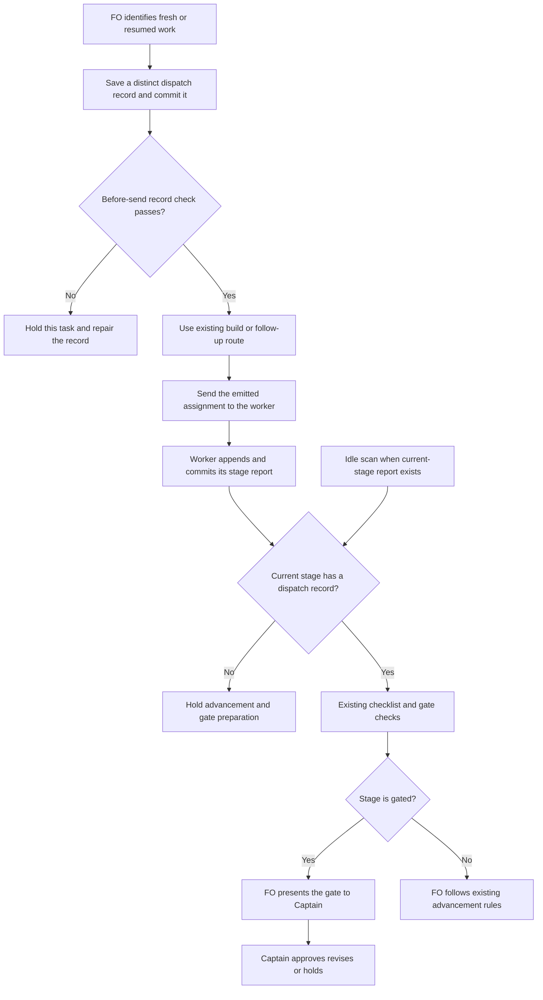

## Scope

- Source: the Captain 「照建議」 (chat, 2026-10-27), answering FO's batch-7 retrospective list (items a to d).
- Bite: kc-ops-inbox task ops-metric-event-protocol (PR #727, two rejected validation cycles; its observer report at state commit f25c224f6, relayed by its FO 2026-10-27): no dispatch records for the implementation or validation dispatches sent to reused workers, and the misses that followed (no delivery_gate question before validation briefings 1 and 2, no Override line, polish items left out of FO declines) all sat on that path, where no `dispatch build --stamp` runs and nothing prompts the record. The README already says a follow-up message to a worker FO resumes is a dispatch.
- Upstream first: the README's Stages (follow-up dispatch rule), `scripts/dispatch_records.py`, `scripts/pr_watch.py tasks`, Spacedock `dispatch build`.

## Non-goals

- A change to Spacedock `dispatch build`; recording messages that are not dispatches (a question answered, a status read).

## Budget

- One package PR; extend `scripts/dispatch_records.py`, no new script.

## Stop condition

- The ops-metric-event-protocol path replays as caught (a reused-worker follow-up with no record is named before the next gate) and every current task with records still passes. Return to the Captain if the record can only be enforced inside Spacedock.

## FO alignment

Alignment: needed before ideation; where the check or rule lives is a package design choice.
Result: aligned at backlog: the Captain 「准」 (chat, 2026-10-28) to FO's batch-9 backlog sitting, which asked 「決定：五張全准進入設計階段；要拿掉或換掉哪張，直接說。」, approved the outcome and bounds in this file. Where the check or rule lives is a package design choice ideation proposes and the ideation gate rules.
Surfaces: none
Visible change: none
Release review: not needed: workflow maintenance, on no journey map.


## Captain amendments

### Amendment 1 — 2026-10-28, ideation gate (batch-9 joint sitting)
Captain: 「照建議」 (chat, 2026-10-28)
Asked: 「決定：五張全照建議（四張准並照上面刪減，一張暫緩）；如果哪張要改，直接說。」, with the reused-worker-dispatch-leaves-a-record row 「| 重用工作者也要留派工紀錄 | 准，刪一部分 | 保留「自動列出沒留紀錄的後續派工」這段，它能抓到 #727 那個案例；刪掉「送出前 FO 自己跑的檢查」。規則本來就要求這一步，FO 照樣跳過，再加一條指令也一樣會被跳過 |」; gate question: Approve the ideation of reused-worker-dispatch-leaves-a-record to enter implementation? FO recommends approve with one Captain amendment; approving accepts it: build `dispatch_records.py --coverage` and its `pr_watch.py tasks` line, and drop `--before-send` with its HEAD-byte and symlink checks (chief-engineer batch review: the README already requires a check on follow-up messages and FO skipped it, so one more FO-run command would be skipped too). The workflow word raise is decided jointly with batch-reaches-each-gate-together as one raise of about 180 words, recounted on the real base.
Supersedes: AC-1, AC-2 (no replacement: the `--before-send` mode is dropped)
Superseded text:

**AC-1** Before-send checks the selected record and its committed bytes. Evidence: committed valid fresh and message records pass; missing, untracked, staged-only, modified, invalid required field, outside-task/symlink escape, bare script, missing validation candidate and pointer-only cases refuse with named repair and exit 1; unreadable Git exits 2. Preserve existing extension-window semantics and both task layouts. Hash the state tree/index and compare before/after each check to prove read-only behavior. Falsifier: bypass the HEAD comparison and the untracked/modified cases must fail the test. Current evidence: existing validators and Git seam inspected; new mode not implemented or verified.

**AC-2** The follow-up path checks before send, independent of `--stamp`. Evidence: a local host-call recorder executes the adopted sequence for a fresh build, `--advance`, and a direct same-stage follow-up; absent or bad record produces no send, valid committed record reaches the existing call with unchanged emitted prompt. Verify the successful build's next host action remains the send/handle capture. Status-only replies trigger neither record nor check. Falsifier: move the check after the fake send and its forbidden-send assertion fails. This proves package procedure in a controlled trace, not interception of real host sends. Current evidence: upstream route read; runtime trace not yet run.

Design:

- `--before-send <record>`: require a regular record inside the task's `dispatch/`, resolve both supported task layouts (`<slug>.md` and `<slug>/index.md`), validate the selected record's existing required parts and applicable extension instruction, and run the current name/candidate/task-fact checks. In this new mode, validation message filenames also owe the candidate header; do not change the legacy `--names` filename grammar. Require that exact path's bytes equal its committed `HEAD` blob in the state repository; absent, untracked, staged-only, or modified bytes hold. Resolve path containment before checking, so an outside file cannot stand in for the task record. Return 0 with `dispatch record ready: <record>` only when all checks pass, 1 with a repair instruction for a missing/invalid/uncommitted record, 2 for an unreadable repository or unsupported invocation. Do not commit, push or send. Read peer records only for the existing pointer/amendment checks. Do not newly fail a selected clean record for an unrelated old record's contents.

> Before building or sending any dispatch, including a resumed-worker message, FO runs `python3 <package>/scripts/dispatch_records.py --before-send <record>`; nonzero holds sending.

## Stage Report: ideation

- FAILED: A design for where a follow-up dispatch to a reused worker gets its record checked (scripts/dispatch_records.py, scripts/pr_watch.py tasks, or the gate path), replaying kc-ops-inbox ops-metric-event-protocol (PR #727) as caught; read kc-ops-inbox state only through read-only commands
  Hold before design: `## FO alignment` says `Alignment: needed before ideation` but contains no `Result:`; the selected ideation principles explicitly require stopping at this missing input. No replay or adopter-state inspection performed.
- SKIPPED: A `### Batch overlap` section naming each file the design would change and each other batch task (reused-worker-dispatch-leaves-a-record, paseo-codex-dispatch-practice, captain-ruling-sources-checked, batch-reaches-each-gate-together, fo-interviews-extension) and live task of other sessions (adoption-asks-which-extensions, adr-required-statement, adr-silent-undo-probe, comment-check-reaches-delivery-gate, journey-canvas-hosted-poc, journey-server-host-pilot, ops-inbox-r1-setup-and-isolation, pr-review-lite-value-pilot (driven by other sessions; read only)) that changes the same file or check, so FO can order implementation
  Deferred with design until FO records its required alignment result; no sibling files edited.
- SKIPPED: The words FO reads at each lifecycle moment, before and after, per root learning.md "Measure the words FO reads at each moment, not one file's size"
  No design authored, so no lifecycle-word comparison claimed.
- FAILED: Acceptance criteria with reproducible evidence clauses and falsifiers, and unresolved decisions for the Captain, each with a recommendation and what gets worse under it
  No acceptance criteria authored under the hold; `python3 /Users/kent/.codex/plugins/cache/kc-claude-plugins/kc-dev-flow-2/0.32.1/scripts/design_surfaces.py check <this-task>` exited 1: `missing '## Acceptance criteria' section`; gate is not presentable.

### Summary

Ideation is held, not completed: the required FO alignment result is absent. Authority: the loaded `skills/ideation/SKILL.md` routes pilot to `skills/ideation/principles.md`, whose opening paragraph says that alignment needed with no `Result:` means “stop and report instead of starting the design”; FO must record its actual alignment result and redispatch. The generated stage definition was read successfully, `git fetch origin` succeeded, and `origin/main:kc-dev-flow-2/.claude-plugin/plugin.json` reports 0.32.1; no GitHub API request, product edit, branch creation, or design/replay claim was made.

## Design

### PRFAQ — proposed behavior and questions

The First Officer (FO) will check a committed record before sending work to a new or reused worker. If a completed stage has no dispatch record, the next task scan and the check before advancement or gate preparation will name the missing stage. The Captain keeps the existing approval gates; no transport hook or Spacedock change is claimed.

- **Who benefits?** FO gets the missing instruction while the task is still actionable; the later observer can read the instruction that was saved.
- **Why two checks?** A pre-send check can validate the particular message's record. A later presence check can find an entirely missing stage record even when FO skipped pre-send. Neither can discover an arbitrary message that left no evidence in state.
- **Why not count reports or parse chat?** Report corrections and feedback can append several reports for one dispatch. A status answer is not a dispatch. No portable message log is supplied, and the accepted scope excludes recording questions or status reads.
- **Does this prevent the other failures of PR #727?** No. It names the dispatch gap before the first validation gate; delivery-question clauses, Captain overrides and finding dispositions remain their existing checks. A record's existence is not proof those rules were followed.
- **What is unchanged?** Pilot scope, worker reuse/freshness rules, independent validation, Captain authority, state frontmatter, the dispatch record's existing fields and Spacedock's generated envelope.

### Chain checked and bounded existing-code finding

Read 2026-10-28, in upstream-first order:

1. Spacedock 0.27.3's own `skills/first-officer/references/fo-dispatch-core.md` and `internal/dispatch/dispatch.go`: reused advancement uses `dispatch build --advance`; `--advance` plus `--stamp` is explicitly refused. A successful build must be followed immediately by the host send/spawn and handle capture. Its generated dispatch artifact is not dev2's durable `<task>/dispatch/` record. Put the package preflight BEFORE the build, never between a successful build and its send. Ordinary follow-up messages retain their existing route. No inspected source exposes a package pre-send hook; other hosts or uninspected mechanisms remain unknown.
2. After `git fetch origin`, `origin/main` was `e57feb6eec956b74a1d4b29f26f1d0a7d1693785`; `kc-dev-flow-2/.claude-plugin/plugin.json` says 0.32.1. Read the workflow Stages rule, all of `scripts/dispatch_records.py`, and its callers in `pr_watch.py tasks`, `laws_check.py` and `test_sd_dispatch.py`. The default checker validates records which exist; `--names` validates named files; `--newest` can return 0 when none exists. The task scan only calls `--newest` when `dispatch/` exists. None joins a completed stage to record presence. This is an existing rule with an unconnected check, not a missing dispatch system.
3. Read relay, web and qnow's own adopted README and committed state, without changing any adopter. Their follow-up rule exists; no separate mechanism observed solves missing-stage coverage. Relay's state is under the beirut-dev2 worktree, not dhaka/docs/dev2. State pins and measured cases are below. The ops-inbox source is this repository's state history; its separate code worktree has no docs/dev2 state checkout.

Two bounded searches: the dispatch command and its documented reuse path in Spacedock; all `dispatch_records.py` callers and dispatch rules inside the dev2 package. External chat transports, uncommitted human messages and other plugin versions were excluded. The capability's consumer and need are the next gate and the missed implementation/validation records in the observed task. No new script, event store, dispatcher or transport is needed for this bounded design.

Read Architecture Decision Records (ADRs) 0017 (push events only), 0020 (word-budget raises), 0024 (chat-only rules), and 0027 (checks at existing writes), plus state `Override:` records. The applicable contrary ruling is `_archive/fo-write-rules-checked.md:98`: the Captain rejected a phrase checker for rule 1. This design compares structured stage/record names, does not infer a Captain ruling from words, and preserves the accepted limit that skipped package commands are not mechanically stopped. No new enduring ruling or ADR draft is proposed.

GitHub limit: `gh pr view 727 --repo iamcxa/kc-claude-plugins --json title,state,headRefOid,body` failed with `error connecting to api.github.com`. Git fetch worked. PR/provider status is not independently verified here; historical PR references below come from committed state and the observer's report.

### Proposed implementation contract

Extend only the existing `scripts/dispatch_records.py` with two explicit modes (both accept the existing `--readme` override, otherwise discover the adopted README), keeping the existing folder, `--names`, and `--newest` modes and their stdout/exit behavior unchanged.

- `--before-send <record>`: require a regular record inside the task's `dispatch/`, resolve both supported task layouts (`<slug>.md` and `<slug>/index.md`), validate the selected record's existing required parts and applicable extension instruction, and run the current name/candidate/task-fact checks. In this new mode, validation message filenames also owe the candidate header; do not change the legacy `--names` filename grammar. Require that exact path's bytes equal its committed `HEAD` blob in the state repository; absent, untracked, staged-only, or modified bytes hold. Resolve path containment before checking, so an outside file cannot stand in for the task record. Return 0 with `dispatch record ready: <record>` only when all checks pass, 1 with a repair instruction for a missing/invalid/uncommitted record, 2 for an unreadable repository or unsupported invocation. Do not commit, push or send. Read peer records only for the existing pointer/amendment checks. Do not newly fail a selected clean record for an unrelated old record's contents.
- FO still writes a distinct record for each actual new assignment, including a follow-up. Use the established `<stage>-<cycle>-message-<N>.md` form where appropriate; keep its own checklist, absolute package root, model, dispatch SHA, validation candidate when owed, and completion recipient. Run the existing folder check before the state commit, then `--before-send` after the commit and before the existing builder or direct follow-up send. The mode cannot prove that FO selected a new record rather than intentionally reused an old one, that it sent the saved bytes, or that a commit preceded a historical message. These remain FO obligations; a committed record is not a send receipt.
- `--coverage <task> --stage <stage>`: a read-only presence check for an explicitly named worker stage in the adopted workflow. Ignore fenced examples; no report for that stage means no completed-stage coverage is owed yet. Once an unfenced `## Stage Report: <stage>` (including its report suffix) exists, require at least one regular record with basename `<stage>-<positive integer>.md` or `<stage>-<positive integer>-message-<positive integer>.md`. Match stage boundaries exactly; another stage does not satisfy it. Return 0 with `dispatch coverage complete: <stage>` or `dispatch coverage not due: <stage>`, 1 with `<task>: no dispatch record for completed <stage>; hold advancement and gate preparation`, 2 for unreadable task/invalid stage or workflow. This mode does not revalidate old record contents or infer report-cycle-to-message identity. It introduces no historical permanence claim.
- In `pr_watch.py tasks`, call the coverage function for each live worker-stage task, including tasks with no `dispatch/` and no PR. On missing coverage print exactly one `next:` line: `next: <slug> has no dispatch record for completed <stage>; hold advancement and gate preparation and report the gap to Captain.` A read error is reported through the existing task-error route, not as clean. A covered or not-yet-reported stage adds no line. Keep this local scan independent of GitHub lookup success; existing PR lookup errors retain their exit semantics. Prefer calling a shared function returning structured findings so a new stdout regex is unnecessary.
- Independently of idle timing, FO runs `--coverage` after reading each worker report and before either advancing a non-gated stage or preparing a gate. A nonzero result holds that task. The task scan is a reminder, not an automatic gate and not a batch-wide hold. Do not reconstruct an absent historical record as though it were saved before sending: FO reports the gap and obtains an authorized recovery; normal future work gets a truthful new record. No global backfill or automatic exemptions.

The precise added workflow paragraph is:

> Before building or sending any dispatch, including a resumed-worker message, FO runs `python3 <package>/scripts/dispatch_records.py --before-send <record>`; nonzero holds sending. After each worker report, before advancing or preparing its gate, FO runs `python3 <package>/scripts/dispatch_records.py --coverage <task> --stage <stage>`; nonzero holds that task. These checks do not observe unrecorded messages.

Retain the current folder/`--names` sentences and `never a pointer to another record`: the present pointer classifier demonstrably does not reject every paraphrase. The new paragraph adds the committed-file check and the missing-stage check; it does not relocate or silently drop existing requirements. No change to `design_surfaces.py`, `delivery_gate.py`, the history-law output formats, observer skill, Spacedock or a host transport. No CI trigger change.

### Flow



Rendered with Mermaid CLI 12.0.0 and visually inspected: the FO record/commit precedes sending; worker evidence precedes coverage; failure stops and Captain approval are distinct. Initial sandbox browser launch failed; the permitted local render succeeded. The diagram is source in this task; `/tmp/reused-worker-record-ideation/flow.png` is disposable local evidence, not a shipped artifact or an extra required surface.

### Measured replay and compatibility boundary

Historical source: `f25c224f6:_archive/ops-metric-event-protocol/observer.md` explicitly records no implementation 1–3 or validation 1–2 dispatch records and says validation-3 was saved after its report. Read the task reports and dispatch directory at the actual earlier validation-report commit `064e61a15`, before the first validation gate. The released folder check returned exit 0, `2 dispatch record(s) complete`; both records were ideation records. An independent presence prototype returned false for implementation and validation. Adding a stage-named file in the disposable copy changed each presence result to true; this control proves only the existence predicate, not record validity. At `f25c224f6`, implementation remains missing, while validation is present and the old folder checker already fails its malformed `Dispatched:` line. Do not advertise that latter run as a newly caught omission.

Reproduce the decisive historical input without reading GitHub or modifying ops-inbox state: export `git -C <repository> archive 064e61a15 -- ops-metric-event-protocol.md ops-metric-event-protocol/dispatch` into a disposable directory; run `python3 -B <package>/scripts/dispatch_records.py --readme <adopted README> <export>/ops-metric-event-protocol.md`. The repository, package and README roots are declared in this dispatch; implementation tests will commit a minimal redacted fixture with the same report/record arrangement so no workstation path is required to run tests. The design-only presence prototype is reproducible as follows (not a shipped checker or proof of runtime wiring):

```python
# task is the exported pathlib.Path; stage is implementation or validation.
# Import unfenced from the declared package's scripts/design_surfaces.py.
import re
folder = task.parent if task.name == 'index.md' else task.with_suffix('')
reported = any(re.match(r'^## Stage Report: ' + re.escape(stage) + r'(?:\s|$)', line)
               for line in unfenced(task.read_text().splitlines()))
covered = not reported or any(
    re.fullmatch(re.escape(stage) + r'-[1-9][0-9]*(?:-message-[1-9][0-9]*)?\.md', p.name)
    for p in (folder / 'dispatch').glob('*.md') if p.is_file())
print(stage, covered)
```

Fixed state snapshots were extracted with `git archive <pin> -- '*.md'` into `/tmp`; no adopter writes. The prototype was run for each live worker-stage task, and the released folder checker was actually run on every such task with records, using its supplied adopted README:

| State source | Commit | Live worker-stage tasks | With records | Released folder check passes | Added presence check passes among recorded tasks |
| --- | --- | ---: | ---: | ---: | ---: |
| package state checkout named in dispatch | `45b8505c1921e82ea9bd1d8f7799e0df7717360b` | 16 | 12 | 10 | 12 |
| `/Users/kent/conductor/workspaces/subspace-relay/beirut-dev2/docs/dev2/.spacedock-state` | `9bbf43a8690d92c9557bd5785912d30e5f9c88ae` | 9 | 7 | 3 | 7 |
| `/Users/kent/conductor/workspaces/subspace-web/dev2-fo/docs/dev2/.spacedock-state` | `045282bb6b5ca6eb084383e166caaf3bfc3427ba` | 5 | 3 | 3 | 3 |
| `/Users/kent/conductor/repos/qnow-adopt-dev2/docs/dev2/.spacedock-state` | `cf95f6d8d7b5e83b575c8ce51669ef17bec9421d` | 10 | 7 | 7 | 7 |

All 29 recorded tasks pass the new presence predicate; 23 pass the pre-existing contents check. Existing contents failures are package `journey-canvas-hosted-poc` (hosted canvas experiment), `journey-server-host-pilot` (shared server pilot); relay `signed-in-specs-run` (signed-in browser tests), `review-ui-room-asks-through-shell` (review room questions), `rr-pairs-once` (one-time pairing), and `limit-telemetry-posthog` (telemetry limits). No existing failure is claimed fixed. Two package tasks with no records would newly show a presence hold: `adr-required-statement` (record each binding Captain ruling) at validation and `pr-review-lite-value-pilot` (prove useful lightweight review) at implementation. List these for their owners; do not edit them or fabricate retrospective dispatch evidence.

A rejected alternative compared report cycle numbers to filenames. It falsely demanded `implementation-3.md` for `ops-inbox-r1-setup-and-isolation` (inbox setup and account separation), which has `implementation-2-message-1.md`, and demanded an old ideation record on qnow `branch-price-copy` (branch price copying) while that task is at validation. This is why the proposed reminder checks only the named current/completed stage, while the pre-send obligation covers every new message. No all-history backfill, retry-count inference or claim of an unskippable transport boundary.

### Words FO reads at each lifecycle moment

Whitespace splitting is the measurement, identical for base and proposed text. This change deliberately adds checking, not a claimed reading reduction. No existing text moves out of the README; no hidden mod duplicates the new instructions. Full workflow text at the pinned base is 5,576 words, proposed 5,624 (+48). The added paragraph's three sentences are 19, 22 and 7 words. Existing readings at each moment remain byte-identical; the table includes every new instruction and output, rather than presenting the README alone as the total cost. Unchanged host-specific/runtime text is not claimed measured here.

| Moment | Before | After, beyond the same existing readings |
| --- | --- | --- |
| startup/resume | full adopted workflow, package template 5,576 words; existing startup/idle mod and its output | workflow 5,624 (+48); idle output adds nothing on clean tasks, 20 words per missing-stage example below |
| fresh dispatch or reused follow-up | existing Stages rule, folder result (example `2 dispatch record(s) complete`, 4 words), `--names` output | reread the added send sentence and boundary (19+7 words), plus `dispatch record ready: <record>` (4); failures name the specific record and repair |
| worker completion, stage advancement or gate preparation | existing completion/checklist/gate rules; no stage-presence output | reread completion sentence and boundary (22+7 words); clean output 4 words, example missing-stage output 12 words |
| idle on an open PR or task without a PR | existing idle mod and `pr_watch.py tasks` output | no new instructions in the mod; clean delta 0; one missing-stage `next:` line, 20 words |
| idle on a merged PR, before archive | existing merged-PR and idle instructions/output | same conditional 0 or 20 words while task is still live; no second copy of the completion rule |
| merge ask | existing delivery gate/approval wording | delta 0; coverage belongs before gate preparation, not a duplicated delivery check |
| after archive | existing archive/observer/learn instructions | delta 0; task scan excludes archived tasks, history-law modes unchanged |

Exact 20-word example: `next: ops-metric-event-protocol has no dispatch record for completed validation; hold advancement and gate preparation and report the gap to Captain.` Exact 12-word coverage failure: `ops-metric-event-protocol.md: no dispatch record for completed validation; hold advancement and gate preparation`. These are measured proposed strings, not output of implemented new modes. Implementation must recount the full readings and actual outputs on matched clean/missing/error fixtures, including both stdout and stderr; any changed wording updates this table. The +48 budget step needs the Captain's actual gate answer under ADR 0020, never the earlier backlog approval.

## Acceptance criteria

**AC-3** The missed ops-metric-event-protocol stages are named before the next gate. Evidence: retain the real state pin `064e61a15` plus a redacted fixture; base default mode exits 0 with two records; candidate coverage for implementation and validation exits 1 naming each stage; the completion procedure stops before fake advancement/gate preparation. A fully formed correct-stage record clears presence; an ideation-only record does not. Falsifier: test only whether `dispatch/` has any file and the historical fixture incorrectly passes. Current evidence: actual base replay and design-only presence prototype produced this difference; candidate CLI and gate trace remain unverified.

**AC-4** Existing modes and recorded tasks retain their verdicts. Evidence: base/candidate exit code, stdout and stderr comparison on all committed task layouts, live and archived, at the four pins, for default, `--names` and `--newest`; also run their existing tests and the history-law tests. Existing failures stay failures, all 29 live tasks with records pass the added current-stage presence check, and the only missing-stage reminders at these pins are the two named no-record tasks. Explain every actual changed verdict, do not backfill source corpora. Falsifier: alter `--newest`'s empty-record result or let new diagnostics reach its legacy parser and comparison/tests fail. Current evidence: fixed-snapshot census and baseline folder runs completed; full candidate differential is not yet verified.

**AC-5** Coverage has the stated bounded grammar and no cycle-count fiction. Evidence: fenced report examples do not trigger; exact stage boundaries, both task layouts, a valid message filename, repeated/repaired reports, no report yet and unrelated-stage records are exercised. `implementation-2-message-1.md` satisfies implementation presence despite a report headed cycle 3; a past ideation gap is not scanned while checking validation. Invalid stage/read errors exit 2. Falsifier: count report headings or remove fence filtering and the corresponding fixtures fail. Current evidence: the strict cycle alternative was disproved on real tasks; full candidate grammar tests remain unverified.

**AC-6** Idle integration reaches missing-record tasks even without a dispatch directory, PR or working provider connection. Evidence: `test_pr_watch.py` supplies fixtures with no directory/no PR, covered tasks, a missing stage and a GitHub failure; the local missing-stage `next:` line appears exactly once, clean coverage adds none, and provider failure still reports as an error. Gate-time coverage is separately tested because idle is not guaranteed to run before a gate. Falsifier: keep the old `if dispatch.is_dir()` guard around the new call and the no-directory test fails. Current evidence: existing guard and consumer inspected; candidate integration unverified.

**AC-7** Instruction cost, authority and retained rules remain explicit. Evidence: exact +48 workflow words and 5,624 total for the stated base, an approved positive budget step with the Captain's quote and load moments, updated `test_sd_dispatch.py` need/swap controls for both checks plus retained pointer rule, and generated POC workflow carrying the same rule. Recount if another task lands first; do not claim this design grants a raise. Compare actual per-moment stdout/stderr and instruction passages to the table; render Mermaid and check actors, order, branches and stops. Falsifier: omit pre-gate wording or the retained pointer prohibition and its instruction test fails; omit the Captain quote and budget lint fails. Current evidence: design wording counted and Mermaid rendered/inspected; candidate lint, derived POC and actual new output not yet verified.

## Unresolved decision for the Captain

One linked decision: accept this bounded package check and its +48-word startup/resume increase? Recommend yes: it catches the observed missing stages before a gate, keeps the existing transport, and leaves all 29 current recorded tasks passing the new predicate. Worse under it: every dispatch gains a preflight, package commands can still be skipped, and unrecorded same-stage messages after an earlier valid record remain invisible; two old no-record tasks need their owners' truthful recovery when touched. The added instruction is necessary for this check to run, so scope and its reading cost are one decision. If the required outcome is automatic prevention of every unrecorded send, stop here and return to the Captain for an upstream/transport task; that exceeds the current non-goal. No approval is inferred from the backlog ruling.

### Batch overlap

Planned changed files (all under `kc-dev-flow-2/`): `scripts/dispatch_records.py`, `scripts/test_dispatch_records.py`, `scripts/pr_watch.py`, `scripts/test_pr_watch.py`, `references/sd/workflow.md`, `scripts/lint-skills.py`, `scripts/test_sd_dispatch.py`. Tests keep fixtures inline; no new script or fixture file. The derived POC workflow is generated during verification/adoption, not an additional source edit. No ADR number or ADR index edit. Shared numbered data: the append-only workflow budget steps.

| Task (meaning) | Observed overlap and ordering consequence |
| --- | --- |
| `reused-worker-dispatch-leaves-a-record` (this dispatch-record design) | owns the seven paths above and stage-presence semantics |
| `paseo-codex-dispatch-practice` (Paseo worker execution practice) | its scoped file is `extensions/paseo/EXTENSION.md`, no shared file; its follow-up sends must respect the same pre-send rule, without transferring state-record ownership to workers |
| `captain-ruling-sources-checked` (verify Captain ruling origins) | scope names `scripts/design_surfaces.py`, no currently shared file; shared pre-gate ordering only, no new coverage reading of rulings |
| `batch-reaches-each-gate-together` (hold a batch until ready) | shares `references/sd/workflow.md`, its budget and likely `test_sd_dispatch.py` instruction checks; if it changes task-scan gate hints, also reconcile `pr_watch.py` and tests; one task's coverage hold must remain visible in batch readiness |
| `fo-interviews-extension` (operator feedback interviews) | planned optional extension; possible shared workflow extension table/budget if its author edits them; no shared script specified in current Scope; recheck final design before implementation |
| `adoption-asks-which-extensions` (judge extensions at dispatch time) | definite `scripts/dispatch_records.py` and `scripts/test_dispatch_records.py`; its `extension_errors` change must be reused by before-send, not replaced; its laws tests and number-guards helper are outside our edits |
| `adr-required-statement` (record binding Captain rulings) | shares workflow Decision records/Number guards and derived POC verification; budget/test file convergence; also one old task the new reminder names, owned by its other session |
| `adr-silent-undo-probe` (probe silent ADR reversals) | state-owned scenario harness; no shared product file or check; do not modify it |
| `comment-check-reaches-delivery-gate` (bind comment checks to delivery) | design explicitly limits changes to delivery_gate.py, its tests and validation principles; no shared file, independent gate check |
| `journey-canvas-hosted-poc` (hosted canvas experiment) | no shared package path; existing dispatch-content failure is corpus evidence, not repair scope |
| `journey-server-host-pilot` (shared server pilot) | kc-journey-map server/client paths, no shared package path; its folder task layout is a compatibility case |
| `ops-inbox-r1-setup-and-isolation` (inbox setup and account separation) | kc-ops-inbox, its CI and ADRs only; no shared file; its report/message mismatch is a required negative control for count-based coverage |
| `pr-review-lite-value-pilot` (prove useful lightweight review) | independent review trial and state artifacts, no shared file; second no-record reminder belongs to that session |

Recommended order: land the extension-window task before this task or rebase its helper together; serialize workflow/budget edits with the batch task and any live ADR-ledger work, recounting against the actual new base. Paseo and interview extension work can proceed independently after FO confirms their final touched paths. Then rerun the compatibility census; no worker may fix or reset another session's task. These are observed scopes, not delivery claims; GitHub API was unavailable, so FO must recheck live PR ownership before implementation.

## Stage Report: ideation

- DONE: A design for where a follow-up dispatch to a reused worker gets its record checked (scripts/dispatch_records.py, scripts/pr_watch.py tasks, or the gate path), replaying kc-ops-inbox ops-metric-event-protocol (PR #727) as caught; read kc-ops-inbox state only through read-only commands
  `## Design`: two modes in the existing checker, pre-send and before advancement/gate; real state `064e61a15` gives old exit 0 with two ideation records, prototype names missing implementation and validation; upstream and four pinned adopter sources read only, GitHub API unavailable.
- DONE: A `### Batch overlap` section naming each file the design would change and each other batch task (reused-worker-dispatch-leaves-a-record, paseo-codex-dispatch-practice, captain-ruling-sources-checked, batch-reaches-each-gate-together, fo-interviews-extension) and live task of other sessions (adoption-asks-which-extensions, adr-required-statement, adr-silent-undo-probe, comment-check-reaches-delivery-gate, journey-canvas-hosted-poc, journey-server-host-pilot, ops-inbox-r1-setup-and-isolation, pr-review-lite-value-pilot (driven by other sessions; read only)) that changes the same file or check, so FO can order implementation
  `### Batch overlap` names all seven proposed files, all five batch tasks and all eight named live sibling tasks, shared budget/checks and recommended ordering; no sibling or product file changed.
- DONE: The words FO reads at each lifecycle moment, before and after, per root learning.md "Measure the words FO reads at each moment, not one file's size"
  `### Words FO reads at each lifecycle moment`: base 5,576, proposed 5,624 (+48); explicit per-moment instructions and 0/4/12/20-word output costs, actual runtime outputs still future evidence.
- DONE: Acceptance criteria with reproducible evidence clauses and falsifiers, and unresolved decisions for the Captain, each with a recommendation and what gets worse under it
  AC-1 through AC-7 each name evidence and a falsifier; one linked Captain decision covers bounded enforcement and +48 words. `design_surfaces.py check` exit 0, `design surfaces presentable`; Spacedock AC scan reads all seven declarations.
- SKIPPED: AC-1 — committed-record pre-send verification
  No new mode implemented; Git/source seams inspected. Planned negative controls must fail if HEAD comparison or path containment is removed.
- SKIPPED: AC-2 — host send ordering verification
  Upstream source confirms --advance cannot use --stamp; fake transport trace and native send behavior remain unverified. Moving the check after send must fail the trace.
- SKIPPED: AC-3 — candidate replay and gate-stop verification
  Historical base run and independent presence prototype exercised; candidate CLI/gate trace not implemented. Treating any-stage records as sufficient must fail.
- SKIPPED: AC-4 — full candidate compatibility differential
  Pinned current census: 29 recorded tasks pass the added presence predicate; 23 pass the released content check. Candidate/all-history mode comparison remains future; changing legacy empty --newest behavior must fail it.
- SKIPPED: AC-5 — complete coverage parser verification
  Real records disprove cycle-count matching; full parser fixtures remain future. Counting report corrections or fenced headings must fail.
- SKIPPED: AC-6 — task-scan integration verification
  Existing directory guard inspected; no candidate integration run. Retaining that guard around coverage must fail the no-directory fixture.
- SKIPPED: AC-7 — candidate lint and approved budget verification
  Exact proposed +48 words measured; Mermaid CLI 12.0.0 rendered and image inspected, matching the prose. Candidate lint/POC derivation and Captain budget approval remain future; dropping the quote or procedure pin must fail.

### Summary

Design completed: 4 dispatched checklist items done, 7 future implementation-verification items skipped, 0 failed; the earlier hold report and all frontmatter remain unchanged. The minimal design joins a committed-record preflight to a current-stage presence check and catches the historical missing stages without confusing report repairs with messages; it does not intercept host sends or cure other PR #727 rule failures. The Captain still decides the bounded mechanism and +48-word cost; two old no-record tasks are named for their owners, GitHub API status is unverified, and no implementation, PR action or peer message occurred.


## Stage Report: implementation

- SKIPPED: One Draft PR (Conventional Commit title scoped to the plugin) from a branch off origin/main (e57feb6eec956b74a1d4b29f26f1d0a7d1693785) implementing the approved design and acceptance criteria in the task file; Captain amendment 1 applies: build kc-dev-flow-2/scripts/dispatch_records.py --coverage and its kc-dev-flow-2/scripts/pr_watch.py tasks line; the --before-send mode is dropped (AC-1 and AC-2 superseded, no replacement); the workflow word raise is one joint raise of about 180 words with batch-reaches-each-gate-together, so report this task's measured share on the real base; only the files the design names
  Implemented and pushed the seven named files at ea84b08d4c726e33460609b2247599afb2d54c2b, based directly on e57feb6eec956b74a1d4b29f26f1d0a7d1693785; Draft PR creation is explicitly delegated to FO, with title/body at /tmp/impl-reused-worker-dispatch-leaves-a-record-pr.md. No version bump.
- DONE: Every acceptance criterion green with the evidence each names; each falsifier shown failing by a mutation you run (python3 -B, caches cleared)
  Retained AC-3 through AC-7 pass as amended; AC-1 and AC-2 moved verbatim under amendment 1's Superseded text. Eight mutations ran with python3 -B in copies excluding __pycache__; each produced the intended failing assertion, not an import/configuration error.
- SKIPPED: kc-dev-flow-2/scripts/lint-skills.py (the repository copy CI runs), /Users/kent/.claude/plugins/cache/kc-claude-plugins/kc-dev-flow-2/0.32.1/scripts/adr_lint.py docs/adr --since <base> exit 0; /Users/kent/.claude/plugins/cache/kc-claude-plugins/kc-dev-flow-2/0.32.1/scripts/number_guards.py check exit 0; /Users/kent/.claude/plugins/cache/kc-claude-plugins/kc-dev-flow-2/0.32.1/scripts/comment_ratio.py within its maximum; roborev evidence= line; push without force and without -u; PR body written for FO; FO reads CI on the PR head; CI cost measured or stated as not measured
  Repository lint and the dispatch-authorized identical Codex package's ADR/number checks exit 0; comment ratio 209 code lines, 0 comment lines, 0.0% <= 5%. RoboRev exit 3: incomplete: the roborev daemon is not running. Branch push succeeded without force/-u; FO owns Draft PR, RoboRev and hosted CI. CI cost per PR not measured; no CI triggers changed.
- DONE: AC-3 — historical omission and completion stop
  Actual state 064e61a15 and the committed inline redacted fixture: base default returns 0, two complete ideation records; candidate coverage returns 1 naming implementation and validation. Fake advancement/gate calls remain absent until a correct-stage record exists; accepting any-stage records makes the test fail.
- DONE: AC-4 — legacy compatibility and recorded tasks
  Four design pins: package 168 tasks/858 comparisons, relay 94/475, web 58/244, qnow 128/478; all 2,055 default/--names/--newest exit/stdout/stderr comparisons match over live and archived layouts. All 29 live recorded tasks pass coverage; the only new gaps are adr-required-statement at validation and pr-review-lite-value-pilot at implementation. Changing empty --newest to exit 1 fails its tests; no source corpus changed.
- DONE: AC-5 — bounded report and record grammar
  60 test_dispatch_records.py tests pass, including exact stages, backtick/tilde fences, both layouts, positive record numbers, message records, repaired reports, no report and invalid/read-error exit 2. Removing fence filtering or counting reports makes the corresponding tests fail.
- DONE: AC-6 — task scan and independent local evidence
  129 test_pr_watch.py tests pass: no-directory/no-PR gap appears once, covered/not-due adds no coverage line, and provider failure retains exit 2 alongside the local gap; unreadable tasks use the task-error route. Restoring the directory guard makes the no-directory test fail.
- DONE: AC-7 — instruction authority, costs and procedure
  Base workflow 5,576 -> 5,605 words (+29), the coverage share of the joint raise; lint records Captain 「照建議」 and the full joint question from amendment 1. Fresh/reused sends add 0; startup/resume +29; completion/advancement/gate rereads 22+7; idle/open or merged live tasks add 0 clean or 20 per gap; merge ask/archive +0. CLI stdout words complete/not-due/missing/invalid-stage = 4/5/12/8, stderr 0 for each measured fixture.
  Real show-stage-def outputs remain byte-identical: ideation 630, implementation 1,365, validation 1,550 words. Derived POC retains coverage and the pointer prohibition; dropping pre-gate wording, pointer wording or Captain quote fails the respective assertion. Mermaid CLI 12.0.0 rendered /tmp/dispatch-coverage-flow.png and visual inspection confirms the amended sequence, per-task stop, recovery and Captain gate; the image is local evidence, not a shipped surface.
- DONE: Required test suites and delivery identity
  test_laws_check.py 44, test_poc_readme.py 7, test_lint_skills.py 45 pass; test_sd_dispatch.py passes 10 real route/stage/host handoffs and 45 wording controls. These detect changes to legacy event parsing, derived routing, quote/budget rules and lost dispatch instructions. No native model behavior or real gate/transport interception is claimed.
- DONE: Affected documents
  doc_impact.py e57feb6eec956b74a1d4b29f26f1d0a7d1693785 ea84b08d4c726e33460609b2247599afb2d54c2b lists six: docs/adr/0020-a-rise-in-the-workflow-word-budget-needs-a-captain-ruling-recorded-with-it.md unaffected: equality and approval rule retained; docs/adr/0037-workers-check-shared-work-and-return-to-fo-early.md unaffected: Team transport unchanged.
  kc-dev-flow-2/README.md unaffected: maintenance commands and bounded harness claims still hold; kc-dev-flow-2/references/sd/adoption.md unaffected: derivation and sync procedure unchanged; kc-dev-flow-2/skills/maintain-flow/SKILL.md unaffected: budget/replay obligations retained; learning.md unaffected: historical learning retained and full differential applied.
- DONE: Ownership, proof location and goal check
  Code worktree is clean on the assigned branch; sibling state was read only. Existing design already traced the missing join; pre-change replay proves the omission. Seven files map to coverage, its caller, inline fixtures or workflow/budget controls. Reproducible suites are committed; local differential and mutation outputs are under the code worktree's .context/dispatch-proof/. GitHub CLI was not run as instructed; hosted PR/CI state is unverified.

### Summary

Implemented coverage and the task-scan reminder at ea84b08d4c726e33460609b2247599afb2d54c2b, with legacy behavior unchanged across 448 task files and the historical omission caught. FO must open the Draft PR using /tmp/impl-reused-worker-dispatch-leaves-a-record-pr.md, run RoboRev and read CI; joint workflow/budget files must be reconciled with the batch task on the eventual merge base.
ADRs: none: the approved design introduces no new enduring ruling; amendment 1 applies the existing workflow-budget and structured-check decisions.

## Validation acceptance — PR 743 at ea84b08d4

No user-visible screen changed. Prerequisites: the named local repository contains this commit, Python 3 and Git are installed, and the named Codex package 0.32.1 is present. Run these five numbered steps together in a fresh `bash --noprofile --norc` shell; they take under five minutes and contact no provider. They exercise local missing-record recovery and idle/provider-failure behavior, not native model compliance, real message interception, adoption or hosted delivery.

```bash
# 1. Create a disposable checkout of the exact candidate.
set -eu
REPO=/Users/kent/conductor/workspaces/kc-claude-plugins/colombo/.context/dev2-adoption/worktree/.worktrees/spacedock-ensign-reused-worker-dispatch-leaves-a-record
ACCEPT_ROOT=$(mktemp -d /tmp/pr743-acceptance.XXXXXX)
git -C "$REPO" worktree add --detach "$ACCEPT_ROOT/candidate" ea84b08d4c726e33460609b2247599afb2d54c2b
cd "$ACCEPT_ROOT/candidate"
# 2. Show missing stages hold advancement and correct records clear the hold.
python3 -B kc-dev-flow-2/scripts/test_dispatch_records.py CoverageTests.test_historical_064e61a15_redacted_replay_stops_before_advancement_and_gate -v
# 3. Show the reminder works without a directory or PR and survives provider failure.
python3 -B kc-dev-flow-2/scripts/test_pr_watch.py TasksTests.test_coverage_without_directory_or_pr_and_with_provider_failure TasksTests.test_coverage_clean_folder_task_and_not_due_add_no_line -v
# 4. Check the approved word budget and decision records.
python3 -B kc-dev-flow-2/scripts/lint-skills.py
python3 -B /Users/kent/.codex/plugins/cache/kc-claude-plugins/kc-dev-flow-2/0.32.1/scripts/adr_lint.py docs/adr --since e57feb6eec956b74a1d4b29f26f1d0a7d1693785
# 5. Remove this disposable checkout.
cd /tmp
git -C "$REPO" worktree remove "$ACCEPT_ROOT/candidate"
rmdir "$ACCEPT_ROOT"
printf 'Acceptance complete; disposable checkout removed.\n'
```

Observed exactly as written in a fresh Bash shell: step 1 checked out `ea84b08d4`; step 2 ran 1 test, OK (0.254s); step 3 ran 2 tests, OK (0.953s); step 4 printed `PASS: basic frontmatter, declared profile routes, role bindings and package script paths`, `5605 of 5605 words`, and `40 ADR file(s) checked, 0 legacy`; step 5 printed `Acceptance complete; disposable checkout removed.`. Every command exited 0. Initial sandbox execution could not create Git worktree metadata; the unchanged script passed under the approved execution permission.

## Stage Report: validation

- DONE: Independent verdict on PR #743 head ea84b08d against every acceptance criterion in the task file, re-running each evidence command and at least one falsifier per criterion yourself, and judging each limit the implementation report states
  PASSED at ea84b08d4c726e33460609b2247599afb2d54c2b against base e57feb6eec956b74a1d4b29f26f1d0a7d1693785; independent detached checkout, retained AC-3 through AC-7 exercised below; no product changes.
- DONE: Captain amendment 1 applies (--before-send dropped; AC-1 and AC-2 superseded with no replacement); RoboRev evidence=roborev:1297 clean on ea84b08d4, run by FO; PR #743 is the base of a stacked batch-reaches-each-gate-together PR
  Applied the recorded amendment, including its narrowed Design block at state 16129ea4c; RoboRev and four passing hosted checks are FO-provided evidence, not independently rerun. The stacked batch task owns its later combined head and joint budget reconciliation.
- DONE: A minimal acceptance script the Captain can run (three to six steps, exact commands, expected output), run by you exactly as written in a fresh bash shell, with its observed output; /Users/kent/.claude/plugins/cache/kc-claude-plugins/kc-dev-flow-2/0.32.1/scripts/adr_lint.py docs/adr --since <base> with its exit code; your verdict naming the head, with findings classified by the workflow's Review-finding disposition
  Five steps and expected/observed output are immediately above; the dispatch-authorized identical Codex package supplied adr_lint.py: exit 0, 40 records, 0 legacy. Findings: Material 0, Deferred risk 0, Polish 0, Needs decision 0.
- DONE: AC-3 — historical missed stages, stop and recovery
  Re-exported actual state 064e61a15: base default exit 0 / two complete ideation records; candidate implementation and validation coverage exit 1, naming each gap. The committed redacted test proves no fake advance/gate before recovery; accepting any-stage records causes its forbidden-advance assertion to fail.
- DONE: AC-4 — unchanged legacy modes and four pinned state corpora
  Re-ran default/--names/--newest exit/stdout/stderr comparisons at all four design pins: 2,055 identical results, including 2 state README documents (446 task files; implementation's 448 count included those READMEs). All 29 live recorded tasks pass; only the two previously named no-record tasks are missing. Mutating empty --newest to exit 1 fails NewestTests.
- DONE: AC-5 — bounded grammar, current-stage scope and read errors
  All 60 dispatch tests pass for both layouts, backtick/tilde fences, exact stages, message filenames, repaired reports, no report and exit-2 errors; removing fence filtering and counting reports each causes the relevant assertion to fail. No cycle-to-message identity or content validity is claimed by presence.
- DONE: AC-6 — idle integration without directory, PR or provider
  All 129 pr_watch tests pass, including one local reminder without a directory/PR, none when covered/not due, retained provider-error exit 2 and task-read error routing; reinstating the directory guard makes the no-directory assertion fail. Gate-time behavior is separately exercised by AC-3.
- DONE: AC-7 — authority, instruction costs, retained rules and flow
  Independently counted 5,576 -> 5,605 workflow words (+29), tied to the recorded joint Captain approval; completion passage 22+7 words, sends +0, idle +0 clean/+20 per gap, merge/archive +0. Coverage stdout complete/not-due/missing/error = 4/5/12/8 words, stderr 0; stage-def bytes unchanged at 630/1,365/1,550 words. Eight mutation probes total reject their intended defect, including missing pre-gate phrase, pointer prohibition and Captain quote.
  Derived POC tests retain coverage and pointer wording; Mermaid CLI 12.0.0 rendered the implementation's amended flow and visual inspection confirms report-before-check, task-specific hold, truthful recovery and Captain gate. This disposable diagram interprets amendment 1; the original pre-amendment diagram is not evidence for a retained before-send feature.
- DONE: Required checks and retained documents
  test_laws_check 44, test_poc_readme 7, test_lint_skills 45 and repository lint pass; test_sd_dispatch passes 10 real route/stage/host handoffs and 45 wording controls with CLI 0.27.2 and explicitly supplied plugin 0.27.3. ADR/number/design/dispatch checks pass; comment ratio is 209 code lines, 0 comments, 0.0% <= 5%; no CI trigger changed and CI cost per PR was not measured.
  doc_impact repeats the same six paths; all unaffected rationales hold: ADR 0020 equality/quote rule, ADR 0037 Team transport, package README maintenance/bounded evidence, adoption derivation/sync, maintain-flow budget/replay, and learning's retained compatibility rules. No ADR is reserved or introduced.
- DONE: Implementation limits, sufficient outcome and minimal scope
  The historical omission is caught at the accepted local seam; coverage/caller, regression tests and workflow/budget controls account for all seven changed paths. Package checks can still be skipped, an older same-stage record can cover later unrecorded messages, and presence is not a send receipt; these are accepted boundaries, not repaired or expanded scope.
  Implementation's daemon/PR/CI limitations were subsequently resolved by FO's supplied evidence; no independent GitHub/provider verification, real host interception, native model execution, release, adoption or merge is claimed. Eventual stacked-head validation and delivery remain FO-owned. Local reproduction logs and disposable probes are under /tmp/pr743-validation-evidence; unchanged candidate and source worktree verified clean before cleanup.

### Summary

PASSED for PR #743 at ea84b08d4c726e33460609b2247599afb2d54c2b within the amended Pilot boundary. The historical gap, legacy compatibility, bounded grammar, provider-independent reminder and approved reading cost have independent positive and negative evidence; the fresh-shell acceptance script passed. FO retains gate and delivery authority, including the later stacked candidate and joint budget.
