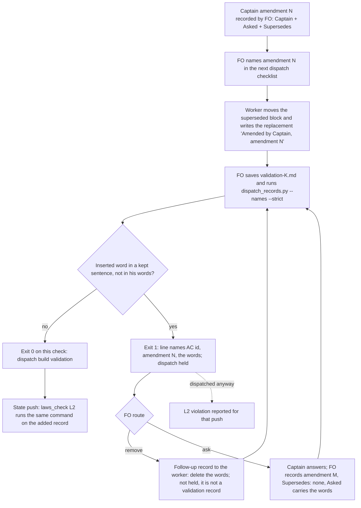

## Scope
- Source: Batch 13 sitting, the Captain, chat 2026-11-03: 「ABC 都開，不屬於套件的本身也要討論一下」, answering 「決定：A、B、C 三個都開成 dev2 任務，跟 #768 一起發版嗎？要刪哪個直接說。」; and 「先不合併，我想要把這些也評估修復後，再一起發版」 about Release PR #768. FO had proposed it as 「FO 改寫驗收條件後，要和你的原話比對」.
- Outcome: when FO or a worker rewrites an acceptance criterion, the rewrite is compared with the Captain's own words before dispatch, so a requirement he never stated does not reach validation.
- Gap: today `design_surfaces.py check` holds a changed Scope and the amendment rules hold FO words in an amendment, but nothing reads a rewritten acceptance criterion against his words.
- Bite: on this workflow's task for PR #756 (batch 11) FO rewrote 「附上來源」 as "the source's commit or link", which failed one validation round. The agent-observatory reports of 2026-11-03 (sampled) show the relay and web FOs stating verdicts before reading the artifacts and using a worker count measured in another repository.
- Consumer: every adopter FO at the ideation gate and the dispatch that follows it.
- Upstream first: `scripts/design_surfaces.py`, `scripts/dispatch_records.py`, the Captain amendments rules in the workflow template.

## Non-goals
- Judging whether a criterion is good; translating his words; rewriting criteria for the FO.

## Budget
- One package PR. Workflow word budget unchanged unless the design names a raise for the Captain.

## FO alignment
Alignment: needed before ideation; the scope is the Captain's ruling and the evidence is an observatory sample, which ideation must check against its source first.
Result: aligned at backlog: Batch 13 backlog sitting, the Captain 「進」 (chat, 2026-11-03), answering 「決定：這批七張（A 權限、B 同症狀計數、C 改寫條件比對原話、D release 驗收不在正式站、來源標註、FO 先自己試、release 驗收到期提醒）都用 Pilot，照各自寫下的範圍、預算與停止條件進入構思嗎？要改哪張直接說。」, approved the outcome and bounds in this file.
Surfaces: none
Visible change: none
Release review: not needed: workflow maintenance, on no journey map.
Reviewer: kc-dev-flow-2:chief-engineer opus 2026-11-04 — what is the smallest next step, given the findings so far? (batch 13 delivery review) Advice: merge #771 and #772; #770 merges main after #771 and adds Symptom fixtures, then revalidates; report review/chief-engineer-batch13.md.

## Stop condition
- A replay of the #756 rewrite is held before dispatch with the added words named, and a rewrite that adds nothing to his words passes.

## Design

### PRFAQ

**After this ships.** When a worker writes the replacement criterion for a Captain amendment and changes words inside a sentence it keeps from the criterion he had approved, the validation dispatch is held before `dispatch build`. The hold names the criterion, the amendment and each added word that is not in his `Captain:` or `Asked:` lines. FO sends the worker a follow-up to remove the words, or asks the Captain and records his answer as a new amendment whose question carries them. A replacement that only deletes what he withdrew passes with no new output.

**Who uses it.** Every adopter FO, at the `dispatch_records.py --names --strict <record>` run the workflow README already requires before `dispatch build`; and `laws_check.py` L2, which runs the same command on each record a state push adds.

**FAQ.**
- *What counts as an added requirement?* A word the replacement inserts into, or swaps into, a sentence whose words match a sentence of the superseded criterion at a `difflib` ratio of at least 0.75, counted on the text before `Current evidence:`, when the word is not in the `Captain:` or `Asked:` line of that amendment or of any later one, and is not an AC id or one of 26 filler words (`the`, `and`, `still`, `remains` and so on). The check matches words; it does not translate them or judge whether a criterion is good (Non-goals).
- *What does it not catch?* A sentence that is new as a whole. Every replacement in the corpus adds whole sentences (the amendment's own change, new limits, new evidence), so a whole-sentence check would hold all 76 of 76 replacements (measured below). Such a sentence still reaches validation unchecked; the validator and the observer read it as they do today.
- *Why only at a validation record?* The words get removed through a follow-up message to the worker, and that message is a dispatch record too. A hold on every record would block the dispatch that repairs it. Holding at `validation-<N>.md` (and its `-message-<M>` continuations) is the last dispatch before the round that failed on #756.
- *Why not the FO's checklist wording?* The dispatch that asked for the #756 replacement paraphrased the amendment ("keeping every other duty including…"). The comparison base is the superseded criterion plus his `Captain:`/`Asked:` lines, never FO's restatement.
- *Does the README grow?* No. The README already says nonzero `--names --strict` holds dispatch; the printed line says how to clear it. Workflow stays 5781/5781 words.



### Evidence checked against the source

Read 2026-11-03 from this workflow's state branch and the archived task `peer-status-reaches-fresh` (PR #756, `pr: pr-merge:756`).

- **What happened.** Amendment 3: Captain 「可以」 answering 「決定：#756 拿掉 FO 回報要寫查證時間這項驗收要求，可以嗎？」. The approved AC-1, AC-7 and AC-8 said "include source/time". FO's `dispatch/implementation-4.md` asked the implementation worker to write the replacement; commit `af3b3975e` ("docs(dev2): apply peer freshness amendment 3") wrote AC-9 with "include source revision/link". The phrase came from the task's own design FAQ (commit `8c22548a6`, "Show an ISO 8601 observation time with timezone and source revision/link"). Validation-2 REJECTED the head on F5 for that duty (commit `9e4564aec`); `dispatch/implementation-4-message-2.md` then had the worker restore "include source".
- **Two corrections to the Scope's Bite.** (1) The rewriter was the implementation worker transcribing the amendment, not FO; FO's dispatch paraphrase was the input. (2) 「附上來源」 is in no `Captain:` or `Asked:` line of the task, and the added words were "revision/link", not "the source's commit or link". Neither changes the outcome or the mechanism; Scope is left unchanged, because a Scope edit after the backlog gate needs an amendment (`scope_hold`).
- **The observatory sample.** The 2026-11-03 Paseo agent-observatory reports are in `~/.paseo/plugin-data/agent-observatory/insight-reports/` (relay FO report `e83cde0a…`, web FO report `a33152a1…`). Relay F4: FO stated a judgement before the evidence and later corrected it. Web F5: a 4-worker CI setting rested on a number measured in the kc-plugin session, not this repository's 2-core runner. Both are correct in substance; neither rewrites an acceptance criterion, so they bear on `claims-name-their-source`, not on this mechanism.
- **Base reproduces the miss.** Snapshot of the task and its dispatch folder at state commit `b4e88ece4` (the commit that added `dispatch/validation-2.md`, with "source revision/link" in AC-9): origin/main `dispatch_records.py --names <snapshot>/dispatch/validation-2.md` exits 0 with no output.

### Chain checked (upstream first)

- **Spacedock 0.27.3** (`skills/`, `references/` of the installed plugin): no amendment or criterion-comparison concept; grep for amendment, rewritten criteria and the Captain's words finds only the commission walkthrough.
- **kc-dev-flow-2 0.34.0** (origin/main): the README's Captain amendments rule ("FO adds no words of its own and does not move or rewrite a criterion"; the worker writes the replacement). `design_surfaces.py check_amendments` checks form, moves and the "Amended by Captain, amendment N" marker; `scope_hold` checks Scope only; `dispatch_records.py check_task_facts` checks amendment form, naming and JSON escapes before dispatch; `laws_check.py` L3 keeps amendment entries append-only. None reads a replacement's words against the superseded text.
- **Adopters:** subspace-relay and subspace-web carry the same README rule vendored (`docs/dev2/README.md`, `docs/dev2-poc/README.md`); no local check. qnow `AGENTS.md`/`CLAUDE.md` have none.

### Existing-code check

Repair, not replace: the predicate goes beside the amendment parser it reuses (`parse_amendments`, `AmendmentRecord.moved`, `DECLARATION_LINE`, `section`) in `design_surfaces.py`, and is called from `check_task_facts`, the function FO already runs before every dispatch. No new script, flag or README sentence. Prototype (scratch, not the deliverable): `rewritten-criteria-checked-against-captain-words/ideation/prototype.diff` in the state checkout, against origin/main 0.34.0.

### Measured on the prototype

Reproduce: `git archive origin/main kc-dev-flow-2/scripts | tar -x -C <dir>`, apply the prototype with `patch -p0` from `<dir>/kc-dev-flow-2/scripts`, snapshot with `git -C <state> archive b4e88ece4 peer-status-reaches-fresh.md peer-status-reaches-fresh/dispatch | tar -x -C <snap>`, then run `python3 -B dispatch_records.py --names <snap>/peer-status-reaches-fresh/dispatch/validation-2.md`.

- Replay: exit 1, one line: `AC-9 (Captain amendment 3) adds words in a sentence kept from the criterion it replaces that are not in his words: revision, link; …` (41 words after the path).
- Control, the same snapshot with "include source revision/link." edited to "include source.": no `adds words` line. The archived final AC-9 passes too, although it adds whole sentences ("A repository and PR number is that source; …"): that is the stated limit.
- Clearance: the replay plus an amendment 4 (`Supersedes: none`, `Asked:` holding "revision, link"): no `adds words` line.
- Corpus, this workflow's tasks whose file has a `### Amendment` entry (top level and `_archive/`): on each task's newest validation record, 18 lines in 10 of 42 tasks; on each task's newest record of any stage, 19 lines in 11 of 44. The 19, read once, not adjudicated against his words one by one: about 4 add or narrow a duty with none of his words behind it (ops-inbox AC-14 "every module it imports, transitively", against 「對，加入且修訂」; read-adr AC-7 "on one host, Codex"; fo-interviews AC-8; prod-security AC-14), about 5 render the amendment's own Chinese ruling in English (dev2-laws-check AC-18, peers-paseo AC-9, read-adr AC-8 and two more), and the rest are rewording, decision ids or added evidence paths. The plain word-set version held 76 of 76 replacements and was dropped.
- Live tasks it would hold now: one, `ops-inbox-r1-setup-and-isolation` AC-14, at its first validation dispatch (it has none yet). `adr-required-statement`, `adr-silent-undo-probe` and `kc-decision-log-handoff-trial` are not held.
- Repair dispatch: on the replay snapshot an `implementation-4-message-2.md` record prints no `adds words` line; a `validation-2-message-1.md` record prints it.
- Existing suites on the prototype: `test_dispatch_records.py` 100 tests OK (1 skipped); `test_design_surfaces.py` 202 tests OK (4 skipped); `test_laws_check.py` 63 tests OK (1 skipped) on the final prototype. The first laws run failed one test, `test_mutation_reverting_the_runner_pattern_makes_the_new_lines_unjudgeable`, which finds the L2 pattern by its ending `from JSON)`; the new alternative therefore goes before the FO-alignment alternative.

### Words FO reads at each lifecycle moment

Counted for unchanged base origin/main 0.34.0 and the prototype, per root `learning.md` "Measure the words FO reads at each moment, not one file's size".

| Moment | What FO reads | Base | Candidate |
| --- | --- | --- | --- |
| Startup | workflow README | 5781 words | 5781 (unchanged) |
| Idle, open PR | `pr_watch.py tasks` (its `--newest` scan is bare names only) | unchanged | unchanged, 0 added |
| Idle, merged PR | same | unchanged | 0 added |
| After the archive | observer, learn | unchanged | 0 added |
| Merge ask | `delivery_gate.py` | unchanged | 0 added |
| Before `dispatch build`, clean record | `--names --strict` output | 0 words | 0 words |
| Before `dispatch build`, validation record with an added word | `--names --strict` output | 0 words | 41 words per held criterion (#756 replay: one line) |
| State push with a held record dispatched anyway | `laws_check.py` L2 | none | one violation line per held criterion |

`references/sd/laws.md` (L2 rule and printed-line list) and the `dispatch_records.py` docstring grow; neither is read at a lifecycle moment above (the docstring prints only on a usage error). Their word counts are measured at implementation.

### Files the design would change

- `kc-dev-flow-2/scripts/design_surfaces.py`: `added_words(lines)` and three helpers beside the amendment parser; `import difflib`.
- `kc-dev-flow-2/scripts/dispatch_records.py`: one line kind in `check_task_facts`, for `validation-<N>.md` records and their message continuations only; one docstring sentence.
- `kc-dev-flow-2/scripts/laws_check.py`: one alternative in the L2 `--names` line pattern, placed before the FO-alignment alternative, so the new line is a violation and not "output this runner does not parse" (exit 2).
- `kc-dev-flow-2/references/sd/laws.md`: L2 Rule and Judged-by name the new printed line.
- Tests: `test_dispatch_records.py` (replay, control, clearance, non-validation record), `test_laws_check.py` (L2 classifies the line), `test_design_surfaces.py` (`added_words` unit cases).

### Decisions for the Captain

- **D1: hold a validation dispatch on words added inside a kept sentence (recommended), or record no check.** Past ruling in this area: ADR 0027 D4, where the Captain chose no check because "there is one case and matching words cannot stop that class of error"; and ADR 0016, which declined a text rule for FO's words in `Design:`. This recommendation departs from that because the class here is narrower and measured: the bitten #756 rewrite is held at the dispatch before the failed round, a live task (ops-inbox AC-14) and three archived ones show the same shape, and the README does not grow. What gets worse: about one in four amended tasks (10 of 42 newest validation records) would have been held once, some on faithful English renderings of his Chinese words, each costing a worker follow-up or one more Captain question; and a requirement written as a whole new sentence still passes unchecked.

### Batch overlap

Batch 13 siblings, none sharing a file or check:
- `fo-answers-own-worker-permissions-by-listed-id`: paseo/peers extensions. None.
- `diagnosis-rounds-count-toward-step-back`: `role_triggers.py`. None; a clearance amendment has `Supersedes: none`, and `step_back_events` counts only amendments that replace something.
- `release-walk-off-production-before-release`, `release-walk-due-trigger`: release-acceptance extension, adoption.md. None.
- `claims-name-their-source`, `fo-tries-what-it-asks-the-captain`: `delivery_gate.py`, validation principles. None (no design yet; recheck when they record one).

Live tasks of other sessions:
- `seed-check-requires-alignment-result`: `design_surfaces.py` (seed branch) and `test_design_surfaces.py`. Same files, different functions.
- `fo-write-checks-parse-top-level`: `design_surfaces.py` (`scope_lines`), `test_design_surfaces.py`, `delivery_gate.py`. Same files, different functions.
- `captain-ruling-sources-checked`: `design_surfaces.py`, `test_design_surfaces.py`, adoption.md, peers. Same files.
- `adoption-asks-which-extensions`: `dispatch_records.py` (`extension_errors`, docstring), `test_dispatch_records.py`, `test_laws_check.py` (one L2 test). Same files; both edit the module docstring.
- `ops-inbox-r1-setup-and-isolation`: no file shared; its AC-14 is held by the new line at its next validation dispatch.
- `dispatch-carries-reserved-adr-number`: no package change in its design. None.
- `adr-required-statement`, `adr-silent-undo-probe`, `comment-check-reaches-delivery-gate`, `archive-waits-for-observer-report`, `journey-canvas-hosted-poc`, `journey-server-host-pilot`, `picky-reviewers-may-run-on-gemini`, `pr-review-lite-value-pilot`: no shared file or check found in their task files.

Recommended order: after `seed-check-requires-alignment-result`, `fo-write-checks-parse-top-level` and `adoption-asks-which-extensions` land, rebasing on each; the change is additive (an appended function, one new line kind, one pattern alternative), so the conflicts are the module docstrings and the test files' fixture lists.

## Acceptance criteria

**AC-1** — The #756 rewrite is held before its validation dispatch. On the snapshot of state commit `b4e88ece4` (task and dispatch folder), candidate `dispatch_records.py --names --strict <snapshot>/peer-status-reaches-fresh/dispatch/validation-2.md` exits 1 with one line naming AC-9, Captain amendment 3 and the words `revision, link`; origin/main exits 0 on the same snapshot. Verified by: a `test_dispatch_records.py` case built from those bytes, and the CLI run recorded in the stage report. Falsifier: removing the `added_words` call from `check_task_facts` makes the case pass with exit 0, which the test refuses. Current evidence: prototype run 2026-11-03, exit 1 with that line; origin/main exit 0.

**AC-2** — A rewrite that adds nothing to his words passes. The same snapshot with "include source revision/link." changed to "include source." prints no `adds words` line; a replacement that only renumbers, adds the "Amended by Captain, amendment N" marker and changes text after `Current evidence:` prints none. Verified by: `test_dispatch_records.py` control cases. Falsifier: counting deleted words as added, or comparing the evidence tail, makes a control print the line. Current evidence: prototype control run 2026-11-03, no line.

**AC-3** — His later words clear the hold. The AC-1 snapshot plus an amendment 4 with `Supersedes: none` whose `Asked:` line holds "revision, link" prints no `adds words` line. Verified by: a `test_dispatch_records.py` case. Falsifier: reading only amendment N's own `Captain:`/`Asked:` lines keeps the hold. Current evidence: prototype run 2026-11-03, no line.

**AC-4** — The repair dispatch is not held. On the AC-1 snapshot, an `implementation-4-message-2.md` record prints no `adds words` line, and a `validation-2-message-1.md` record does. Verified by: `test_dispatch_records.py` cases. Falsifier: applying the line to every record holds the follow-up that removes the words. Current evidence: prototype runs 2026-11-03, implementation follow-up 0 lines, validation continuation 1 line.

**AC-5** — L2 reports the line as a violation, not a runner failure. A `test_laws_check.py` case where a push adds a held validation record yields `violation: L2 dispatch-record-complete … AC-9 (Captain amendment 3) adds words …` and exit 1, not exit 2. Falsifier: removing the new pattern alternative gives "output this runner does not parse" (exit 2). Not yet verified (the prototype adds the alternative; no L2 case was run).

**AC-6** — The corpus bound and no regression. Rerun the corpus sweep (newest dispatch record of each amended task in this workflow's state checkout) at the candidate and report each `adds words` line; base and candidate output differ only by those lines. `test_dispatch_records.py`, `test_design_surfaces.py`, `test_laws_check.py`, `lint-skills.py` and `comment_ratio.py` pass. Falsifier: a filler or AC-id word in a held line, or any other changed output line. Current evidence: prototype sweep 18 lines in 10 of 42 newest validation records; on the final prototype test_dispatch_records.py 100 OK, test_design_surfaces.py 202 OK, test_laws_check.py 63 OK; lint and comment ratio not yet run.

**AC-7** — FO reads no more words at any moment except a held pre-dispatch run. Workflow README stays 5781 words (lint budget unchanged); a clean record's `--names --strict` output is byte-identical to base; the #756 replay adds one line of 41 words after the path. Verified by: word counts in the stage report. Falsifier: a README sentence added, or output on a clean record. Current evidence: README 5781 at origin/main; replay line 41 words on the prototype.

Limits: a requirement written as a whole new sentence passes; the words after `Current evidence:` are not compared; a faithful English rendering of his Chinese words is held until removed or confirmed. These are bounds of a word-matching check, stated so the gate does not read AC-1..AC-7 as "every added requirement is caught".


## Number guards

ADR: 0057

## Stage Report: ideation

- DONE: First check the evidence against its source; then design where a rewritten acceptance criterion is compared with the Captain's words before dispatch, what counts as an added requirement, and how the #756 rewrite is caught
  `### Evidence checked against the source`: the implementation worker wrote "source revision/link" into AC-9 (af3b3975e) from the design FAQ, not FO; 「附上來源」 is in no Captain:/Asked: line; observatory relay F4 and web F5 read and found unrelated to criteria. Design: `dispatch_records.py --names --strict` holds a validation record whose replacement criterion inserts words, not in his words, into a kept sentence; the prototype holds the #756 replay naming "revision, link".
- DONE: A `### Batch overlap` section naming each file the design would change and each other batch task (fo-answers-own-worker-permissions-by-listed-id, diagnosis-rounds-count-toward-step-back, rewritten-criteria-checked-against-captain-words, release-walk-off-production-before-release, claims-name-their-source, fo-tries-what-it-asks-the-captain, release-walk-due-trigger) and live task of other sessions (adoption-asks-which-extensions, adr-required-statement, adr-silent-undo-probe, archive-waits-for-observer-report, captain-ruling-sources-checked, comment-check-reaches-delivery-gate, dispatch-carries-reserved-adr-number, fo-write-checks-parse-top-level, journey-canvas-hosted-poc, journey-server-host-pilot, ops-inbox-r1-setup-and-isolation, picky-reviewers-may-run-on-gemini, pr-review-lite-value-pilot, seed-check-requires-alignment-result (live tasks; read only)) that changes the same file or check, so FO can order implementation
  `### Files the design would change` lists six files; `### Batch overlap` gives each task, shared files (design_surfaces.py, dispatch_records.py and their tests with seed-check, fo-write-checks, captain-ruling-sources, adoption-asks), the live ops-inbox hold, and `Recommended order:`.
- DONE: The words FO reads at each lifecycle moment, before and after, per root learning.md "Measure the words FO reads at each moment, not one file's size"
  Table in the design: README 5781 → 5781; startup, idle, archive and merge-ask moments add 0; a clean pre-dispatch run stays 0 words; a held validation record adds 41 words per held criterion.
- DONE: Acceptance criteria with reproducible evidence clauses and falsifiers, and unresolved decisions for the Captain, each with a recommendation and what gets worse under it
  AC-1..AC-7 below, each with its own evidence; D1 (hold vs no check), naming ADR 0027 D4 and ADR 0016 as the past rulings it departs from, and what gets worse.

Per criterion, current evidence at the prototype (`ideation/prototype.diff`, applied to origin/main 0.34.0):
- AC-1: verified on the prototype: snapshot b4e88ece4 validation-2.md exits 1 naming AC-9, amendment 3, "revision, link"; origin/main exits 0. Test case not yet written.
- AC-2: verified on the prototype: the "include source." control prints no line. Test case not yet written.
- AC-3: verified on the prototype: an amendment 4 whose Asked: holds the words clears the line. Test case not yet written.
- AC-4: verified on the prototype: implementation-4-message-2.md 0 lines; validation-2-message-1.md 1 line.
- AC-5: not yet verified: the L2 pattern alternative is in the prototype; no L2 case was run. test_laws_check.py 63 tests OK with the alternative in place.
- AC-6: partly verified: sweep 18 lines in 10 of 42 newest validation records; test_dispatch_records.py 100 OK; test_design_surfaces.py 202 OK, test_laws_check.py 63 OK; lint and comment ratio not run.
- AC-7: verified: README 5781 words at origin/main, unchanged by the design; replay line 41 words.

`design_surfaces.py check` (package 0.34.0) on this task: "design surfaces presentable", exit 0.

### Summary

The #756 widening was a worker's transcription of amendment 3, drawn from the task's own design wording, and nothing in the package compared it with the superseded criterion; origin/main passes the validation-2 record that carried it. The design adds one pre-dispatch line, at validation records only, for words inserted into a sentence kept from the approved criterion and absent from his words; a plain word-set check held 76 of 76 past replacements and was dropped. Whole new sentences stay unchecked, a stated limit. D1 asks whether to hold at all, since ADR 0027 D4 once chose no word-matching check.


## Stage Report: implementation

- DONE: Implement the approved design with D1 as recommended: hold a validation dispatch on words added inside a kept sentence; only the files the design names.
  Local candidate f0830463a9c5166f35d8f9e38ede74b4ae4f5cd3, branch spacedock-ensign/rewritten-criteria-checked-against-captain-words, direct parent/base 713d4e6ed6381e65fa6d8305e08b282ceb56a8fb; seven design files plus FO-authorized ADR 0057, no versions changed; worktree clean.
- DONE: AC-1 — The #756 rewrite is held before its validation dispatch.
  Exact b4e88ece4 task/dispatch snapshot: base --names --strict exits 0; candidate exits 1, one line naming AC-9, amendment 3, revision, link (41 words); frozen source-byte test passes and removing added_words call makes that test fail (mutation-1.log).
- DONE: AC-2 — A rewrite that adds nothing to his words passes.
  Snapshot control changing include source revision/link. to include source. is byte-identical to base output (empty, exit 0); renumber/marker/evidence-tail controls pass; counting deleted words or evidence tails fails the controls (mutation-2/3.log).
- DONE: AC-3 — His later words clear the hold.
  Snapshot plus amendment 4, Supersedes: none, Asked: revision, link, clears the added-words line; CLI tests also cover Captain: clearance; own-amendment-only mutation fails (mutation-4.log).
- DONE: AC-4 — The repair dispatch is not held.
  Snapshot implementation-4-message-2.md has no added-words line; validation-2-message-1.md has one; applying the predicate to all records fails the repair test (mutation-5.log).
- DONE: AC-5 — L2 reports the line as a violation, not a runner failure.
  A real temporary state Git push range returns violation: L2 dispatch-record-complete ... AC-9 ... adds words and exit 1; later confirmation clears only later events. Removing the pattern alternative yields exit 2 and fails the test (mutation-6.log).
- DONE: AC-6 — The corpus bound and no regression.
  At d7af6b4b7f72ad8a2652e9b9530b47184cd0c210, newest-added dispatch of each amended task: 47 tasks, 10 held, 18 added lines; removing those lines makes base/candidate stdout, stderr and exit behavior match. Exact lines below; filler/AC-id/extra-output mutations fail (mutation-7/8/9.log).
- DONE: AC-7 — FO reads no more words at any moment except a held pre-dispatch run.
  Workflow README byte-identical, 5781→5781; clean strict output empty and identical; startup/idle-open/idle-merged/archive/merge-ask add 0 words; held replay adds 41. Workflow-sentence and clean-output mutations fail (mutation-10/9.log). Laws 1255→1345 words; dispatch docstring 686→712, neither newly read at those moments.
- DONE: Every acceptance criterion green with the evidence each names; each falsifier shown failing by a mutation run with python3 -B, caches cleared.
  /tmp/criteria-check-implementation/{proof.json,corpus-lines.log,mutations.json,mutation-1.log..mutation-10.log}; tests retain the frozen criterion/amendment bytes. Ten mutants rejected by assertions, no import/syntax failures or pyc caches; whole new sentences and evidence tails remain unchecked, translations may be held.
- DONE: test_dispatch_records.py, test_design_surfaces.py, test_laws_check.py, repository lint-skills.py, adr_lint.py --since <base> --require 0057, number_guards.py check and comment_ratio.py within maximum.
  Three suites: 376 tests, six existing environment/fixture skips; final 12 focused checks include the subsequently added 0.75 boundary case. All checks exit 0; ADR 51/0 legacy; numbers PASS, no migration path; comments 168 code/3 comment lines, 1.8% ≤5%; git diff --check clean. Logs: /tmp/criteria-check-implementation/{suites,acceptance,adr,numbers,comments,lint}.log.
- DONE: Fresh-shell verification and affected-document disposition.
  /bin/bash --noprofile --norc /tmp/criteria-check-implementation/acceptance.sh exits 0: replay/corpus, ten falsifiers, 12 final checks, lint, ADR, numbers, comment ratio and whitespace. doc_impact lists five documents: ADR 0057 updated; ADR 0041 unaffected: seed-only admission unchanged; ADR 0045 unaffected: live ruling-history predicate unchanged; ADR 0048 unaffected: Paseo completion/publication unchanged; learning.md unaffected: its parser/corpus/word-count practices followed, no new learning proposed.
- SKIPPED: One Draft PR (Conventional Commit title scoped to the plugin) from a branch off origin/main; roborev evidence= line; CI green on the PR head.
  FO's 2026-11-03 reply explicitly assigns product push, Draft PR and exact-head RoboRev to FO under ADR 0042/0048; no worker publication/review or CI run is claimed. Base fetched; code committed locally; prepared PR text below. CI cost per PR not measured; no CI trigger changed.
- DONE: Split-root state handoff, without frontmatter/status or sibling changes.
  Append this report to rewritten-criteria-checked-against-captain-words.md only; path-scoped state commit/push, retaining prior reports and Captain words. No other code/state write, review request, PR comment, ready or merge; task remains implementation pending FO routing.

### Summary

The local candidate implements the accepted bounded comparison and records its departure from ADR 0027 D4 in ADR 0057. The historical widening and ten falsifiers are exercised; clean and repair dispatches retain their behavior, while corpus differences are exactly the 18 intended diagnostics. Product publication, exact-head RoboRev, hosted CI and independent validation remain with FO; no semantic, translation or whole-new-sentence coverage is claimed.

### Prepared PR

Title: fix(kc-dev-flow-2): hold widened amendment criteria before validation

Body:
When an amended acceptance criterion inserts words inside a retained sentence, validation dispatch now holds if the words are absent from the Captain's recorded amendment words. The diagnostic names the criterion, amendment and words, and the existing state-history law recognizes it; repair follow-ups remain available. ADR 0057 records the accepted bounded check.

Validation: 376 tests (six skips), 12 final focused checks, exact historical replay, 47-task corpus comparison, ten rejected falsifier mutations, skill lint, ADR/number checks, 1.8% comment ratio and fresh-shell acceptance. Workflow remains 5781 words. Whole new sentences remain unchecked and translations can be held. CI cost per PR is unmeasured; CI triggers are unchanged. Exact-head RoboRev and hosted CI pending FO.

### Corpus diagnostic evidence

The following are the complete added diagnostics, with only the common temporary corpus prefix removed:

```text
_archive/dev2-laws-check/dispatch/validation-4.md:1: AC-14 (Captain amendment 1) adds words in a sentence kept from the criterion it replaces that are not in his words: report, quoting, l2; remove them, or ask the Captain and record his answer as an amendment, then run this check again
_archive/dev2-laws-check/dispatch/validation-4.md:1: AC-18 (Captain amendment 1) adds words in a sentence kept from the criterion it replaces that are not in his words: one, run, per, push, tip, whose, names; remove them, or ask the Captain and record his answer as an amendment, then run this check again
_archive/dev2-laws-check/dispatch/validation-4.md:1: AC-19 (Captain amendment 1) adds words in a sentence kept from the criterion it replaces that are not in his words: d1; remove them, or ask the Captain and record his answer as an amendment, then run this check again
_archive/dev2-laws-check/dispatch/validation-4.md:1: AC-20 (Captain amendment 1) adds words in a sentence kept from the criterion it replaces that are not in his words: ci, job's; remove them, or ask the Captain and record his answer as an amendment, then run this check again
_archive/fo-interviews-extension/dispatch/validation-3.md:1: AC-8 (Captain amendment 1) adds words in a sentence kept from the criterion it replaces that are not in his words: retaining, their, predictions; remove them, or ask the Captain and record his answer as an amendment, then run this check again
_archive/fo-lifecycle-mod/dispatch/validation-8.md:1: AC-8 (Captain amendment 3) adds words in a sentence kept from the criterion it replaces that are not in his words: package's, references, sd, mods, kc-dev-flow-2, md; remove them, or ask the Captain and record his answer as an amendment, then run this check again
_archive/fo-lifecycle-mod/dispatch/validation-8.md:1: AC-14 (Captain amendment 3) adds words in a sentence kept from the criterion it replaces that are not in his words: through, pr_watch, slug, dispatch, attempted, then; remove them, or ask the Captain and record his answer as an amendment, then run this check again
_archive/fo-lifecycle-mod/dispatch/validation-8.md:1: AC-15 (Captain amendment 3) adds words in a sentence kept from the criterion it replaces that are not in his words: sync; remove them, or ask the Captain and record his answer as an amendment, then run this check again
_archive/fo-lifecycle-mod/dispatch/validation-8.md:1: AC-18 (Captain amendment 5) adds words in a sentence kept from the criterion it replaces that are not in his words: replay, plan, counted; remove them, or ask the Captain and record his answer as an amendment, then run this check again
_archive/kc-decision-log-cli/dispatch/validation-2.md:1: AC-12 (Captain amendment 6) adds words in a sentence kept from the criterion it replaces that are not in his words: shows, skills, read-adr, ac4, text_check, py, asserts, ac4, install-falsifiers, txt, 2026-10-22; remove them, or ask the Captain and record his answer as an amendment, then run this check again
_archive/new-work-starts-from-a-story-map/dispatch/validation-4.md:1: AC-13 (Captain amendment 2) adds words in a sentence kept from the criterion it replaces that are not in his words: replaces, arm, arm, alone, does, count, node, kc-journey-map, lib, journey-review, test, mjs; remove them, or ask the Captain and record his answer as an amendment, then run this check again
_archive/paseo-human-surfaces-visible-and-reachable/dispatch/validation-2.md:1: AC-10 (Captain amendment 1) adds words in a sentence kept from the criterion it replaces that are not in his words: must, pass; remove them, or ask the Captain and record his answer as an amendment, then run this check again
_archive/peers-paseo-rule-matches-practice/dispatch/validation-3.md:1: AC-9 (Captain amendment 2) adds words in a sentence kept from the criterion it replaces that are not in his words: notices, steer, successful, true, actual, steer, notify, true, send, arguments, recipient-side, record, matching, finish, event, information-only, notice, notice, finish, callback, causes, another, action, treated, proof, understanding, amendments-2, 3, exact-head; remove them, or ask the Captain and record his answer as an amendment, then run this check again
_archive/peers-paseo-rule-matches-practice/dispatch/validation-3.md:1: AC-11 (Captain amendment 4) adds words in a sentence kept from the criterion it replaces that are not in his words: policy; remove them, or ask the Captain and record his answer as an amendment, then run this check again
_archive/prod-security-review-gates/dispatch/validation-4.md:1: AC-14 (Captain amendment 2) adds words in a sentence kept from the criterion it replaces that are not in his words: question, he, answered; remove them, or ask the Captain and record his answer as an amendment, then run this check again
_archive/read-adr-honors-adr-folder/dispatch/validation-1.md:1: AC-7 (Captain amendment 1) adds words in a sentence kept from the criterion it replaces that are not in his words: one, host; remove them, or ask the Captain and record his answer as an amendment, then run this check again
_archive/read-adr-honors-adr-folder/dispatch/validation-1.md:1: AC-8 (Captain amendment 1) adds words in a sentence kept from the criterion it replaces that are not in his words: absolute, without, absolute-path, conversion, unusable; remove them, or ask the Captain and record his answer as an amendment, then run this check again
_archive/seed-check-requires-schema-fields/dispatch/validation-3.md:1: AC-10 (Captain amendment 1) adds words in a sentence kept from the criterion it replaces that are not in his words: comparison; remove them, or ask the Captain and record his answer as an amendment, then run this check again
```


## Stage Report: implementation

- DONE: Implement the approved design with D1 as recommended: hold a validation dispatch on words added inside a kept sentence; only the files the design names.
  Local candidate f0830463a9c5166f35d8f9e38ede74b4ae4f5cd3, branch spacedock-ensign/rewritten-criteria-checked-against-captain-words, direct parent/base 713d4e6ed6381e65fa6d8305e08b282ceb56a8fb; seven design files plus FO-authorized ADR 0057, no versions changed; worktree clean.
- DONE: AC-1 — The #756 rewrite is held before its validation dispatch.
  Exact b4e88ece4 task/dispatch snapshot: base --names --strict exits 0; candidate exits 1, one line naming AC-9, amendment 3, revision, link (41 words); frozen source-byte test passes and removing added_words call makes that test fail (mutation-1.log).
- DONE: AC-2 — A rewrite that adds nothing to his words passes.
  Snapshot control changing include source revision/link. to include source. is byte-identical to base output (empty, exit 0); renumber/marker/evidence-tail controls pass; counting deleted words or evidence tails fails the controls (mutation-2/3.log).
- DONE: AC-3 — His later words clear the hold.
  Snapshot plus amendment 4, Supersedes: none, Asked: revision, link, clears the added-words line; CLI tests also cover Captain: clearance; own-amendment-only mutation fails (mutation-4.log).
- DONE: AC-4 — The repair dispatch is not held.
  Snapshot implementation-4-message-2.md has no added-words line; validation-2-message-1.md has one; applying the predicate to all records fails the repair test (mutation-5.log).
- DONE: AC-5 — L2 reports the line as a violation, not a runner failure.
  A real temporary state Git push range returns violation: L2 dispatch-record-complete ... AC-9 ... adds words and exit 1; later confirmation clears only later events. Removing the pattern alternative yields exit 2 and fails the test (mutation-6.log).
- DONE: AC-6 — The corpus bound and no regression.
  At d7af6b4b7f72ad8a2652e9b9530b47184cd0c210, newest-added dispatch of each amended task: 47 tasks, 10 held, 18 added lines; removing those lines makes base/candidate stdout, stderr and exit behavior match. Exact lines below; filler/AC-id/extra-output mutations fail (mutation-7/8/9.log).
- DONE: AC-7 — FO reads no more words at any moment except a held pre-dispatch run.
  Workflow README byte-identical, 5781→5781; clean strict output empty and identical; startup/idle-open/idle-merged/archive/merge-ask add 0 words; held replay adds 41. Workflow-sentence and clean-output mutations fail (mutation-10/9.log). Laws 1255→1345 words; dispatch docstring 686→712, neither newly read at those moments.
- DONE: Every acceptance criterion green with the evidence each names; each falsifier shown failing by a mutation run with python3 -B, caches cleared.
  /tmp/criteria-check-implementation/{proof.json,corpus-lines.log,mutations.json,mutation-1.log..mutation-10.log}; tests retain the frozen criterion/amendment bytes. Ten mutants rejected by assertions, no import/syntax failures or pyc caches; whole new sentences and evidence tails remain unchecked, translations may be held.
- DONE: test_dispatch_records.py, test_design_surfaces.py, test_laws_check.py, repository lint-skills.py, adr_lint.py --since <base> --require 0057, number_guards.py check and comment_ratio.py within maximum.
  Three suites: 376 tests, six existing environment/fixture skips; final 12 focused checks include the subsequently added 0.75 boundary case. All checks exit 0; ADR 51/0 legacy; numbers PASS, no migration path; comments 168 code/3 comment lines, 1.8% ≤5%; git diff --check clean. Logs: /tmp/criteria-check-implementation/{suites,acceptance,adr,numbers,comments,lint}.log.
- DONE: Fresh-shell verification and affected-document disposition.
  /bin/bash --noprofile --norc /tmp/criteria-check-implementation/acceptance.sh exits 0: replay/corpus, ten falsifiers, 12 final checks, lint, ADR, numbers, comment ratio and whitespace. doc_impact lists five documents: ADR 0057 updated; ADR 0041 unaffected: seed-only admission unchanged; ADR 0045 unaffected: live ruling-history predicate unchanged; ADR 0048 unaffected: Paseo completion/publication unchanged; learning.md unaffected: its parser/corpus/word-count practices followed, no new learning proposed.
- SKIPPED: One Draft PR (Conventional Commit title scoped to the plugin) from a branch off origin/main; roborev evidence= line; CI green on the PR head.
  FO's 2026-11-03 reply explicitly assigns product push, Draft PR and exact-head RoboRev to FO under ADR 0042/0048; no worker publication/review or CI run is claimed. Base fetched; code committed locally; prepared PR text below. CI cost per PR not measured; no CI trigger changed.
- DONE: Split-root local state handoff, without frontmatter/status or sibling changes.
  Initial report committed as f52ea2295 (this task path only); append this complete correction under the required heading and commit this entity path only. All prior bytes, reports and Captain words preserved; task remains implementation. Concurrent sibling state commits are preserved.
- SKIPPED: Push the state branch so peers see the entity/report.
  git push origin spacedock-state/dev2 exited 128: fatal: unable to access https://github.com/iamcxa/kc-claude-plugins.git/: Could not resolve host: github.com. No remote sync is claimed; FO must sync the locally committed state and perform the already delegated product publication/review/CI.

### Prepared PR

Title: fix(kc-dev-flow-2): hold widened amendment criteria before validation

Body:
When an amended acceptance criterion inserts words inside a retained sentence, validation dispatch now holds if the words are absent from the Captain's recorded amendment words. The diagnostic names the criterion, amendment and words, and the existing state-history law recognizes it; repair follow-ups remain available. ADR 0057 records the accepted bounded check.

Validation: 376 tests (six skips), 12 final focused checks, exact historical replay, 47-task corpus comparison, ten rejected falsifier mutations, skill lint, ADR/number checks, 1.8% comment ratio and fresh-shell acceptance. Workflow remains 5781 words. Whole new sentences remain unchecked and translations can be held. CI cost per PR is unmeasured; CI triggers are unchanged. Exact-head RoboRev and hosted CI pending FO.

### Corpus diagnostic evidence

The following are the complete added diagnostics, with only the common temporary corpus prefix removed:

```text
_archive/dev2-laws-check/dispatch/validation-4.md:1: AC-14 (Captain amendment 1) adds words in a sentence kept from the criterion it replaces that are not in his words: report, quoting, l2; remove them, or ask the Captain and record his answer as an amendment, then run this check again
_archive/dev2-laws-check/dispatch/validation-4.md:1: AC-18 (Captain amendment 1) adds words in a sentence kept from the criterion it replaces that are not in his words: one, run, per, push, tip, whose, names; remove them, or ask the Captain and record his answer as an amendment, then run this check again
_archive/dev2-laws-check/dispatch/validation-4.md:1: AC-19 (Captain amendment 1) adds words in a sentence kept from the criterion it replaces that are not in his words: d1; remove them, or ask the Captain and record his answer as an amendment, then run this check again
_archive/dev2-laws-check/dispatch/validation-4.md:1: AC-20 (Captain amendment 1) adds words in a sentence kept from the criterion it replaces that are not in his words: ci, job's; remove them, or ask the Captain and record his answer as an amendment, then run this check again
_archive/fo-interviews-extension/dispatch/validation-3.md:1: AC-8 (Captain amendment 1) adds words in a sentence kept from the criterion it replaces that are not in his words: retaining, their, predictions; remove them, or ask the Captain and record his answer as an amendment, then run this check again
_archive/fo-lifecycle-mod/dispatch/validation-8.md:1: AC-8 (Captain amendment 3) adds words in a sentence kept from the criterion it replaces that are not in his words: package's, references, sd, mods, kc-dev-flow-2, md; remove them, or ask the Captain and record his answer as an amendment, then run this check again
_archive/fo-lifecycle-mod/dispatch/validation-8.md:1: AC-14 (Captain amendment 3) adds words in a sentence kept from the criterion it replaces that are not in his words: through, pr_watch, slug, dispatch, attempted, then; remove them, or ask the Captain and record his answer as an amendment, then run this check again
_archive/fo-lifecycle-mod/dispatch/validation-8.md:1: AC-15 (Captain amendment 3) adds words in a sentence kept from the criterion it replaces that are not in his words: sync; remove them, or ask the Captain and record his answer as an amendment, then run this check again
_archive/fo-lifecycle-mod/dispatch/validation-8.md:1: AC-18 (Captain amendment 5) adds words in a sentence kept from the criterion it replaces that are not in his words: replay, plan, counted; remove them, or ask the Captain and record his answer as an amendment, then run this check again
_archive/kc-decision-log-cli/dispatch/validation-2.md:1: AC-12 (Captain amendment 6) adds words in a sentence kept from the criterion it replaces that are not in his words: shows, skills, read-adr, ac4, text_check, py, asserts, ac4, install-falsifiers, txt, 2026-10-22; remove them, or ask the Captain and record his answer as an amendment, then run this check again
_archive/new-work-starts-from-a-story-map/dispatch/validation-4.md:1: AC-13 (Captain amendment 2) adds words in a sentence kept from the criterion it replaces that are not in his words: replaces, arm, arm, alone, does, count, node, kc-journey-map, lib, journey-review, test, mjs; remove them, or ask the Captain and record his answer as an amendment, then run this check again
_archive/paseo-human-surfaces-visible-and-reachable/dispatch/validation-2.md:1: AC-10 (Captain amendment 1) adds words in a sentence kept from the criterion it replaces that are not in his words: must, pass; remove them, or ask the Captain and record his answer as an amendment, then run this check again
_archive/peers-paseo-rule-matches-practice/dispatch/validation-3.md:1: AC-9 (Captain amendment 2) adds words in a sentence kept from the criterion it replaces that are not in his words: notices, steer, successful, true, actual, steer, notify, true, send, arguments, recipient-side, record, matching, finish, event, information-only, notice, notice, finish, callback, causes, another, action, treated, proof, understanding, amendments-2, 3, exact-head; remove them, or ask the Captain and record his answer as an amendment, then run this check again
_archive/peers-paseo-rule-matches-practice/dispatch/validation-3.md:1: AC-11 (Captain amendment 4) adds words in a sentence kept from the criterion it replaces that are not in his words: policy; remove them, or ask the Captain and record his answer as an amendment, then run this check again
_archive/prod-security-review-gates/dispatch/validation-4.md:1: AC-14 (Captain amendment 2) adds words in a sentence kept from the criterion it replaces that are not in his words: question, he, answered; remove them, or ask the Captain and record his answer as an amendment, then run this check again
_archive/read-adr-honors-adr-folder/dispatch/validation-1.md:1: AC-7 (Captain amendment 1) adds words in a sentence kept from the criterion it replaces that are not in his words: one, host; remove them, or ask the Captain and record his answer as an amendment, then run this check again
_archive/read-adr-honors-adr-folder/dispatch/validation-1.md:1: AC-8 (Captain amendment 1) adds words in a sentence kept from the criterion it replaces that are not in his words: absolute, without, absolute-path, conversion, unusable; remove them, or ask the Captain and record his answer as an amendment, then run this check again
_archive/seed-check-requires-schema-fields/dispatch/validation-3.md:1: AC-10 (Captain amendment 1) adds words in a sentence kept from the criterion it replaces that are not in his words: comparison; remove them, or ask the Captain and record his answer as an amendment, then run this check again
```

### Summary

This report supersedes the earlier implementation report and corrects its state-sync claim: the push failed on DNS resolution. The local candidate implements the accepted bounded comparison and records its departure from ADR 0027 D4 in ADR 0057. The historical widening and ten falsifiers are exercised; clean and repair dispatches retain their behavior, while corpus differences are exactly the 18 intended diagnostics. Product publication, exact-head RoboRev, hosted CI and independent validation remain with FO; no semantic, translation or whole-new-sentence coverage is claimed.


## Stage Report: implementation

- DONE: Implement the approved design with D1 as recommended; repair the in-scope High finding FO routed from RoboRev 1417.
  Candidate 5e79f10eb25057a96db53dc532742119e8659c4a, branch spacedock-ensign/rewritten-criteria-checked-against-captain-words; base 713d4e6ed6381e65fa6d8305e08b282ceb56a8fb; repair parent f0830463a9c5166f35d8f9e38ede74b4ae4f5cd3. Repair changes design_surfaces.py and its two existing test files; cumulative scope remains the seven design files plus authorized ADR 0057, no version change.
- DONE: Collect a criterion across blank paragraphs and stop at its next criterion declaration or Markdown section heading.
  Two new tests first fail on the prior head: strict dispatch exits 0 for revision/link in paragraph two, and the old-block parser drops its second paragraph. Both pass after repair; declarations and indented headings terminate blocks. Restoring the old blank-line predicate makes the CLI test fail again (mutation-10.log, AssertionError 0 != 1).
- DONE: AC-1 — The #756 rewrite is held before its validation dispatch.
  Exact b4e88ece4 task/dispatch snapshot: base --names --strict exits 0; candidate exits 1, one line naming AC-9, amendment 3, revision, link (41 words). Frozen-source CLI case passes; removing added_words fails it (mutation-1.log).
- DONE: AC-2 — A rewrite that adds nothing to his words passes.
  Snapshot deletion-only control has empty byte-identical base/candidate output, exit 0; renumber/marker/evidence-tail controls and the new paragraph-two clean control pass. Deleted-word/evidence-tail mutants fail (mutation-2/3.log).
- DONE: AC-3 — His later words clear the hold.
  Amendment 4 with Supersedes: none and Asked: revision, link clears the snapshot hold; Captain-line clearance also passes. Restricting comparison to amendment 3 fails (mutation-4.log).
- DONE: AC-4 — The repair dispatch is not held.
  Snapshot implementation-4-message-2.md has no added-words line; validation-2-message-1.md has one. Holding all records fails the repair-route test (mutation-5.log).
- DONE: AC-5 — L2 reports the line as a violation, not a runner failure.
  A real temporary Git state range reports AC-9 under violation: L2 dispatch-record-complete, exit 1; later words clear later events without rewriting the historical verdict. Removing the pattern gives exit 2 and fails the test (mutation-6.log).
- DONE: AC-6 — The corpus bound and no regression.
  State 29fcb5d2e30d2cf6578fdc1abe86cf6f6ea921bd: newest-added dispatch of each amended task gives 47 tasks, 10 held, 18 added diagnostics. All other stdout/stderr/exit behavior matches base. Complete added diagnostics below; filler/id/extra-output mutants fail (mutation-7/8/9.log).
- DONE: AC-7 — FO reads no more words at any moment except a held pre-dispatch run.
  README remains byte-identical at 5781→5781 words; clean strict output is empty/identical; startup, both idle moments, archive and merge ask add 0; replay hold adds 41. Workflow-sentence/clean-output mutations fail (mutation-readme/9.log). Prior measured laws 1255→1345 and dispatch docstring 686→712 remain unchanged by this repair.
- DONE: Every acceptance criterion green locally with its reproducible evidence and falsifier; multi-paragraph regression added.
  /tmp/criteria-check-repair-1417/{red.log,green.log,proof.json,mutations.json,mutation-*.log}: two red regressions, 13 focused green tests, 11 assertion-rejected mutants with python3 -B and no pyc caches. Whole-new-sentence, evidence-tail and translation limits remain; independent validation is not claimed.
- DONE: test_design_surfaces.py, test_dispatch_records.py, test_laws_check.py, repository lint-skills.py, ADR/number checks and comment ratio.
  Three suites exit 0: 379 tests, six existing skips. Fresh bash acceptance exits 0 with 14 focused checks, replay/corpus, 11 mutants, lint 5781/5781, ADR --since base --require 0057 (51/0 legacy), numbers PASS/no migration path, comments 185 code/3 comment lines=1.6% within 5%, and git diff --check. Logs/scripts: /tmp/criteria-check-repair-1417/.
- DONE: Run the requested exact-head RoboRev command once after the local commit.
  python3 /Users/kent/.claude/plugins/cache/kc-claude-plugins/kc-dev-flow-2/0.34.0/extensions/roborev/roborev_gate.py --repo /Users/kent/conductor/workspaces/kc-claude-plugins/colombo/.context/dev2-adoption/worktree/.worktrees/spacedock-ensign-rewritten-criteria-checked-against-captain-words --base 713d4e6ed6381e65fa6d8305e08b282ceb56a8fb exited 3: incomplete: the roborev daemon is not running. One invocation, no retry; roborev.log preserves the line.
- DONE: Affected-document dispositions and CI-cost boundary.
  doc_impact lists ADR 0057 updated in the cumulative candidate (unchanged/accurate for this repair); ADR 0041 unaffected: seed admission unchanged; ADR 0045 unaffected: ruling-history check unchanged; ADR 0048 unaffected: completion/publication unchanged; learning.md unaffected: its parser/corpus/word-count practices followed. CI cost per PR not measured; triggers unchanged.
- SKIPPED: One Draft PR from the origin/main base; clean RoboRev evidence= proof; CI green on the PR head.
  Latest FO routing assigns pushes and the Draft PR to FO. No worker product push/PR action; daemon absence leaves fresh review incomplete, not clean; hosted CI and independent validation remain with FO. Updated PR title/body below.
- DONE: Complete appended report and local split-root handoff.
  Append this report without changing frontmatter, prior reports or Captain words; commit only this entity path in the shared state checkout. Earlier state push failed on DNS; remote sync is not claimed and pushes remain with FO under repair routing. Code worktree clean; task stage unchanged.

### Prepared PR

Title: fix(kc-dev-flow-2): hold widened amendment criteria before validation

Body:
When an amended acceptance criterion inserts words inside a retained sentence, validation dispatch now holds if the words are absent from the Captain's recorded amendment words. The comparison includes later Markdown paragraphs, names the criterion/amendment/words, and is recognized by the state-history law; implementation follow-ups remain available. ADR 0057 records the accepted bounded comparison.

Validation at 5e79f10eb25057a96db53dc532742119e8659c4a: 379 tests (six skips), 14 focused checks, historical replay, 47-task corpus with 18 intended diagnostics only, 11 rejected mutations including restoring the paragraph bypass, skill lint, ADR/number checks, 1.6% comment ratio and fresh-shell acceptance. README remains 5781 words. Whole new sentences remain unchecked; translations can be held. RoboRev ran once and returned incomplete because its daemon was unavailable; exact-head review/hosted CI remain pending. CI cost per PR unmeasured; triggers unchanged.

### Corpus diagnostic evidence

Complete added diagnostics, with only the common temporary corpus prefix removed:

```text
_archive/dev2-laws-check/dispatch/validation-4.md:1: AC-14 (Captain amendment 1) adds words in a sentence kept from the criterion it replaces that are not in his words: report, quoting, l2; remove them, or ask the Captain and record his answer as an amendment, then run this check again
_archive/dev2-laws-check/dispatch/validation-4.md:1: AC-18 (Captain amendment 1) adds words in a sentence kept from the criterion it replaces that are not in his words: one, run, per, push, tip, whose, names; remove them, or ask the Captain and record his answer as an amendment, then run this check again
_archive/dev2-laws-check/dispatch/validation-4.md:1: AC-19 (Captain amendment 1) adds words in a sentence kept from the criterion it replaces that are not in his words: d1; remove them, or ask the Captain and record his answer as an amendment, then run this check again
_archive/dev2-laws-check/dispatch/validation-4.md:1: AC-20 (Captain amendment 1) adds words in a sentence kept from the criterion it replaces that are not in his words: ci, job's; remove them, or ask the Captain and record his answer as an amendment, then run this check again
_archive/fo-interviews-extension/dispatch/validation-3.md:1: AC-8 (Captain amendment 1) adds words in a sentence kept from the criterion it replaces that are not in his words: retaining, their, predictions; remove them, or ask the Captain and record his answer as an amendment, then run this check again
_archive/fo-lifecycle-mod/dispatch/validation-8.md:1: AC-8 (Captain amendment 3) adds words in a sentence kept from the criterion it replaces that are not in his words: package's, references, sd, mods, kc-dev-flow-2, md; remove them, or ask the Captain and record his answer as an amendment, then run this check again
_archive/fo-lifecycle-mod/dispatch/validation-8.md:1: AC-14 (Captain amendment 3) adds words in a sentence kept from the criterion it replaces that are not in his words: through, pr_watch, slug, dispatch, attempted, then; remove them, or ask the Captain and record his answer as an amendment, then run this check again
_archive/fo-lifecycle-mod/dispatch/validation-8.md:1: AC-15 (Captain amendment 3) adds words in a sentence kept from the criterion it replaces that are not in his words: sync; remove them, or ask the Captain and record his answer as an amendment, then run this check again
_archive/fo-lifecycle-mod/dispatch/validation-8.md:1: AC-18 (Captain amendment 5) adds words in a sentence kept from the criterion it replaces that are not in his words: replay, plan, counted; remove them, or ask the Captain and record his answer as an amendment, then run this check again
_archive/kc-decision-log-cli/dispatch/validation-2.md:1: AC-12 (Captain amendment 6) adds words in a sentence kept from the criterion it replaces that are not in his words: shows, skills, read-adr, ac4, text_check, py, asserts, ac4, install-falsifiers, txt, 2026-10-22; remove them, or ask the Captain and record his answer as an amendment, then run this check again
_archive/new-work-starts-from-a-story-map/dispatch/validation-4.md:1: AC-13 (Captain amendment 2) adds words in a sentence kept from the criterion it replaces that are not in his words: replaces, arm, arm, alone, does, count, node, kc-journey-map, lib, journey-review, test, mjs; remove them, or ask the Captain and record his answer as an amendment, then run this check again
_archive/paseo-human-surfaces-visible-and-reachable/dispatch/validation-2.md:1: AC-10 (Captain amendment 1) adds words in a sentence kept from the criterion it replaces that are not in his words: must, pass; remove them, or ask the Captain and record his answer as an amendment, then run this check again
_archive/peers-paseo-rule-matches-practice/dispatch/validation-3.md:1: AC-9 (Captain amendment 2) adds words in a sentence kept from the criterion it replaces that are not in his words: notices, steer, successful, true, actual, steer, notify, true, send, arguments, recipient-side, record, matching, finish, event, information-only, notice, notice, finish, callback, causes, another, action, treated, proof, understanding, amendments-2, 3, exact-head; remove them, or ask the Captain and record his answer as an amendment, then run this check again
_archive/peers-paseo-rule-matches-practice/dispatch/validation-3.md:1: AC-11 (Captain amendment 4) adds words in a sentence kept from the criterion it replaces that are not in his words: policy; remove them, or ask the Captain and record his answer as an amendment, then run this check again
_archive/prod-security-review-gates/dispatch/validation-4.md:1: AC-14 (Captain amendment 2) adds words in a sentence kept from the criterion it replaces that are not in his words: question, he, answered; remove them, or ask the Captain and record his answer as an amendment, then run this check again
_archive/read-adr-honors-adr-folder/dispatch/validation-1.md:1: AC-7 (Captain amendment 1) adds words in a sentence kept from the criterion it replaces that are not in his words: one, host; remove them, or ask the Captain and record his answer as an amendment, then run this check again
_archive/read-adr-honors-adr-folder/dispatch/validation-1.md:1: AC-8 (Captain amendment 1) adds words in a sentence kept from the criterion it replaces that are not in his words: absolute, without, absolute-path, conversion, unusable; remove them, or ask the Captain and record his answer as an amendment, then run this check again
_archive/seed-check-requires-schema-fields/dispatch/validation-3.md:1: AC-10 (Captain amendment 1) adds words in a sentence kept from the criterion it replaces that are not in his words: comparison; remove them, or ask the Captain and record his answer as an amendment, then run this check again
```

### Summary

This report supersedes all earlier implementation reports. Candidate 5e79f10eb25057a96db53dc532742119e8659c4a repairs the blank-paragraph bypass and proves the regression fails before the fix and when the fix is reverted; the original seven acceptance criteria and corpus boundary remain green locally. RoboRev was invoked once but is incomplete because the daemon is not running; FO owns pushes, the Draft PR, fresh exact-head review, hosted CI and independent validation.


## Stage Report: implementation

- DONE: Implement the approved design with D1 as recommended; repair external round 1, Codex review 5751281497 on PR #770, comment 4454005900 (P2), routed by FO.
  Candidate 8d94819b4bc6f50af1a5e91d086a46e639af8802, branch spacedock-ensign/rewritten-criteria-checked-against-captain-words; base 713d4e6ed6381e65fa6d8305e08b282ceb56a8fb; repair parent 5e79f10eb25057a96db53dc532742119e8659c4a. Repair changes design_surfaces.py and its two existing test files; cumulative scope remains the seven design files plus authorized ADR 0057, no version change.
- DONE: Use words_of() tokens when filtering requirement sentences, matching the comparison tokenizer.
  Two regression methods fail first on the prior head: short Require source/revision/time. and Require source/revision/link. sentences are discarded, and a valid criterion without a leading em dash exits 0. Both pass after the one-line filter fix: strict dispatch names link; unchanged control exits 0. Restoring whitespace counting fails the CLI test (mutation-11.log, AssertionError 0 != 1); the prior paragraph repair remains covered by mutation-10.log.
- DONE: AC-1 — The #756 rewrite is held before its validation dispatch.
  Exact b4e88ece4 task/dispatch snapshot: base --names --strict exits 0; candidate exits 1, one line naming AC-9, amendment 3, revision, link (41 words). Frozen-source CLI case passes; removing added_words fails it (mutation-1.log).
- DONE: AC-2 — A rewrite that adds nothing to his words passes.
  Snapshot deletion-only control has empty byte-identical base/candidate output, exit 0; renumber/marker/evidence-tail controls and the new paragraph-two clean control pass. Deleted-word/evidence-tail mutants fail (mutation-2/3.log).
- DONE: AC-3 — His later words clear the hold.
  Amendment 4 with Supersedes: none and Asked: revision, link clears the snapshot hold; Captain-line clearance also passes. Restricting comparison to amendment 3 fails (mutation-4.log).
- DONE: AC-4 — The repair dispatch is not held.
  Snapshot implementation-4-message-2.md has no added-words line; validation-2-message-1.md has one. Holding all records fails the repair-route test (mutation-5.log).
- DONE: AC-5 — L2 reports the line as a violation, not a runner failure.
  A real temporary Git state range reports AC-9 under violation: L2 dispatch-record-complete, exit 1; later words clear later events without rewriting the historical verdict. Removing the pattern gives exit 2 and fails the test (mutation-6.log).
- DONE: AC-6 — The corpus bound and no regression.
  State 5f536bb6d5a1334497a815a57413d5f9292ea435: newest-added dispatch of each amended task gives 47 tasks, 10 held, 18 added diagnostics. All other stdout/stderr/exit behavior matches base. Complete added diagnostics below; filler/id/extra-output mutants fail (mutation-7/8/9.log).
- DONE: AC-7 — FO reads no more words at any moment except a held pre-dispatch run.
  README remains byte-identical at 5781→5781 words; clean strict output is empty/identical; startup, both idle moments, archive and merge ask add 0; replay hold adds 41. Workflow-sentence/clean-output mutations fail (mutation-readme/9.log). Prior measured laws 1255→1345 and dispatch docstring 686→712 remain unchanged by this repair.
- DONE: Every acceptance criterion green locally with its reproducible evidence and falsifier; short slash-separated regression added; earlier paragraph regression retained.
  /tmp/criteria-check-external-1/{red.log,green.log,proof.json,mutations.json,mutation-*.log}: two red regressions, 15 focused green tests, 12 assertion-rejected mutants with python3 -B and no pyc caches. Whole-new-sentence, evidence-tail and translation limits remain; independent validation is not claimed.
- DONE: test_design_surfaces.py, test_dispatch_records.py, test_laws_check.py, repository lint-skills.py, ADR/number checks and comment ratio.
  Three suites exit 0: 381 tests, six existing skips. Fresh bash acceptance exits 0 with 16 focused checks, replay/corpus, 12 mutants, lint 5781/5781, ADR --since base --require 0057 (51/0 legacy), numbers PASS/no migration path, comments 200 code/3 comment lines=1.5% within 5%, and git diff --check. Logs/scripts: /tmp/criteria-check-external-1/.
- DONE: Run the requested exact-head RoboRev command once after the local commit.
  python3 /Users/kent/.claude/plugins/cache/kc-claude-plugins/kc-dev-flow-2/0.34.0/extensions/roborev/roborev_gate.py --repo /Users/kent/conductor/workspaces/kc-claude-plugins/colombo/.context/dev2-adoption/worktree/.worktrees/spacedock-ensign-rewritten-criteria-checked-against-captain-words --base 713d4e6ed6381e65fa6d8305e08b282ceb56a8fb exited 3: incomplete: the roborev daemon is not running. One invocation, no retry; roborev.log preserves the line.
- DONE: Affected-document dispositions and CI-cost boundary.
  doc_impact lists ADR 0057 updated in the cumulative candidate (unchanged/accurate for this repair); ADR 0041 unaffected: seed admission unchanged; ADR 0045 unaffected: ruling-history check unchanged; ADR 0048 unaffected: completion/publication unchanged; learning.md unaffected: its parser/corpus/word-count practices followed. CI cost per PR not measured; triggers unchanged.
- SKIPPED: One Draft PR from the origin/main base; clean RoboRev evidence= proof; CI green on the PR head.
  FO supplied PR #770 at prior head 5e79f10eb and assigns pushes to FO; no worker product push or PR action. Daemon absence leaves fresh review incomplete, not clean; hosted CI and independent validation remain with FO. Updated title/body for the existing PR is below.
- DONE: Complete appended report and local split-root handoff.
  Append this report without changing frontmatter, prior reports or Captain words; commit only this entity path in the shared state checkout. Earlier state push failed on DNS; remote sync is not claimed and pushes remain with FO under repair routing. Code worktree clean; task stage unchanged.

### Prepared PR

Title: fix(kc-dev-flow-2): hold widened amendment criteria before validation

Body:
When an amended acceptance criterion inserts words inside a retained sentence, validation dispatch now holds if the words are absent from the Captain's recorded amendment words. The comparison includes later Markdown paragraphs and short slash-separated requirements, names the criterion/amendment/words, and is recognized by the state-history law; implementation follow-ups remain available. ADR 0057 records the accepted bounded comparison.

Validation at 8d94819b4bc6f50af1a5e91d086a46e639af8802: 381 tests (six skips), 16 focused checks, historical replay, 47-task corpus with 18 intended diagnostics only, 12 rejected mutations including restoring whitespace counting and the paragraph bypass, skill lint, ADR/number checks, 1.5% comment ratio and fresh-shell acceptance. External rounds: 1. README remains 5781 words. Whole new sentences remain unchecked; translations can be held. RoboRev ran once and returned incomplete because its daemon was unavailable; exact-head review/hosted CI remain pending. CI cost per PR unmeasured; triggers unchanged.

### Corpus diagnostic evidence

Complete added diagnostics, with only the common temporary corpus prefix removed:

```text
_archive/dev2-laws-check/dispatch/validation-4.md:1: AC-14 (Captain amendment 1) adds words in a sentence kept from the criterion it replaces that are not in his words: report, quoting, l2; remove them, or ask the Captain and record his answer as an amendment, then run this check again
_archive/dev2-laws-check/dispatch/validation-4.md:1: AC-18 (Captain amendment 1) adds words in a sentence kept from the criterion it replaces that are not in his words: one, run, per, push, tip, whose, names; remove them, or ask the Captain and record his answer as an amendment, then run this check again
_archive/dev2-laws-check/dispatch/validation-4.md:1: AC-19 (Captain amendment 1) adds words in a sentence kept from the criterion it replaces that are not in his words: d1; remove them, or ask the Captain and record his answer as an amendment, then run this check again
_archive/dev2-laws-check/dispatch/validation-4.md:1: AC-20 (Captain amendment 1) adds words in a sentence kept from the criterion it replaces that are not in his words: ci, job's; remove them, or ask the Captain and record his answer as an amendment, then run this check again
_archive/fo-interviews-extension/dispatch/validation-3.md:1: AC-8 (Captain amendment 1) adds words in a sentence kept from the criterion it replaces that are not in his words: retaining, their, predictions; remove them, or ask the Captain and record his answer as an amendment, then run this check again
_archive/fo-lifecycle-mod/dispatch/validation-8.md:1: AC-8 (Captain amendment 3) adds words in a sentence kept from the criterion it replaces that are not in his words: package's, references, sd, mods, kc-dev-flow-2, md; remove them, or ask the Captain and record his answer as an amendment, then run this check again
_archive/fo-lifecycle-mod/dispatch/validation-8.md:1: AC-14 (Captain amendment 3) adds words in a sentence kept from the criterion it replaces that are not in his words: through, pr_watch, slug, dispatch, attempted, then; remove them, or ask the Captain and record his answer as an amendment, then run this check again
_archive/fo-lifecycle-mod/dispatch/validation-8.md:1: AC-15 (Captain amendment 3) adds words in a sentence kept from the criterion it replaces that are not in his words: sync; remove them, or ask the Captain and record his answer as an amendment, then run this check again
_archive/fo-lifecycle-mod/dispatch/validation-8.md:1: AC-18 (Captain amendment 5) adds words in a sentence kept from the criterion it replaces that are not in his words: replay, plan, counted; remove them, or ask the Captain and record his answer as an amendment, then run this check again
_archive/kc-decision-log-cli/dispatch/validation-2.md:1: AC-12 (Captain amendment 6) adds words in a sentence kept from the criterion it replaces that are not in his words: shows, skills, read-adr, ac4, text_check, py, asserts, ac4, install-falsifiers, txt, 2026-10-22; remove them, or ask the Captain and record his answer as an amendment, then run this check again
_archive/new-work-starts-from-a-story-map/dispatch/validation-4.md:1: AC-13 (Captain amendment 2) adds words in a sentence kept from the criterion it replaces that are not in his words: replaces, arm, arm, alone, does, count, node, kc-journey-map, lib, journey-review, test, mjs; remove them, or ask the Captain and record his answer as an amendment, then run this check again
_archive/paseo-human-surfaces-visible-and-reachable/dispatch/validation-2.md:1: AC-10 (Captain amendment 1) adds words in a sentence kept from the criterion it replaces that are not in his words: must, pass; remove them, or ask the Captain and record his answer as an amendment, then run this check again
_archive/peers-paseo-rule-matches-practice/dispatch/validation-3.md:1: AC-9 (Captain amendment 2) adds words in a sentence kept from the criterion it replaces that are not in his words: notices, steer, successful, true, actual, steer, notify, true, send, arguments, recipient-side, record, matching, finish, event, information-only, notice, notice, finish, callback, causes, another, action, treated, proof, understanding, amendments-2, 3, exact-head; remove them, or ask the Captain and record his answer as an amendment, then run this check again
_archive/peers-paseo-rule-matches-practice/dispatch/validation-3.md:1: AC-11 (Captain amendment 4) adds words in a sentence kept from the criterion it replaces that are not in his words: policy; remove them, or ask the Captain and record his answer as an amendment, then run this check again
_archive/prod-security-review-gates/dispatch/validation-4.md:1: AC-14 (Captain amendment 2) adds words in a sentence kept from the criterion it replaces that are not in his words: question, he, answered; remove them, or ask the Captain and record his answer as an amendment, then run this check again
_archive/read-adr-honors-adr-folder/dispatch/validation-1.md:1: AC-7 (Captain amendment 1) adds words in a sentence kept from the criterion it replaces that are not in his words: one, host; remove them, or ask the Captain and record his answer as an amendment, then run this check again
_archive/read-adr-honors-adr-folder/dispatch/validation-1.md:1: AC-8 (Captain amendment 1) adds words in a sentence kept from the criterion it replaces that are not in his words: absolute, without, absolute-path, conversion, unusable; remove them, or ask the Captain and record his answer as an amendment, then run this check again
_archive/seed-check-requires-schema-fields/dispatch/validation-3.md:1: AC-10 (Captain amendment 1) adds words in a sentence kept from the criterion it replaces that are not in his words: comparison; remove them, or ask the Captain and record his answer as an amendment, then run this check again
```

### Summary

This report supersedes all earlier implementation reports. Candidate 8d94819b4bc6f50af1a5e91d086a46e639af8802 repairs the whitespace-token filter bypass and proves the slash-separated regression fails before the fix and when whitespace counting is restored; the original seven acceptance criteria and corpus boundary remain green locally. RoboRev was invoked once but is incomplete because the daemon is not running; FO owns pushes, the Draft PR, fresh exact-head review, hosted CI and independent validation.


## Stage Report: implementation

- DONE: Implement the approved design with D1 as recommended; repair external round 2, Codex review 5751624953 on PR #770, comment 4454223152 (P2), routed by FO.
  Candidate 40ced2d65e9ee7b069154670bac8dcab29d0d93d, branch spacedock-ensign/rewritten-criteria-checked-against-captain-words; base 713d4e6ed6381e65fa6d8305e08b282ceb56a8fb; repair parent 8d94819b4bc6f50af1a5e91d086a46e639af8802. Repair changes design_surfaces.py and its two existing test files; cumulative scope remains the seven design files plus authorized ADR 0057, no version change.
- DONE: Strip supported criterion declaration prefixes using DECLARATION_LINE before comparing requirement words.
  Two regression methods fail first on the prior head: 19 prefix/label variants retain declaration tokens, and three bullet/numbered/quoted old-new pairs silently pass the list-form source/revision/time to source/revision/link rewrite. After reusing DECLARATION_LINE, all 20 normalization variants pass, strict dispatch names link in all three pairs, and unchanged controls pass. Restoring the old substitution fails the CLI test (mutation-12.log); paragraph/token-count regressions remain covered by mutation-10/11.log.
- DONE: AC-1 — The #756 rewrite is held before its validation dispatch.
  Exact b4e88ece4 task/dispatch snapshot: base --names --strict exits 0; candidate exits 1, one line naming AC-9, amendment 3, revision, link (41 words). Frozen-source CLI case passes; removing added_words fails it (mutation-1.log).
- DONE: AC-2 — A rewrite that adds nothing to his words passes.
  Snapshot deletion-only control has empty byte-identical base/candidate output, exit 0; renumber/marker/evidence-tail controls and the new paragraph-two clean control pass. Deleted-word/evidence-tail mutants fail (mutation-2/3.log).
- DONE: AC-3 — His later words clear the hold.
  Amendment 4 with Supersedes: none and Asked: revision, link clears the snapshot hold; Captain-line clearance also passes. Restricting comparison to amendment 3 fails (mutation-4.log).
- DONE: AC-4 — The repair dispatch is not held.
  Snapshot implementation-4-message-2.md has no added-words line; validation-2-message-1.md has one. Holding all records fails the repair-route test (mutation-5.log).
- DONE: AC-5 — L2 reports the line as a violation, not a runner failure.
  A real temporary Git state range reports AC-9 under violation: L2 dispatch-record-complete, exit 1; later words clear later events without rewriting the historical verdict. Removing the pattern gives exit 2 and fails the test (mutation-6.log).
- DONE: AC-6 — The corpus bound and no regression.
  State 9a3cb0fc342767f31bf494ecd04db23b6d858a8c: newest-added dispatch of each amended task gives 48 tasks, 10 held, 18 added diagnostics. All other stdout/stderr/exit behavior matches base. Complete added diagnostics below; filler/id/extra-output mutants fail (mutation-7/8/9.log).
- DONE: AC-7 — FO reads no more words at any moment except a held pre-dispatch run.
  README remains byte-identical at 5781→5781 words; clean strict output is empty/identical; startup, both idle moments, archive and merge ask add 0; replay hold adds 41. Workflow-sentence/clean-output mutations fail (mutation-readme/9.log). Prior measured laws 1255→1345 and dispatch docstring 686→712 remain unchanged by this repair.
- DONE: Every acceptance criterion green locally with its reproducible evidence and falsifier; list-form/quoted/numbered regression added; earlier slash and paragraph regressions retained.
  /tmp/criteria-check-external-2/{red.log,green.log,proof.json,mutations.json,mutation-*.log}: two red regression methods, 17 focused green tests, 13 assertion-rejected mutants with python3 -B and no pyc caches. Whole-new-sentence, evidence-tail and translation limits remain; independent validation is not claimed.
- DONE: test_design_surfaces.py, test_dispatch_records.py, test_laws_check.py, repository lint-skills.py, ADR/number checks and comment ratio.
  All 26 CI-listed check commands exit 0 locally; unittest summaries total 1042 tests and 7 skips, with other fixture runners reporting success. Fresh bash acceptance exits 0 with 18 focused checks, replay/corpus, 13 mutants, lint 5781/5781, ADR --since base --require 0057 (51/0 legacy), numbers PASS/no migration path, comments 221 code/3 comment lines=1.4% within 5%, and git diff --check. Logs/scripts: /tmp/criteria-check-external-2/ (full-suite.json, full-suite-summary.json and per-command logs). Spacedock CLI 0.27.2, installed plugin 0.27.3 on darwin/arm64; CI pins plugin v0.27.2, so this is local full-suite evidence, not a hosted Linux/pinned-dependency run.
- DONE: Run the requested exact-head RoboRev command once after the local commit.
  python3 /Users/kent/.claude/plugins/cache/kc-claude-plugins/kc-dev-flow-2/0.34.0/extensions/roborev/roborev_gate.py --repo /Users/kent/conductor/workspaces/kc-claude-plugins/colombo/.context/dev2-adoption/worktree/.worktrees/spacedock-ensign-rewritten-criteria-checked-against-captain-words --base 713d4e6ed6381e65fa6d8305e08b282ceb56a8fb exited 3: incomplete: the roborev daemon is not running. One invocation, no retry; roborev.log preserves the line.
- DONE: Affected-document dispositions and CI-cost boundary.
  doc_impact lists ADR 0057 updated in the cumulative candidate (unchanged/accurate for this repair); ADR 0041 unaffected: seed admission unchanged; ADR 0045 unaffected: ruling-history check unchanged; ADR 0048 unaffected: completion/publication unchanged; learning.md unaffected: its parser/corpus/word-count practices followed. CI cost per PR not measured; triggers unchanged.
- SKIPPED: One Draft PR from the origin/main base; clean RoboRev evidence= proof; CI green on the PR head.
  FO supplied PR #770 at prior head 8d94819b4 and assigns pushes to FO; no worker product push or PR action. Daemon absence leaves fresh review incomplete, not clean; hosted CI and independent validation remain with FO. Updated title/body for the existing PR is below.
- DONE: Complete appended report and local split-root handoff.
  Append this report without changing frontmatter, prior reports or Captain words; commit only this entity path in the shared state checkout. Earlier state push failed on DNS; remote sync is not claimed and pushes remain with FO under repair routing. Code worktree clean; task stage unchanged.

### Prepared PR

Title: fix(kc-dev-flow-2): hold widened amendment criteria before validation

Body:
When an amended acceptance criterion inserts words inside a retained sentence, validation dispatch now holds if the words are absent from the Captain's recorded amendment words. The comparison strips supported declaration prefixes for bullet, numbered and quoted criteria, includes later Markdown paragraphs and short slash-separated requirements, names the criterion/amendment/words, and is recognized by the state-history law; implementation follow-ups remain available. ADR 0057 records the accepted bounded comparison.

Validation at 40ced2d65e9ee7b069154670bac8dcab29d0d93d: all 26 CI-listed checks passed locally (1042 tests in unittest summaries, 7 skips), 18 focused checks, historical replay, 48-task corpus with 18 intended diagnostics only, 13 rejected mutations including restoring the old declaration substitution, whitespace counting and the paragraph bypass, skill lint, ADR/number checks, 1.4% comment ratio and fresh-shell acceptance. External rounds: 2. README remains 5781 words. Whole new sentences remain unchecked; translations can be held. RoboRev ran once and returned incomplete because its daemon was unavailable; exact-head review/hosted CI remain pending. Spacedock CLI 0.27.2/plugin 0.27.3 used locally; hosted CI pins plugin v0.27.2 and remains unverified. CI cost per PR unmeasured; triggers unchanged.

### Corpus diagnostic evidence

Complete added diagnostics, with only the common temporary corpus prefix removed:

```text
_archive/dev2-laws-check/dispatch/validation-4.md:1: AC-14 (Captain amendment 1) adds words in a sentence kept from the criterion it replaces that are not in his words: report, quoting, l2; remove them, or ask the Captain and record his answer as an amendment, then run this check again
_archive/dev2-laws-check/dispatch/validation-4.md:1: AC-18 (Captain amendment 1) adds words in a sentence kept from the criterion it replaces that are not in his words: one, run, per, push, tip, whose, names; remove them, or ask the Captain and record his answer as an amendment, then run this check again
_archive/dev2-laws-check/dispatch/validation-4.md:1: AC-19 (Captain amendment 1) adds words in a sentence kept from the criterion it replaces that are not in his words: d1; remove them, or ask the Captain and record his answer as an amendment, then run this check again
_archive/dev2-laws-check/dispatch/validation-4.md:1: AC-20 (Captain amendment 1) adds words in a sentence kept from the criterion it replaces that are not in his words: ci, job's; remove them, or ask the Captain and record his answer as an amendment, then run this check again
_archive/fo-interviews-extension/dispatch/validation-3.md:1: AC-8 (Captain amendment 1) adds words in a sentence kept from the criterion it replaces that are not in his words: retaining, their, predictions; remove them, or ask the Captain and record his answer as an amendment, then run this check again
_archive/fo-lifecycle-mod/dispatch/validation-8.md:1: AC-8 (Captain amendment 3) adds words in a sentence kept from the criterion it replaces that are not in his words: package's, references, sd, mods, kc-dev-flow-2, md; remove them, or ask the Captain and record his answer as an amendment, then run this check again
_archive/fo-lifecycle-mod/dispatch/validation-8.md:1: AC-14 (Captain amendment 3) adds words in a sentence kept from the criterion it replaces that are not in his words: through, pr_watch, slug, dispatch, attempted, then; remove them, or ask the Captain and record his answer as an amendment, then run this check again
_archive/fo-lifecycle-mod/dispatch/validation-8.md:1: AC-15 (Captain amendment 3) adds words in a sentence kept from the criterion it replaces that are not in his words: one, file, sync; remove them, or ask the Captain and record his answer as an amendment, then run this check again
_archive/fo-lifecycle-mod/dispatch/validation-8.md:1: AC-18 (Captain amendment 5) adds words in a sentence kept from the criterion it replaces that are not in his words: replay, plan, counted; remove them, or ask the Captain and record his answer as an amendment, then run this check again
_archive/kc-decision-log-cli/dispatch/validation-2.md:1: AC-12 (Captain amendment 6) adds words in a sentence kept from the criterion it replaces that are not in his words: shows, skills, read-adr, ac4, text_check, py, asserts, ac4, install-falsifiers, txt, 2026-10-22; remove them, or ask the Captain and record his answer as an amendment, then run this check again
_archive/new-work-starts-from-a-story-map/dispatch/validation-4.md:1: AC-13 (Captain amendment 2) adds words in a sentence kept from the criterion it replaces that are not in his words: replaces, arm, arm, alone, does, count, node, kc-journey-map, lib, journey-review, test, mjs; remove them, or ask the Captain and record his answer as an amendment, then run this check again
_archive/paseo-human-surfaces-visible-and-reachable/dispatch/validation-2.md:1: AC-10 (Captain amendment 1) adds words in a sentence kept from the criterion it replaces that are not in his words: must, pass; remove them, or ask the Captain and record his answer as an amendment, then run this check again
_archive/peers-paseo-rule-matches-practice/dispatch/validation-3.md:1: AC-9 (Captain amendment 2) adds words in a sentence kept from the criterion it replaces that are not in his words: steer, successful, true, actual, steer, notify, true, send, arguments, recipient-side, record, matching, finish, event, information-only, notice, notice, finish, callback, causes, another, action, treated, proof, understanding, amendments-2, 3, exact-head; remove them, or ask the Captain and record his answer as an amendment, then run this check again
_archive/peers-paseo-rule-matches-practice/dispatch/validation-3.md:1: AC-11 (Captain amendment 4) adds words in a sentence kept from the criterion it replaces that are not in his words: policy; remove them, or ask the Captain and record his answer as an amendment, then run this check again
_archive/prod-security-review-gates/dispatch/validation-4.md:1: AC-14 (Captain amendment 2) adds words in a sentence kept from the criterion it replaces that are not in his words: question, he, answered; remove them, or ask the Captain and record his answer as an amendment, then run this check again
_archive/read-adr-honors-adr-folder/dispatch/validation-1.md:1: AC-7 (Captain amendment 1) adds words in a sentence kept from the criterion it replaces that are not in his words: one, host; remove them, or ask the Captain and record his answer as an amendment, then run this check again
_archive/read-adr-honors-adr-folder/dispatch/validation-1.md:1: AC-8 (Captain amendment 1) adds words in a sentence kept from the criterion it replaces that are not in his words: absolute, without, absolute-path, conversion, unusable; remove them, or ask the Captain and record his answer as an amendment, then run this check again
_archive/seed-check-requires-schema-fields/dispatch/validation-3.md:1: AC-10 (Captain amendment 1) adds words in a sentence kept from the criterion it replaces that are not in his words: comparison; remove them, or ask the Captain and record his answer as an amendment, then run this check again
```

### Summary

This report supersedes all earlier implementation reports. Candidate 40ced2d65e9ee7b069154670bac8dcab29d0d93d repairs declaration tokens leaking into comparison, with list/numbered/quoted regressions failing before the fix and when the old substitution is restored; the original seven acceptance criteria and corpus boundary remain green locally. RoboRev was invoked once but is incomplete because the daemon is not running; FO owns pushes, the Draft PR, fresh exact-head review, hosted CI and independent validation.


## Stage Report: validation

- DONE: Independent verdict on PR #770 head 40ced2d6 against every acceptance criterion in the task file, re-running each evidence command and at least one falsifier per criterion yourself, and judging each limit the implementation report states
  PASSED for the bounded criteria at 40ced2d65e9ee7b069154670bac8dcab29d0d93d against origin/main=713d4e6ed6381e65fa6d8305e08b282ceb56a8fb. F1 is Deferred risk and F2 is Polish; this is no delivery approval. Evidence: /Users/kent/conductor/workspaces/kc-claude-plugins/colombo/.context/dev2-adoption/worktree/.worktrees/spacedock-ensign-rewritten-criteria-checked-against-captain-words/.context/pr770-validation/validation.md.
- DONE: AC-1 — The #756 rewrite is held before its validation dispatch.
  Independently archived b4e88ece4 task/dispatch: base exit 0/empty; candidate exit 1, one AC-9/amendment 3 diagnostic naming revision, link. Removing added_words makes the frozen-source test fail (mutation-1.log).
- DONE: AC-2 — A rewrite that adds nothing to his words passes.
  Deletion-only replay returns byte-identical empty output/exit 0; renumber, marker and Current evidence controls pass. Counting deletions or evidence tails fails assertions (mutation-2/3.log).
- DONE: AC-3 — His later words clear the hold.
  Later amendment 4, Supersedes: none and Asked: revision, link clears the historical hold; Captain-line control passes. Ignoring later amendments fails clearance (mutation-4.log).
- DONE: AC-4 — The repair dispatch is not held.
  Historical implementation-4-message-2.md has no added-words line; validation-2-message-1.md does. Applying the comparison to all records fails the repair-route test (mutation-5.log).
- DONE: AC-5 — L2 reports the line as a violation, not a runner failure.
  Temporary Git events return violation: L2 dispatch-record-complete and exit 1; later clearance does not erase the earlier event. Removing the pattern fails with exit 2 (mutation-6.log).
- DONE: AC-6 — The corpus bound and no regression.
  State af175bc10bf862e01b708bf3faedbb88a77c21c3: 48 amended tasks' newest-added dispatch records, 10 held, 18 diagnostics; no other stdout/stderr/exit differences. Every line is retained in validation.md/corpus-lines.log. Filler/id/extra-output mutants fail (mutation-7/8/9.log).
- DONE: AC-7 — FO reads no more words at any moment except a held pre-dispatch run.
  Workflow bytes/budget unchanged, 5781 words; clean output identical; startup, both idle moments, archive and merge ask add zero; held replay adds 41. Added README sentence/clean-output mutations fail; laws 1255→1345 and dispatch docstring 686→712 are outside those clean lifecycle reads.
- DONE: Judge FO's proposed decline of Codex comment 4455001433 on 40ced2d65 (external round 3, P2), including whether it is P1 in substance.
  Support Deferred-risk decline on F1's evidence, not the claim that only P1 blocks round 3: README and ADR 0004/0010 say Material OR reviewer P1 blocks every round. Not P1 in substance: narrow constructed trigger, no observed affected task, no direct delivery/authority bypass. FO must commit the decline and name its separate backlog task.
- DONE: A minimal acceptance script the Captain can run (three to six steps, exact commands, expected output), run exactly as written in a fresh bash shell, with observed output.
  Five steps: /bin/bash --noprofile --norc /Users/kent/conductor/workspaces/kc-claude-plugins/colombo/.context/dev2-adoption/worktree/.worktrees/spacedock-ensign-rewritten-criteria-checked-against-captain-words/.context/pr770-validation/acceptance.sh exited 0 unchanged. Expected/observed: exact clean SHA; historical hold 0→1/41 words and clean 0/empty; 18 tests OK; lint 5781/5781, ADR 51/0 legacy, comments 1.4%; clean product and removed temporary clone. Full commands/output: validation.md and acceptance.log.
- DONE: ADR lint, number guards, design check, document impact, comments and regression checks.
  python3 -B /Users/kent/.codex/plugins/cache/kc-claude-plugins/kc-dev-flow-2/0.34.0/scripts/adr_lint.py docs/adr --since origin/main --require 0057 exited 0; dispatched .claude/.../0.34.0/scripts/adr_lint.py docs/adr --since origin/main also exited 0. Numbers PASS/no migration path; design presentable; diff --check clean; all 26 CI-listed commands passed, 1042 unittest tests/7 existing skips; 13 mutations rejected by assertions.
- DONE: Judge implementation limits, goal sufficiency, minimal necessity and affected documents.
  Exercised whole-new-sentence/evidence-tail omissions and a faithful Chinese-to-English translation hold: all confirmed accepted limits. All eight changed files serve the comparison, caller, L2 parser, regressions or ADR/docs; without-call/parser/normalization probes justify them. doc_impact's five dispositions verified: 0057 updated; 0041 seed admission, 0045 ruling history, 0048 completion/publication and learning.md unaffected as reported.
- FAILED: Dispatch-record completeness required by validation principles.
  Installed Codex package and exact candidate both exit 1: implementation-1-message-1.md needs the full completion-recipient scope line. It has only the first Paseo sentence; the initial record has the full instruction and the continuation says it remains in force. F2 records the metadata defect without inventing a lost completion.
- DONE: Check provider evidence and preserve publication boundaries.
  PR #770 is open/Draft at the assigned SHA; four hosted workflows succeeded, including all unit-test steps on run 41639775407 with pinned Spacedock. Local CLI 0.27.2/plugin 0.27.3 differs from hosted pin; hosted proof is separately verified. CI triggers unchanged and cost per PR unmeasured.
- SKIPPED: Fresh exact-head RoboRev proof, decline/backlog publication and delivery.
  Implementation's exit 3 is incomplete; PR body cites clean evidence only at older 5e79f10eb, so no current-head clean claim. FO owns review verification and both dispositions; no review invoked, agent spawned, push, PR comment, ready or merge performed.

### Summary

All seven accepted criteria pass at 40ced2d65e9ee7b069154670bac8dcab29d0d93d with independent replay, corpus, full tests and falsifiers. The comparison meets its deliberately bounded goal; acceptance does not prove every semantic rewrite, translation or Markdown example, native delivery, adoption, or exact-head local review.

### Findings

- F1 Deferred risk: Codex comment 4455001433, design_surfaces.py:336. Released user/workflow: FO checks amended-task validation dispatches. Observable harm: adding a tilde-fenced duplicate AC-9 to the fixture changes strict dispatch and L2 from exit 1 to 0 while the live requirement stays unchanged; design check returns 0; backtick control stays held. Boundary: value-ac[AC-1] protects the historical widening, whose exact accepted replay still passes; the example variant threatens that protection if it enters a real task. Trigger: constructed fixture, but 0 of 191 committed task acceptance sections at af175bc1 use tilde fences. No accepted criterion or ruling promises this example variant; current evidence therefore does not establish normal-workflow Material harm or P1 urgency. Reclassify if a supported task carries this trigger or an accepted contract requires this fence coverage. Evidence: fence-probe.json/log and fence-corpus.json. Recommend a separate backlog task, not an in-scope repair.
- F2 Polish: implementation-1-message-1.md lacks the full standalone completion sentence required by dispatch_records.py. Released user/workflow: FO resumes the existing worker by continuation. Observable harm: the record check fails, but no lost signal is demonstrated and the full initial instruction is explicitly inherited. Boundary: contract[docs/adr/0048-paseo-stage-workers-complete-by-final-reply-and-hand-publication-to-fo.md#decision] preserves final-reply completion and FO publication; no candidate change affects it. Trigger: actual committed record, reproduced by declared-package and candidate checks. FO must disposition this metadata defect; a later correction cannot rewrite the historical record.


## Stage Report: implementation

- DONE: Merge origin/main (now carrying #771 at f623f0f16) into spacedock-ensign/rewritten-criteria-checked-against-captain-words with a merge commit; resolve kc-dev-flow-2/scripts/dispatch_records.py and kc-dev-flow-2/scripts/test_dispatch_records.py keeping both sides.
  Merge candidate b81c628facd2cd38568018beec47b6c4566c0aae; parents 40ced2d65e9ee7b069154670bac8dcab29d0d93d and fetched main 2bda2e98304261d46b0ae7205a29ddc9038d2b4d (includes #771, #772 and #773). Union checks retain main's functions/tests plus our added_words caller and fixture; relative to the new base the deliverable remains the eight authorized paths, no versions/CI changed.
- DONE: Add Symptom: lines to RewrittenCriterionTests fixtures numbered 2 or higher and check stdout where #771 now shares the exit code; no parser repair.
  Combined-tree red run reproduces all ten reported assertion failures in eight test methods. Symptom: none in the synthetic headers plus an empty-stderr assertion yields all eight rewrite and five inherited SymptomDispatchTests passing; main's stdout-focused helper changes retained. design_surfaces.py blob equals pre-merge 40ced2d65 exactly; merge-check.json records function preservation.
- DONE: AC-1 re-measured on the new main — the archived widening has its own criterion diagnostic even when exit codes are shared.
  Untouched b4e88ece4 snapshot: base and candidate both exit 1 and share the missing-Symptom stderr hint; base stdout empty, candidate stdout one 41-word line naming AC-9, amendment 3, revision, link. Removing the added_words call still exits 1 but loses that stdout line. Adding only Symptom: none to a scratch record isolates base exit 0 versus candidate exit 1; archival source bytes unchanged.
- DONE: AC-2 re-measured — deletion-only, renumber/marker/evidence controls introduce no added-words diagnostic.
  Untouched record with include source revision/link. changed to include source.: base/candidate results byte-identical, exit 1 solely on the shared Symptom hint, stdout empty. With Symptom: none both exit 0 with empty stdout/stderr; persisted CLI controls and deletion/evidence mutations pass.
- DONE: AC-3 — Later Captain words clear the criterion hold.
  Scratch amendment 4, Supersedes: none, Asked: revision, link clears it; the valid normalized dispatch also names amendment 4 in its checklist and exits 0 silently. Own-amendment-only mutation fails the CLI test; no real amendment or archived task is changed.
- DONE: AC-4 — A repair dispatch remains outside the added-words hold.
  Raw implementation-4-message-2.md has no added-words line while validation-2-message-1.md has one; each independently shares the new header requirement. With Symptom: none the implementation follow-up exits 0 silently and the validation continuation exits 1 naming revision, link. Holding every record fails the repair-route test.
- DONE: AC-5 — L2 recognizes the criterion diagnostic and preserves event-time judging.
  The real temporary state-range test returns violation: L2 dispatch-record-complete, exit 1; later confirmation clears later events only. Removing the pattern produces exit 2 and fails that test. Both L2 and the full laws suite rerun on the merged candidate.
- DONE: AC-6 — Current corpus comparison and original falsifiers.
  State f1e984ef0eaadf9bb03b25f2c29e14bfa8ddec44: 51 amended tasks' newest-added records, 10 held and 18 added diagnostics; all other stdout, stderr (including main's Symptom messages) and exit behavior match the new base. Thirteen production mutants rejected with python3 -B/caches cleared; the extra raw shared-exit probe proves that exit 1 alone is insufficient. Evidence: /tmp/criteria-check-main-sync/{proof.json,mutations.json,mutation-*.log,corpus-lines.log}.
- DONE: AC-7 re-measured — no task-added words except a criterion hold, relative to the fetched main.
  Workflow README byte-identical 5836→5836 words; the 55-word rise from original 5781 is inherited from main, not this task. Startup/idle/archive/merge ask add 0 task words; valid clean strict output is empty/identical. Raw #756 adds a shared 20-word stderr hint on both versions; this candidate alone adds 41 stdout words. Laws 1255→1345 and dispatch docstring 745→771; workflow-sentence/clean-output mutants reject.
- DONE: Run the full suite on the merged candidate, and fresh-shell acceptance.
  All 26 CI-listed check commands exit 0 locally; unittest summaries total 1104 tests, 7 skips. Fresh /bin/bash --noprofile --norc acceptance.sh exits 0: raw/normalized replay, corpus, 13 mutants, 23 focused checks, repo lint, ADR/number checks and whitespace. Full-suite.json/per-command logs and acceptance.log are under /tmp/criteria-check-main-sync/. Local Spacedock CLI 0.27.2/plugin 0.27.3 on darwin/arm64 differs from hosted CI's plugin v0.27.2 pin; hosted proof remains for FO.
- DONE: ADR, numbering, comment ratio, affected documents and CI-cost record against the new base.
  Installed 0.34.0 scripts: adr_lint.py --since 2bda2e98304261d46b0ae7205a29ddc9038d2b4d --require 0057 exits 0 (53 ADRs/0 legacy), number_guards.py check PASS/no migration path; comment_ratio.py 223 code/3 comment lines, 1.3% within 5%. doc_impact: ADR 0057 updated in cumulative diff; ADR 0041 unaffected (seed), ADR 0045 unaffected (ruling history), ADR 0048 unaffected (completion/publication), learning.md unaffected (its comparison/parser practices followed). CI cost per PR not measured; no task CI trigger changes.
- DONE: Commit locally and run the RoboRev gate once against the fetched origin/main.
  python3 /Users/kent/.claude/plugins/cache/kc-claude-plugins/kc-dev-flow-2/0.34.0/extensions/roborev/roborev_gate.py --repo /Users/kent/conductor/workspaces/kc-claude-plugins/colombo/.context/dev2-adoption/worktree/.worktrees/spacedock-ensign-rewritten-criteria-checked-against-captain-words --base 2bda2e98304261d46b0ae7205a29ddc9038d2b4d exited 3: incomplete: the roborev daemon is not running. One invocation; roborev.log retains it, no clean review claim.
- SKIPPED: Fresh exact-head RoboRev evidence, hosted PR-head CI and revalidation verdict.
  FO owns pushes/PR #770 body update and revalidation under dispatch/implementation-1-message-2.md. No worker product/state push, review request, PR comment, ready or merge ceremony; this ordinary code-branch merge is the specifically authorized main integration. Updated PR text below.
- SKIPPED: Tilde-fence P2 parser repair.
  Chief-engineer review/chief-engineer-batch13.md routes it to backlog and explicitly says no parser repair here; none attempted. Whole-new-sentence, evidence-tail and translation limitations remain, without a claim that every added requirement is caught.
- DONE: Append a complete new implementation report with the new head and updated PR body; local split-root handoff.
  Only this entity's report is appended and committed path-scoped; prior reports, Captain words, frontmatter and current validation stage preserved. Code worktree clean. This merge integration does not create an additional external review round; recorded external rounds remain 2, and revalidation belongs to FO.

### Prepared PR

Title: fix(kc-dev-flow-2): hold widened amendment criteria before validation

Body:
Validation dispatch checks words inserted into retained sentences of an amended acceptance criterion against the Captain's recorded words. It handles later paragraphs, slash-separated requirements and supported declaration prefixes, names the criterion/amendment/words, and is recognized by L2; repair follow-ups stay available. ADR 0057 records the bounded comparison.

Merge candidate b81c628facd2cd38568018beec47b6c4566c0aae contains fetched main 2bda2e98304261d46b0ae7205a29ddc9038d2b4d, retaining its Symptom hold and adding Symptom: none to the synthetic rewrite fixtures. The archived replay now returns exit 1 on both versions for its missing header, so validation compares stdout: only this candidate names revision, link. Header-normalized widening holds; deletion controls pass silently.

Validation: all 26 CI-listed commands passed locally (1104 tests in unittest summaries, 7 skips), 23 focused checks, 51-task corpus with 18 intended diagnostics only, 13 rejected mutants plus shared-exit probe, skill lint, ADR/number checks, 1.3% comments and fresh-shell acceptance. Workflow 5836 words, unchanged from main. External rounds: 2. RoboRev ran once and returned incomplete because its daemon is not running; exact-head hosted CI/review and revalidation remain pending. Local Spacedock CLI 0.27.2/plugin 0.27.3 differs from CI's plugin v0.27.2 pin. Whole new sentences stay unchecked, translations can be held, and tilde-fence P2 remains backlog. CI cost per PR unmeasured; no task CI trigger changes.

### Corpus diagnostic evidence

Complete added diagnostics, with only the common temporary corpus prefix removed:

```text
_archive/dev2-laws-check/dispatch/validation-4.md:1: AC-14 (Captain amendment 1) adds words in a sentence kept from the criterion it replaces that are not in his words: report, quoting, l2; remove them, or ask the Captain and record his answer as an amendment, then run this check again
_archive/dev2-laws-check/dispatch/validation-4.md:1: AC-18 (Captain amendment 1) adds words in a sentence kept from the criterion it replaces that are not in his words: one, run, per, push, tip, whose, names; remove them, or ask the Captain and record his answer as an amendment, then run this check again
_archive/dev2-laws-check/dispatch/validation-4.md:1: AC-19 (Captain amendment 1) adds words in a sentence kept from the criterion it replaces that are not in his words: d1; remove them, or ask the Captain and record his answer as an amendment, then run this check again
_archive/dev2-laws-check/dispatch/validation-4.md:1: AC-20 (Captain amendment 1) adds words in a sentence kept from the criterion it replaces that are not in his words: ci, job's; remove them, or ask the Captain and record his answer as an amendment, then run this check again
_archive/fo-interviews-extension/dispatch/validation-3.md:1: AC-8 (Captain amendment 1) adds words in a sentence kept from the criterion it replaces that are not in his words: retaining, their, predictions; remove them, or ask the Captain and record his answer as an amendment, then run this check again
_archive/fo-lifecycle-mod/dispatch/validation-8.md:1: AC-8 (Captain amendment 3) adds words in a sentence kept from the criterion it replaces that are not in his words: package's, references, sd, mods, kc-dev-flow-2, md; remove them, or ask the Captain and record his answer as an amendment, then run this check again
_archive/fo-lifecycle-mod/dispatch/validation-8.md:1: AC-14 (Captain amendment 3) adds words in a sentence kept from the criterion it replaces that are not in his words: through, pr_watch, slug, dispatch, attempted, then; remove them, or ask the Captain and record his answer as an amendment, then run this check again
_archive/fo-lifecycle-mod/dispatch/validation-8.md:1: AC-15 (Captain amendment 3) adds words in a sentence kept from the criterion it replaces that are not in his words: one, file, sync; remove them, or ask the Captain and record his answer as an amendment, then run this check again
_archive/fo-lifecycle-mod/dispatch/validation-8.md:1: AC-18 (Captain amendment 5) adds words in a sentence kept from the criterion it replaces that are not in his words: replay, plan, counted; remove them, or ask the Captain and record his answer as an amendment, then run this check again
_archive/kc-decision-log-cli/dispatch/validation-2.md:1: AC-12 (Captain amendment 6) adds words in a sentence kept from the criterion it replaces that are not in his words: shows, skills, read-adr, ac4, text_check, py, asserts, ac4, install-falsifiers, txt, 2026-10-22; remove them, or ask the Captain and record his answer as an amendment, then run this check again
_archive/new-work-starts-from-a-story-map/dispatch/validation-4.md:1: AC-13 (Captain amendment 2) adds words in a sentence kept from the criterion it replaces that are not in his words: replaces, arm, arm, alone, does, count, node, kc-journey-map, lib, journey-review, test, mjs; remove them, or ask the Captain and record his answer as an amendment, then run this check again
_archive/paseo-human-surfaces-visible-and-reachable/dispatch/validation-2.md:1: AC-10 (Captain amendment 1) adds words in a sentence kept from the criterion it replaces that are not in his words: must, pass; remove them, or ask the Captain and record his answer as an amendment, then run this check again
_archive/peers-paseo-rule-matches-practice/dispatch/validation-3.md:1: AC-9 (Captain amendment 2) adds words in a sentence kept from the criterion it replaces that are not in his words: steer, successful, true, actual, steer, notify, true, send, arguments, recipient-side, record, matching, finish, event, information-only, notice, notice, finish, callback, causes, another, action, treated, proof, understanding, amendments-2, 3, exact-head; remove them, or ask the Captain and record his answer as an amendment, then run this check again
_archive/peers-paseo-rule-matches-practice/dispatch/validation-3.md:1: AC-11 (Captain amendment 4) adds words in a sentence kept from the criterion it replaces that are not in his words: policy; remove them, or ask the Captain and record his answer as an amendment, then run this check again
_archive/prod-security-review-gates/dispatch/validation-4.md:1: AC-14 (Captain amendment 2) adds words in a sentence kept from the criterion it replaces that are not in his words: question, he, answered; remove them, or ask the Captain and record his answer as an amendment, then run this check again
_archive/read-adr-honors-adr-folder/dispatch/validation-1.md:1: AC-7 (Captain amendment 1) adds words in a sentence kept from the criterion it replaces that are not in his words: one, host; remove them, or ask the Captain and record his answer as an amendment, then run this check again
_archive/read-adr-honors-adr-folder/dispatch/validation-1.md:1: AC-8 (Captain amendment 1) adds words in a sentence kept from the criterion it replaces that are not in his words: absolute, without, absolute-path, conversion, unusable; remove them, or ask the Captain and record his answer as an amendment, then run this check again
_archive/seed-check-requires-schema-fields/dispatch/validation-3.md:1: AC-10 (Captain amendment 1) adds words in a sentence kept from the criterion it replaces that are not in his words: comparison; remove them, or ask the Captain and record his answer as an amendment, then run this check again
```

### Summary

This report supersedes all earlier implementation reports, including their pre-#771 baseline exit codes and reading counts. Merge candidate b81c628facd2cd38568018beec47b6c4566c0aae retains both changes, fixes only fixtures/conflict integration, and re-measures AC-1, AC-2 and AC-7 against 2bda2e98304261d46b0ae7205a29ddc9038d2b4d: stdout distinguishes the criterion hold from the shared Symptom hold. Full local checks pass; RoboRev is incomplete, and FO owns pushes, PR update, fresh hosted proof and revalidation.

## Stage Report: validation

- DONE: Independent verdict on PR #770 head b81c628f against every acceptance criterion in the task file, re-running each evidence command and at least one falsifier per criterion yourself, and judging each limit the implementation report states
  PASSED for the bounded criteria as explicitly re-measured after main integration at b81c628facd2cd38568018beec47b6c4566c0aae, base 2bda2e98304261d46b0ae7205a29ddc9038d2b4d. Evidence: rewritten-criteria-checked-against-captain-words/validation-2/validation.md; no Material finding or delivery approval.
- DONE: Revalidation after the chief-engineer delivery review (review/chief-engineer-batch13.md): origin/main with #771 was merged in and the RewrittenCriterionTests fixtures numbered 2 or higher gained Symptom lines; re-measure AC-1, AC-2 and AC-7 and every criterion at this head, and carry the earlier F1 (tilde-fence, Deferred risk) and F2 (FO record, Polish) judgments forward if they still hold. Do not start agents you were not asked to
  Main is an ancestor; comparison-parser bytes equal prior 40ced2d65. F1 remains Deferred risk and F2 Polish; new F3 is a separate dispatch metadata finding. No agents started or product repairs made.
- DONE: A minimal acceptance script the Captain can run (three to six steps, exact commands, expected output), run by you exactly as written in a fresh bash shell, with its observed output; /Users/kent/.claude/plugins/cache/kc-claude-plugins/kc-dev-flow-2/0.34.0/scripts/adr_lint.py docs/adr --since <base> with its exit code; your verdict naming the head, with findings classified by the workflow's Review-finding disposition
  Five-step rewritten-criteria-checked-against-captain-words/validation-2/acceptance.sh ran unchanged under /bin/bash --noprofile --norc, exit 0; validation.md contains every command, expected observation and acceptance.log. ADR lint --since 2bda2e98304261d46b0ae7205a29ddc9038d2b4d exits 0; also --require 0057 exits 0.
- DONE: AC-1 — The historical rewrite is held before validation.
  Untouched b4e88ece4 snapshot: base/candidate exit 1 with identical missing-Symptom stderr, but only candidate stdout names AC-9/amendment 3/revision, link (41 words). Header-normalized replay gives 0→1; removing added_words loses the diagnostic even though raw exit remains 1, and fails the focused assertion.
- DONE: AC-2 — A rewrite adding nothing passes the comparison.
  Deletion-only raw replay gives byte-identical base/candidate exit 1 and empty stdout; with Symptom: none both exit 0 silently. Renumber/marker/evidence controls pass; counting deletions or the evidence tail fails assertions.
- DONE: AC-3 — Later Captain words clear the hold.
  Amendment 4 with Supersedes: none and Asked: revision, link clears the historical diagnostic; a normalized record naming it exits 0. Ignoring later amendments fails the clearance test; Captain-line control also passes.
- DONE: AC-4 — Repair dispatch remains available.
  Historical implementation-4-message-2 has no added-words diagnostic; validation-2-message-1 does. Normalized records exit 0 and 1 respectively; applying the comparison to every record fails the repair-route assertion.
- DONE: AC-5 — L2 classifies a violation at its event.
  Temporary Git events yield violation: L2 dispatch-record-complete, exit 1, with later clearance applying only to later events. Removing the output pattern makes the runner exit 2 and fails the assertion.
- DONE: AC-6 — Corpus bound and no regression.
  State de81585004ce636732a2515fd759f2b07c2980cd: 51 amended tasks' newest-added records, 10 held/18 diagnostics; no other stdout/stderr/exit differences. Every line is in corpus-lines.log; filler, AC-id and extra-output mutants fail. All 26 CI-listed local commands pass: 1104 unittest tests, 7 existing skips.
- DONE: AC-7 — No task-added reading at clean lifecycle moments.
  Workflow bytes and budget are unchanged from integrated main: 5836→5836 (the original 5781 baseline is no longer current; 55 words are inherited). Startup, idle, archive, merge ask and clean output add zero; replay adds only 41 stdout words beyond the shared 20-word Symptom hint. README/clean-output mutants fail; laws 1255→1345 and docstring 745→771 are outside those clean reads.
- DONE: Judge limits, goal sufficiency, minimal necessity, documents and comments.
  Whole-new-sentence/evidence-tail omissions and faithful-translation hold reproduced. Eight changed paths serve comparison, dispatch, event parser, regression proof or retained rules; call/parser/prefix/paragraph/slash falsifiers justify them. All five doc_impact dispositions verified; comment ratio 223 code/3 comment lines (1.3%), no added narrative comment; ADR/number/design/diff checks pass.
- FAILED: Dispatch-record completeness required by validation principles.
  Both declared-package and candidate commands exit 1: implementation-1-message-1 lacks the full completion-recipient line (F2); current validation-2 lacks Symptom (F3). Historical records were preserved; passing product checks does not erase these metadata failures.
- DONE: Verify exact-head hosted proof and preserve ownership.
  GitHub unit-test run 41751257209 succeeded on b81c628facd2cd38568018beec47b6c4566c0aae, separately from local CLI 0.27.2/plugin 0.27.3 versus CI plugin 0.27.2. PR #770 was open/non-Draft at the assigned head. CI triggers unchanged; cost per PR unmeasured.
- DONE: Remove the throwaway detached worktree and retain the candidate.
  Candidate worktree was clean and removed; acceptance script removed its own worktree/fixtures. Assigned branch remains b81c628facd2cd38568018beec47b6c4566c0aae and clean. No product commit, push, PR comment, review request, ready or merge action.
- SKIPPED: Fresh exact-head RoboRev proof, backlog/metadata dispositions and delivery.
  Implementation's daemon-unavailable result is incomplete, not clean review evidence. First Officer owns outstanding review verification, committed decline/backlog routing, F2/F3 disposition and delivery.

### Summary

The integrated candidate passes the accepted bounded comparison with independent historical replay, corpus comparison, all local CI commands, exact-head hosted tests, 13 rejected mutations and fresh-shell acceptance. This supersedes the prior validation's baseline measurements without rewriting Captain criteria: original base exit 0 and 5781 words are no longer true after the accepted main integration; whole rewrites, translations, tilde examples, adoption and delivery are not proved.

### Findings

- F1 Deferred risk (carried forward): released user/workflow is the First Officer checking amended-task validation records. Observable harm: a constructed tilde-fenced duplicate AC-9 changes strict dispatch/L2 from 1 to 0; design check stays 0 and backtick control stays held. Boundary: value-ac[AC-1] protects the historical widening, whose accepted replay passes. Trigger: reproduced at this head, but 0 of 192 committed acceptance sections uses tilde fences; no new normal-workflow harm or changed parser bytes. The chief engineer routes it to backlog with no parser repair here; reclassify if a supported task or accepted fence contract establishes the trigger.
- F2 Polish (carried forward): released workflow is resuming implementation by follow-up. Observable harm: implementation-1-message-1 fails completion-line metadata validation, with no observed lost completion; its full initial instruction is explicitly inherited. Boundary: contract[docs/adr/0048-paseo-stage-workers-complete-by-final-reply-and-hand-publication-to-fo.md#decision] preserves final-reply completion/FO publication. Trigger: the actual committed record still fails both checkers. First Officer disposition remains; do not rewrite historical evidence.
- F3 Polish (new): released workflow is dispatching this second validation. Observable harm: validation-2.md lacks Symptom and the required strict record check exits 1; no lost symptom escalation is established for this integration-only recheck. Boundary: contract[kc-dev-flow-2/references/sd/workflow.md#stages] requires a passing saved-record check before dispatch; this is an FO record defect, not a changed candidate boundary. Trigger: actual record at de81585004ce636732a2515fd759f2b07c2980cd and both checker outputs. First Officer must disposition it; record a later correction without silently rewriting the historical dispatch.
