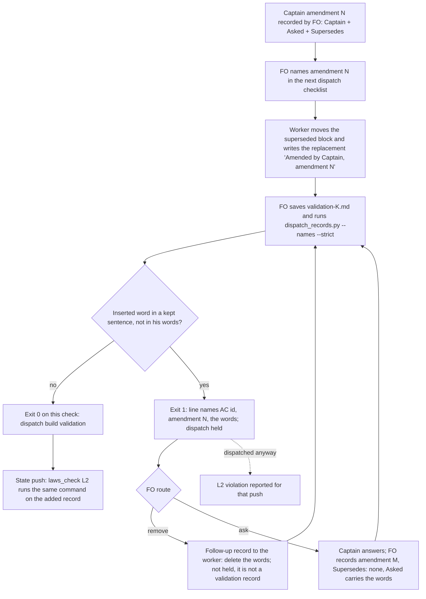

## Scope
- Source: Batch 13 sitting, the Captain, chat 2026-11-03: 「ABC 都開，不屬於套件的本身也要討論一下」, answering 「決定：A、B、C 三個都開成 dev2 任務，跟 #768 一起發版嗎？要刪哪個直接說。」; and 「先不合併，我想要把這些也評估修復後，再一起發版」 about Release PR #768. FO had proposed it as 「FO 改寫驗收條件後，要和你的原話比對」.
- Outcome: when FO or a worker rewrites an acceptance criterion, the rewrite is compared with the Captain's own words before dispatch, so a requirement he never stated does not reach validation.
- Gap: today `design_surfaces.py check` holds a changed Scope and the amendment rules hold FO words in an amendment, but nothing reads a rewritten acceptance criterion against his words.
- Bite: on this workflow's task for PR #756 (batch 11) FO rewrote 「附上來源」 as "the source's commit or link", which failed one validation round. The agent-observatory reports of 2026-11-03 (sampled) show the relay and web FOs stating verdicts before reading the artifacts and using a worker count measured in another repository.
- Consumer: every adopter FO at the ideation gate and the dispatch that follows it.
- Upstream first: `scripts/design_surfaces.py`, `scripts/dispatch_records.py`, the Captain amendments rules in the workflow template.

## Non-goals
- Judging whether a criterion is good; translating his words; rewriting criteria for the FO.

## Budget
- One package PR. Workflow word budget unchanged unless the design names a raise for the Captain.

## FO alignment
Alignment: needed before ideation; the scope is the Captain's ruling and the evidence is an observatory sample, which ideation must check against its source first.
Result: aligned at backlog: Batch 13 backlog sitting, the Captain 「進」 (chat, 2026-11-03), answering 「決定：這批七張（A 權限、B 同症狀計數、C 改寫條件比對原話、D release 驗收不在正式站、來源標註、FO 先自己試、release 驗收到期提醒）都用 Pilot，照各自寫下的範圍、預算與停止條件進入構思嗎？要改哪張直接說。」, approved the outcome and bounds in this file.
Surfaces: none
Visible change: none
Release review: not needed: workflow maintenance, on no journey map.

## Stop condition
- A replay of the #756 rewrite is held before dispatch with the added words named, and a rewrite that adds nothing to his words passes.

## Design

### PRFAQ

**After this ships.** When a worker writes the replacement criterion for a Captain amendment and changes words inside a sentence it keeps from the criterion he had approved, the validation dispatch is held before `dispatch build`. The hold names the criterion, the amendment and each added word that is not in his `Captain:` or `Asked:` lines. FO sends the worker a follow-up to remove the words, or asks the Captain and records his answer as a new amendment whose question carries them. A replacement that only deletes what he withdrew passes with no new output.

**Who uses it.** Every adopter FO, at the `dispatch_records.py --names --strict <record>` run the workflow README already requires before `dispatch build`; and `laws_check.py` L2, which runs the same command on each record a state push adds.

**FAQ.**
- *What counts as an added requirement?* A word the replacement inserts into, or swaps into, a sentence whose words match a sentence of the superseded criterion at a `difflib` ratio of at least 0.75, counted on the text before `Current evidence:`, when the word is not in the `Captain:` or `Asked:` line of that amendment or of any later one, and is not an AC id or one of 26 filler words (`the`, `and`, `still`, `remains` and so on). The check matches words; it does not translate them or judge whether a criterion is good (Non-goals).
- *What does it not catch?* A sentence that is new as a whole. Every replacement in the corpus adds whole sentences (the amendment's own change, new limits, new evidence), so a whole-sentence check would hold all 76 of 76 replacements (measured below). Such a sentence still reaches validation unchecked; the validator and the observer read it as they do today.
- *Why only at a validation record?* The words get removed through a follow-up message to the worker, and that message is a dispatch record too. A hold on every record would block the dispatch that repairs it. Holding at `validation-<N>.md` (and its `-message-<M>` continuations) is the last dispatch before the round that failed on #756.
- *Why not the FO's checklist wording?* The dispatch that asked for the #756 replacement paraphrased the amendment ("keeping every other duty including…"). The comparison base is the superseded criterion plus his `Captain:`/`Asked:` lines, never FO's restatement.
- *Does the README grow?* No. The README already says nonzero `--names --strict` holds dispatch; the printed line says how to clear it. Workflow stays 5781/5781 words.

### Evidence checked against the source

Read 2026-11-03 from this workflow's state branch and the archived task `peer-status-reaches-fresh` (PR #756, `pr: pr-merge:756`).

- **What happened.** Amendment 3: Captain 「可以」 answering 「決定：#756 拿掉 FO 回報要寫查證時間這項驗收要求，可以嗎？」. The approved AC-1, AC-7 and AC-8 said "include source/time". FO's `dispatch/implementation-4.md` asked the implementation worker to write the replacement; commit `af3b3975e` ("docs(dev2): apply peer freshness amendment 3") wrote AC-9 with "include source revision/link". The phrase came from the task's own design FAQ (commit `8c22548a6`, "Show an ISO 8601 observation time with timezone and source revision/link"). Validation-2 REJECTED the head on F5 for that duty (commit `9e4564aec`); `dispatch/implementation-4-message-2.md` then had the worker restore "include source".
- **Two corrections to the Scope's Bite.** (1) The rewriter was the implementation worker transcribing the amendment, not FO; FO's dispatch paraphrase was the input. (2) 「附上來源」 is in no `Captain:` or `Asked:` line of the task, and the added words were "revision/link", not "the source's commit or link". Neither changes the outcome or the mechanism; Scope is left unchanged, because a Scope edit after the backlog gate needs an amendment (`scope_hold`).
- **The observatory sample.** The 2026-11-03 Paseo agent-observatory reports are in `~/.paseo/plugin-data/agent-observatory/insight-reports/` (relay FO report `e83cde0a…`, web FO report `a33152a1…`). Relay F4: FO stated a judgement before the evidence and later corrected it. Web F5: a 4-worker CI setting rested on a number measured in the kc-plugin session, not this repository's 2-core runner. Both are correct in substance; neither rewrites an acceptance criterion, so they bear on `claims-name-their-source`, not on this mechanism.
- **Base reproduces the miss.** Snapshot of the task and its dispatch folder at state commit `b4e88ece4` (the commit that added `dispatch/validation-2.md`, with "source revision/link" in AC-9): origin/main `dispatch_records.py --names <snapshot>/dispatch/validation-2.md` exits 0 with no output.

### Chain checked (upstream first)

- **Spacedock 0.27.3** (`skills/`, `references/` of the installed plugin): no amendment or criterion-comparison concept; grep for amendment, rewritten criteria and the Captain's words finds only the commission walkthrough.
- **kc-dev-flow-2 0.34.0** (origin/main): the README's Captain amendments rule ("FO adds no words of its own and does not move or rewrite a criterion"; the worker writes the replacement). `design_surfaces.py check_amendments` checks form, moves and the "Amended by Captain, amendment N" marker; `scope_hold` checks Scope only; `dispatch_records.py check_task_facts` checks amendment form, naming and JSON escapes before dispatch; `laws_check.py` L3 keeps amendment entries append-only. None reads a replacement's words against the superseded text.
- **Adopters:** subspace-relay and subspace-web carry the same README rule vendored (`docs/dev2/README.md`, `docs/dev2-poc/README.md`); no local check. qnow `AGENTS.md`/`CLAUDE.md` have none.

### Existing-code check

Repair, not replace: the predicate goes beside the amendment parser it reuses (`parse_amendments`, `AmendmentRecord.moved`, `DECLARATION_LINE`, `section`) in `design_surfaces.py`, and is called from `check_task_facts`, the function FO already runs before every dispatch. No new script, flag or README sentence. Prototype (scratch, not the deliverable): `rewritten-criteria-checked-against-captain-words/ideation/prototype.diff` in the state checkout, against origin/main 0.34.0.

### Measured on the prototype

Reproduce: `git archive origin/main kc-dev-flow-2/scripts | tar -x -C <dir>`, apply the prototype with `patch -p0` from `<dir>/kc-dev-flow-2/scripts`, snapshot with `git -C <state> archive b4e88ece4 peer-status-reaches-fresh.md peer-status-reaches-fresh/dispatch | tar -x -C <snap>`, then run `python3 -B dispatch_records.py --names <snap>/peer-status-reaches-fresh/dispatch/validation-2.md`.

- Replay: exit 1, one line: `AC-9 (Captain amendment 3) adds words in a sentence kept from the criterion it replaces that are not in his words: revision, link; …` (41 words after the path).
- Control, the same snapshot with "include source revision/link." edited to "include source.": no `adds words` line. The archived final AC-9 passes too, although it adds whole sentences ("A repository and PR number is that source; …"): that is the stated limit.
- Clearance: the replay plus an amendment 4 (`Supersedes: none`, `Asked:` holding "revision, link"): no `adds words` line.
- Corpus, this workflow's tasks whose file has a `### Amendment` entry (top level and `_archive/`): on each task's newest validation record, 18 lines in 10 of 42 tasks; on each task's newest record of any stage, 19 lines in 11 of 44. The 19, read once, not adjudicated against his words one by one: about 4 add or narrow a duty with none of his words behind it (ops-inbox AC-14 "every module it imports, transitively", against 「對，加入且修訂」; read-adr AC-7 "on one host, Codex"; fo-interviews AC-8; prod-security AC-14), about 5 render the amendment's own Chinese ruling in English (dev2-laws-check AC-18, peers-paseo AC-9, read-adr AC-8 and two more), and the rest are rewording, decision ids or added evidence paths. The plain word-set version held 76 of 76 replacements and was dropped.
- Live tasks it would hold now: one, `ops-inbox-r1-setup-and-isolation` AC-14, at its first validation dispatch (it has none yet). `adr-required-statement`, `adr-silent-undo-probe` and `kc-decision-log-handoff-trial` are not held.
- Repair dispatch: on the replay snapshot an `implementation-4-message-2.md` record prints no `adds words` line; a `validation-2-message-1.md` record prints it.
- Existing suites on the prototype: `test_dispatch_records.py` 100 tests OK (1 skipped); `test_design_surfaces.py` 202 tests OK (4 skipped); `test_laws_check.py` 63 tests OK (1 skipped) on the final prototype. The first laws run failed one test, `test_mutation_reverting_the_runner_pattern_makes_the_new_lines_unjudgeable`, which finds the L2 pattern by its ending `from JSON)`; the new alternative therefore goes before the FO-alignment alternative.

### Words FO reads at each lifecycle moment

Counted for unchanged base origin/main 0.34.0 and the prototype, per root `learning.md` "Measure the words FO reads at each moment, not one file's size".

| Moment | What FO reads | Base | Candidate |
| --- | --- | --- | --- |
| Startup | workflow README | 5781 words | 5781 (unchanged) |
| Idle, open PR | `pr_watch.py tasks` (its `--newest` scan is bare names only) | unchanged | unchanged, 0 added |
| Idle, merged PR | same | unchanged | 0 added |
| After the archive | observer, learn | unchanged | 0 added |
| Merge ask | `delivery_gate.py` | unchanged | 0 added |
| Before `dispatch build`, clean record | `--names --strict` output | 0 words | 0 words |
| Before `dispatch build`, validation record with an added word | `--names --strict` output | 0 words | 41 words per held criterion (#756 replay: one line) |
| State push with a held record dispatched anyway | `laws_check.py` L2 | none | one violation line per held criterion |

`references/sd/laws.md` (L2 rule and printed-line list) and the `dispatch_records.py` docstring grow; neither is read at a lifecycle moment above (the docstring prints only on a usage error). Their word counts are measured at implementation.

### Files the design would change

- `kc-dev-flow-2/scripts/design_surfaces.py`: `added_words(lines)` and three helpers beside the amendment parser; `import difflib`.
- `kc-dev-flow-2/scripts/dispatch_records.py`: one line kind in `check_task_facts`, for `validation-<N>.md` records and their message continuations only; one docstring sentence.
- `kc-dev-flow-2/scripts/laws_check.py`: one alternative in the L2 `--names` line pattern, placed before the FO-alignment alternative, so the new line is a violation and not "output this runner does not parse" (exit 2).
- `kc-dev-flow-2/references/sd/laws.md`: L2 Rule and Judged-by name the new printed line.
- Tests: `test_dispatch_records.py` (replay, control, clearance, non-validation record), `test_laws_check.py` (L2 classifies the line), `test_design_surfaces.py` (`added_words` unit cases).

### Decisions for the Captain

- **D1: hold a validation dispatch on words added inside a kept sentence (recommended), or record no check.** Past ruling in this area: ADR 0027 D4, where the Captain chose no check because "there is one case and matching words cannot stop that class of error"; and ADR 0016, which declined a text rule for FO's words in `Design:`. This recommendation departs from that because the class here is narrower and measured: the bitten #756 rewrite is held at the dispatch before the failed round, a live task (ops-inbox AC-14) and three archived ones show the same shape, and the README does not grow. What gets worse: about one in four amended tasks (10 of 42 newest validation records) would have been held once, some on faithful English renderings of his Chinese words, each costing a worker follow-up or one more Captain question; and a requirement written as a whole new sentence still passes unchecked.

### Batch overlap

Batch 13 siblings, none sharing a file or check:
- `fo-answers-own-worker-permissions-by-listed-id`: paseo/peers extensions. None.
- `diagnosis-rounds-count-toward-step-back`: `role_triggers.py`. None; a clearance amendment has `Supersedes: none`, and `step_back_events` counts only amendments that replace something.
- `release-walk-off-production-before-release`, `release-walk-due-trigger`: release-acceptance extension, adoption.md. None.
- `claims-name-their-source`, `fo-tries-what-it-asks-the-captain`: `delivery_gate.py`, validation principles. None (no design yet; recheck when they record one).

Live tasks of other sessions:
- `seed-check-requires-alignment-result`: `design_surfaces.py` (seed branch) and `test_design_surfaces.py`. Same files, different functions.
- `fo-write-checks-parse-top-level`: `design_surfaces.py` (`scope_lines`), `test_design_surfaces.py`, `delivery_gate.py`. Same files, different functions.
- `captain-ruling-sources-checked`: `design_surfaces.py`, `test_design_surfaces.py`, adoption.md, peers. Same files.
- `adoption-asks-which-extensions`: `dispatch_records.py` (`extension_errors`, docstring), `test_dispatch_records.py`, `test_laws_check.py` (one L2 test). Same files; both edit the module docstring.
- `ops-inbox-r1-setup-and-isolation`: no file shared; its AC-14 is held by the new line at its next validation dispatch.
- `dispatch-carries-reserved-adr-number`: no package change in its design. None.
- `adr-required-statement`, `adr-silent-undo-probe`, `comment-check-reaches-delivery-gate`, `archive-waits-for-observer-report`, `journey-canvas-hosted-poc`, `journey-server-host-pilot`, `picky-reviewers-may-run-on-gemini`, `pr-review-lite-value-pilot`: no shared file or check found in their task files.

Recommended order: after `seed-check-requires-alignment-result`, `fo-write-checks-parse-top-level` and `adoption-asks-which-extensions` land, rebasing on each; the change is additive (an appended function, one new line kind, one pattern alternative), so the conflicts are the module docstrings and the test files' fixture lists.

## Acceptance criteria

**AC-1** — The #756 rewrite is held before its validation dispatch. On the snapshot of state commit `b4e88ece4` (task and dispatch folder), candidate `dispatch_records.py --names --strict <snapshot>/peer-status-reaches-fresh/dispatch/validation-2.md` exits 1 with one line naming AC-9, Captain amendment 3 and the words `revision, link`; origin/main exits 0 on the same snapshot. Verified by: a `test_dispatch_records.py` case built from those bytes, and the CLI run recorded in the stage report. Falsifier: removing the `added_words` call from `check_task_facts` makes the case pass with exit 0, which the test refuses. Current evidence: prototype run 2026-11-03, exit 1 with that line; origin/main exit 0.

**AC-2** — A rewrite that adds nothing to his words passes. The same snapshot with "include source revision/link." changed to "include source." prints no `adds words` line; a replacement that only renumbers, adds the "Amended by Captain, amendment N" marker and changes text after `Current evidence:` prints none. Verified by: `test_dispatch_records.py` control cases. Falsifier: counting deleted words as added, or comparing the evidence tail, makes a control print the line. Current evidence: prototype control run 2026-11-03, no line.

**AC-3** — His later words clear the hold. The AC-1 snapshot plus an amendment 4 with `Supersedes: none` whose `Asked:` line holds "revision, link" prints no `adds words` line. Verified by: a `test_dispatch_records.py` case. Falsifier: reading only amendment N's own `Captain:`/`Asked:` lines keeps the hold. Current evidence: prototype run 2026-11-03, no line.

**AC-4** — The repair dispatch is not held. On the AC-1 snapshot, an `implementation-4-message-2.md` record prints no `adds words` line, and a `validation-2-message-1.md` record does. Verified by: `test_dispatch_records.py` cases. Falsifier: applying the line to every record holds the follow-up that removes the words. Current evidence: prototype runs 2026-11-03, implementation follow-up 0 lines, validation continuation 1 line.

**AC-5** — L2 reports the line as a violation, not a runner failure. A `test_laws_check.py` case where a push adds a held validation record yields `violation: L2 dispatch-record-complete … AC-9 (Captain amendment 3) adds words …` and exit 1, not exit 2. Falsifier: removing the new pattern alternative gives "output this runner does not parse" (exit 2). Not yet verified (the prototype adds the alternative; no L2 case was run).

**AC-6** — The corpus bound and no regression. Rerun the corpus sweep (newest dispatch record of each amended task in this workflow's state checkout) at the candidate and report each `adds words` line; base and candidate output differ only by those lines. `test_dispatch_records.py`, `test_design_surfaces.py`, `test_laws_check.py`, `lint-skills.py` and `comment_ratio.py` pass. Falsifier: a filler or AC-id word in a held line, or any other changed output line. Current evidence: prototype sweep 18 lines in 10 of 42 newest validation records; on the final prototype test_dispatch_records.py 100 OK, test_design_surfaces.py 202 OK, test_laws_check.py 63 OK; lint and comment ratio not yet run.

**AC-7** — FO reads no more words at any moment except a held pre-dispatch run. Workflow README stays 5781 words (lint budget unchanged); a clean record's `--names --strict` output is byte-identical to base; the #756 replay adds one line of 41 words after the path. Verified by: word counts in the stage report. Falsifier: a README sentence added, or output on a clean record. Current evidence: README 5781 at origin/main; replay line 41 words on the prototype.

Limits: a requirement written as a whole new sentence passes; the words after `Current evidence:` are not compared; a faithful English rendering of his Chinese words is held until removed or confirmed. These are bounds of a word-matching check, stated so the gate does not read AC-1..AC-7 as "every added requirement is caught".

## Stage Report: ideation

- DONE: First check the evidence against its source; then design where a rewritten acceptance criterion is compared with the Captain's words before dispatch, what counts as an added requirement, and how the #756 rewrite is caught
  `### Evidence checked against the source`: the implementation worker wrote "source revision/link" into AC-9 (af3b3975e) from the design FAQ, not FO; 「附上來源」 is in no Captain:/Asked: line; observatory relay F4 and web F5 read and found unrelated to criteria. Design: `dispatch_records.py --names --strict` holds a validation record whose replacement criterion inserts words, not in his words, into a kept sentence; the prototype holds the #756 replay naming "revision, link".
- DONE: A `### Batch overlap` section naming each file the design would change and each other batch task (fo-answers-own-worker-permissions-by-listed-id, diagnosis-rounds-count-toward-step-back, rewritten-criteria-checked-against-captain-words, release-walk-off-production-before-release, claims-name-their-source, fo-tries-what-it-asks-the-captain, release-walk-due-trigger) and live task of other sessions (adoption-asks-which-extensions, adr-required-statement, adr-silent-undo-probe, archive-waits-for-observer-report, captain-ruling-sources-checked, comment-check-reaches-delivery-gate, dispatch-carries-reserved-adr-number, fo-write-checks-parse-top-level, journey-canvas-hosted-poc, journey-server-host-pilot, ops-inbox-r1-setup-and-isolation, picky-reviewers-may-run-on-gemini, pr-review-lite-value-pilot, seed-check-requires-alignment-result (live tasks; read only)) that changes the same file or check, so FO can order implementation
  `### Files the design would change` lists six files; `### Batch overlap` gives each task, shared files (design_surfaces.py, dispatch_records.py and their tests with seed-check, fo-write-checks, captain-ruling-sources, adoption-asks), the live ops-inbox hold, and `Recommended order:`.
- DONE: The words FO reads at each lifecycle moment, before and after, per root learning.md "Measure the words FO reads at each moment, not one file's size"
  Table in the design: README 5781 → 5781; startup, idle, archive and merge-ask moments add 0; a clean pre-dispatch run stays 0 words; a held validation record adds 41 words per held criterion.
- DONE: Acceptance criteria with reproducible evidence clauses and falsifiers, and unresolved decisions for the Captain, each with a recommendation and what gets worse under it
  AC-1..AC-7 below, each with its own evidence; D1 (hold vs no check), naming ADR 0027 D4 and ADR 0016 as the past rulings it departs from, and what gets worse.

Per criterion, current evidence at the prototype (`ideation/prototype.diff`, applied to origin/main 0.34.0):
- AC-1: verified on the prototype: snapshot b4e88ece4 validation-2.md exits 1 naming AC-9, amendment 3, "revision, link"; origin/main exits 0. Test case not yet written.
- AC-2: verified on the prototype: the "include source." control prints no line. Test case not yet written.
- AC-3: verified on the prototype: an amendment 4 whose Asked: holds the words clears the line. Test case not yet written.
- AC-4: verified on the prototype: implementation-4-message-2.md 0 lines; validation-2-message-1.md 1 line.
- AC-5: not yet verified: the L2 pattern alternative is in the prototype; no L2 case was run. test_laws_check.py 63 tests OK with the alternative in place.
- AC-6: partly verified: sweep 18 lines in 10 of 42 newest validation records; test_dispatch_records.py 100 OK; test_design_surfaces.py 202 OK, test_laws_check.py 63 OK; lint and comment ratio not run.
- AC-7: verified: README 5781 words at origin/main, unchanged by the design; replay line 41 words.

`design_surfaces.py check` (package 0.34.0) on this task: "design surfaces presentable", exit 0.

### Summary

The #756 widening was a worker's transcription of amendment 3, drawn from the task's own design wording, and nothing in the package compared it with the superseded criterion; origin/main passes the validation-2 record that carried it. The design adds one pre-dispatch line, at validation records only, for words inserted into a sentence kept from the approved criterion and absent from his words; a plain word-set check held 76 of 76 past replacements and was dropped. Whole new sentences stay unchecked, a stated limit. D1 asks whether to hold at all, since ADR 0027 D4 once chose no word-matching check.
