## Scope

- Source: the Captain 「准」 (chat, 2026-11-09, given in both the qnow dev2 FO session and this one), answering the qnow dev2 FO's question 「准不准他們照下面的條件去做？」, which put P1-P3 of /tmp/qnow-case/proposal.md and p1-revised.md (FO scratch, 2026-11-09) with their ship conditions.
- Bite: qnow task owner-vehicle-kept-after-name: 5 repair passes, 3 Material validations and 7 dispatches on one Symptom. Adopted 0.35.0 `role_triggers.py <state> <slug> --rev <state commit>` (run by the qnow dev2 FO, 2026-11-09) already owed a chief-engineer call (3 implementation dispatches on one symptom) and an engineering-reviewer call (replacing amendments 1-6) at state ee29b0a8 before implementation-4, and again at 27f04824 and 03829bf0 before implementations 5 and 6; FO never ran it and recorded neither a call nor a decline. The step-back question FO answered four times was "is what I am solving still the outcome first asked for"; it answered yes each time while validation-1 F2 and validation-2 F6 both pointed at one screen, so the outcome question did not surface the shared cause (a missing attempt identity).
- Change: the chief-engineer question for a repeated-symptom or repeated-validation call asks "what single mechanism produces these findings, and what one change closes that class?"; a decline line must say why the findings are unrelated, or it does not clear the owed call.
- Related: task step-back-answer-has-a-record-line (held at ideation 2026-11-05; its non-goal "changing the three questions" is unchanged by this task, which changes the chief-engineer call's question and the decline form only); task a-worker-holds-while-a-role-call-is-owed reads the decline form.
- Non-goals: when calls are owed; the step-back three questions.

## Budget
- One package PR; workflow word budget unchanged unless the design names a raise.

## Stop condition
- Behaviour replay on qnow validation-2's records: a chief-engineer asked the current question and one asked the mechanism question, 3 runs each; count runs whose answer names the missing attempt identity. Ships only if the mechanism question beats the current wording; otherwise this task closes with the table.
- The four recorded step-back answers fail the new decline form (mechanical).
- Results go to the qnow dev2 FO for its Captain report.

## FO alignment

Alignment: not needed; the Captain approved the direction and ship condition.
Surfaces: none
Visible change: none
Release review: not needed: workflow maintenance, on no journey map.

## Design

Read against kc-dev-flow-2 0.36.0 at origin/main (`kc-dev-flow-2/.claude-plugin/plugin.json`, fetched 2026-11-09); origin/main `scripts/role_triggers.py` is byte-identical to the 0.36.0 cache (`cmp`, 2026-11-09).

### PRFAQ

**Proposition.** From the next kc-dev-flow-2 release, when a task has three validations with a Material or Needs decision finding, or three dispatches of one stage on one symptom, `role_triggers.py` asks for a chief-engineer call with the question "what single mechanism produces these findings, and what one change closes that class?". FO can still decline the call, but only with `Reviewer: kc-dev-flow-2:chief-engineer not run <date>: unrelated: <finding> <its own cause>; <finding> <its own cause>`. A decline that only restates the outcome no longer clears the call.

- *Why change the question?* In the qnow case the owed call carried the three step-back questions, which FO had already answered at the outcome level. Replayed on validation-2's records, a chief-engineer asked the mechanism question named the missing attempt identity in 3 of 3 runs. Asked the current question, it did so in 2 of 3 runs on a generous grading and 1 of 3 on a strict one (table below).
- *Which events change?* Only the two the Captain's scope names: failed validations and repeated symptom dispatches. A call owed only for repair passes or review rounds keeps "what is the smallest next step, given the findings so far?". A call owed only for three replacing amendments keeps the three step-back questions, because amendments are Captain changes, not findings.
- *What does the decline check prove?* Form, not truth. `unrelated()` in `role_triggers.py` checks for two or more `;`-separated items after `unrelated:`, each a finding name followed by a cause of two or more words, with no two causes the same. A false "unrelated" claim with that form still clears the call (control C1 below). The value is that the claim is written down where the Captain and the observer read it.
- *Do the existing ADR 0026 rules change?* A call still counts by its date and model, not its question. Owing is still read from counts. Only what a decline must say for these two events changes, and the question text recorded in ADR 0026's 2026-11-02 amendment changes. ADR 0026 gets one amended paragraph (no new number).
- *What is not changed?* `dispatch_records.py` and its two-dispatch step-back reminder; the three step-back questions; when any call is owed; the chief-engineer skill and agent (the replay ran with the current skill); `workflow.md`; `delivery_gate.py`, `pr_watch.py` and the observer, which forward `role_triggers.py` lines as they are.

```mermaid
flowchart TD
  A[role_triggers.py reads committed task] --> B{event owes chief-engineer?}
  B -- no --> Z[exit 0, or count-two reminder]
  B -- yes --> C{failed validations >= 3 or one symptom dispatched >= 3?}
  C -- yes --> D[owed line asks the mechanism question; decline template 'unrelated: ...']
  C -- no, amendments only --> E[owed line asks the three step-back questions; plain decline]
  C -- no, repairs or review rounds only --> F[owed line asks 'smallest next step'; plain decline]
  D --> G{Reviewer line under FO alignment?}
  G -- call on opus rank or above, dated per existing rules --> H[cleared]
  G -- decline with two or more unrelated items --> H
  G -- plain decline or none --> I[still owed: exit 1, merge ask held by delivery_gate.py]
  E --> J{call or any dated decline} --> H
  F --> J
```

### Existing-code check

`role_triggers.py` already owns the question (`QUESTION`, `STEP_BACK`, chosen in `check()`), the decline grammar (`records()`, `owed_line()`) and the duplicate-reminder suppression. The change reuses all of them: one constant `MECHANISM`, one helper `unrelated()`, `records()` keeping each decline's reason, and the two findings events cleared only by a call or a reasoned decline. Scratch prototype: `role-call-asks-for-the-mechanism/ideation/proto.diff` (115-line unified diff, 26 added and 10 removed lines in `role_triggers.py`). Needed because the 0.36.0 owed line for the qnow symptom event asks the step-back questions (`ideation/current-owed-line.txt`) and any non-empty reason clears it (table below, column 0.36.0).

### Files

- `kc-dev-flow-2/scripts/role_triggers.py`: `MECHANISM`, `unrelated()`, `records()` returns `(date, reason)` per decline, `check()` clears `failures_owed` and `symptom_owed` only by a call or a reasoned decline and picks the question and decline template, the suppression per D1, the docstring.
- `kc-dev-flow-2/scripts/test_role_triggers.py`: the 8 tests that pin the old question or a plain decline on these two events (run against the prototype, 2026-11-09: `StepBackTest` 3, `SymptomRoundsTest` 4, plus `test_cleared_symptom_cannot_mask_...`), and new cases for AC-1 to AC-4.
- `kc-dev-flow-2/scripts/test_delivery_gate.py`: `OwedRoleCallTests.test_third_committed_symptom_round_holds_merge_ask` and `test_third_failure_holds_until_the_call_is_committed` assert the old question.
- `docs/adr/0026-role-calls-are-owed-on-counts-read-from-task-records-and-a-dated-call-clears-them.md`: one `Amended` paragraph with the Captain's words from this task's gates.
- Prototype run of the other suites against `role_triggers.py` swapped in a scratch copy of origin/main (2026-11-09): `test_pr_watch` 135 passed, `test_dispatch_records` 114 passed 1 skipped; `test_dispatch_stage` fails 53 with or without the change in that scratch copy (environment), and its only step-back pin (`test_successful_same_symptom_forwards_one_reminder_before_real_build`) is the `dispatch_records.py` reminder this task does not change.

### Replay: the chief-engineer question

Inputs: qnow state at 27f04824 (the task file, dispatch records, validation-1 and validation-2 evidence without pictures) and product source `apps/qnow-app` at candidate 35fd5f65 plus its diff from base 232344ce, extracted with `git archive` into `/tmp/rcm/inputs`; a scan for `attempt identity|attemptId|attempt_id|attempt-identity` found none. Each run: `kc-dev-flow-2:chief-engineer` agent, Claude opus, the same prompt except the question; the current arm's question is the exact string 0.36.0 `role_triggers.py` printed at 27f04824. Grader pre-registered at 2026-11-09T14:44:25Z, before the first run (`ideation/grader.md`); rule: the mechanism arm must pass strictly more runs.

| Run | Question | Names the missing attempt identity | Quoted line (`ideation/grading.md`) |
| --- | --- | --- | --- |
| current-1 | current | yes | "Define one booking-attempt identity ... Check it after every await" |
| current-2 | current | no | binds callbacks to their screen and the key to the slot, two separate rules |
| current-3 | current | yes on a generous grading, no on a strict one | "without checking that it is still the same booking attempt" |
| mechanism-1 | mechanism | yes | "The booking attempt has no identity of its own." |
| mechanism-2 | mechanism | yes | "The class is \"the attempt has no identity,\" not \"callbacks are unguarded.\"" |
| mechanism-3 | mechanism | yes | "A booking in progress has no identity of its own." |

Mechanism 3/3, current 2/3 (generous) or 1/3 (strict): the ship condition is met under both gradings. All three mechanism answers open with the mechanism; all three current answers open with whether the outcome is delivered. Limits: Claude only, 3 runs per arm, one grader (this worker), a one-run margin on the generous grading. Validation-2's own F6 text says "scope ... to the actual booking attempt/slot", so the word "attempt" was in both arms' inputs; the grade is on the single-cause claim, not the word. All six answers also said the original symptom was fixed and the repairs were on another class, so making the call happen at all (task a-worker-holds-while-a-role-call-is-owed) carries much of the case's value; this task adds a consistent mechanism-first answer.

### Replay: the recorded step-back answers against the decline form

The case record says FO answered the step-back four times. Search (2026-11-09): `rg -l -e 'step back:' -e 'before you send this one'` over every `*.jsonl` under the Claude project directories for `qnow-adopt-dev2` and the Codex sessions of 2026-11-08 and 2026-11-09. For this task, the qnow FO's session prints it for implementation-3, implementation-4 and validation-2, and FO answered each once, verbatim (A0, A1, A2). The prints for implementation-6, validation-3, implementation-7 and validation-4 are only in Codex worker sessions, with no FO answer. A3 is the form `package-feedback.md` quotes. Each was written as `Reviewer: kc-dev-flow-2:chief-engineer not run 2026-11-09: <answer>` under `## FO alignment` in a scratch copy at each revision (`ideation/decline-replay.py`, `ideation/decline-replay-table.md`).

| Decline reason | 0.36.0 at ee29b0a8 / 27f04824 / 03829bf0 | Prototype at the same three |
| --- | --- | --- |
| none | owed / owed / owed | owed / owed / owed |
| A0 "My answer is yes. The original problem is fixed: ... not a drift in direction." | cleared ×3 | owed ×3 |
| A1 "These two bugs are in the booking draft we're delivering. Tests can reproduce them now, ..." | cleared ×3 | owed ×3 |
| A2 "The goal is still the original one: ... The remaining gaps can all be tested now." | cleared ×3 | owed ×3 |
| A3 "the outcome is unchanged; the gap is testable now" | cleared ×3 | owed ×3 |
| C1 control: `unrelated: F1 explicit home exit keeps the draft; F2 late 201 response after Back` | cleared ×3 | cleared ×3 |
| C2 control: one item only | cleared ×3 | owed ×3 |
| C3 control: the same cause twice | cleared ×3 | owed ×3 |

### Words FO reads at each moment

| Moment | Before (0.36.0) | After |
| --- | --- | --- |
| Startup (`workflow.md`) | 5931 words | unchanged |
| Dispatch (`dispatch_records.py` step-back at two dispatches) | unchanged text | unchanged |
| Idle (`pr_watch.py tasks`), merge ask (`delivery_gate.py check`), archive (observer): all `role_triggers.py` output on the qnow task | 152 / 152 / 156 words at ee29b0a8 / 27f04824 / 03829bf0 | 143 / 143 / 147 under D1's recommendation; 143 / 262 / 266 under D1's alternative |
| The owed chief-engineer line alone, 27f04824 | 95 words (`ideation/current-owed-line.txt`) | 86 words (`ideation/proto-owed-line.txt`) |
| The question the chief-engineer receives | 26 words | 15 words |

### Batch overlap

- **a-worker-holds-while-a-role-call-is-owed** (batch 19): its worker-start check runs `role_triggers.py` and its Scope says a decline clears the hold only in this task's reason form. It reads this task's exit codes and decline grammar; if it edits `role_triggers.py` or `test_role_triggers.py` the two meet in `check()` and `records()`.
- **kept-data-lifecycle-at-ui-ideation** (batch 19): ideation skill and design-director files; no file or check in common.
- **step-back-answer-has-a-record-line** (held at ideation): its design reads and changes the duplicate-reminder suppression in `role_triggers.py` ("an owed chief-engineer line already carries STEP_BACK?"), `test_role_triggers.py` and ADR 0026's amendments. Same branch as D1; it must re-read that branch after this task lands.
- **counts-name-the-run-that-produced-them** (batch 18, implementation): `delivery_gate.py` and `test_delivery_gate.py`; this task changes only two `OwedRoleCallTests` cases in that test file.
- **delivery-gate-ignores-url-paths-and-data-fences** (batch 18, validation): `test_delivery_gate.py` (`CaptainStepsTests`, `QuestionTests`); different classes, same file.
- ADR index: this task amends ADR 0026 and reserves no number.

Recommended order: delivery-gate-ignores-url-paths-and-data-fences, counts-name-the-run-that-produced-them, this task, a-worker-holds-while-a-role-call-is-owed, then step-back-answer-has-a-record-line if it is revived; kept-data-lifecycle-at-ui-ideation in any order.

## Acceptance criteria

**AC-1**: For a task with three validations carrying a Material or Needs decision F bullet, or three dispatch records of one stage on one symptom, and no qualifying call, the owed chief-engineer line carries "what single mechanism produces these findings, and what one change closes that class?" and the decline template `not run <date>: unrelated: <finding> <its own cause>; <finding> <its own cause>`; a task owing only for repair passes or review rounds keeps "what is the smallest next step, given the findings so far?", and one owing only for three replacing amendments keeps the three step-back questions.
Verified by: new `test_role_triggers.py` cases, one per event family; falsifier: choosing `STEP_BACK` for the findings events again fails the failure and symptom cases.

**AC-2**: For those two events, a decline clears the call only when its reason is `unrelated:` followed by two or more `;`-separated items, each a name plus two or more words, with no two causes equal after casefolding; the existing date rules still apply. A plain decline still clears repair-pass, review-round and amendment events.
Verified by: `test_role_triggers.py` cases for a reasoned decline (clears), a plain decline, one item, a one-word cause and a repeated cause (each still owes), and a plain decline on a repair-pass-only task (clears); falsifier: clearing the two events with any decline again makes the plain-decline cases pass wrongly.

**AC-3**: The four recorded step-back answers above (A0, A1, A2, A3, verbatim) written as decline reasons leave the chief-engineer call owed.
Verified by: a `test_role_triggers.py` case with the four texts as fixtures (no qnow checkout needed); ideation evidence on qnow state at ee29b0a8, 27f04824 and 03829bf0 is `ideation/decline-replay-table.md`; falsifier: the 0.36.0 script clears all three.

**AC-4**: The count-two step-back reminder is printed in exactly the states it was printed in 0.36.0 (D1 recommendation): an owed findings or amendment chief-engineer line suppresses it whatever question that line carries.
Verified by: the updated `test_cleared_symptom_cannot_mask_another_second_event_and_owed_questions_are_not_duplicated` asserts the mechanism question once and the three questions zero times; on qnow state at 27f04824 the output is 143 words with the prototype against 262 with the substring check; falsifier: restoring `STEP_BACK in line` makes that test print the reminder.

**AC-5**: The mechanism question beats the current wording in the replay on qnow validation-2's records.
Verified by: ideation evidence `ideation/grader.md` (pre-registered), `ideation/runs/` (six answers) and `ideation/grading.md` (mechanism 3/3, current 2/3 generous or 1/3 strict); validation re-grades the six saved answers against the pre-registered rule and states its own count.

**AC-6**: ADR 0026 carries one amended paragraph with the Captain's words, the new question, the decline form and its form-not-truth limit, and the D1 ruling; `workflow.md` is byte-unchanged.
Verified by: the repository's ADR lint on the PR head and `git diff origin/main -- kc-dev-flow-2/references/sd/workflow.md` empty.

**AC-7**: `test_role_triggers.py`, `test_delivery_gate.py`, `test_pr_watch.py` and `test_dispatch_records.py` pass on the PR head.
Verified by: their runs saved in the implementation evidence folder, each with command and exit code.

## Unresolved decisions

- **D1. When the owed chief-engineer line asks the mechanism question, does the count-two step-back reminder still print beside it?** ADR 0026's 2026-11-02 amendment suppresses a duplicate reminder "only when an emitted owed-call line already carries the three questions". With the new question, that literal rule would print the reminder again: on the qnow task at 27f04824, FO would read the mechanism question plus two step-back reminders (262 words instead of 143). Recommendation: suppress the reminder whenever an owed findings or amendment chief-engineer line is printed, so it prints in exactly the states it did before, and amend that ADR sentence. Why: the outcome-level step-back answer is the one that hid the mechanism in this case, and printing it beside the mechanism question invites that answer again. What gets worse: an ADR rule's wording changes, and in those states FO sees only the mechanism question, not the three step-back questions.

## Stage Report: ideation

- DONE: Run the replays your stop condition names now, as scratch prototypes under /tmp (never a repository file), and put the result table in the design
  Behaviour: mechanism 3/3 vs current 2/3 generous or 1/3 strict, 6 opus chief-engineer runs on leak-scanned qnow 27f04824 + 35fd5f65 inputs, grader pre-registered 14:44:25Z (`ideation/grading.md`); mechanical: A1-A3 declines clear on 0.36.0 and stay owed on the prototype at all three revisions (`ideation/decline-replay-table.md`). FO's verbatim step-back answers for this task are three (implementation-3, -4, validation-2), plus the quoted form, not four; search and result stated in the design.
- DONE: A `### Batch overlap` section naming each file the design would change and each other batch task (a-worker-holds-while-a-role-call-is-owed, role-call-asks-for-the-mechanism, kept-data-lifecycle-at-ui-ideation) and live task of other sessions (step-back-answer-has-a-record-line (held at ideation), counts-name-the-run-that-produced-them and delivery-gate-ignores-url-paths-and-data-fences (batch 18, live)) that changes the same file or check, so FO can order implementation
  `### Batch overlap` names role_triggers.py, test_role_triggers.py, test_delivery_gate.py and ADR 0026 per task, with a Recommended order line.
- DONE: The words FO reads at each lifecycle moment, before and after, per root learning.md "Measure the words FO reads at each moment, not one file's size"
  `### Words FO reads at each moment`: workflow.md 5931 unchanged; role_triggers output on qnow 152/152/156 → 143/143/147 (262/266 under D1's alternative); owed CE line 95 → 86; CE question 26 → 15.
- DONE: Acceptance criteria with reproducible evidence clauses and falsifiers, and unresolved decisions for the Captain, each with a recommendation and what gets worse under it
  AC-1..AC-7 each with Verified by and a falsifier; D1 (reminder suppression vs ADR 0026's literal sentence) with recommendation and cost.
- DONE: AC-1 mapped to its evidence — new test_role_triggers cases; current evidence: the prototype prints the mechanism question at 27f04824 (`ideation/proto-owed-line.txt`); product test not yet verified, implementation.
- DONE: AC-2 mapped to its evidence — test_role_triggers decline cases; current evidence: prototype control C1 clears, C2 and C3 owe (`ideation/decline-replay-table.md`); repair-pass plain decline not yet verified, implementation.
- DONE: AC-3 mapped to its evidence — a fixture test with A0-A3; current evidence: A0-A3 owed at all three qnow revisions on the prototype, cleared on 0.36.0; product test not yet verified, implementation.
- DONE: AC-4 mapped to its evidence — the updated suppression test; current evidence: prototype 143 words vs 262 with the substring check at 27f04824; product test not yet verified, implementation; depends on D1.
- DONE: AC-5 mapped to its evidence — `ideation/grader.md`, `ideation/runs/`, `ideation/grading.md`; current evidence: mechanism 3/3 vs current 2/3 (1/3 strict); validation re-grade not yet verified.
- DONE: AC-6 mapped to its evidence — ADR lint and the workflow.md diff on the PR head; not yet verified, implementation.
- DONE: AC-7 mapped to its evidence — saved suite runs on the PR head; not yet verified; current evidence: in a scratch copy the prototype fails only the 8 + 2 tests the design lists as changed.
- DONE: design_surfaces.py check: `role-call-asks-for-the-mechanism.md: design surfaces presentable`, exit 0 (0.36.0 package).

### Summary

The owed chief-engineer call for repeated validation failures or one repeated symptom asks for the single mechanism, and its decline must name two or more findings each with its own cause. The replay met the ship condition (mechanism 3/3 against current 2/3 or 1/3), with the limit that all six chief-engineers saw the class once called, so the call happening at all carries much of the value. One Captain decision: D1, whether the step-back reminder stays suppressed beside the new question (recommended, amends one ADR 0026 sentence). For the qnow FO's report: the case record's "four" step-back answers are three FO answers in its transcript (implementation-3, implementation-4, validation-2); later prints were in worker sessions only.

## Stage Report: implementation

- DONE: Implement the approved design on a branch off origin/main; only the files the design names.
  Branch spacedock-ensign/role-call-asks-for-the-mechanism; base 82c9e67ae892b80647c3f6a8b6929f993e42dbc2; candidate ebbac3de0dbf3b9bf9bf4c59611ff06bb5eb4fe9; four files, clean product tree, hashes in implementation/candidate.json.
- SKIPPED: One Draft PR in iamcxa/kc-claude-plugins.
  No PR opened: no push grant. Dispatch delegates product push/open to FO; exact title/body prepared at /tmp/impl-role-call-asks-for-the-mechanism-pr.md and implementation/pr.md.
- DONE: AC-1: findings calls ask the mechanism question; repair/review/amendment-only questions remain.
  test_role_triggers StepBackTest, SymptomRoundsTest and repair/review-only case; old-question mutation fails both findings families (implementation/old-question.log).
- DONE: AC-2: two or more findings with distinct causes are required; prior date/model and other-event decline rules remain.
  Both-event reason table, dated/undated symptom controls and failure-model controls pass; any-decline, one-word-cause and case-sensitive-causes mutations fail (implementation/mutations.json).
- DONE: AC-3: all four recorded outcome answers leave the findings calls owed.
  Verbatim fixtures exercised against both failure and symptom events; the 0.36.0 baseline clears all eight subcases and fails the candidate assertions (implementation/base-0.36.0.log).
- DONE: AC-4: keep the count-two reminder suppressed in the approved former states.
  Cleared-event independence and owed-call suppression tests pass; substring-suppression mutation adds the forbidden reminder and fails the named case (implementation/substring-suppression.log).
- DONE: AC-5: confirm the saved behavioral replay meets its ship condition.
  Read the pre-registered grader and all six answers: mechanism 3/3, current 2/3 generous or 1/3 strict; implementation/replay-author-regrade.md explains each verdict; replay-inputs.json binds the saved answers.
- SKIPPED: AC-5 independent validation re-grade.
  Delegated to the validation worker; the author re-read is not independent review, and no new model runs or live qnow repair are claimed.
- DONE: AC-6: append the Captain-approved ADR 0026 paragraph, including D1 and form-not-truth limit; workflow.md byte-unchanged.
  Captain's 「核准（建議）」 and the bound recommendation quoted; ADR lint --since base --require 0026 exits 0; workflow diff empty, repository lint reports 5931/5931 words.
- DONE: AC-7: test_role_triggers.py, test_delivery_gate.py, test_pr_watch.py and test_dispatch_records.py pass.
  implementation/tests.json and each command/exit/log: 46/192/135/115 tests, 488 total, 486 passed and 2 optional checks skipped; no candidate byte changes since these runs.
- SKIPPED: Optional historical gate replay and real Spacedock builder checks.
  Existing skips require GATE_PRESENTATION_STATE or SPACEDOCK_BIN plus SD_PLUGIN_ROOT; not run, never clean; reasons in implementation/README.md.
- DONE: Every named code falsifier exercised with python3 -B and caches cleared.
  Six fresh-directory variants exit 1 through assertions, no import errors; original baseline fails 22 subcases, old question 2, any decline 20, short cause 2, casefold 2, reminder suppression 1.
- DONE: kc-dev-flow-2/scripts/lint-skills.py (repository CI copy), package adr_lint.py, number_guards.py check and comment_ratio.py.
  All exit 0 on the candidate; number guards rerun with successful state fetch; comment ratio: code lines 118, comment lines 1, 0.8%, maximum 5% met (implementation/*.json and *.log).
- DONE: Affected documents and existing-code consumers checked.
  doc_impact.py lists docs/adr/0049-special-roles-and-stage-defaults-follow-one-model-table.md: unaffected, Astra rank/opus floor unchanged; ADR 0026 updated. delivery_gate.py/pr_watch.py forward lines unchanged; dispatch_records.py imports unchanged STEP_BACK.
- DONE: Compare newly refusing checker against every committed task in this state checkout.
  implementation/corpus.json at bd507c059bacfd7c27b748ee50bcee39e049924a: 220 tasks, 0 exit changes, 219 identical outputs and one intended archived findings-question/template change; no unverifiable tasks.
- SKIPPED: RoboRev, product publication, hosted CI, reviews, ready and merge.
  FO owns these actions; RoboRev and hosted CI not run, never clean. CI cost per PR not measured; CI configuration and version files unchanged.

### Summary

The candidate asks for the common mechanism on the two findings events and requires a written unrelated-causes claim to decline them, preserving the approved reminder states and existing trigger/date/model rules. Local suites and reverse mutations pass their expected outcomes; the saved model replay still meets the ship rule on author re-read. FO receives the local candidate and prepared Draft PR text; independent validation, RoboRev, publication and hosted checks remain owed.

## Stage Report: validation

- DONE: Independent verdict on PR #821 head ebbac3de against every acceptance criterion in the task file, re-running each evidence command and at least one falsifier per criterion yourself, and judging each limit the implementation report states
  PASSED at ebbac3de0dbf3b9bf9bf4c59611ff06bb5eb4fe9 against 82c9e67ae892b80647c3f6a8b6929f993e42dbc2; seven criteria met; validation/README.md maps proof, necessity and limits; no review findings proposed.
- DONE: A minimal acceptance script the Captain can run (three to six steps, exact commands, expected output), run by you exactly as written in a fresh bash shell, with its observed output; /Users/kent/.claude/plugins/cache/kc-claude-plugins/kc-dev-flow-2/0.36.0/scripts/adr_lint.py docs/adr --since <base> with its exit code; your verdict naming the head, with findings classified by the workflow's Review-finding disposition
  validation/acceptance.sh has five executable steps, run via bash --noprofile --norc; observed CLI hold/clear, six tests, eight expected old-version failures and ADR pass in validation/logs/acceptance.log; both installed-package ADR commands exit 0.
- DONE: AC-1 — findings calls ask the mechanism question while other event families retain their questions.
  Re-ran failure/symptom and repair/review/amendment cases; restoring STEP_BACK for findings fails both affected families (validation/mutations/old-question.log).
- DONE: AC-2 — reasoned declines require distinct causes and preserve date/model rules and other-event plain declines.
  Both-event reason table and existing date/model controls pass; any-decline, one-word-cause and case-sensitive duplicate mutations are caught (validation/mutations/mutations.json).
- DONE: AC-3 — all four recorded outcome answers leave both findings calls owed.
  Verbatim fixture agrees with ideation's three transcribed answers plus one quoted form; old checker wrongly clears all eight answer/event subcases, caught by the Captain script.
- DONE: AC-4 — preserve the Captain-approved reminder states.
  Cleared-event independence and owed findings/amendment suppression pass; restoring question-substring suppression prints the unwanted reminder and fails (validation/mutations/substring-suppression.log).
- DONE: AC-5 — independently re-grade all six saved answers against the pre-registered rule.
  Mechanism 3/3 versus current 2/3; current-3 counts as semantic identity, current-2 stays separate screen/slot rules; tie/loss falsifiers reject. validation/regrade.json records reasoning, source hashes and limits.
- DONE: AC-6 — retain one approved ADR 0026 amendment and byte-identical workflow.md.
  ADR --since base --require 0026 exits 0; Captain quote/bound decision checked independently; removed amendment and one-byte workflow drift controls fail the respective checks (validation/noncode-falsifiers.json).
- DONE: AC-7 — test_role_triggers.py, test_delivery_gate.py, test_pr_watch.py and test_dispatch_records.py pass.
  46/192/135/115 tests: 486 passed, two existing optional skips; all four commands exit 0. Restoring old behavior fails assertions, not imports (validation/tests.json and mutation logs).
- DONE: Package evidence commands, implementation dispatch and affected documents independently checked.
  Repository lint, number guards, comment ratio, doc impact, design surfaces, dispatch records and diff --check exit 0; ADR 0049 unaffected because model rank/floor stays unchanged; comment ratio 1/118 = 0.8%, maximum 5%.
- DONE: Newly refusing checker compared against the implementation's pinned committed corpus.
  State bd507c059bacfd7c27b748ee50bcee39e049924a: 220 tasks, zero exit changes, 219 identical outputs and one inspected intended archived question/template change (validation/corpus.json).
- DONE: Goal sufficiency and minimal necessity checked at the same exact candidate.
  Actual trigger CLI and real delivery-gate consumer calls cover owed/cleared behavior; reverse mutations justify changed logic and two consumer assertions; governing ADR justifies retained decision; four scoped product files only.
- DONE: Judge implementation limits and record live hosted identity without delivery claims.
  Form-not-truth boundary accepted; replay is one case, three Claude runs per arm, independent but not blind and a one-run margin; no qnow fix or broader effectiveness proven. Same Draft head has six successful hosted checks and skipped docs deploy (validation/pr.json); required-check eligibility not evaluated.
- SKIPPED: Historical gate replays, real Spacedock builder and original qnow archive/word-count rerun.
  Optional environment inputs absent; portable accepted fixtures and all four required suites ran. Historical measurements were read only; design_surfaces scope check is not run in validation. None is reported clean.
- SKIPPED: RoboRev, external reviews, ready, merge and installed adoption.
  FO-owned; no product mutation/publication. CI cost per PR not measured; CI configuration unchanged. Number-guard state fetch initially sandbox-blocked, then exact authorized rerun succeeded.

### Summary

PASSED for PR #821 at ebbac3de0dbf3b9bf9bf4c59611ff06bb5eb4fe9: all seven accepted criteria, independent replay grading and relevant falsifiers pass, with the five-step fresh-shell acceptance script and raw evidence in validation/. No Material, Needs decision, Deferred risk or Polish finding is proposed; the accepted form-only decline and small replay remain explicit evidence limits. Product worktree stays clean; FO retains the validation gate, review, delivery and adoption decisions.
