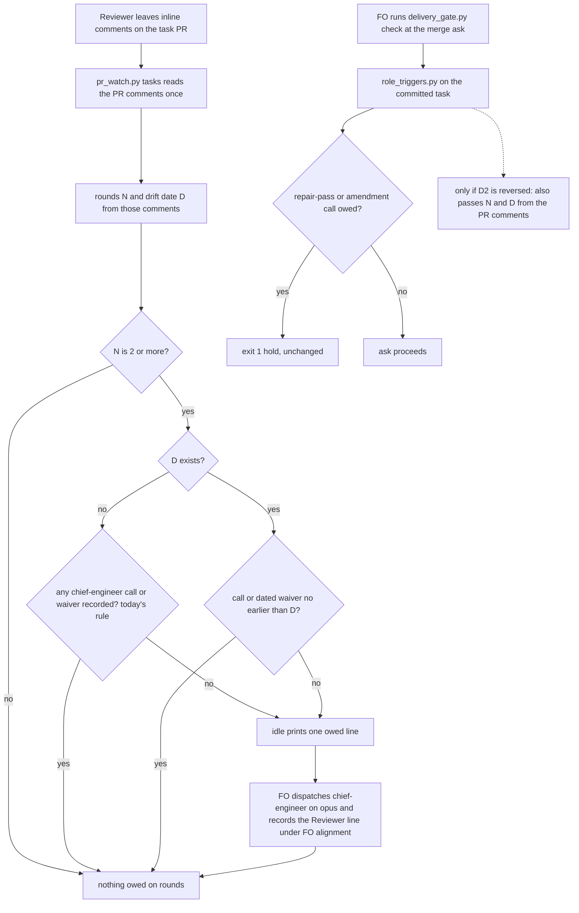

## Scope

- Source: the Captain 「都開」 (chat, 2026-10-23), answering FO's 「要不要把這三項各開成一張待辦任務？我建議開。」, after his 「另外看一下我的 user scrope claude.md 有沒有特別適合 dev2 的部分可以移植的？」; FO read his global ~/.claude/CLAUDE.md and grepped the kc-dev-flow-2 0.28.0 package for each theme (2026-10-23).
- Port: from his global instructions, the circuit breaker ("when the same approach has twice failed to move the state forward, stop"), read as a drift trigger for the chief-engineer.
- Bite: on new-work-starts-from-a-story-map, Codex rounds 1 to 3 on iamcxa/kc-claude-plugins#704 each found new findings in kc-journey-map/lib/journey-review.mjs, the file the previous round fixed; on #675 (2026-10-19) every round found a new gap in the same merge-wording grant. In both FO called the chief-engineer by memory; role_triggers.py counts only repair passes and Captain amendments.
- Upstream first: kc-dev-flow-2 role_triggers.py events; delivery_gate.py hold C (PR #703); workflow.md findings step 5 (round 3 declines).
- Non-goals: changing the round-3 decline rule.
- Batch 6 (2026-10-25): the Captain 「可以」 (chat, 2026-10-25), answering 「需要你決定：這份第 6 批的清單可以嗎？」 about FO's batch-6 list, which placed this task second and widened it: the merge ask also holds while `role_triggers.py` lists a call owed. Bite: iamcxa/kc-claude-plugins#709 merged with an engineering-reviewer call owed for release-acceptance Amendments 1 to 4 (observer, `_archive/release-acceptance/observer.md`); `delivery_gate.py check` exited 0. Drift bite added: #714 rounds 1 to 3 each found a new gap in the same `release_acceptance.py` clean predicate and FO called no chief-engineer.

## FO alignment

Alignment: needed at ideation; what counts as "the same surface" is his to accept.
Surfaces: none
Visible change: none
Release review: not needed: workflow maintenance, on no journey map.

## Design

Checked 2026-10-25 against `kc-dev-flow-2/` at `origin/main` d496ac3d (kc-dev-flow-2 0.29.0 released; the dispatch said 0.28.0). Chain: Spacedock `--help` (0.27.x) lists no review-round or role-call concept, so it owns none of this; kc-dev-flow-2 owns it in `scripts/role_triggers.py`, `scripts/pr_watch.py`, `scripts/delivery_gate.py` and ADR 0026; `find` over the conductor repos and workspaces finds `role_triggers.py` only inside kc-claude-plugins package worktrees, so no adopter holds a copy to fork.

### What is already true on main (three Scope premises are stale)

1. The gate half is shipped. `delivery_gate.py check` runs the real `role_triggers.py` on the committed task and exits 1 while a repair-pass or amendment call is owed (#703, merged 2026-10-22 09:58Z, first released in 0.29.0 on 2026-10-24). #709's ask was saved 2026-10-23 13:20Z on 0.28.0, which had no such hold. Replay: `role_triggers.py` on release-acceptance at a27bbc10 exits 1 ("replacing amendments 1, 2, 3, 4"); `test_delivery_gate.py` (86 tests, 60 s) passes; replacing `owed_role_calls`'s return with `(0, [])` in a scratch copy fails 4 of them.
2. `role_triggers.py` already counts review rounds: `--review-rounds N` with N >= 2 owes a chief-engineer call, and `pr_watch.py tasks` passes N (#682, 2026-10-20, released 0.26.0). Scope's "counts only repair passes and Captain amendments" is wrong for 0.26.0 and later.
3. The Captain ruled on 2026-10-22 (「按建議**不算**」, D2 of merge-ask-holds-missing-clauses, recorded in ADR 0026's Amended paragraph) that the merge-ask hold does not count review rounds. FO's recommendation went with him, so no `Override:` line exists (`git -C <state> grep -n 'Override:'` hits none about role calls).

### The gap that is real

The chief-engineer record clears the review-round event whatever its date or question: in `check()` the branch is `if not (calls or waivers)`, with no date test, although ADR 0026 says "a call counts by its date". Replay on #714 (release-walk-picky-reviewers-and-director): Codex left inline findings in three rounds, all on `release_acceptance.py` (review ids 5636050872, 5636392914, 5636428225, 2026-10-24 01:13Z, 02:18Z, 02:30Z). The task holds a chief-engineer call dated 2026-10-23 about an unrelated AC-8(b) failure. At the ask commit f6cddd6b, `role_triggers.py ... --review-rounds 3` exits 0 ("each with a call or a waiver"). No call about the three rounds was made. The same call would have cleared #714's idle line too.

Replays of the four records (comments read with `gh api repos/iamcxa/kc-claude-plugins/pulls/<N>/comments --paginate --slurp`, state at `spacedock-state/dev2`, 2026-10-25):

| PR | rounds, files | role_triggers today | what is new |
| --- | --- | --- | --- |
| #709 | 1 round, 1 file | exit 1 at a27bbc10 (amendments); gate holds since 0.29.0 | nothing: shipped |
| #714 | 3 rounds, all `release_acceptance.py` | exit 0 with `--review-rounds 3` (cleared by an unrelated 10-23 call) | owed: the only new catch |
| #704 | 3 rounds, all `journey-review.mjs` | exit 1 at 4dfb2816~1 (before FO's call), exit 0 after it | nothing: today's rule already fires; the call was dated 2026-10-22, the day of the rounds |
| #675 | 2 rounds, `delivery_gate.py` then `workflow.md` | predates #682; exit 1 at 35bdf5ef~1 with `--review-rounds 2` | nothing, and a path surface would not see it as drift (one concept across two files) |

### The same surface (his to accept)

A round is a distinct `pull_request_review_id` among the PR's inline comments (as `pr_watch.review_rounds` counts today). Its surface is the set of `path` values of its comments. Round k (ordered by earliest comment time) drifts when its surface shares a path with round k-1's. D is the UTC date of the newest drifting round's earliest comment. Limits: a path is coarse (a large file drifts falsely), a concept spread over files (#675) is not drift, and a reply comment carries its own review id (0 of 82 inline comments in the window ADR 0026 measured).

### Press release

When two review rounds in a row hit the same file, FO is told to call the chief-engineer again, even if an earlier call about something else is on file. The idle line names the date of the drifting round, and the call or a dated waiver that clears it must be no earlier than that date.

### FAQ

- Why not only widen the gate? The gate half already holds. What it cannot see is a call the date-blind rule treated as cleared; fixing the clear fixes idle and, if D2 below is reversed, the gate with the same arguments.
- Does a round 3 now force another repair? No. Round-3 decline rules are untouched (Non-goal); this only owes a chief-engineer question.
- What does it cost? One Opus chief-engineer call when drift is detected and no call is dated at or after it. Not measured per call. No new CI step: the three test files are already CI steps.
- What does the surface buy over "every new round after a call re-owes"? On these four records nothing: that simpler rule (call it S) fires on the same PRs. The surface only avoids a repeat call when a later round lands on a different file. See D1.

### Flow

### Files

`kc-dev-flow-2/scripts/role_triggers.py` (new `review_facts(comments)`; `--drift-date`; the chief-engineer branch of `check()`; docstring), `kc-dev-flow-2/scripts/test_role_triggers.py`, `kc-dev-flow-2/scripts/pr_watch.py` (`review_rounds`, the `tasks` call site, one docstring clause), `kc-dev-flow-2/scripts/test_pr_watch.py`, `docs/adr/0026-role-calls-are-owed-on-counts-read-from-task-records-and-a-dated-call-clears-them.md` (one Amended paragraph, as 0026 was amended on 2026-10-22). Only if D2 is reversed: `kc-dev-flow-2/scripts/delivery_gate.py` (`owed_role_calls`, one `gh` read, the docstring sentence "(no --review-rounds)") and `kc-dev-flow-2/scripts/test_delivery_gate.py`. No README, `workflow.md`, skill, agent or extension file.

### Words FO reads at each moment

Counted with `len(text.split())` on the script's printed output, 2026-10-25, base = 0.29.0. Startup and idle on an open PR print the same `role_triggers.py` lines.

| Moment | Base | Candidate bound |
| --- | --- | --- |
| startup / idle on open PR, chief-engineer review-round line | 44 (3 rounds, `new-work-starts-from-a-story-map` at 4dfb2816~1) | at most 56; nothing owed prints 0 added |
| idle on merged PR, after the archive | unchanged | unchanged |
| merge ask, hold output | 11-word problem line + the `next:` lines, only when owed | unchanged unless D2 is reversed, then the same single line |
| `references/sd/workflow.md` | 5385 words | 5385 (diff empty) |

### Existing-code check

Repair, not replacement: the review-round event, its argument, `pr_watch.py`'s single comment read and the gate's `owed_role_calls` all exist. The one change of behavior is the chief-engineer clear for the review-round event; the repair-pass event keeps its undated clear (a stage-report heading has no date to compare).

### Past rulings

ADR 0026 (dated call clears; same-path review rounds measured in its window "added no unique true catch or false-fired"), its 2026-10-22 amendment (D2), and ADR 0004 (rounds 1 and 2 fix, round 3 declines). The ADR 0026 measurement is the reason D1 recommends deleting the surface.

## Acceptance criteria

Source for all: the Captain 「都開」 (chat, 2026-10-23) and 「可以」 (chat, 2026-10-25, batch 6); the dated clear also traces to ADR 0026 ("a call counts by its date"), whose code gap is the verified fact above (`role_triggers.py` `check()`, read at d496ac3d, 2026-10-25). Test files: `test_role_triggers.py` (`R`), `test_pr_watch.py` (`W`), `test_delivery_gate.py` (`G`). AC-1 is written with the surface (the Captain's words); if D1 takes S, its path clause and AC-3's different-file row are deleted.

**AC-1** `role_triggers.py` has one function `review_facts(comments)` that returns the round count and D from a `pulls/<N>/comments` list. Verified by: `R` rows built from the four recorded shapes (review id, path, created_at only): #714 gives (3, 2026-10-24), #704 (3, 2026-10-22), #675 (2, none), #709 (1, none), and one synthetic A,B,A shape gives no drift. Falsifier: comparing round k with every earlier round instead of k-1 makes the A,B,A row return a date; ordering by review id instead of time fails a row whose ids are out of time order.

**AC-2** A chief-engineer call or waiver clears a review-round event with a drift date only when dated no earlier than D; an older call and an undated waiver leave it owed, and the owed line names D and offers `not run <date>: <reason>`. Verified by: on a scratch `git clone` of the state branch, `role_triggers.py <clone> release-walk-picky-reviewers-and-director --rev f6cddd6b --review-rounds 3 --drift-date 2026-10-24` exits 1 (today, without the flag, exit 0, measured 2026-10-25); after a committed `Reviewer: kc-dev-flow-2:chief-engineer opus 2026-10-24 — ...` under `## FO alignment` it exits 0; with that line dated 2026-10-23 it exits 1; an undated waiver exits 1. Falsifier: deleting the date comparison makes the 2026-10-23 row exit 0 and fail. Limit stated in the docstring: a call earlier on the same date as the drifting round clears it.

**AC-3** Nothing is newly owed where today's rule is satisfied and no drift exists. Verified by: every existing `R` and `W` row passes unchanged; `--review-rounds 3` without `--drift-date` behaves as today; #704 at 4dfb2816~1 with `--drift-date 2026-10-22` exits 1 and at 4dfb2816 (call dated 2026-10-22) exits 0; #675's task at 35bdf5ef~1 with `--review-rounds 2` and no date exits 1 as today. Falsifier: making the undated rule dated for the no-drift case fails the existing undated-call row.

**AC-4** `pr_watch.py tasks` passes `--review-rounds N` and, when D exists, `--drift-date D`, from the same single comment read it makes today. Verified by: `W` rows with a stub `gh`: a #714-shaped list prints the owed line; a no-drift list passes only `--review-rounds`; the stub counts one comments call per open task PR. Falsifier: dropping the date argument makes the #714-shaped row print nothing after an older call.

**AC-5** (regression, true on main) The merge ask still holds on a repair-pass or amendment call owed. Verified by: `G` rows that run the real `role_triggers.py` pass (86 tests, 2026-10-25); the release-acceptance bytes at a27bbc10 exit 1 from `role_triggers.py`. Falsifier: `owed_role_calls` returning `(0, [])` fails 4 `G` tests (measured in a scratch copy, 2026-10-25). Only if D2 is reversed: the gate also reads the PR's comments once and passes the same two arguments; a `G` row with the #714 shape and only the 2026-10-23 call exits 1, with a 2026-10-24 call exits 0, and a `gh` failure on that read exits 2; falsifier: omitting the arguments makes the #714 row exit 0.

**AC-6** Words FO reads: the table under "Words FO reads at each moment" holds, recounted by an independent copy of the count at implementation: the owed line at most 56 words, nothing owed adds 0, `references/sd/workflow.md` stays 5385 words with an empty diff. Falsifier: any edit to `workflow.md`, or a candidate line of 57 words.

**AC-7** ADR 0026 gains one Amended paragraph that quotes the Captain's words for the dated clear, the surface (or S) and D2's outcome, and states the same-day limit. Verified by: `git diff` touches that file only under a new `Amended 2026-10-25` paragraph, and the repository's ADR lint exits 0. Falsifier: a changed Decision or Status line.

Not claimed: that a date-clear catches an owed call the idle line already printed and FO ignored; that the surface is right outside these four PRs (second corpus: the relay, web and qnow adopters hold PR-comment shapes I did not read); a per-call cost.

## Needs decision

**D1. Does a new review round after a chief-engineer call re-owe only when it hits the previous round's file (the Captain's words, recommended: no, re-owe on any new round instead, "S")?** Recommended S: it needs no path reading, fires on the same PRs in all four records, and ADR 0026 already measured same-path rounds as adding no unique catch. What gets worse under S: a later round on a different file costs one more Opus call. What gets worse if the surface is kept: a concept spread over files (#675) is never drift, and a large file drifts falsely.

**D2. Does the merge-ask check also pass the PR's review rounds (the 2026-10-22 ruling said no; recommended: keep no)?** Recommended keep: the case #709 showed is shipped, the #714 miss is fixed at the clear (idle and gate would both have been silent without it), and no record shows FO ignoring a printed review-round line. What gets worse: a PR with drift reaches the merge ask with no hold if FO misses the idle line. Reversing costs one paginated `gh` call at the ask, the AC-5 conditional rows and the files listed above for it; the Captain's 10-22 reason ("no ask in the window shows that case") would then be answered by #714.

### Batch overlap

Live tasks read from their own files on 2026-10-25. Five of the batch names the dispatch listed are already `done` and archived (`new-work-starts-from-a-story-map`, `codex-reader-reads-receipt-marker`, `merge-ask-holds-missing-clauses`, `idle-names-failing-seeds`, `agent-reads-governing-adr`; #705, #693, #703, #694, #698) are on main and share no pending change.

| Task | Status | Same file or check | Order |
| --- | --- | --- | --- |
| fo-write-checks-parse-top-level (folded into fo-written-lines-checked-before-dispatch) | ideation | `delivery_gate.py` (`declined_items`, `DECLINE_END`, its docstring) and `test_delivery_gate.py`: same files as this task only if D2 is reversed; different functions | mine has no `delivery_gate.py` change unless D2 reverses; if both land, the clause task first, textual rebase on the docstring |
| delivery-gate-reads-folder-tasks (folded with merge-check-reads-two-pr-tasks) | ideation | `delivery_gate.py` path derivation; `owed_role_calls(task)` runs `role_triggers.py` on `task.parent` and `task.stem`, which is right for `<slug>/index.md` only because `./index.md` resolves inside the folder; if that task passes the folder itself as `task`, `owed_role_calls` must change with it | that task owns `owed_role_calls` first if D2 is reversed; otherwise independent |
| comment-check-reaches-delivery-gate | ideation | `delivery_gate.py` and `test_delivery_gate.py` (a completion-path comment check); same files as this task only if D2 is reversed | independent unless D2 reverses; then textual rebase on `check()` |
| prod-split-owes-chief-engineer-route-review | backlog | `role_triggers.py` (a new event, `check()`, docstring, `test_role_triggers.py`) | after this task: this one changes the chief-engineer branch it would extend |
| codex-review-hang-detected | ideation | `pr_watch.py` (`wait`) and `extensions/codex/codex_review.py`; this task edits `review_rounds` and the `tasks` call site only | independent |
| release-walk-due-trigger, pr-watch-tasks-foreign-worktree | backlog | `pr_watch.py` `tasks()` output lines; this task changes the args of the existing `role_triggers.py` call in the same function | either order; textual rebase |
| fo-written-lines-checked-before-dispatch | ideation | listed above; its measured "role_triggers.py calls owed and not made before the merge ask: 2" is the idle-and-gate class this task does not widen | independent |
| kc-decision-log-handoff-trial, pr-review-lite-value-pilot, journey-canvas-hosted-poc, journey-server-host-pilot, adoption-asks-which-extensions | other sessions or unrelated | none changes `role_triggers.py`, `pr_watch.py`, `delivery_gate.py` or ADR 0026 (grep of each task file, 2026-10-25; adoption-asks-which-extensions only counts their output words, unchanged) | none |

Recommended order: this task before prod-split-owes-chief-engineer-route-review; the two `delivery_gate.py` tasks first if D2 is reversed.

## Stage Report: ideation

- DONE: Design the widened outcome under ## Scope: kc-dev-flow-2/scripts/role_triggers.py owes a chief-engineer call when consecutive review rounds find new findings in the surface the previous round fixed (define the same surface, the Captain's to accept), and kc-dev-flow-2/scripts/delivery_gate.py holds the merge ask while kc-dev-flow-2/scripts/role_triggers.py lists any call owed; replay both against the #709, #714, #704 and #675 records; name every file, the falsifier and the evidence each criterion needs
  The gate half is already shipped (#703, released 0.29.0 after #709's ask); the real gap is a date-blind chief-engineer clear (replayed on #714: exit 0 at f6cddd6b with 3 same-file rounds); surface defined as the comment `path`; files, falsifiers and evidence under `## Design` and `## Acceptance criteria`.
- DONE: A `### Batch overlap` section naming each file the design would change and each other batch task (new-work-starts-from-a-story-map, codex-reader-reads-receipt-marker, merge-ask-holds-missing-clauses, fo-write-checks-parse-top-level, idle-names-failing-seeds, agent-reads-governing-adr) and live task of other sessions (kc-decision-log-p1, kc-decision-log-cli, kc-decision-log-handoff-trial, pr-review-lite-value-pilot, release-acceptance, journey-canvas-hosted-poc, journey-server-host-pilot (driven by other sessions; read only)) that changes the same file or check, so FO can order implementation
  Table under `### Batch overlap`; five of the named batch tasks are done and archived (no pending change); real overlaps are the two `delivery_gate.py` tasks (only if D2 reverses), prod-split-owes-chief-engineer-route-review (`role_triggers.py`) and the `pr_watch.py` backlog tasks.
- DONE: The words FO reads at each lifecycle moment, before and after, per root learning.md "Measure the words FO reads at each moment, not one file's size"
  Table under `### Words FO reads at each moment`: owed line 44 words base, at most 56 candidate, nothing owed adds 0, workflow.md 5385 unchanged (counted 2026-10-25 with `len(text.split())`; the candidate is a bound, not a measurement).
- DONE: Acceptance criteria with reproducible evidence clauses and falsifiers, and unresolved decisions for the Captain, each with a recommendation and what gets worse under it
  AC-1 to AC-7 with Verified-by and Falsifier clauses; `## Needs decision` holds D1 (surface or S) and D2 (gate counts rounds), each with a recommendation and its cost.

### Acceptance criteria evidence

- AC-1: not yet verified (implementation); the four PR shapes were computed in a scratch script 2026-10-25 and give (3, 2026-10-24) for #714, (3, 2026-10-22) for #704, (2, none) for #675, (1, none) for #709.
- AC-2: not yet verified; baseline measured: #714 at f6cddd6b with `--review-rounds 3` exits 0 today.
- AC-3: partly verified: #704 at 4dfb2816~1 exits 1 and at 4dfb2816 exits 0, #675 at 35bdf5ef~1 owes the line, `test_role_triggers.py` 22 tests OK, 2026-10-25.
- AC-4: not yet verified; `pr_watch.review_rounds` and the `tasks` call site read at d496ac3d.
- AC-5: verified on main: `test_delivery_gate.py` 86 tests OK; scratch mutation of `owed_role_calls` fails 4; release-acceptance at a27bbc10 exits 1. The D2 rows are not yet verified.
- AC-6: base counts measured; candidate not yet verified.
- AC-7: not yet verified.

### Summary

The ask's gate half already holds on 0.29.0, so the work narrows to making the chief-engineer clear respect the date of the drifting review round, passing that date from the one comment read `pr_watch.py` already makes, and amending ADR 0026. Two decisions for the Captain: whether to keep the path surface or re-owe on any new round (recommended: any new round), and whether the merge ask also counts review rounds, which reverses his 2026-10-22 ruling (recommended: keep it). Alignment gap: `## FO alignment` records "Alignment: needed at ideation" with no `Result:` line; I proceeded because the dispatch names the surface definition as this stage's output, and `design_surfaces.py check` exits 0 ("design surfaces presentable", 2026-10-25).
