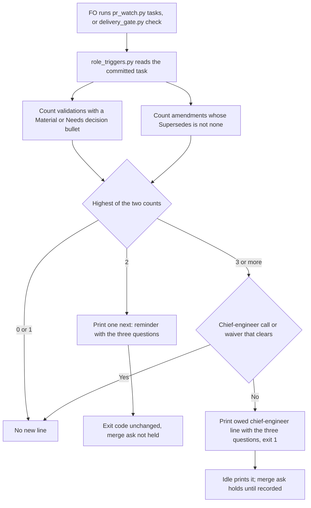

## Scope

- Source: the Captain, chat 2026-11-02: 「第二輪可以」, then 「可以」 to 「把這項加進下一批，和模型設定那張票一起做，可以嗎？」, which named `role_triggers.py` and the idle check. Batch 12 backlog sitting: the Captain 「可以，但不用寫了就報錯，接受 `max` 和 `ultra`沒關係，等於就是不建議，但使用者真的想要也可以」 (chat, 2026-11-02), answering 「決定：五件事都照建議，第 5 項用這張表，並把 xhigh 上限寫進設定檔檢查，可以嗎？」.
- Outcome: when a task's validation fails a second time, or its criteria are relaxed a second time, `role_triggers.py` prints one reminder with three questions, and the FO's idle check surfaces it too. The questions: is what I am solving still the outcome first asked for; can this gap be tested now, or am I waiting; what breaks if this criterion or process is deleted. At the third round an independent reviewer asks them.
- Bite: batch 11, 2026-10-30 to 11-02. On peers-paseo-rule-matches-practice the FO relaxed criteria repeatedly without stepping back until the Captain asked; the standing questions in the global instructions did not fire.
- Consumer: every adopter FO, through the delivery check and idle check that already run `role_triggers.py`.
- Upstream first: `scripts/role_triggers.py`, `scripts/pr_watch.py`, `references/sd/mods/kc-dev-flow-2.md`.

## Non-goals

- Grading the FO's answers; a new tool or stage.

## Budget

- One package PR. Workflow word budget unchanged unless the design names a raise for the Captain.

## Stop condition

- A replay of a task with two failed validations and one with two relaxations each print the reminder at the delivery check and the idle check; a first-round task prints none.

## FO alignment

Alignment: needed before ideation; the scope is the Captain's ruling.
Result: aligned at backlog: Batch 12 backlog sitting: the Captain 「可以，但不用寫了就報錯，接受 `max` 和 `ultra`沒關係，等於就是不建議，但使用者真的想要也可以」 (chat, 2026-11-02), answering 「決定：五件事都照建議，第 5 項用這張表，並把 xhigh 上限寫進設定檔檢查，可以嗎？」, approved the outcome and bounds in this file.
Surfaces: none
Visible change: none
Release review: not needed: workflow maintenance, on no journey map.

## Design

Base: `origin/main` 146727ded, package 0.34.0, with `special-roles-follow-the-model-table` landed first. The state checkout is `spacedock-state/dev2` at 0b1032a7a. Revised under the Captain's 2026-11-02 gate reply; D1 to D3 are ruled (`### Rulings`).

### PRFAQ

**Press line.** When a task's validations have twice left a Material or Needs decision finding, or two amendments have replaced approved criteria, the First Officer (FO) now sees the three questions at the idle check and the merge check. At three, a chief-engineer has to ask them, and the merge ask waits for that call or a dated waiver.

**FAQ.**

- *What counts as a failed validation?* A `## Stage Report: validation` section holding at least one `- F<N> Material` or `- F<N> Needs decision` bullet. `skills/validation/principles.md` already requires that bullet form, and `DECISION_FINDING` in `dispatch_records.py` already reads it (ADR 0045).
- *What counts as a relaxation?* An entry under `## Captain amendments` whose `Supersedes:` does not start with `none`. The count reads replacements; the words cannot tell direction, and `prod-security-review-gates` amendment 1 replaced a criterion without lowering it. So this task counts replacing amendments, not every relaxation: a replacement that lowers nothing counts, and a relaxation written with `Supersedes: none` does not. FO judges whether what it counted was a relaxation.
- *Is this the README's "round"?* No. A round in the README's review-finding rules is one external reviewer's verdict on the PR head. This task does not count those, and the printed lines do not say "round".
- *Does the second time stop anything?* No. It prints and holds nothing, so the merge ask is unaffected. It repeats on each run until the count reaches three or the task is archived. There is no answer record: grading is a non-goal, and a record invites going through the motions.
- *What does it not catch?* A first-round over-build; an FO that reads the questions and answers them badly; a rejected report written without F bullets. 5 of the 13 tasks whose Summaries say REJECTED twice stay silent: `dispatch-and-report-hygiene`, `pr-review-lite-value-pilot` (9 such reports), `journey-edits-after-merge`, `owner-sms-notices`, `reception-holds-slot`.

### Sequence

### Mechanism

`scripts/role_triggers.py`, in `check`, reading the lines `outside_fences` yields:

- Two new counts as above. They are separate: one failed validation plus one replacing amendment prints nothing, because the Captain ruled each "a second time".
- Highest count exactly 2: print `next: <slug> has <F> validations with a Material or Needs decision finding and <R> replacing amendments: before the next step, answer: is what I am solving still the outcome first asked for; can this gap be tested now, or am I waiting; what breaks if this criterion or process is deleted?`. This line alone does not change the exit code.
- Either count at 3 or more: chief-engineer is owed on the model `special-roles-follow-the-model-table` sets for its other events, exit 1, through `owed_line`. That line carries the three questions instead of `QUESTION["chief-engineer"]`, so `owed_line` takes the question as a parameter. Still one line per task and role: when repair passes or review rounds are also owed, their facts join the same line and the three questions win. The reminder is not printed at this level. A fourth failure owes no second call. Three replacing amendments still owe engineering-reviewer on its own line, so an FO with neither recorded reads two lines and makes two calls.
- A call counts only at opus rank or above, Astra included, as ruled on `special-roles-follow-the-model-table`. Waivers have no floor.
- Clearing the third replacing amendment: a call or waiver dated no earlier than the heading date of that amendment, the existing date rule used for `--drift-date`. Peers' 2026-10-30 chief-engineer call does not clear its 2026-10-31 amendment.
- Clearing the third failed validation: any chief-engineer call or waiver, because a stage-report heading has no date. This is the limit ADR 0026 already accepted for the repair event. A chief-engineer call made earlier in the task clears it unasked.

`scripts/pr_watch.py`, in `tasks`: today it forwards the script's stdout only on exit 1. It also forwards `next:` lines on exit 0.

`scripts/delivery_gate.py`, in `check`: on exit 0 from `owed_role_calls` it emits `next:` lines before the record and `ASK` lines, adds no problem, and `ASK` stays the last line. On exit 1 the lines already reach `nexts`.

`docs/adr/0026-role-calls-are-owed-on-counts-read-from-task-records-and-a-dated-call-clears-them.md`: one amendment paragraph recording the new events and the Captain's words from this task's gate, after the amendment `special-roles-follow-the-model-table` adds there. It carries no number. Docstrings of the three scripts are updated. `references/sd/workflow.md` and `references/sd/mods/kc-dev-flow-2.md` do not change: the idle hook already says "Do each `next:` line", and each printed line states its own action.

Two existing `test_role_triggers.py` fixtures change, because each has three or more replacing amendments and no chief-engineer call, so it now owes a second line: `test_a_task_with_five_replacing_amendments_prints_one_line_listing_them` and `test_an_amendment_is_cleared_by_a_call_or_a_dated_waiver_no_earlier_than_it`. Against the prototype these are the only failures in `test_role_triggers`, `test_pr_watch` and `test_delivery_gate` on a full package copy (273 tests, 2026-11-02).

### Existing events tried first

Checked 2026-11-02 with a one-off read-only reader over `*.md` task files, live and archived, skipping fenced blocks, and re-run for this revision with the same totals. Corpora: this workflow (96 tasks with a validation report or a replacing amendment, at 99e8bb36f and 0b1032a7a), relay (61, worktree copy at 88a54b00, 2026-10-23) and qnow (64, d5ab7e823, 2026-11-02). The reader is not retained; the reproducible proof is the acceptance criteria.

| Candidate count | Tasks at 2 or more | Why not |
| --- | --- | --- |
| Repair events (implementation headings minus one) | not the same event | `paseo-codex-dispatch-practice` failed three validations with one implementation report, so 0 repair passes |
| `--drift-date` | not a count | It dates external review rounds on an open PR, and `delivery_gate.py` runs without it. Its clear rule is reused above |
| Validation headings | 54 of 96 here | Most re-checks pass |
| A validation heading followed by an implementation heading | 77 of 217 (first pass, not re-counted) | Same false fires, and misses `paseo-codex-dispatch-practice` |
| Summary says REJECTED without PASSED | 13 of 221 | Conflicts with two rulings (D1) |
| F bullet (chosen) | 7 of 221 | Reads a required form; misses reports written without it (D1) |

Tasks that would fire with the chosen counts: at the highest count 2 or more, 12 of 96, 5 of 61, 4 of 64 (21 of 221). At 3 or more, 6, 2, 2 (10 of 221).

Replays on real commits with a prototype outside the repository (`/tmp`, not retained), rebuilt on a copy of `special-roles-follow-the-model-table`'s `RANK`, `rank`, floor and owed-line changes as its design states them:

| Task at commit | Records | Result |
| --- | --- | --- |
| `peers-paseo-rule-matches-practice` f0203ee02 | none | silent |
| `paseo-codex-dispatch-practice` 1e17be9a0 | one failed | silent |
| `adr-reserved-when-design-names-one` c03f77631 | one rejected, then passed | silent |
| `paseo-codex-dispatch-practice` e0dc64f88 | two failed | reminder |
| `read-adr-honors-adr-folder` 95c1ecc8b | two replacing | reminder |
| `peers-paseo-rule-matches-practice` ff2063c53 | second replacing, 2026-10-31 | reminder, before amendment 4 was asked |
| `peers-paseo-rule-matches-practice` 7d203d562 | third replacing | chief-engineer owed |
| `paseo-codex-dispatch-practice` 0e5b6f59a | three failed | chief-engineer owed |

### Upstream check

- Spacedock 0.27.3: `feedback-rejection-flow` escalates to the human at cycle 3 of a rejected feedback gate and writes `### Feedback Cycles` only when a workflow declares it. The three READMEs of this workflow, relay and qnow do not mention it (`grep -lE 'step back|退一步|Feedback Cycles'`, no match, 2026-11-02). It has no second-time prompt and asks no questions.
- kc-dev-flow-2: `git grep -nEi 'step back|third round|second round|three questions|cycle 3' origin/main -- kc-dev-flow-2`, excluding tests and changelog: no match. `role_triggers.py` is the existing seam, working through idle and merge for role calls, with no consumer for this event.
- Sibling adopters: the same README search finds nothing. Scripts come from the package.
- Need: the Scope's bite, `peers-paseo-rule-matches-practice`, is the falsifier above. The Captain's global standing questions exist and did not fire.

### Words FO reads at each moment

Lines counted with `wc -w`, the slug as one word, from the prototype's printed lines on the replays above. Base and candidate use the same replay.

| Moment | Base | Candidate | Passage |
| --- | --- | --- | --- |
| Startup | 0 added | 0 added | README unchanged, mod unchanged; startup runs the idle hook, so the idle rows apply |
| Idle, count below 2 | 0 | 0 | none |
| Idle, count 2 | 0 | 51 on each run, per task | the reminder |
| Idle, count 3 and call owed | 0 | 68 (replacing amendments) or 73 (validations) on each run until recorded | the owed line |
| Idle, three replacing amendments, neither role recorded | the engineering-reviewer line | that line plus 68 | two lines |
| Idle on a merged PR, after the archive | 0 | 0 | `tasks` reads live tasks only |
| Merge ask, count below 2 | 0 | 0 | none |
| Merge ask, count 2 | 0 | 51, no hold | the reminder |
| Merge ask, count 3 and call owed | 0 | 79 or 84, holds | 11-word problem line plus the owed line |

Workflow word budget: unchanged, no raise under ADR 0020. What gets worse: the 51 words repeat on every idle run for the life of a task at count 2. The alternatives add a clearing record or a session mark for a cost nobody has yet complained about.

### Rulings

The Captain 「可以」 (chat, 2026-11-02), answering 「決定：多開「完成通知」和「挑剔使用者可用 Gemini」兩張票，先前五件事照建議，可以嗎？」. No decision remains open for the Captain on this design.

- **D1. A failed validation is read from the F bullet.** It follows ADR 0026 ("does not match phrases") and `delivery-gate-verdict-form` amendment 2 (「好」, 2026-10-15), where #647 spent five commits and three Codex P1s reading prose. Accepted cost: 5 of 13 word-detected tasks stay silent. Of the 13, 7 lack the bullets and 2 of those still fire on replacing amendments. Passed reports that kept such a bullet also count (`seed-check-requires-schema-fields`).
- **D2. The third time holds the merge ask, with the existing waiver.** This matches repair passes and amendments; review rounds, the other precedent, do not hold (ADR 0026, 「按建議不算」). Accepted cost: about 10 of 221 tasks need one more line before merge, including tasks whose latest validation passed.
- **D3. The independent reviewer is chief-engineer.** An engineering-reviewer call dated on the amendment already clears by date whatever it asked (ADR 0026), so the questions would go unasked on the replacing-amendment path. Accepted cost: chief-engineer is not an assurance role, and batch 11's useful catch came from an engineering reviewer.

Beyond the asks, three things follow from them and change nothing the Captain ruled: the opus-rank floor reaches this call because this task lands after `special-roles-follow-the-model-table`; the two test fixtures above change; and an FO can owe both role calls at three replacing amendments.

### Batch overlap

Files this design changes: `scripts/role_triggers.py`, `scripts/test_role_triggers.py`, `scripts/pr_watch.py`, `scripts/test_pr_watch.py`, `scripts/delivery_gate.py`, `scripts/test_delivery_gate.py`, `docs/adr/0026-role-calls-are-owed-on-counts-read-from-task-records-and-a-dated-call-clears-them.md`.

| Task | Overlap |
| --- | --- |
| special-roles-follow-the-model-table (batch 12) | Direct: `role_triggers.py` (`RANK`, `rank`, `owed_line`, the chief-engineer block of `check`), `test_role_triggers.py`, the docstring, and the same ADR 0026 file. This task builds on its floor and owed-line text |
| validation-gate-requires-the-question-check (batch 12) | Direct: `delivery_gate.py` `check` and `test_delivery_gate.py`. It adds a hold on a missing `External rounds:` line; this adds the exit-0 `next:` emit at the `owed_role_calls` call. A task at count 2 with that line missing prints both. Different ADRs: it amends ADR 0044's ruling in a new file |
| worker-completion-reaches-fo-on-paseo (batch 12) | none: `dispatch_records.py`, `workflow.md`, `replay_dispatch.py`, `test_sd_dispatch.py` and the Paseo extension, per its Scope; no design yet |
| picky-reviewers-may-run-on-gemini (batch 12) | none: the release-acceptance extension text, per its Scope; no design yet |
| model-roster-question-needs-both-families (batch 12) | none: its design leaves `role_triggers.py` unchanged |
| comment-check-reaches-delivery-gate (other session) | `delivery_gate.py` `check` and `test_delivery_gate.py` if it reopens. Its `## Closed` section records the Captain's 2026-10-20 「那就按建議不做」, while its frontmatter still reads `ideation` and the dispatch lists it live |
| adoption-asks-which-extensions (other session) | none: its table leaves `pr_watch.py` and `delivery_gate.py` unchanged |
| adr-required-statement (other session, validation) | No shared file. Its required ledger lines in the validation Summary do not touch the F-bullet count. It may require this task's ADR amendment ruling in its ledger |
| adr-silent-undo-probe, journey-canvas-hosted-poc, journey-server-host-pilot, ops-inbox-r1-setup-and-isolation, pr-review-lite-value-pilot | none: no mention of these scripts or ADR 0026 at a design level (`grep`, 2026-11-02; the one `0026` hit in `pr-review-lite-value-pilot` is a message id) |

Recommended order: `special-roles-follow-the-model-table`, then this task, then `validation-gate-requires-the-question-check`, which the Captain ruled last in the batch. The later task rebases on each shared function.

## Acceptance criteria

`S` is a checkout of `spacedock-state/dev2`. `P` is `kc-dev-flow-2/scripts` at the candidate, built after `special-roles-follow-the-model-table` lands. Fixture tests go in the three named test files, each of which CI runs by name in `.github/workflows/kc-dev-flow-2-tests.yml`.

**AC-1** Two failed validations print the reminder; fewer print nothing.
Verified by: `python3 -B $P/role_triggers.py $S paseo-codex-dispatch-practice --rev e0dc64f886cf80e7579551a4002a05b4c603f1c9` prints one `next:` line holding all three questions and exits 0; the same at `1e17be9a0734eb1b122b83335bb7ff96a3a331cb` (one failed) and `adr-reserved-when-design-names-one` at `c03f77631e6fa06afdaa275ecb3f05559314f9c6` (one rejected, then passed) print no such line. A fixture proves a bullet in a fenced block does not count, and neither does a `Deferred risk` bullet.
Falsifier: count validation headings instead of bullets; the `c03f7763` replay prints the line and the test fails.

**AC-2** Two replacing amendments print the reminder; `Supersedes: none` does not count.
Verified by: `read-adr-honors-adr-folder` at `95c1ecc8b1f0477c8c986ee2895b00e8d105b69e` prints the line; `peers-paseo-rule-matches-practice` at `ff2063c539a2fbf8c446797d7051fc34c406aff9` prints it too. A fixture with amendments `Supersedes: AC-1` and `Supersedes: none` with a non-none `Design:` prints none.
Falsifier: reuse the existing `events` test, which counts `Design:` as well; the fixture prints the line and fails.

**AC-3** The idle check surfaces the reminder without inventing a hold.
Verified by: a `test_pr_watch.py` case through `tasks` on a live fixture at count 2 prints the reminder and returns 0, and a first-round fixture prints nothing new. An archived task prints nothing.
Falsifier: restore forwarding on exit 1 only; the first case fails.

**AC-4** The merge check surfaces the reminder without holding.
Verified by: a `test_delivery_gate.py` case at count 2 running the real `role_triggers.py` exits 0, prints the reminder before `ASK`, and `ASK` is the last line; a count-2 task with another problem prints the problem and the reminder. A first-round fixture's output equals base's.
Falsifier: drop the exit-0 emit; the first case fails. Treat the reminder as a problem; exit is 1 and the case fails.

**AC-5** The third time owes a chief-engineer call carrying the three questions, and holds the merge ask.
Verified by: `paseo-codex-dispatch-practice` at `0e5b6f59a8e5a067b2739bf1b78863d96399240f` and `peers-paseo-rule-matches-practice` at `7d203d562789a107d651f3169b6a89b153024d33` each exit 1 with a chief-engineer `next:` line holding all three questions and no reminder line. Fixtures: replacing-amendment event, a call dated before the third amendment leaves it owed, a call or dated waiver on or after it clears; failed-validation event, any call or waiver clears; on either event a `sonnet` call leaves it owed and `gpt-6-astra` clears it. A `test_delivery_gate.py` case holds the ask until the call is committed. With repair passes also owed, one chief-engineer line prints.
Falsifier: clear the amendment event with any call; the 7d203d562 replay exits without owing chief-engineer and fails.

**AC-6** Nothing changes below the threshold and FO's standing text does not grow.
Verified by: `git diff --stat origin/main -- kc-dev-flow-2/references/sd/workflow.md kc-dev-flow-2/references/sd/mods/kc-dev-flow-2.md` is empty; `python3 kc-dev-flow-2/scripts/lint-skills.py` and the package's test suite pass; at `peers-paseo-rule-matches-practice` `f0203ee02` base and candidate `role_triggers.py` print the same bytes. The candidate's printed lines measure within the table above, recounted by the validator with `wc -w`.
Falsifier: add a line to the mod; the diff is not empty.

**AC-7** ADR 0026 records the new events with the Captain's words.
Verified by: `python3 kc-dev-flow-2/scripts/adr_lint.py docs/adr --since origin/main` passes, and the amendment paragraph quotes 「可以」 and its question from this task's newest ideation resolution, gives D1 to D3 and says which precedent each follows.
Falsifier: omit the paragraph; a reader comparing `docs/adr/` with `check` finds an event no ruling names. Not machine-checked: this is the validator's comparison against the gate record.

## Captain amendments

### Amendment 1 — 2026-11-02, chat
Captain: 「照建議」 (chat, 2026-11-02)
Asked: 「決定：四件事都照建議嗎？要改哪件直接說。」, which FO had stated as: 「修這兩個 bug，在原本的票裡修」
Supersedes: none

## Stage Report: ideation

- DONE: A design for this task's Scope: what counts as a round and where each script prints the reminder, using the existing --drift-date and repair events first
  `## Design`, Mechanism and Existing events tried first; prototype replays on 8 real commits.
- DONE: A `### Batch overlap` section naming each file the design would change and each other batch task (model-roster-question-needs-both-families, second-round-prompts-a-step-back, validation-gate-requires-the-question-check, special-roles-follow-the-model-table) and live task of other sessions (adoption-asks-which-extensions, adr-required-statement, adr-silent-undo-probe, comment-check-reaches-delivery-gate, journey-canvas-hosted-poc, journey-server-host-pilot, ops-inbox-r1-setup-and-isolation, pr-review-lite-value-pilot (driven by other sessions; read only)) that changes the same file or check, so FO can order implementation
  Table and `Recommended order:` line; validation-gate-requires-the-question-check had no design to compare yet.
- DONE: The words FO reads at each lifecycle moment, before and after, per root learning.md "Measure the words FO reads at each moment, not one file's size"
  `### Words FO reads at each moment`; 0 at startup and below threshold, 51 at count 2, 70 or 81 at count 3. Words are computed from the proposed line text, not yet from a built candidate.
- DONE: Acceptance criteria with reproducible evidence clauses and falsifiers, and unresolved decisions for the Captain, each with a recommendation and what gets worse under it
  AC-1 to AC-7 and D1 to D3.
- DONE: AC-1 two failed validations print the reminder
  Not yet verified on a candidate; prototype printed it at e0dc64f88 and stayed silent at 1e17be9a0 and c03f77631.
- DONE: AC-2 two replacing amendments print the reminder
  Not yet verified on a candidate; prototype printed it at 95c1ecc8b and ff2063c53. The `Supersedes: none` fixture is not yet written.
- DONE: AC-3 idle check surfaces the reminder without a hold
  Not yet verified; `pr_watch.py` `tasks` read at origin/main forwards stdout on exit 1 only, so the change is needed.
- DONE: AC-4 merge check surfaces the reminder without holding
  Not yet verified; `delivery_gate.py` `check` read at origin/main reads the script's lines only on nonzero exit.
- DONE: AC-5 the third time owes a chief-engineer call and holds
  Not yet verified on a candidate; prototype reported it owed at 0e5b6f59a and 7d203d562. Clear rules and the hold are not exercised.
- DONE: AC-6 nothing changes below the threshold
  Not yet verified on a candidate; prototype printed no new line at f0203ee02.
- DONE: AC-7 ADR 0026 records the new events
  Not yet verified: the wording waits for the Captain's gate reply.
- DONE: Design surfaces check run
  `design_surfaces.py check`: `second-round-prompts-a-step-back.md: design surfaces presentable`, exit 0; `spacedock status --read --ac-scan` reads AC-1 to AC-7.

### Summary

The design counts F-bullet validations and replacing amendments in `role_triggers.py`: two prints a non-holding `next:` reminder at the idle and merge checks, and three owes a chief-engineer call that holds the merge ask. Reading the verdict word collides with ADR 0026 and the 2026-10-15 ruling, so D1 recommends the existing bullet form and states its cost: 5 of 13 word-detected tasks stay silent. No README or mod words change; D1 to D3 go to the Captain.

## Stage Report: ideation (cycle 2)

- DONE: Revise the design under the Captain gate revise of 2026-11-02: the asks are in the reason of the newest ideation resolution in this task file; do exactly those asks, and name anything that would go beyond them
  D1 to D3 are rulings; `### PRFAQ` says replacing amendments, not every relaxation, and names the 5 silent tasks; overlap and order corrected. `### Rulings` names three consequences beyond the asks.
- DONE: A `### Batch overlap` section naming each file the design would change and each other batch task (worker-completion-reaches-fo-on-paseo, model-roster-question-needs-both-families, special-roles-follow-the-model-table, second-round-prompts-a-step-back, validation-gate-requires-the-question-check, picky-reviewers-may-run-on-gemini) and live task of other sessions (adoption-asks-which-extensions, adr-required-statement, adr-silent-undo-probe, comment-check-reaches-delivery-gate, journey-canvas-hosted-poc, journey-server-host-pilot, ops-inbox-r1-setup-and-isolation, pr-review-lite-value-pilot (driven by other sessions; read only)) that changes the same file or check, so FO can order implementation
  Two direct overlaps; `comment-check-reaches-delivery-gate` records itself closed on 2026-10-20 although its frontmatter reads `ideation`; two new batch tasks have no design yet, so their rows read their Scopes.
- DONE: The words FO reads at each lifecycle moment, before and after, per root learning.md "Measure the words FO reads at each moment, not one file's size"
  Measured from prototype output: 0 at startup and below threshold, 51 at count 2, 68 or 73 at count 3, 79 or 84 at the merge ask.
- DONE: Acceptance criteria with reproducible evidence clauses and falsifiers, and unresolved decisions for the Captain, each with a recommendation and what gets worse under it
  AC-1 to AC-7 revised; no decision remains open, and `### Rulings` carries each accepted cost.
- DONE: AC-1 two failed validations print the reminder
  Not yet verified on a candidate; prototype printed it at e0dc64f88 and stayed silent at 1e17be9a0 and c03f77631.
- DONE: AC-2 two replacing amendments print the reminder
  Not yet verified on a candidate; prototype printed it at 95c1ecc8b and ff2063c53. The `Supersedes: none` fixture is not yet written.
- DONE: AC-3 idle check surfaces the reminder without a hold
  Not yet verified; `pr_watch.py` `tasks` at origin/main forwards stdout on exit 1 only.
- DONE: AC-4 merge check surfaces the reminder without holding
  Not yet verified; `delivery_gate.py` `check` at origin/main reads the script's lines only on nonzero exit.
- DONE: AC-5 the third time owes a chief-engineer call and holds
  Not yet verified on a candidate; prototype owed it at 0e5b6f59a and 7d203d562, and throwaway fixtures showed the early call and `sonnet` stay owed while a dated call, a waiver and `gpt-6-astra` clear. The hold is not exercised.
- DONE: AC-6 nothing changes below the threshold
  Not yet verified on a candidate; prototype and base printed the same bytes at f0203ee02.
- DONE: AC-7 ADR 0026 records the new events
  Not yet verified: the paragraph is written at implementation.
- DONE: Design surfaces check run
  `design_surfaces.py check`: `second-round-prompts-a-step-back.md: design surfaces presentable`, exit 0; `spacedock status --read --ac-scan` reads AC-1 to AC-7, none unevidenced.

### Summary

D1 to D3 now stand as the Captain ruled them, and the design says plainly that it counts replacing amendments and that 5 of 13 word-detected tasks stay silent; a re-run of the reader reproduced those totals. Landing after `special-roles-follow-the-model-table` puts the opus-rank floor on this call and changes the owed-line word counts, and `validation-gate-requires-the-question-check` shares `delivery_gate.py` `check` and goes last. A prototype run on a full package copy fails only two `test_role_triggers.py` fixtures, which the design names.

## Stage Report: implementation

- DONE: Implement the approved Pilot design, D1 to D3, changing only the seven named files; commit locally without version bumps
  CODE worktree `/Users/kent/conductor/workspaces/kc-claude-plugins/colombo/.context/dev2-adoption/worktree/.worktrees/spacedock-ensign-second-round-prompts-a-step-back`; branch `spacedock-ensign/second-round-prompts-a-step-back`; base `e2eb2fb5a9629f52ab540fac1e274c287913cfac`; Candidate: 92dbf1d32c7142e010fad6a7d9807a17ae0ce240.
- SKIPPED: One Draft PR stacked on PR #765, with Conventional Commit title scoped to the plugin
  Publication belongs to FO under ADR 0042 and the dispatch: product branch not pushed; no PR exists for this branch in the live query; title/body prepared at `/tmp/impl-second-round-prompts-a-step-back-pr.md`, base branch `spacedock-ensign/model-roster-question-needs-both-families`.
- DONE: AC-1 Two failed validations print the reminder; fewer print nothing
  Real revisions e0dc64f88/1e17be9a0/c03f77631 pass; StepBackTest excludes passing reports, multiple bullets per report, fences and Deferred risk; counting headings makes its test exit 1 and c03f77631 wrongly print the reminder.
- DONE: AC-2 Two replacing amendments print the reminder; Supersedes: none does not count
  Real revisions 95c1ecc8b/ff2063c53 print one advisory; StepBackTest excludes Design-only replacements and mixed 1+1 counts; reusing events' Design count makes the fixture fail, exit 1.
- DONE: AC-3 The idle check surfaces the reminder without inventing a hold
  TasksTests.test_second_failed_validation_is_advisory_live_and_silent_archived runs the real script through tasks, checks exit 0 and live/first/archive behavior; restoring exit-1-only forwarding makes it fail, exit 1.
- DONE: AC-4 The merge check surfaces the reminder without holding
  OwedRoleCallTests checks the real script, reminder before record, ASK last, another problem retained and identical first-occurrence output; dropping exit-0 forwarding or treating the advisory as a problem each makes it fail, exit 1.
- DONE: AC-5 The third time owes a chief-engineer call carrying the three questions, and holds the merge ask
  Real revisions 0e5b6f59a/7d203d562 exit 1; StepBackTest covers dated call/waiver clearance, early/sonnet refusal, Astra acceptance, fourth occurrence and combined repair/review facts; delivery tests require committed clearance; any-call mutation fails and wrongly clears 7d203d562.
- DONE: AC-6 Nothing changes below the threshold and FO's standing text does not grow
  Three historical base/candidate byte comparisons pass; workflow/mod diff against assigned base is empty, added-mod-line mutation yields diff exit 1; wc -w counts are 51 advisory, 68 amendment-call, 73 validation-call (79/84 including the merge problem). Literal origin/main comparison includes eight inherited workflow lines from the parent stack, not this candidate's diff.
- FAILED: AC-6 The package's complete test suite passes
  25/26 commands pass (1,018 unittest cases, one failure, seven skips); test_poc_readme.py line 84 expects gate: true where inherited model: opus now sits; identical failure reproduced from untouched e2eb2fb5a archive. Outside the seven-file scope; FO notified for parent-owner repair. Native dispatch/recovery pass on installed Spacedock 0.27.3; CI pins 0.27.2.
- DONE: AC-7 ADR 0026 records the new events with the Captain's words
  Amendment quotes both 「可以」 and 「照建議」 with their exact gate questions, D1 to D3 and precedents; removing it leaves no ruling for the new events in manual gate/code comparison (not machine-checked); adr_lint.py docs/adr --since e2eb2fb5a --require 0026 exits 0, 49 records.
- DONE: kc-dev-flow-2/scripts/lint-skills.py (the repository copy CI runs)
  Exit 0; workflow remains 5781/5781 words inherited from the base; no workflow word-budget raise or standing mod change.
- DONE: number_guards.py check exit 0 and comment_ratio.py within its maximum
  Installed 0.34.0 scripts, --base e2eb2fb5a and explicit workflow/task: PASS no findings; comment_ratio.py e2eb2fb5a HEAD reports 185 code lines, 0 comment lines, 0.0%, maximum 5% met.
- DONE: Design surfaces and affected-document checks
  design_surfaces.py check exits 0; doc_impact.py e2eb2fb5a HEAD lists ADR 0044 unaffected: optional question/summary contract unchanged, and ADR 0049 unaffected: model floor/defaults reused unchanged; the new role events are recorded in ADR 0026.
- DONE: Exercise every named falsifier and compare committed task outputs
  `python3 -B <CODE worktree>/.context/second-round-proof/verify.py` passes: eight historical replays, three byte comparisons, six failing behavioral mutants on cache-free copies, mod difference and manual ADR omission; corpus pinned at state 562bacf7e7e0be704397666160d33af12e3e70aa: 186 tasks, 12 changed outputs, all reaching approved thresholds; logs beside the script.
- SKIPPED: roborev evidence= line
  Exact committed candidate command with --repo <CODE worktree> --base e2eb2fb5a exits 3: incomplete: the roborev daemon is not running. No review verdict obtained; FO must run its delegated exact-head review.
- SKIPPED: Product push, Draft PR creation, hosted CI and approval
  FO owns these actions; none run by this worker. CI cost per PR was not measured; existing CI triggers unchanged.

### Summary

The approved questions now reach idle and merge checks at the second occurrence, and the third owes the model-qualified chief-engineer call with the approved clearing rules. Local candidate and PR text are ready; parent test repair, exact-head RoboRev, publication and hosted CI remain with FO, so the full-suite criterion is not green.

## Stage Report: implementation

- DONE: Follow dispatch/implementation-1-message-1.md; rerun the whole CI suite at the repaired head without a product commit
  Candidate: 1c0dbb540f354300b75dba5a119d2614c8fb0c02; 26/26 CI-listed commands exit 0 (1,018 unittest cases, zero failures, seven skips); logs: `<CODE worktree>/.context/second-round-proof/corrected-1c0dbb540/`; product HEAD and tracked working tree unchanged throughout.
- DONE: Implement the approved Pilot design, D1 to D3, changing only the seven named files without version bumps
  CODE worktree `/Users/kent/conductor/workspaces/kc-claude-plugins/colombo/.context/dev2-adoption/worktree/.worktrees/spacedock-ensign-second-round-prompts-a-step-back`; branch `spacedock-ensign/second-round-prompts-a-step-back`; integrated parent/base `3c49c24a3eba3d90093f330c051b682a3335ae23`; the seven task files are byte-identical to original implementation 92dbf1d32, with parent repairs merged by FO.
- DONE: One Draft PR stacked on PR #765, with Conventional Commit title scoped to the plugin
  FO published https://github.com/iamcxa/kc-claude-plugins/pull/766; live query confirms OPEN/Draft, base `spacedock-ensign/model-roster-question-needs-both-families`, head 1c0dbb540f354300b75dba5a119d2614c8fb0c02; prepared title/body: `/tmp/impl-second-round-prompts-a-step-back-pr.md`.
- DONE: AC-1 Two failed validations print the reminder; fewer print nothing
  Current-head real revisions e0dc64f88/1e17be9a0/c03f77631 pass; StepBackTest excludes passing reports, multiple bullets per report, fences and Deferred risk; counting headings makes its test exit 1 and c03f77631 wrongly print the reminder.
- DONE: AC-2 Two replacing amendments print the reminder; Supersedes: none does not count
  Current-head revisions 95c1ecc8b/ff2063c53 print one advisory; StepBackTest excludes Design-only replacements and mixed 1+1 counts; reusing events' Design count makes the fixture fail, exit 1.
- DONE: AC-3 The idle check surfaces the reminder without inventing a hold
  TasksTests.test_second_failed_validation_is_advisory_live_and_silent_archived runs the real script through tasks, checks exit 0 and live/first/archive behavior; restoring exit-1-only forwarding makes it fail, exit 1.
- DONE: AC-4 The merge check surfaces the reminder without holding
  OwedRoleCallTests checks the real script, reminder before record, ASK last, another problem retained and identical first-occurrence output; dropping exit-0 forwarding or treating the advisory as a problem each makes it fail, exit 1.
- DONE: AC-5 The third time owes a chief-engineer call carrying the three questions, and holds the merge ask
  Current-head revisions 0e5b6f59a/7d203d562 exit 1; StepBackTest covers dated call/waiver clearance, early/sonnet refusal, Astra acceptance, fourth occurrence and combined repair/review facts; delivery tests require committed clearance; any-call mutation fails and wrongly clears 7d203d562.
- DONE: AC-6 Nothing changes below the threshold and FO's standing text does not grow
  Three historical base/candidate byte comparisons pass; workflow/mod diff against integrated parent 3c49c24a3 is empty; added-mod-line mutation yields diff exit 1; printed lines remain 51 advisory, 68 amendment-call, 73 validation-call (79/84 including the merge problem), also counted with wc -w on the unchanged original task files.
- DONE: AC-6 The package's complete test suite passes
  26/26 CI-listed commands exit 0 (1,018 unittest cases, zero failures, seven skips); test_poc_readme.py now passes all nine tests. Native dispatch additionally passes with CI's exact plugin-source commit 4d158a484ec73e184861067f8ed1e20087fdc26a and installed Spacedock CLI 0.27.2 (darwin/arm64); hosted CI covers ubuntu-latest.
- DONE: AC-7 ADR 0026 records the new events with the Captain's words
  Unchanged amendment quotes 「可以」 and 「照建議」 with both gate questions, D1 to D3 and precedents; omitted-amendment copy exposes the missing ruling in manual gate/code comparison (not a machine verdict); current-head adr_lint.py docs/adr --since 3c49c24a3 --require 0026 exits 0, 49 records.
- DONE: kc-dev-flow-2/scripts/lint-skills.py (the repository copy CI runs)
  Current-head exit 0; workflow remains 5781/5781 words inherited from the parent; no workflow word-budget raise or standing mod change.
- DONE: number_guards.py check exit 0 and comment_ratio.py within its maximum
  Installed 0.34.0 scripts, base 3c49c24a3, explicit workflow/task, head 1c0dbb540: PASS no findings; comment_ratio.py reports 185 code lines, 0 comment lines, 0.0%, maximum 5% met.
- DONE: Design surfaces and affected-document checks
  Current-head design_surfaces.py check exits 0; doc_impact.py 3c49c24a3 HEAD lists ADR 0044 unaffected: optional question/summary contract unchanged, and ADR 0049 unaffected: model floor/defaults reused unchanged; new role events remain recorded in ADR 0026.
- DONE: Exercise every named falsifier and compare committed task outputs
  Re-executed verify.py against current head/integrated parent, directing logs to `corrected-1c0dbb540/`: eight historical replays, three byte comparisons, six rejected behavioral mutants using python3 -B and cache-free copies, mod difference and manual ADR omission; corpus at state 0c56419a56c6c5ff078f17b4e112222ca8c03910: 186 tasks, 12 changed outputs, all at approved thresholds.
- DONE: Read hosted CI at the exact candidate and state the measured-cost limit
  PR #766 live head 1c0dbb540 shows all five check runs SUCCESS, including unit tests (python3), run 41405815562; CI cost per PR was not measured, and existing CI triggers are unchanged.
- SKIPPED: roborev evidence= line at the repaired head
  FO owns exact-head RoboRev under the dispatched Paseo exception; not run by this report-only follow-up. The earlier 92dbf1d32 attempt returned exit 3, `incomplete: the roborev daemon is not running`, which is not review evidence for 1c0dbb540.
- SKIPPED: Worker product commit, push, PR mutation, approval and merge
  This follow-up authorizes a corrected report only; no product commit, product push or PR edit was made by this worker. Split-root report commit and sync follow the original ensign contract.

### Summary

This complete report supersedes the earlier implementation report: the inherited README test failure is repaired, and the entire CI suite now passes locally at 1c0dbb540f354300b75dba5a119d2614c8fb0c02. Behavior proofs and required checks were refreshed without changing product bytes; exact-head RoboRev and further workflow decisions remain with FO.

## Stage Report: validation

- DONE: Independent verdict on PR #766 head 1c0dbb54 against every acceptance criterion in the task file, re-running each evidence command and at least one falsifier per criterion yourself, and judging each limit the implementation report states
  PASSED at 1c0dbb540f354300b75dba5a119d2614c8fb0c02; no findings under Review-finding disposition; per-criterion evidence and accepted limits: second-round-prompts-a-step-back/validation-1/details.md.
- DONE: Stacked on PR #765 at its current head. Run the whole suite the CI job runs. Do not start agents you were not asked to
  Live parent 3c49c24a3eba3d90093f330c051b682a3335ae23 is integrated; detached candidate: 26/26 CI commands exit 0, 1,018 unittest cases, zero failures, seven skips, plus native dispatch/recovery on CI's 0.27.2 pin; no agents started; exact commands/logs: validation-1/run-suite.py and suite-results.txt.
- DONE: A minimal acceptance script the Captain can run (three to six steps, exact commands, expected output), run by you exactly as written in a fresh bash shell, with its observed output; /Users/kent/.claude/plugins/cache/kc-claude-plugins/kc-dev-flow-2/0.34.0/scripts/adr_lint.py docs/adr --since <base> with its exit code; your verdict naming the head, with findings classified by the workflow's Review-finding disposition
  Six steps in validation-1/acceptance.sh, run unchanged by /bin/bash --noprofile --norc, exit 0; full commands/expected/observed output in details.md. Loaded Codex package root takes precedence over the dispatch's Claude cache: adr_lint.py docs/adr --since 3c49c24a3 --require 0026 exits 0, 49 records; literal --since origin/main also exits 0.
- DONE: AC-1 — Two failed validations print the reminder; fewer print nothing
  Three named historical revisions and fenced/Deferred-risk fixtures pass; heading-count mutant fails and wrongly reminds at c03f77631; replays.log and AC-1-headings.log.
- DONE: AC-2 — Two replacing amendments print the reminder; Supersedes: none does not count
  Both named replacing-amendment replays pass; Design-only/mixed-count controls pass; broad-events mutant fails, exit 1; AC-2-design-count.log.
- DONE: AC-3 — The idle check surfaces the reminder without inventing a hold
  Real role checker through tasks passes live/first/archive cases, exit 0; dropping exit-0 forwarding fails, exit 1; test_pr_watch.py.log and AC-3-idle-drop.log.
- DONE: AC-4 — The merge check surfaces the reminder without holding
  Real checker keeps advisory before record/ASK, preserves other problems and first-occurrence output; dropping forwarding or turning advisory into a problem each fails; test_delivery_gate.py.log and AC-4-merge-*.log.
- DONE: AC-5 — The third time owes a chief-engineer call carrying the three questions, and holds the merge ask
  Both named third-event replays exit 1; date/model/waiver/fourth-event and committed-clearance cases pass; undated-amendment-call mutant fails and wrongly clears 7d203d562; AC-5-undated-call.log.
- DONE: AC-6 — Nothing changes below the threshold and FO's standing text does not grow
  Three base/candidate byte comparisons pass; workflow/mod unchanged against parent; added-mod-line control differs; wc -w gives 51/68/73 (79/84 with merge problem). Literal origin/main contains eight inherited workflow lines, not changes from this task.
- DONE: AC-7 — ADR 0026 records the new events with the Captain's words
  Manually matched both Captain replies/questions and the three decisions to the final amendment; omitted-amendment copy leaves new events unruled, as expected; ADR lint is structural, not proof of that semantic comparison.
- DONE: Required checks, affected documents, and every retained change's purpose
  comments 185 code / 0 comment / 0.0%; number guards and design surfaces exit 0; ADR 0044/0049 unaffected for recorded reasons, ADR 0026 updated; seven files serve event counting, both consumers, falsifiers, and the decision record.
- DONE: Corpus comparison and current hosted evidence
  State 4b7b297dfd1000f9cb3d0ec59e952533287eeb89: 186 tasks, 12 changed outputs, all at approved thresholds; PR #766 exact head and parent each have five SUCCESS checks; CI trigger unchanged, cost per PR not measured.
- DONE: Reconcile installed-tool compatibility with the accepted stack
  Installed 0.34.0 dispatch checker exits 1 on three final-reply records; the candidate's ADR-0048-aware checker exits 0, five records complete. This old-package limit is not a candidate defect; checks.json and candidate-dispatch-records.log.
- SKIPPED: Exact-head RoboRev, natural FO behavior, approval and product delivery
  RoboRev remains delegated to FO; the older daemon failure is not current evidence. Script/fixture proof does not establish answer quality, a real reviewer asking the questions, merge or adoption.
- DONE: Preserve product bytes and remove the detached throwaway checkout
  Original branch/head and tracked files unchanged; validation and acceptance worktrees removed. Only this entity's report/evidence is committed through the dispatched state helper.

### Summary

PASSED: candidate 1c0dbb540f354300b75dba5a119d2614c8fb0c02 satisfies AC-1 through AC-7 at the approved Pilot depth; goal sufficiency and minimal necessity are supported by the same replay and mutation evidence. Accepted count/clearance limits and local-versus-hosted boundaries are detailed in validation-1/details.md; FO retains exact-head review, gate and delivery decisions.

## Stage Report: implementation

- DONE: Repair review:5733422448 and Captain amendment 1; read Copilot's exact claim and confirm it first
  Read https://github.com/iamcxa/kc-claude-plugins/pull/766#discussion_r4439960039; both new masking regressions failed at 1c0dbb540 before the fix: a cleared third event suppressed the other count's second-occurrence advisory.
- DONE: Report each count at its own threshold, with a failing mutation for each masking case
  StepBackTest now covers both directions at counts 3 and 4, third-event question deduplication, and an ordinary repair-call line that must retain the advisory; five new cache-free python3 -B mutants fail, including independently dropping either count, restoring max in both directions, and removing question deduplication.
- DONE: One follow-up commit on the assigned branch; no product push
  Candidate: 65e8f5a95bdb4cdc53235a862208caaded2ff403; exactly one commit after repair base 1c0dbb540f354300b75dba5a119d2614c8fb0c02, on `spacedock-ensign/second-round-prompts-a-step-back`; only role_triggers.py, test_role_triggers.py and the approved ADR 0026 changed. Integrated PR parent remains 3c49c24a3eba3d90093f330c051b682a3335ae23; code tree clean.
- DONE: AC-1 Two failed validations print the reminder; fewer print nothing
  Current candidate passes historical e0dc64f88/1e17be9a0/c03f77631 plus passing-report, multi-bullet, fence and Deferred-risk controls; the heading-count mutant fails and wrongly reminds at c03f77631.
- DONE: AC-2 Two replacing amendments print the reminder; Supersedes: none does not count
  Current candidate passes historical 95c1ecc8b/ff2063c53, Design-only and mixed 1+1 controls; broad-events mutant fails. Amendment 1's repair now preserves a second occurrence even after the other event's third or fourth occurrence is cleared.
- DONE: AC-3 The idle check surfaces the reminder without inventing a hold
  Existing tasks tests pass; two new consumer replays run the real checker through tasks for the masking cases, each yielding exit 0 and exactly one advisory; removing exit-0 forwarding fails the retained fixture.
- DONE: AC-4 The merge check surfaces the reminder without holding
  Existing merge tests pass; both masking consumer replays exit 0 with one advisory and ASK last; dropping forwarding or treating an advisory as a problem fails the retained fixtures.
- DONE: AC-5 The third time owes a chief-engineer call carrying the questions and holds the merge ask
  Real 0e5b6f59a/7d203d562 exit 1; date/model/waiver/fourth-event and committed-clearance tests pass; an owed line already carrying the questions suppresses the extra count-2 advisory, while a normal repair-call question does not; undated-amendment-call mutant fails.
- DONE: AC-6 Nothing changes below the threshold and FO's standing text does not grow
  Three historical base/candidate byte comparisons pass; workflow/mod unchanged against integrated parent; mod-line falsifier differs. wc -w confirms each previously masked case now prints 51 advisory words instead of zero; original 51/68/73-word lines remain, and duplicate-question mutation fails.
- DONE: AC-6 Run the whole suite the CI job runs
  26/26 CI-listed commands exit 0: 1,021 unittest cases, zero failures, seven skips; exact logs: `<CODE worktree>/.context/second-round-proof/review-5733422448/`; native dispatch uses CI plugin-source commit 4d158a484ec73e184861067f8ed1e20087fdc26a and Spacedock CLI 0.27.2 on darwin/arm64; candidate HEAD/working tree checked before and after.
- DONE: AC-7 ADR 0026 records the Captain's words and the approved count rules
  Original event ruling is retained; a new amendment quotes 「照建議」, its question and FO's proposed repair from task amendment 1, recording independent reminders and deduplication only by an emitted three-question call line. Manual omitted-ruling comparison exercised; ADR lint exits 0, 49 records, requiring 0026.
- DONE: kc-dev-flow-2/scripts/lint-skills.py (the repository copy CI runs)
  Exit 0 at the candidate; inherited standing workflow remains 5781/5781 words; no word-budget raise or version bump.
- DONE: number_guards.py check exit 0 and comment_ratio.py within its maximum
  Installed 0.34.0 scripts against integrated parent 3c49c24a3 and current candidate: PASS no findings; 219 code lines, 0 comment lines, 0.0%, maximum 5% met.
- DONE: Design surfaces and affected-document checks
  design_surfaces.py check exits 0; doc_impact.py lists ADR 0044 unaffected: optional question/summary contract unchanged, and ADR 0049 unaffected: model floor/defaults unchanged; ADR 0026 contains the accepted reminder repair.
- DONE: Refresh every original falsifier and the committed-task comparison
  `python3 -B <CODE worktree>/.context/second-round-proof/review-5733422448/verify-current.py` passes: eight historical replays, three byte comparisons, six original rejected behavioral mutants, mod difference and manual ADR omission; state 86e7c8c0988073b16a561dd745994f4f385c1da4: 186 tasks, 12 changed outputs, all at approved thresholds. Five repair mutants are separately logged in masking-mutations.log; both consumer replays are in consumer-replays.log.
- DONE: Reconcile the existing PR and prepared PR text without mutating GitHub
  Live PR #766 is OPEN and ready, with published head 1c0dbb540 and base 3c49c24a3; its earlier Draft creation was by FO. Local repair candidate 65e8f5a95 remains unpublished; updated title/body is prepared at `/tmp/impl-second-round-prompts-a-step-back-pr.md` for FO.
- SKIPPED: roborev evidence= line
  Exact committed-candidate command with --repo <CODE worktree> --base 3c49c24a3 exits 3: incomplete: the roborev daemon is not running. This is no current review verdict; FO retains exact-head review.
- SKIPPED: Product push, PR update/reply, fresh hosted CI/review, validation approval and merge
  Not run by this worker; older 1c0dbb540 hosted results do not cover 65e8f5a95. CI cost per PR was not measured; existing CI triggers unchanged. Only the path-scoped corrected state report is committed and synced.

### Summary

This complete report supersedes both earlier implementation reports: Copilot's masking finding is reproduced and repaired under Captain amendment 1, with each count reaching its own advisory threshold and only one copy of the three questions when an owed line already carries them. One local follow-up commit contains the bounded repair and its tests; the full suite and refreshed proofs pass at 65e8f5a95bdb4cdc53235a862208caaded2ff403, while publication, exact-head review and fresh validation remain with FO.

## Stage Report: validation

- DONE: Independent verdict on PR #766 head 0d8cb2b1 against every acceptance criterion in the task file, re-running each evidence command and at least one falsifier per criterion yourself, and judging each limit the implementation report states
  PASSED at 0d8cb2b13be65d6cd8917d343797e8fa515e155f against fetched origin/main 84e3e492e512efad6e8b5b5b9764e4b13eb8a445; no Review-finding disposition findings; criterion evidence and limits: second-round-prompts-a-step-back/validation-2/details.md.
- DONE: Base is main; #763, #764 and #765 are merged and this head contains main. Captain amendment 1 in the task file asked for the masking repair: judge it with its mutations. Re-judge the literal origin/main comparison in AC-6 as written, which a sibling's validator read differently, and run the whole suite CI runs. Do not start agents you were not asked to
  Live PR/base/merged parents confirmed; main is an ancestor; literal standing-text diff is empty; 26/26 CI commands exit 0 (1,021 unittest cases, zero failures, seven skips), native CLI/source match CI 0.27.2; no agents spawned.
- DONE: A minimal acceptance script the Captain can run (three to six steps, exact commands, expected output), run by you exactly as written in a fresh bash shell, with its observed output; /Users/kent/.claude/plugins/cache/kc-claude-plugins/kc-dev-flow-2/0.34.0/scripts/adr_lint.py docs/adr --since <base> with its exit code; your verdict naming the head, with findings classified by the workflow's Review-finding disposition
  Six steps in validation-2/acceptance.sh executed unchanged by /bin/bash --noprofile --norc, exit 0; complete commands/expected/observed output in details.md. Loaded Codex package root takes precedence: its adr_lint.py docs/adr --since origin/main --require 0026 exits 0, 49 records; candidate literal AC-7 command also exits 0.
- DONE: AC-1 — Two failed validations print the reminder; fewer print nothing
  Three named historical commands and fenced/Deferred-risk controls pass; heading-count mutation fails and wrongly reminds at c03f77631; replays.log and AC-1-headings.log.
- DONE: AC-2 — Two replacing amendments print the reminder; Supersedes: none does not count
  Both named historical commands pass; Design-only/mixed-count controls pass; broad-event mutation fails, exit 1; AC-2-design-count.log.
- DONE: AC-3 — The idle check surfaces the reminder without inventing a hold
  Real checker through tasks passes live/first/archive fixtures and both repaired masking combinations; removing exit-0 forwarding fails, exit 1; test_pr_watch.py.log, consumer-replays.log and AC-3-idle-drop.log.
- DONE: AC-4 — The merge check surfaces the reminder without holding
  Real checker preserves reminder before record/ASK, ASK last and other problems; actual main/candidate first-occurrence output matches bytes; removing forwarding or turning advice into a problem each fails; test_delivery_gate.py.log and first-occurrence-merge-bytes.log.
- DONE: AC-5 — The third time owes a chief-engineer call carrying the three questions, and holds the merge ask
  Both named third-event revisions exit 1; date/model/waiver/fourth-event, one-line and committed-clearance cases pass; any-call mutation fails and wrongly clears 7d203d562; AC-5-undated-call.log.
- DONE: Captain amendment 1 — independently trigger each count and deduplicate only emitted three-question lines
  Both regressions fail on actual pre-repair 1c0dbb540; five repair mutations fail; counts 3/4 preserve the other count's second-occurrence reminder, and both consumers pass; masking-mutations.log and consumer-replays.log.
- DONE: AC-6 — Nothing changes below the threshold and FO's standing text does not grow
  Literal origin/main comparison is empty at this head, rather than inherited-parent substitution; three historical byte controls match; mod-line falsifier differs; wc -w gives 51/68/73 words, 79/84 with merge problem; checks.json and word-count logs.
- DONE: AC-7 — ADR 0026 records the new events with the Captain's words
  Both ideation replies/questions and D1–D3 match the gate; repair paragraph matches amendment 1; removing the paragraphs leaves these events unruled in manual comparison, distinct from structural ADR lint; details.md.
- DONE: Required checks, affected documents, and retained-change necessity
  Comment ratio 219 code / 0 comment / 0.0%; number guards and design surfaces pass; installed/candidate dispatch checkers each report seven complete records; ADR 0044/0049 unaffected for recorded reasons, ADR 0026 updated; all seven changed files serve behavior, falsifiers or the ruling.
- DONE: Committed-task comparison and hosted evidence
  State 438554d2f89b6d125cf41413e7dc44bf290446e4: 186 tasks, 13 changed outputs, all intended at approved thresholds; exact-head hosted checks all five SUCCESS; CI triggers unchanged, cost per PR not measured; corpus.log and pr-766.json.
- SKIPPED: Exact-head RoboRev, natural FO behavior, gate approval and product delivery
  RoboRev remains delegated to FO; old-head daemon failures provide no current verdict. Real human response/dispatch quality, adoption and merge are outside the proved script/fixture boundary; accepted limitations are re-judged in details.md.
- DONE: Preserve product bytes and remove the detached throwaway checkout
  Original branch/head and tracked tree unchanged; validation and acceptance detached worktrees removed; no shared git configuration writes or product mutations; cleanup.log.

### Summary

PASSED at 0d8cb2b13be65d6cd8917d343797e8fa515e155f: AC-1 through AC-7 and Captain amendment 1 are met at the accepted Pilot depth, including the literal main comparison, full suite and independent masking falsifiers. This second validation replaces the old-head conclusion for the current candidate; FO retains exact-head review, gate and delivery authority.

