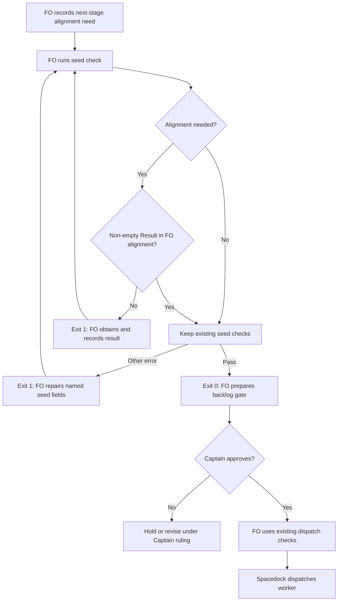

## Scope

- Source: FO's own miss, filed by FO with no Captain ruling yet; the Captain rules it at the next backlog sitting.
- Bite: batch 9 (2026-10-28): three ideation workers (batch-reaches-each-gate-together, captain-ruling-sources-checked, reused-worker-dispatch-leaves-a-record) held at their first step because `## FO alignment` said "needed" with no `Result:` line, costing three dispatches; the same miss on adr-protected-path-guard (2026-10-23). Each time `design_surfaces.py check --seed` (0.32.1) passed the task: it printed "seed fields and FO alignment recorded" for all five batch-9 seeds before the Result lines existed.
- Upstream first: `scripts/design_surfaces.py` (`check --seed`), `skills/ideation/principles.md` (the stop rule the workers applied), the workflow README FO alignment section.
Reviewer: kc-dev-flow-2:chief-engineer opus 2026-10-29 — batch-10 review before the joint ideation sitting: approve, revise or cut each task, the Captain's decisions, overlap and order

## Non-goals

- Judging whether a Result line's content is a real alignment; only that it exists when alignment is recorded as needed before the stage being dispatched.

## Budget

- One package PR in `scripts/design_surfaces.py` and its tests; no new script.

## Stop condition

- The three batch-9 seeds as committed before their Result lines replay as refused, and every current task that records a Result passes.

## FO alignment

Alignment: not needed before ideation: a check for a rule the ideation principles already state.
Surfaces: none
Visible change: none
Release review: not needed: workflow maintenance, on no journey map.

## Design

### Proposition and FAQ

The First Officer (FO) will see an actionable refusal at the existing seed check when a task records `Alignment: needed` but has no non-empty `Result:` in its FO alignment section. FO obtains and records the actual alignment, reruns the check, and uses the existing Captain gate and dispatch route. Passing checks presence, not the truth, adequacy or approval of that result.

**Who benefits?** FO and the dispatched worker: the three batch-9 workers stopped immediately on the same missing record that seed admission had accepted. This moves that detectable failure earlier, without delegating Captain authority to a checker.

**What changes?** In `check_task`, only the `seed=True` branch adds a diagnostic when the existing `alignment_owes_result(text)` predicate returns true. Keep `check_seed_fields` and the existing surface errors, the CLI arguments, success text and 0/1 exit convention. Add focused tests in the existing test file. No new script, workflow paragraph, ADR, extension or Spacedock change is proposed.

**Which stage does this cover?** The existing five-stage seed-admission route, before preparing its backlog gate. The FO alignment record names the need before the next declared worker stage. The CLI has no dispatch-stage parameter: do not infer that stage from `status: backlog`, invent an option, or parse arbitrary English stage names. Reuse the existing structured `Alignment: needed` contract (including `needed before ideation` and `needed at ideation`); leave the existing ideation dispatch-record check intact. POC admission and a general stage-aware alignment language are outside this slice.

**What counts?** Preserve `alignment_owes_result` semantics: a case-insensitive column-zero `Alignment: needed` prefix and a case-sensitive column-zero `Result:` with non-whitespace content, inside the FO alignment section after the existing backtick-fence removal. `Alignment: not needed` does not owe a result. An empty result, a result outside the section, and a result in a backtick example do not discharge the need. This is not a general Markdown parser or interpretation of older prose such as `Needed: yes`; no parser broadening is claimed.

**What does FO read on refusal?** `<task>.md: '## FO alignment' records alignment as needed with no 'Result:' line; record the alignment result there, then run this check again`. Exit 1, with no success line; unrelated errors remain visible. FO must not manufacture a result just to make this pass. Existing instructions still own whether alignment was actually obtained.

**What does it not enforce?** Spacedock does not invoke this package check automatically. Skipping the instructed check can still reach dispatch. Historical replay is compatibility evidence, not a retrospective operator verdict or an instruction to rewrite old tasks. Implementation and independent validation remain future work.

### Journey

Rendered and visually inspected on 2026-10-29 using Mermaid CLI 12.0.0, with temporary source/output at `/tmp/seed-alignment-ideation/journey.mmd` and `journey.png`. The durable source is the block above; re-render by extracting it and running `mmdc -i journey.mmd -o journey.png` with that CLI version. Browser startup needed execution outside the sandbox; no hosted resource was created. The actors, rerun loops, refusal branches and Captain approval boundary match the prose. `Surfaces: none` owes no separate UI or database artifact.

### Chain and existing-code findings

1. **Spacedock first:** read the installed 0.27.3 ensign contract, first-officer entry, shared State Management section and `fo-dispatch-core.md` Dispatch section. Its own contract reads the task and stage definition, stamps dispatch state and builds the worker envelope; it does not specify a kc-dev-flow-2 alignment schema or run `design_surfaces.py`. Fix the package check already prescribed at admission, not an adopter workaround or an invented runtime hook.
2. **Package source:** fetched origin and pinned `iamcxa/kc-claude-plugins` `origin/main` at `5725d495bb83a17ec13616bb5421bf5ffdc71f70`; its manifest says 0.33.0. The dispatched Codex package's checker, checker tests and workflow source are byte-identical to that commit. `alignment_owes_result` already exists in `design_surfaces.py`, but only `dispatch_records.py:check_task_facts` uses it for ideation records. `check_task(seed=True)` returns field/surface errors without calling it. This is a broken existing seam, not missing parser machinery.
3. **Callers:** searched package callers. `pr_watch.py:seeds` runs the seed CLI, classifies exit 1 with non-empty stdout as a failing seed and prints its existing aggregate next-step line. It does not parse diagnostic wording. A mocked subprocess result carrying the proposed diagnostic exercised that consumer: one failing seed produced the normal line, no parser error. `dispatch_records.py` imports the predicate; leaving the predicate unchanged preserves its contract. `test_sd_dispatch.py` pins the workflow command, not this diagnostic. No consumer edit is required by the proposal.
4. **Adopters:** read Relay `dhaka/docs/dev2/README.md`, Web `dev2-fo/docs/dev2/README.md`, QNow `qnow-adopt-dev2/docs/dev2/README.md`, and their locally available committed dev2 state. The README routes already prescribe seed checking and a recorded result before ideation. No adopter file was edited or fetched. Older prose forms remain outside the existing predicate; the corpus is evidence of compatibility, not proof of natural-language coverage.
5. **Prior decisions:** Architecture Decision Records (ADRs) 0041 (seed admission bounds), 0027 (checks at existing FO writes), and 0020 (workflow word budget) are Accepted at the pinned source. 0041 specifically keeps historical replay diagnostic and default design checking separate; 0027 rejects claiming word matching proves a person's intent. The state `Override:` search disclosed the earlier no-phrase-check ruling in `_archive/fo-write-rules-checked.md`; this design checks a structured record's presence only. It proposes no new enduring ruling beyond these accepted contracts and no number reservation.
6. **Ownership/provider:** `gh pr list --repo iamcxa/kc-claude-plugins --state open --json number,title,headRefName` succeeded. The four open PRs were 699 (ADR path trigger probe), 674 (Codex model policy), 635 (Behavior Diff CI), and 374 (peer reply skill); none is this seed-check implementation. Sibling tasks remain FO-owned; their current scope is mapped below, not treated as completed work.

ADR byte evidence at `5725d495bb83a17ec13616bb5421bf5ffdc71f70`:

| Path | SHA-256 |
| --- | --- |
| `docs/adr/0041-seed-admission-enforces-required-fields.md` | `16384fad490f88308c836d8e5d9cfeeff86a6c2c19c2b42cc7d8bea3e769cefb` |
| `docs/adr/0027-fo-write-rules-are-checked-by-the-script-fo-runs-at-the-write.md` | `3c4a5010f86bf4dd03725c458700bfe571694dcafff45233fb38823b62ce412c` |
| `docs/adr/0020-a-rise-in-the-workflow-word-budget-needs-a-captain-ruling-recorded-with-it.md` | `a49b4da2665730f648334a0a8465bde6df3c779e9b0c42b3e61510cc96185afb` |

### Replay evidence

The following are full commits on this workflow's state branch. For each task, the left commit is its last committed version before the first Result line; the right commit adds that result. Extract with `git -C <state-checkout> show <commit>:<task>.md > <temporary-task>.md`, then run `python3 <package>/scripts/design_surfaces.py check --seed <temporary-task>.md`.

| Task | Before Result | First Result | Released seed exits, before/after | In-memory proposal exits, before/after |
| --- | --- | --- | --- | --- |
| `batch-reaches-each-gate-together` (one sitting per batch gate) | `566a50400518f4d9fe217803605611e7910e7de5` | `796bb5f39742e5e534f1572c40272869ca7c35b5` | 0 / 0 | 1 / 0 |
| `captain-ruling-sources-checked` (ruling source provenance) | `39e071b2969c37958ca70dd5a72dac40ea257800` | `1c241a18bfaaba33b51f379a8220d4bf1a92e86e` | 0 / 0 | 1 / 0 |
| `reused-worker-dispatch-leaves-a-record` (saved reuse dispatch records) | `0ccdbb305328e410fd4fb5fb53ca729837302688` | `c1512a118e4a6ecc7bc1265752f5d7f09703e5cb` | 0 / 0 | 1 / 0 |

Probe method: import the dispatched checker with bytecode writes disabled; retain its `check_task`; wrap it in memory to append the proposed diagnostic only when `seed` and `alignment_owes_result(path.read_text())`; invoke its real `main(['check', '--seed', path])` on each extracted file and capture return/output. No source file or candidate was written. Removing the wrapper reproduces all three false passes. This proves the design's narrow wiring proposal on those six inputs, not a shipped implementation or independent validation.

A read-only committed-corpus probe enumerated root task files plus `_archive` task files, including `<task>/index.md`, requiring task frontmatter with `status:`. It ran existing `check_task(seed=True)` and the unchanged predicate over each pinned file. These are current local snapshots, not fresh remote-adopter attestations:

| Corpus | State revision | Tasks | Non-empty Result records | Missing-result predicate hits | Base-pass seeds that would newly fail |
| --- | --- | --- | --- | --- | --- |
| Package workflow | `731a165dfdf02549a9d13b0624174351e8a6d7be` | 173 | 38 | 34 | 7 |
| Relay | `7fbde2c526769e0968d05fac858fc63b31c6274c` | 98 | 8 | 0 | 0 |
| Web | `2c3a6dcbfb3a8e178d65151237a0c234351612c0` | 60 | 6 | 0 | 0 |
| QNow | `934789a124e50dd45f37af59bb337573462739ea` | 135 | 22 | 1 | 0 |

All 74 Result-bearing records yield false from the missing-result predicate. Of the 17 current, non-archived Result-bearing tasks, 13 already fail the released seed check for unrelated missing bounds/surface fields (3 package, 10 QNow). This is why “every current task with Result passes” needs the bounded interpretation below; bypassing old failures would weaken admission.

The seven newly failing package seeds are `design-director-runs-where-it-pays`, `ideation-preview-is-one-static-file`, `model-roster-per-repo`, `paseo-human-surfaces-visible-and-reachable`, `published-ui-docs-checked-on-screen-change`, `review-briefing-links-repeated-in-chat`, and `superseded-criterion-without-dispatch-caught`. Each has the structured needed marker and lacks a Result; this is the intended new error, not authority to edit those seeds. The other 28 predicate hits add a diagnostic to an already failing seed. Full candidate-versus-base default-mode and seed-mode CLI comparison, with sidecars and per-file messages retained, is owed at implementation; the current probe does not claim that broader comparison passed.

### Words FO reads at each moment

Count with `len(text.split())`, including filenames and command paths as one token each. No instruction is moved. The current workflow has 5,754 words, the dev entry 763, and the lifecycle mod 48, each unchanged by this two-file proposal. Count changed outputs as well: seed success is 7 words; the proposed alignment diagnostic is 22 words. The existing idle aggregate for one failing seed is 28 words; for n names it is 27+n words. A subprocess-output probe of `pr_watch.seeds` measured 0 to 28 words for one newly failing backlog seed.

The table distinguishes the unchanged reading at a moment (U, exactly the same input passages and unrelated output in both runs) from the task's changed output. It does not mislabel these output counts as the complete size of a live FO session. For startup, the three package entry documents above contribute 6,565 unchanged words to U; task data, extension passages and other hook output depend on that run. Default design checks, merge checks and archive instructions are unchanged. This is not a word-reduction claim.

| Moment / controlled case | Before | Proposed after | Meaning |
| --- | --- | --- | --- |
| Startup/resume, no newly failing seed | U + 0 | U + 0 | Same instructions and output |
| Startup/resume, one newly failing backlog seed and no prior seed warning | U + 0 | U + 28 | Existing next-step warning becomes visible |
| Idle on open PR, same backlog fixture | U + 0 | U + 28 | Idle calls the same seed consumer |
| Idle on merged PR, same backlog fixture | U + 0 | U + 28 | PR state does not suppress backlog diagnostics |
| After archive, archive instructions alone | U + 0 | U + 0 | No archive change; a later idle pass follows the rows above |
| Merge ask | U + 0 | U + 0 | No delivery-gate change; subsequent idle counted separately |
| Backlog gate seed check, missing Result only | U + 7 | U + 22 | False success becomes actionable refusal, +15 words |
| Backlog gate seed check, valid Result or not needed | U + 7 | U + 7 | Success stays unchanged |
| Ideation gate / dispatch with recorded Result | U + 0 | U + 0 | Default checker and dispatch-record output unchanged |

If an aggregate seed warning already exists, each additionally failing task adds one slug token, not another 28-word line. If an input already has errors, the new diagnostic adds 22 words rather than replacing a success line. The three historical failures would have changed the aggregate from 0 to 30 words and each direct check from 7 to 22. At implementation, measure the same fixed lifecycle inputs against base and candidate; do not substitute a shrinking README or these design projections for actual output evidence. No CI trigger change is proposed; CI cost per PR was not measured.

## Acceptance criteria

**AC-1**: Seed checking refuses the three historical missing-result snapshots above with exit 1 and the alignment diagnostic, while the matching Result-added snapshots exit 0.
Verified by: preserve the six exact git extracts as test fixtures in the existing `test_design_surfaces.py` or reconstruct their relevant seed bytes there with provenance comments; run the candidate CLI on the full extracts and report stdout and exit per snapshot. Falsifier: remove the new seed-branch predicate call; all three required refusals become false success. Current evidence: the in-memory proposal produced 1/0 for each pair; candidate acceptance unverified.

**AC-2**: The new refusal uses the existing structured predicate: needed plus absent/blank Result fails; a non-empty Result and not-needed records pass when other seed fields are valid. A Result outside FO alignment or inside an existing supported backtick fence does not satisfy it; a fenced needed example does not create a need.
Verified by: table-driven CLI tests in `test_design_surfaces.py` with otherwise-valid seeds, including needed marker case variants, needed-before-ideation, an empty result followed by another field, result in another section, and quoted backtick examples. Falsifiers: unconditional refusal breaks the valid rows; whole-document Result search breaks the outside-section row; accepting blank results breaks the empty row; raw-text matching breaks fenced rows. Current evidence: inspected/exercised the shared predicate on the historical corpus; complete candidate matrix unverified.

**AC-3**: Current tasks recording a Result gain no alignment error and retain their base verdict and existing errors; any already passing such seed remains passing. Other existing seed checks remain enforced. This criterion is proposed pending the Captain decision below; it does not silently rewrite the original Stop condition.
Verified by: pin every corpus revision, enumerate all committed task files and run base/candidate in both `check` and `check --seed`, preserving required sidecars; compare per-file exit and output, not only counts. Explain each new seed diagnostic as an actual needed/missing-result record. Default check must be byte-for-byte unchanged on fixed inputs. Falsifiers: bypassing `check_seed_fields` changes pre-existing bound failures; applying the new error in default mode changes default output; rejecting Result-bearing seeds fails the 74-record compatibility set. Current evidence: 466-file predicate/seed-function probe, 74 Result records with no owed result, and 13 pre-existing failures among current Result tasks; full candidate CLI replay unverified.

**AC-4**: The existing startup/idle seed consumer accepts the new diagnostic and names a failing seed without parser error; the six lifecycle moments above include every changed passage/output and retain unchanged instructions.
Verified by: run the existing `test_pr_watch.py` and the fixed backlog fixture through its seed consumer against real base/candidate CLI output; measure words using the same split rule for startup, idle on open PR, idle on merged PR, after archive, merge ask and direct seed check, recording unrelated unchanged readings separately. Falsifiers: returning success for missing Result hides the idle warning; empty diagnostic output bypasses the consumer's failing-seed classification; a new always-loaded instruction violates the zero static delta. Current evidence: mocked new CLI output exercised the consumer (0 to 28 words), and source packet counts above; candidate end-to-end lifecycle replay unverified.

**AC-5**: The implementation changes only `kc-dev-flow-2/scripts/design_surfaces.py` and `kc-dev-flow-2/scripts/test_design_surfaces.py`, keeps the shared predicate behavior and default-mode behavior, and retains existing dispatch-record enforcement.
Verified by: exact candidate diff, `python3 <candidate-package>/scripts/test_design_surfaces.py`, `test_dispatch_records.py` and `test_pr_watch.py`, plus the repository's required package checks. Falsifier: changing the helper to always return false makes historical refusal tests fail; changing default behavior fails AC-3; changing a third deliverable file fails the scope check and returns to FO. Current evidence: caller/source audit establishes the two-file repair seam; implementation tests not run on a candidate because no candidate exists.

**AC-6**: The task's design is usable for the Pilot gate: prose and rendered flow agree on owners, checks, stop/rerun paths and Captain authority; every recorded surface has its owed artifact.
Verified by: render the Mermaid block and compare its branches with the FAQ, then run the dispatched package's `design_surfaces.py check <task>` and the stage checklist read. Falsifier: removing the Acceptance criteria declarations makes the design checker refuse; moving worker dispatch before Captain approval contradicts the rendered flow and fails the semantic review. Current evidence: diagram rendered/inspected in ideation; final design/checklist output is recorded in the stage report.

## Unresolved decisions

**One Captain decision: what does “current tasks with a Result line passing” mean when they already fail another seed rule?** Recommend AC-3's no-new-error interpretation: Result-bearing tasks retain all existing verdicts; otherwise-valid ones pass, and unrelated existing failures stay failures. This follows Accepted ADR 0041's diagnostic historical replay, preserves admission bounds, and avoids editing other owners' tasks. What gets worse: the stop condition is less convenient to describe, and historical Result-bearing tasks can still print failures. The alternative, forcing every Result-bearing task to exit 0, would mask missing Budget/Stop condition/Surfaces; the alternative of repairing all 13 current records exceeds this two-file scope. FO should present this one choice at the batch gate; no scope wording has been overwritten here.

### Batch overlap

Files this design would change: `kc-dev-flow-2/scripts/design_surfaces.py` (seed branch only) and `kc-dev-flow-2/scripts/test_design_surfaces.py` (seed tests). Shared checks: `design_surfaces.py check --seed`, its unchanged shared predicate used by `dispatch_records.py`, and the `pr_watch.py` seed consumer. No shared ADR index, number reservation, workflow table or budget step is changed. Entries below are as recorded when read, not forecasts of another worker's final design.

| Task | Shared file/check and ordering consequence |
| --- | --- |
| `seed-check-requires-alignment-result` (this seed refusal) | Owns the two files named above. |
| `captain-amendment-form-checked` (amendment shape and history) | Direct overlap: `design_surfaces.py` and its tests; adjacent `dispatch_records.py` behavior. Land this narrow seed change first, then rebase and rerun both modes for the amendment change. |
| `adr-reserved-when-design-names-one` (reserve ADR before dispatch) | Scope names `dispatch_records.py:check_task_facts` and `number_guards.py`; no direct owned file yet. Same dispatch checker consumes our unchanged predicate. Re-run its suite after both changes. |
| `validation-rerun-waits-for-captain-ruling` (hold unruled validation reruns) | Scope names dispatch records and delivery gate, no direct owned file. Same dispatch checker suite; recheck when its design names final files. |
| `gate-requires-recorded-reviews` (reviews before gate preparation) | Scope names delivery gate, role triggers and Spacedock gate prepare. No direct file overlap currently; shares the gate-entry journey. Recheck design if it chooses `design_surfaces.py` as enforcement. |
| `adoption-asks-which-extensions` (check event-time extensions) | Current narrowed design changes dispatch records, number guards, dispatch/laws tests and laws.md; no direct file. Same dispatch suite and import seam. |
| `adr-required-statement` (report product-ruling ADRs) | Validation task, workflow/POC README checks per recorded overlap; no checker-file ownership found. |
| `adr-silent-undo-probe` (measure unnoticed ADR reversals) | Fictional scenario harness in its state evidence; explicitly no package change. None. |
| `comment-check-reaches-delivery-gate` (bind comment evidence to head) | Recorded design owns delivery gate, its tests and validation principles. None of these two files. |
| `journey-canvas-hosted-poc` (host a shared canvas) | Hosted canvas work, no seed-check change recorded. None. |
| `journey-server-host-pilot` (private server on Node/Cloudflare) | Read its live folder `journey-server-host-pilot/index.md`, status validation; server/package and hosted evidence, checker is only a consumer. None. |
| `ops-inbox-r1-setup-and-isolation` (incident setup and permission isolation) | Owns `kc-ops-inbox/**`, its CI and two ADRs. None. |
| `pr-review-lite-value-pilot` (bounded review-value comparison) | Review-comparison preparation/evidence; no seed-check edit. Its old Result-bearing seed already fails unrelated rules; preserve that verdict under AC-3. |

Recommended order: this two-file seed repair before `captain-amendment-form-checked`; the other batch tasks can be designed independently, then FO rechecks the final file/check intersections before implementation. Merge order is FO's decision. No sibling task or session was changed or messaged. Pilot boundary: design and task-state report only; the Captain gate, implementation, independent validation and delivery remain outstanding.

## Stage Report: ideation

- DONE: A design for refusing, in kc-dev-flow-2/scripts/design_surfaces.py check --seed, a task whose ## FO alignment says needed before the stage being dispatched and has no Result: line; the three batch-9 seeds as committed before their Result lines (state history of batch-reaches-each-gate-together, captain-ruling-sources-checked, reused-worker-dispatch-leaves-a-record) replayed as refused, and current tasks with a Result line passing
  Design reuses the existing predicate in the seed-only branch; six exact state extracts replayed through the in-memory proposal: three missing-result exits 1, three Result-added exits 0. Removing the call restores false passes. Candidate implementation remains unverified.
- DONE: A `### Batch overlap` section naming each file the design would change and each other batch task (seed-check-requires-alignment-result, captain-amendment-form-checked, adr-reserved-when-design-names-one, validation-rerun-waits-for-captain-ruling, gate-requires-recorded-reviews) and live task of other sessions (adoption-asks-which-extensions, adr-required-statement, adr-silent-undo-probe, comment-check-reaches-delivery-gate, journey-canvas-hosted-poc, journey-server-host-pilot, ops-inbox-r1-setup-and-isolation, pr-review-lite-value-pilot (driven by other sessions; read only)) that changes the same file or check, so FO can order implementation
  Batch overlap names both owned files, all five batch tasks and all eight other-session tasks; direct overlap is the amendment checker. Read-only GitHub PR inventory succeeded; no peer message or sibling edit.
- DONE: The words FO reads at each lifecycle moment, before and after, per root learning.md "Measure the words FO reads at each moment, not one file's size"
  Words FO reads at each moment counts unchanged entry passages plus changed output: direct false success 7 to 22 words; one new idle backlog warning 0 to 28. Full live-session totals are explicitly not claimed; candidate lifecycle comparison remains owed.
- DONE: Acceptance criteria with reproducible evidence clauses and falsifiers, and unresolved decisions for the Captain, each with a recommendation and what gets worse under it
  Six individually evidenced criteria with falsifiers; one Captain decision recommends preserving existing verdicts for Result-bearing tasks, because 13 current records already fail unrelated seed rules. Original Stop condition preserved pending that ruling.
- DONE: AC-1 design evidence
  Existing CLI false-passes all three pre-result snapshots; the in-memory call addition produces 1/0 for each historical pair. Exact candidate CLI proof remains unverified.
- DONE: AC-2 design evidence
  Existing predicate semantics and boundary cases specified; historical predicate replay performed. The full candidate test matrix remains unverified.
- DONE: AC-3 design evidence
  Read-only probe: 466 committed tasks, 74 Result records with no owed result, seven proposed new seed failures; 13 current Result records already fail other checks. Full two-mode candidate replay and Captain interpretation remain pending.
- DONE: AC-4 design evidence
  Existing pr_watch seed consumer exercised with the new diagnostic; one 28-word warning and no parser error. Exact candidate lifecycle replay remains unverified.
- DONE: AC-5 design evidence
  Fetched origin/main 5725d495bb83a17ec13616bb5421bf5ffdc71f70, version 0.33.0; cache/source bytes match for checker/tests/workflow. Two-file seam and consumers audited; no product implementation or candidate tests claimed.
- DONE: AC-6 design evidence
  Mermaid CLI 12.0.0 rendered the diagram and its branches were visually checked; package check exited 0: seed-check-requires-alignment-result.md: design surfaces presentable. Removing usable criteria would make that check refuse.

### Summary

Designed the bounded seed-only repair around the existing alignment predicate, with historical replay, read-only adopter compatibility evidence, per-moment word deltas and the batch overlap order. The Captain must settle one acceptance interpretation: preserve existing errors for Result-bearing tasks rather than bypass admission rules; no source file, product branch, PR or sibling state was changed. Pilot design is ready for FO's batch gate preparation; implementation, candidate tests and independent validation remain future work.
