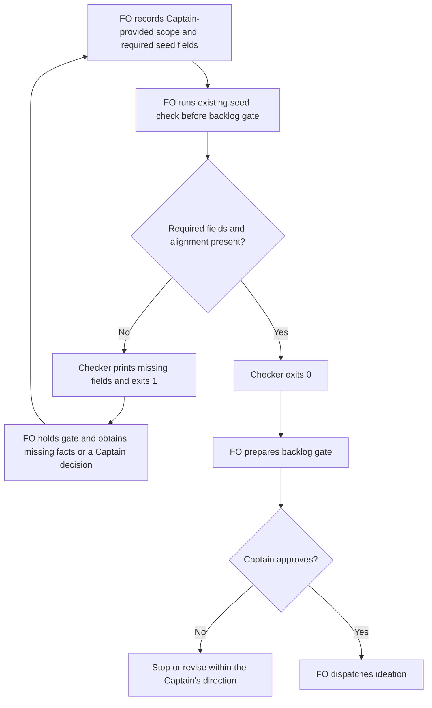

## Scope

- Source: the Captain 「同意開 1 到 5，第 6 項併進「GPT 夥伴」提案」 (chat, 2026-10-27), answering FO's list of package-issue candidates (items 2 to 5 relayed by the relay FO, Paseo 1671c3a9, from its pair-once and room-specs-follow-web-part-select observer reports; item 1 relayed by the kc-ops-inbox FO, Paseo 46c2ebdf).
- Bite: relay room-specs-follow-web-part-select had no budget, no stop condition and no `id:`, yet `design_surfaces.py check --seed` passed (relay FO's report).
- Upstream first: `scripts/design_surfaces.py` (`check --seed`), the workflow README schema, Spacedock `new`.

## FO alignment

Alignment: needed before ideation; where the check runs is a package design choice.
Surfaces: none
Visible change: none
Release review: not needed: workflow maintenance, on no journey map.
Result: aligned 2026-10-27 on the outcome by the Captain's 「全准」 answering this task's backlog briefing-1 question, which named the seed check refusing a task missing its schema's required fields; which fields are required is put to him at the ideation gate.
Reviewer: kc-dev-flow-2:chief-engineer opus 2026-10-27 — batch 8 review at the ideation gate (the Captain's batch ruling 2026-10-27): per-task disposition, the Captain's decisions, order and batch risk.

## PRFAQ

The seed check will tell the First Officer (FO) which required task fields are missing before asking the Captain to admit a task. It will check the package workflow's declared seed contract, retain the existing surface checks, and leave the task unchanged. A passing seed will still not prove that the Captain approved its contents.

**Who benefits?** FO gets a field-specific refusal before the backlog gate, instead of learning after delivery that the task omitted its bounds. The observed Relay task is the acceptance example.

**Why here?** This is a repair of the existing `design_surfaces.py check --seed` seam, not a new Spacedock hook or schema framework. Spacedock creates task identity; the package owns its required seed content. ADR 0027, “FO-write rules are checked by the script FO already runs at the write,” supports using that existing check. Skipping it can still bypass the refusal.

**What is optional?** Surface artifacts and finished acceptance criteria are due after ideation, not at seed admission. Pull-request, worktree, gate, journey and number-reservation records are filled at their respective lifecycle steps, not invented to satisfy this check.

**Will old tasks be rewritten?** No. The new field checks run only in `check --seed`, regardless of the task's recorded stage, so an explicit historical replay can expose incompatibility. Default `check` retains its present behavior. Ordinary seed calls remain at backlog admission and the existing idle reminder; this task neither reopens archived gates nor backfills any task. Existing backlog tasks must obtain real missing values from their scope owner before their next admission check.

**What is not promised?** Presence is not approval or adequacy. The checker does not infer a budget, decide whether prose is a good stop condition, parse arbitrary README prose into a schema, validate every YAML feature, prevent direct dispatch, or change the proof-of-concept route. No hosted resource, credential, production obligation or CI trigger is added.

## Design

### Source chain and existing behavior

- Code source: fetched `origin/main` at `8bf4f3582411e8e4238f19fbadda8ddeca6767be`; released package version in `kc-dev-flow-2/.claude-plugin/plugin.json` is `0.32.0`. The supplied Codex package is `/Users/kent/.codex/plugins/cache/kc-claude-plugins/kc-dev-flow-2/0.32.0`; its `scripts/design_surfaces.py` bytes equal that source revision. All package-script runs in this stage used this supplied package.
- Spacedock first: read its own `internal/status/new.go`, `docs/schema/entity.mdschema.yml`, `skills/first-officer/references/fo-write-core.md` in the supplied Spacedock 0.27.3 package, plus native `spacedock new --help`. Its slug route deliberately omits `id` when stdin omits it; the slug is identity. The installed executable reports 0.27.2, so source and executable versions are separately named. A disposable native replay confirmed both omitted-id and matching-explicit-id inputs create successfully, exit 0. The former output has no stored id; the latter retains `id: with-id`. No upstream defect is claimed and no upstream change is needed for the recommendation below.
- Package second: `references/sd/workflow.md` Schema and Task Template explicitly require/illustrate a stored `id`. The adopted workflow repeats that requirement despite `id-style: slug`. `check_task()` returns from its seed branch after only the FO-alignment surface checks; it reads neither these five required frontmatter fields nor Scope bounds. This is the demonstrated missing seam.
- Sibling adopters third, read only: Relay `beirut-dev2`, Web `dev2-fo`, and QNow `qnow-adopt-dev2` each have `docs/dev2/README.md` with `id-style: slug` and the same Schema paragraph. Relay's archived `room-specs-follow-web-part-select.md` has Scope and a separate Non-goals section but no stored `id`, budget or stop condition. Both installed check modes return 0 on it.
- Bounded search: inspected the checker and its tests, then searched every package caller/import of `design_surfaces`. `pr_watch.py seeds()` invokes seed mode and replaces diagnostic detail with “fix its ## FO alignment”; the observer skill invokes seed mode on historical backlog snapshots and currently labels exit 1 a violation. Other consumers import existing symbols or run default mode; preserve those interfaces. External/manual invocations beyond the package are not exhaustively known.
- Prior decisions: read Accepted ADR 0027 and ADR 0020, “A rise in the workflow word budget needs a Captain ruling recorded with it,” at the source revision. Searched state `Override:` gate-reason lines; none concerns seed fields, their format or this id conflict. The no-phrase-check ruling inside ADR 0027 rules out claiming that recognizing words proves a person's intent.

### Required and optional fields

This is what the current workflow README says, before the proposed enforcement changes:

| Location | Required by current README | Not a required seed field |
| --- | --- | --- |
| Frontmatter | `id`, `title`, `status`, `variant: kc-dev-flow-2`, the user's selected `profile` | `merge`, `worktree`, `pr` appear in the template but are not listed by Schema as mandatory seed fields; existing delivery rules still apply later |
| Body | Approved outcome, scope, non-goals, budget, stop condition | Specific labels for those concepts are not currently mandated |
| Later design | Bold acceptance-criterion declarations with individual evidence clauses | Finished criteria, previews, schema artifacts and reviews are not demanded by seed mode |
| Conditional lifecycle | Journey fields when assigned to a release, number reservations when needed, Spacedock-owned gate/report state | No blanket demand for journey, migration, ADR, completion, verdict or gate fields at seed admission |

The five-stage route admits `pilot` or `prod`; the separate proof-of-concept workflow admits `poc`. Profile/route compatibility remains FO's existing check. This design adds missing-field refusal, not a new generic workflow graph validator. Unknown extension fields are preserved and ignored by this new check.

### Proposed contract, subject to the Captain's decision

Keep the five explicitly declared frontmatter fields, including stored `id`. For slug workflows, FO supplies the matching slug as `id` in stdin to `spacedock new`; the native replay shows this supported route. Never synthesize an id from the filename inside the checker: that would silently waive the README requirement. Flat and folder-form tasks have the same required fields.

Require a non-empty `## Scope` section for the outcome/scope, and non-empty Non-goals, Budget and Stop condition records. Accept either a labeled line inside Scope (optional `- ` or `* ` bullet), or its own level-two section; accept singular/plural Non-goal(s) and Stop condition(s). This retains Relay's existing separate Non-goals section. Ignore examples inside backtick or tilde code fences and nested frontmatter keys; a similarly named line in a report, quote or unrelated section must not satisfy the field. This explicit form is a proposed schema clarification, not a claim that old free prose violated a previously mandated format.

Read only the opening frontmatter mapping. Absent fields, empty/whitespace-only values, empty quoted strings, YAML null (`null`, `~`, or an empty value/comment), and unfilled angle-bracket placeholders fail with the field name. Support the ordinary plain/quoted scalar forms used by Spacedock; safely read inline comments and quoted colons. Reject ambiguous duplicate required keys or unsupported mapping/list/block-scalar values for a required scalar, rather than treating their punctuation as content. This is a bounded parser for these fields, not a new YAML dependency or validation of Spacedock's nested gate mapping. Test the boundary explicitly. Body labels require content, not an unfilled angle-bracket placeholder; the script does not decide whether a non-empty value is truthful or adequate.

Add a small seed-field helper in `design_surfaces.py` and call it only in the seed branch, retaining all existing errors. A malformed or missing frontmatter block emits one structural error; otherwise list field defects in stable schema order, followed by body fields and existing alignment defects. Read errors are reported as a diagnostic/nonzero exit, not a traceback or pass. Preserve existing exit semantics: valid seed 0, rejected seed 1; argument errors remain 2. Do not infer a required-field list by scraping arbitrary prose at runtime: this package check implements this package's documented contract, with fixtures pinning their agreement.

The new success line is `<task>: seed fields and FO alignment recorded`. Example Relay refusals are `<task>: missing required frontmatter field: id`, `<task>: missing required body field: Budget`, and `<task>: missing required body field: Stop condition`. `pr_watch.py seeds()` must tell FO to “fix the reported seed fields and run” the check rather than only fix FO alignment; its existing stage/readiness filters remain. No new remote call is needed.

The observer's historical replay rule gains: “For a seed-field failure on a historical copy, report current-schema incompatibility; call it a historical violation only if the README at that event required the same form.” Missing event-time schema evidence is `can't tell`. Old surface failures retain their existing interpretation. This prevents a new labeling requirement being misreported as an old operator failure.



The actors, order, refusal, approval and stop above match the prose. Skipping the check is an acknowledged unsupported bypass, not a hidden automatic hook. Mermaid was reviewed against the prose; a rendered diagram was not exercised in this stage. `Surfaces: none` owes this PRFAQ/diagram, not a UI preview.

### Proposed workflow wording

Replace the Schema paragraph with the following text, retaining the separate stage and profile ownership rules:

> Record non-empty `id`, `title`, `status`, `variant: kc-dev-flow-2`, and the user's selected `profile`. For `id-style: slug`, supply the slug as `id` to `spacedock new`; otherwise it omits that field. The five-stage route accepts `pilot` or `prod`; the POC adaptation removes ideation from frontmatter and Stages and accepts `poc` only. Before admission and dispatch, FO holds an unknown/mismatched profile; SD does not enforce this rule. Preserve approved outcome and scope under `## Scope`, with non-empty `Non-goals:`, `Budget:` and `Stop condition:` lines or matching level-two sections. Use bold **AC-N** declarations with individual evidence clauses.

In the seed-check bullet replace “An FO that skips this step still dispatches; the worker's own check is the backstop.” with “An FO that skips this step still dispatches; no runtime hook blocks it.” Default mode is deliberately not a backstop for these new seed fields.

Replace the Task Template's Scope placeholder with:

```text
<Approved outcome and scope.>
Non-goals: <exclusions>
Budget: <approved bound>
Stop condition: <when to return to the Captain>
```

The package README's description of seed mode changes from “checks the FO record” to “checks seed fields and the FO record.” CLI help must describe seed fields too. The proof-of-concept derivative must still omit the seed gate and ideation; update its derivation fixtures if the revised Schema text changes their anchors, without adding a new proof-of-concept obligation.

### Replay evidence and its limits

The disposable classifier models missing/non-empty field and body-record presence only; it is not an implementation candidate and does not prove the proposed quoting, duplicate-key, placeholder or fence-edge handling. The existing package was actually executed in both modes on every committed entity at the snapshots below. Each input stayed unchanged during its two runs, and its SHA-256 matched `git show <state>:<path>` afterwards: 164 of 164 matches. No adopter task was edited.

| Corpus | Pinned state commit | Files | Current seed: pass/fail | Proposed seed: pass/fail | Current default: pass/fail |
| --- | --- | --- | --- | --- | --- |
| This workflow, active and archive | `0d8847df7b0ef6e9046d8ff99dd6331bff010d2b` | 163 (69 active, 94 archived) | 140 / 23 | 0 / 163 | 73 / 90 |
| Relay named example | `d20ff925992d34e70808b4291b32560afbc7fee5` | 1 | 1 / 0 | 0 / 1 | 1 / 0 |

The 140 newly refused local seeds comprise 59 active and 81 archived tasks. All 23 existing failures retain failure; new diagnostics are additive. New default-mode enforcement is not proposed: its 73/90 result is the baseline, not a claimed future candidate pass. Relay currently prints `room-specs-follow-web-part-select.md: FO alignment recorded`; the proposal adds exactly id/Budget/Stop condition refusals. Its task SHA-256 is `a385615b692934c41a1c1664d3b1444cc09020cb03622c1ec7c0e95ed2ec0fa6`.

Across the 163 local files the classifier finds no usable id in 162, Budget in 156, Stop condition in 157, Non-goals in 62, Scope in 16, and profile in 2. These are current-form compatibility findings, not claims that all these tasks lacked the underlying human decision. Every newly refused group is listed below for FO's ordering and migration assessment. No bulk repair is authorized.

- Non-goals, Budget, Stop condition (1): `journey-server-host-pilot/index.md`.

- id (2): `_archive/ops-metric-event-protocol.md`, `ops-inbox-r1-setup-and-isolation.md`.

- id, Budget, Stop condition (93): `_archive/adr-protected-path-guard.md`, `_archive/agent-reads-governing-adr.md`, `_archive/board-optout.md`, `_archive/captain-question-load.md`, `_archive/chat-only-evidence-observer-blind.md`, `_archive/codex-reader-counts-code-review-only.md`, `_archive/codex-review-hang-detected.md`, `_archive/codex-review-round3-followups.md`, `_archive/commissioned-by-names-spacedock.md`, `_archive/copilot-quota-refusal-is-not-a-review.md`, `_archive/db-surface-without-migrations.md`, `_archive/delivery-gate-reads-folder-tasks.md`, `_archive/delivery-gate-settles-skipped-checks.md`, `_archive/delivery-gate-verdict-form.md`, `_archive/design-director-runs-ui-design-review.md`, `_archive/dev2-laws-check.md`, `_archive/extension-defaults-and-install-choice.md`, `_archive/extension-instruction-reaches-dispatch.md`, `_archive/fo-batch-sittings.md`, `_archive/fo-lifecycle-mod.md`, `_archive/fo-record-checks.md`, `_archive/fo-write-checks.md`, `_archive/fo-write-rules-checked.md`, `_archive/fo-written-lines-checked-before-dispatch.md`, `_archive/followup-dispatch-records-checked.md`, `_archive/followup-dispatch-records-round3-followups.md`, `_archive/idle-names-failing-seeds.md`, `_archive/journey-render-keeps-annotations.md`, `_archive/kc-adr-tools-with-dev2-copy.md`, `_archive/learn-delivery-follow-through.md`, `_archive/learn-delivery-round3-followups.md`, `_archive/merge-ask-holds-missing-clauses.md`, `_archive/names-check-before-dispatch.md`, `_archive/new-work-starts-from-a-story-map.md`, `_archive/observer-before-merge-guard.md`, `_archive/observer-check-round3-followups.md`, `_archive/patch-0102.md`, `_archive/patch-0103.md`, `_archive/peers-paseo-host-binding.md`, `_archive/poc-no-migrations.md`, `_archive/pr-watch-round3-followups.md`, `_archive/pr-watch-state-per-session.md`, `_archive/pr-watch-tasks-round3-followups.md`, `_archive/reflow-order.md`, `_archive/release-acceptance/index.md`, `_archive/release-review-staleness-held-at-dispatch.md`, `_archive/release-review.md`, `_archive/release-walk-picky-reviewers-and-director.md`, `_archive/replay-control-arm-round3-followups.md`, `_archive/review-followups-0102.md`, `_archive/role-triggers-owe-ce-on-review-drift.md`, `_archive/special-role-calls-fire-when-needed.md`, `_archive/stage-report-correction-path.md`, `_archive/worker-completion-goes-to-main.md`, `_archive/worker-knows-the-team-and-asks-early.md`, `_archive/workflow-checkout-must-match-trunk-readme.md`, `_archive/workflow-gaps-from-qnow-1270.md`, `adoption-asks-which-extensions.md`, `adr-required-statement.md`, `adr-silent-undo-probe.md`, `agents-md-holds-instructions.md`, `autopilot-l3-dogfood-spacedock-bridge.md`, `built-screen-check-round3-followups.md`, `claims-name-their-source.md`, `comment-check-reaches-delivery-gate.md`, `deprecate-kc-dev-flow-v1.md`, `design-director-model-follows-task.md`, `design-surfaces-task-dir-crash.md`, `dispatch-sets-reasoning-effort.md`, `fo-asks-to-raise-concurrency.md`, `fo-interviews-extension.md`, `fo-narrates-outward-writes.md`, `fo-write-checks-parse-top-level.md`, `gate-presentation-asks-one-thing-plainly.md`, `gpt-partner-extension-proposal.md`, `interrogation-strangers-isolated.md`, `journey-canvas-hosted-poc.md`, `journey-card-notes.md`, `journey-map-contract-round3-followups.md`, `journey-review-check-round3-followups.md`, `kc-adr-dev2-sharing-better-way.md`, `learn-names-agents-md-candidates.md`, `merge-check-reads-two-pr-tasks.md`, `merge-guard-stops-unasked-merges.md`, `new-work-checks-what-exists-first.md`, `override-recorded-when-captain-departs.md`, `prod-split-owes-chief-engineer-route-review.md`, `product-review-path-before-backlog.md`, `read-adr-honors-adr-folder.md`, `release-walk-due-trigger.md`, `retire-task-with-unconsumed-approval.md`, `rewalk-binds-prior-and-carries-complaints.md`, `workflow-checkout-round3-followups.md`.

- id, Non-goals, Budget (1): `_archive/kc-decision-log-p1/index.md`.

- id, Non-goals, Budget, Stop condition (36): `_archive/amendment-form-check.md`, `_archive/codex-reader-reads-receipt-marker.md`, `_archive/codex-reader-resolved-mark-adr.md`, `_archive/codex-reader-same-head-unresolved.md`, `_archive/dispatch-and-report-hygiene.md`, `_archive/ideation-gaps.md`, `_archive/merge-gatekeeper.md`, `_archive/migration-and-number-guards.md`, `_archive/number-guards-readme-shrink.md`, `_archive/override-reaches-gate-and-criteria-wait.md`, `_archive/peers-rules-name-each-host-binding.md`, `_archive/prod-security-validation-gate.md`, `_archive/review-cadence.md`, `_archive/special-role-triggers.md`, `_archive/ui-design-review-in-ideation.md`, `_archive/worker-loads-declared-package.md`, `_archive/workflow-budget-ratchet.md`, `archive-waits-for-observer-report.md`, `batch-reaches-each-gate-together.md`, `captain-ruling-sources-checked.md`, `copilot-not-run-line-carries-quote.md`, `dispatch-carries-reserved-adr-number.md`, `fo-tries-what-it-asks-the-captain.md`, `gate-summary-names-each-decline.md`, `ideation-preview-is-one-static-file.md`, `idle-hook-names-merged-tasks-without-learn.md`, `journey-fold-answers-open-placeholders.md`, `journey-probe-finds-nested-maps.md`, `observer-check-learn-only-when-listed.md`, `paseo-codex-dispatch-practice.md`, `repair-dispatch-asks-for-sibling-sites.md`, `reused-worker-dispatch-leaves-a-record.md`, `reviewer-negative-claim-shows-reach.md`, `seed-check-requires-schema-fields.md`, `superseded-criterion-without-dispatch-caught.md`, `workflow-readme-in-invocation-test.md`.

- id, Non-goals, Stop condition (1): `_archive/kc-decision-log-cli.md`.

- id, Scope, Non-goals, Budget, Stop condition (2): `_archive/journey-map-dev2-contract.md`, `_archive/prod-security-review-gates.md`.

- id, Stop condition (3): `_archive/kc-adr-format-source.md`, `_archive/read-adr-reporting-rule-followup.md`, `kc-decision-log-handoff-trial.md`.

- id, profile, Budget, Stop condition (1): `paseo-fo-board.md`.

Reproduction: use the supplied 0.32.0 package, the state roots named in Source chain, and the pinned commits above. Enumerate tracked flat `<slug>.md` and `<slug>/index.md` entities at the state root and `_archive/`, excluding README and ancillary task folders. Run `python3 <package>/scripts/design_surfaces.py check --seed <task>` and `check <task>` per entity, recording stdout and exit. Compare bytes with `git show <state>:<path>` and reject a run on changed input; default mode also reads existing artifacts/history. The classifier used for the proposed missing-field projection is below. Feed it each pinned task text; projected seed exit is 1 when either the actual seed exit is nonzero or this list is nonempty. This is a research predicate, not shipping code.

```python
import re
# ds is the supplied package scripts/design_surfaces.py module.
def absent(text):
 fm=ds.FRONTMATTER.match(text); fields={}
 for l in (fm[1].splitlines() if fm else []):
  m=re.match(r'^([\w-]+):[ \t]*(.*)$',l)
  if m: fields[m[1]]=m[2].strip().strip('\"\'')
 missing=[k for k in ('id','title','status','variant','profile') if fields.get(k,'').lower() in ('','null','~')]
 body=text[fm.end():] if fm else text
 plain='\n'.join(ds.unfenced(body.splitlines()))
 scope=re.search(r'^## Scope\s*\n(.*?)(?=^## |\Z)',plain,re.M|re.S)
 scope=scope[1] if scope else ''
 if not scope.strip(): missing.append('Scope')
 for label,pat in [('Non-goals',r'Non-goals?'),('Budget',r'Budget'),('Stop condition',r'Stop conditions?')]:
  line=re.search(r'^(?:[-*] )?'+pat+r':[ \t]*\S[^\n]*',scope,re.M|re.I)
  section=re.search(r'^## '+pat+r'[ \t]*\n(.*?)(?=^## |\Z)',plain,re.M|re.S|re.I)
  if not line and not (section and section[1].strip()):missing.append(label)
 return missing
```

### Words FO reads at each lifecycle moment

Counts use whitespace splitting, as `lint-skills.py` does. Before is the pinned 0.32.0 source; after is the literal proposed wording above, not a built candidate. Path, task and PR placeholders each count as one token. Count both a newly printed diagnostic and the instruction that makes FO run it. This is not a word-saving claim.

| Moment and measured passages/output | Before | Proposed after |
| --- | --- | --- |
| Entry/startup or full resume: package README + adopted workflow source + package mod | 3067 + 5565 + 48 = 8680 | 3070 + 5577 + 48 = 8695 |
| Backlog admission, good seed: Seed check bullet + success output | 40 + 4 = 44 | 38 + 7 = 45 |
| Backlog admission, Relay-shaped missing id/bounds: bullet + output | 40 + 4 = 44 | 38 + 19 = 57 |
| Idle on an open PR, no backlog seed defect: package mod | 48 | 48; all existing PR fact/reviewer/next output unchanged |
| Idle on an open or merged PR, one backlog seed newly refused | 48 + 0 = 48 | 48 + 28 = 76; the reminder uses “fix the reported seed fields and run” (the replacement itself remains seven words) |
| Idle on a merged PR: package mod + learn extension | 48 + 282 = 330 | 330; existing observer/sentinel/learn step output unchanged |
| After archive: learn extension | 282 | 282; learn instructions/output unchanged; historical seed findings have the qualification below |
| Merge ask: Delivery authority + Extensions sections | 461 + 224 = 685 | 685; delivery-check output unchanged |

These are the task's affected and neighboring package instruction passages, not total model context: unchanged Spacedock runtime instructions, review payloads and variable-length task/report text are excluded equally. No reduction of total FO reading is claimed. Open/merged-PR script output stays byte-identical when no backlog seed newly fails; a new seed reminder is an intended extra read. The observer worker loads 27 extra words (the exact sentence above), and FO sees that distinction in any historical finding; report length depends on the number of findings and is not a fixed saving. Validation must compare complete emitted output on the same controlled lifecycle fixtures, not substitute this table for runtime measurement.

The workflow source grows by 12 words, 5565 to 5577 (Schema +4, seed-bypass sentence -2, template +10). Under ADR 0020 this requires the Captain's actual approval quote and `loaded: startup/resume` on the +12 budget step; do not insert a quote until the decision below is answered. The package README grows by 3 words. Nothing moves into a hidden always-read file.

### Captain decision

**Approve the explicit seed contract above, keeping stored `id` as the current README requires, plus labeled body bounds?** Recommendation: approve it as one schema decision, including the measured +12 workflow words. The choices are coupled: the chosen schema determines both which seeds fail and the creation instructions FO must follow.

This catches the observed omission in the existing check, makes no upstream change, and permits the native `spacedock new` route by supplying a matching id. What gets worse: a redundant id must be supplied in slug workflows, 140 currently passing local seeds would fail if replayed, and old free-form body records may need explicit labels before a future admission. Missing scope/budget values must be decided, not guessed by a worker. Alternative: align the README with Spacedock by making id optional in slug workflows and enforce only the remaining fields; that reduces redundant data but changes the currently written requirement and needs an explicit schema choice. Neither option is approved by this ideation report.

If approved, land one decision record titled “Seed admission enforces the workflow's explicit required fields”; leave its number to FO at implementation dispatch. The record distinguishes current schema compatibility from historical operator fault and records the seed-only scope. No other Captain decision is needed for parser/test placement. The recommended implementation bound is this package check and its existing consumers, with no adopter migration; stop and return to FO if implementation needs an upstream creation change, an additional persistent schema service, or automatic legacy repair. This is a recommendation for the gate, not a retroactive addition to this task's accepted Scope or budget.

### Batch overlap

Planned implementation files, all relative to the code repository:

- `kc-dev-flow-2/scripts/design_surfaces.py`, `scripts/test_design_surfaces.py`: seed-field behavior and counterexamples; preserve all existing default-mode imports/output.
- `kc-dev-flow-2/scripts/pr_watch.py`, `scripts/test_pr_watch.py`: correct the seed reminder and prove the actual seed subprocess reaches it; no new provider calls.
- `kc-dev-flow-2/references/sd/workflow.md`, `scripts/lint-skills.py`: schema/template/bypass wording and the Captain-backed +12 budget step.
- `kc-dev-flow-2/scripts/test_sd_dispatch.py`: update real seed fixtures and verify the native backlog definition still carries the check.
- `kc-dev-flow-2/scripts/poc_readme.py`, `scripts/test_poc_readme.py`: only if the revised Schema changes a derivation anchor; preserve no-ideation/no-seed-gate output. These are conditional file touches, not permission to redesign that route.
- `kc-dev-flow-2/README.md`, `skills/observer/SKILL.md`: accurate seed-mode description and historical-replay qualification.
- `docs/adr/<FO-reserved-number>-seed-admission-enforces-required-fields.md`: the accepted ruling, if the Captain approves it. No existing ADR rewrite or index-file edit is proposed; `docs/adr/` is a shared number namespace. No adopted README, other task, CI workflow, release manifest or Spacedock source is changed by this design stage or automatically by the feature.

Paths prefixed only with `scripts/` or `skills/` in the first list are under `kc-dev-flow-2/`.

| Other task (task slug) | Shared file/check, based on current task record | Ordering consequence |
| --- | --- | --- |
| archive-waits-for-observer-report (archive waits for committed observer evidence) | Its newly written design directly shares `kc-dev-flow-2/README.md`, `scripts/test_sd_dispatch.py` and the ADR number namespace; it also changes mod/learn/adoption/recovery files outside this task. It leaves workflow/lint/watcher unchanged. | Serialize README/dispatch-fixture edits; preserve its upstream-dependent prerequisite and this historical-replay qualification independently. |
| idle-hook-names-merged-tasks-without-learn (idle reminder for missing learning) | `scripts/pr_watch.py`, its tests, and startup/idle output measurement | Implement after that task or serialize watcher edits; rerun both sets of lifecycle fixtures. |
| copilot-not-run-line-carries-quote (review refusal includes evidence quote) | No direct overlap in its current Scope: delivery checker and Copilot reader; shared end-to-end lifecycle measurement only | Independent code work; do not overwrite its merge-output assertions. |
| dispatch-carries-reserved-adr-number (dispatch repeats reserved decision number) | Its newly written recommendation changes only its task record, no package files; dispatch checking imports helpers from this checker. | No ordering dependency under that recommendation; preserve imports and rerun dispatch tests. Recheck only if the Captain chooses broader coverage. |
| seed-check-requires-schema-fields (this task: required seed fields) | Owns the file list above | Own task only; no sibling-state repair. |
| journey-probe-finds-nested-maps (adoption finds nested journey maps) | Scope names adoption reference; no direct file overlap established. Adoption/POC tests may share integration coverage. | Independent unless its final design touches shared tests or README. |
| read-adr-honors-adr-folder (decision reader respects supplied folder) | Source and copied read-ADR skill plus copy-sync script; none of this task's runtime files | Independent; consume whatever reader rule lands without editing its files. |
| adr-required-statement (implementation states its decision records) | Historical design shares workflow/POC files and the ADR namespace, but the Captain closed it on 2026-10-20; its validation frontmatter is stale. | Do not wait for, land or revive that branch. Coordinate those files only if FO records a reopening. |
| journey-server-host-pilot (private journey server on two hosts) | Current folder-form task changes journey-server package/docs; no seed file overlap, only ADR number namespace | Independent code; FO allocates distinct decision numbers. |
| ops-inbox-r1-setup-and-isolation (signed events and isolated setup) | `kc-ops-inbox/**` and its workflow; no direct seed-file overlap, shared ADR namespace | Independent; its task is read-only input to the replay. |
| pr-review-lite-value-pilot (supervised comparison of review routes) | Review-capability package scripts; no direct file/check overlap found | Independent. |
| adr-silent-undo-probe (measure accidental reversal of an earlier ruling) | Held here and moved by Captain amendment to `adr-silent-undo-poc` in the POC workflow; no shipped package overlap declared | Do not redispatch this copy; the experiment grants no authority to change ADR rules. |
| comment-check-reaches-delivery-gate (delivery checks comment evidence) | The Captain closed it on 2026-10-20 with the recommendation not to build; no live edit is inferred from its stale ideation status. Existing `delivery_gate.py` still imports this checker. | Do not revive its design. Preserve exported helpers and run the existing delivery consumer suite. |
| journey-canvas-hosted-poc (prove a hosted shared canvas) | Journey hosting/canvas; no direct seed-file overlap found | Independent; no hosting action belongs in this task. |

The current work state is shared and other stages remain live. The table describes read-only task-record evidence, not current remote PR status or an ownership grant. GitHub API state was not queried; the assignment uses git/local evidence. Proposed work must recheck the neighboring designs at dispatch because several batch tasks are still in ideation.

Recommended order: coordinate the shared watcher files with `idle-hook-names-merged-tasks-without-learn`, and serialize README/dispatch-test edits with `archive-waits-for-observer-report`; then rebase this implementation and rerun corpus/consumer checks. Do not wait for or revive the closed ADR-statement/comment-check tasks. The reserved-number task currently recommends no source change. Other named tasks have no established same-file dependency. FO owns that ordering.

## Acceptance criteria

**AC-1**: Seed mode refuses each absent or empty required frontmatter field with a field-specific diagnostic and exit 1; a complete seed with no optional fields exits 0, in flat and folder form.
Verified by: in `test_design_surfaces.py`, start with one complete seed, delete or blank each of the five fields individually, then restore it. Include quoted empty/null/comment-only/placeholder values, nested lookalikes, body lookalikes, malformed frontmatter and ambiguous duplicate keys. Verify input bytes unchanged. Falsifier: remove the new seed-field call or search the entire text instead of opening top-level frontmatter; each must make a named negative case pass and fail the test. Future implementation evidence; the current checker gap was observed, not fixed.

**AC-2**: Scope and the three explicit body records are required in the accepted forms, without treating fenced examples, unrelated sections or empty labels as content; no missing value is invented.
Verified by: a complete seed using Scope labels and one using dedicated sections both pass; remove each field separately and test backtick/tilde fenced impostors and headings in quotes. Relay's unchanged pinned task produces exactly the new id/Budget/Stop-condition reasons in seed mode. Falsifier: accept label-only content, scan all body sections, or remove fence exclusion; the corresponding impostor must flip from refused to accepted. Future implementation evidence; the disposable classifier covered the ordinary historical forms only.

**AC-3**: The unchanged `spacedock new` mechanism can create a compliant slug seed when given the matching stored id; it does not itself enforce the package's required bounds.
Verified by: in a disposable workflow, run the selected native binary on otherwise identical complete stdin with id omitted and with `id: <slug>` supplied. Creation succeeds for both; the proposed seed check refuses the first and passes the second. Include folder creation and a mismatching supplied id, which native Spacedock refuses. Falsifier: treating filename identity as the stored field makes the omitted-id negative case pass. Current evidence: the installed 0.27.2 executable created both omission and matching-id flat cases; the proposed-check/folder/mismatch matrix remains future work.

**AC-4**: The refusal reaches the existing backlog/idle route with useful wording, while default `check`, imported helpers, optional fields and the proof-of-concept route preserve their behavior.
Verified by: run `test_pr_watch.py`, `test_sd_dispatch.py --sd-plugin-root <selected Spacedock package>`, `test_poc_readme.py`, `test_dispatch_records.py`, `test_delivery_gate.py` and checker tests at the candidate. Use one backlog/needs-preparation task with valid alignment but missing id, invoking the actual seed subprocess rather than a stubbed refusal; require the reminder naming seed fields. Verify non-backlog rows stay filtered and a POC workflow gets no seed/ideation gate. Falsifier: suppress the helper call, keep the old FO-alignment-only instruction, or move the new field check before the seed branch; the relevant test must fail. Future evidence, not tested as a candidate in this stage.

**AC-5**: Every changed corpus verdict is explained at the exact implementation candidate, with no silent archive/adopter repairs and no historical fault inferred solely from the new format.
Verified by: execute base and candidate in both modes over all 163 pinned local tasks plus Relay, then repeat on all newly committed entities present at implementation time; retain path, input digest, exit and output. Seed changes must match accepted required-field failures; default outputs/exits must remain unchanged on identical history/artifacts. Test the observer instruction against an old free-prose snapshot and its event-time README, yielding current incompatibility or `can't tell`, not invented old-format violation. Falsifier: make seed enforcement unconditional or remove the historical qualification; the default comparison or retrospective case fails. Current evidence is the 164-file base run and explicit design projection above, not a candidate comparison.

**AC-6**: Documentation, native dispatch fixtures and lifecycle wording agree with the approved schema; word changes and the durable ruling are explicit.
Verified by: run package lint at the final rebased candidate with the actual Captain quote for any positive budget step, the POC/dispatch checks above, and compare complete output on fixed startup, valid/refused backlog, open/merged idle, archive and merge-ask scenarios using whitespace counts. Keep all baseline passages in both counts; show new diagnostics rather than claiming a saving. Run the existing ADR lint for the number FO reserves. Falsifier: count only workflow.md, drop a newly printed seed reminder, leave a template placeholder passing, remove the budget quote, or assert an old historical violation without matching old schema evidence; each must fail its declared check/review. Current evidence: literal proposed wording measures +12 workflow words and +3 package-README words; shipping checks remain future work.

**AC-7**: The feature remains a read-only package seed check with no new upstream hook, provider request, automatic task migration or CI trigger.
Verified by: run the seed matrix with input byte comparisons and network/process calls observed; inspect the named-file candidate diff and run the relevant existing package tests already selected by the current CI workflow. No implementation change outside the approved files without FO routing. Falsifier: add task mutation, a remote request, seed enforcement to default mode, or a new CI trigger; the byte comparison/call observation/diff review must fail. CI cost per PR was not measured in this design stage; no CI configuration change is proposed.

## Captain amendments

### Amendment 1 — 2026-10-27, chat
Captain: 「其他全照建議」 (chat, 2026-10-27)
Asked: 「需要你決定：第 8 批的設計，照首席工程師的建議一起處理，可以嗎？6 張進入實作，1 張直接關掉，再送一份 issue 給 Spacedock。我和首席工程師都建議照這樣做。」, with this task's row 「任務缺必要欄位要擋 ｜ 縮小範圍 ｜ `id` 改成可不寫（Spacedock 本來就不寫，163 個裡有 162 個沒有）；只要求「不做的事」「預算」「停止條件」三項；只檢查新任務」
Supersedes: AC-1, AC-3 and AC-4 as written (the implementation worker restates them for an optional stored id under id-style: slug, the three required body records, and new seeds only with replay counts reported)

## Number guards

ADR: 0041

## Stage Report: ideation

- DONE: A design for /Users/kent/.claude/plugins/cache/kc-claude-plugins/kc-dev-flow-2/0.32.0/scripts/design_surfaces.py check --seed to refuse a task missing a field the workflow README's schema actually requires (read the README schema first and list which fields are required and which optional), replayed over every task file in this workflow and the relay room-specs-follow-web-part-select task read only
  `## Design`: README-required/optional fields listed; source chain checked; native slug creation exercised. Actual 164-file base replay plus explicitly non-shipping field projection; 140 local and 1 Relay seeds newly refuse. Removing required-field enforcement would preserve their old passing result.
- DONE: A `### Batch overlap` section naming each file the design would change and each other batch task (archive-waits-for-observer-report, idle-hook-names-merged-tasks-without-learn, copilot-not-run-line-carries-quote, dispatch-carries-reserved-adr-number, seed-check-requires-schema-fields, journey-probe-finds-nested-maps, read-adr-honors-adr-folder) and live task of other sessions (adr-required-statement, journey-server-host-pilot, ops-inbox-r1-setup-and-isolation, pr-review-lite-value-pilot, adr-silent-undo-probe, comment-check-reaches-delivery-gate, journey-canvas-hosted-poc (driven by other sessions; read only)) that changes the same file or check, so FO can order implementation
  `### Batch overlap`: all seven batch tasks and seven named other-session records mapped to files/checks; refreshed against new sibling designs and Captain-recorded closures rather than trusting stale frontmatter.
- DONE: The words FO reads at each lifecycle moment, before and after, per root learning.md "Measure the words FO reads at each moment, not one file's size"
  `### Words FO reads at each lifecycle moment`: source/proposed whitespace counts and output branches; workflow 5565→5577, package README +3, missing Relay seed 44→57 words. Full runtime emission comparison remains implementation evidence.
- DONE: Acceptance criteria with reproducible evidence clauses and falsifiers, and unresolved decisions for the Captain, each with a recommendation and what gets worse under it
  `## Acceptance criteria`: seven individually named evidence plans and falsifiers; `### Captain decision` makes one coupled schema choice, recommends keeping stored id and explicit bounds, and states compatibility/reading costs.
- DONE: Current design artifact check
  Supplied 0.32.0 `design_surfaces.py check <task>` exits 0: `seed-check-requires-schema-fields.md: design surfaces presentable`; Scope/frontmatter preserved. Mermaid prose agreement reviewed; rendering not exercised.
- SKIPPED: AC-1 implementation acceptance proof
  Candidate missing/empty/ambiguous scalar matrix not implemented; current seed omission reproduced and acceptance falsifiers recorded.
- SKIPPED: AC-2 implementation acceptance proof
  Candidate body/fence matrix not implemented; historical ordinary-form classifier projects Relay id/Budget/Stop-condition refusal.
- SKIPPED: AC-3 implementation acceptance proof
  Native 0.27.2 flat omission and matching-id creation both exit 0; candidate refusal, folder and mismatch matrix not yet verified.
- SKIPPED: AC-4 implementation acceptance proof
  Candidate consumer/POC checks not run; existing caller/import paths inspected and behavioral integration falsifiers specified.
- SKIPPED: AC-5 implementation acceptance proof
  164 base task runs in each mode completed with all input hashes matching pinned state; actual candidate comparison and historical observer qualification remain unverified.
- SKIPPED: AC-6 implementation acceptance proof
  Proposed literal words measured; shipping lint, actual lifecycle output, Captain-backed budget entry and reserved ADR remain future work.
- SKIPPED: AC-7 implementation acceptance proof
  No package/adopter/CI source changed in ideation; candidate byte/network/diff checks remain future work; CI cost not measured.

### Summary

Designed a seed-only repair against released 0.32.0, with required/optional schema fields, native Spacedock evidence, a 164-task replay and refreshed batch ordering. The Captain still decides the explicit schema, including stored id despite native slug omission and the +12 workflow-word cost; no implementation, historical migration or remote PR claim is made. This report completes the pilot ideation assignment only.
