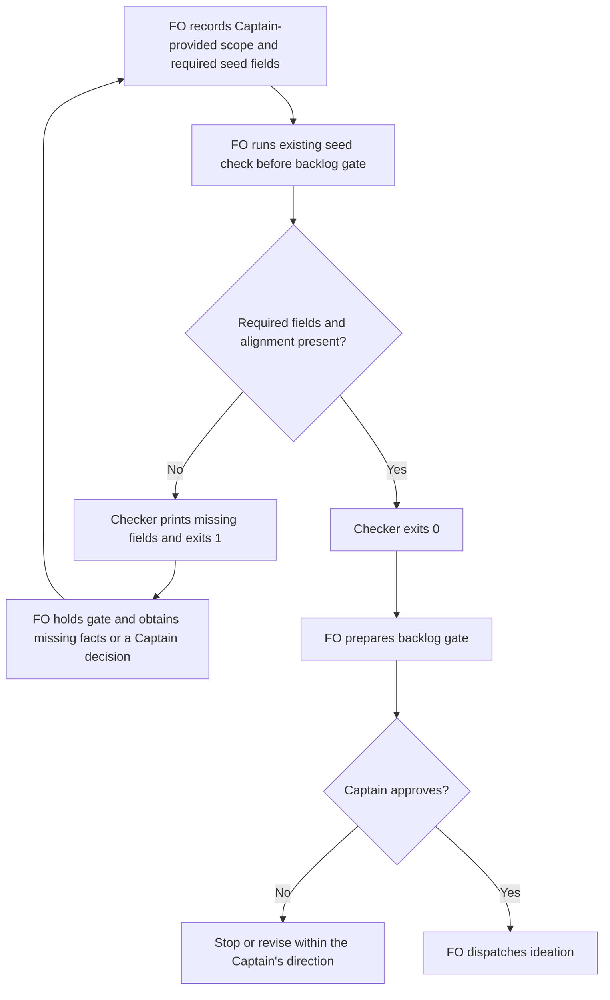

## Scope

- Source: the Captain 「同意開 1 到 5，第 6 項併進「GPT 夥伴」提案」 (chat, 2026-10-27), answering FO's list of package-issue candidates (items 2 to 5 relayed by the relay FO, Paseo 1671c3a9, from its pair-once and room-specs-follow-web-part-select observer reports; item 1 relayed by the kc-ops-inbox FO, Paseo 46c2ebdf).
- Bite: relay room-specs-follow-web-part-select had no budget, no stop condition and no `id:`, yet `design_surfaces.py check --seed` passed (relay FO's report).
- Upstream first: `scripts/design_surfaces.py` (`check --seed`), the workflow README schema, Spacedock `new`.

## FO alignment

Alignment: needed before ideation; where the check runs is a package design choice.
Surfaces: none
Visible change: none
Release review: not needed: workflow maintenance, on no journey map.
Result: aligned 2026-10-27 on the outcome by the Captain's 「全准」 answering this task's backlog briefing-1 question, which named the seed check refusing a task missing its schema's required fields; which fields are required is put to him at the ideation gate.
Reviewer: kc-dev-flow-2:chief-engineer opus 2026-10-27 — batch 8 review at the ideation gate (the Captain's batch ruling 2026-10-27): per-task disposition, the Captain's decisions, order and batch risk.
Reviewer: kc-dev-flow-2:engineering-reviewer opus 2026-10-28 — do these amendments withdraw what the Captain approved, and what changes in the build? Answer: the shipped narrowing matches the Asked row; but the build reads 「只檢查新任務」 as every not-yet-admitted backlog seed (all 54 current backlog tasks fail the body bounds; 42 with FO alignment would be held at their backlog gate), AC-2 and AC-5 still carry superseded promises, and the meaning of new is the Captain's; escalate.

## PRFAQ

The seed check will tell the First Officer (FO) which required task fields are missing before asking the Captain to admit a task. It will check the package workflow's declared seed contract, retain the existing surface checks, and leave the task unchanged. A passing seed will still not prove that the Captain approved its contents.

**Who benefits?** FO gets a field-specific refusal before the backlog gate, instead of learning after delivery that the task omitted its bounds. The observed Relay task is the acceptance example.

**Why here?** This is a repair of the existing `design_surfaces.py check --seed` seam, not a new Spacedock hook or schema framework. Spacedock creates task identity; the package owns its required seed content. ADR 0027, “FO-write rules are checked by the script FO already runs at the write,” supports using that existing check. Skipping it can still bypass the refusal.

**What is optional?** Surface artifacts and finished acceptance criteria are due after ideation, not at seed admission. Pull-request, worktree, gate, journey and number-reservation records are filled at their respective lifecycle steps, not invented to satisfy this check.

**Will old tasks be rewritten?** No. The new field checks run only in `check --seed`, regardless of the task's recorded stage, so an explicit historical replay can expose incompatibility. Default `check` retains its present behavior. Ordinary seed calls remain at backlog admission and the existing idle reminder; this task neither reopens archived gates nor backfills any task. Existing backlog tasks must obtain real missing values from their scope owner before their next admission check.

**What is not promised?** Presence is not approval or adequacy. The checker does not infer a budget, decide whether prose is a good stop condition, parse arbitrary README prose into a schema, validate every YAML feature, prevent direct dispatch, or change the proof-of-concept route. No hosted resource, credential, production obligation or CI trigger is added.

## Design

### Source chain and existing behavior

- Code source: fetched `origin/main` at `8bf4f3582411e8e4238f19fbadda8ddeca6767be`; released package version in `kc-dev-flow-2/.claude-plugin/plugin.json` is `0.32.0`. The supplied Codex package is `/Users/kent/.codex/plugins/cache/kc-claude-plugins/kc-dev-flow-2/0.32.0`; its `scripts/design_surfaces.py` bytes equal that source revision. All package-script runs in this stage used this supplied package.
- Spacedock first: read its own `internal/status/new.go`, `docs/schema/entity.mdschema.yml`, `skills/first-officer/references/fo-write-core.md` in the supplied Spacedock 0.27.3 package, plus native `spacedock new --help`. Its slug route deliberately omits `id` when stdin omits it; the slug is identity. The installed executable reports 0.27.2, so source and executable versions are separately named. A disposable native replay confirmed both omitted-id and matching-explicit-id inputs create successfully, exit 0. The former output has no stored id; the latter retains `id: with-id`. No upstream defect is claimed and no upstream change is needed for the recommendation below.
- Package second: `references/sd/workflow.md` Schema and Task Template explicitly require/illustrate a stored `id`. The adopted workflow repeats that requirement despite `id-style: slug`. `check_task()` returns from its seed branch after only the FO-alignment surface checks; it reads neither these five required frontmatter fields nor Scope bounds. This is the demonstrated missing seam.
- Sibling adopters third, read only: Relay `beirut-dev2`, Web `dev2-fo`, and QNow `qnow-adopt-dev2` each have `docs/dev2/README.md` with `id-style: slug` and the same Schema paragraph. Relay's archived `room-specs-follow-web-part-select.md` has Scope and a separate Non-goals section but no stored `id`, budget or stop condition. Both installed check modes return 0 on it.
- Bounded search: inspected the checker and its tests, then searched every package caller/import of `design_surfaces`. `pr_watch.py seeds()` invokes seed mode and replaces diagnostic detail with “fix its ## FO alignment”; the observer skill invokes seed mode on historical backlog snapshots and currently labels exit 1 a violation. Other consumers import existing symbols or run default mode; preserve those interfaces. External/manual invocations beyond the package are not exhaustively known.
- Prior decisions: read Accepted ADR 0027 and ADR 0020, “A rise in the workflow word budget needs a Captain ruling recorded with it,” at the source revision. Searched state `Override:` gate-reason lines; none concerns seed fields, their format or this id conflict. The no-phrase-check ruling inside ADR 0027 rules out claiming that recognizing words proves a person's intent.

### Required and optional fields

This is what the current workflow README says, before the proposed enforcement changes:

| Location | Required by current README | Not a required seed field |
| --- | --- | --- |
| Frontmatter | `id`, `title`, `status`, `variant: kc-dev-flow-2`, the user's selected `profile` | `merge`, `worktree`, `pr` appear in the template but are not listed by Schema as mandatory seed fields; existing delivery rules still apply later |
| Body | Approved outcome, scope, non-goals, budget, stop condition | Specific labels for those concepts are not currently mandated |
| Later design | Bold acceptance-criterion declarations with individual evidence clauses | Finished criteria, previews, schema artifacts and reviews are not demanded by seed mode |
| Conditional lifecycle | Journey fields when assigned to a release, number reservations when needed, Spacedock-owned gate/report state | No blanket demand for journey, migration, ADR, completion, verdict or gate fields at seed admission |

The five-stage route admits `pilot` or `prod`; the separate proof-of-concept workflow admits `poc`. Profile/route compatibility remains FO's existing check. This design adds missing-field refusal, not a new generic workflow graph validator. Unknown extension fields are preserved and ignored by this new check.

### Proposed contract, subject to the Captain's decision

Keep the five explicitly declared frontmatter fields, including stored `id`. For slug workflows, FO supplies the matching slug as `id` in stdin to `spacedock new`; the native replay shows this supported route. Never synthesize an id from the filename inside the checker: that would silently waive the README requirement. Flat and folder-form tasks have the same required fields.

Require a non-empty `## Scope` section for the outcome/scope, and non-empty Non-goals, Budget and Stop condition records. Accept either a labeled line inside Scope (optional `- ` or `* ` bullet), or its own level-two section; accept singular/plural Non-goal(s) and Stop condition(s). This retains Relay's existing separate Non-goals section. Ignore examples inside backtick or tilde code fences and nested frontmatter keys; a similarly named line in a report, quote or unrelated section must not satisfy the field. This explicit form is a proposed schema clarification, not a claim that old free prose violated a previously mandated format.

Read only the opening frontmatter mapping. Absent fields, empty/whitespace-only values, empty quoted strings, YAML null (`null`, `~`, or an empty value/comment), and unfilled angle-bracket placeholders fail with the field name. Support the ordinary plain/quoted scalar forms used by Spacedock; safely read inline comments and quoted colons. Reject ambiguous duplicate required keys or unsupported mapping/list/block-scalar values for a required scalar, rather than treating their punctuation as content. This is a bounded parser for these fields, not a new YAML dependency or validation of Spacedock's nested gate mapping. Test the boundary explicitly. Body labels require content, not an unfilled angle-bracket placeholder; the script does not decide whether a non-empty value is truthful or adequate.

Add a small seed-field helper in `design_surfaces.py` and call it only in the seed branch, retaining all existing errors. A malformed or missing frontmatter block emits one structural error; otherwise list field defects in stable schema order, followed by body fields and existing alignment defects. Read errors are reported as a diagnostic/nonzero exit, not a traceback or pass. Preserve existing exit semantics: valid seed 0, rejected seed 1; argument errors remain 2. Do not infer a required-field list by scraping arbitrary prose at runtime: this package check implements this package's documented contract, with fixtures pinning their agreement.

The new success line is `<task>: seed fields and FO alignment recorded`. Example Relay refusals are `<task>: missing required frontmatter field: id`, `<task>: missing required body field: Budget`, and `<task>: missing required body field: Stop condition`. `pr_watch.py seeds()` must tell FO to “fix the reported seed fields and run” the check rather than only fix FO alignment; its existing stage/readiness filters remain. No new remote call is needed.

The observer's historical replay rule gains: “For a seed-field failure on a historical copy, report current-schema incompatibility; call it a historical violation only if the README at that event required the same form.” Missing event-time schema evidence is `can't tell`. Old surface failures retain their existing interpretation. This prevents a new labeling requirement being misreported as an old operator failure.



The actors, order, refusal, approval and stop above match the prose. Skipping the check is an acknowledged unsupported bypass, not a hidden automatic hook. Mermaid was reviewed against the prose; a rendered diagram was not exercised in this stage. `Surfaces: none` owes this PRFAQ/diagram, not a UI preview.

### Proposed workflow wording

Replace the Schema paragraph with the following text, retaining the separate stage and profile ownership rules:

> Record non-empty `id`, `title`, `status`, `variant: kc-dev-flow-2`, and the user's selected `profile`. For `id-style: slug`, supply the slug as `id` to `spacedock new`; otherwise it omits that field. The five-stage route accepts `pilot` or `prod`; the POC adaptation removes ideation from frontmatter and Stages and accepts `poc` only. Before admission and dispatch, FO holds an unknown/mismatched profile; SD does not enforce this rule. Preserve approved outcome and scope under `## Scope`, with non-empty `Non-goals:`, `Budget:` and `Stop condition:` lines or matching level-two sections. Use bold **AC-N** declarations with individual evidence clauses.

In the seed-check bullet replace “An FO that skips this step still dispatches; the worker's own check is the backstop.” with “An FO that skips this step still dispatches; no runtime hook blocks it.” Default mode is deliberately not a backstop for these new seed fields.

Replace the Task Template's Scope placeholder with:

```text
<Approved outcome and scope.>
Non-goals: <exclusions>
Budget: <approved bound>
Stop condition: <when to return to the Captain>
```

The package README's description of seed mode changes from “checks the FO record” to “checks seed fields and the FO record.” CLI help must describe seed fields too. The proof-of-concept derivative must still omit the seed gate and ideation; update its derivation fixtures if the revised Schema text changes their anchors, without adding a new proof-of-concept obligation.

### Replay evidence and its limits

The disposable classifier models missing/non-empty field and body-record presence only; it is not an implementation candidate and does not prove the proposed quoting, duplicate-key, placeholder or fence-edge handling. The existing package was actually executed in both modes on every committed entity at the snapshots below. Each input stayed unchanged during its two runs, and its SHA-256 matched `git show <state>:<path>` afterwards: 164 of 164 matches. No adopter task was edited.

| Corpus | Pinned state commit | Files | Current seed: pass/fail | Proposed seed: pass/fail | Current default: pass/fail |
| --- | --- | --- | --- | --- | --- |
| This workflow, active and archive | `0d8847df7b0ef6e9046d8ff99dd6331bff010d2b` | 163 (69 active, 94 archived) | 140 / 23 | 0 / 163 | 73 / 90 |
| Relay named example | `d20ff925992d34e70808b4291b32560afbc7fee5` | 1 | 1 / 0 | 0 / 1 | 1 / 0 |

The 140 newly refused local seeds comprise 59 active and 81 archived tasks. All 23 existing failures retain failure; new diagnostics are additive. New default-mode enforcement is not proposed: its 73/90 result is the baseline, not a claimed future candidate pass. Relay currently prints `room-specs-follow-web-part-select.md: FO alignment recorded`; the proposal adds exactly id/Budget/Stop condition refusals. Its task SHA-256 is `a385615b692934c41a1c1664d3b1444cc09020cb03622c1ec7c0e95ed2ec0fa6`.

Across the 163 local files the classifier finds no usable id in 162, Budget in 156, Stop condition in 157, Non-goals in 62, Scope in 16, and profile in 2. These are current-form compatibility findings, not claims that all these tasks lacked the underlying human decision. Every newly refused group is listed below for FO's ordering and migration assessment. No bulk repair is authorized.

- Non-goals, Budget, Stop condition (1): `journey-server-host-pilot/index.md`.

- id (2): `_archive/ops-metric-event-protocol.md`, `ops-inbox-r1-setup-and-isolation.md`.

- id, Budget, Stop condition (93): `_archive/adr-protected-path-guard.md`, `_archive/agent-reads-governing-adr.md`, `_archive/board-optout.md`, `_archive/captain-question-load.md`, `_archive/chat-only-evidence-observer-blind.md`, `_archive/codex-reader-counts-code-review-only.md`, `_archive/codex-review-hang-detected.md`, `_archive/codex-review-round3-followups.md`, `_archive/commissioned-by-names-spacedock.md`, `_archive/copilot-quota-refusal-is-not-a-review.md`, `_archive/db-surface-without-migrations.md`, `_archive/delivery-gate-reads-folder-tasks.md`, `_archive/delivery-gate-settles-skipped-checks.md`, `_archive/delivery-gate-verdict-form.md`, `_archive/design-director-runs-ui-design-review.md`, `_archive/dev2-laws-check.md`, `_archive/extension-defaults-and-install-choice.md`, `_archive/extension-instruction-reaches-dispatch.md`, `_archive/fo-batch-sittings.md`, `_archive/fo-lifecycle-mod.md`, `_archive/fo-record-checks.md`, `_archive/fo-write-checks.md`, `_archive/fo-write-rules-checked.md`, `_archive/fo-written-lines-checked-before-dispatch.md`, `_archive/followup-dispatch-records-checked.md`, `_archive/followup-dispatch-records-round3-followups.md`, `_archive/idle-names-failing-seeds.md`, `_archive/journey-render-keeps-annotations.md`, `_archive/kc-adr-tools-with-dev2-copy.md`, `_archive/learn-delivery-follow-through.md`, `_archive/learn-delivery-round3-followups.md`, `_archive/merge-ask-holds-missing-clauses.md`, `_archive/names-check-before-dispatch.md`, `_archive/new-work-starts-from-a-story-map.md`, `_archive/observer-before-merge-guard.md`, `_archive/observer-check-round3-followups.md`, `_archive/patch-0102.md`, `_archive/patch-0103.md`, `_archive/peers-paseo-host-binding.md`, `_archive/poc-no-migrations.md`, `_archive/pr-watch-round3-followups.md`, `_archive/pr-watch-state-per-session.md`, `_archive/pr-watch-tasks-round3-followups.md`, `_archive/reflow-order.md`, `_archive/release-acceptance/index.md`, `_archive/release-review-staleness-held-at-dispatch.md`, `_archive/release-review.md`, `_archive/release-walk-picky-reviewers-and-director.md`, `_archive/replay-control-arm-round3-followups.md`, `_archive/review-followups-0102.md`, `_archive/role-triggers-owe-ce-on-review-drift.md`, `_archive/special-role-calls-fire-when-needed.md`, `_archive/stage-report-correction-path.md`, `_archive/worker-completion-goes-to-main.md`, `_archive/worker-knows-the-team-and-asks-early.md`, `_archive/workflow-checkout-must-match-trunk-readme.md`, `_archive/workflow-gaps-from-qnow-1270.md`, `adoption-asks-which-extensions.md`, `adr-required-statement.md`, `adr-silent-undo-probe.md`, `agents-md-holds-instructions.md`, `autopilot-l3-dogfood-spacedock-bridge.md`, `built-screen-check-round3-followups.md`, `claims-name-their-source.md`, `comment-check-reaches-delivery-gate.md`, `deprecate-kc-dev-flow-v1.md`, `design-director-model-follows-task.md`, `design-surfaces-task-dir-crash.md`, `dispatch-sets-reasoning-effort.md`, `fo-asks-to-raise-concurrency.md`, `fo-interviews-extension.md`, `fo-narrates-outward-writes.md`, `fo-write-checks-parse-top-level.md`, `gate-presentation-asks-one-thing-plainly.md`, `gpt-partner-extension-proposal.md`, `interrogation-strangers-isolated.md`, `journey-canvas-hosted-poc.md`, `journey-card-notes.md`, `journey-map-contract-round3-followups.md`, `journey-review-check-round3-followups.md`, `kc-adr-dev2-sharing-better-way.md`, `learn-names-agents-md-candidates.md`, `merge-check-reads-two-pr-tasks.md`, `merge-guard-stops-unasked-merges.md`, `new-work-checks-what-exists-first.md`, `override-recorded-when-captain-departs.md`, `prod-split-owes-chief-engineer-route-review.md`, `product-review-path-before-backlog.md`, `read-adr-honors-adr-folder.md`, `release-walk-due-trigger.md`, `retire-task-with-unconsumed-approval.md`, `rewalk-binds-prior-and-carries-complaints.md`, `workflow-checkout-round3-followups.md`.

- id, Non-goals, Budget (1): `_archive/kc-decision-log-p1/index.md`.

- id, Non-goals, Budget, Stop condition (36): `_archive/amendment-form-check.md`, `_archive/codex-reader-reads-receipt-marker.md`, `_archive/codex-reader-resolved-mark-adr.md`, `_archive/codex-reader-same-head-unresolved.md`, `_archive/dispatch-and-report-hygiene.md`, `_archive/ideation-gaps.md`, `_archive/merge-gatekeeper.md`, `_archive/migration-and-number-guards.md`, `_archive/number-guards-readme-shrink.md`, `_archive/override-reaches-gate-and-criteria-wait.md`, `_archive/peers-rules-name-each-host-binding.md`, `_archive/prod-security-validation-gate.md`, `_archive/review-cadence.md`, `_archive/special-role-triggers.md`, `_archive/ui-design-review-in-ideation.md`, `_archive/worker-loads-declared-package.md`, `_archive/workflow-budget-ratchet.md`, `archive-waits-for-observer-report.md`, `batch-reaches-each-gate-together.md`, `captain-ruling-sources-checked.md`, `copilot-not-run-line-carries-quote.md`, `dispatch-carries-reserved-adr-number.md`, `fo-tries-what-it-asks-the-captain.md`, `gate-summary-names-each-decline.md`, `ideation-preview-is-one-static-file.md`, `idle-hook-names-merged-tasks-without-learn.md`, `journey-fold-answers-open-placeholders.md`, `journey-probe-finds-nested-maps.md`, `observer-check-learn-only-when-listed.md`, `paseo-codex-dispatch-practice.md`, `repair-dispatch-asks-for-sibling-sites.md`, `reused-worker-dispatch-leaves-a-record.md`, `reviewer-negative-claim-shows-reach.md`, `seed-check-requires-schema-fields.md`, `superseded-criterion-without-dispatch-caught.md`, `workflow-readme-in-invocation-test.md`.

- id, Non-goals, Stop condition (1): `_archive/kc-decision-log-cli.md`.

- id, Scope, Non-goals, Budget, Stop condition (2): `_archive/journey-map-dev2-contract.md`, `_archive/prod-security-review-gates.md`.

- id, Stop condition (3): `_archive/kc-adr-format-source.md`, `_archive/read-adr-reporting-rule-followup.md`, `kc-decision-log-handoff-trial.md`.

- id, profile, Budget, Stop condition (1): `paseo-fo-board.md`.

Reproduction: use the supplied 0.32.0 package, the state roots named in Source chain, and the pinned commits above. Enumerate tracked flat `<slug>.md` and `<slug>/index.md` entities at the state root and `_archive/`, excluding README and ancillary task folders. Run `python3 <package>/scripts/design_surfaces.py check --seed <task>` and `check <task>` per entity, recording stdout and exit. Compare bytes with `git show <state>:<path>` and reject a run on changed input; default mode also reads existing artifacts/history. The classifier used for the proposed missing-field projection is below. Feed it each pinned task text; projected seed exit is 1 when either the actual seed exit is nonzero or this list is nonempty. This is a research predicate, not shipping code.

```python
import re
# ds is the supplied package scripts/design_surfaces.py module.
def absent(text):
 fm=ds.FRONTMATTER.match(text); fields={}
 for l in (fm[1].splitlines() if fm else []):
  m=re.match(r'^([\w-]+):[ \t]*(.*)$',l)
  if m: fields[m[1]]=m[2].strip().strip('\"\'')
 missing=[k for k in ('id','title','status','variant','profile') if fields.get(k,'').lower() in ('','null','~')]
 body=text[fm.end():] if fm else text
 plain='\n'.join(ds.unfenced(body.splitlines()))
 scope=re.search(r'^## Scope\s*\n(.*?)(?=^## |\Z)',plain,re.M|re.S)
 scope=scope[1] if scope else ''
 if not scope.strip(): missing.append('Scope')
 for label,pat in [('Non-goals',r'Non-goals?'),('Budget',r'Budget'),('Stop condition',r'Stop conditions?')]:
  line=re.search(r'^(?:[-*] )?'+pat+r':[ \t]*\S[^\n]*',scope,re.M|re.I)
  section=re.search(r'^## '+pat+r'[ \t]*\n(.*?)(?=^## |\Z)',plain,re.M|re.S|re.I)
  if not line and not (section and section[1].strip()):missing.append(label)
 return missing
```

### Words FO reads at each lifecycle moment

Counts use whitespace splitting, as `lint-skills.py` does. Before is the pinned 0.32.0 source; after is the literal proposed wording above, not a built candidate. Path, task and PR placeholders each count as one token. Count both a newly printed diagnostic and the instruction that makes FO run it. This is not a word-saving claim.

| Moment and measured passages/output | Before | Proposed after |
| --- | --- | --- |
| Entry/startup or full resume: package README + adopted workflow source + package mod | 3067 + 5565 + 48 = 8680 | 3070 + 5577 + 48 = 8695 |
| Backlog admission, good seed: Seed check bullet + success output | 40 + 4 = 44 | 38 + 7 = 45 |
| Backlog admission, Relay-shaped missing id/bounds: bullet + output | 40 + 4 = 44 | 38 + 19 = 57 |
| Idle on an open PR, no backlog seed defect: package mod | 48 | 48; all existing PR fact/reviewer/next output unchanged |
| Idle on an open or merged PR, one backlog seed newly refused | 48 + 0 = 48 | 48 + 28 = 76; the reminder uses “fix the reported seed fields and run” (the replacement itself remains seven words) |
| Idle on a merged PR: package mod + learn extension | 48 + 282 = 330 | 330; existing observer/sentinel/learn step output unchanged |
| After archive: learn extension | 282 | 282; learn instructions/output unchanged; historical seed findings have the qualification below |
| Merge ask: Delivery authority + Extensions sections | 461 + 224 = 685 | 685; delivery-check output unchanged |

These are the task's affected and neighboring package instruction passages, not total model context: unchanged Spacedock runtime instructions, review payloads and variable-length task/report text are excluded equally. No reduction of total FO reading is claimed. Open/merged-PR script output stays byte-identical when no backlog seed newly fails; a new seed reminder is an intended extra read. The observer worker loads 27 extra words (the exact sentence above), and FO sees that distinction in any historical finding; report length depends on the number of findings and is not a fixed saving. Validation must compare complete emitted output on the same controlled lifecycle fixtures, not substitute this table for runtime measurement.

The workflow source grows by 12 words, 5565 to 5577 (Schema +4, seed-bypass sentence -2, template +10). Under ADR 0020 this requires the Captain's actual approval quote and `loaded: startup/resume` on the +12 budget step; do not insert a quote until the decision below is answered. The package README grows by 3 words. Nothing moves into a hidden always-read file.

### Captain decision

**Approve the explicit seed contract above, keeping stored `id` as the current README requires, plus labeled body bounds?** Recommendation: approve it as one schema decision, including the measured +12 workflow words. The choices are coupled: the chosen schema determines both which seeds fail and the creation instructions FO must follow.

This catches the observed omission in the existing check, makes no upstream change, and permits the native `spacedock new` route by supplying a matching id. What gets worse: a redundant id must be supplied in slug workflows, 140 currently passing local seeds would fail if replayed, and old free-form body records may need explicit labels before a future admission. Missing scope/budget values must be decided, not guessed by a worker. Alternative: align the README with Spacedock by making id optional in slug workflows and enforce only the remaining fields; that reduces redundant data but changes the currently written requirement and needs an explicit schema choice. Neither option is approved by this ideation report.

If approved, land one decision record titled “Seed admission enforces the workflow's explicit required fields”; leave its number to FO at implementation dispatch. The record distinguishes current schema compatibility from historical operator fault and records the seed-only scope. No other Captain decision is needed for parser/test placement. The recommended implementation bound is this package check and its existing consumers, with no adopter migration; stop and return to FO if implementation needs an upstream creation change, an additional persistent schema service, or automatic legacy repair. This is a recommendation for the gate, not a retroactive addition to this task's accepted Scope or budget.

### Batch overlap

Planned implementation files, all relative to the code repository:

- `kc-dev-flow-2/scripts/design_surfaces.py`, `scripts/test_design_surfaces.py`: seed-field behavior and counterexamples; preserve all existing default-mode imports/output.
- `kc-dev-flow-2/scripts/pr_watch.py`, `scripts/test_pr_watch.py`: correct the seed reminder and prove the actual seed subprocess reaches it; no new provider calls.
- `kc-dev-flow-2/references/sd/workflow.md`, `scripts/lint-skills.py`: schema/template/bypass wording and the Captain-backed +12 budget step.
- `kc-dev-flow-2/scripts/test_sd_dispatch.py`: update real seed fixtures and verify the native backlog definition still carries the check.
- `kc-dev-flow-2/scripts/poc_readme.py`, `scripts/test_poc_readme.py`: only if the revised Schema changes a derivation anchor; preserve no-ideation/no-seed-gate output. These are conditional file touches, not permission to redesign that route.
- `kc-dev-flow-2/README.md`, `skills/observer/SKILL.md`: accurate seed-mode description and historical-replay qualification.
- `docs/adr/<FO-reserved-number>-seed-admission-enforces-required-fields.md`: the accepted ruling, if the Captain approves it. No existing ADR rewrite or index-file edit is proposed; `docs/adr/` is a shared number namespace. No adopted README, other task, CI workflow, release manifest or Spacedock source is changed by this design stage or automatically by the feature.

Paths prefixed only with `scripts/` or `skills/` in the first list are under `kc-dev-flow-2/`.

| Other task (task slug) | Shared file/check, based on current task record | Ordering consequence |
| --- | --- | --- |
| archive-waits-for-observer-report (archive waits for committed observer evidence) | Its newly written design directly shares `kc-dev-flow-2/README.md`, `scripts/test_sd_dispatch.py` and the ADR number namespace; it also changes mod/learn/adoption/recovery files outside this task. It leaves workflow/lint/watcher unchanged. | Serialize README/dispatch-fixture edits; preserve its upstream-dependent prerequisite and this historical-replay qualification independently. |
| idle-hook-names-merged-tasks-without-learn (idle reminder for missing learning) | `scripts/pr_watch.py`, its tests, and startup/idle output measurement | Implement after that task or serialize watcher edits; rerun both sets of lifecycle fixtures. |
| copilot-not-run-line-carries-quote (review refusal includes evidence quote) | No direct overlap in its current Scope: delivery checker and Copilot reader; shared end-to-end lifecycle measurement only | Independent code work; do not overwrite its merge-output assertions. |
| dispatch-carries-reserved-adr-number (dispatch repeats reserved decision number) | Its newly written recommendation changes only its task record, no package files; dispatch checking imports helpers from this checker. | No ordering dependency under that recommendation; preserve imports and rerun dispatch tests. Recheck only if the Captain chooses broader coverage. |
| seed-check-requires-schema-fields (this task: required seed fields) | Owns the file list above | Own task only; no sibling-state repair. |
| journey-probe-finds-nested-maps (adoption finds nested journey maps) | Scope names adoption reference; no direct file overlap established. Adoption/POC tests may share integration coverage. | Independent unless its final design touches shared tests or README. |
| read-adr-honors-adr-folder (decision reader respects supplied folder) | Source and copied read-ADR skill plus copy-sync script; none of this task's runtime files | Independent; consume whatever reader rule lands without editing its files. |
| adr-required-statement (implementation states its decision records) | Historical design shares workflow/POC files and the ADR namespace, but the Captain closed it on 2026-10-20; its validation frontmatter is stale. | Do not wait for, land or revive that branch. Coordinate those files only if FO records a reopening. |
| journey-server-host-pilot (private journey server on two hosts) | Current folder-form task changes journey-server package/docs; no seed file overlap, only ADR number namespace | Independent code; FO allocates distinct decision numbers. |
| ops-inbox-r1-setup-and-isolation (signed events and isolated setup) | `kc-ops-inbox/**` and its workflow; no direct seed-file overlap, shared ADR namespace | Independent; its task is read-only input to the replay. |
| pr-review-lite-value-pilot (supervised comparison of review routes) | Review-capability package scripts; no direct file/check overlap found | Independent. |
| adr-silent-undo-probe (measure accidental reversal of an earlier ruling) | Held here and moved by Captain amendment to `adr-silent-undo-poc` in the POC workflow; no shipped package overlap declared | Do not redispatch this copy; the experiment grants no authority to change ADR rules. |
| comment-check-reaches-delivery-gate (delivery checks comment evidence) | The Captain closed it on 2026-10-20 with the recommendation not to build; no live edit is inferred from its stale ideation status. Existing `delivery_gate.py` still imports this checker. | Do not revive its design. Preserve exported helpers and run the existing delivery consumer suite. |
| journey-canvas-hosted-poc (prove a hosted shared canvas) | Journey hosting/canvas; no direct seed-file overlap found | Independent; no hosting action belongs in this task. |

The current work state is shared and other stages remain live. The table describes read-only task-record evidence, not current remote PR status or an ownership grant. GitHub API state was not queried; the assignment uses git/local evidence. Proposed work must recheck the neighboring designs at dispatch because several batch tasks are still in ideation.

Recommended order: coordinate the shared watcher files with `idle-hook-names-merged-tasks-without-learn`, and serialize README/dispatch-test edits with `archive-waits-for-observer-report`; then rebase this implementation and rerun corpus/consumer checks. Do not wait for or revive the closed ADR-statement/comment-check tasks. The reserved-number task currently recommends no source change. Other named tasks have no established same-file dependency. FO owns that ordering.

## Acceptance criteria


**AC-2**: Scope and the three explicit body records are required in the accepted forms, without treating fenced examples, unrelated sections or empty labels as content; no missing value is invented.
Verified by: a complete seed using Scope labels and one using dedicated sections both pass; remove each field separately and test backtick/tilde fenced impostors and headings in quotes. Relay's unchanged pinned task produces exactly the new id/Budget/Stop-condition reasons in seed mode. Falsifier: accept label-only content, scan all body sections, or remove fence exclusion; the corresponding impostor must flip from refused to accepted. Future implementation evidence; the disposable classifier covered the ordinary historical forms only.


**AC-5**: Every changed corpus verdict is explained at the exact implementation candidate, with no silent archive/adopter repairs and no historical fault inferred solely from the new format.
Verified by: execute base and candidate in both modes over all 163 pinned local tasks plus Relay, then repeat on all newly committed entities present at implementation time; retain path, input digest, exit and output. Seed changes must match accepted required-field failures; default outputs/exits must remain unchanged on identical history/artifacts. Test the observer instruction against an old free-prose snapshot and its event-time README, yielding current incompatibility or `can't tell`, not invented old-format violation. Falsifier: make seed enforcement unconditional or remove the historical qualification; the default comparison or retrospective case fails. Current evidence is the 164-file base run and explicit design projection above, not a candidate comparison.

**AC-6**: Documentation, native dispatch fixtures and lifecycle wording agree with the approved schema; word changes and the durable ruling are explicit.
Verified by: run package lint at the final rebased candidate with the actual Captain quote for any positive budget step, the POC/dispatch checks above, and compare complete output on fixed startup, valid/refused backlog, open/merged idle, archive and merge-ask scenarios using whitespace counts. Keep all baseline passages in both counts; show new diagnostics rather than claiming a saving. Run the existing ADR lint for the number FO reserves. Falsifier: count only workflow.md, drop a newly printed seed reminder, leave a template placeholder passing, remove the budget quote, or assert an old historical violation without matching old schema evidence; each must fail its declared check/review. Current evidence: literal proposed wording measures +12 workflow words and +3 package-README words; shipping checks remain future work.

**AC-7**: The feature remains a read-only package seed check with no new upstream hook, provider request, automatic task migration or CI trigger.
Verified by: run the seed matrix with input byte comparisons and network/process calls observed; inspect the named-file candidate diff and run the relevant existing package tests already selected by the current CI workflow. No implementation change outside the approved files without FO routing. Falsifier: add task mutation, a remote request, seed enforcement to default mode, or a new CI trigger; the byte comparison/call observation/diff review must fail. CI cost per PR was not measured in this design stage; no CI configuration change is proposed.

Amendment 1 governs the remaining replay clauses too: no stored-id refusal or new frontmatter/Scope enforcement is owed; historical results are compatibility counts, not enforcement on existing tasks.

**AC-8**: Amended by Captain, amendment 1 (replaces AC-1): Seed mode requires only the three new body bounds, Non-goals, Budget and Stop condition. A stored id is optional under id-style: slug; no new frontmatter or Scope check is added.
Verified by: delete or empty each bound in flat and folder seeds, retain the field-specific exit-1 diagnostic and unchanged bytes, and pass seeds with omitted/matching id. Falsifier: disable the seed-bound call, accept empty/placeholders, or add a stored-id requirement; the matrix must fail.

**AC-9**: Amended by Captain, amendment 1 (replaces AC-3): Native Spacedock creates compliant slug seeds with omitted or matching stored id in flat/folder form; the package checks bounds, and native creation still refuses a mismatching id.
Verified by: actual native new and the actual candidate seed subprocess on all four creation cases, then remove Budget and require refusal. Falsifier: require stored id or drop bound enforcement; the corresponding creation/check case must fail.

**AC-10**: Amended by Captain, amendment 1 (replaces AC-4): Newly admitted seeds reach the backlog/idle check with useful wording; existing tasks are replayed for counts without enforcement or migration. Default check, imported helpers, optional fields and the proof-of-concept route preserve behavior.
Verified by: actual seed subprocess on a backlog/needs-preparation task with valid alignment but missing Budget; existing route filters and consumer/POC suites; base/candidate corpus outputs and hashes. Falsifier: suppress the seed call, retain alignment-only wording, or enforce the new bounds in default mode; the relevant test/comparison must fail.

### Feedback Cycles

- Cycle 1 (FO, 2026-10-28): validation-1 on #738 2f3966a6, F1 Material: a `## Budget` section holding only an indented quote (one to three spaces then `> <approved bound>`) passes as a real budget, because design_surfaces.py filters `>` only at column zero; to fix; investigation first, then FO fix authorization, then validation. F2 Polish (a five-word count gap in the merge-ask total) goes with it.

## Captain amendments

### Amendment 1 — 2026-10-27, chat
Captain: 「其他全照建議」 (chat, 2026-10-27)
Asked: 「需要你決定：第 8 批的設計，照首席工程師的建議一起處理，可以嗎？6 張進入實作，1 張直接關掉，再送一份 issue 給 Spacedock。我和首席工程師都建議照這樣做。」, with this task's row 「任務缺必要欄位要擋 ｜ 縮小範圍 ｜ `id` 改成可不寫（Spacedock 本來就不寫，163 個裡有 162 個沒有）；只要求「不做的事」「預算」「停止條件」三項；只檢查新任務」
Supersedes: AC-1, AC-3 and AC-4 as written (the implementation worker restates them for an optional stored id under id-style: slug, the three required body records, and new seeds only with replay counts reported)

Superseded text:

**AC-1**: Seed mode refuses each absent or empty required frontmatter field with a field-specific diagnostic and exit 1; a complete seed with no optional fields exits 0, in flat and folder form.
Verified by: in `test_design_surfaces.py`, start with one complete seed, delete or blank each of the five fields individually, then restore it. Include quoted empty/null/comment-only/placeholder values, nested lookalikes, body lookalikes, malformed frontmatter and ambiguous duplicate keys. Verify input bytes unchanged. Falsifier: remove the new seed-field call or search the entire text instead of opening top-level frontmatter; each must make a named negative case pass and fail the test. Future implementation evidence; the current checker gap was observed, not fixed.

**AC-3**: The unchanged `spacedock new` mechanism can create a compliant slug seed when given the matching stored id; it does not itself enforce the package's required bounds.
Verified by: in a disposable workflow, run the selected native binary on otherwise identical complete stdin with id omitted and with `id: <slug>` supplied. Creation succeeds for both; the proposed seed check refuses the first and passes the second. Include folder creation and a mismatching supplied id, which native Spacedock refuses. Falsifier: treating filename identity as the stored field makes the omitted-id negative case pass. Current evidence: the installed 0.27.2 executable created both omission and matching-id flat cases; the proposed-check/folder/mismatch matrix remains future work.

**AC-4**: The refusal reaches the existing backlog/idle route with useful wording, while default `check`, imported helpers, optional fields and the proof-of-concept route preserve their behavior.
Verified by: run `test_pr_watch.py`, `test_sd_dispatch.py --sd-plugin-root <selected Spacedock package>`, `test_poc_readme.py`, `test_dispatch_records.py`, `test_delivery_gate.py` and checker tests at the candidate. Use one backlog/needs-preparation task with valid alignment but missing id, invoking the actual seed subprocess rather than a stubbed refusal; require the reminder naming seed fields. Verify non-backlog rows stay filtered and a POC workflow gets no seed/ideation gate. Falsifier: suppress the helper call, keep the old FO-alignment-only instruction, or move the new field check before the seed branch; the relevant test must fail. Future evidence, not tested as a candidate in this stage.

### Amendment 2 — 2026-10-28, chat
Captain: 「全准」 (chat, 2026-10-28)
Asked: FO's batch-8 second merge sitting, item 「**要你裁定的：你批准的「只檢查新任務」，「新」指的是什麼？** 工程審查員發現，現在的寫法把「所有還沒通過待辦關卡的任務」都當成「新」。目前待辦清單裡 54 張全部缺這三項，其中 42 張已經寫好對齊說明，等著開待辦關卡。」 with 「**我建議：就照現在這樣，「新」＝還沒通過待辦關卡的任務。** 以後我要拿一張舊待辦給你批之前，先補上「不做的事、預算、停止條件」三行。」
Supersedes: AC-2 and AC-5's remaining Scope requirement and existing-task replay clauses (no replacement: a new seed is any backlog task not yet admitted, and FO adds the three bounds to an older task before presenting its backlog gate)

## Number guards

ADR: 0041

## Stage Report: ideation

- DONE: A design for /Users/kent/.claude/plugins/cache/kc-claude-plugins/kc-dev-flow-2/0.32.0/scripts/design_surfaces.py check --seed to refuse a task missing a field the workflow README's schema actually requires (read the README schema first and list which fields are required and which optional), replayed over every task file in this workflow and the relay room-specs-follow-web-part-select task read only
  `## Design`: README-required/optional fields listed; source chain checked; native slug creation exercised. Actual 164-file base replay plus explicitly non-shipping field projection; 140 local and 1 Relay seeds newly refuse. Removing required-field enforcement would preserve their old passing result.
- DONE: A `### Batch overlap` section naming each file the design would change and each other batch task (archive-waits-for-observer-report, idle-hook-names-merged-tasks-without-learn, copilot-not-run-line-carries-quote, dispatch-carries-reserved-adr-number, seed-check-requires-schema-fields, journey-probe-finds-nested-maps, read-adr-honors-adr-folder) and live task of other sessions (adr-required-statement, journey-server-host-pilot, ops-inbox-r1-setup-and-isolation, pr-review-lite-value-pilot, adr-silent-undo-probe, comment-check-reaches-delivery-gate, journey-canvas-hosted-poc (driven by other sessions; read only)) that changes the same file or check, so FO can order implementation
  `### Batch overlap`: all seven batch tasks and seven named other-session records mapped to files/checks; refreshed against new sibling designs and Captain-recorded closures rather than trusting stale frontmatter.
- DONE: The words FO reads at each lifecycle moment, before and after, per root learning.md "Measure the words FO reads at each moment, not one file's size"
  `### Words FO reads at each lifecycle moment`: source/proposed whitespace counts and output branches; workflow 5565→5577, package README +3, missing Relay seed 44→57 words. Full runtime emission comparison remains implementation evidence.
- DONE: Acceptance criteria with reproducible evidence clauses and falsifiers, and unresolved decisions for the Captain, each with a recommendation and what gets worse under it
  `## Acceptance criteria`: seven individually named evidence plans and falsifiers; `### Captain decision` makes one coupled schema choice, recommends keeping stored id and explicit bounds, and states compatibility/reading costs.
- DONE: Current design artifact check
  Supplied 0.32.0 `design_surfaces.py check <task>` exits 0: `seed-check-requires-schema-fields.md: design surfaces presentable`; Scope/frontmatter preserved. Mermaid prose agreement reviewed; rendering not exercised.
- SKIPPED: AC-1 implementation acceptance proof
  Candidate missing/empty/ambiguous scalar matrix not implemented; current seed omission reproduced and acceptance falsifiers recorded.
- SKIPPED: AC-2 implementation acceptance proof
  Candidate body/fence matrix not implemented; historical ordinary-form classifier projects Relay id/Budget/Stop-condition refusal.
- SKIPPED: AC-3 implementation acceptance proof
  Native 0.27.2 flat omission and matching-id creation both exit 0; candidate refusal, folder and mismatch matrix not yet verified.
- SKIPPED: AC-4 implementation acceptance proof
  Candidate consumer/POC checks not run; existing caller/import paths inspected and behavioral integration falsifiers specified.
- SKIPPED: AC-5 implementation acceptance proof
  164 base task runs in each mode completed with all input hashes matching pinned state; actual candidate comparison and historical observer qualification remain unverified.
- SKIPPED: AC-6 implementation acceptance proof
  Proposed literal words measured; shipping lint, actual lifecycle output, Captain-backed budget entry and reserved ADR remain future work.
- SKIPPED: AC-7 implementation acceptance proof
  No package/adopter/CI source changed in ideation; candidate byte/network/diff checks remain future work; CI cost not measured.

### Summary

Designed a seed-only repair against released 0.32.0, with required/optional schema fields, native Spacedock evidence, a 164-task replay and refreshed batch ordering. The Captain still decides the explicit schema, including stored id despite native slug omission and the +12 workflow-word cost; no implementation, historical migration or remote PR claim is made. This report completes the pilot ideation assignment only.


## Implementation evidence

Candidate: `2f3966a6ca1394a5154034637a55314613180875`; base: `207c0a7eb51d08c00e68dbe52e9b364793750484`. Local raw evidence: `/var/folders/tm/dk0m7pgx4h3gxqv_v2v8nds00000gp/T/seed-schema-evidence-hksgnuxy/` (`manifest.json`, corpus JSON with per-path digest/exit/output, `replay-summary.json`, mutation source/logs/runner, lifecycle counts/complete output, historical review and test logs); native commands/stdin/exits: `/private/var/folders/tm/dk0m7pgx4h3gxqv_v2v8nds00000gp/T/dev-flow-2-sd-ubp66rkn/commands.jsonl`.

The 138 newly refused seeds in each 163-task snapshot group as Budget+Stop condition 94; all three bounds 39; Stop condition 3; Non-goals+Stop condition 1; Non-goals+Budget 1. The 23 prior failures stay failed with only accepted missing-bound diagnostics added; 2 prior passes stay passed. Default pass/fail counts are 73/90 at pinned `0d8847df7b0ef6e9046d8ff99dd6331bff010d2b`, 79/84 at current `a20f15267689a47c58111466acada1c0b2c42b0d`, and 1/0 on Relay `d20ff925992d34e70808b4291b32560afbc7fee5`; within every identical snapshot, base and candidate outputs/exits match. Relay input SHA-256 remains `a385615b692934c41a1c1664d3b1444cc09020cb03622c1ec7c0e95ed2ec0fa6`.

Actual whitespace counts retain all baseline passages; these measure the declared package passages plus complete controlled script output, not total model context. Open/merged/archive/merge-ask output is byte-identical across the two script variants; seed output and its reminder intentionally change. Provider interfaces are local fixtures; no live provider query is part of this evidence.

| FO moment and complete measured passages/output | Base | Candidate |
| --- | --- | --- |
| Startup: package README + workflow + mod | 3067+5565+48 = 8680 | 3072+5576+48 = 8696 |
| Valid backlog: seed bullet + actual seed output | 40+4 = 44 | 38+7 = 45 |
| Refused backlog, Relay-shaped bounds: bullet + output | 40+4 = 44 | 38+13 = 51 |
| Idle, refused backlog: mod + actual reminder | 48+0 = 48 | 48+28 = 76 |
| Open idle, no seed defect: mod + full output | 48+29 = 77 | 48+29 = 77 |
| Merged idle: mod + learn extension + full output | 48+280+20 = 348 | 48+280+20 = 348 |
| Archived: learn extension + full output | 280+5 = 285 | 280+5 = 285 |
| Merge ask: Delivery authority + Extensions + full output | 685+57 = 742 | 685+57 = 742 |

Historical observer review uses the pinned Relay input: current compatibility fails for Budget/Stop condition; historical operator fault is `can't tell` without matching event-time README bytes. Removing the qualification restores an unsupported historical-violation claim and fails that manual review; live observer behavior was not exercised. Named-file review rejects the negative case of adding a CI trigger because it is outside the approved files; no trigger was installed or run.


## Stage Report: implementation

- DONE: Implement the approved design and Captain amendment 1 on the assigned branch; only the files the design names.
  Candidate `2f3966a6ca1394a5154034637a55314613180875`, stacked on `207c0a7eb51d08c00e68dbe52e9b364793750484`; 10 named files, clean code worktree; branch pushed without force or -u. No version, adopter, upstream or CI edits.
- SKIPPED: One Draft PR (Conventional Commit title scoped to the plugin) from a branch off origin/main (8bf4f3582411e8e4238f19fbadda8ddeca6767be) implementing the approved design and acceptance criteria in the task file; the kc-dev-flow-2/scripts/design_surfaces.py seed check, README schema and kc-dev-flow-2/scripts/pr_watch.py seeds() changes the design names, with Captain amendment 1 applied: a stored id optional under id-style: slug; Non-goals, Budget and Stop condition required; new seeds only, with the replay counts reported and not enforced on existing tasks; restate AC-1, AC-3 and AC-4 marked 'Amended by Captain, amendment 1'. Stack on idle-hook-names-merged-tasks-without-learn: base your branch on origin/spacedock-ensign/idle-hook-names-merged-tasks-without-learn (207c0a7e), not origin/main, because both change kc-dev-flow-2/scripts/pr_watch.py and that PR (#737) lands first; only the files the design names
  Implementation and push complete; only opening the Draft PR is delegated to FO. Title/body: `/tmp/impl-seed-check-requires-schema-fields-pr.md`; no gh command run.
- DONE: Every acceptance criterion green with the evidence each names; each falsifier shown failing by a mutation you run (python3 -B, caches cleared)
  Current AC-2, AC-5–AC-10 proved below; AC-1/3/4 moved verbatim into amendment 1 and replaced by fresh AC-8/9/10. Eleven isolated behavior mutations under python3 -B each fail named tests; the quote-removal mutation is refused by budget_errors; no mutant caches reused.
- DONE: AC-2 and AC-8 — require the three actual bounds, preserve the optional slug id and add no frontmatter/Scope enforcement.
  `test_design_surfaces.py` 189/189: flat/folder missing-bound matrix, both accepted forms, empty/placeholders, quoted/unrelated/fenced impostors, fence length/kind, unchanged bytes and no process/network calls; removing the helper, widening section scanning, dropping fences, accepting placeholders or requiring id fails its named case.
- DONE: AC-9 — native creation and the actual seed subprocess agree with the amended contract.
  `test_sd_dispatch.py --sd-plugin-root <supplied 0.27.3>` passes using native 0.27.2: flat/folder × omitted/matching id all create and pass; removing Budget refuses, mismatching native id refuses, unfilled template refuses all three bounds and filled template passes. A stored-id requirement or missing bound call fails this matrix.
- DONE: AC-10 — refusal reaches the existing backlog/idle route and consumers retain their behavior.
  Watcher 123/123, dispatch records 54/54, delivery 101/101, POC 7/7 and native dispatch/recovery pass; the real missing-Budget subprocess reaches the reminder. Suppressing that subprocess or restoring alignment-only wording fails the integration test; unconditional enforcement fails default-mode preservation.
- DONE: AC-5 — replay every pinned/current committed task in both modes without changing inputs or enforcing results on existing tasks.
  Pinned `0d8847df` 163 tasks and current `a20f1526` 163 tasks each retain 23 seed failures and 2 passes, with 138 newly refused; Relay `d20ff925` adds 1 refusal for Budget/Stop condition. Every default exit/output stays identical; all input digests match git snapshots. See Implementation evidence above for grouped reasons and historical-review limit.
- DONE: AC-6 — schema, template, reminder, lifecycle wording, explicit budget and durable ruling agree.
  Workflow 5565→5576 (+11 within approved +12), package README 3067→3072, Captain quote retained in the budget step; removing it fails the check. ADR 0041 records amendment 1. Complete fixed lifecycle outputs/counts are retained above; default-mode or template regressions fail their executable checks.
- DONE: AC-7 — read-only package check without a new hook, provider request, migration or CI trigger.
  Input byte comparisons and process/network rejection probes pass; named-file candidate diff has only the approved 10 files. All 23 CI-listed unit suites pass: 900 tests, one pre-existing skip; native dispatch/recovery pass. A task write, seed process/network call, default enforcement or CI edit fails the byte/call/default/diff boundary.
- SKIPPED: kc-dev-flow-2/scripts/lint-skills.py (the repository copy CI runs), /Users/kent/.claude/plugins/cache/kc-claude-plugins/kc-dev-flow-2/0.32.0/scripts/adr_lint.py docs/adr --since <base> exit 0; /Users/kent/.claude/plugins/cache/kc-claude-plugins/kc-dev-flow-2/0.32.0/scripts/number_guards.py check exit 0; /Users/kent/.claude/plugins/cache/kc-claude-plugins/kc-dev-flow-2/0.32.0/scripts/comment_ratio.py within its maximum; roborev evidence= line; push without force and without -u; PR body written for FO; FO reads CI on the PR head; CI cost measured or stated as not measured
  All available checks, push and PR text are complete below; only RoboRev and hosted PR/CI evidence are delegated to FO by the sandbox override. No roborev evidence= line exists: RoboRev not run because its daemon is unreachable; gh not run. CI cost per PR not measured; no CI configuration change.
- DONE: Required lint, ADR, number and comment guards.
  Repository lint exits 0 at 5576/5576 words; supplied Codex 0.32.0 adr_lint --since 207c0a7e --require 0041 exits 0 (40 ADRs, 0 legacy); number_guards check exits 0 (trunk base 8bf4f358, head 2f3966a6, migration check inapplicable); comment_ratio exits 0: 187 code lines, 2 comment lines, 1.1% ≤5%.
- DONE: Affected-document dispositions at the committed candidate.
  Updated: `kc-dev-flow-2/README.md`, ADR 0041. Unaffected: ADR 0020 (equality/quote rule retained), ADR 0037 (Team step retained), `references/sd/adoption.md` (same native dispatch command and scope), `skills/maintain-flow/SKILL.md` (same equality/maintenance commands), root `learning.md` (all learned practices retained and exercised).

### Summary

Implemented and pushed the amended seed-only bounds check at `2f3966a6`; schema, template, watcher and historical guidance agree, with ADR 0041 and replacement AC-8/9/10 recorded. Tests, mutations, native seams and both corpus snapshots pass their stated boundaries; FO still owns the Draft PR, RoboRev and hosted CI. Historical observer wording was manually reviewed, not executed by a live observer; without matching event-time README bytes, historical operator fault is `can't tell`.


## Validation acceptance script — 2026-10-28

Candidate `2f3966a6ca1394a5154034637a55314613180875`, own diff against stacked base `207c0a7eb51d08c00e68dbe52e9b364793750484` (PR #737). No application screen changes; this four-step CLI script covers seed admission only, not native creation, historical replay, live worker/observer execution or hosted delivery. Run the four numbered steps together in `bash --noprofile --norc`; the assigned code worktree must still contain the reviewed head. Expected: step 1 confirms head, step 2 succeeds, steps 3 and 4 name missing Budget and return 1 from the checker; the overall script should return 0. At this candidate step 4 incorrectly returns 0, so the overall script exits 1.

```bash
#!/usr/bin/env bash
set -eu

# Step 1: bind this run to the reviewed candidate.
cd /Users/kent/conductor/workspaces/kc-claude-plugins/colombo/.context/dev2-adoption/worktree/.worktrees/spacedock-ensign-seed-check-requires-schema-fields
test "$(git rev-parse HEAD)" = 2f3966a6ca1394a5154034637a55314613180875
SEED_ACCEPT_DIR=$(mktemp -d /tmp/seed-acceptance-738.XXXXXX)
trap 'rm -r "$SEED_ACCEPT_DIR"' EXIT
printf 'candidate 2f3966a6 verified\n'

# Step 2: a complete seed without stored id must pass.
cat > "$SEED_ACCEPT_DIR/valid.md" <<'TASK'
---
title: bounded task
status: backlog
variant: kc-dev-flow-2
profile: pilot
---
## Scope
Non-goals: migrations
Budget: one task
Stop condition: upstream changes needed
## FO alignment
Surfaces: none
Visible change: none
TASK
python3 -B kc-dev-flow-2/scripts/design_surfaces.py check --seed "$SEED_ACCEPT_DIR/valid.md"

# Step 3: deleting Budget must be refused with exit 1.
sed '/^Budget:/d' "$SEED_ACCEPT_DIR/valid.md" > "$SEED_ACCEPT_DIR/missing.md"
seed_status=0
python3 -B kc-dev-flow-2/scripts/design_surfaces.py check --seed "$SEED_ACCEPT_DIR/missing.md" || seed_status=$?
printf 'missing Budget exit=%s (expected 1)\n' "$seed_status"
test "$seed_status" -eq 1

# Step 4: a quoted placeholder is not a Budget and must also be refused.
cat > "$SEED_ACCEPT_DIR/quoted.md" <<'TASK'
---
title: quoted budget
status: backlog
variant: kc-dev-flow-2
profile: pilot
---
## Non-goals
No migrations.
## Budget
 > <approved bound>
## Stop condition
Upstream changes needed.
## FO alignment
Surfaces: none
Visible change: none
TASK
seed_status=0
python3 -B kc-dev-flow-2/scripts/design_surfaces.py check --seed "$SEED_ACCEPT_DIR/quoted.md" || seed_status=$?
printf 'quoted placeholder exit=%s (expected 1)\n' "$seed_status"
test "$seed_status" -eq 1
```

Observed verbatim in a fresh `bash --noprofile --norc /tmp/seed-validation-738-evidence/acceptance.sh` (exit 1):

```text
candidate 2f3966a6 verified
valid.md: seed fields and FO alignment recorded
missing.md: missing required body field: Budget
missing Budget exit=1 (expected 1)
quoted.md: seed fields and FO alignment recorded
quoted placeholder exit=0 (expected 1)
```

Raw independent evidence: `/tmp/seed-validation-738-evidence/` (`tests.json`, `guards.json`, `mutation-summary-final.json`, three corpus JSON files and `replay-summary.json`, `lifecycle.json`, `quote-probe.json`, native logs and the acceptance script/output). Corpus input bytes were reverified against their recorded Git snapshots before and after execution; no adopter state was edited. The independent detached checkout was removed after checking its clean status; the assigned branch stays at the reviewed head.

## Stage Report: validation

- DONE: Independent verdict on PR #738 head 2f3966a6 against every acceptance criterion in the task file, re-running each evidence command and at least one falsifier per criterion yourself, and judging each limit the implementation report states
  REJECTED at `2f3966a6ca1394a5154034637a55314613180875`: independent execution and eleven behavior mutations completed; the additional quoted-placeholder counterexample violates AC-2/AC-8 (F1 below).
- DONE: The PR is stacked on #737 (base spacedock-ensign/idle-hook-names-merged-tasks-without-learn at 207c0a7e): judge only its own diff against that base, and check it merges cleanly onto that base; check Captain amendment 1 directly (stored id optional under id-style: slug; Non-goals, Budget, Stop condition required; new seeds only, replay counts reported not enforced); if references/sd/workflow.md grew past its budget, say whether the raise step quotes a Captain ruling that actually approves that raise; RoboRev on this head (FO, 2026-10-28): clean on 2f3966a6c, evidence=roborev:1268; CI on this head read by FO: 5 of 5 pass
  Only the ten-file diff against `207c0a7e` assessed; merge-tree exits 0 and returns candidate tree `ad5f7cb7e037214654ebb1d0d7e211852f426d14`. Amendment, budget approval and supplied provider evidence assessed below.
- DONE: A minimal acceptance script the Captain can run (three to six steps, exact commands, expected output), run by you exactly as written in a fresh bash shell, with its observed output; /Users/kent/.claude/plugins/cache/kc-claude-plugins/kc-dev-flow-2/0.32.0/scripts/adr_lint.py docs/adr --since <base> with its exit code; your verdict naming the head, with findings classified by the workflow's Review-finding disposition
  Four-step script above run unchanged in fresh bash: exit 1 at quoted placeholder. Supplied Codex 0.32.0 `python3 <package>/scripts/adr_lint.py docs/adr --since 207c0a7eb51d08c00e68dbe52e9b364793750484 --require 0041` exits 0: 40 ADR files, 0 legacy; Package rule selects Codex root over dispatch's Claude path.
- FAILED: AC-2 and AC-8 — quoted or placeholder-only body content must not satisfy a required bound.
  Existing 189 checker tests pass, but `## Budget` followed by ` > <approved bound>` passes seed mode; the same quote with zero spaces correctly exits 1. One, two and three leading spaces all incorrectly exit 0; inputs unchanged.
- DONE: AC-8 remainder and Captain amendment 1 — optional stored id, three required bounds, no added frontmatter/Scope requirement.
  Flat/folder deletion, empty/placeholder and dedicated-section tests pass; require-stored-id, drop-seed-call and accept-placeholders mutations fail their named cases. F1 is the uncovered quote form, not a request for new fields.
- DONE: AC-9 — actual native creation and seed subprocess.
  Native Spacedock 0.27.2 with supplied plugin root 0.27.3 passes flat/folder × omitted/matching id, refuses mismatching id, refuses deleted Budget and all unfilled template bounds; requiring id or dropping bounds is detected by the independent matrix mutations. No upstream change needed.
- DONE: AC-10 — existing backlog/idle route and consumer compatibility.
  Watcher 123, dispatch records 54, delivery 101, POC 7 and native dispatch/recovery pass; actual missing-Budget subprocess prints the reminder. Suppressing that subprocess or restoring alignment-only wording makes the integration case fail; non-backlog/POC filters retain behavior.
- DONE: AC-5 — complete read-only replay and historical-evidence boundary.
  Pinned `0d8847df` and implementation-time `a20f1526`: 163 each, 138 seed pass→fail, 23 fail→fail, 2 pass→pass; new reasons 94 Budget+Stop, 39 all three, 3 Stop, 1 Non-goals+Stop, 1 Non-goals+Budget. Relay `d20ff925` adds Budget/Stop refusal; all default output/exit pairs match (73/90, 79/84, 1/0). Unconditional default enforcement fails its mutation; removing historical qualification would wrongly label the unchanged Relay snapshot a historical violation without event-time README evidence.
- DONE: AC-6 — approved budget, schema/template, lifecycle output and ADR.
  Workflow 5565→5576; the positive step quotes 「其他全照建議」 from the accepted ideation gate, whose artifact `f262e0d3` explicitly recommends +12 (Captain decision line 208); amendment narrows fields and leaves that budget intact. +11 is covered; removing the quote fails budget_errors. ADR 0041 matches the amendment.
- DONE: AC-6 — independent complete lifecycle recount.
  Startup 8680→8696; valid backlog 44→45; refused backlog 44→51; idle seed refusal 48→76; open idle 77→77; merged idle 348→348; archive 285→285; merge ask 742→742 including both section headings (implementation counted 737 without their five words). Full fixed outputs retained; no savings claimed.
- DONE: AC-7 — read-only boundary, existing CI-selected checks and document scope.
  All 23 unit suites: 900 tests run, one existing skip, all others pass; lint/native checks pass. Input-write/process/network mutations fail; ten named files only, no CI/provider hook/version/adopter edits. Number guards and four dispatch records exit 0; comment ratio 2/187 = 1.1% ≤5%; added comments reviewed. CI cost per PR not measured; CI unchanged.
- DONE: Affected documents and necessity.
  doc_impact rerun: README and ADR 0041 updated; ADR 0020/0037, adoption.md, maintain-flow skill and learning.md correctly unaffected. Each retained source/test/doc change supports the accepted seed/refusal/diagnostic boundary or ADR obligation; removing the seed call loses the intended missing-bound refusal, but goal sufficiency still fails F1.
- SKIPPED: Independent live provider, model-agent and historical operator verification.
  FO supplied CI 5/5 and RoboRev clean `evidence=roborev:1268` on this exact head; not queried here. Native dispatch is synthetic (not host discovery/worker/human-gate/remote-merge proof). Observer qualification is a manual source/Relay replay review, not a live observer run; historical fault remains `can't tell`. These limits are correctly bounded and do not clear F1.

### Findings

- F1 Material: FO admitting a new seed in the supported dedicated-section form can get exit 0 with no actual Budget: `## Budget` followed by one to three spaces then `> <approved bound>`. Harm: a quoted unfilled example clears the required-bound check and permits backlog gate preparation. Protected claim: `value-ac[AC-2]` excludes quotes/empty content and `value-ac[AC-8]` requires Budget. Trigger: four-case `quote-probe.json` and acceptance step 4; `design_surfaces.py` filters `>` only at column zero, then strips the placeholder and counts the remaining `>` as content. Return through implementation feedback; candidate bytes preserved.
- F2 Polish: implementation's merge-ask total excludes five section-heading words (737 versus independently counted 742 on both base and candidate). No behavior, approval boundary or growth comparison changes; this report provides the inclusive count.

### Summary

REJECTED at `2f3966a6ca1394a5154034637a55314613180875` because an indented quoted placeholder passes the required Budget check; AC-2/AC-8 remain unmet despite green existing suites and provider evidence supplied by FO. The stack merges cleanly and the +11 word step is backed by the approved +12 design allowance; other tested criteria pass within their stated local/native/manual limits. FO should disposition F1 and route repair, then validate a new exact head; no product change, PR action or delivery was performed.


## Stage Report: implementation

- DONE: Fix Cycle 1 as you proposed: in kc-dev-flow-2/scripts/design_surfaces.py test a quote with `line.lstrip().startswith(">")` and keep the original indentation for every other parse; add the three sections × four indents tests (quoted placeholder, quoted real text, valid content) to kc-dev-flow-2/scripts/test_design_surfaces.py, and show the old test fails them; correct the merge-ask count to 685 + 57 = 742 wherever the task or ADR 0041 states it
  Repair `e31e3022056f279ea41af1b24b4488d611adcf21` changes only the quote predicate and its two regression methods; the task's implementation table is corrected to 685+57=742 on both sides. ADR 0041 contains no count and remains unchanged.
- DONE: Run every kc-dev-flow-2 test file; commit (named files only), push with an explicit remote and branch, no force, no -u; append a complete new `## Stage Report: implementation` ending in a superseding `### Summary`, committed with `spacedock state commit seed-check-requires-schema-fields --workflow-dir /Users/kent/conductor/workspaces/kc-claude-plugins/colombo/.context/dev2-adoption/worktree/docs/dev2`; FO runs RoboRev and reads CI
  All 25 test files exit 0 (23 unit suites: 902 tests, one existing skip; two native integration files). Two named code files committed and pushed via `git push origin spacedock-ensign/seed-check-requires-schema-fields`; this complete report uses the requested state-commit command. FO's new-head checks remain delegated below.
- DONE: AC-2 / AC-8 — quoted examples cannot supply any of the three required bounds.
  Non-goals/Budget/Stop condition × 0–3 spaces × quoted placeholder/quoted real text/valid text × flat/folder = 72 subcases pass. Before the fix and in an isolated old-predicate replay, 36 quoted subcases fail their expected-refusal assertions; the valid-content method passes. python3 -B with a fresh empty cache confirms no cached candidate reuse.
- DONE: AC-2 / AC-8 — confirm the validator's actual CLI failure is repaired.
  All 24 original phase-1 quote probes now exit 1 with the affected field and unchanged bytes; the four-step validator acceptance script, rebinding only candidate identity/git root to this head, exits 0 in fresh bash. Restoring the old column-zero quote predicate reopens the 36 negative cases.
- DONE: AC-9 / AC-10 — retain native creation, slug identity, route filtering and consumer behavior.
  Fresh native Spacedock 0.27.2 / plugin 0.27.3 dispatch and recovery pass; checker 191, watcher 123, dispatch records 54, delivery 101 and POC 7 tests pass. The existing native omitted/matching-id, missing-bound/template and mismatching-id matrix remains green.
- DONE: AC-5 — compare both checker modes over the original snapshots and all newly committed task state.
  Repair-base 2f3966a6 versus this head: pinned 0d8847df (163), implementation-time a20f1526 (163), Relay d20ff925 (1), and latest fdfecaa42a27dbab02e4a43064ecd1c9ecdd2465 (163) have zero exit/output changes in either mode; all input bytes/digests match Git snapshots. No task migration or historical enforcement occurred.
- DONE: AC-6 — correct the count and retain the approved schema/budget/ruling.
  Merge-ask sections including headings are 685 words, plus the same 57-word output =742 on both base and candidate; only the former table arithmetic changes. Workflow remains 5576/5576 words; ADR 0041 and its Captain amendment remain in force. Earlier validation's discussion of the old 737 count is retained as historical finding evidence.
- DONE: AC-7 — keep the approved read-only repair boundary.
  Incremental code diff is two approved files; phase-1 probe bytes remain unchanged and the full package suites retain their process/network/default-mode controls. No CI, version, provider-hook, upstream or adopter edit; CI cost per PR not measured.
- DONE: Required guards and document impact at e31e3022.
  Repository lint exits 0; supplied Codex 0.32.0 adr_lint --since 207c0a7e --require 0041 exits 0 (40 ADRs, 0 legacy); number_guards exits 0 (trunk base 8bf4f358, migrations inapplicable); comment_ratio 2/212 =0.9% ≤5%. doc_impact lists only ADR 0041: unaffected, its no-example/no-placeholder rule is restored by this repair.
- DONE: Preserve the complete prior delivery scope and record exact evidence.
  Full branch still stacks on 207c0a7e with the original ten named files; amendment replacements AC-8/9/10 and optional stored slug id remain. Raw evidence: `/tmp/seed-738-cycle1-phase2-kk_1f_oe/` (manifest, all-tests.json, red/old-predicate logs, fixed quote probes, four replay JSON files/summary and acceptance.sh/log).
- SKIPPED: RoboRev and hosted CI on the repaired head.
  Delegated to FO by dispatch: sandbox cannot reach the daemon or GitHub API; no gh, PR comment/review request, ready action or RoboRev run. Prior evidence=roborev:1268 and CI 5/5 belong only to 2f3966a6 and do not clear this new head.

### Summary

Cycle 1 repair is implemented and pushed at `e31e3022056f279ea41af1b24b4488d611adcf21`: indented quotes no longer supply any bound, legitimate indentation is retained, and the inclusive merge-ask count is 742. All 25 package test files, regression falsifier, validator acceptance script, snapshot replay and required guards pass within the stated local/native scope; FO still owns new-head RoboRev, CI and independent revalidation. This complete report supersedes the earlier implementation report; validation-1 remains the historical rejection of 2f3966a6.


## Cycle 1 validation acceptance script — 2026-10-28

Candidate `e31e3022056f279ea41af1b24b4488d611adcf21`, stacked base `207c0a7eb51d08c00e68dbe52e9b364793750484` (PR #737), repair base `2f3966a6ca1394a5154034637a55314613180875`. No application screen changes. Run these four steps together in a fresh `bash --noprofile --norc` shell; the named assigned worktree must contain this exact candidate. Expected: step 1 confirms head; step 2 passes without a stored id; steps 3 and 4 each name missing Budget and return 1 from the checker; the overall script exits 0. This script covers seed admission, not native creation, corpus compatibility, live model-agent execution or hosted delivery.

```bash
#!/usr/bin/env bash
set -eu

# Step 1: bind this run to the reviewed candidate.
cd /Users/kent/conductor/workspaces/kc-claude-plugins/colombo/.context/dev2-adoption/worktree/.worktrees/spacedock-ensign-seed-check-requires-schema-fields
test "$(git rev-parse HEAD)" = e31e3022056f279ea41af1b24b4488d611adcf21
SEED_ACCEPT_DIR=$(mktemp -d /tmp/seed-acceptance-738.XXXXXX)
trap 'rm -r "$SEED_ACCEPT_DIR"' EXIT
printf 'candidate e31e3022 verified\n'

# Step 2: a complete seed without stored id must pass.
cat > "$SEED_ACCEPT_DIR/valid.md" <<'TASK'
---
title: bounded task
status: backlog
variant: kc-dev-flow-2
profile: pilot
---
## Scope
Non-goals: migrations
Budget: one task
Stop condition: upstream changes needed
## FO alignment
Surfaces: none
Visible change: none
TASK
python3 -B kc-dev-flow-2/scripts/design_surfaces.py check --seed "$SEED_ACCEPT_DIR/valid.md"

# Step 3: deleting Budget must be refused with exit 1.
sed '/^Budget:/d' "$SEED_ACCEPT_DIR/valid.md" > "$SEED_ACCEPT_DIR/missing.md"
seed_status=0
python3 -B kc-dev-flow-2/scripts/design_surfaces.py check --seed "$SEED_ACCEPT_DIR/missing.md" || seed_status=$?
printf 'missing Budget exit=%s (expected 1)\n' "$seed_status"
test "$seed_status" -eq 1

# Step 4: a quoted placeholder is not a Budget and must also be refused.
cat > "$SEED_ACCEPT_DIR/quoted.md" <<'TASK'
---
title: quoted budget
status: backlog
variant: kc-dev-flow-2
profile: pilot
---
## Non-goals
No migrations.
## Budget
 > <approved bound>
## Stop condition
Upstream changes needed.
## FO alignment
Surfaces: none
Visible change: none
TASK
seed_status=0
python3 -B kc-dev-flow-2/scripts/design_surfaces.py check --seed "$SEED_ACCEPT_DIR/quoted.md" || seed_status=$?
printf 'quoted placeholder exit=%s (expected 1)\n' "$seed_status"
test "$seed_status" -eq 1
```

Observed verbatim from `bash --noprofile --norc /tmp/seed-validation-738-cycle1-evidence/acceptance.sh`, exit 0:

```text
candidate e31e3022 verified
valid.md: seed fields and FO alignment recorded
missing.md: missing required body field: Budget
missing Budget exit=1 (expected 1)
quoted.md: missing required body field: Budget
quoted placeholder exit=1 (expected 1)
```

Independent raw evidence: `/tmp/seed-validation-738-cycle1-evidence/` — `candidate.json`, `tests.json`, `guards.json`, `quote-recheck.json`, `old-quote-predicate.log`, `mutation-summary-final.json`, four corpus JSON files with every digest/exit/output, `replay-summary.json`, `lifecycle.json`, native logs and acceptance script/output. Every command was run against the repaired head in a detached checkout; that clean throwaway checkout has been removed. The assigned worktree remains clean at the candidate.

## Stage Report: validation

- DONE: Independent verdict on PR #738 head e31e3022 against every acceptance criterion in the task file, re-running each evidence command and at least one falsifier per criterion yourself, and judging each limit the implementation report states
  PASSED at `e31e3022056f279ea41af1b24b4488d611adcf21`: all current criteria AC-2, AC-5–AC-10 checked under amendment 1; reran the evidence commands and criterion-specific falsifiers. Prior F1/F2 are resolved; limitations distinguished below.
- DONE: Recheck the Cycle 1 repair: your four-case quote probe now refuses every indent for Non-goals, Budget and Stop condition, valid content still passes, the 742 count, and nothing else changed since 2f3966a6; the PR stays stacked on #737 (base 207c0a7e); RoboRev on this head (FO, 2026-10-28): clean on e31e30220, evidence=roborev:1270; CI on this head read by FO
  Exactly two incremental code files: quote predicate and regression tests; original eight other files are byte-identical. Full PR remains ten approved files; merge-tree against `207c0a7e` exits 0 and returns the candidate tree `1c387f90859544049b93fac994b14217e2e47eda`. Native creation, 742 count and supplied new-head review evidence checked below.
- DONE: A minimal acceptance script the Captain can run (three to six steps, exact commands, expected output), run by you exactly as written in a fresh bash shell, with its observed output; /Users/kent/.claude/plugins/cache/kc-claude-plugins/kc-dev-flow-2/0.32.0/scripts/adr_lint.py docs/adr --since <base> with its exit code; your verdict naming the head, with findings classified by the workflow's Review-finding disposition
  Four-step script above passes unchanged in fresh bash. Supplied Codex 0.32.0 `python3 <package>/scripts/adr_lint.py docs/adr --since 207c0a7eb51d08c00e68dbe52e9b364793750484 --require 0041` exits 0: 40 ADR files, 0 legacy; Package rule selects the loaded Codex root over the dispatch's Claude path.
- DONE: AC-2 / AC-8 — all three bounds reject quotes and placeholders while real content and optional slug id remain valid.
  72 actual CLI cases: three fields × four indents × quoted placeholder/quoted real text/valid text × flat/folder; 48 refusals and 24 passes, exact field diagnostics, input bytes unchanged. Old column-zero predicate causes 36 negative subcases to fail with no errors; valid-content method stays green. Checker suite 191 tests; drop-call, placeholder, unrelated-section, fence and required-id mutations are caught.
- DONE: AC-9 — native creation and seed checks retain their real seam.
  Native Spacedock 0.27.2 with plugin root 0.27.3 passes flat/folder × omitted/matching id, rejects mismatching id, and refuses removed Budget/unfilled template bounds. Missing-bound and id-requirement falsifiers fail the corresponding matrix; no upstream change or synthetic id is needed.
- DONE: AC-10 — actual seed subprocess reaches the existing backlog/idle route; consumers and POC remain compatible.
  Watcher 123, dispatch records 54, delivery 101, POC 7 and native dispatch/recovery pass; actual missing Budget generates the seed-fields reminder. Suppressing the subprocess or restoring alignment-only wording fails its integration test; default-enforcement mutation fails preservation and non-backlog filters remain green.
- DONE: AC-5 — original and repair comparisons over every required snapshot, without task migration.
  Replayed stacked base, repair base and candidate in both modes over pinned `0d8847df` (163), original implementation `a20f1526` (163), repair-time `fdfecaa4` (163), and Relay `d20ff925` (1): 2940 executions, Git bytes/digests verified. Repair changes zero exits/outputs; default mode matches stacked base everywhere (pass/fail 73/90, 79/84, 80/83, 1/0).
- DONE: AC-5 — all intended seed changes explained and retrospective claims bounded.
  Each local snapshot has 138 newly refused, 23 prior failures and 2 passes; new reasons are 94 Budget+Stop, 39 all three, 3 Stop, 1 Non-goals+Stop, 1 Non-goals+Budget. Relay newly lacks Budget/Stop. Unconditional default enforcement fails its mutation; removing observer qualification would invent historical fault without event-time README evidence, so the manual retrospective verdict remains current incompatibility / historical `can't tell`.
- DONE: AC-6 — schema, template, budget ruling, durable record and complete lifecycle counts agree.
  Workflow stays 5576/5576 (+11 against stack base); quote 「其他全照建議」 binds the approved ideation artifact `f262e0d3`, whose Captain decision explicitly allows +12, unaffected by amendment 1's narrowing. Quote-removal mutation is refused; ADR 0041 and template/native checks agree with optional stored id and three new-seed bounds.
- DONE: AC-6 — independently recount all fixed lifecycle passages and emitted output.
  Base→candidate: startup 8680→8696, valid backlog 44→45, refused backlog 44→51, idle seed refusal 48→76, open idle 77→77, merged idle 348→348, archive 285→285, merge ask 685+57=742→742. Corrected task table matches, including headings; ADR 0041 contains no count. This measures declared passages and fixed outputs, not all model context; no saving is claimed.
- DONE: AC-7 — read-only behavior, CI-selected suite and scope controls.
  All 25 test files exit 0: 23 unit suites run 902 tests, one pre-existing skip and all others pass, plus native dispatch/recovery. Eleven independent behavior mutations catch writes, process/network calls, default enforcement and other boundary losses; no CI, version, upstream hook, provider request or adopter edit. CI cost per PR remains unmeasured; CI configuration unchanged.
- DONE: Required checks, document impact, sufficiency and minimal necessity.
  Lint, number guards, seven dispatch records and task design check exit 0; comments 2/212 =0.9% ≤5%. Full-diff document dispositions remain README/ADR 0041 updated and ADR 0020/0037, adoption.md, maintain-flow and learning.md unaffected; incremental doc_impact names ADR 0041 only, correctly unchanged because repair restores its rule. The single predicate repair closes the observed admission gap; reverting it demonstrably restores harm, and no unrelated change remains.
- SKIPPED: Independent provider and live model-agent execution beyond the dispatched evidence boundary.
  FO supplies CI 5/5 and RoboRev clean `evidence=roborev:1270` on this exact head; not queried here. Native fixtures do not prove skill discovery, actual worker/observer behavior, human gates or remote merge. Historical observer evidence is manual review plus exact-snapshot CLI replay, so no old operator fault or live observer behavior is inferred. These limits remain accurately bounded and add no unresolved acceptance finding.

### Findings

- F1 Material — resolved: the prior one-to-three-space quoted placeholder no longer clears any of the three required bounds; 48 actual CLI negative cases refuse and the old-predicate falsifier restores 36 failures. No residual harm under the supported quote forms was observed.
- F2 Polish — resolved: the implementation table now includes both headings, 685+57=742 on each side; independent complete-output recount agrees. No new Material, Deferred risk, Polish or Needs decision finding.

### Summary

PASSED at `e31e3022056f279ea41af1b24b4488d611adcf21`: both Cycle 1 findings are resolved, all current acceptance criteria and their falsifiers pass within the stated local/native/manual boundaries, and the candidate merges cleanly onto `207c0a7e`. FO still owns the Captain's validation/delivery gate; supplied CI/RoboRev evidence is distinguished from checks rerun here, and no code, PR or delivery action was performed. This complete Cycle 1 validation report supersedes the previous validation report; its rejection remains historical evidence for `2f3966a6` only.


## Stage Report: implementation

- DONE: Decouple from #737: `git fetch origin`, create branch spacedock-ensign/seed-check-requires-schema-fields-main from origin/main (now including #734, #735 and #736), cherry-pick only this task's own commits (those on spacedock-ensign/seed-check-requires-schema-fields after 207c0a7e, ending at e31e3022), resolving any conflict without changing behaviour; leave the old branch untouched
  Fetched/pinned main `4b78f020c2e4b5e8cdfa9e8a7e0133f63e9dd2d0`; created the new branch with --no-track; cherry-picked only 2f3966a6→a3027e934 and e31e3022→bd8a2c93b, without conflicts. Old branch remains e31e3022; 207c0a7e is not an ancestor of the new head.
- DONE: Run every kc-dev-flow-2 test file and kc-dev-flow-2/scripts/lint-skills.py, /Users/kent/.claude/plugins/cache/kc-claude-plugins/kc-dev-flow-2/0.32.0/scripts/adr_lint.py docs/adr --since <origin/main> --require 0041 and /Users/kent/.claude/plugins/cache/kc-claude-plugins/kc-dev-flow-2/0.32.0/scripts/number_guards.py check on the new branch; push it with an explicit remote and branch name, no force, no -u; write the PR title and body (same as #738's, saying it replaces #738 and is no longer stacked) to /tmp/impl-seed-check-requires-schema-fields-main-pr.md; append a complete new `## Stage Report: implementation` ending in a superseding `### Summary` naming the new head, committed with `spacedock state commit seed-check-requires-schema-fields --workflow-dir /Users/kent/conductor/workspaces/kc-claude-plugins/colombo/.context/dev2-adoption/worktree/docs/dev2`
  All 25 test files and required guards exit 0 at `bd8a2c93bf1552468c5a2780c839930d3669114d`; explicit `git push origin spacedock-ensign/seed-check-requires-schema-fields-main` succeeds. Replacement PR text uses FO's current /tmp/pr738-current.md; report persistence uses the requested state-commit command.
- DONE: Preserve the approved feature and Cycle 1 repair while excluding the sibling dependency.
  Combined zero-context stable patch-id is e5f345374e70dfba903954e225eb225ca6f56fda for both old 207c0a7e→e31e3022 and new 4b78f020→bd8a2c93; both diffs contain the same ten approved files. Eight own files are byte-identical; watcher and its test retain only this task's patch atop the new base, without #737's additions.
- DONE: Fresh complete package test execution on the new branch.
  23 unit suites run 906 tests, one existing skip, all others pass; native dispatch/recovery both pass. Main's delivery/lint additions and the omitted #737 tests account for the changed total. Raw per-file exits/output are in all-tests.json and its logs.
- DONE: Re-exercise the preserved acceptance boundaries.
  Checker 191 (including the 72 quote/real-content subcases), watcher 114 with the actual missing-Budget subprocess, dispatch records 54, delivery 113 and POC 7 pass. Native flat/folder omitted/matching-id creation and missing-bound/template refusal pass; four-step seed acceptance exits 0 in fresh bash after binding it to bd8a2c93.
- DONE: Required lint, ADR, number and comment guards at the replacement head.
  Repository lint exits 0 at 5576/5576 words; supplied Codex 0.32.0 adr_lint --since 4b78f020 --require 0041 exits 0 (40 ADRs, 0 legacy); number_guards exits 0 with base/merge-base 4b78f020 and migrations inapplicable; comment_ratio exits 0, 2/212 =0.9% ≤5%; diff --check is clean.
- DONE: Preserve schema, Captain amendment 1, document ownership and bounded evidence.
  Optional stored slug id, three new-seed bounds, replacement AC-8/9/10, historical-review qualification and ADR 0041 are retained. doc_impact: package README and ADR 0041 updated; ADR 0020/0037, current-main adoption.md, maintain-flow and learning.md unaffected because their rules/commands remain accurate and their current-main bytes are preserved.
- DONE: Replacement PR title/body prepared from the exact provider snapshot FO supplied.
  /tmp/impl-seed-check-requires-schema-fields-main-pr.md preserves the title and body except the replacement/unstacking note and new-head evidence; names #738 as replaced, direct main base 4b78f020 and head bd8a2c93. Old-head RoboRev line removed so FO can append its new result; no PR API action taken.
- DONE: Pin the new artifact and keep prior evidence scoped to its original head.
  Evidence directory /tmp/seed-schema-main-jjp50pmb/ contains manifest.json, decoupling-proof.json, all 25 test logs/results and rebound acceptance.sh/log. Old e31e3022 validation remains historical evidence; its CI/RoboRev and the old stacked lifecycle measurements are not asserted for this new composition.
- SKIPPED: New Draft PR, closing #738, RoboRev, hosted CI and independent revalidation.
  FO owns these actions under implementation-5. No gh, PR comment, review request, ready/merge action or RoboRev run; the sandbox cannot reach its daemon or GitHub API. CI cost per PR is not measured; no CI or version configuration changed.

### Summary

Created and pushed `spacedock-ensign/seed-check-requires-schema-fields-main` at `bd8a2c93bf1552468c5a2780c839930d3669114d`, directly on fetched main `4b78f020`, with only this task's two commits and no conflicts or further product edits; the old branch is unchanged. Every package test file, required guard and the rebound acceptance script passes, the combined feature patch is identical, and the replacement PR file is ready for FO. This complete report supersedes the earlier implementation reports for the replacement delivery; FO still owns the new PR, old-PR close, review/CI and revalidation.


## Replacement PR validation acceptance script — 2026-10-28

Replacement PR #740 candidate `bd8a2c93bf1552468c5a2780c839930d3669114d`, directly based on pinned main `4b78f020c2e4b5e8cdfa9e8a7e0133f63e9dd2d0`. No application screen changes. Run these four steps together in a fresh `bash --noprofile --norc` shell; the assigned worktree path must contain this exact head (its authorized replacement branch is `spacedock-ensign/seed-check-requires-schema-fields-main`). Expected: step 1 confirms the candidate, step 2 passes without a stored id, steps 3 and 4 each name missing Budget and return 1 from the checker; overall script exits 0. The script covers seed admission only, not native creation, corpus compatibility, model-agent execution or hosted delivery.

```bash
#!/usr/bin/env bash
set -eu

# Step 1: bind this run to the reviewed candidate.
cd /Users/kent/conductor/workspaces/kc-claude-plugins/colombo/.context/dev2-adoption/worktree/.worktrees/spacedock-ensign-seed-check-requires-schema-fields
test "$(git rev-parse HEAD)" = bd8a2c93bf1552468c5a2780c839930d3669114d
SEED_ACCEPT_DIR=$(mktemp -d /tmp/seed-acceptance-738.XXXXXX)
trap 'rm -r "$SEED_ACCEPT_DIR"' EXIT
printf 'candidate bd8a2c93 verified\n'

# Step 2: a complete seed without stored id must pass.
cat > "$SEED_ACCEPT_DIR/valid.md" <<'TASK'
---
title: bounded task
status: backlog
variant: kc-dev-flow-2
profile: pilot
---
## Scope
Non-goals: migrations
Budget: one task
Stop condition: upstream changes needed
## FO alignment
Surfaces: none
Visible change: none
TASK
python3 -B kc-dev-flow-2/scripts/design_surfaces.py check --seed "$SEED_ACCEPT_DIR/valid.md"

# Step 3: deleting Budget must be refused with exit 1.
sed '/^Budget:/d' "$SEED_ACCEPT_DIR/valid.md" > "$SEED_ACCEPT_DIR/missing.md"
seed_status=0
python3 -B kc-dev-flow-2/scripts/design_surfaces.py check --seed "$SEED_ACCEPT_DIR/missing.md" || seed_status=$?
printf 'missing Budget exit=%s (expected 1)\n' "$seed_status"
test "$seed_status" -eq 1

# Step 4: a quoted placeholder is not a Budget and must also be refused.
cat > "$SEED_ACCEPT_DIR/quoted.md" <<'TASK'
---
title: quoted budget
status: backlog
variant: kc-dev-flow-2
profile: pilot
---
## Non-goals
No migrations.
## Budget
 > <approved bound>
## Stop condition
Upstream changes needed.
## FO alignment
Surfaces: none
Visible change: none
TASK
seed_status=0
python3 -B kc-dev-flow-2/scripts/design_surfaces.py check --seed "$SEED_ACCEPT_DIR/quoted.md" || seed_status=$?
printf 'quoted placeholder exit=%s (expected 1)\n' "$seed_status"
test "$seed_status" -eq 1
```

Observed verbatim from `bash --noprofile --norc /tmp/seed-validation-740-evidence/acceptance.sh`, exit 0:

```text
candidate bd8a2c93 verified
valid.md: seed fields and FO alignment recorded
missing.md: missing required body field: Budget
missing Budget exit=1 (expected 1)
quoted.md: missing required body field: Budget
quoted placeholder exit=1 (expected 1)
```

Independent raw evidence: `/tmp/seed-validation-740-evidence/` — `decoupling.json`, `tests.json`, `guards.json`, `quote-recheck.json`, `old-quote-predicate.log`, `mutation-summary-final.json`, five corpus JSON files and `replay-summary.json`, `lifecycle.json` / `lifecycle-totals.json`, native logs and acceptance script/output. The new committed-state snapshot is pinned at `9a520194c95cf7d1c1e1f1d0272dc8b1b05269e1`. All candidate execution used an independent detached checkout; its status was clean before removal. The assigned replacement branch remains at the reviewed candidate and the old branch remains at `e31e3022`.

## Stage Report: validation

- DONE: Independent verdict on PR #740 head bd8a2c93 against every acceptance criterion in the task file, re-running each evidence command and at least one falsifier per criterion yourself, and judging each limit the implementation report states
  PASSED at `bd8a2c93bf1552468c5a2780c839930d3669114d`: AC-2 and AC-5–AC-10 checked under amendment 1, evidence commands and criterion-specific falsifiers rerun. Prior quote/count findings remain resolved; implementation limits judged below.
- DONE: Recheck the decoupling: #740 replaces #738; its change equals #738's own commits after 207c0a7e cherry-picked onto origin/main, with nothing of #737 included and nothing else changed beyond conflict resolution; the earlier PASSED verdict at e31e3022 still holds on this head; RoboRev on this head (FO, 2026-10-28): clean on bd8a2c93b, evidence=roborev:1272; CI on this head read by FO: 5 of 5 pass
  `range-diff` pairs both own commits with `=` (2f3966a6→a3027e934, e31e3022→bd8a2c93); both combined patch IDs are `e5f345374e70dfba903954e225eb225ca6f56fda`, and every added/deleted line matches including whitespace. Same ten-file patch, eight byte-identical own files; watcher/test contain only that patch atop main. Old branch stays e31e3022; 207c0a7e is not an ancestor. Clean merge-tree onto 4b78f020 returns candidate tree `622bd635673f09213a117ac15a952cc93c498c5c`.
- DONE: A minimal acceptance script the Captain can run (three to six steps, exact commands, expected output), run by you exactly as written in a fresh bash shell, with its observed output; /Users/kent/.claude/plugins/cache/kc-claude-plugins/kc-dev-flow-2/0.32.0/scripts/adr_lint.py docs/adr --since <base> with its exit code; your verdict naming the head, with findings classified by the workflow's Review-finding disposition
  Four-step acceptance above exits 0 in fresh bash. Supplied Codex 0.32.0 `python3 <package>/scripts/adr_lint.py docs/adr --since 4b78f020c2e4b5e8cdfa9e8a7e0133f63e9dd2d0 --require 0041` exits 0: 40 ADR files, 0 legacy. Loaded Package rule selects the Codex root over the dispatch's Claude path.
- DONE: AC-2 / AC-8 — require only the accepted body bounds and preserve optional slug id.
  Checker 191 tests and 72 independent actual CLI cases pass: three fields × four indents × quoted placeholder/quoted real text/valid text × flat/folder; 48 quote refusals, 24 valid passes, exact missing-field diagnostics and unchanged bytes. Old-predicate mutation restores 36 negative failures, with zero errors; drop-call, placeholder, unrelated-section, fence and required-id mutations are caught. No new frontmatter or Scope enforcement.
- DONE: AC-9 — native flat/folder creation and the actual seed subprocess remain compliant.
  Spacedock binary 0.27.2 with plugin root 0.27.3 passes omitted/matching id in both forms, rejects mismatching id, and refuses deleted Budget/all unfilled template bounds. The missing-bound and stored-id falsifiers are caught; no upstream mechanism is added.
- DONE: AC-10 — existing backlog/idle route and consumers retain the new main base's behavior.
  Watcher 114, dispatch records 54, delivery 113 and POC 7 tests pass, plus native dispatch/recovery. Actual missing-Budget subprocess reaches the seed-fields reminder; suppressing that subprocess or restoring alignment-only wording fails its case. Default-mode preservation and non-backlog/POC filtering pass; excluded #737 archive reminders are not part of this candidate.
- DONE: AC-5 — replay each required historical and current snapshot without modifying inputs.
  Main base, old validated e31e3022 checker and replacement candidate each run both modes over 0d8847df (163), a20f1526 (163), fdfecaa4 (163), replacement-state 9a520194 (163), and Relay d20ff925 (1): 653 snapshot instances / 3918 executions. Every input matches its Git bytes/digest; old validated checker and new head have zero exit/output changes, and all default outputs equal main base (pass/fail 73/90, 79/84, 80/83, 81/82, 1/0).
- DONE: AC-5 — explain every seed refusal and preserve the historical-evidence boundary.
  Each local snapshot adds 138 refusals, retains 23 failures and 2 passes: 94 Budget+Stop, 39 all three, 3 Stop, 1 Non-goals+Stop, 1 Non-goals+Budget. Relay adds Budget/Stop. Unconditional default enforcement fails its mutation; deleting the observer qualification would wrongly convert current incompatibility into historical fault without event-time README evidence. No archive migration or retroactive enforcement occurs.
- DONE: AC-6 — retain schema/template/ruling and prove the budget authority on the new base.
  Workflow is 5576/5576 (+11 over main's 5565); quote 「其他全照建議」 binds the accepted ideation artifact f262e0d3, whose Captain decision explicitly allows +12. Amendment 1 narrows the fields without withdrawing that allowance; ADR 0041 matches it. Removing the quote fails budget_errors; native template placeholders refuse.
- DONE: AC-6 — recompute complete lifecycle evidence for this composition, not the former stack.
  Main→candidate totals: startup 8680→8696; valid backlog 44→45; refused backlog 44→51; idle seed refusal 48→76; open idle 77→77; merged idle 350→350; archive 282→282; merge ask 742→742. Excluding #737 restores the 282-word learn reference and emits no archived-task reminder; the old stack's 348/285 totals do not apply. Full fixed outputs retained; same 685 section words +57 merge-output words=742, with headings included.
- DONE: AC-7 — read-only boundary, complete new-head tests and named-file scope.
  All 25 test files exit 0: 23 unit suites run 906 tests, one pre-existing skip, all others pass; both native suites pass. Eleven behavior mutations detect writes, process/network calls and other boundary losses. No CI/version/upstream/provider-hook/adopter change; CI cost per PR unmeasured, CI configuration unchanged. Exact own-patch equality excludes unrelated #737 code.
- DONE: Required guards, document impact, sufficiency and minimal necessity.
  Lint, number guards, nine dispatch records, task design check and diff --check exit 0; comment ratio 2/212=0.9% ≤5%. doc_impact dispositions verified: README/ADR 0041 updated; ADR 0020/0037, main's adoption.md, maintain-flow and learning.md unaffected because current-base rules/commands remain accurate and unedited. The seed call is necessary to refuse absent bounds; its quote predicate is necessary to reject the reproduced bypass, and both losses are caught by rerun falsifiers.
- SKIPPED: Independent live provider or model-agent execution beyond the assigned evidence boundary.
  FO supplies CI 5/5 and RoboRev clean `evidence=roborev:1272` on bd8a2c93; not queried here. Replacement identity is supplied by FO and current task metadata, not a fresh API read; no old-PR closure/merge claim is made. Native fixtures do not establish live skill discovery, worker/observer execution, human gates or remote merge. Historical observer qualification remains a manual review plus exact CLI replay; historical operator fault is still `can't tell` without event-time README evidence. These limits do not leave an in-scope criterion unmet.

### Findings

- F1 Material — remains resolved: indented quoted placeholders cannot satisfy any of the three bounds; actual CLI cases refuse and restoring the old predicate reopens 36 negative cases.
- F2 Polish — remains resolved: inclusive merge-ask count stays 742. New-base merged/archive totals are explicitly recomputed above, so old stack output is not reused as replacement-head evidence. No new Material, Deferred risk, Polish or Needs decision finding.

### Summary

PASSED for replacement PR #740 at `bd8a2c93bf1552468c5a2780c839930d3669114d`, directly on main `4b78f020`: the exact two-commit feature patch is preserved, #737 is excluded, and the previously accepted repaired behavior passes all current criteria, falsifiers, native seams, five corpus replays and the fresh-shell acceptance script. FO retains the Captain's validation/delivery gate; provider evidence supplied by FO and local/native/manual evidence remain distinct, with no code or PR delivery action by validation. This complete replacement-head validation report supersedes all earlier validation reports for delivery; their findings and verdicts remain historical evidence for their original heads only.
