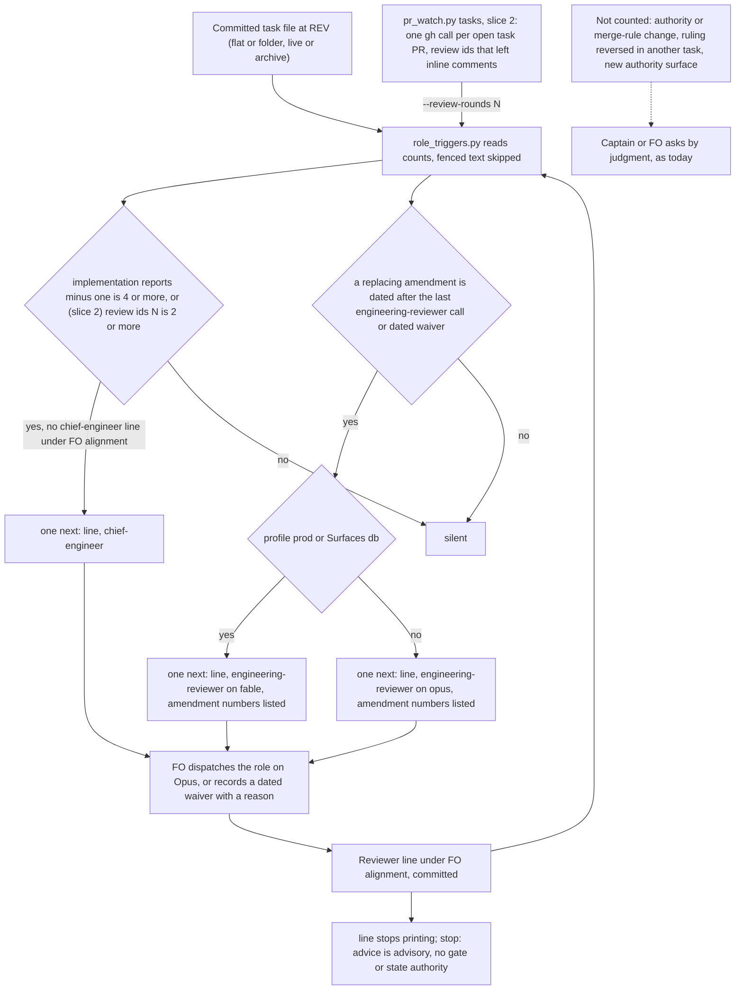

## Scope

- Source: the Captain, 2026-10-20: 「在特定時候應該要徵招特殊角色來諮詢，目前似乎做的不是那麼得好？」. Evidence collected the same day by four read-only observers over the dev2 state of kc-claude-plugins, subspace-relay, subspace-web and qnow (reports in `fo-batch-sittings/dogfood/`).
- Bite, measured on those reports (window: gates from 2026-10-17):
  - engineering-reviewer: `role_triggers.py` owes it 4 times here, 8 in relay and 2 in web; 0 calls were made in those three repositories inside the window; the only two engineering-reviewer calls found are web's on 2026-10-15 and 10-16.
  - chief-engineer: owed by the script 3 times here (2 calls made but worded "third repair cycle", so the script does not count them; 1 filed under the wrong heading), 1 in relay (waived after the merge); qnow and web have none.
  - Script blind spots: qnow and web track cycles in `## Stage Report: ... (cycle N)` headings, not `- Cycle N` lines under `### Feedback Cycles`, so the script reads 0 events there; qnow has no `## Captain amendments` section in any window task; an amendment marked `Supersedes: none` that changes the merge rule (captain-question-load) fires nothing.
  - Owed by judgment, no call: two or more review rounds finding new gaps in one file or sentence (here: special-role-triggers, fo-write-checks, extension-instruction-reaches-dispatch, captain-question-load; qnow: production-operations with seven rounds on one scrubber, cash-at-pickup); a design or amendment reversing an earlier Captain ruling (here: merge-gatekeeper, delivery-gate-settles-skipped-checks, prod-security-review-gates; relay: account-publish-ceiling, spacedock-install-beta); merge, authority or hard-to-reverse rule changes (captain-question-load; qnow: production-go-live).
- Consumer: every FO on the dev2 route (this repository, relay, web, qnow) and the Captain, who otherwise asks FO 「找誰問？」.
- Upstream first: `role_triggers.py` and the README `Reviewer:` rule (0.25.0, special-role-triggers #664); the chief-engineer and engineering-reviewer agent descriptions, which already name drift and contested, high-risk or hard-to-reverse claims.
- Captain's design direction, 2026-10-20: 「設計時不應該過度依賴關鍵字，而是可能要依靠犯錯字數觸發，合理嗎？」 FO reads 犯錯字數 as a count of mistakes (findings, rejected validations, holds, overrides) and asked him to correct that reading if wrong. Triggers are to come from counts read from structured records (review comments and their paths, gate records, Feedback Cycle and stage-report headings), not from phrase matching; ideation measures each candidate count over the four repositories' records before choosing thresholds.
- Captain's scope addition, 2026-10-20: 「先加第一個，第二個列入評估」, answering FO's 「1. ER：例如碰到 prod、資料庫、密鑰、合併權限就用 Fable，其他用 Opus。這可以併進正在設計的特殊角色任務。 2. 安全審查：要改就得推翻 ADR 0021 的 D1」. Item 1, in scope: the engineering-reviewer's model is chosen by the same structured risk signals (prod, db, secrets, merge or authority rules: Fable; otherwise its declared Opus), never below Opus. Item 2, evaluation only: whether the prod security reviewer (kc-pr-flow:tob-security-reviewer, fixed at sonnet by ADR 0021 D1) should step up by risk, for example sonnet then opus; the Captain cites the model documentation ranking Fable strongest on cyber security and Opus next; ideation states what measurement would justify reversing ADR 0021 D1, whose 14 runs found the model was not the lever.
- Order: runs in parallel with delivery-gate-settles-skipped-checks; the release does not wait for it.
- Non-goals: to be set at ideation.

## FO alignment

Alignment: not needed before ideation; the Captain raised the problem.
Release review: not needed: workflow maintenance, on no journey map.
Surfaces: none
Visible change: none

## Design

Profile pilot. Measured 2026-10-20, read-only, over the four repositories' state branches pinned at kc-claude-plugins `dc6530d404cbd5560d197b62e6e15228b7634f39`, subspace-relay `9579d59afde3be7ffa05d8c8bc2f981d5b5e1663`, subspace-web `96a54eef3ee97641f5b0caf49975e83179e4fd26`, qnow `8ce9bd7674ba459fdc8ce54375ed241a91de62b8` (the kc-claude-plugins and relay branches moved after this; delivery-gate-settles-skipped-checks has an engineering-reviewer line at today's tip that the pin does not), and `gh api repos/<repo>/pulls/<N>/comments` and `.../reviews` for the 157 task PRs. Package source: kc-dev-flow-2 0.25.0 at origin/main `891a9a24`. The measuring scripts ran from a scratch directory and are not committed (ideation commits nothing); AC-7 has the validator re-derive the table.

### PRFAQ

**Press release.** When a task has been repaired four times, FO is told once, in the line `pr_watch.py tasks` already prints at every startup and idle pass, that a chief-engineer call is owed. A replacing amendment owes one engineering-reviewer line per task, not one per amendment. A call counts when it is a dated `Reviewer:` line under `## FO alignment`, whatever its question says; "third repair cycle" and "Cycle 3" are the same call. Nothing in FO's reading grows: the README sentence stays as it is, and the owed line goes away when the call is recorded. Slice 2, if the Captain agrees, adds the count he named: a second review round that left findings on the open PR.

**FAQ**

- *Why a count and not a phrase?* The Captain's direction on 2026-10-20 was counts from records, not keywords. Today's script reads one line shape (`- Cycle N` under one heading) and one wording of the call, and so read 0 events in web and qnow and refused 3 real calls in this repository. A count of stage-report headings reads all four repositories.
- *Which count?* Repair passes: `## Stage Report: implementation` headings minus one, fire at 4. In the 38-task window it fires on 10 tasks, 9 of them observer-labelled owed, 1 unclear, 0 labelled not owed; today's Event A fires on 5.
- *Does the count call itself?* No. FO still dispatches, or records `Reviewer: <agent> not run <date>: <reason>`. Neither role gets gate or state authority.
- *What does it not see?* Four engineering-reviewer cases, named below. Counts cannot see an authority change, a ruling reversed in another task, or a new authority surface.
- *What does it cost?* About 0.25 Opus calls per task over 287 tasks (today 0.18), 0.50 per task in the busy 38-task window (today 0.37). Table below.



### Chain check (in the chain's order, 2026-10-20)

- **Spacedock 0.27.0** (`/Users/kent/.claude/plugins/cache/spacedock/spacedock/0.27.0`): no consult or review seat. `skills/feedback-rejection-flow/SKILL.md` step 4 records an escalation to the human on cycle 3 and stops; step 2 of the same skill has a neutral recorder count every entry of a correction round, and gate attempts sit in `gates.records[].attempts[]`. So the chief-engineer and engineering-reviewer calls are a package concept, and Spacedock's own cycle-3 escalation is the Captain's, not a role's.
- **kc-dev-flow-2** at origin/main: `scripts/role_triggers.py` (Event A, Event B), `references/sd/workflow.md` Stages paragraph (the `Reviewer:` sentence), `pr_watch.py tasks` (prints the script's output), `skills/observer/SKILL.md` (reports a `Reviewer:` line for a task "whose validation was sent back twice", runs the script and quotes each `next:` line as a violation), the two agent files and skills (triggers by judgment). ADR 0016 (`docs/adr/0016-the-amendment-check-refuses-an-unnamed-move-and-an-unmarked-replacement.md`) is the evidence on author-declared fields: FO wrote `Supersedes: none` over seven criteria, and 34 of 35 non-`none` `Design:` values were prose no text rule could separate.
- **Adopters** (relay, web, qnow): the README sentence is byte-identical to the package's at 0.25.0 (lines 75-78 in relay and web, 77-80 in qnow). Calls on record in the window: kc-claude-plugins 4 chief-engineer (one misfiled under `### Feedback Cycles`, two worded "third repair cycle", one made after the Captain asked); relay 1 chief-engineer waiver; web 2 engineering-reviewer on 2026-10-15 and 10-16 about a bridge design, none on its 10-17 amendment; qnow none. No adopter has a local copy of `role_triggers.py` to reconcile.
- **Bounded existing-code check.** Use what exists: the script, its output channel and its test file are repaired in place; only Event A and the wording match are replaced. What breaks without the change: today's Event A misses 7 of the 11 chief-engineer cases labelled owed in the window (every web and qnow case reads 0 events), and three of the four calls FO did make are refused by the script (two by wording, one by heading); on 2026-10-19 the Captain asked FO 「為何你沒有自動找 CE 來問？」.

### What was measured

Window: the 37 tasks with a gate resolution on or after 2026-10-17 UTC (the observers' window; this task excluded) plus qnow `owner-sms-notices`, a boundary task the qnow observer judged owed. Population: all 287 tasks at the pins. **Ground truth** is the four observers' (sonnet) judgment-owed tables in `fo-batch-sittings/dogfood/`, plus the Captain's own question on captain-question-load; it is not a Captain ruling for the other tasks. The observers' definition of "owed" is the Scope's list of triggers, so a count that matches it gets a true positive almost by construction: read the **false fires** and **misses**, which that circularity does not inflate. "Unclear" means the observer called the case weak or FO waived it with a reason; it counts as neither. The thresholds were chosen on the same 38 tasks they are scored on (no held-out labels exist: no task outside the window has a role call on record), so every threshold is in-sample.

Counts were read from committed bytes: stage-report headings, `### Amendment N` entries and their `Supersedes:`/`Design:` lines, gate records in frontmatter (`stage`, `decision`, `at`, `reason`), the first verdict phrase of each validation report, `Reviewer:` lines, and the inline comments of each PR (`pull_request_review_id`, `path`, `line`, the P1/P2 badge).

#### Per-task counts, window of 38

Columns: the observer label (C = chief-engineer owed, E = engineering-reviewer owed, ? = weak, W = waived with a reason, - = not owed), the call on record at the pin, then the candidate counts. "Sent back" is a REJECTED validation report plus a Captain `revise` at a validation gate. "Same-path rounds" and "Review rounds" come from PR inline comments and are 0 for every relay and web task because no inline reviewer commented on those PRs (3 of 46 relay PRs and 0 of 23 web PRs have any inline comment; 21 of 41 kc-claude-plugins and 36 of 47 qnow PRs do). "ACs withdrawn" is the number of `**AC-N**` declarations present at the first ideation (or backlog) approval and removed or changed at the pin, read from the commit that recorded that approval.

| Task (repo/slug) | Observer label CE/ER | Call on record | Repair passes | Sent back | Same-path rounds | Review rounds | Amendments (replacing) | ACs withdrawn | Holds, overrides |
|---|---|---|---|---|---|---|---|---|---|
| kcp/captain-question-load | C/E | CE | 2 | 0 | 1 | 2 | 2 (0) | 0 | 0 |
| kcp/chat-only-evidence-observer-blind | ?/- | - | 1 | 0 | 1 | 1 | 0 (0) | 0 | 0 |
| kcp/delivery-gate-settles-skipped-checks | -/E | - | 0 | 0 | 0 | 0 | 0 (0) | 0 | 0 |
| kcp/extension-instruction-reaches-dispatch | C/E | - | 4 | 0 | 3 | 3 | 1 (1) | 1 | 0 |
| kcp/fo-write-checks | C/- | - | 4 | 0 | 3 | 3 | 0 (0) | 0 | 0 |
| kcp/merge-gatekeeper | C/E | CE | 10 | 0 | 4 | 4 | 1 (1) | 7 | 0 |
| kcp/number-guards-readme-shrink | -/- | - | 0 | 0 | 0 | 0 | 0 (0) | 0 | 0 |
| kcp/prod-security-review-gates | C/E | CE misfiled | 7 | 1 | 4 | 4 | 2 (2) | 6 | 0 |
| kcp/prod-security-validation-gate | -/- | - | 0 | 0 | 0 | 0 | 0 (0) | 0 | 0 |
| kcp/special-role-triggers | C/? | - | 4 | 0 | 2 | 2 | 1 (1) | 1 | 0 |
| kcp/ui-design-review-in-ideation | C/- | CE | 4 | 0 | 3 | 3 | 0 (0) | 0 | 0 |
| kcp/worker-loads-declared-package | -/- | - | 1 | 0 | 1 | 1 | 0 (0) | 0 | 0 |
| kcp/workflow-budget-ratchet | -/- | - | 1 | 0 | 1 | 1 | 0 (0) | 0 | 0 |
| relay/account-publish-ceiling | ?/E | - | 3 | 0 | 0 | 0 | 2 (2) | 8 | 1 |
| relay/entry-without-name-field | -/- | - | 1 | 1 | 0 | 0 | 0 (0) | 0 | 1 |
| relay/frame-and-content-headers | -/- | - | 0 | 0 | 0 | 0 | 0 (0) | 0 | 0 |
| relay/identity-cannot-be-borrowed | -/- | - | 0 | 0 | 0 | 0 | 0 (0) | 0 | 0 |
| relay/junk-share-edge-cost | -/? | - | 0 | 0 | 0 | 0 | 1 (1) | 0 | 0 |
| relay/others-highlights-in-author-colour | -/- | - | 0 | 0 | 0 | 0 | 0 (0) | 0 | 0 |
| relay/own-comments-follow-account | W/- | CE | 3 | 3 | 0 | 0 | 0 (0) | 0 | 0 |
| relay/owner-feedback-pages | -/- | - | 2 | 0 | 0 | 0 | 0 (0) | 0 | 0 |
| relay/revoke-ends-access | -/- | - | 0 | 0 | 0 | 0 | 0 (0) | 0 | 0 |
| relay/spacedock-install-beta | ?/E | - | 5 | 1 | 0 | 0 | 5 (5) | 3 | 4 |
| relay/storage-stops-growing | -/? | - | 0 | 0 | 0 | 0 | 0 (0) | 0 | 0 |
| web/ac9-feedback-phone-revision-drawer-note-time | -/- | - | 0 | 0 | 0 | 0 | 0 (0) | 0 | 0 |
| web/comment-links-open-with-confirm | -/E | - | 1 | 1 | 0 | 0 | 1 (1) | 1 | 0 |
| web/disclosure-chevrons-follow-state | -/- | - | 0 | 0 | 0 | 0 | 1 (0) | 0 | 0 |
| web/others-highlights-in-author-colour | C/E | ER | 2 | 2 | 0 | 0 | 1 (1) | 2 | 0 |
| web/web-render-rules | -/? | - | 1 | 1 | 0 | 0 | 0 (0) | 0 | 0 |
| qnow/cash-at-pickup | C/- | - | 6 | 1 | 4 | 4 | 0 (0) | 0 | 0 |
| qnow/check-database-version | -/- | - | 0 | 0 | 0 | 0 | 0 (0) | 0 | 0 |
| qnow/go-live-consent | -/- | - | 3 | 0 | 1 | 1 | 0 (0) | 0 | 0 |
| qnow/move-to-singapore-region | -/- | - | 0 | 0 | 0 | 0 | 0 (0) | 0 | 0 |
| qnow/product-analytics-posthog | -/- | - | 0 | 0 | 0 | 0 | 0 (0) | 0 | 0 |
| qnow/production-go-live | -/E | - | 0 | 0 | 0 | 0 | 0 (0) | 0 | 0 |
| qnow/production-incident-agent | -/E | - | 0 | 0 | 0 | 0 | 0 (0) | 0 | 1 |
| qnow/production-operations | C/? | - | 11 | 0 | 5 | 6 | 0 (0) | 0 | 0 |
| qnow/owner-sms-notices | C/- | - | 5 | 2 | 2 | 2 | 0 (0) | 0 | 0 |

#### Each candidate count, scored on the window

Fires / true positives / false fires / unclear / misses (11 chief-engineer and 11 engineering-reviewer cases labelled owed). Rows are from one run; `repairs` is the number of `## Stage Report: implementation` headings minus one.

Chief-engineer:

| Candidate count and threshold | Fires | TP | False | Unclear | Miss | Reading |
|---|---|---|---|---|---|---|
| Today's Event A: `- Cycle N`, N >= 3, under `### Feedback Cycles` | 5 | 4 | 0 | 1 | 7 | web and qnow record cycles in stage-report headings and read 0 events; qnow `owner-sms-notices` has the heading at level 2 with `- PR #…` lines |
| Stage-report `(cycle N)` heading, highest N >= 3 / >= 4 | 17 / 10 | 11 / 7 | 3 / 0 | 3 / 3 | 0 / 4 | counts ideation cycles too; false: owner-feedback-pages, ac9-feedback, go-live-consent |
| **Repairs >= 2 / 3 / 4 / 5** | 16 / 13 / **10** / 6 | 11 / 9 / **9** / 5 | 2 / 1 / **0** / 0 | 3 / 3 / **1** / 1 | 0 / 2 / **2** / 6 | false at 3: go-live-consent (4 reports, 3 validations all PASSED, wording changed once); at 2 also owner-feedback-pages. Misses at 4: captain-question-load, web others-highlights |
| Implementation reports after the first validation report >= 3 / 2 | 10 / 14 | 8 / 10 | 0 / 2 | 2 / 2 | 3 / 1 | file order, not time order: prod-security-review-gates writes its repairs before its first validation report and is missed at 3 |
| Highest implementation `(cycle N)` >= 3 / 4 | 15 / 9 | 10 / 6 | 2 / 0 | 3 / 3 | 1 / 5 | phase and probe headings add noise |
| Validation sent back (REJECTED report + Captain `revise`) >= 1 / 2 | 9 / 3 | 4 / 2 | 3 / 0 | 2 / 1 | 7 / 9 | false at 1: entry-without-name-field, comment-links-open-with-confirm, web-render-rules. 105 of 410 validation reports have no parseable verdict phrase |
| REJECTED validation report >= 1 | 4 | 4 | 0 | 0 | 7 | the only unique catch over repairs >= 4 is web others-highlights |
| Captain hold or override >= 1 | 4 | 0 | 2 | 2 | 11 | false: entry-without-name-field (override of a delivery-check hold), production-incident-agent (a priority pause) |
| PR inline findings on one path in >= 2 / 3 distinct review ids | 9 / 7 | 9 / 7 | 0 / 0 | 0 / 0 | 2 / 4 | the same 9 tasks as repairs >= 4; adds none in the window |
| P1 findings in >= 2 distinct review ids | 5 | 5 | 0 | 0 | 6 | misses the P2-only repair loops (fo-write-checks, extension-instruction) |
| **PR review ids with inline findings >= 2 / 3** | **10 / 7** | **10 / 7** | 0 / 0 | 0 / 0 | **1 / 4** | the single unique catch over repairs >= 4 is captain-question-load; web and relay are dark (no inline reviewer) |
| repairs >= 4 OR review ids >= 2 (slice 1 + slice 2) | 11 | 10 | 0 | 1 | 1 | miss: web others-highlights |

Engineering-reviewer:

| Candidate count | Fires | TP | False | Unclear | Miss | Reading |
|---|---|---|---|---|---|---|
| **Today's Event B: replacing amendment (`Supersedes:` or `Design:` not `none`)** | **9** | **7** | **0** | **2** | **4** | 15 events on 9 tasks |
| Criteria withdrawn since the first approval >= 1 (git read) | 8 | 7 | 0 | 1 | 4 | adds nothing over Event B in the window; would catch an amendment that withdraws criteria under `Supersedes: none`, which ADR 0016's check already refuses |
| Any amendment recorded >= 1 / >= 2 | 11 / 4 | 8 / 4 | 1 / 0 | 2 / 0 | 3 / 7 | false at 1: disclosure-chevrons-follow-state (`Supersedes: none`, correct) |
| Captain hold or override >= 1 | 4 | 3 | 1 | 0 | 8 | two of the three true cases are already Event B; the unique one is production-incident-agent |
| Captain `revise` or hold after an approval >= 1 | 11 | 5 | 5 | 1 | 6 | routine sends-back |
| A `### ADR draft` heading in the task | 6 | 3 | 3 | 0 | 8 | false: cash-at-pickup, owner-sms-notices, own-comments-follow-account |
| ADR numbers cited in the design | - | - | - | - | - | no separation: engineering-reviewer cases cite 1 to 13, others up to 10 (web ac9-feedback cites 10 and is not owed) |
| Another task's slug cited in scope, design or criteria | - | - | - | - | - | no separation: every task cites 0 to 18 others |
| Another task's gate id cited | 0 | 0 | 0 | 0 | 11 | 0 of 38 tasks cite a gate id of another task: "a design that names an earlier Captain gate it reverses" has no structured form today |

**Misses by name, engineering-reviewer (4 of 11, no count sees them):** captain-question-load (a merge and approval rule change; its two amendments honestly say `Supersedes: none`, so this is not a form gap), delivery-gate-settles-skipped-checks (its design reverses a clause of merge-gatekeeper's accepted criterion; it cites that task by slug, as every task cites peers), production-go-live (hard to reverse: amends several accepted decisions and puts an operator secret on production), production-incident-agent (a new authority surface, a machine account opening draft PRs). **Chief-engineer misses at repairs >= 4:** captain-question-load (caught by review rounds >= 2) and web others-highlights (2 repairs, REJECTED once and sent back once; caught only by a text-parsed verdict).

#### Calls and cost

Expected calls = fires (one chief-engineer call per task, one engineering-reviewer call per task and later amendment). The Opus counts in the earlier rows include the Fable calls; read the two model rows for the split. No Fable price for an engineering-reviewer call was measured: the only figures are ADR 0021's security-review runs (Opus about 2.2, Fable about 12.3 USD, assumed prices), about 5.6 times, which is not an engineering-reviewer cost.

| Scope | Today (Event A + Event B) | This design, slice 1 | Slice 1 + slice 2 |
|---|---|---|---|
| Window, 38 tasks | CE 5 + ER 9 = 14 (0.37 per task) | CE 10 + ER 9 = 19 (0.50) | CE 11 + ER 9 = 20 (0.53) |
| Window, per repo (CE/ER) | kcp 4/4, relay 1/3, web 0/2, qnow 0/0 | kcp 6/4, relay 1/3, web 0/2, qnow 3/0 | kcp 7/4, same elsewhere |
| Population, 287 tasks | CE 14 + ER 39 = 53 (0.18) | CE 32 + ER 39 = 71 (0.25) | CE 47 + ER 39 = 86 (0.30) |
| Population, per repo (CE/ER) | kcp 10/12, relay 4/17, web 0/4, qnow 0/6 | kcp 11/12, relay 5/17, web 1/4, qnow 15/6 | kcp 19/12, relay 6/17, web 1/4, qnow 21/6 |
| Engineering-reviewer calls by model, window | all Opus | Opus 7, Fable 2 (merge-gatekeeper, account-publish-ceiling) | same |
| Engineering-reviewer calls by model, population | all Opus | Opus 27, Fable 12 (kc-claude-plugins 2, relay 6, qnow 4) | same |
| Chief-engineer calls | all Opus | all Opus | all Opus |
| Owed lines after recorded calls count, window | 19 lines, 1104 words | 17 lines (CE 8, ER 9), about 855 words with the model named | 17 lines |

Calls actually made in the window: 4 chief-engineer (three recorded in wording or under a heading the script does not count, one made after the Captain asked), 1 chief-engineer waiver, 0 engineering-reviewer on an amendment. The per-task fire rate is unjudged outside the window: 52 of the 71 population fires (slice 1) are on tasks no observer read. A chief-engineer or engineering-reviewer call runs on Opus at `xhigh` (agent files); no dollar figure was measured. A task that keeps circling after its one call does not fire again (merge-gatekeeper reached 10 repairs and production-operations 11).

### Keep, change, drop

| Existing element | Decision | Why, from the table |
|---|---|---|
| Event A: `- Cycle N` with N >= 3 under `### Feedback Cycles` | **Drop**; replaced by repair passes >= 4 | fires 5 (TP 4) against 10 (TP 9); reads nothing in web or qnow; the level-2 heading blind spot disappears because the heading is no longer read |
| Event B: `### Amendment N` under `## Captain amendments` with `Supersedes:` or `Design:` not `none` | **Keep** detection | 9 tasks, TP 7, 0 false, 15 events (the same 15 as today) |
| One `next:` line per event | **Change** to one per task and role, amendment numbers listed | relay spacedock-install-beta: 5 lines, 300 words, to 1 line |
| A call or waiver must name `Cycle 3` or `Amendment N` | **Drop** the naming; any call-shaped line clears the chief-engineer event; the engineering-reviewer event is cleared by a call dated on or after the amendment or a dated waiver | merge-gatekeeper and ui-design-review-in-ideation are "third repair cycle"; the wording match is the keyword dependence the Captain named; what gets worse: an engineering-reviewer call on some other question, dated after the amendment, now clears it (web's two bridge reviews are that shape and stay owed only because they predate Amendment 1) |
| Call shape `Reviewer: <agent> <model> <date> — <question>` | **Keep**; waiver becomes `Reviewer: <agent> not run <date>: <reason>` (the printed line shows it) | a date is needed to know which later amendments a waiver covers; the one waiver in the corpus (relay own-comments-follow-account, chief-engineer) was undated and keeps clearing because the chief-engineer event takes any waiver |
| Records count only under `## FO alignment` | **Keep**, and the owed output adds a `next:` line naming a call-shaped line found under another heading | 2 of the 5 call or waiver lines in the window were first written elsewhere (prod-security-review-gates under `### Feedback Cycles`; the relay waiver under `## Acceptance criteria`, moved in a later commit); `test_only_the_fo_alignment_section_can_clear_an_event` stays |
| README Stages sentence: `Reviewer: <agent> <model> <date> — <question>`; `role_triggers.py` lists calls owed | **Keep unchanged** | still true; `test_sd_dispatch.py` `need=` pin and the adopters' synced copies do not change |
| `pr_watch.py tasks` prints the script's output | **Keep**; slice 2 adds the `--review-rounds N` argument | the channel already runs at startup and every idle pass |
| Observer rule (report a `Reviewer:` line for a task "whose validation was sent back twice"; run the script, quote each `next:` as a violation) | **Keep unchanged** | the observer replay (`--rev TO`) cannot pass N, so it judges slice 1 only; its output changes though its rule does not, because it quotes the new heading-hint `next:` line as a violation (a misplaced call is a form break) |
| Engineering-reviewer model | **Change**: Fable when `profile: prod` or `Surfaces:` lists `db`, else Opus, never below Opus; a call below the required model does not clear | prod or db: 2 of 9 window fires and 12 of 39 population fires; path and secret signals do not discriminate (see the model section) |
| `agents/engineering-reviewer.md` body | **Change** one clause: "Run as Claude Opus" becomes "or the model the dispatch names"; `model: opus` and the `lint-skills.py` pin stay | the declared floor is kept; Fable is not cheaper, so the README sentence stays true |
| Agent and skill triggers by judgment (contested, hard to reverse, low confidence; unclear, blocked, drifting) | **Keep unchanged** | the counts are a floor FO cannot forget; the four misses stay with judgment and the Captain's question |
| Sent-back count (REJECTED report, Captain `revise`) | **Drop** from the trigger | adds one unique catch (web others-highlights) and costs a free-text verdict match that leaves 105 of 410 validation reports unreadable; at threshold 1 it has 3 false fires. Revisit with a second case |
| Same-path review rounds, P1 counts, hold or override, withdrawn criteria, ADR draft, cross-references | **Drop** | each scored above: no unique true catch, or false fires |

**Blind spots fixed:** stage-report cycle headings (counted); level-2 `## Feedback Cycles` (not read); a call worded "third repair cycle" (clears). **Not fixed, by design:** a call under the wrong heading still does not clear; the output names the heading to move it from. **Tests that move:** in `kc-dev-flow-2/scripts/test_role_triggers.py`, `test_the_third_cycle_owes_chief_engineer_and_the_second_does_not`, `test_a_call_or_a_waiver_naming_the_event_clears_it`, `test_each_near_miss_leaves_the_event_owed`, `test_an_amendment_call_naming_another_number_is_owed` and `test_a_feedback_cycles_heading_in_any_form_design_surfaces_accepts_is_read`; in `test_pr_watch.py` the rows near `has a third Feedback Cycle` and `Cycle 3`. Module docstrings of `role_triggers.py` and `pr_watch.py` change.

**ADR draft (no number).** Short title: *Role calls are owed on counts read from task records, and a dated call clears them whatever it says.* Ruling: chief-engineer is owed at four repair passes; engineering-reviewer at a replacing amendment; a `Reviewer:` line under `## FO alignment` with a date clears by date, not by wording. It supersedes the wording-match clause of the special-role-triggers design (task `special-role-triggers`, PR #664), which has no ADR of its own to amend.

### Engineering-reviewer model (Captain's scope addition 2026-10-20, item 1)

The engineering-reviewer is dispatched on Fable when structured risk signals in state say so, else on its declared Opus, and never below Opus. Signals are fields already in state, measured at the pins (window of 38, population of 287):

| Signal | Field read | Tasks with it, window / population | ER fires with it, window / population | Verdict |
|---|---|---|---|---|
| Prod profile | frontmatter `profile: prod` (`design_surfaces.FM_PROFILE`, as `delivery_gate.py` reads it) | 10 / 33 | 2 (merge-gatekeeper, account-publish-ceiling) / 12 with the next row | **use** |
| Database surface | a `db` value on the `Surfaces:` line under `## FO alignment` (`delivery_gate.py` already tests `^Surfaces:.*\bdb\b`) | 7 / 23 (prod and db: 4 / 6) | 0 beyond prod / included above | **use** |
| Merge or authority rules | the PR's changed paths in `delivery_gate.py` `never_paths` (instructions, gate scripts, `_mods`, migrations, `.github`, ADRs) | 31 of 38; all 13 kc-claude-plugins tasks | 7 of 9 | **not used**: it would make Fable the default in this repository, and it needs a PR, so it cannot speak at ideation |
| Secrets | none in state; a secret-looking changed path (`.env*`, `*secret*`, `*credential*`, `*.pem`, `*.key`) | 1 of 38 (owner-sms-notices, not owed) | 0 | **not used**: no field to read, and the path guess hit one unrelated task |

Prod or db carries 13 of 38 window tasks and 50 of 287; it picks Fable for 2 of 9 window engineering-reviewer fires (7 on Opus) and for 12 of 39 population fires (27 on Opus). It covers 3 of the 11 owed cases (merge-gatekeeper, account-publish-ceiling, production-go-live); the other 8, including captain-question-load (a merge and approval rule change on a pilot task), get Opus. Chief-engineer stays on Opus: item 1 names the reviewer only.

**How the dispatch records it.** The owed line names the model and the field that chose it: `dispatch kc-dev-flow-2:engineering-reviewer on fable (profile prod)`, `on fable (profile prod, Surfaces db)` or `on opus`; FO passes that as the Agent `model`; the `Reviewer: <agent> <model> <date> — <question>` line's `<model>` token is the record. The reason is not copied into a field: it is re-derivable from the frontmatter and the `Surfaces:` line at the same revision, so a copied reason could only disagree with them. **Never below Opus:** the script ranks haiku, sonnet, opus, fable by the leading word of the token (`opus-5.5` ranks as opus); a call whose model ranks below the required one, or is unrecognised, does not clear, and the owed line says which model it needs. Both engineering-reviewer calls on record at the pins (web, 2026-10-15 and 10-16) say `opus` on a pilot task, which the rule leaves at Opus; no call on record is on a prod or db task. `agents/engineering-reviewer.md` keeps `model: opus` (the floor `lint-skills.py` pins); its body says "Run as Claude Opus" and gains "or the model the dispatch names"; the README sentence "run on the model and reasoning their agent files declare, never a cheaper one" stays true, since Fable is not cheaper. A call FO makes by judgment, with no owed line, has no printed model: that is a known limit, and D4 offers a README sentence for it.

### Evaluation only: what would justify reversing ADR 0021 D1 (item 2)

Nothing was run on a model. Question: should `kc-pr-flow:tob-security-reviewer` at prod validation step up by risk (sonnet, then opus), against ADR 0021 D1 (sonnet fixed)? ADR 0021's own reopen condition is "if a stronger model finds a class Sonnet misses under the same brief" (or a refusal, or a write class missed on another repository). Its evidence: 14 runs on one relay PR and one Python script, 0 refusals, Opus and Fable n=1 each, and the same class named by every model that got the Reach brief; none of that was a repeat on a second repository. The ranking in model documentation that the Captain cites is not in state or in the ADR and I did not verify it; it is not a measurement on this brief.

Evidence in state today: 28 saved security reports (22 in kc-claude-plugins, 2 relay, 4 qnow; 8 HIGH, 0 CRITICAL, 35 MEDIUM, 56 LOW), none records its model in the file, so "Sonnet" rests on ADR 0021 D1. Ten are prod validation reports on 7 prod tasks (merge-gatekeeper 4, revoke-ends-access, account-publish-ceiling, production-operations validation-10, check-database-version, move-to-singapore-region, product-analytics-posthog).

- **Stage 1, reading only, no model, no cost.** For those 10 reports, take every inline finding and roborev High raised on the same PR at a later head. Only merge-gatekeeper (#666: 7 comments, 6 P1) and production-operations (#1287: 19 comments, 10 P1, 9 P2) have both a saved report and later inline findings, 26 comments in all. A reader labels each security-class or not and whether the report at the preceding head names it (same file, same class). Output: the number of escapes. Stop rule: no security-class escape keeps D1 and closes the question.
- **Stage 2, a model run, only after the Captain approves it and stage 1 finds at least one escape.** Same agent, same Reach brief, same saved heads: Opus once on each escaped head and on 3 control heads with no escape; Sonnet once more on the same heads (its own variance); Fable once on any head where Opus returns something Sonnet did not. Count: HIGH or CRITICAL findings returned by Opus or Fable and by no Sonnet run on that head, confirmed real by a reader; findings Sonnet had that the stronger run lacks; refusals or no-report replies; findings needing a disposition (false-positive load). Proposed reversal rule: at least one confirmed real HIGH or CRITICAL finding that every Sonnet run on that head missed; none keeps D1. The 3 controls guard against a stronger model that only adds noise.
- **Cost, ADR 0021's per-review figures at relay size (assumed prices, not billed; other sizes not measured):** Sonnet 0.86 to 0.91, Opus about 2.2, Fable about 12.3 USD. Per head: Sonnet rerun plus Opus about 3.1, plus Fable about 12.3 where used. With 2 escaped heads and 3 controls (5 heads): about 4.5 (Sonnet) + 11 (Opus) + up to 25 (Fable on 2) = about 40 USD assumed; stage 1 costs reading time only. If stage 1 finds nothing, stage 2 costs 0.

### Words FO reads at each lifecycle moment

Rule: for each moment in root `learning.md` ("Measure the words FO reads at each moment"), the words of every role-call line printed by `pr_watch.py tasks` over the live tasks of the state at the pin, `len(line.split())`, and the README sentence. `tasks` runs at startup and at each idle pass, so the three moments that run it read the same lines; the after-archive step and the merge ask do not print them. The README sentence (`Record chief-engineer and engineering-reviewer calls under …`) is 20 words before and after.

| Moment | relay, today / design | kc-claude-plugins | web | qnow |
|---|---|---|---|---|
| Startup (restart, one open PR) | 540 (9 lines) / 219 (4) | 120 (2) / 204 (4) | 0 / 0 | 0 / 0 |
| Idle on an open PR | same lines as startup | same | same | same |
| Idle on a merged PR | same lines as startup | same | same | same |
| After the archive | 0 / 0 | 0 / 0 | 0 / 0 | 0 / 0 |
| The merge ask | 0 / 0 | 0 / 0 | 0 / 0 | 0 / 0 |

The learn practice that every moment must fall below its base does not hold, and this task's goal is not to cut reading: kc-claude-plugins rises 120 to 204 (the engineering-reviewer lines now name the model, 2 to 6 words each) because two live tasks that today's script does not flag now owe a call, and relay falls only because five lines for one task become one. The numbers FO can rely on are the length of one owed line (46 to 58 words in the prototype with the model named; today 51 and 60) and that a line is printed only until the call is recorded.

### Batch overlap

Against delivery-gate-settles-skipped-checks (PR #680, design written): it edits `delivery_gate.py`, `test_delivery_gate.py` and one ADR; this task edits `role_triggers.py`, `test_role_triggers.py`, `pr_watch.py` and `test_pr_watch.py` and leaves `docs/dev2/README.md` and `references/sd/workflow.md` unchanged. No shared file, no shared hunk, either order works. Its design is itself one of the four engineering-reviewer misses here (it reverses a clause of merge-gatekeeper's accepted criterion, no count sees it), and its tip now carries an engineering-reviewer line FO made by judgment after the dogfood report. Against the other open batch-3 work: chat-only-evidence-observer-blind (PR #679) edits `delivery_gate.py` and the Delivery authority sentence of `workflow.md`, not the Stages paragraph; fo-batch-sittings (backlog) lists "a repeated finding class calls the chief-engineer" as an interim rule, and this task supplies the count for that rule, so that task should cite it, not restate it. Recommended order: no constraint.

### Limits (not criteria)

- Labels are four sonnet observers' tables and one Captain question; the scored thresholds are in-sample on 38 tasks. 52 of the 71 population fires are on tasks nobody judged.
- Repair passes also count merges of main: relay own-comments-follow-account has 3 repairs, two of them stale-base merges, and FO waived the call for that reason. The threshold of 4 stays above it; a waiver with a reason is the answer when it happens.
- The count is blind to a rule change that no record counts (the four misses), to a task that keeps circling after its one call, and to relay and web review rounds (no inline reviewer).
- `roborev` findings are a local reviewer's and are not in `pulls/N/comments`; slice 2 undercounts where roborev carries the rounds.
- The kc-claude-plugins state branch moved during measurement; the pins above are the oracle, not today's tip.
- New obligation that would force a profile change: none; slice 2 adds one `gh` read inside a step FO already runs.
- The model rule reaches FO only through an owed line; a call FO makes by judgment prints no model. Fable is chosen on 2 of 9 window fires, so the measured effect of the rule is small here; it matters more in relay (6 of 17) and qnow (4 of 6).
- Item 2 is evaluation only: no model was run, no ADR 0021 text changes, the security reviewer stays on Sonnet until the Captain rules on D5.
- Non-goals: no automatic dispatch; no change to the two agent files or skills; no new gate or state authority; no tiered second call; no text-matched verdict; the observer is unchanged.

## Acceptance criteria

**AC-1** Four repair passes owe one chief-engineer call, in every record shape of the four repositories. Evidence: `python3 -B -m unittest discover -s kc-dev-flow-2/scripts -p test_role_triggers.py` has rows on synthetic task files, each asserting exit code and the number of `next:` lines: (a) five `## Stage Report: implementation` headings (one plain, four `(cycle N)`) and no `### Feedback Cycles` section: exit 1, one line naming chief-engineer and 4 repair passes; (b) four headings: exit 0; (c) five headings with a level-2 `## Feedback Cycles` whose lines read `- PR #1 …`: exit 1; (d) the five headings inside a fenced block: exit 0; (e) `--rev` naming a commit that held four headings: exit 0 while HEAD exits 1. Falsifier: counting `- Cycle N` lines under `### Feedback Cycles` (today's Event A) makes (a) and (c) exit 0.

**AC-2** Wording and number of a call do not decide whether it counts; its heading still does. Evidence: rows: a line `Reviewer: kc-dev-flow-2:chief-engineer opus 2026-10-18 — repair again, or narrow the PR?` under `## FO alignment` clears the repair event (it names no cycle; today exit 1, as for merge-gatekeeper and ui-design-review-in-ideation); the same line under `### Feedback Cycles` leaves it owed and the output adds a `next:` line naming that heading; a bullet `Reviewer: one run per design …` (the two non-call lines found in prod-security-review-gates and ui-design-review-in-ideation) clears nothing; a chief-engineer waiver `Reviewer: kc-dev-flow-2:chief-engineer not run: <reason>` clears it. Falsifier: requiring the question to contain `Cycle 3` re-opens the first row; accepting any heading clears the second row's task.

**AC-3** Engineering-reviewer: one line per task lists every uncleared replacing amendment; a call dated on or after an amendment, or a dated waiver `Reviewer: kc-dev-flow-2:engineering-reviewer not run <date>: <reason>`, clears the amendments dated on or before it. Evidence: rows: a task with five replacing amendments prints one `next:` line listing 1 to 5 (today five lines, 300 words in relay spacedock-install-beta); a call dated between amendments 3 and 4 leaves 4 and 5 owed; an undated waiver clears no amendment; a task whose only calls (2026-10-15, 2026-10-16) precede its Amendment 1 (2026-10-17) stays owed (web others-highlights). Falsifier: clearing on any engineering-reviewer line makes the last row exit 0.

**AC-4** Reading cost: the README is untouched and every owed line is short. Evidence: `git diff origin/main --stat -- docs/dev2/README.md kc-dev-flow-2/references/sd/workflow.md` prints nothing; each `next:` line printed by the rows of AC-1 to AC-3 and AC-8 has at most 60 words (`len(line.split())`; the prototype printed 46 to 58 with the model named); the test asserts that bound. Falsifier: a 61-word line fails the row; an edit to the Stages paragraph fails the stat and the `test_sd_dispatch.py` `need=` pin. Limit: words per idle pass are not bounded, because they follow the number of owed tasks (relay 540 to 219, kc-claude-plugins 120 to 204 at the pins).

**AC-5** The script's contract and the suite hold. Evidence: `python3 -B -m unittest discover -s kc-dev-flow-2/scripts` exits 0 (the job in `.github/workflows/kc-dev-flow-2-tests.yml` already runs it); `test_it_judges_committed_bytes_and_leaves_the_checkout_unchanged` and `test_it_reports_what_it_cannot_tell_with_exit_2` pass unchanged (committed bytes, `--rev`, exits 0, 1 and 2); the five `test_role_triggers.py` tests and the `test_pr_watch.py` rows named in Keep, change, drop are rewritten, not deleted; `lint-skills.py` still passes with `model: opus` in `agents/engineering-reviewer.md` and `test_lint_skills.py` rows for a changed model still fail; the ADR passes `python3 <package>/scripts/adr_lint.py --require <reserved number>`. Falsifier: reading the checkout instead of `git show REV` fails the first; leaving `test_the_third_cycle_owes_chief_engineer_and_the_second_does_not` as written fails against the new script.

**AC-6** (slice 2, only if the Captain accepts D1) Two review ids with inline findings on an open task PR owe the chief-engineer call. Evidence: `pr_watch.py tasks` reads `gh api repos/<repo>/pulls/<N>/comments` once per open task PR in the list, counts distinct `pull_request_review_id`, and passes `--review-rounds N` to `role_triggers.py`; rows in `test_pr_watch.py` with a stub `gh`: two review ids: one chief-engineer `next:` line; one review id with nine comments (qnow booking-submit-staff-confirm shape): silent; no comments (relay and web shape): silent; a `gh` failure: `next: report <slug> to the Captain` (the existing exit-2 path). `role_triggers.py` without the argument behaves as in AC-1. Replay: on the window it adds captain-question-load only (its second review round was submitted 2026-10-19T10:08:56Z; its call is recorded 2026-10-19T18:26 +08:00, 17 minutes later, after the Captain asked). Falsifier: counting comments instead of review ids makes the nine-comment row fire.

**AC-7** The corpus replay reproduces this design's table. Evidence: at validation, a replay script kept in the task's `validation/` folder runs the candidate `role_triggers.py` over the four state checkouts at the pins named in Design (`git show <pin>:…`, `--rev <pin>`) and prints per window task the repair passes and owed lines; expected: window chief-engineer fires 10 (9 observer-labelled owed, 1 unclear, 0 false), engineering-reviewer fires 9 (7, 2, 0); population 32 and 39 over 287 tasks; owed lines after recorded calls 17 (chief-engineer 8, engineering-reviewer 9: Fable 2, Opus 7) plus one heading hint; population engineering-reviewer fires Fable 12, Opus 27; prod-security-review-gates stays owed with that hint; merge-gatekeeper, ui-design-review-in-ideation and captain-question-load clear. Falsifier: any task whose fire differs from the per-task table fails. Limit: the checkouts are private to this machine and their task bodies cannot be fixtures in this public repository (sanitize-check), so CI runs the synthetic rows of AC-1 to AC-3 and this replay is a one-time validation step; measured thresholds are in-sample.

**AC-8** The engineering-reviewer's model follows `profile: prod` or a `db` value on the `Surfaces:` line, else Opus. Evidence: rows in `test_role_triggers.py`: a task with `profile: prod` and an owed amendment prints `dispatch kc-dev-flow-2:engineering-reviewer on fable (profile prod)`; `Surfaces: db` on a pilot task prints `on fable (Surfaces db)`; both prints `on fable (profile prod, Surfaces db)`; neither prints `on opus`; a `Surfaces:` line inside a fenced block counts for nothing; the chief-engineer line names no model. Replay: window lines name Fable for merge-gatekeeper and account-publish-ceiling and Opus for the other 7. Falsifier: reading the PR's changed paths for authority files (`class: never`) makes 7 of the 9 window lines Fable and fails the replay row.

**AC-9** A call below the required model does not clear, and no model below Opus is ever asked for. Evidence: rows: a call `Reviewer: kc-dev-flow-2:engineering-reviewer sonnet 2026-10-18 — q` leaves a signal-free task owed, and the owed line says it needs opus; the same call with `opus` on a prod task leaves it owed and the line says it needs fable; `fable` clears a signal-free task; `opus-5.5` ranks as opus; an unrecognised word leaves the task owed; the existing web calls (`opus`, pilot) are unchanged in verdict. Falsifier: ranking by string order (`fable` < `opus`) clears the prod row with an Opus call.

## Needs decision

**D1. Ship the review-round count (slice 2, AC-6) in this task?** Recommendation: yes, as the last slice, droppable without touching AC-1 to AC-5. It is the only count that catches captain-question-load, the case the Captain asked about, and it is the signal he named (findings across rounds). What gets worse: one more `gh` read per open task PR in `tasks` and a new failure path in a script every FO runs at every idle pass; it is dark in relay (3 of 46 PRs) and web (0 of 23); it adds 15 population fires (47 against 32 chief-engineer) on tasks nobody judged, about 0.05 more Opus calls per task. If declined: captain-question-load-shaped cases (P1 findings in two rounds, only two repairs) stay with judgment.

**D2. Threshold: four repair passes, or three?** Recommendation: four. At four: 9 true, 0 false, 1 unclear; at three: the same 9 true plus 1 false fire (go-live-consent, whose extra reports were phases, not repairs) and 3 unclear, with calls one pass earlier. What gets worse at four: FO's own calls were made at the "third repair cycle", so the script now speaks one pass later than FO practice; a 4-repair loop costs one more cycle before the line prints. Spend at four: 0.25 Opus calls per task over 287 tasks (today 0.18), 0.50 in the busy window (today 0.37).

**D3. The four engineering-reviewer misses (an authority or merge-rule change, a ruling reversed in another task, a new authority surface): accept them as judgment, or add an author-declared line (for example `Reverses: <gate id | task | none>` in `## FO alignment`)?** Recommendation: accept, add nothing, and read the next batch's records for a repeat. No count and no structured field sees them today (0 of 38 tasks cite another task's gate id); ADR 0016's evidence is that FO wrote `Supersedes: none` over seven criteria, which predicts a declared `Reverses:` under-declares in the same way. What gets worse: the Captain keeps being the backstop for these (he asked FO about captain-question-load himself), 4 of 11 engineering-reviewer cases.

**D4. Which signals pick Fable for the engineering-reviewer?** Recommendation: `profile: prod` or a `db` value on `Surfaces:` only, delivered by the owed line alone. They are the two fields `delivery_gate.py` already trusts; they pick Fable for 2 of 9 window fires and 12 of 39 population fires (Opus 7 and 27). Secrets have no field and the path guess hit 1 of 38 tasks; the merge-or-authority path signal marks 31 of 38 tasks (all 13 in this repository), so it would make Fable the default here. What gets worse: 8 of the 11 owed cases, including captain-question-load (a merge and approval rule change on a pilot task), run on Opus, and a call FO makes by judgment prints no model; a README sentence would fix the second at about 25 more words FO reads at startup and a new `test_sd_dispatch.py` pin. Fable per call costs about 5.6 times Opus on ADR 0021's security-review runs (assumed prices); no engineering-reviewer cost was measured.

**D5. Evaluation of ADR 0021 D1 (security reviewer on Sonnet): approve stage 1 now, and stage 2 only after its result?** Recommendation: approve stage 1 (reading 10 saved reports against 26 later inline findings, no model, no cost) and decide stage 2 when it reports. What gets worse: the prod security review stays on Sonnet meanwhile, and if stage 2 runs, about 40 USD assumed for 5 heads (4.5 Sonnet, 11 Opus, up to 25 Fable). The sample is small: 2 PRs hold both a saved report and later findings, so stage 1 may find no escape and still not prove Sonnet adequate.

## Number guards

ADR: 0026

## Stage Report: ideation

- DONE: A design (PRFAQ and Mermaid) for when FO owes a chief-engineer or engineering-reviewer call, built on counts read from structured records, per the Captain's direction in Scope: candidate counts such as review findings per file or sentence across rounds (from PR review comments and their paths), validation REJECTED verdicts, Feedback Cycles or stage-report cycle headings, Captain overrides and holds, amendments that supersede accepted criteria, and a design or amendment that names an earlier Captain gate it reverses; for each, which role it calls and why
  `## Design` holds the PRFAQ and the Mermaid flow; every named count has a row in the two scored tables; chief-engineer is called on repair passes (and, in slice 2, review rounds), engineering-reviewer on replacing amendments; gate-reversal has no structured form (0 of 38 tasks cite another task's gate id).
- DONE: Measure every candidate count over the four repositories' committed records (kc-claude-plugins, subspace-relay, subspace-web and qnow; paths and the per-repository findings in fo-batch-sittings/dogfood/), read-only: per task, the count, the threshold that would have fired, and whether a call was then made or judged owed; report false fires and misses for each threshold, and the expected calls per task (cost in Opus calls)
  `### What was measured`: 38 window tasks and 287 population tasks at four pinned SHAs plus 157 PRs read with `gh api`; per-task table, two tables scoring each candidate count and threshold with fires/TP/false/unclear/miss, and a calls-and-cost table (0.18 to 0.25 per task over 287, 0.37 to 0.50 in the window); labels are observers' judgment and thresholds are in-sample (stated).
- DONE: Name which existing kc-dev-flow-2/scripts/role_triggers.py events and README `Reviewer:` rules the design keeps, changes or drops, and fix its observed blind spots (stage-report cycle headings, a level-2 Feedback Cycles heading, a call worded "third repair cycle"); a `### Batch overlap` section against delivery-gate-settles-skipped-checks; the words FO reads at each lifecycle moment, before and after, per root learning.md
  `### Keep, change, drop` (11 rows, tests that move, ADR draft title), `### Words FO reads at each lifecycle moment` (five moments, four repositories; the "every moment lower" practice does not hold and the section says why), `### Batch overlap` (no shared file with delivery-gate-settles-skipped-checks).
- DONE: Acceptance criteria with reproducible evidence clauses and falsifiers, and unresolved decisions for the Captain, each with a recommendation and what gets worse under it
  `## Acceptance criteria` AC-1 to AC-7, each with an Evidence clause and a Falsifier; `## Needs decision` D1 (slice 2), D2 (threshold), D3 (the four misses). Current evidence per criterion:
  AC-1: design-time measurement only (10 of 38 window tasks fire, 9 labelled owed, 0 false); the synthetic test rows are not written yet.
  AC-2: not yet verified; the three misworded or misfiled calls were found by running the 0.25.0 script at the pins, which owes all three.
  AC-3: not yet verified; today's script prints 5 lines (300 words) for relay spacedock-install-beta, run at the pin.
  AC-4: not yet verified; prototype line lengths 46 to 55 words, README untouched by design.
  AC-5: not yet verified; the named tests exist at origin/main 891a9a24.
  AC-6: not yet verified; only the offline replay exists (it adds captain-question-load, from `gh api` on PR #675).
  AC-7: not yet verified; the expected numbers are this design's measurement at the pins.

### Summary

Counting `## Stage Report: implementation` headings (four repair passes) replaces Event A and fires on 9 of the 11 chief-engineer cases the observers labelled owed with no false fire in the window; Event B's detection is kept, its clearing is by date instead of by wording, and its output is one line per task. The review-round count the Captain named adds exactly one case (captain-question-load) and is offered as a droppable second slice (D1); the other candidate counts either add no unique true catch or false-fire, and four engineering-reviewer cases remain beyond any count (D3). Thresholds are scored on the same 38 tasks against four observers' labels, and the Non-goals line left open in Scope is set under `### Limits`.

`python3 <package>/scripts/design_surfaces.py check` on this file (package 0.25.0, 2026-10-20) printed "design surfaces presentable", exit 0.

## Stage Report: ideation (cycle 2)

- DONE: Item 1, the engineering-reviewer's model is chosen by structured risk signals (prod profile, a db surface, secrets, merge or authority rules: Fable; otherwise its declared Opus), never below Opus; name the signals as fields already in state, and how the dispatch records the model chosen and why
  `### Engineering-reviewer model`: signals scored in a table (prod and db used; secrets and merge-authority paths measured and not used, with numbers); the owed line names the model and its basis, the `Reviewer:` model token is the record, a call below the required model does not clear; AC-8 and AC-9 hold the rows.
- DONE: Item 2, evaluation only: state what measurement would justify reversing ADR 0021 D1 (the prod security reviewer kc-pr-flow:tob-security-reviewer fixed at sonnet; 14 runs found the model was not the lever), for example rerunning ADR 0021's runs on opus and counting findings sonnet missed and refusals; propose the run and its cost, run nothing on a model
  `### Evaluation only`: stage 1 reads 10 saved reports against 26 later inline findings at no cost; stage 2 reruns Opus (Fable on need) on escaped heads plus 3 controls, about 40 USD assumed for 5 heads; reversal rule stated; no model was run.
- DONE: Update the acceptance criteria, the words FO reads, the Opus-call cost per task (Fable counted separately) and Needs decision for both items; keep D1 to D3 as written unless the additions change them
  AC-8 and AC-9 added, AC-4, AC-5 and AC-7 updated (line bound 60 kept, relay 540 to 219 and kc-claude-plugins 120 to 204 words, Fable 2 of 9 window and 12 of 39 population engineering-reviewer fires); D4 (signals) and D5 (evaluation) added; D1 to D3 unchanged.
  AC-1: unchanged by the additions; design-time measurement only (10 of 38 window tasks fire, 0 false), synthetic rows not written.
  AC-2: unchanged; not yet verified (the three uncounted calls were found by running the 0.25.0 script at the pins).
  AC-3: unchanged; not yet verified (relay spacedock-install-beta prints 5 lines today).
  AC-4: updated, not yet verified; prototype lines 46 to 58 words with the model named, README untouched.
  AC-5: updated, not yet verified; adds the `lint-skills.py` and `test_lint_skills.py` rows for the agent file.
  AC-6: unchanged; not yet verified (offline replay only).
  AC-7: updated, not yet verified; expected model split Fable 2 and Opus 7 in the window, Fable 12 and Opus 27 over the population.
  AC-8: not yet verified; replay at the pins names Fable for merge-gatekeeper and account-publish-ceiling only.
  AC-9: not yet verified; all 2 engineering-reviewer calls on record say opus on pilot tasks.

### Summary

The model rule is two fields (`profile: prod`, a `db` surface), carried in the owed line and recorded in the call's model token; the secrets and authority-path signals were measured and do not discriminate. The ADR 0021 question is evaluation only, in two stages, with the first free and reading-only. No model was run, and D1 to D3 stand.

## Stage Report: implementation

- DONE: One Draft PR (feat(kc-dev-flow-2): ...) from a branch off origin/main (891a9a24b51e5e9fda02a992c6a27910a216787d) implementing the design as the Captain accepted D1 to D5 at the ideation gate: kc-dev-flow-2/scripts/role_triggers.py and kc-dev-flow-2/scripts/test_role_triggers.py per the design's "Keep, change, drop" table (chief-engineer owed at four repair passes read from stage-report headings, D2; engineering-reviewer one line per task cleared by date, with the model chosen by profile: prod or a db surface for Fable, otherwise Opus, D4); the review-round count as the last, separately droppable slice (D1, AC-6); docs/adr/0026 with the design's ADR draft; every other file the design names
  Draft PR https://github.com/iamcxa/kc-claude-plugins/pull/682, head f4447396 (2 commits on 891a9a24): df97ec8c slice 1 (role_triggers.py, test_role_triggers.py, the moved test_pr_watch.py rows, agents/engineering-reviewer.md, ADR 0026), f4447396 slice 2 (pr_watch.py `--review-rounds`, its rows, role_triggers.py argument), revertable alone. The agent body says "a stronger model the dispatch names" where the design said "the model the dispatch names", to keep never-below-Opus. origin/main moved to a7222292 (#680) meanwhile: no shared file, `git merge-tree` clean. `design_surfaces.py check` presentable; `number_guards.py check` PASS (head f4447396, base a72222925f95). I edited the PR body once (`gh pr edit`, own Draft PR, to record CI); no review request, comment, ready or merge.
- DONE: Every acceptance criterion AC-1 to AC-9 green, each falsifier shown failing by a mutation you run (python3 -B, caches cleared), including the replay over the four repositories' committed records the design measured (38 window tasks, 287 overall) reproducing the fire counts it states
  AC-1/2/3/8/9 rows in test_role_triggers.py (22 tests), AC-6 rows in test_pr_watch.py (78), AC-5 suite 569 OK (python3 -B -m unittest discover -s kc-dev-flow-2/scripts, before the follow-up that dropped the reply filter; test_pr_watch.py reran OK); AC-4: README and workflow.md diff empty, longest owed line 54 words (test bound 60). Mutations, each red on a named row: repair count ignored, threshold 3, any heading clears, amendment date ignored, undated waiver clears, rank by string order, profile ignored, fenced `Surfaces:` counted, fences not skipped, one line per amendment, unknown model clears, waiver reason not needed, call must name `Cycle 3` (role_triggers rows); review rounds ignored (role_triggers); comments counted not review ids, merged PR read, first page only, `gh` failure swallowed, rounds not passed (pr_watch rows). One mutant survived and was an equivalent redundant level check, removed. AC-7: `python3 -I replay.py <scripts> --slice2` PASS at f4447396: window CE fires 10 (9 owed, 1 unclear, 0 false), ER 9 (7, 2, 0), population CE 32 and ER 39 over 287, fable 12 and opus 27, owed lines CE 8 and ER 9 (fable 2, opus 7) plus one hint (prod-security-review-gates), merge-gatekeeper, ui-design-review-in-ideation and captain-question-load clear, slice 2 window fires 11 with review ids read live from `gh` equal to the table for all 38; replay falsifiers red: threshold 3 or 5, no amendment detection, profile ignored (the replay cannot see model ranking: no call on record is on a prod or db task).
- DONE: D5 stage 1 only, as a committed report under the task folder in the state checkout, not in the PR: for the 10 saved prod validation reports, each later inline finding and roborev High on the same PR, classified as an escape or not, with no model run
  `special-role-calls-fire-when-needed/security-evaluation-stage-1.md`, state commit 55262419 (with `replay/replay.py` and `inputs.json`). Two security-class escapes on one PR (#666: grants resolved from a stale working tree; roborev:843/844 a grant entry honored without its ADR check) and two same-head misses; the other 6 prod tasks show none. One reader, labels listed.
- DONE: kc-dev-flow-2/scripts/lint-skills.py exits 0; kc-dev-flow-2/scripts/adr_lint.py docs/adr --since <base> --require 26 exits 0; roborev evidence= line; push without force and without -u; CI green on the PR head; CI cost measured or stated as not measured
  lint-skills.py exit 0 (5374 of 5374 words); `adr_lint.py docs/adr --since 891a9a24 --require 26`: "26 ADR file(s) checked, 0 legacy", exit 0, ADR 0026 added; `comment_ratio.py origin/main HEAD`: 0 comment lines, maximum met; `doc_impact.py 891a9a24 HEAD` lists 0 documents, so no per-document verdict is owed. `roborev: clean on f44473962; evidence=roborev:918` (exit 0; the head before the amend, 1f986fcc, was clean as roborev:917). `git push origin spacedock-ensign/special-role-calls-fire-when-needed`, no force, no -u. CI at f4447396: all 4 checks pass, run 39360016573, `unit tests (python3)` 1m50s; added runner time against main not measured.

### Needs decision (Captain)

- D5 stage 2: stage 1 did not meet the design's "no escape keeps D1" stop rule (2 escapes, both on #666). Run stage 2 (about 40 USD assumed prices) or keep ADR 0021 D1. Caveats in the report: one PR, one reader, escapes are merge-gate logic errors outside the reach brief's outsider-facing class, and nothing shows a stronger model would have named them.

### Limits for the validator

- AC-2's "same line under `### Feedback Cycles` stays owed with a heading hint" is exercised in the synthetic suite under `## Stage Report: validation`; the literal `### Feedback Cycles` shape is proven only by the replay (prod-security-review-gates hint). A synthetic row with that literal heading may be wanted.
- Review ids are counted as GitHub returns them, replies included: I added then removed a reply filter because replies were not observed in the sampled PRs (4 PRs, 0 replies) and the design does not ask for one; the live replay over the 38 window PRs equals the design table.
- ADR 0026 says counts come from committed task records; slice 2 also reads GitHub, as the design put both under one ADR.
- Thresholds are in-sample (design `### Limits`); the slice-2 count is dark in relay and web.

### Summary

Slice 1 replaces Event A with the repair-pass count, clears calls by date and model rather than wording, prints one line per task and role naming Fable for prod or db tasks, and adds a heading hint; slice 2 adds the review-round count from `pr_watch.py tasks`. The corpus replay reproduces every number in the design, roborev is clean (917, 918), CI is green on #682, and the D5 stage 1 reading found two escapes that need the Captain's call on stage 2.

## Stage Report: validation

- DONE: Independent verdict on PR #682 head f4447396 against every acceptance criterion in the task file, re-running each evidence command and at least one falsifier per criterion yourself, and judging each limit the implementation report states
  Head f4447396265e18e7b2cbb681b4dbfe16d396530e (Draft, 2 commits on 891a9a24; origin/main is a7222292, no shared file), checked out detached in a throwaway worktree, removed after. AC-1,2,3,8,9: `test_role_triggers.py` 22 OK; AC-4: README and workflow.md diff empty, longest owed line 54 words; AC-5: full `unittest discover` 568 OK (exit 0), lint-skills 0, test_lint_skills 35 OK; AC-6: `test_pr_watch.py` 78 OK, real `gh api --paginate --slurp` on PR 666 returns 7 comments from 4 review ids; AC-7 below.
  Falsifiers I ran with python3 -B and caches cleared, each red on a named test: threshold 5; reports not counted; any heading clears; amendment date ignored; profile ignored; string-order rank; only first amendment listed; undated waiver clears; fences not skipped; review rounds ignored; call must name Cycle 3; checkout read instead of `git show`; comments counted not review ids; merged PR read; rounds not passed; `gh` failure swallowed. One survived: dropping `--paginate --slurp` from the `gh api` argv (the stub gh does not assert flags) is Polish F1.
  Limits judged. Agent body "a stronger model the dispatch names": accepted; it is stricter than the design's "the model the dispatch names", keeps never-below-Opus and `model: opus` (lint-skills passes). AC-2 literal `### Feedback Cycles`: I ran it synthetically, the call under it stays owed, one hint line names that heading, a non-call `Reviewer: one run per design` line clears nothing and adds no hint; the missing row is Polish F3. Review replies counted as ids: measured 0 replies in 82 inline comments over the 38 window PRs, so excluding replies changes no count; Deferred risk F2. Slice 2 dark in relay and web: accepted, the Captain took D1 knowing it (0 of 23 web PRs, 3 of 46 relay PRs have inline comments).
- DONE: Run the replay yourself from the task folder's replay/ (replay.py --slice2) and reproduce the design's fire counts; judge the implementation's one deviation (the engineering-reviewer agent body says 'a stronger model the dispatch names' to keep never below Opus) and its stated limits (AC-2's literal Feedback Cycles heading exercised only by the replay hint; review replies counted as review ids; slice 2 dark in relay and web); confirm slice 2 reverts alone by reverting its commit in a throwaway checkout.
  `python3 -B -I replay.py <candidate scripts> --slice2` exit 0, PASS: 38 window and 287 population tasks; window CE 10 (9,1,0), ER 9 (7,2,0); population CE 32, ER 39, Fable 12, Opus 27; owed lines CE 8, ER 9 (Fable 2, Opus 7) plus one hint (prod-security-review-gates); slice 2 window fires 11 and live review ids equal the table for all 38. Re-derived without the candidate code: a 40-line scratch script counting `## Stage Report: implementation` headings at the pins matches the table's repair column for 38 of 38 tasks and gives population CE 32, ER 39, Fable 12, Opus 27. Caveat: the TP/unclear/false split reads the design's own observer labels, so it restates the design; the misses and false fires are the informative columns. Slice 2 reverts alone: `git revert f4447396` is clean, then `test_role_triggers.py` 21 OK, `test_pr_watch.py` 72 OK, lint-skills 0, and the slice-1 replay (no `--slice2`) PASS with the same numbers.
- DONE: A minimal acceptance script the Captain can run (three to six steps, exact commands, expected output), run by you exactly as written in a fresh bash shell, with its observed output; adr_lint.py docs/adr --since <base> with its exit code; your verdict naming the head, with findings classified by the workflow's Review-finding disposition
  Script below, run as `env -i HOME=$HOME PATH=$PATH bash --noprofile --norc accept.sh`, all six steps matched. `adr_lint.py docs/adr --since 891a9a24 --require 26`: "26 ADR file(s) checked, 0 legacy", exit 0 (same with `--since origin/main`). Also at the head: comment_ratio 0 comment lines, exit 0; doc_impact 0 documents, exit 0; number_guards PASS, exit 0; design_surfaces presentable, exit 0; dispatch_records "4 dispatch record(s) complete", exit 0; CI at f4447396 all 4 checks SUCCESS.

### Verdict

PASSED for head f4447396265e18e7b2cbb681b4dbfe16d396530e. Every AC-1 to AC-9 holds at that head on the evidence above, goal sufficiency (the counts and clearing rules do what the design measured) and minimal necessity (six files, every one named by the design; no README change; the one agent-body clause is the model rule the Captain asked for) both hold. No Material finding.

### Findings (Review-finding disposition)

- F1 Polish: no test asserts the `--paginate --slurp` flags of `review_rounds`. Real `gh` refuses `--slurp` without `--paginate` (loud, exit 2 line), so only dropping both flags would silently undercount past 30 comments, and no window PR has 30.
- F2 Deferred risk: reply comments carry their own review ids and would count as rounds. Becomes Material when a task PR with author replies fires the chief-engineer line with one real reviewer round; 0 of 82 window comments are replies.
- F3 Polish: the synthetic suite has no row with the literal `### Feedback Cycles` heading (AC-2 text); I ran it and it behaves as specified.
- F4 Polish: the PR title names only the repair-pass slice, and release-please reads the title; slice 2 is also in the PR. Retitle before merge if the changelog should name it.
- F5 Polish: an owed engineering-reviewer line lists every amendment number, so a task with about a dozen replacing amendments exceeds the 60-word bound that the tests check only up to six; the replay's "captain-question-load clears" row is vacuous in slice 1 (two repairs, never fires) and only slice 2 can fire it.

### Unverified obligations

- No model was run: that an Agent dispatch with `model` fable is honoured by the host, and the model-documentation ranking the Captain cites, are not checked.
- `gh api --slurp` needs a minimum `gh` version that I did not look up (I ran 2.92.0); CI uses a stub gh, so no real `gh` runs in CI.
- The replay needs this machine's four private state checkouts and live `gh`; it is a one-time check, as AC-7 says. Thresholds remain in-sample.
- D5 stage 2 (about 40 USD assumed prices) is the Captain's pending decision from implementation, not a candidate defect.

### Minimal acceptance script (run as written in a fresh bash, needs git, python3 and network)

```bash
# Step 1: check out PR #682 at its head in a throwaway directory.
D=$(mktemp -d) && git clone --quiet --no-checkout --depth 1 https://github.com/iamcxa/kc-claude-plugins "$D/c" && git -C "$D/c" fetch --quiet --depth 1 origin pull/682/head && git -C "$D/c" checkout --quiet --detach FETCH_HEAD && git -C "$D/c" rev-parse --short=8 HEAD
# Expected: f4447396
# Observed: f4447396

# Step 2: a task with five implementation reports (four repair passes) and no recorded call owes a chief-engineer call.
S="$D/state" && mkdir "$S" && git -C "$S" init -q -b main
printf -- '---\ntitle: t\nprofile: pilot\nstatus: validation\n---\n\n## FO alignment\n\nSurfaces: none\n\n## Stage Report: implementation\n\n## Stage Report: implementation (cycle 2)\n\n## Stage Report: implementation (cycle 3)\n\n## Stage Report: implementation (cycle 4)\n\n## Stage Report: implementation (cycle 5)\n' > "$S/t.md"
git -C "$S" add t.md && git -C "$S" -c user.name=t -c user.email=t@t commit -qm one
python3 -B "$D/c/kc-dev-flow-2/scripts/role_triggers.py" "$S" t; echo "exit $?"
# Expected: one line starting "next: t has 4 repair passes; dispatch kc-dev-flow-2:chief-engineer", then "exit 1"
# Observed: "next: t has 4 repair passes; dispatch kc-dev-flow-2:chief-engineer with the question ..." then "exit 1"

# Step 3: a dated call worded "third repair cycle" under FO alignment clears it by date, not by wording.
python3 - "$S/t.md" <<'PY'
import sys
p = sys.argv[1]; s = open(p).read()
open(p, "w").write(s.replace("Surfaces: none\n", "Surfaces: none\nReviewer: kc-dev-flow-2:chief-engineer opus 2026-10-20 — third repair cycle, keep going?\n", 1))
PY
git -C "$S" -c user.name=t -c user.email=t@t commit -qam two
python3 -B "$D/c/kc-dev-flow-2/scripts/role_triggers.py" "$S" t; echo "exit $?"
# Expected: "role triggers: 1 event(s) read at HEAD, each with a call or a waiver." then "exit 0"
# Observed: as expected

# Step 4: a replacing amendment on a prod task needs Fable; an Opus call does not clear it, a Fable call does.
printf -- '---\ntitle: u\nprofile: prod\nstatus: validation\n---\n\n## FO alignment\n\nSurfaces: none\nReviewer: kc-dev-flow-2:engineering-reviewer opus 2026-10-21 — q\n\n## Captain amendments\n\n### Amendment 1 — 2026-10-20, chat\nCaptain: ok\nSupersedes: AC-1\nDesign: none\n' > "$S/u.md"
git -C "$S" add u.md && git -C "$S" -c user.name=t -c user.email=t@t commit -qm three
python3 -B "$D/c/kc-dev-flow-2/scripts/role_triggers.py" "$S" u | cut -c1-120; echo "exit ${PIPESTATUS[0]}"
sed -i.bak 's/engineering-reviewer opus 2026-10-21/engineering-reviewer fable 2026-10-21/' "$S/u.md" && git -C "$S" -c user.name=t -c user.email=t@t commit -qam four
python3 -B "$D/c/kc-dev-flow-2/scripts/role_triggers.py" "$S" u; echo "exit $?"
# Expected: first run "next: u has replacing amendment 1; dispatch kc-dev-flow-2:engineering-reviewer on fable (profile prod) ..." and "exit 1"; second run "role triggers: 1 event(s) read at HEAD, each with a call or a waiver." and "exit 0"
# Observed: as expected

# Step 5: the unit tests of the changed scripts pass.
cd "$D/c" && python3 -B -m unittest discover -s kc-dev-flow-2/scripts -p 'test_role_triggers.py' 2>&1 | tail -3 && python3 -B -m unittest discover -s kc-dev-flow-2/scripts -p 'test_pr_watch.py' 2>&1 | tail -3
# Expected: "Ran 22 tests" then "OK", and "Ran 78 tests" then "OK"
# Observed: Ran 22 tests in 11.9s OK; Ran 78 tests in 19.5s OK

# Step 6: the README sentence FO reads is untouched (the PR is two commits on 891a9a24 and changes six files, none of them these two).
git -C "$D/c" fetch --quiet --depth 3 origin pull/682/head && git -C "$D/c" diff --stat HEAD~2 HEAD -- docs/dev2/README.md kc-dev-flow-2/references/sd/workflow.md | wc -l | tr -d ' ' && git -C "$D/c" rev-parse --short=8 HEAD~2 && git -C "$D/c" diff --stat HEAD~2 HEAD | tail -1
# Expected: 0, then 891a9a24, then " 6 files changed, 376 insertions(+), 150 deletions(-)"
# Observed: 0, 891a9a24, " 6 files changed, 376 insertions(+), 150 deletions(-)"
```

Does not cover: the live four-repository replay (private checkouts), slice 2's real `gh` read on an open PR, or a Fable dispatch. A pass shows the counting and clearing rules, not that FO will act on the lines.
