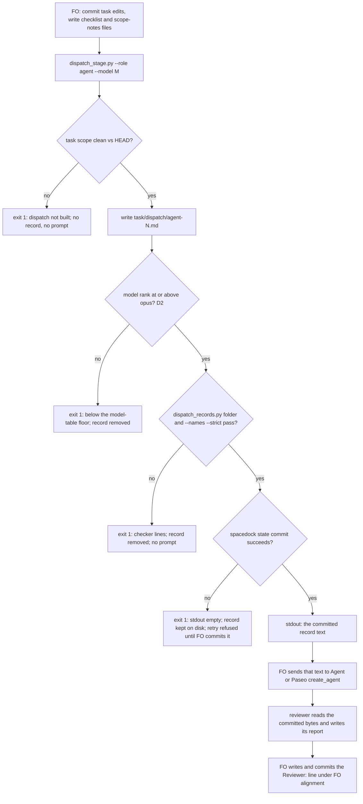

## Scope

- Source: the Captain 「驗證不讀 PR 審查意見（建議）, 特別角色派工紀錄手寫（建議）, 改驗收條件沒當下檢查（建議）, 合併檢查時間點看不出（建議）」 (host question dialog, 2026-11-08), answering 「批次 17 觀察者找到的問題，哪些要開成 kc-dev-flow-2 套件問題單（排進下一批的待辦）？建議四張都開，每張都真的發生過。」
- Bite: the batch 17 observer for worker-browser-checks-use-paseo-browser recorded a violation: FO hand-wrote dispatch/engineering-reviewer-1.md without the record fields; dispatch_records.py exited 1 on it until validation-2 reported it (state commits a113aa3e9, cc856a639).
- Non-goals: changing Spacedock; adopter AGENTS.md files.

## Budget
- One package PR; workflow word budget unchanged unless the design names a raise for the Captain.

## Stop condition
- An engineering-reviewer or chief-engineer dispatch made through the package writes a complete record before the agent starts, with a falsifier.

## FO alignment

Alignment: not needed; the Captain chose to file it from the batch 17 observer findings.
Surfaces: none
Visible change: none
Release review: not needed: workflow maintenance, on no journey map.

## Design

### PRFAQ

**Proposition.** When First Officer (FO) calls kc-dev-flow-2's chief-engineer or engineering-reviewer, it builds the call with the same package script that builds stage dispatches: `python3 <package>/scripts/dispatch_stage.py --role <agent>`. The script writes `<task>/dispatch/<agent>-<N>.md` from FO's checklist and scope-notes files, adds the `Dispatched:` workflow-checkout SHA and the `Model:` line, runs the two record checks a stage dispatch already passes, commits the record with `spacedock state commit`, and only then prints the record text on stdout. That text is the prompt FO hands to `Agent()` or Paseo `create_agent`, so the bytes the reviewer read are the committed record. A record missing a part never reaches a reviewer: the script exits 1 with the checker's lines and prints no prompt.

**FAQ**

- *Why not `spacedock dispatch build`?* It builds stage dispatches only. Checked 2026-11-10 against Spacedock 0.27.2: `spacedock dispatch build --workflow-dir docs/dev2 --entity-path <this task> --stage engineering-reviewer --checklist-file <file> --host claude` exits 1 with `error: stage 'engineering-reviewer' not found in …/docs/dev2/README.md`, and `spacedock dispatch` lists no role or agent subcommand. Role mode therefore skips the build and uses the commit seam the `--advance` branch already uses.
- *Does the checker need to change?* No. Reproduced 2026-11-10 with the 0.37.0 package on copies of the archived task: with the batch 17 hand-written bytes (`git show a113aa3e9:worker-browser-checks-use-paseo-browser/dispatch/engineering-reviewer-1.md`) in the full `dispatch/` folder, `dispatch_records.py <task folder>` exits 1 with six lines, all on `engineering-reviewer-1.md` (Dispatched, Model, Checklist, Scope notes, Package root, completion line); with the repaired record it exits 0 (`9 dispatch record(s) complete`). `--names --strict` on the hand-written record exits 0, so only folder mode sees it. The checker already tells the two apart; the defect is that nothing runs it before the reviewer starts. Role mode runs both checks at that moment.
- *Which defect class does this close, and which not?* It closes "a role record exists but is incomplete when the reviewer starts", when FO uses the script. It does not catch a call FO makes by hand with no record at all; D3 below is the check that would, and why it is not recommended now.
- *Why must FO run the script before writing the `Reviewer:` line?* `check_task_scope` refuses a task whose file differs from HEAD (`staged content … differs from HEAD`, `unstaged content … differs from index`). FO commits task edits, runs the script, then writes and commits the `Reviewer:` line, which stays FO-written: `role_triggers.py` reads it at the next gate.
- *What happens when a task-wide check refuses?* The `--names --strict` task-fact checks apply to every record in the folder, roles included. For example, a task whose `### Amendment N` no dispatch checklist names refuses a role record too; FO names `Captain amendment N` in the reviewer's checklist, which an engineering-reviewer call on amendments asks about anyway.
- *What about a follow-up message to a live reviewer, design-director and observer?* Unchanged: follow-ups stay hand-recorded like stage follow-ups (ADR 0070), and the Captain's stop condition names only chief-engineer and engineering-reviewer; `--role` accepts those two values.

### Mechanism

`dispatch_stage.py` gains `--role {chief-engineer,engineering-reviewer}`, mutually exclusive with `--stage` (one is required). With `--role`: `--advance`, `--bare-mode`, `--host`, `--candidate`, `--symptom`, `--feedback-context-file` and `--feedback-reflow` are argument errors (exit 2); `--roster` and `--note` keep their meaning. The run reuses `resolve_scope`, `check_task_scope`, `select_record` (record name `<role>-<N>`, the same committed-record reuse rule on retry) and `remove_uncommitted`; adds the model-floor check (D2) with `role_triggers.rank`; skips `role_triggers.py --pending` (the role call is what that check asks for) and `dispatch build`; runs the same two `dispatch_records.py` checks; then runs `spacedock state commit <slug> --workflow-dir <dir>` exactly as the `--advance` branch does, and on success writes the record text to stdout. A failed state commit keeps the record and prints nothing on stdout, matching `test_advance_commits_record_and_withholds_envelope_on_commit_failure`.

`references/sd/workflow.md` § Stages: "Record chief-engineer and engineering-reviewer calls under `## FO alignment` as" becomes "Build chief-engineer and engineering-reviewer calls with `<package>/scripts/dispatch_stage.py --role <agent>`; record each under `## FO alignment` as" (+6 words, D1). `test_sd_dispatch.py` `reviewer-record` gains that phrase as a `need`; `lint-skills.py` `WORKFLOW_BUDGET_STEPS` gains the +6 step with the Captain's words and its loaded moment.

ADR: `docs/adr/<reserved>-special-role-calls-are-built-by-the-stage-dispatch-script.md`, recording the Captain's ideation-gate words for D1 to D3. ADR 0070 decides stage-worker dispatches only and names follow-ups as manual; this record extends the writer to the two special roles and protects `dispatch_stage.py` `main`'s role branch.

### Existing-code check

Chain checked 2026-11-10. Spacedock 0.27.2: no role dispatch (FAQ above). kc-dev-flow-2 0.37.0 (`origin/main`, plugin.json `0.37.0`): `dispatch_stage.py` writes stage records only; `dispatch_records.py` folder mode already checks every `dispatch/*.md`, role records included; `role_triggers.py` reads `Reviewer:` lines and never reads role records. Sibling adopters, read-only: `git grep -l -E 'engineering-reviewer-[0-9N<]|chief-engineer-[0-9N<]' origin/HEAD -- '*.py' '*.sh' '*.ts'` in subspace-relay (8b3e2370), qnow (706b01fdb) and subspace-web (2a63a9a7) finds no writer. Conclusion: extend `dispatch_stage.py`, which holds every needed piece; a new script would copy `select_record` and the PR #812 index rules it encodes.

### Words FO reads at each moment

| Moment | Base (0.37.0) | Candidate |
| --- | --- | --- |
| Startup and resume (README) | 5931 words (`wc -w` on `references/sd/workflow.md`, the lint's count) | 5937 (+6, measured on a copy 2026-11-10) |
| Before a chief-engineer or engineering-reviewer call | the § Stages sentence; FO writes the record by hand, no script output | the same sentence; script stderr is empty on a clean task, else `dispatch_stage: dispatch not built; repair the dispatch record:` plus the checker's own lines (the stage path's existing output); stdout is the record FO wrote, passed on, not instructions. Measured at implementation |
| Stage worker dispatch, after a worker report, coverage | unchanged | unchanged (no stage path edit) |
| Idle on an open PR, idle on a merged PR, after the archive, the merge ask | unchanged | unchanged: `pr_watch.py`, `delivery_gate.py`, `role_triggers.py` untouched |

### Batch overlap

Files this design changes: `kc-dev-flow-2/scripts/dispatch_stage.py`, `kc-dev-flow-2/scripts/test_dispatch_stage.py`, `kc-dev-flow-2/scripts/test_sd_dispatch.py` (`reviewer-record` need), `kc-dev-flow-2/references/sd/workflow.md` (§ Stages, one sentence), `kc-dev-flow-2/scripts/lint-skills.py` (`WORKFLOW_BUDGET_STEPS` tail), one new ADR (number reserved by FO; shared ADR numbering).

| Task (state as read 2026-11-10) | Shared file, check or record | Effect |
| --- | --- | --- |
| issue-815-fo-record-gaps (batch 20, ideation) | its item 5 changes the `dispatch_records.py --coverage` message; role mode runs folder and `--names --strict`, not `--coverage` | none shared |
| amendment-checked-when-written (batch 20, ideation) | its scope checks amendments at commit; if its design adds a `--names` task-fact check, role records inherit it | shared check only; either order |
| delivery-gate-pr-body-attribution-link (batch 20, ideation) | `delivery_gate.py` only | none |
| adr-required-statement (validation) | edits `workflow.md` § Decision records and the budget; textual overlap on `WORKFLOW_BUDGET_STEPS` tail and the README total; ADR numbering | land it first; this rebases and recounts |
| merge-guard-stops-unasked-merges (validation) | `workflow.md` unchanged by its design; ADR numbering | ADR number only |
| validation-reads-pr-review-comments (implementation) | validation `principles.md` only | none |
| archive-waits-for-observer-report (implementation) | learn `EXTENSION.md`; observer records are not role dispatches | none |
| adoption-asks-which-extensions (ideation) | `dispatch_records.py` `extension_errors`, which reads only stage-named records | shared check only; either order |
| captain-ruling-sources-checked (ideation) | `design_surfaces.py`, peers `EXTENSION.md`, `adoption.md`, an ADR | ADR number only |
| comment-check-reaches-delivery-gate (ideation) | `delivery_gate.py`, validation principles | none |
| dispatch-carries-reserved-adr-number (ideation) | task body only by its design | none |
| fo-write-checks-parse-top-level (ideation) | names `workflow.md` only to count words | none |
| gate-summary-names-each-decline (ideation) | `workflow.md` and budget unchanged by its design | none |
| picky-reviewers-may-run-on-gemini (ideation) | `EXTENSION.md`; workflow budget unchanged | none |
| seed-check-requires-alignment-result (ideation) | `design_surfaces.py` seed branch | none |
| step-back-answer-has-a-record-line (parked) | `role_triggers.py`, `dispatch_records.py`; shared only under D3 | none unless D3 is taken |
| adr-silent-undo-probe, journey-server-host-pilot, ops-inbox-r1-setup-and-isolation, pr-review-lite-value-pilot, journey-canvas-hosted-poc | no mention of any file above | none |

Recommended order: adr-required-statement, then this task; the rest in any order. One ADR number to reserve.

## Acceptance criteria

All tests run against the real Spacedock binary in split-root fixtures, as `test_dispatch_stage.py` does: `SPACEDOCK_BIN="$HOME/.local/bin/spacedock" python3 -B kc-dev-flow-2/scripts/test_dispatch_stage.py`.

**AC-1** `dispatch_stage.py --role engineering-reviewer` writes `<task>/dispatch/engineering-reviewer-1.md` whose header is `# engineering-reviewer-1`, a `Dispatched:` line with the workflow checkout's 40-hex HEAD, the `Model:` line, then `## Checklist` and `## Scope notes` holding the two files' bytes; it exits 0, HEAD holds the record, and stdout equals the record's bytes. Verified by: a new test asserting each of those, plus `dispatch_records.py <task folder>` exit 0 on the result. Falsifier: deleting the role branch's `spacedock state commit` call fails the HEAD assertion.

**AC-2** A record shaped like the batch 17 bite is refused before any prompt exists: scope notes without a `Package root:` line or a completion line exit 1, stdout is empty, stderr carries `dispatch_records.py`'s part lines, and the record is in neither HEAD nor the worktree. Verified by: a test using those scope notes. Falsifier: skipping the two checks in role mode makes stdout non-empty and the test fails.

**AC-3** A failed state commit withholds the prompt: with a wrapper that refuses `state commit`, the run exits 1 with empty stdout and the record kept on disk; a retry is refused naming the record until FO commits it, after which the retry exits 0 without writing a `-2` record. Verified by: a test mirroring `test_advance_commits_record_and_withholds_envelope_on_commit_failure`. Falsifier: printing the record before the commit makes the empty-stdout assertion fail.

**AC-4** Role mode never calls `dispatch build` and is not held by `role_triggers.py --pending`: on a task that owes a chief-engineer call (four implementation reports), `--role chief-engineer` exits 0, and a spy binary records no `dispatch build` argv. Verified by: a test with the existing spy pattern. Falsifier: routing role mode through the build path makes the spy see `dispatch build` (and Spacedock exits 1 `stage … not found`).

**AC-5** (D2) The model floor holds: `--model sonnet` exits 1 naming the opus floor with no record left; `--model opus` and `--model "gpt-6-astra (Codex via Paseo, thinking xhigh)"` pass. Verified by: a test of the three values. Falsifier: removing the rank check lets `sonnet` exit 0.

**AC-6** `--role` with any of `--stage`, `--advance`, `--bare-mode`, `--host`, `--candidate`, `--symptom`, `--feedback-context-file`, `--feedback-reflow`, or with the value `design-director`, exits 2 and writes nothing. Verified by: a parameterised test. Falsifier: dropping one exclusion lets that pair pass.

**AC-7** Numbering and the stage path stay as they are: a second engineering-reviewer call writes `engineering-reviewer-2.md`; a chief-engineer call in the same folder writes `chief-engineer-1.md`; every existing `test_dispatch_stage.py`, `test_dispatch_records.py` and `test_role_triggers.py` case passes unchanged. Verified by: the full three suites. Falsifier: counting every record in the folder instead of the role's own makes the chief-engineer call write `chief-engineer-3.md`.

**AC-8** (D1) `workflow.md` § Stages carries "Build chief-engineer and engineering-reviewer calls with `<package>/scripts/dispatch_stage.py --role <agent>`; record each under `## FO alignment` as"; `test_sd_dispatch.py` `reviewer-record` needs that phrase; `lint-skills.py` has a +6 step with the Captain's quoted words and loaded moment, and `python3 -B kc-dev-flow-2/scripts/lint-skills.py` exits 0 at 5937 words. Falsifier: deleting the phrase from `workflow.md` fails `test_sd_dispatch.py`; deleting the step fails the lint.

**AC-9** The ADR lands with the Captain's words for D1 to D3 and the number FO reserved; `python3 kc-dev-flow-2/scripts/adr_lint.py docs/adr --since <base> --require <number>` exits 0. Falsifier: removing the `Words` line fails the lint.

**AC-10** The words FO reads match the table above: startup +6, the role-call moment measured on captured success and refusal outputs, every other moment unchanged by `git diff --stat` (no `pr_watch.py`, `delivery_gate.py` or `role_triggers.py` change). Verified by: `wc -w` on the captured outputs and the diff stat, saved in the validation folder.

## Decisions for the Captain

- **D1. Add six words to the workflow README so FO knows to use the script for role calls.** Recommended: yes, 5931 to 5937. Without the sentence FO meets `--role` only in `--help`, and the hand-written record recurs. Worse under it: every FO startup and resume reads six more words.
- **D2. The script refuses a role call below the model table's floor (opus, or astra).** Recommended: yes. ADR 0070 left the model FO-supplied and refused resolving it in the script; this checks the supplied value, using `role_triggers.rank`, and does not resolve one. Worse under it: a model name with no recognized word (a new family) blocks the call until `RANK` learns it.
- **D3. Also make `role_triggers.py` keep a call owed when its `Reviewer:` line has no matching dispatch record.** Recommended: not in this task. No absent record has bitten yet (the bite was an incomplete one); a batch-wide chief-engineer review is recorded on several tasks but dispatched once, so a per-task join would mark those owed; and ADR 0026 decides that a dated call line clears a call. Worse under the recommendation: a role call FO makes entirely by hand, with no record, stays uncaught; the rule stays prose-enforced, as ADR 0070's stage rule is.

## Stage Report: ideation

- DONE: Design how an engineering-reviewer or chief-engineer dispatch made through the package writes its complete dispatch record before the agent starts (the batch 17 hand-written dispatch/engineering-reviewer-1.md is the bite), naming the script that writes it and a falsifier that fails without it
  `## Design`: `dispatch_stage.py --role <agent>` writes, checks and state-commits `<task>/dispatch/<agent>-<N>.md`, then prints it as the prompt; falsifiers in AC-1 to AC-3. Bite reproduced 2026-11-10: a113aa3e9 bytes give folder-mode exit 1 (six part lines), repaired record exit 0, `--names --strict` exit 0 on both.
- DONE: A `### Batch overlap` section naming each file the design would change and each other batch task (issue-815-fo-record-gaps, special-role-dispatch-records-built-by-script, amendment-checked-when-written, delivery-gate-pr-body-attribution-link) and live task of other sessions (adr-required-statement, journey-server-host-pilot, merge-guard-stops-unasked-merges, archive-waits-for-observer-report, ops-inbox-r1-setup-and-isolation, pr-review-lite-value-pilot, validation-reads-pr-review-comments, adoption-asks-which-extensions, adr-silent-undo-probe, captain-ruling-sources-checked, comment-check-reaches-delivery-gate, dispatch-carries-reserved-adr-number, fo-write-checks-parse-top-level, gate-summary-names-each-decline, journey-canvas-hosted-poc, picky-reviewers-may-run-on-gemini, seed-check-requires-alignment-result, step-back-answer-has-a-record-line (in flight or parked; read only)) that changes the same file or check, so FO can order implementation
  `### Batch overlap`: six files; only adr-required-statement shares a file (`workflow.md` budget, `WORKFLOW_BUDGET_STEPS` tail); Recommended order: it first; one ADR number to reserve.
- DONE: The words FO reads at each lifecycle moment, before and after, per root learning.md "Measure the words FO reads at each moment, not one file's size"
  `### Words FO reads at each moment`: startup 5931 to 5937 (measured on a copy with the lint's `split()` count); role-call moment measured at implementation (AC-10); every other moment unchanged.
- DONE: Acceptance criteria with reproducible evidence clauses and falsifiers, and unresolved decisions for the Captain, each with a recommendation and what gets worse under it
  AC-1 (record written, committed, printed): not yet verified, implementation test.
  AC-2 (bite-shaped record refused, no prompt): not yet verified; the checker half is reproduced above.
  AC-3 (commit failure withholds prompt): not yet verified, implementation test.
  AC-4 (no `dispatch build`, no role-trigger hold): not yet verified; `dispatch build --stage engineering-reviewer` exit 1 "stage … not found" observed 2026-11-10.
  AC-5 (model floor, D2): not yet verified, implementation test.
  AC-6 (flag exclusions): not yet verified, implementation test.
  AC-7 (numbering, existing suites unchanged): not yet verified.
  AC-8 (README sentence, D1 +6): word count 5937 measured on a copy 2026-11-10; tests and lint not yet run.
  AC-9 (ADR lands): not yet verified; needs FO's reserved number.
  AC-10 (words per moment): startup measured; the rest not yet verified.
  Decisions D1 (+6 README words, recommend yes), D2 (model floor, recommend yes, follows ADR 0070), D3 (role_triggers join, recommend not now, follows ADR 0026). `git grep -n 'Override:'` in the state checkout: no ruling in the dispatch or role-call area.

### Summary

Role calls reuse `dispatch_stage.py` through a new `--role` mode that writes, checks and commits the record and only then prints it as the reviewer's prompt; Spacedock cannot build role dispatches, and the existing checker already rejects the bite shape, so no checker change is needed. `design_surfaces.py check` printed `design surfaces presentable` (exit 0). Three Captain decisions: a six-word README raise, a model-floor check, and not adding a record join to `role_triggers.py` now.
