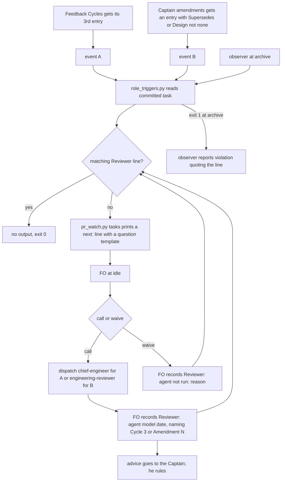

Filed on the Captain's 「可以，建成待辦」 (chat, 2026-10-16), after FO listed six moments in one session where a special role applied and was not used. The README says FO calls them when it judges they are needed; FO rarely judges its own work to need a second opinion, the same failure as the relay prod task where risk-selected security review never fired.

## Scope

- Evidence, session of 2026-10-15/16 on this workflow:
  - chief-engineer would apply: delivery-gate-verdict-form, three Codex P1 rounds of one class (the Captain asked FO to step back twice); dev2-laws-check, a fourth P1 of one class; prod-security-review-gates, its stop rule fired twice and the Captain asked for a rethink three times.
  - engineering-reviewer would apply: FO-proposed amendments that replaced an approved design (delivery-gate-verdict-form amendment 2, dev2-laws-check amendment 1); narrowing a stated guarantee (dev2-laws-check, Cycle 3); accepting residual security risk on a prod design (prod-security-review-gates, first actual use on 2026-10-16).
- Candidate triggers: chief-engineer when FO's circuit breaker fires (the same class of finding a second time) or the Captain asks FO to step back, before FO proposes a new route; engineering-reviewer when FO proposes an amendment that replaces approved design, narrows a guarantee, or accepts a risk, with its verdict in the gate question.
- Candidate enforcement: a `Reviewer:` line the check scripts or the observer can require when the event is in state (an amendment entry, a Feedback Cycles line naming a repeated class).
- Cost: each call is an Opus run; count the triggers per batch before choosing.

## FO alignment

Alignment: not needed before ideation; the Captain approved filing it (his words are at the top of this file).
Release review: not needed: workflow maintenance, on no journey map.
Surfaces: none
Visible change: none

## Captain amendments

### Amendment 1 — 2026-10-17, chat
Captain: 「第四題同意」 (chat, 2026-10-17)
Asked: 「第 4 題：#664「特殊角色觸發點」的 AC-2，要照你批准的設計改嗎？」（「我建議把 AC-2 改成：找審核員的日期「不早於」修正指示的日期。這樣就和 D3 一致。」）
Supersedes: AC-2
Design: AC-2's date rule is changed so that an engineering-reviewer call dated no earlier than the amendment entry's date clears it, consistent with D3
Superseded text: **AC-2** A matching line clears an event; each near-miss does not.
Verified by: one subTest per case on a task with one owed event: a call line naming `Cycle 3` or `Amendment N` exits 0; `not run: <reason>` exits 0; wrong agent, blank reason, no event token, `Cycle 30` for `Cycle 3`, a line inside a fenced block, and (B) a call dated after the entry each exit 1 with the `next:` line.
Falsifier: match the token as a substring and the `Cycle 30` case exits 0; accept an empty reason and the blank-reason case exits 0.

## Design

Base: origin/main package 0.24.0; paths below are under `kc-dev-flow-2/`. Counts were taken on state branch `spacedock-state/dev2` at `f3474f68` (2026-10-17); the probes are throwaway scripts in `/tmp`, not committed.

### Existing-code check (chain: Spacedock, kc-dev-flow-2, adopters)

- **Spacedock 0.27.0 plugin and 0.27.2 binary:** it owns `### Feedback Cycles` and its Cycle lines; `skills/feedback-rejection-flow/SKILL.md` step 4 says "On cycle 3 run no reviewer: escalate to the human instead of a fourth round", and it leaves the Cycle line grammar to the workflow. It has no task-body hook (hooks are startup, idle and merge; `ideation-gaps` read this on 2026-09-30). So the third Cycle entry is an existing, portable stop, and the idle hook is the only moment FO reads.
- **kc-dev-flow-2 0.24.0:** the `Reviewer: <agent> <model> <date> — <question>` form exists (`references/sd/workflow.md` § Stages) and is guarded only by `test_sd_dispatch.py` "reviewer-record"; `skills/observer/SKILL.md` reports it as `observed`, "a record, not a requirement"; `pr_watch.py tasks` already runs `dispatch_records.py --newest` per live task and prints `next:` lines that the mod's idle hook tells FO to do; `laws_check.py` (L1, L2) and `delivery_gate.py` (`Second reviewer: X because` needs `X not run: <reason>`) are the precedents for record-or-reason. Nothing starts either role. Result: extend `pr_watch.py tasks` and the observer sentence; no new hook, gate or law.
- **Adopters:** relay's state (read-only, `spacedock-state/dev2`, 2026-10-17): 14 task files carry `### Feedback Cycles`, none a P-level finding path, and no file carries a `Reviewer:` line; relay's v1 contract says specialists are "risk-selected, not convened" (quoted in `prod-security-review-gates`), the failure this task fixes.
- **ADR 0011** ("never delegated" authority, merge, outward actions): an event that starts an advisory call delegates nothing; the report is advisory and the Captain still rules. **ADR 0004** (review rounds stop by rule): the third Cycle is its stop; this adds a recorded call at it. **ADR 0005** (amendments recorded by FO): the entry form is its. `git -C <state> grep -n 'Override:'` (2026-10-17): no gate-record override on triggers or roles.

### Bite and consumer

- Bite: in all of state at `f3474f68`, one chief-engineer call is recorded (`prod-security-review-gates`, 2026-10-17, FO-initiated at Cycle 2) and no engineering-reviewer call; the Scope's six moments had no call. Over 2026-10-15/16, 10 events would have owed a call (counts below).
- Consumer: FO at idle (a `next:` line, the same channel as `dispatch_records.py --newest`); the observer at archive.

### PRFAQ

**Press release.** When a task's feedback loop reaches its third Cycle, or the Captain's amendment replaces a criterion or the design, FO's next idle read tells it to ask the right Opus seat one bounded question and record the answer's line or a reason for not asking. Nothing waits on FO noticing that its own work needs a second opinion.

**FAQ.**
- *Does the reviewer decide?* No. The line records a call and its question; `proceed | adjust | hold | escalate` stays advice (ADR 0011).
- *What is the event for "the same class a second time"?* There is none in state. A class is FO's judgement, and no form carries it on either corpus (a P-level finding path repeats across cycles in 9 of 13 archived tasks here, which over-fires on every normal repair loop, and in 0 of 14 relay tasks, none of which carries a path; it also misses `prod-security-review-gates` where 4 of 5 cycles name no path). The recorded event is the third Cycle entry, which Spacedock already stops at. FO may still call earlier; any call whose question names `Cycle N` counts.
- *What is the event for "the Captain asks FO to step back"?* His own request is a direct invocation, which both skills already list; it needs no FO judgement. A step-back he orders by amendment is event B.
- *What is the event for "FO proposes an amendment"?* The proposal is chat or a gate question, not state. The first state record is his answer, the amendment entry. All 8 real entries since 2026-10-15 carry an `Asked:` line quoting an FO proposal, so `Asked:` separates nothing. The call is therefore owed from the commit of the entry until the worker that applies it is dispatched: it cannot lead the Captain's answer, but it can still change what is built. A proposal-time call stays FO judgement (decision D3).
- *Accepting a residual risk?* No recorded form exists, and one case (`prod-security-review-gates`, 2026-10-16) is not a bite count. Deferred; no event invented.
- *Does a waiver defeat it?* It makes FO write a reason into a file the observer reads; it does not stop FO. L1's `observer not run:` and `Second reviewer: X not run:` are the precedent.

### Mechanism

One new script, `scripts/role_triggers.py <state checkout> <slug> [--rev REV]`, with the exit contract of `observer_check.py`: 0 nothing owed (stdout counts events read), 1 one `next:` line per unmet event, 2 cannot tell (not a work tree, REV names no commit, no task for the slug), reading committed bytes only.
- **Event A:** the third `- Cycle N` line in `### Feedback Cycles`, fenced blocks ignored. Owed: a `Reviewer:` line for `chief-engineer`.
- **Event B:** each `### Amendment N` under `## Captain amendments`, fenced blocks ignored, whose `Supersedes:` or `Design:` value does not start with `none`. Owed: a `Reviewer:` line for `engineering-reviewer`.
- **Met by:** a line `Reviewer: kc-dev-flow-2:<agent> <model> <date> — <question>` whose question matches `\bCycle 3\b` or `\bAmendment N\b` (call), or `Reviewer: kc-dev-flow-2:<agent> not run: <non-blank reason>` followed by that token (waiver), outside fenced blocks; for B the call's `<date>` is not later than the entry's date. Lines naming another agent (for example a design reviewer) are ignored.
- **Output text** (the question template is what keeps the Opus run bounded; word counts by `len(text.split())`): A 52 words, B 63 words, each naming the agent, the template question, and both record forms.
- **Wiring:** `pr_watch.py tasks` calls it for each live task beside `dispatch_records.py --newest` (archived tasks are skipped, as today). `skills/observer/SKILL.md`: for each line the script prints at `TO`, report `violation` quoting it; the old "record, not a requirement" sentence stays for the db and stronger-ideation conditions. `skills/engineering-reviewer/SKILL.md`: one trigger bullet naming a recorded amendment, so the seat does not decline it by its own list.
- **README:** `references/sd/workflow.md` § Stages sentence on `Reviewer:` is rewritten to name the script, at no more words than the 20 it has now (candidate: "Each chief-engineer or engineering-reviewer call goes under `## FO alignment` as `Reviewer: <agent> <model> <date> — <question>`; `role_triggers.py` lists calls owed." is 21, so one word is cut elsewhere in the paragraph). The waiver form and templates live in the script's output, not the README.

### Cost

Counts from the state branch at `f3474f68`, dated by the Cycle or Amendment line:

| Window | A (3rd Cycle) | B (amendments) | Opus runs owed |
| --- | --- | --- | --- |
| 2026-10-15/16 | 3 (delivery-gate-verdict-form, dev2-laws-check, amendment-form-check) | 7 (dev2-laws-check 1, delivery-gate-verdict-form 2, amendment-form-check 1, prod-security-review-gates 2, names-check-before-dispatch 1) | 10 over 6 tasks |
| 2026-10-15 to 17 | 5 (adds extension-instruction-reaches-dispatch, prod-security-review-gates) | 8 (adds extension-instruction-reaches-dispatch 1) | 13 over 7 tasks |

At the second Cycle instead (decision D1): A is 4 for 10-15/16 and 5 for 10-15 to 17. Token cost per call is unmeasured: the one recorded call has no token record and kc-dev-flow-2 stores none, so no number is given. Recorded calls today: 1. CI: one added step in `.github/workflows/kc-dev-flow-2-tests.yml`, the existing job.

### Words FO reads at each lifecycle moment

Counted `len(text.split())` on origin/main 0.24.0; `workflow.md` is 5495 words, budget 5511 (`lint-skills.py` `WORKFLOW_WORD_BUDGET`).

| Moment | Text FO reads | Before | After, no event owed | After, event owed |
| --- | --- | --- | --- | --- |
| startup | mod `kc-dev-flow-2.md` (48) plus `pr_watch.py tasks` output | 48 + output | identical | + one line, 52 (A) or 63 (B) words, per owed event |
| idle, open PR | same | 48 + output | identical | same addition |
| idle, merged PR | same | 48 + output | identical | same addition |
| after the archive | same | 48 + output | identical | n/a (archived tasks skipped) |
| ideation gate prep | `### ideation` plus `design_surfaces.py check` output | unchanged | unchanged | unchanged |
| merge ask | `delivery_gate.py` passage and output | unchanged | unchanged | unchanged |
| the README's `reviewer-record` sentence | 20 words | 20 | at most 20 | at most 20 |

This change cannot lower a moment; it adds text only while a call is owed and removes it when the line is recorded. No README word is added. If workflow-budget-ratchet sets the budget equal to the count, the sentence must be net zero or negative, which AC-5 requires.
- Cycle 1 (FO, 2026-10-17): Codex review on #664 5afe7fd7 (review:5558171225) left two P2, to fix (rounds 1 and 2 fix every finding); investigation first, then FO fix authorization, then a fresh validation recheck.
  - P2 `kc-dev-flow-2/scripts/role_triggers.py`: (1) an engineering-reviewer call dated after the amendment entry is rejected (the comparison requires call date <= entry date), so pr_watch.py tasks keeps reporting it owed; Captain amendment 1 now supersedes AC-2 with 'no earlier than the entry date'; (2) cleared() scans every unfenced line, so a Reviewer: line copied into a validation report or other section clears the debt, though the rule and the remediation require it under ## FO alignment.
- Cycle 2 (FO, 2026-10-17): Codex review on #664 7701703b (review:5558381167) left one P2, to fix (rounds 1 and 2 fix every finding); investigation first, then FO fix authorization, then a fresh validation recheck.
  - P2 `kc-dev-flow-2/scripts/role_triggers.py`: the Captain amendments section is matched by a case-sensitive literal, so '## Captain Amendments', '## CAPTAIN AMENDMENTS' or an indented heading (forms kc-dev-flow-2/scripts/test_design_surfaces.py accepts) makes every replacing amendment silently ignored and no engineering-reviewer call reported.

## Acceptance criteria

**AC-1** The script finds event A and event B from committed state and ignores fenced text.
Verified by: `python3 <pkg>/scripts/role_triggers.py <state> <slug> --rev f3474f68` on archived tasks exits 1 and prints, per task: delivery-gate-verdict-form A and B 1, B 2; dev2-laws-check A, B 1; amendment-form-check A and exactly one B (its two fenced `### Amendment 1` fixtures, near its lines 370 and 485, are not events); extension-instruction-reaches-dispatch A, B 1; names-check-before-dispatch B 1; prod-security-review-gates A, B 1, B 2 (its existing Cycle-2 call names no event, so A is still owed). Run in the test with synthetic copies of those shapes, and once by hand on the real branch.
Falsifier: scan fenced text and amendment-form-check prints three B lines; fire A at the second Cycle and a task with exactly two Cycles prints an A line the test says it must not.

**AC-3** It judges committed bytes and reports what it cannot tell.
Verified by: with the task edited on disk but not committed, `--rev HEAD` prints the committed answer; a bad `--rev`, a non-work-tree and a slug with no task exit 2 with `cannot tell`; `git status --porcelain` is empty after every run.
Falsifier: read the working file and the uncommitted-edit case flips its exit code.

**AC-4** FO sees the line at idle, for live tasks only.
Verified by: a `test_pr_watch.py` case on a temporary workflow with one live task owing A: `pr_watch.py tasks <workflow>` prints the 52-word A line; with the line recorded it prints none; the same task under `_archive/` prints none; a script exit 2 becomes an `errors` line and the exit code 2. Run once by hand on a throwaway copy of `f3474f68` with delivery-gate-verdict-form moved to the top level.
Falsifier: delete the call in `tasks` and the live-task case prints nothing.

**AC-5** The README gains no words and its guard still bites.
Verified by: `python3 -c "print(len(open('references/sd/workflow.md').read().split()))"` after is at most 5495 and at most the budget workflow-budget-ratchet sets; `lint-skills.py` exits 0 with `WORKFLOW_WORD_BUDGET` unchanged; `test_sd_dispatch.py` "reviewer-record" is updated and fails when the rewritten sentence is deleted.
Falsifier: add the waiver form to the README sentence and the count exceeds 5495.

**AC-6** The two skill sentences are present and linted.
Verified by: `lint-skills.py` and `test_lint_skills.py` exit 0; `git diff` over `skills/` touches only `observer/SKILL.md` (one sentence naming the script and `violation`) and `engineering-reviewer/SKILL.md` (one trigger bullet).
Falsifier: a hand-written `Reviewer:` rule in the chief-engineer skill, which AC-6 forbids.

**AC-7** A second corpus shows the false-positive cost.
Verified by: the A reader over relay's 14 archived tasks (read with `git show`, copied to a temp directory, run with `python3 -I`) reports exactly one-share-link (3 Cycles), close-race-copilot (4) and owner-link-and-account (4); the validator records that those Cycles were Captain-ordered, so waivers are the expected answer there.
Falsifier: any other relay task reported, or one of the three missing.

**AC-8** The new test runs in CI.
Verified by: `.github/workflows/kc-dev-flow-2-tests.yml` has a step running `test_role_triggers.py`; the test fails by itself when the script is broken.
Falsifier: the suite exists and no step runs it (the case that left about 1050 assertions unrun).

**AC-9** The observer reports an owed event.
Verified by: not yet verified. At validation, one `kc-dev-flow-2:observer` replay on archived delivery-gate-verdict-form must print a `violation` finding quoting a `role_triggers.py` line; the report is saved with the validation record.
Falsifier: the report has no such line, or reports `observed` for it.

**AC-10** Amended by Captain, amendment 1, replacing AC-2: a matching line clears an event; each near-miss does not; an engineering-reviewer call dated no earlier than the amendment entry's date clears it.
Verified by: one subTest per case on a task with one owed event: a call line naming `Cycle 3` or `Amendment N` exits 0 (for B, dated on or after the entry); `not run: <reason>` exits 0; wrong agent, blank reason, no event token, `Cycle 30` for `Cycle 3`, a line inside a fenced block, and (B) a call dated before the entry each exit 1 with the `next:` line.
Falsifier: match the token as a substring and the `Cycle 30` case exits 0; accept an empty reason and the blank-reason case exits 0.

### Batch overlap

Files this design would change: `scripts/role_triggers.py` (new), `scripts/test_role_triggers.py` (new), `.github/workflows/kc-dev-flow-2-tests.yml` (one step), `scripts/pr_watch.py` and `scripts/test_pr_watch.py`, `references/sd/workflow.md` (one sentence), `scripts/test_sd_dispatch.py` ("reviewer-record" case), `skills/observer/SKILL.md`, `skills/engineering-reviewer/SKILL.md`.

- **workflow-budget-ratchet:** same file `references/sd/workflow.md`, and its budget in `scripts/lint-skills.py`. Order: ratchet first; this design must then be net zero in words. It also names `observer_check.py`-style shrinking of README rules; the `Reviewer:` sentence is not on its list.
- **worker-loads-declared-package:** as filed it touches `package_version.py` or `dispatch_records.py`; if its design adds a call in `pr_watch.py tasks`, it shares the loop this design edits. Textual merge only; no ordering needed unless it does.
- **merge-gatekeeper:** may change `delivery_gate.py`, `references/sd/workflow.md` (Delivery authority) and `pr_watch.py`; shares `workflow.md` and possibly `pr_watch.py`. This design does not touch `delivery_gate.py`.
- **prod-security-validation-gate** and **ui-design-review-in-ideation:** no shared file. ui-design-review writes its own `Reviewer:` (a design reviewer); `role_triggers.py` ignores other agents' lines (AC-2), but both share the token in `workflow.md` § Stages. Whichever lands second reconciles that sentence.
- Shared CI file: any batch-2 task adding a test step edits the same `kc-dev-flow-2-tests.yml` list; one-line conflicts.

### Unresolved decisions (for the Captain)

Past rulings read: no `Override:` on triggers; ADR 0011, 0004, 0005 followed.

1. **D1. Cycle threshold.** Recommendation: the third Cycle (Spacedock's own stop; all three cited cases reach it: delivery-gate-verdict-form, dev2-laws-check, prod-security-review-gates). What gets worse: the Scope says "a second time"; at the third, a class that repeats once and is then fixed gets no owed call (FO may still call; prod-security's Cycle-2 call was FO's). The second Cycle adds 1 Opus run for 10-15/16 and fires on most loops (11 archived tasks reached two Cycles, 8 reached three).
2. **D2. Waiver allowed.** Recommendation: yes, `Reviewer: <agent> not run: <reason>`. What gets worse: FO can write the waiver itself, so the event is a prompt and a visible reason, not an enforced call; 13 owed runs in three days would otherwise include amendments that only widened scope (extension-instruction-reaches-dispatch 1) and Captain-ordered Cycles.
3. **D3. Position of the engineering-reviewer call.** Recommendation: owed after his answer and before the applying worker is dispatched. What gets worse: it cannot put a verdict in his question; a proposal-time call needs a README rule FO would have to remember, which is the failure here, and no state shows it.

### Not done

Event for accepted residual risk; a `Class:` token (it would close the prod-security blind spot, but is a new form with no second bite); a law L3 in `laws_check.py` (report-only, runs after the push; deferred); any change to `delivery_gate.py`; token-cost measurement.

## Stage Report: ideation

- DONE: A design (PRFAQ and Mermaid) for recorded events that start chief-engineer and engineering-reviewer, where the Reviewer line goes, and what a check or the observer can require from state
  `## Design`: event A is the third Feedback Cycle, event B an amendment entry; `Reviewer:` stays under `## FO alignment`; `role_triggers.py` via `pr_watch.py tasks` and one observer sentence. Mermaid matches the order and the waive branch.
- DONE: The Opus cost per batch from the 2026-10-15/16 count; the rule text fits under the ratchet budget
  `### Cost`: 10 owed runs over 6 tasks for 10-15/16 (13 over 7 to 10-17); tokens unmeasured, stated. README sentence at most 20 words, base 5495 of 5511 (AC-5).
- DONE: A `### Batch overlap` section naming each file and each overlapping batch-2 task
  Eight files listed; overlaps named for workflow-budget-ratchet (order first), worker-loads-declared-package, merge-gatekeeper, the two others (no shared file).
- DONE: The words FO reads at each lifecycle moment, before and after
  `### Words FO reads at each lifecycle moment`: no moment falls, none rises unless a call is owed (52 or 63 words); no README word added.
- DONE: Acceptance criteria with reproducible evidence clauses and falsifiers, and unresolved decisions with recommendations
  AC-1..AC-9 each with Verified by and Falsifier; D1 to D3 each with a recommendation and what gets worse.
- DONE: AC-1 evidence now: probes on state `f3474f68` gave A for 5 tasks and B for 8 entries (fenced fixtures excluded); the script itself is not yet written.
- DONE: AC-2..AC-4 current evidence: none beyond the shape of the probes; the tests and the `pr_watch.py` wiring are not yet verified.
- DONE: AC-5 current evidence: base `workflow.md` 5495 words, budget 5511, sentence 20 words, candidate 21 (one word to cut); not yet verified after edit.
- DONE: AC-6 and AC-8 current evidence: none; not yet verified. AC-7: relay probe gave 3 of 14 tasks with three or more Cycles; the script is not yet written.
- DONE: AC-9 current evidence: not yet verified (needs an observer replay at validation).
- DONE: `design_surfaces.py check` run
  `python3 <package>/scripts/design_surfaces.py check <task>`: "design surfaces presentable", exit 0.

### Summary

The path-based "same class" detector failed on relay (0 of 14) and on prod-security-review-gates, so the recorded event is the third Feedback Cycle, which Spacedock already stops at, plus amendment entries. The amendment call is owed after his answer because no state exists before it (D3). The Cycle threshold, the waiver and that position are the Captain's calls.

## Stage Report: implementation

- DONE: One Draft PR (feat(kc-dev-flow-2): ...) from a branch off origin/main implementing D1 to D3 as recommended: kc-dev-flow-2/scripts/role_triggers.py, its call from kc-dev-flow-2/scripts/pr_watch.py tasks, one sentence in kc-dev-flow-2/skills/observer/SKILL.md, one trigger bullet in kc-dev-flow-2/skills/engineering-reviewer/SKILL.md, and the Reviewer sentence in kc-dev-flow-2/references/sd/workflow.md at net zero README words under the merged budget ratchet; every acceptance criterion in the task file green, each falsifier shown failing by a mutation you run (python3 -B, caches cleared)
  Draft PR https://github.com/iamcxa/kc-claude-plugins/pull/664, head 5afe7fd7 on origin/main 6ea3a472; README 5447 of 5447, budget steps unchanged. AC-1..AC-8 met, AC-9 is the validation replay (not run here). `test_role_triggers.py` (9 tests): no fence skipping fails the fenced test; A at Cycle 2 fails the third-cycle test; token as substring fails "Cycle 30"; empty reason fails blank-reason; working file read fails the committed-bytes test; call date ignored fails the date test. `test_pr_watch.py` (+3): deleting the call fails 2, not reporting exit 2 fails 1. `test_sd_dispatch.py` "reviewer-record": deleting the sentence reports its need as missing; adding the waiver form to the README fails lint (5454 > 5447). AC-6: `git diff --stat origin/main..HEAD -- kc-dev-flow-2/skills/` lists exactly observer and engineering-reviewer SKILL.md.
- DONE: No FO-read word added beyond the design; the candidate's own kc-dev-flow-2/scripts/lint-skills.py exits 0; roborev evidence= line; push without force; CI green on the PR head; CI cost measured or stated as not measured
  Output lines are 51 (A) and 60 (B) words against the design's 52 and 63; lint-skills.py "PASS ... 5447 of 5447 words" (exit 0, seen); roborev `clean on 5afe7fd78; evidence=roborev:802` (first run on 6f84d1d15 was roborev:801); plain push, no force; all 5 checks pass at 5afe7fd7 (unit tests job 1m14s whole job; the new step alone not measured, 7 s locally).
- DONE: Existing-code probes and by-hand runs
  AC-1 on state f3474f68: A and B lines match the design per task; `amendment-form-check` prints 1 B (3 with fence skipping off). AC-4 by hand on a throwaway copy with delivery-gate-verdict-form at top level: `pr_watch.py tasks` printed its A line and both B lines. AC-7 over relay's 60 state files at a5589c71 (python3 -I): A fires for exactly one-share-link, close-race-copilot, owner-link-and-account.
- DONE: Affected documents (doc_impact.py origin/main HEAD lists two)
  kc-dev-flow-2/README.md: unaffected: line 283 says every other test is listed in the workflow yml, where the step went. references/sd/adoption.md: unaffected: it names the `test_sd_dispatch.py` invocation, which did not change.
- DONE: comment_ratio, design_surfaces, number guards, ADR
  comment_ratio.py: 2 comment lines of 304 code lines, 0.7%, exit 0. design_surfaces.py check: presentable, exit 0. number_guards: not applicable (no `## Number guards`, Surfaces none). ADR: none written; the design lists no docs/adr file and reserved no number, so FO rules if one is owed.

### Summary

Event A is keyed on a `- Cycle N` line numbered 3 or more, not on the third line, because `Cycle 1, validation` shares number 1; the two readings agree on every AC-1 task and all three relay A tasks. Over all of state at f3474f68 the script reports A on 8 tasks and B on 16 entries (the design's 5 and 8 were a 10-15..17 window); relay shows B on 16 tasks, which the design's AC-7 did not count, and relay's Cycle counts at a5589c71 (one-share-link 5) differ from the design's while the set of three matches. An amendment call must be dated no later than its entry (AC-2 as written), so a call made the next day is owed a waiver. A live task file not yet committed makes `tasks` print a `cannot tell` line and exit 2.

## Stage Report: validation

- DONE: Independent verdict on PR #664 head 5afe7fd7 against every acceptance criterion in the task file, re-running each evidence command and at least one falsifier per criterion yourself, and judging each limit the implementation report states
  Verdict PASSED at 5afe7fd78b7abab40c87e37b406254848c213301 (base 6ea3a472), one Needs decision (F1). CI at that head: all 5 checks success, `test_role_triggers.py` step ran and passed in run 39039429526. Mutations on a throwaway copy (python3 -B), each fails the named test: no fence skip, A at Cycle 2, token substring (A and B), empty reason, call date ignored, any agent accepted, `none` not skipped, working-file read (AC-1..3); `tasks` call deleted fails 2 tests, exit 2 ignored fails 1 (AC-4); waiver form added to the README sentence gives 5457 > 5447 and lint-skills exits 1 (AC-5). AC-1 by hand on state f3474f68: the per-task A/B lines match the design for all six tasks, amendment-form-check prints 1 B. AC-4 by hand on a clone of f3474f68 with delivery-gate-verdict-form at top level: A and both B lines printed, archived tasks print none. AC-6: skills diff is observer and engineering-reviewer SKILL.md only; lint-skills and test_lint_skills exit 0. AC-7 over relay state a5589c71 (python3 -I, clone): A reported for exactly close-race-copilot, one-share-link, owner-link-and-account. AC-8: workflow step present and ran. Limits: (a) uncommitted live task gives `cannot tell` and exit 2 from `tasks`: acceptable, Deferred risk, material only if FO routinely leaves a live task file uncommitted at idle. (b) Event A reading and (c) AC-2 date rule: see the next item and F1.
- DONE: first validation; run AC-9 (one observer replay) here; judge the implementer's reading of Event A (any '- Cycle N' line with N of 3 or more, not the third line), the output word counts (51 and 60), the trigger counts over all state (A on 8 tasks, B on 16 entries) against the design's window counts, and AC-2's same-day rule; README stays 5447 of 5447; no ADR was written (FO rules if one is owed)
  AC-9 met: `kc-dev-flow-2:observer` (sonnet, candidate skill file, TO f3474f68) on archived delivery-gate-verdict-form printed three `violation` lines quoting role_triggers.py (`... has a third Feedback Cycle ...`, `... Captain amendment 1 ...`, `... Captain amendment 2 ...`) and kept the old `Reviewer:` sentence as `observed`. Event A: N>=3 is right; real files repeat numbers (`Cycle 1`, `Cycle 1, validation`, `Cycle 2`, `Cycle 3`), so the third line would fire at Cycle 2 on delivery-gate-verdict-form; both readings agree on all 8 tasks (my regex probe, no fence, matches the script). Words 51 and 60 re-counted. Counts: A 8 tasks matches; B is 17 entries on 10 tasks at both f3474f68 and state HEAD, not 16 (F2); the 2026-10-15..17 window gives A 5 and B 8, 2026-10-15/16 gives 7, as the design says. README 5447 of 5447, same as origin/main. ADR: none written and none required by the design; FO rules if one is owed.
- DONE: A minimal acceptance script the Captain can run (three to six steps, exact commands, expected output), run by you exactly as written in a fresh bash shell, with its observed output; adr_lint.py docs/adr --since <base> with its exit code; your verdict naming the head, with findings classified by the workflow's Review-finding disposition
  `python3 /Users/kent/.claude/plugins/cache/kc-claude-plugins/kc-dev-flow-2/0.24.0/scripts/adr_lint.py docs/adr --since 6ea3a4724515b974c34beb16bc3382683b6d45b9` at the candidate: "20 ADR file(s) checked, 0 legacy", exit 0. comment_ratio 0.7% exit 0; design_surfaces exit 0; dispatch_records "3 dispatch record(s) complete"; doc_impact's two documents match the implementer's `unaffected` reasons. Script below, run with `env -i PATH HOME bash --noprofile --norc`, all outputs as expected.
  Findings. F1 Needs decision: AC-2 requires a call's date not later than the amendment's date, so an engineering-reviewer call dated the next day (fixture: entry 2026-10-16, call 2026-10-17, exit 1) leaves the `next:` line and an observer `violation` until a waiver is written, while design D3 owes the call after his answer; the task cannot own the AC wording. F2 Polish: the implementation report says B on 16 entries, the script gives 17. F3 Polish: the design says "the third `- Cycle N` line" and the code uses N>=3; the code is the sounder reading, the design text should say so.

### Minimal acceptance script

Needs this repository's checkout at `/Users/kent/conductor/workspaces/kc-claude-plugins/colombo` and the state checkout named in step 5; step 1 fails if `/tmp/rt-accept` already exists. Covers the script, its test and the README budget; not `pr_watch.py tasks`, the observer or CI.

1. `git -C /Users/kent/conductor/workspaces/kc-claude-plugins/colombo worktree add --detach /tmp/rt-accept 5afe7fd78b7abab40c87e37b406254848c213301` prints `HEAD is now at 5afe7fd7`.
2. `cd /tmp/rt-accept && python3 -B kc-dev-flow-2/scripts/test_role_triggers.py` prints `Ran 9 tests` and `OK`.
3. `rm -rf /tmp/rt-accept-state && git init -q /tmp/rt-accept-state && printf '### Feedback Cycles\n\n- Cycle 1, a\n- Cycle 2, b\n- Cycle 3, c\n' > /tmp/rt-accept-state/demo.md && git -C /tmp/rt-accept-state add demo.md && git -C /tmp/rt-accept-state -c user.email=a@b -c user.name=t commit -qm demo` then `python3 -B /tmp/rt-accept/kc-dev-flow-2/scripts/role_triggers.py /tmp/rt-accept-state demo; echo "exit $?"` prints one `next: demo has a third Feedback Cycle; dispatch kc-dev-flow-2:chief-engineer ...` line and `exit 1`.
4. `printf 'Reviewer: kc-dev-flow-2:chief-engineer not run: Captain ordered these rounds Cycle 3\n' >> /tmp/rt-accept-state/demo.md && git -C /tmp/rt-accept-state add demo.md && git -C /tmp/rt-accept-state -c user.email=a@b -c user.name=t commit -qm waiver` then the step 3 `role_triggers.py` command again prints `role triggers: 1 event(s) read at HEAD, each with a call or a waiver.` and `exit 0`.
5. `python3 -B /tmp/rt-accept/kc-dev-flow-2/scripts/role_triggers.py /Users/kent/conductor/workspaces/kc-claude-plugins/colombo/.context/dev2-adoption/worktree/docs/dev2/.spacedock-state delivery-gate-verdict-form --rev f3474f68 | cut -c1-90; echo "exit ${PIPESTATUS[0]}"` prints three `next:` lines (third Feedback Cycle, amendment 1, amendment 2) and `exit 1`.
6. `cd /tmp/rt-accept && python3 -B kc-dev-flow-2/scripts/lint-skills.py | tail -2; echo "exit ${PIPESTATUS[0]}"` prints `references/sd/workflow.md: 5447 of 5447 words; no unlisted passage repeats it` and `exit 0`; then `cd /tmp && git -C /Users/kent/conductor/workspaces/kc-claude-plugins/colombo worktree remove --force /tmp/rt-accept && rm -rf /tmp/rt-accept-state`.

### Summary

PASSED at 5afe7fd7: AC-1 to AC-9 hold, each falsifier fails under a mutation I ran, CI is green and the new step ran. One Needs decision for FO or the Captain (F1, the same-day date rule in AC-2 against design D3), two Polish findings. My throwaway worktree and probes are removed.

## Stage Report: implementation (cycle 2, phase 1)

- DONE: Phase 1 only: reproduce the Codex P2 on #664 head 5afe7fd7 (review:5558171225) as a failing test, and propose the smallest fix; report and stop, with no commit or push, until FO authorizes the fix
  Both P2 reproduce at 5afe7fd7: two new tests in `kc-dev-flow-2/scripts/test_role_triggers.py` (worktree, uncommitted) fail with 4 of 13 subtests: `..._dated_no_earlier_than_the_entry_clears_it` (call 10-17 for entry 10-15 exits 1, expected 0; call 10-14 exits 0, expected 1) and `test_only_the_fo_alignment_section_can_clear_an_event` (call and waiver under `## Stage Report` exit 0, expected 1). Controls that pass today: same-day call, call and waiver under `## FO alignment`, and under a `###` subheading of it. Nothing committed or pushed; no remote or config write.
- DONE: Captain amendment 1 applied to the task file
  AC-2 moved verbatim under the entry's `Superseded text:`; replacement is AC-10 "Amended by Captain, amendment 1, replacing AC-2", AC-2's wording with only the date clause changed (on or after the entry clears; before the entry is owed). `design_surfaces.py check` exit 0. Task-file edit is uncommitted in the state checkout (phase 1 said no commit).

### Proposed fix (verified on a scratch copy, not applied)

In `role_triggers.py`: (1) `made.group(1) <= latest` becomes `>= latest` in `cleared()`; (2) a 9-line `alignment(lines)` generator yields only lines under the `## FO alignment` heading (ends at the next heading of level 1 or 2, so `###` subheadings stay in), and `check()` passes that to both `cleared()` calls. On the scratch copy the two new tests pass; the only failing case is the old `test_an_amendment_call_dated_after_the_entry_or_naming_another_number_is_owed` case dated 2026-10-17, which asserts the superseded AC-2 and must be dropped from it in the fix. Output over all 323 task files of state f3474f68 is identical before and after (md5 per task, 0 differ), so AC-1 and AC-7 evidence is unchanged.

### Summary

Both Codex P2 are real and reproduce as failing tests; the fix is about 11 lines in `role_triggers.py` plus removing one superseded test case. Decision for FO: the only recorded call in state (prod-security-review-gates) sits under `## Acceptance criteria`, not `## FO alignment`, so finding 2's rule would not count it (it names Cycle 2, so it clears nothing either way); also, finding 2 is not covered by Captain amendment 1, so its rule (restrict to `## FO alignment`) needs FO's ruling before it enters an AC.

## Stage Report: implementation (cycle 2, phase 2)

- DONE: Apply the phase-1 fix in role_triggers.py (call dated no earlier than the entry clears it, AC-10; only lines under ## FO alignment with its ### subheadings clear an event or carry a waiver); drop the superseded 10-17 case from the old test and keep the two new tests
  Commit 7701703b on spacedock-ensign/special-role-triggers (off 5afe7fd7): `>= latest` in `cleared()`, new `alignment()` generator feeding both `cleared()` calls, docstring updated; old test renamed `..._naming_another_number_is_owed` without the 10-17 case.
- DONE: Each rule's test fails under its own mutation (python3 -B, no bytecode)
  Date: `<= latest` back fails the 10-17 and 10-14 subtests. Section: `cleared(lines, ...)` back fails "call/waiver in another section". Subheading: ending the section at level 3 fails "call/waiver under a subheading of FO alignment". Unmutated copy: 11 tests OK.
- DONE: Output over the state task files unchanged except where the new rules apply, with the count
  Base script (5afe7fd7) vs new, md5 of stdout per task over all 323 .md files at state f3474f68: 0 differ, because no recorded call there sits under a changed rule's edge (the one real call, prod-security-review-gates, names Cycle 2).
- DONE: lint-skills.py exits 0 at 5447 of 5447; all package test files pass
  `lint-skills.py` exit 0, "5447 of 5447 words"; every `test_*.py` in kc-dev-flow-2/scripts exits 0 (test_sd_dispatch.py with `--sd-plugin-root` spacedock 0.27.0).
- DONE: roborev evidence= line; push without force; CI green on the new head
  `roborev clean on 7701703; evidence=roborev:814` (codex, SEVERITY_THRESHOLD_MET, verdict_bool 1); plain push 5afe7fd7..7701703b; `gh pr checks 664`: 5 passed, 0 failed, headRefOid 7701703beff2d9c48ee3577db395449df6f3747e.
- DONE: commit the stage report
  State commit via `spacedock state commit` (see the FO message).

### Summary

Both Codex P2 on #664 are fixed at 7701703b with a failing-first test and a mutation each; the state output is unchanged over 323 task files. Remaining for FO: a fresh validation recheck; no PR comment, review request or ready-mark was made.

## Stage Report: validation (cycle 2)

- DONE: Independent verdict on PR #664 head 7701703b against every acceptance criterion in the task file, re-running each evidence command and at least one falsifier per criterion yourself, and judging each limit the implementation report states
  Verdict PASSED at 7701703beff2d9c48ee3577db395449df6f3747e (base 6ea3a472, PR still Draft, CI 5 checks pass). Own mutations on a copy (python3 -B), each fails only its named test: `>=` back to `<=` fails the 10-14 and 10-17 date subtests (AC-10); date check removed fails 10-14; all sections clear fails "call/waiver in another section"; section ending at level 3 fails the two "under a subheading" subtests; no fence skip, A at N>=2, `Cycle 3`/`Amendment N` as substrings, empty reason, any agent, `none` not skipped, working-file read each fail one test (AC-1, AC-3, AC-10). `tasks` call deleted fails 2 `test_pr_watch.py` tests, exit 2 ignored fails 1 (AC-4); waiver form added to the README sentence gives 5454 > 5447 and lint-skills exits 1 (AC-5). Reruns: test_role_triggers 11 OK, test_pr_watch 72 OK, test_lint_skills 31 OK, lint-skills "5447 of 5447" exit 0, test_sd_dispatch with `--sd-plugin-root` spacedock 0.27.0 PASS incl. reviewer-record. AC-1 by hand on state f3474f68: per-task A/B lines as the design lists for all six tasks. AC-3: bad `--rev`, a non-work-tree and an absent slug each exit 2 with `cannot tell`; state `git status --porcelain` empty. AC-6: skills diff is observer and engineering-reviewer SKILL.md only. AC-7: A reported for exactly close-race-copilot, one-share-link, owner-link-and-account over relay state a5589c71 (python3 -I, archive extracted to a temp git repo). AC-8: the workflow step `test_role_triggers.py` is present and the new head's unit-test job passed.
- DONE: recheck after Cycle 1: Codex P2s (review:5558171225) fixed: a call dated no earlier than the amendment entry clears it (AC-10, Captain amendment 1 superseding AC-2), and only lines under ## FO alignment clear an event or carry a waiver (implements the approved design); confirm each rule's test fails under its mutation; AC-1 and AC-3 to AC-10 hold; validation-1's Polish and Deferred risk are FO's to decline
  Both rules hold and each test fails under its own mutation (above). Old 5afe7fd7 vs 7701703b script output (stdout plus exit) over all 118 task slugs of state f3474f68: 0 differ, so AC-1 and AC-7 evidence is unchanged. AC-9 is carried from validation 1, not re-run: observer SKILL.md is unchanged between 5afe7fd7 and 7701703b and the script output the observer quotes is identical for delivery-gate-verdict-form (the claim is that identity, not a new observer run). AC-2 is superseded by AC-10; the date clause no longer contradicts design D3. validation-1 F1 is resolved by the amendment; F2 and F3 (Polish) and limit (a) (Deferred risk) are FO's to decline and I add nothing to them.
- DONE: A minimal acceptance script the Captain can run (three to six steps, exact commands, expected output), run by you exactly as written in a fresh bash shell, with its observed output; /Users/kent/.claude/plugins/cache/kc-claude-plugins/kc-dev-flow-2/0.24.0/scripts/adr_lint.py docs/adr --since <base> with its exit code; your verdict naming the head, with findings classified by the workflow's Review-finding disposition
  `python3 /Users/kent/.claude/plugins/cache/kc-claude-plugins/kc-dev-flow-2/0.24.0/scripts/adr_lint.py docs/adr --since 6ea3a4724515b974c34beb16bc3382683b6d45b9` at the candidate: "20 ADR file(s) checked, 0 legacy", exit 0. comment_ratio 2 of 333 code lines (0.6%) exit 0; design_surfaces check exit 0; dispatch_records "6 dispatch record(s) complete"; doc_impact's two documents keep the implementer's `unaffected` reasons (cycle 2 changed only role_triggers.py and its test). Script below run with `env -i PATH HOME bash --noprofile --norc`, every output as expected. Findings: no Material, none Needs decision. F4 Polish (info for FO): relay's owner-link-and-account Cycle 3 was a validator REJECTED, not Captain-ordered, so AC-7's "waivers are the expected answer" holds for close-race-copilot and one-share-link's Cycle 3 and not for that one, where a call is the expected answer.

### Minimal acceptance script

Needs this repository's checkout at `/Users/kent/conductor/workspaces/kc-claude-plugins/colombo` and the state checkout named in step 5; step 1 fails if `/tmp/rt-accept` or `/tmp/rt-accept-state` exists. Covers the script, its test and the README budget; not `pr_watch.py tasks`, the observer or CI. Steps 3 to 5 each end by committing `demo.md` to a throwaway repo; run steps in order in one shell.

1. `git -C /Users/kent/conductor/workspaces/kc-claude-plugins/colombo worktree add --detach /tmp/rt-accept 7701703beff2d9c48ee3577db395449df6f3747e` prints `HEAD is now at 7701703b`.
2. `cd /tmp/rt-accept && python3 -B kc-dev-flow-2/scripts/test_role_triggers.py 2>&1 | tail -3; python3 -B kc-dev-flow-2/scripts/lint-skills.py | tail -2 | head -1; echo "lint exit ${PIPESTATUS[0]}"` prints `Ran 11 tests`, `OK`, `references/sd/workflow.md: 5447 of 5447 words; no unlisted passage repeats it` and `lint exit 0`.
3. `rm -rf /tmp/rt-accept-state && git init -q /tmp/rt-accept-state && printf '## FO alignment\n\nSurfaces: none\n\n## Captain amendments\n\n### Amendment 1 — 2026-10-15, chat\nCaptain: ok\nSupersedes: AC-2\nDesign: none\n\n### Feedback Cycles\n\n- Cycle 1, a\n- Cycle 2, b\n- Cycle 3, c\n' > /tmp/rt-accept-state/demo.md && git -C /tmp/rt-accept-state add demo.md && git -C /tmp/rt-accept-state -c user.email=a@b -c user.name=t -c commit.gpgsign=false commit -qm demo; python3 -B /tmp/rt-accept/kc-dev-flow-2/scripts/role_triggers.py /tmp/rt-accept-state demo | cut -c1-90; echo "exit ${PIPESTATUS[0]}"` prints two `next:` lines (a third Feedback Cycle, Captain amendment 1) and `exit 1`.
4. `printf 'Reviewer: kc-dev-flow-2:chief-engineer not run: Captain ordered these rounds Cycle 3\nReviewer: kc-dev-flow-2:engineering-reviewer opus 2026-10-17 — Amendment 1: q\n' >> /tmp/rt-accept-state/demo.md && git -C /tmp/rt-accept-state add demo.md && git -C /tmp/rt-accept-state -c user.email=a@b -c user.name=t -c commit.gpgsign=false commit -qm wrong-section; python3 -B /tmp/rt-accept/kc-dev-flow-2/scripts/role_triggers.py /tmp/rt-accept-state demo | cut -c1-90; echo "exit ${PIPESTATUS[0]}"` still prints the same two `next:` lines and `exit 1` (the records sit under `### Feedback Cycles`, not `## FO alignment`).
5. `printf '## FO alignment\n\nSurfaces: none\nReviewer: kc-dev-flow-2:chief-engineer not run: Captain ordered these rounds Cycle 3\nReviewer: kc-dev-flow-2:engineering-reviewer opus 2026-10-17 — Amendment 1: q\n\n## Captain amendments\n\n### Amendment 1 — 2026-10-15, chat\nCaptain: ok\nSupersedes: AC-2\nDesign: none\n\n### Feedback Cycles\n\n- Cycle 1, a\n- Cycle 2, b\n- Cycle 3, c\n' > /tmp/rt-accept-state/demo.md && git -C /tmp/rt-accept-state add demo.md && git -C /tmp/rt-accept-state -c user.email=a@b -c user.name=t -c commit.gpgsign=false commit -qm right-section; python3 -B /tmp/rt-accept/kc-dev-flow-2/scripts/role_triggers.py /tmp/rt-accept-state demo; echo "exit ${PIPESTATUS[0]}"` prints `role triggers: 2 event(s) read at HEAD, each with a call or a waiver.` and `exit 0` (the call is dated 2026-10-17, after the 2026-10-15 entry).
6. `python3 -B /tmp/rt-accept/kc-dev-flow-2/scripts/role_triggers.py /Users/kent/conductor/workspaces/kc-claude-plugins/colombo/.context/dev2-adoption/worktree/docs/dev2/.spacedock-state delivery-gate-verdict-form --rev f3474f68 | cut -c1-90; echo "exit ${PIPESTATUS[0]}"; cd /tmp && git -C /Users/kent/conductor/workspaces/kc-claude-plugins/colombo worktree remove --force /tmp/rt-accept && rm -rf /tmp/rt-accept-state` prints three `next:` lines (third Feedback Cycle, amendment 1, amendment 2) and `exit 1`, then removes both temp paths.

### Summary

PASSED at 7701703b: both Codex P2 are fixed, each rule's test fails under its own mutation, AC-1 and AC-3 to AC-10 hold, script output over the real state is identical to 5afe7fd7, CI is green. No Material finding and no Needs decision; AC-9 is carried from validation 1 on unchanged observer text and identical script output. My throwaway worktrees and probe copies are removed.

## Stage Report: implementation (cycle 3, phase 1)

- DONE: Phase 1 only: reproduce the Codex P2 on #664 head 7701703b (review:5558381167) as a failing test, and propose the smallest fix; report and stop, with no commit or push, until FO authorizes the fix
  New `HeadingFormsTest` in `kc-dev-flow-2/scripts/test_role_triggers.py` (worktree, uncommitted): at 7701703b 29 of 40 subtests fail, the 11 old tests and every trailing-no-break-space control pass. Per heading, forms uppercase, lowercase, leading space, tab, no-break space (forms from `test_design_surfaces.py`): `## Captain amendments`, `### Amendment N`, `### Feedback Cycles`, `## FO alignment` each ignored; plus an indented sibling heading does not end FO alignment, Captain amendments or Feedback Cycles (9 subtests).
- DONE: Close the class: every heading role_triggers.py matches normalized as design_surfaces.py does
  Proposed fix verified on a scratch copy `/tmp/rt-fix-scratch` (patch `fix.patch`, not applied): a `SPACE` class copied from `design_surfaces.GO_SPACE`, `HEADING` and `AMENDMENT` take leading `SPACE`, and `titled(hashes, text)` (case-insensitive, `SPACE` both sides) builds the three section matchers. design_surfaces.py has no heading helper, only the `GO_SPACE` constant and per-heading regexes, so there is nothing to import as a function.
- DONE: a test and mutation per heading; output over state task files
  Scratch with fix: 16 tests OK. Reverting one matcher to its literal fails only that heading's test (Captain amendments 6, Feedback Cycles 6, FO alignment 6, Amendment entry 5 subtests); column-0 `HEADING` fails 21 subtests across the five tests. Output over state task slugs (live and archived, base vs fixed `check()`): 0 differ of 67 at state HEAD 30c10e74, 0 of 63 at f3474f68; `git grep -i` finds no non-literal form of these headings in state HEAD.

### Summary

Same cause as the earlier two P2: the matchers compare literals, while design_surfaces accepts case, indent and no-break space. FO rulings needed: (1) design_surfaces itself reads `## FO alignment` and `### ` entries strictly, so normalizing those two goes beyond it (harmless: a task with `## FO Alignment` already fails design_surfaces); (2) copy `SPACE` plus a parity test against `design_surfaces.GO_SPACE`, or import it (an import breaks under `python3 -I`, and an import traceback exits 1, which this contract reads as owed lines).

## Stage Report: implementation (cycle 3, phase 2)

- DONE: Apply /tmp/rt-fix-scratch/fix.patch to kc-dev-flow-2/scripts/role_triggers.py and keep HeadingFormsTest in kc-dev-flow-2/scripts/test_role_triggers.py: all four headings (Captain amendments, Amendment N, Feedback Cycles, FO alignment) and section ends accept case, leading indent and no-break space
  Commit b300d9ba on spacedock-ensign/special-role-triggers (off 7701703b): `patch` applied unchanged; `test_role_triggers.py` 17 tests OK (29 subtests failed on 7701703b, trailing-no-break-space controls passed before and after).
- DONE: Copy the SPACE class and add a test that pins it equal to the GO_SPACE constant in kc-dev-flow-2/scripts/design_surfaces.py (no import at run time); each matcher's mutation fails only its own test (python3 -B, caches cleared); output over the state task files unchanged, with the count stated
  `SpaceClassTest` reads both constants as text; changing `\x85` to `\x86` in SPACE fails only it. Matcher reverted to its literal fails only its heading's test: Captain amendments 6, Feedback Cycles 6, FO alignment 6, Amendment entry 5 subtests; column-0 `HEADING` fails 21 subtests in the five heading tests (9 of them the section-end test). State output, base vs fixed `check()`: 0 of 68 task slugs differ at state HEAD, 0 of 63 at f3474f68.
- DONE: kc-dev-flow-2/scripts/lint-skills.py exits 0 at 5447 of 5447; all package test files pass; roborev evidence= line; push without force; CI green on the new head
  lint-skills.py exit 0, "5447 of 5447 words"; every `test_*.py` exits 0 (test_sd_dispatch.py with `--sd-plugin-root` spacedock 0.27.0; one first run, inside a loop with a 100 s timeout while other jobs ran, reported exit 2, a rerun alone exits 0). `roborev clean on b300d9ba; evidence=roborev:827` (codex, SEVERITY_THRESHOLD_MET, verdict_bool 1). Plain push 7701703b..b300d9ba; `gh pr checks 664`: 5 passed, 0 failed, headRefOid b300d9ba.
- DONE: commit the stage report
  State commit via `spacedock state commit` (see the FO message).

### Summary

All four headings and the section ends in `role_triggers.py` now read the forms `design_surfaces.py` accepts, with SPACE copied and pinned by test so the script runs under `python3 -I`. State output is unchanged over 68 task slugs; no PR comment, review request or ready-mark.

## Stage Report: validation (cycle 3)

- DONE: Independent verdict on PR #664 head b300d9ba against every acceptance criterion in the task file, re-running each evidence command and at least one falsifier per criterion yourself, and judging each limit the implementation report states
  Verdict PASSED at b300d9ba6019a4f2c54d5657b1698338fa71164b (base 6ea3a472; PR Draft, 5 checks SUCCESS via `gh pr view 664`). Since 5afe7fd7 only role_triggers.py and test_role_triggers.py changed (`git diff 5afe7fd7..HEAD --stat`). Reruns: test_role_triggers 17 OK, test_pr_watch 72 OK, test_lint_skills 31 OK, test_sd_dispatch (`--sd-plugin-root` /Users/kent/.claude/plugins/cache/spacedock/spacedock/0.27.0, binary spacedock 0.27.2) PASS incl. reviewer-record, lint-skills "5447 of 5447" exit 0; README 5447 words at base and head. Own mutations on a copy (python3 -B), each fails the named test: no fence skip, A at N>=2, token substring (Cycle and Amendment), empty waiver reason, `none` not skipped, working-file read (AC-1, AC-3, AC-10); call accepts any agent fails the near-miss test; date check removed fails only the date test; all sections clear fails the section test (AC-10); `tasks` call disabled in pr_watch fails the live-task and newest-record tests (AC-4). AC-1 by hand on state f3474f68: per-task lines match the design for all six tasks (amendment-form-check one B). AC-3 by hand: bad `--rev`, non-work-tree, absent slug each exit 2 `cannot tell`; an uncommitted edit leaves the committed answer; the script writes nothing. AC-5/6/8: 5447 words, skills diff is observer and engineering-reviewer SKILL.md only, workflow step `test_role_triggers.py` present. AC-7 over relay a5589c71 (git archive into a temp repo, python3 -I): A for exactly close-race-copilot, one-share-link, owner-link-and-account. AC-10 by hand: call dated 10-14 for a 10-15 entry exits 1, 10-15 and 10-17 exit 0. Limits judged: the cycle 3 report's "SPACE copied, not imported" holds (SpaceClassTest compares constant text; import would break `python3 -I`); live task uncommitted gives `cannot tell` exit 2 (Deferred risk, unchanged from validation 1).
- DONE: recheck after Cycle 2: Codex round-2 P2 (review:5558381167) fixed by normalizing every heading role_triggers.py matches (Captain amendments, Amendment N, Feedback Cycles, FO alignment, and section ends) for case, leading indent and no-break space, with SPACE copied and pinned to the GO_SPACE constant of kc-dev-flow-2/scripts/design_surfaces.py by test; confirm each matcher's mutation fails only its own test and output over the state task files is unchanged; AC-1 and AC-3 to AC-10 hold
  Matcher mutations: Captain amendments literal fails only its heading test (6 subtests); Feedback Cycles literal only its test (6); FO alignment literal only its test (6); Amendment entry literal only its test (5; dropping only re.I gives 2); `titled` without re.I fails those three tests (2 each), without leading SPACE (3 each), without trailing SPACE (1 each); SPACE `\x85` to `\x86` fails only SpaceClassTest; column-0 HEADING fails the five heading tests (21 subtests, 9 in the section-end test), as the report says; alignment section ending at level 3 fails only the FO-alignment-section test. Output (stdout plus exit code) of the 7701703b script against b300d9ba over every task slug, live and archived: 0 differ of 63 at f3474f68 and 0 of 68 at state 2e9f612f (read-only `git show`; exit codes 0 for 54, 1 for 14 at 2e9f612f). `git grep -i` for an indented, cased or no-break form of the four headings in state 2e9f612f finds none (the one near hit is `### FO alignment: proposed lines`, which no matcher accepts). Also: the Cycle 3 acceptance fixture (uppercase and no-break-space headings) reads 0 events at 7701703b and 2 at b300d9ba. AC-9 is carried, not re-run: observer SKILL.md and pr_watch.py are unchanged since 5afe7fd7 and the script output for delivery-gate-verdict-form is identical (0 differ). AC-4 by-hand run was not repeated either; the same unchanged wiring plus the mutation above is the evidence.
- DONE: A minimal acceptance script the Captain can run (three to six steps, exact commands, expected output), run by you exactly as written in a fresh bash shell, with its observed output; /Users/kent/.claude/plugins/cache/kc-claude-plugins/kc-dev-flow-2/0.24.0/scripts/adr_lint.py docs/adr --since <base> with its exit code; your verdict naming the head, with findings classified by the workflow's Review-finding disposition
  `python3 /Users/kent/.claude/plugins/cache/kc-claude-plugins/kc-dev-flow-2/0.24.0/scripts/adr_lint.py docs/adr --since 6ea3a4724515b974c34beb16bc3382683b6d45b9` at the candidate: "20 ADR file(s) checked, 0 legacy", exit 0. comment_ratio 2 of 389 code lines (0.5%) exit 0, the two are shebangs; design_surfaces check exit 0; dispatch_records "9 dispatch record(s) complete"; doc_impact's two documents keep the implementer's `unaffected` reasons; no Number guards section. Script below run with `env -i PATH HOME bash --noprofile --norc`, every output as expected; it also reads 0 events at 7701703b, so step 3 bites. Findings: no Material, none Needs decision. F5 Deferred risk: the fence matcher takes 0 to 3 plain spaces of indent while headings now accept any indent, tab or no-break space, so an event-shaped heading inside a fence opened with a tab or no-break-space indent would count; I did not probe state for one; material only if a task writes such a fence. F4 (validation cycle 2 Polish), F2, F3 (Polish) and limit (a) stay FO's to decline.

### Minimal acceptance script

Needs this repository's checkout at `/Users/kent/conductor/workspaces/kc-claude-plugins/colombo` and the state checkout named in step 5; step 1 fails if `/tmp/rt-accept` or `/tmp/rt-accept-state` exists. Covers the script, its test and the README budget; not `pr_watch.py tasks`, the observer or CI. Steps 3 to 5 each end by committing `demo.md` to a throwaway repo; run steps in order in one shell.

1. `git -C /Users/kent/conductor/workspaces/kc-claude-plugins/colombo worktree add --detach /tmp/rt-accept b300d9ba6019a4f2c54d5657b1698338fa71164b 2>&1 | tail -1` prints `HEAD is now at b300d9ba` and the commit subject.
2. `cd /tmp/rt-accept && python3 -B kc-dev-flow-2/scripts/test_role_triggers.py 2>&1 | tail -3; python3 -B kc-dev-flow-2/scripts/lint-skills.py | tail -2 | head -1; echo "lint exit ${PIPESTATUS[0]}"` prints `Ran 17 tests`, `OK`, `references/sd/workflow.md: 5447 of 5447 words; no unlisted passage repeats it` and `lint exit 0`.
3. `rm -rf /tmp/rt-accept-state && git init -q /tmp/rt-accept-state && printf '## fo alignment\n\nSurfaces: none\n\n \302\240## CAPTAIN AMENDMENTS\n\n\302\240### amendment 1 — 2026-10-15, chat\nCaptain: ok\nSupersedes: AC-2\nDesign: none\n\n### FEEDBACK CYCLES\n\n- Cycle 1, a\n- Cycle 2, b\n- Cycle 3, c\n' > /tmp/rt-accept-state/demo.md && git -C /tmp/rt-accept-state add demo.md && git -C /tmp/rt-accept-state -c user.email=a@b -c user.name=t -c commit.gpgsign=false commit -qm demo; python3 -B /tmp/rt-accept/kc-dev-flow-2/scripts/role_triggers.py /tmp/rt-accept-state demo | cut -c1-90; echo "exit ${PIPESTATUS[0]}"` prints two `next:` lines (a third Feedback Cycle, Captain amendment 1) and `exit 1` (headings in lowercase, uppercase and no-break-space forms are still read).
4. `printf 'Reviewer: kc-dev-flow-2:chief-engineer not run: Captain ordered these rounds Cycle 3\nReviewer: kc-dev-flow-2:engineering-reviewer opus 2026-10-17 — Amendment 1: q\n' >> /tmp/rt-accept-state/demo.md && git -C /tmp/rt-accept-state add demo.md && git -C /tmp/rt-accept-state -c user.email=a@b -c user.name=t -c commit.gpgsign=false commit -qm wrong-section; python3 -B /tmp/rt-accept/kc-dev-flow-2/scripts/role_triggers.py /tmp/rt-accept-state demo | cut -c1-90; echo "exit ${PIPESTATUS[0]}"` prints the same two `next:` lines and `exit 1` (the records sit under `### FEEDBACK CYCLES`, not the FO alignment section).
5. `printf '\302\240## FO ALIGNMENT\n\nSurfaces: none\nReviewer: kc-dev-flow-2:chief-engineer not run: Captain ordered these rounds Cycle 3\nReviewer: kc-dev-flow-2:engineering-reviewer opus 2026-10-17 — Amendment 1: q\n\n \302\240## CAPTAIN AMENDMENTS\n\n\302\240### amendment 1 — 2026-10-15, chat\nCaptain: ok\nSupersedes: AC-2\nDesign: none\n\n### FEEDBACK CYCLES\n\n- Cycle 1, a\n- Cycle 2, b\n- Cycle 3, c\n' > /tmp/rt-accept-state/demo.md && git -C /tmp/rt-accept-state add demo.md && git -C /tmp/rt-accept-state -c user.email=a@b -c user.name=t -c commit.gpgsign=false commit -qm right-section; python3 -B /tmp/rt-accept/kc-dev-flow-2/scripts/role_triggers.py /tmp/rt-accept-state demo; echo "exit ${PIPESTATUS[0]}"` prints `role triggers: 2 event(s) read at HEAD, each with a call or a waiver.` and `exit 0` (the call is dated 2026-10-17, on or after the 2026-10-15 entry).
6. `python3 -B /tmp/rt-accept/kc-dev-flow-2/scripts/role_triggers.py /Users/kent/conductor/workspaces/kc-claude-plugins/colombo/.context/dev2-adoption/worktree/docs/dev2/.spacedock-state delivery-gate-verdict-form --rev f3474f68 | cut -c1-90; echo "exit ${PIPESTATUS[0]}"; cd /tmp && git -C /Users/kent/conductor/workspaces/kc-claude-plugins/colombo worktree remove --force /tmp/rt-accept && rm -rf /tmp/rt-accept-state` prints three `next:` lines (third Feedback Cycle, amendment 1, amendment 2) and `exit 1`, then removes both temp paths.

### Summary

PASSED at b300d9ba: the heading class is closed (every matcher fails only its own test under its mutation, SPACE is pinned to GO_SPACE by test), script output over the real state is identical to 7701703b for all 68 task slugs, AC-1 and AC-3 to AC-10 hold, CI is green. No Material finding and no Needs decision; one Deferred risk (fence indent, F5). AC-9 and the by-hand AC-4 run are carried on unchanged wiring and identical output, not re-run. My throwaway worktrees and probe copies are removed.
