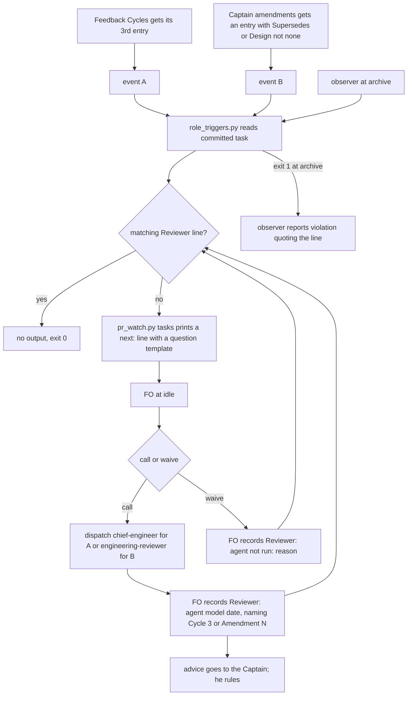

Filed on the Captain's 「可以，建成待辦」 (chat, 2026-10-16), after FO listed six moments in one session where a special role applied and was not used. The README says FO calls them when it judges they are needed; FO rarely judges its own work to need a second opinion, the same failure as the relay prod task where risk-selected security review never fired.

## Scope

- Evidence, session of 2026-10-15/16 on this workflow:
  - chief-engineer would apply: delivery-gate-verdict-form, three Codex P1 rounds of one class (the Captain asked FO to step back twice); dev2-laws-check, a fourth P1 of one class; prod-security-review-gates, its stop rule fired twice and the Captain asked for a rethink three times.
  - engineering-reviewer would apply: FO-proposed amendments that replaced an approved design (delivery-gate-verdict-form amendment 2, dev2-laws-check amendment 1); narrowing a stated guarantee (dev2-laws-check, Cycle 3); accepting residual security risk on a prod design (prod-security-review-gates, first actual use on 2026-10-16).
- Candidate triggers: chief-engineer when FO's circuit breaker fires (the same class of finding a second time) or the Captain asks FO to step back, before FO proposes a new route; engineering-reviewer when FO proposes an amendment that replaces approved design, narrows a guarantee, or accepts a risk, with its verdict in the gate question.
- Candidate enforcement: a `Reviewer:` line the check scripts or the observer can require when the event is in state (an amendment entry, a Feedback Cycles line naming a repeated class).
- Cost: each call is an Opus run; count the triggers per batch before choosing.

## FO alignment

Alignment: not needed before ideation; the Captain approved filing it (his words are at the top of this file).
Release review: not needed: workflow maintenance, on no journey map.
Surfaces: none
Visible change: none

## Design

Base: origin/main package 0.24.0; paths below are under `kc-dev-flow-2/`. Counts were taken on state branch `spacedock-state/dev2` at `f3474f68` (2026-10-17); the probes are throwaway scripts in `/tmp`, not committed.

### Existing-code check (chain: Spacedock, kc-dev-flow-2, adopters)

- **Spacedock 0.27.0 plugin and 0.27.2 binary:** it owns `### Feedback Cycles` and its Cycle lines; `skills/feedback-rejection-flow/SKILL.md` step 4 says "On cycle 3 run no reviewer: escalate to the human instead of a fourth round", and it leaves the Cycle line grammar to the workflow. It has no task-body hook (hooks are startup, idle and merge; `ideation-gaps` read this on 2026-09-30). So the third Cycle entry is an existing, portable stop, and the idle hook is the only moment FO reads.
- **kc-dev-flow-2 0.24.0:** the `Reviewer: <agent> <model> <date> — <question>` form exists (`references/sd/workflow.md` § Stages) and is guarded only by `test_sd_dispatch.py` "reviewer-record"; `skills/observer/SKILL.md` reports it as `observed`, "a record, not a requirement"; `pr_watch.py tasks` already runs `dispatch_records.py --newest` per live task and prints `next:` lines that the mod's idle hook tells FO to do; `laws_check.py` (L1, L2) and `delivery_gate.py` (`Second reviewer: X because` needs `X not run: <reason>`) are the precedents for record-or-reason. Nothing starts either role. Result: extend `pr_watch.py tasks` and the observer sentence; no new hook, gate or law.
- **Adopters:** relay's state (read-only, `spacedock-state/dev2`, 2026-10-17): 14 task files carry `### Feedback Cycles`, none a P-level finding path, and no file carries a `Reviewer:` line; relay's v1 contract says specialists are "risk-selected, not convened" (quoted in `prod-security-review-gates`), the failure this task fixes.
- **ADR 0011** ("never delegated" authority, merge, outward actions): an event that starts an advisory call delegates nothing; the report is advisory and the Captain still rules. **ADR 0004** (review rounds stop by rule): the third Cycle is its stop; this adds a recorded call at it. **ADR 0005** (amendments recorded by FO): the entry form is its. `git -C <state> grep -n 'Override:'` (2026-10-17): no gate-record override on triggers or roles.

### Bite and consumer

- Bite: in all of state at `f3474f68`, one chief-engineer call is recorded (`prod-security-review-gates`, 2026-10-17, FO-initiated at Cycle 2) and no engineering-reviewer call; the Scope's six moments had no call. Over 2026-10-15/16, 10 events would have owed a call (counts below).
- Consumer: FO at idle (a `next:` line, the same channel as `dispatch_records.py --newest`); the observer at archive.

### PRFAQ

**Press release.** When a task's feedback loop reaches its third Cycle, or the Captain's amendment replaces a criterion or the design, FO's next idle read tells it to ask the right Opus seat one bounded question and record the answer's line or a reason for not asking. Nothing waits on FO noticing that its own work needs a second opinion.

**FAQ.**
- *Does the reviewer decide?* No. The line records a call and its question; `proceed | adjust | hold | escalate` stays advice (ADR 0011).
- *What is the event for "the same class a second time"?* There is none in state. A class is FO's judgement, and no form carries it on either corpus (a P-level finding path repeats across cycles in 9 of 13 archived tasks here, which over-fires on every normal repair loop, and in 0 of 14 relay tasks, none of which carries a path; it also misses `prod-security-review-gates` where 4 of 5 cycles name no path). The recorded event is the third Cycle entry, which Spacedock already stops at. FO may still call earlier; any call whose question names `Cycle N` counts.
- *What is the event for "the Captain asks FO to step back"?* His own request is a direct invocation, which both skills already list; it needs no FO judgement. A step-back he orders by amendment is event B.
- *What is the event for "FO proposes an amendment"?* The proposal is chat or a gate question, not state. The first state record is his answer, the amendment entry. All 8 real entries since 2026-10-15 carry an `Asked:` line quoting an FO proposal, so `Asked:` separates nothing. The call is therefore owed from the commit of the entry until the worker that applies it is dispatched: it cannot lead the Captain's answer, but it can still change what is built. A proposal-time call stays FO judgement (decision D3).
- *Accepting a residual risk?* No recorded form exists, and one case (`prod-security-review-gates`, 2026-10-16) is not a bite count. Deferred; no event invented.
- *Does a waiver defeat it?* It makes FO write a reason into a file the observer reads; it does not stop FO. L1's `observer not run:` and `Second reviewer: X not run:` are the precedent.

### Mechanism

One new script, `scripts/role_triggers.py <state checkout> <slug> [--rev REV]`, with the exit contract of `observer_check.py`: 0 nothing owed (stdout counts events read), 1 one `next:` line per unmet event, 2 cannot tell (not a work tree, REV names no commit, no task for the slug), reading committed bytes only.
- **Event A:** the third `- Cycle N` line in `### Feedback Cycles`, fenced blocks ignored. Owed: a `Reviewer:` line for `chief-engineer`.
- **Event B:** each `### Amendment N` under `## Captain amendments`, fenced blocks ignored, whose `Supersedes:` or `Design:` value does not start with `none`. Owed: a `Reviewer:` line for `engineering-reviewer`.
- **Met by:** a line `Reviewer: kc-dev-flow-2:<agent> <model> <date> — <question>` whose question matches `\bCycle 3\b` or `\bAmendment N\b` (call), or `Reviewer: kc-dev-flow-2:<agent> not run: <non-blank reason>` followed by that token (waiver), outside fenced blocks; for B the call's `<date>` is not later than the entry's date. Lines naming another agent (for example a design reviewer) are ignored.
- **Output text** (the question template is what keeps the Opus run bounded; word counts by `len(text.split())`): A 52 words, B 63 words, each naming the agent, the template question, and both record forms.
- **Wiring:** `pr_watch.py tasks` calls it for each live task beside `dispatch_records.py --newest` (archived tasks are skipped, as today). `skills/observer/SKILL.md`: for each line the script prints at `TO`, report `violation` quoting it; the old "record, not a requirement" sentence stays for the db and stronger-ideation conditions. `skills/engineering-reviewer/SKILL.md`: one trigger bullet naming a recorded amendment, so the seat does not decline it by its own list.
- **README:** `references/sd/workflow.md` § Stages sentence on `Reviewer:` is rewritten to name the script, at no more words than the 20 it has now (candidate: "Each chief-engineer or engineering-reviewer call goes under `## FO alignment` as `Reviewer: <agent> <model> <date> — <question>`; `role_triggers.py` lists calls owed." is 21, so one word is cut elsewhere in the paragraph). The waiver form and templates live in the script's output, not the README.

### Cost

Counts from the state branch at `f3474f68`, dated by the Cycle or Amendment line:

| Window | A (3rd Cycle) | B (amendments) | Opus runs owed |
| --- | --- | --- | --- |
| 2026-10-15/16 | 3 (delivery-gate-verdict-form, dev2-laws-check, amendment-form-check) | 7 (dev2-laws-check 1, delivery-gate-verdict-form 2, amendment-form-check 1, prod-security-review-gates 2, names-check-before-dispatch 1) | 10 over 6 tasks |
| 2026-10-15 to 17 | 5 (adds extension-instruction-reaches-dispatch, prod-security-review-gates) | 8 (adds extension-instruction-reaches-dispatch 1) | 13 over 7 tasks |

At the second Cycle instead (decision D1): A is 4 for 10-15/16 and 5 for 10-15 to 17. Token cost per call is unmeasured: the one recorded call has no token record and kc-dev-flow-2 stores none, so no number is given. Recorded calls today: 1. CI: one added step in `.github/workflows/kc-dev-flow-2-tests.yml`, the existing job.

### Words FO reads at each lifecycle moment

Counted `len(text.split())` on origin/main 0.24.0; `workflow.md` is 5495 words, budget 5511 (`lint-skills.py` `WORKFLOW_WORD_BUDGET`).

| Moment | Text FO reads | Before | After, no event owed | After, event owed |
| --- | --- | --- | --- | --- |
| startup | mod `kc-dev-flow-2.md` (48) plus `pr_watch.py tasks` output | 48 + output | identical | + one line, 52 (A) or 63 (B) words, per owed event |
| idle, open PR | same | 48 + output | identical | same addition |
| idle, merged PR | same | 48 + output | identical | same addition |
| after the archive | same | 48 + output | identical | n/a (archived tasks skipped) |
| ideation gate prep | `### ideation` plus `design_surfaces.py check` output | unchanged | unchanged | unchanged |
| merge ask | `delivery_gate.py` passage and output | unchanged | unchanged | unchanged |
| the README's `reviewer-record` sentence | 20 words | 20 | at most 20 | at most 20 |

This change cannot lower a moment; it adds text only while a call is owed and removes it when the line is recorded. No README word is added. If workflow-budget-ratchet sets the budget equal to the count, the sentence must be net zero or negative, which AC-5 requires.

## Acceptance criteria

**AC-1** The script finds event A and event B from committed state and ignores fenced text.
Verified by: `python3 <pkg>/scripts/role_triggers.py <state> <slug> --rev f3474f68` on archived tasks exits 1 and prints, per task: delivery-gate-verdict-form A and B 1, B 2; dev2-laws-check A, B 1; amendment-form-check A and exactly one B (its two fenced `### Amendment 1` fixtures, near its lines 370 and 485, are not events); extension-instruction-reaches-dispatch A, B 1; names-check-before-dispatch B 1; prod-security-review-gates A, B 1, B 2 (its existing Cycle-2 call names no event, so A is still owed). Run in the test with synthetic copies of those shapes, and once by hand on the real branch.
Falsifier: scan fenced text and amendment-form-check prints three B lines; fire A at the second Cycle and a task with exactly two Cycles prints an A line the test says it must not.

**AC-2** A matching line clears an event; each near-miss does not.
Verified by: one subTest per case on a task with one owed event: a call line naming `Cycle 3` or `Amendment N` exits 0; `not run: <reason>` exits 0; wrong agent, blank reason, no event token, `Cycle 30` for `Cycle 3`, a line inside a fenced block, and (B) a call dated after the entry each exit 1 with the `next:` line.
Falsifier: match the token as a substring and the `Cycle 30` case exits 0; accept an empty reason and the blank-reason case exits 0.

**AC-3** It judges committed bytes and reports what it cannot tell.
Verified by: with the task edited on disk but not committed, `--rev HEAD` prints the committed answer; a bad `--rev`, a non-work-tree and a slug with no task exit 2 with `cannot tell`; `git status --porcelain` is empty after every run.
Falsifier: read the working file and the uncommitted-edit case flips its exit code.

**AC-4** FO sees the line at idle, for live tasks only.
Verified by: a `test_pr_watch.py` case on a temporary workflow with one live task owing A: `pr_watch.py tasks <workflow>` prints the 52-word A line; with the line recorded it prints none; the same task under `_archive/` prints none; a script exit 2 becomes an `errors` line and the exit code 2. Run once by hand on a throwaway copy of `f3474f68` with delivery-gate-verdict-form moved to the top level.
Falsifier: delete the call in `tasks` and the live-task case prints nothing.

**AC-5** The README gains no words and its guard still bites.
Verified by: `python3 -c "print(len(open('references/sd/workflow.md').read().split()))"` after is at most 5495 and at most the budget workflow-budget-ratchet sets; `lint-skills.py` exits 0 with `WORKFLOW_WORD_BUDGET` unchanged; `test_sd_dispatch.py` "reviewer-record" is updated and fails when the rewritten sentence is deleted.
Falsifier: add the waiver form to the README sentence and the count exceeds 5495.

**AC-6** The two skill sentences are present and linted.
Verified by: `lint-skills.py` and `test_lint_skills.py` exit 0; `git diff` over `skills/` touches only `observer/SKILL.md` (one sentence naming the script and `violation`) and `engineering-reviewer/SKILL.md` (one trigger bullet).
Falsifier: a hand-written `Reviewer:` rule in the chief-engineer skill, which AC-6 forbids.

**AC-7** A second corpus shows the false-positive cost.
Verified by: the A reader over relay's 14 archived tasks (read with `git show`, copied to a temp directory, run with `python3 -I`) reports exactly one-share-link (3 Cycles), close-race-copilot (4) and owner-link-and-account (4); the validator records that those Cycles were Captain-ordered, so waivers are the expected answer there.
Falsifier: any other relay task reported, or one of the three missing.

**AC-8** The new test runs in CI.
Verified by: `.github/workflows/kc-dev-flow-2-tests.yml` has a step running `test_role_triggers.py`; the test fails by itself when the script is broken.
Falsifier: the suite exists and no step runs it (the case that left about 1050 assertions unrun).

**AC-9** The observer reports an owed event.
Verified by: not yet verified. At validation, one `kc-dev-flow-2:observer` replay on archived delivery-gate-verdict-form must print a `violation` finding quoting a `role_triggers.py` line; the report is saved with the validation record.
Falsifier: the report has no such line, or reports `observed` for it.

### Batch overlap

Files this design would change: `scripts/role_triggers.py` (new), `scripts/test_role_triggers.py` (new), `.github/workflows/kc-dev-flow-2-tests.yml` (one step), `scripts/pr_watch.py` and `scripts/test_pr_watch.py`, `references/sd/workflow.md` (one sentence), `scripts/test_sd_dispatch.py` ("reviewer-record" case), `skills/observer/SKILL.md`, `skills/engineering-reviewer/SKILL.md`.

- **workflow-budget-ratchet:** same file `references/sd/workflow.md`, and its budget in `scripts/lint-skills.py`. Order: ratchet first; this design must then be net zero in words. It also names `observer_check.py`-style shrinking of README rules; the `Reviewer:` sentence is not on its list.
- **worker-loads-declared-package:** as filed it touches `package_version.py` or `dispatch_records.py`; if its design adds a call in `pr_watch.py tasks`, it shares the loop this design edits. Textual merge only; no ordering needed unless it does.
- **merge-gatekeeper:** may change `delivery_gate.py`, `references/sd/workflow.md` (Delivery authority) and `pr_watch.py`; shares `workflow.md` and possibly `pr_watch.py`. This design does not touch `delivery_gate.py`.
- **prod-security-validation-gate** and **ui-design-review-in-ideation:** no shared file. ui-design-review writes its own `Reviewer:` (a design reviewer); `role_triggers.py` ignores other agents' lines (AC-2), but both share the token in `workflow.md` § Stages. Whichever lands second reconciles that sentence.
- Shared CI file: any batch-2 task adding a test step edits the same `kc-dev-flow-2-tests.yml` list; one-line conflicts.

### Unresolved decisions (for the Captain)

Past rulings read: no `Override:` on triggers; ADR 0011, 0004, 0005 followed.

1. **D1. Cycle threshold.** Recommendation: the third Cycle (Spacedock's own stop; all three cited cases reach it: delivery-gate-verdict-form, dev2-laws-check, prod-security-review-gates). What gets worse: the Scope says "a second time"; at the third, a class that repeats once and is then fixed gets no owed call (FO may still call; prod-security's Cycle-2 call was FO's). The second Cycle adds 1 Opus run for 10-15/16 and fires on most loops (11 archived tasks reached two Cycles, 8 reached three).
2. **D2. Waiver allowed.** Recommendation: yes, `Reviewer: <agent> not run: <reason>`. What gets worse: FO can write the waiver itself, so the event is a prompt and a visible reason, not an enforced call; 13 owed runs in three days would otherwise include amendments that only widened scope (extension-instruction-reaches-dispatch 1) and Captain-ordered Cycles.
3. **D3. Position of the engineering-reviewer call.** Recommendation: owed after his answer and before the applying worker is dispatched. What gets worse: it cannot put a verdict in his question; a proposal-time call needs a README rule FO would have to remember, which is the failure here, and no state shows it.

### Not done

Event for accepted residual risk; a `Class:` token (it would close the prod-security blind spot, but is a new form with no second bite); a law L3 in `laws_check.py` (report-only, runs after the push; deferred); any change to `delivery_gate.py`; token-cost measurement.

## Stage Report: ideation

- DONE: A design (PRFAQ and Mermaid) for recorded events that start chief-engineer and engineering-reviewer, where the Reviewer line goes, and what a check or the observer can require from state
  `## Design`: event A is the third Feedback Cycle, event B an amendment entry; `Reviewer:` stays under `## FO alignment`; `role_triggers.py` via `pr_watch.py tasks` and one observer sentence. Mermaid matches the order and the waive branch.
- DONE: The Opus cost per batch from the 2026-10-15/16 count; the rule text fits under the ratchet budget
  `### Cost`: 10 owed runs over 6 tasks for 10-15/16 (13 over 7 to 10-17); tokens unmeasured, stated. README sentence at most 20 words, base 5495 of 5511 (AC-5).
- DONE: A `### Batch overlap` section naming each file and each overlapping batch-2 task
  Eight files listed; overlaps named for workflow-budget-ratchet (order first), worker-loads-declared-package, merge-gatekeeper, the two others (no shared file).
- DONE: The words FO reads at each lifecycle moment, before and after
  `### Words FO reads at each lifecycle moment`: no moment falls, none rises unless a call is owed (52 or 63 words); no README word added.
- DONE: Acceptance criteria with reproducible evidence clauses and falsifiers, and unresolved decisions with recommendations
  AC-1..AC-9 each with Verified by and Falsifier; D1 to D3 each with a recommendation and what gets worse.
- DONE: AC-1 evidence now: probes on state `f3474f68` gave A for 5 tasks and B for 8 entries (fenced fixtures excluded); the script itself is not yet written.
- DONE: AC-2..AC-4 current evidence: none beyond the shape of the probes; the tests and the `pr_watch.py` wiring are not yet verified.
- DONE: AC-5 current evidence: base `workflow.md` 5495 words, budget 5511, sentence 20 words, candidate 21 (one word to cut); not yet verified after edit.
- DONE: AC-6 and AC-8 current evidence: none; not yet verified. AC-7: relay probe gave 3 of 14 tasks with three or more Cycles; the script is not yet written.
- DONE: AC-9 current evidence: not yet verified (needs an observer replay at validation).
- DONE: `design_surfaces.py check` run
  `python3 <package>/scripts/design_surfaces.py check <task>`: "design surfaces presentable", exit 0.

### Summary

The path-based "same class" detector failed on relay (0 of 14) and on prod-security-review-gates, so the recorded event is the third Feedback Cycle, which Spacedock already stops at, plus amendment entries. The amendment call is owed after his answer because no state exists before it (D3). The Cycle threshold, the waiver and that position are the Captain's calls.
