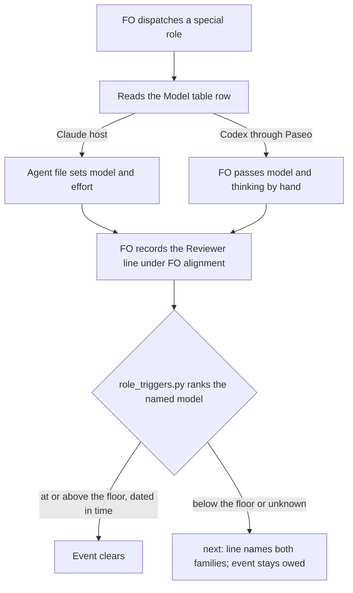

## Scope

- Source: Batch 12 backlog sitting: the Captain 「可以，但不用寫了就報錯，接受 `max` 和 `ultra`沒關係，等於就是不建議，但使用者真的想要也可以」 (chat, 2026-11-02), answering 「決定：五件事都照建議，第 5 項用這張表，並把 xhigh 上限寫進設定檔檢查，可以嗎？」, items 3 and 5. The Captain, chat 2026-11-02: 「我認為 codex 的實作者可以預設比 claude 多高一個推理等級，例如 Sonnet / high，對應 Sol / xhigh，總監也是」 and 「不要用到 max，最高就是 xigh 就好」.
- The table he approved:

| Role | On Claude | On Codex |
|---|---|---|
| implementation | Sonnet / high | Sol / xhigh |
| chief-engineer | Opus / xhigh | Astra / xhigh |
| engineering-reviewer | Opus / xhigh | Astra / xhigh |
| design-director | Sonnet / high | Sol / xhigh |
| ideation | Opus / high | Astra / xhigh |
| validation | Opus / high | Astra / xhigh |
| observer | Sonnet / high | Sol / high |

- Chief-engineer and engineering-reviewer run on a different family from the workers; so usually Opus / xhigh here, Astra / xhigh when the workers are Claude.
- Bite: `role_triggers.py` ranks Claude model names only, so a Codex engineering-reviewer call on 2026-10-30 had to be recorded as a waiver (`_archive/peers-paseo-rule-matches-practice.md`, FO alignment). `agents/design-director.md` and FO's notes disagreed on its model.
- Consumer: every FO dispatching a special role.
- Upstream first: `agents/*.md`, `scripts/role_triggers.py`, `references/sd/workflow.md` Stages.

## Non-goals

- Host changes; automatic model substitution; changing when a role is called.

## Budget

- One package PR. Workflow word budget unchanged unless the design names a raise for the Captain.

## Stop condition

- A Reviewer line naming a table model on either family clears its event; a cheaper one does not. Each role's declared settings and the workflow text agree with the table.

## FO alignment

Alignment: needed before ideation; the scope is the Captain's ruling.
Result: aligned at backlog: Batch 12 backlog sitting: the Captain 「可以，但不用寫了就報錯，接受 `max` 和 `ultra`沒關係，等於就是不建議，但使用者真的想要也可以」 (chat, 2026-11-02), answering 「決定：五件事都照建議，第 5 項用這張表，並把 xhigh 上限寫進設定檔檢查，可以嗎？」, approved the outcome and bounds in this file.
Surfaces: none
Visible change: none
Release review: not needed: workflow maintenance, on no journey map.

## Design

Base: `origin/main` 146727ded, kc-dev-flow-2 0.34.0. Probes ran on 2026-11-02 against disposable copies; no repository file changed. This revision carries the Captain's gate rulings of 2026-11-02, D1 to D5 below.

### PRFAQ

**Proposition.** An FO looks up one table to know what a special role or stage worker runs on, a Reviewer line naming a table model clears its event on either family, and the effort each special role declares reaches Claude Code.

**Why does effort need a change when the agent files already say xhigh?** Claude Code does not read the field they use. Its docs list `effort`, with no `reasoning` field, and say unrecognized fields are ignored (code.claude.com/docs/en/sub-agents, Frontmatter reference). `claude -p ... --debug-file` (2.1.316) logged, for all four kc-dev-flow-2 0.34.0 agents, `has a frontmatter key Claude Code does not recognize or apply: "reasoning"`; a probe agent with `effort: high` logged no such line. Subagent transcripts carry `perTurnEffort`, and they show the result: across `~/.claude/projects` on this machine on 2026-11-02, every record of 28 chief-engineer agents reads `high` and of 46 engineering-reviewer agents 43 read `high` and 3 carry no value, against a declared `xhigh`. That is one machine's history. A candidate copy using `effort:` ran as declared under a session at another level: chief-engineer and engineering-reviewer on `claude-opus-5-5` at `xhigh`, design-director and observer on `claude-sonnet-5-5` at `high`. Base ran chief-engineer at the session's `high`.

**Does this make Codex automatic?** No. `dispatch build --host codex` printed `declared model 'opus' ignored on host codex` and emitted `model=null`, and no agent file reaches Codex. The Codex column is what FO passes by hand on the Paseo route; the check only reads what was recorded.

**What about the other agent-file sentence?** "Explicitly request the highest available reasoning level" would pick `ultra` on Codex (`list_models codex`), against 「不要用到 max，最高就是 xigh 就好」. It goes.

**Does the agent file settle the model?** Not alone. A parent that passed `model: haiku` on its Agent call got Haiku at `xhigh`, so the file's model holds when the dispatch passes none, and the workflow's "never cheaper" and the Reviewer line carry the rest. The check reads the recorded line, not the transcript.

**What stays out?** Host changes, automatic substitution, when a role is called, refusing `max` or `ultra` anywhere (the Captain's batch ruling), and the effort of stage workers, which has no dispatch field on Spacedock's route and stays with the backlog seed `dispatch-sets-reasoning-effort`.

### Upstream first

- Spacedock: a per-state `model:` works (`[build] effective_model=opus (from stage)` on a disposable workflow); `effort:` on a state is not emitted, and `dispatch build` has no effort field or flag.
- kc-dev-flow-2: `AGENT_MODELS` in `lint-skills.py` already pins the Claude column of the four agents, on the dead field; `RANK` and `rank` in `role_triggers.py` are the check. Both are repaired, not replaced. `model_roster.py` covers stage workers only.
- Sibling adopters: no `docs/dev/README.md` under `~/conductor/repos` (qnow and its worktrees among them) sets a per-stage `model:` or `effort:`. The relay and web repositories have no checkout there and were not read.
- `kc-dev-flow` (v1) agents carry the same dead field; out of scope.

### Each agent file against the table

| Role | Table, Claude | File today | Applies today? | Change |
|---|---|---|---|---|
| chief-engineer | Opus / xhigh | `model: opus`, `reasoning: xhigh` | model yes, effort no | `effort: xhigh`; body sentence below |
| engineering-reviewer | Opus / xhigh | `model: opus`, `reasoning: xhigh` | model yes, effort no | `effort: xhigh`; body sentence below |
| design-director | Sonnet / high | `model: sonnet`, `reasoning: high` | model yes, effort no | `effort: high` |
| observer | Sonnet / high | `model: sonnet`, `reasoning: high` | model yes, effort no | `effort: high` |

Body sentences, replacing "Run as Claude Opus … before advising/giving judgment": chief-engineer `Run on Claude Opus or Codex gpt-6-astra, at xhigh and no higher.`; engineering-reviewer `Run on Claude Opus, Codex gpt-6-astra or a stronger model the dispatch names, at xhigh and no higher.` The director and observer wrappers keep "adds no policy"; FO chooses their model from the table.

### Reviewer rank

`RANK` gains `"astra": 3`, the same rank as `fable` (decision D1). Sol, Terra and Luna get no entry: every floor is opus or above, so a Sol rank would change no result, and an unknown word already ranks -1 and clears nothing. `rank` takes the first word of the model token that is in `RANK` instead of only the leading word, which is what makes `gpt-6-astra` readable and also fixes `claude-opus-5-5`, Paseo's own id, which ranks -1 today.

Chief-engineer calls gain a floor of opus rank (decision D2): base clears one on any model. Waivers and the date rules do not change. The `next:` lines say `on opus or gpt-6-astra` (or `on fable or gpt-6-astra (...)`), and the record template says `<model>` instead of the required model, so an FO on Astra is not told to write opus.

Prototype replay: base and candidate on all 182 tasks of `spacedock-state/dev2`, at its HEAD during this stage, gave 0 changed results. `peers-paseo-rule-matches-practice` without its 2026-11-01 waiver owes the amendments at base and clears on the candidate; with `gpt-6.1-sol` swapped in it stays owed; as `profile: prod`, Astra clears and `opus` stays owed. `test_role_triggers`, `test_pr_watch` and `test_delivery_gate` passed against the prototype before any test edit (25, 129 and 119 tests).

### Table and workflow sentence

The table goes in `references/model-roster.md` as `## Model table`, the seven rows verbatim, because the Stages section already points FO there and `workflow.md` has no spare words. Beneath it: the Codex column goes through Paseo's `settings.thinkingOptionId`, and the family rule: chief-engineer and engineering-reviewer run on a family other than the implementation workers' (D5). "This slice adds no … special-role hosting" loses those two words. `lint-skills.py` reads the field `effort` and refuses a table row whose Claude cell for one of the four agents differs from `AGENT_MODELS`, so the table and the agent files cannot drift apart. No check caps effort in a roster.

`references/sd/workflow.md`, Stages, before:

> `kc-dev-flow-2:chief-engineer`, `kc-dev-flow-2:engineering-reviewer` and `kc-dev-flow-2:observer` run on the model and reasoning their agent files declare, never a cheaper one.

After:

> `kc-dev-flow-2:chief-engineer`, `kc-dev-flow-2:engineering-reviewer`, `kc-dev-flow-2:design-director` and `kc-dev-flow-2:observer` run on its `## Model table` row, never cheaper.

Same file, the review sentence (line 81 at base), before: `use a different family from all workers or ask the Captain`. After: `use a different family from implementation workers or ask the Captain`.

Frontmatter gains `model: opus` on `ideation` and `validation` (decision D3); `implementation` keeps the `sonnet` default. This also names the design director, which the old sentence omitted. Package `README.md` "Opus/xhigh policy" becomes "model table row". The `high` half of the stage rows has no dispatch field on Spacedock's route, so it stays a stated limit until `dispatch-sets-reasoning-effort` lands.

Existing-code check: all of this repairs existing fields, one existing dictionary and one existing sentence. The observation showing need is the debug-log line and the waiver in `_archive/peers-paseo-rule-matches-practice.md`.

### ADR drafts

No number; FO reserves it.

- Amend ADR 0026 (`role-calls-are-owed-on-counts-read-from-task-records-and-a-dated-call-clears-them`): Astra meets the Fable floor (D1), and a chief-engineer call counts only at opus rank or above (D2).
- New, short title `special-roles-and-stage-defaults-follow-one-model-table`: the Captain's table and words from Scope, `effort` as the field that carries it on Claude Code, the family rule (D5), and the table replacing the 2026-10-23 per-task director rule (D4).

### Files changed

`agents/chief-engineer.md`, `agents/engineering-reviewer.md`, `agents/design-director.md`, `agents/observer.md`, `scripts/role_triggers.py`, `scripts/test_role_triggers.py`, `scripts/lint-skills.py`, `scripts/test_lint_skills.py`, `scripts/test_sd_dispatch.py` (the `reviewer-record` fixture quotes the old sentence), `references/model-roster.md`, `references/sd/workflow.md`, `README.md`, and `docs/adr/` (one amended, one new). The first twelve are under `kc-dev-flow-2/`. `scripts/release_acceptance.py` and `extensions/release-acceptance/` do not change. Retiring the seed `design-director-model-follows-task` is FO's state action and changes no repository file.

### The Captain's rulings

From the newest ideation resolution, 2026-11-02. Past rulings read: `docs/adr/` at 146727ded (0021, 0022, 0026, 0030, 0033, 0047) and `git grep 'Override:'` in the state checkout; no `Override:` line concerns a model floor.

- **D1. An Astra call clears the Fable floor.** ADR 0026 D4's floor stays for Claude. Worse: Astra counts as equal to Fable with no measurement, and an Opus call on a `profile: prod` or `Surfaces: db` task still does not clear, so the Stop condition's "a table model clears" holds for Opus on pilot only.
- **D2. A chief-engineer call needs opus rank.** All 35 recorded chief-engineer calls name opus, so nothing recorded changes. Worse: a real call made on Sonnet must be redone or waived.
- **D3. The template moves ideation and validation to Opus.** Worse: every adopter's ideation and validation move to Opus at its next sync, at a cost not measured, and the `high` half is not applied.
- **D4. The table replaces the 2026-10-23 rule for per-task director passes; the seed `design-director-model-follows-task` is retired; release-walk passes stay under ADR 0033.** Worse: with Opus ideation, `ra director-model` prints opus for nearly every Claude-designed walk, about twice the duration by ADR 0022's measurement, while a walk designed on Astra prints sonnet because its match reads only "opus". That asymmetry needs its own task if it bites.
- **D5. The family rule reads "other than the implementation workers", and `references/sd/workflow.md` says the same.** "Line 81" in the ruling is read as line 81 of that file, the sentence the chief-engineer review named with this swap; line 81 of this task file was blank at the commits that review could read (001a9c260, efe03a527). The earlier "Batch gates sentence stays unchanged" is withdrawn. Worse: Opus may review an Opus-written design.

### Decisions for the Captain

None open.

### Beyond the asks

Nothing here changes behaviour past the rulings. Three additions follow from them and are named so they can be struck: AC-5 also asserts the model and all four roles; AC-10 is new evidence for D4; the FAQ records that an Agent `model` argument overrides the file, with no change made for it.

### Words FO reads at each moment

Whitespace split, the counter `lint-skills.py` compares with the budget (base count 5781 equals its budget).

| Moment | Before | After |
|---|---|---|
| Startup and resume (`workflow.md`) | 5781 | 5781, measured on a candidate copy: the sentence goes from 18 words to 14, the two frontmatter lines add 4, the family sentence swaps one word for one; no `WORKFLOW_BUDGET_STEPS` step |
| Stage launch (`model-roster.md`) | the file today | + `## Model table`: 7 rows and about 40 words of note, read only by an FO that opens it; the first special-role dispatch now opens it too |
| Chief-engineer dispatch (agent body) | 23 words | 12 |
| Engineering-reviewer dispatch (agent body) | 31 words | 18 |
| Director and observer dispatch | unchanged | unchanged; one frontmatter key renamed |
| Idle and delivery hold (`next:` line, an event owed) | the line today | +2 words (`or gpt-6-astra`) per owed role |
| Idle, nothing owed | unchanged | unchanged |

### Batch overlap

| Task | Shared | Effect |
|---|---|---|
| worker-completion-reaches-fo-on-paseo | no design yet; its Scope keeps the rule in `extensions/paseo/EXTENSION.md`. Possibly the `workflow.md` `main` sentence and `model-roster.md` | Other sentence; recount the budget if it edits `workflow.md` |
| model-roster-question-needs-both-families | `references/model-roster.md`, different sections; its D4 is this task's D5 wording, and its design leaves that `workflow.md` sentence to this task; D3 feeds its D5; ADR index | Direct: it lands first, this task rebases `model-roster.md` |
| second-round-prompts-a-step-back | `scripts/role_triggers.py` `owed_line` and `check`, `scripts/test_role_triggers.py`, an ADR 0026 amendment | Direct: it lands after this task, on the changed `owed_line` |
| validation-gate-requires-the-question-check | ADR index; its design leaves `workflow.md` and `role_triggers.py` alone, and `delivery_gate.py` `check` calls the changed script | Index only |
| picky-reviewers-may-run-on-gemini | none: `extensions/release-acceptance/EXTENSION.md`, which D4 leaves alone; a director-model change is its non-goal | None |
| adoption-asks-which-extensions | `workflow.md` untouched per its AC-7 | None |
| adr-required-statement | `references/sd/workflow.md` other sections; `docs/adr/` numbering; `lint-skills.py` budget steps if it raises | Shared index; this task's edit nets 0 words on any base |
| comment-check-reaches-delivery-gate | `delivery_gate.py` runs `role_triggers.py`, which it does not edit | None; its hold text prints the longer `next:` line |
| ops-inbox-r1-setup-and-isolation | `docs/adr/` numbering (its AC-6) | Shared index; FO's reserved number covers it |
| adr-silent-undo-probe, journey-canvas-hosted-poc, pr-review-lite-value-pilot | no design file of this task is named in these task files (grep for `role_triggers`, `model-roster`, `lint-skills` and `sd/workflow.md`, 2026-11-02) | None |
| journey-server-host-pilot | no task file by this name at the state checkout's HEAD on 2026-11-02; not read | Unknown; FO names its location if it matters |

Recommended order: worker-completion-reaches-fo-on-paseo, model-roster-question-needs-both-families, this task, second-round-prompts-a-step-back, validation-gate-requires-the-question-check. This task goes before second-round-prompts-a-step-back by the Captain's ruling.

## Acceptance criteria

**AC-1** A call naming a table model clears an engineering-reviewer event and a cheaper one does not. Verified by: `python3 -B -m unittest test_role_triggers` from `kc-dev-flow-2/scripts` with `test_a_call_below_the_required_model_does_not_clear` extended: pilot clears on `gpt-6-astra`, `claude-opus-5-5`; stays owed on `gpt-6.1-sol`, `gpt-6.1-terra`, `gpt-6-luna`, `claude-sonnet-5-5`; prod clears on `gpt-6-astra`, `fable`, `claude-fable-5-1`; stays owed on `opus`, `claude-opus-5-5`. Falsifiers: remove `astra` from `RANK` and the Astra cases fail; restore the leading-word `rank` and `claude-opus-5-5` fails.

**AC-2** A chief-engineer call below opus rank leaves its event owed; opus, Astra and a waiver clear it. Verified by: new `test_role_triggers.py` cases for the repair event and the review-round event with `sonnet`, `gpt-6.1-sol`, `opus`, `gpt-6-astra` and a waiver. Falsifier: remove the floor filter and the `sonnet` case fails.

**AC-3** Recorded history keeps its result, and the Bite's case clears without its waiver. Verified by: a one-off replay at validation of base and candidate `check` on every task of `spacedock-state/dev2` at a named commit, reporting 0 changed results or naming each; and a test fixture of that task's shape, `gpt-6-astra` calls with no waiver, exit 1 at base and exit 0 on the candidate. Falsifier: the same fixture with `gpt-6.1-sol` exits 1 on the candidate.

**AC-4** An owed line names both families and leaves the model open. Verified by: `test_role_triggers.py` asserts `on opus or gpt-6-astra` and `on fable or gpt-6-astra (profile prod)` and `<model>` in the record template; `test_pr_watch.py` and `test_delivery_gate.py` pass, running the real script. Falsifier: revert the wording and the assertion fails.

**AC-5** Each role runs at the table's Claude effort and model. Verified by: on the candidate, `claude -p '<one Agent call per role, no model argument>' --plugin-dir <candidate>/kc-dev-flow-2 --debug-file <log> --model sonnet --effort medium --allowedTools Agent --output-format json`, then read `perTurnEffort` and each assistant `model` from `~/.claude/projects/*/<session_id>/subagents/*.jsonl`, naming each by `agentType` in its `.meta.json`. Chief-engineer and engineering-reviewer read `xhigh` and `claude-opus-5-5`; design-director and observer read `high` and `claude-sonnet-5-5`. `grep 'does not recognize or apply' <log>` shows no line for a candidate `kc-dev-flow-2` agent, against four at base 0.34.0. Falsifier: put `reasoning: xhigh` back in chief-engineer; its line returns and its records read the session's level. Limit: `perTurnEffort` is what Claude Code recorded for the turn; a dispatch passing `model` overrides the file.

**AC-6** The table holds the seven approved rows and cannot drift from the agent files. Verified by: `python3 kc-dev-flow-2/scripts/lint-skills.py` exits 0; `test_lint_skills.py` changes one Claude cell and one agent `effort`, each refused, and a roster naming `max` is still accepted by `model_roster.py`. Falsifier: remove the table comparison and the changed-cell case fails.

**AC-7** Workflow text names all four roles, the family sentence names implementation workers, and the word count stays 5781. Verified by: `lint-skills.py` exits 0 with no new `WORKFLOW_BUDGET_STEPS` entry; `git diff` of `references/sd/workflow.md` shows the two sentences and two frontmatter lines; `grep -c 'from implementation workers'` prints 1 and `grep -c 'from all workers'` prints 0; `test_sd_dispatch.py` `reviewer-record` passes on the new sentence. Falsifiers: drop `kc-dev-flow-2:design-director` from the sentence and that fixture fails; restore `all workers` and the first count prints 0.

**AC-8** Stage defaults reach dispatch (D3). Verified by: `spacedock dispatch build` on a disposable copy of the template emits `model` `opus` for ideation and validation and `sonnet` for implementation with `--host claude`, and `null` with `--host codex`. Falsifier: remove the state's `model:` and the build reports `from defaults` with `sonnet`.

**AC-9** The rulings are recorded. Verified by: `python3 kc-dev-flow-2/scripts/adr_lint.py docs/adr` exits 0, ADR 0026 carries the amendment, and the new ADR carries the Captain's words from Scope. Falsifier: `adr_lint.py --require <number>` exits nonzero with the record missing.

**AC-10** Release-walk passes stay and the seed is retired (D4). Verified by: `git diff --stat origin/main -- kc-dev-flow-2/scripts/release_acceptance.py kc-dev-flow-2/extensions/release-acceptance` is empty; `spacedock status` lists `design-director-model-follows-task` no longer in backlog once FO retires it. Falsifier: the seed still at `backlog` after this task's merge fails it.

## Stage Report: ideation

- DONE: A design for this task's Scope: the Reviewer rank for Codex models, each agent file against the table, and the workflow sentence that names them
  `## Design`: `astra` ranks with `fable`, `rank` reads any word of the token; all four agents move from the unrecognized `reasoning` to `effort`; one sentence names all four roles and points at `## Model table`. Prototype only, in /tmp; no repository file changed.
- DONE: A `### Batch overlap` section naming each file the design would change and each other batch task (model-roster-question-needs-both-families, second-round-prompts-a-step-back, validation-gate-requires-the-question-check, special-roles-follow-the-model-table) and live task of other sessions (adoption-asks-which-extensions, adr-required-statement, adr-silent-undo-probe, comment-check-reaches-delivery-gate, journey-canvas-hosted-poc, journey-server-host-pilot, ops-inbox-r1-setup-and-isolation, pr-review-lite-value-pilot (driven by other sessions; read only)) that changes the same file or check, so FO can order implementation
  Direct overlap with the roster task (`model-roster.md`) and the step-back task (`role_triggers.py`); recommended order stated. `### Files changed` lists the files.
- DONE: The words FO reads at each lifecycle moment, before and after, per root learning.md "Measure the words FO reads at each moment, not one file's size"
  `### Words FO reads at each moment`: workflow 5781 to 5781 measured on a candidate copy; agent bodies 23 to 12 and 31 to 18; +2 words per owed `next:` line. The "about 40 words" of table note is an estimate. Table form follows root learning.md § Measure the words FO reads at each moment.
- DONE: Acceptance criteria with reproducible evidence clauses and falsifiers, and unresolved decisions for the Captain, each with a recommendation and what gets worse under it
  AC-1 to AC-9 below; D1 to D5 under `### Decisions for the Captain`.
- DONE: AC-1 current evidence: prototype `rank` gave astra 3, claude-opus-5-5 2, gpt-6.1-sol, terra and luna -1; Astra clears pilot and prod, `opus` stays owed on prod. Test edits not yet written.
- DONE: AC-2 current evidence: prototype floor passed the three existing suites; no chief-engineer floor case has run. Not yet verified.
- DONE: AC-3 current evidence: 182 tasks, 0 changed; waiver-removed task exit changed from owed to clear on the prototype, Sol stays owed. Fixture not yet written.
- DONE: AC-4 current evidence: none; wording is designed, not prototyped. Not yet verified.
- DONE: AC-5 current evidence: at base, debug log names `reasoning` as unrecognized for all four 0.34.0 agents; `effort` probe logged no line. Candidate run not yet verified; effort actually used was not observable in two attempts.
- DONE: AC-6 current evidence: `lint-skills.py` pins `AGENT_MODELS` today; table check not yet written. Not yet verified.
- DONE: AC-7 current evidence: whitespace count of a candidate copy is 5781; lint itself could not run from my /tmp extract (it needs the repository's `skill-frontmatter-lint.sh`). Not yet verified.
- DONE: AC-8 current evidence: disposable workflow built `opus (from stage)` and `sonnet (from defaults)` on Claude, `model=null` on Codex. Template copy not yet verified.
- DONE: AC-9 current evidence: drafts named, no number. Not yet verified.
- DONE: `design_surfaces.py check` on this file: `design surfaces presentable`, exit 0.

### Summary

The trigger check needs one rank entry and a wider word match to accept Astra, and a replay of 182 recorded tasks changed nothing. The larger finding is that Claude Code ignores the `reasoning` field all four agents use, so their declared effort has never applied; the design renames it to `effort`. Five decisions go to the Captain, chiefly whether Astra meets the Fable floor and whether the template moves ideation and validation to Opus. Proof of the effort a run actually used stays open and belongs to `dispatch-sets-reasoning-effort`.

## Stage Report: ideation (cycle 2)

- DONE: Revise the design under the Captain gate revise of 2026-11-02: the asks are in the reason of the newest ideation resolution in this task file; do exactly those asks, and name anything that would go beyond them
  D1 to D5 are recorded as rulings under `### The Captain's rulings`; the effort claim and AC-5 are corrected; `### Beyond the asks` names three additions. "Line 81" is read as `references/sd/workflow.md` line 81; the D5 entry gives the reason, and FO should say if another line was meant.
- DONE: A `### Batch overlap` section naming each file the design would change and each other batch task (worker-completion-reaches-fo-on-paseo, model-roster-question-needs-both-families, special-roles-follow-the-model-table, second-round-prompts-a-step-back, validation-gate-requires-the-question-check, picky-reviewers-may-run-on-gemini) and live task of other sessions (adoption-asks-which-extensions, adr-required-statement, adr-silent-undo-probe, comment-check-reaches-delivery-gate, journey-canvas-hosted-poc, journey-server-host-pilot, ops-inbox-r1-setup-and-isolation, pr-review-lite-value-pilot (driven by other sessions; read only)) that changes the same file or check, so FO can order implementation
  Direct overlap with the roster and second-round tasks; this task goes before second-round. New: ops-inbox shares the ADR index, which the earlier table missed. `journey-server-host-pilot` has no task file at the state checkout's HEAD, so it was not read.
- DONE: The words FO reads at each lifecycle moment, before and after, per root learning.md "Measure the words FO reads at each moment, not one file's size"
  `### Words FO reads at each moment`: workflow 5781 to 5781 measured on a candidate copy with all three edits; the "about 40 words" of table note is still an estimate.
- DONE: Acceptance criteria with reproducible evidence clauses and falsifiers, and unresolved decisions for the Captain, each with a recommendation and what gets worse under it
  AC-1 to AC-10; no decision is open, and each ruling keeps what gets worse under it.
- DONE: AC-1 current evidence: first-cycle prototype `rank` gave astra 3, claude-opus-5-5 2, gpt-6.1-sol, terra and luna -1. Test edits not yet written.
- DONE: AC-2 current evidence: prototype floor passed the three existing suites in cycle 1; no chief-engineer floor case has run. Not yet verified.
- DONE: AC-3 current evidence: cycle 1 replay, 182 tasks, 0 changed; not rerun on this cycle's state. Fixture not yet written.
- DONE: AC-4 current evidence: none; wording is designed, not prototyped. Not yet verified.
- DONE: AC-5 current evidence: candidate copy (`reasoning` renamed to `effort`) under `--effort medium` gave engineering-reviewer `xhigh` on claude-opus-5-5, design-director and observer `high` on claude-sonnet-5-5; under `--effort high` chief-engineer `xhigh` on claude-opus-5-5, and base `high`. Debug log: four unrecognized lines at base, zero on the candidate. Probe copies only, not the implementation; the `reasoning` falsifier at `--effort medium` has not run.
- DONE: AC-6 current evidence: `lint-skills.py` pins `AGENT_MODELS` today; table check not yet written. Not yet verified.
- DONE: AC-7 current evidence: whitespace count of a candidate copy is 5781 with all edits; `all workers` occurs once in the package, at workflow.md line 81, and no script pins it. `lint-skills.py` not run on a candidate. Not yet verified.
- DONE: AC-8 current evidence: cycle 1 disposable workflow built `opus (from stage)` and `sonnet (from defaults)` on Claude, `model=null` on Codex. Template copy not yet verified.
- DONE: AC-9 current evidence: drafts named, no number. Not yet verified.
- DONE: AC-10 current evidence: the seed is at `backlog` today and no release-acceptance file is in `### Files changed`. Not yet verified.
- DONE: `design_surfaces.py check` on this file: `special-roles-follow-the-model-table.md: design surfaces presentable`, exit 0.

### Summary

The design now carries the Captain's five rulings and his three corrections. The claim that no log shows effort was false: transcripts record it, none of the recorded reviewer turns here reached `xhigh`, and a candidate copy ran each role at its declared effort, so AC-5 now asserts `xhigh`. Remaining: that an Agent `model` argument still overrides the file is recorded as a limit, and "line 81" is my reading, stated for FO to correct.
