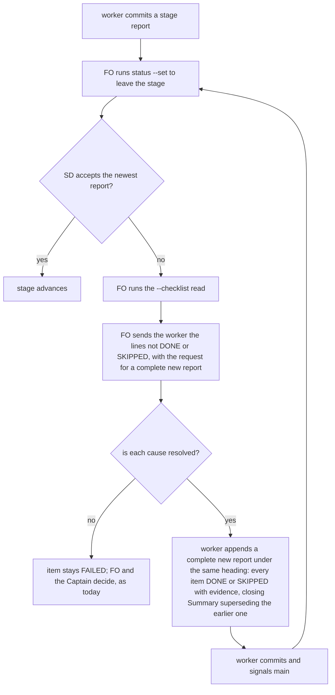

## Scope

- Source: batch 6 (2026-10-25): the Captain 「可以」 (chat), answering 「需要你決定：這份第 6 批的清單可以嗎？」 about FO's batch-6 list, item 5 「報告寫錯時的正確更正方式（新票）」.
- Bite (FO, 2026-10-25): on extension-defaults-and-install-choice the implementation report carried one `FAILED` item; `spacedock status --set ... status=validation` refused ("cannot change status away from entered stage implementation until a durable, complete ## Stage Report: implementation is committed"). A correction appended as `## Stage Report: implementation (correction)` was not read; only a second, complete report under the exact heading `## Stage Report: implementation` with every item DONE and a `### Summary` let it pass. Two worker rounds.
- Fact: Spacedock 0.27.3 `internal/status/entered_stage.go` `hasCompleteCommittedStageReport` reads only the latest report whose heading token is exactly the stage name; its checklist must hold no FAILED or blank item, every item needs an evidence line, and it must end with a non-empty Summary.
- Outcome: the dev2 worker skills (and FO's correction message) say how a report is corrected: a complete new report under the exact heading that supersedes the earlier ones.
- Upstream first: Spacedock ensign skill (report protocol) and the check above; dev2 `skills/implementation`, `skills/validation`.
- Non-goals: changing Spacedock's check.

## FO alignment

Alignment: not needed: documents an observed Spacedock behaviour.
Surfaces: none
Visible change: none
Release review: not needed: workflow maintenance, on no journey map.

## Design

Ruling: the task's own Bite is half wrong, and the fix is smaller than the title implies. Spacedock did read the `## Stage Report: implementation (correction)` section; it refused because that section had no `### Summary`. The design keeps the Captain's outcome (a complete new report under the same heading, superseding the earlier ones) and writes it where each reader meets the failure: one clause in FO's `status --set` refusal step, and one sentence in each of the three worker skills.

Design read against `origin/main` ac67eb0a (kc-dev-flow-2 0.30.0, which includes the batch-5 and extension-default merges; the dispatch named 0.28.0), Spacedock 0.27.3 source under the installed plugin cache.

### What I checked first (upstream, then package, then siblings)

- Spacedock 0.27.3: `internal/status/gate_extract.go` `selectStageReport` picks the LAST `## Stage Report:` heading whose first whitespace-delimited word after the colon equals the stage (comment: "keep walking: last match wins"), so `implementation`, `implementation (correction)` and `implementation (cycle 2)` all select. `internal/status/entered_stage.go` `hasCompleteStageReport` then needs a non-empty checklist, no FAILED or blank item, an evidence line per item, and a non-empty `### Summary`; the entity must also be committed and clean. The ensign skill's Stage Report Protocol says only "append `(cycle N)`" after a rejection; it has no rule for correcting inside one stage. The selector and the completeness file are identical in 0.27.0 and 0.27.3 (`diff` empty); CI's 0.27.2 was not run. Changing Spacedock is a non-goal.
- Package, origin/main: each of `skills/ideation|implementation|validation/SKILL.md` carries the same parse-form paragraph (heading shape, bullet shape, FAILED meaning) and nothing about correcting; `references/sd/workflow.md` § Stages says, on a refused `status --set`, to run the `--checklist` read and "return any line it reports as neither DONE nor SKIPPED to the worker". That sentence is the proximate cause of the bite: FO returned the one FAILED line and the worker fixed the one line. `role_triggers.py`, `delivery_gate.py`, `design_surfaces.py` and `release_acceptance.py` read stage reports by regex; none treats a correction differently from a new report.
- Siblings, read only 2026-10-25 (`git grep -i -E 'supersede[sd]? (the )?(two |earlier|prior|previous)|correction\)|append a complete'` on subspace-relay, subspace-web and qnow): no hits. No adopter has local wording to borrow or to retire.

### Facts that shaped the design (measured 2026-10-25)

1. **The correction was read.** `_archive/extension-defaults-and-install-choice.md` on `origin/spacedock-state/dev2` holds, in order: a report with one FAILED item, `## Stage Report: implementation (correction)` (one DONE item, evidence line, no Summary), then a complete `## Stage Report: implementation` whose Summary opens "This report supersedes the two implementation reports above it". Cut the file just before the last of the three and run `spacedock status --workflow-dir <dir> --read <copy> --checklist --stage implementation --json`: it prints one item, `AC-4 falsifier`, so the correction was the selected report.
2. **Real refusal on four committed fixtures** (a scratch repo, `worktree:` set so the guard applies, local Spacedock 0.27.3, `status --set <slug> status=validation`): report with a FAILED item: refused ("until a durable, complete ## Stage Report: implementation is committed"); `(correction)` section with checklist and no Summary: refused; `(correction)` section with only the corrected item and a Summary: accepted; a complete report under the exact heading: accepted; a complete `(correction)` report: accepted. So the heading form does not decide acceptance; completeness does.
3. **A short addendum passes Spacedock and hides the rest.** Fixture 3 above advanced the stage while its latest report listed one of two items. `--checklist` then names only that item, and three validation readers take the last validation report: the finding count in `delivery_gate.py` (`VALIDATION_SECTION`, last match), `design_surfaces.py` (the last `Stage Report: validation`) and `release_acceptance.py` (`found[-1]`). An earlier `F<N>` finding that a short validation addendum omits is not seen by them.
4. **A correction counts as a repair pass.** `role_triggers.py` counts every `## Stage Report: implementation\b` heading, minus one. Fixtures of 1, 2, 4 and 5 such headings exit 0, 0, 0, 1 ("t has 4 repair passes; dispatch kc-dev-flow-2:chief-engineer"). A correction under the exact heading or under `(correction)` adds the same count as a real repair.
5. **The README word ledger blocks any added FO text.** `lint-skills.py` equals `references/sd/workflow.md` to its budget (5385 at origin/main); the candidate is 5407 and the lint refuses until a raise step of 22 with `captain` and `loaded` is added (ADR 0020: a rise in the workflow word budget needs a Captain ruling recorded with it).

### PRFAQ

*Headline.* When Spacedock refuses a worker's stage report, FO asks for a complete new report under the same heading, and the worker's next report passes and still lists every item.

*FAQ.* **Why not a `(correction)` heading?** It works (fact 2), so the rule does not forbid it; the Captain titled the task "under the exact stage heading", the skills say "the same heading", and nothing is gained by a new suffix vocabulary beside `(cycle N)`. **Why "complete" and not "just fix the line"?** Fact 3: a partial report passes the check and removes the earlier items from the newest report. **Why a Summary that says it supersedes?** The completeness check needs a non-empty Summary (the first bite), and the line tells the next reader which report stands. **What if the item really is unmet?** The rule says how to write a correction, not when FAILED may become DONE; a worker with an unmet item leaves it FAILED and FO and the Captain decide, as today. **Does the correction count toward the chief-engineer trigger?** Yes (fact 4); D2.

### The change, file by file

- `kc-dev-flow-2/references/sd/workflow.md` § Stages: in the `status --set` refusal passage, "to the worker" becomes "to the worker with the request to append a complete new report under the same heading, ending in a Summary that supersedes the earlier one,". +22 words, nothing else in the file.
- `kc-dev-flow-2/skills/ideation/SKILL.md`, `skills/implementation/SKILL.md`, `skills/validation/SKILL.md`: after "is never a bullet." add: " To correct a report, append a complete new one under the same `## Stage Report: <stage>` heading: every item DONE or SKIPPED with its evidence, and a closing `### Summary` that says it supersedes the earlier report. Spacedock's completeness check and the validation readers use the newest report for the stage, and a short addendum passes that check while hiding the earlier items." (+63 words each.)
- `kc-dev-flow-2/scripts/lint-skills.py`: one `WORKFLOW_BUDGET_STEPS` raise of 22 (`captain` = his words at this task's ideation gate, `loaded` = "FO's step after `status --set` refuses to leave a stage, and startup and resume, which read the README").
- `kc-dev-flow-2/scripts/test_sd_dispatch.py`: four `FIXES` entries (`correction-request` on `workflow.md`, `correction-form-<stage>` on each skill; each reverted alone reports only its own gap) and one `corrected-report` exercise beside `failed-none`, run with the real Spacedock binary: report with a FAILED item refused; `(correction)` section with no Summary refused and its `--checklist` read names only its own item; a complete report under the exact heading advances.
- `kc-dev-flow-2/README.md` § on the CLI test: the sentence that lists what the test checks gains "and that a correction without a Summary is refused until a complete report follows".

Not changed: Spacedock; `role_triggers.py` (D2); `delivery_gate.py`, `design_surfaces.py`, `release_acceptance.py`; every `principles.md`; any adopter. No ADR: no ruling changes, the design documents an observed Spacedock behaviour and the Captain's 「可以」 of 2026-10-25 is quoted in Scope.

Scratch evidence, measured on a copy of origin/main with the edits above (not kept in the repository): `lint-skills.py` PASS at 5407 of 5407; `test_sd_dispatch.py --sd-plugin-root <0.27.3>` exit 0 with 47 wording fixes (43 at base).

### Words FO and workers read at each moment

Whitespace-split counts (the `lint-skills.py` counter), origin/main ac67eb0a against the candidate copy; a moment not listed reads the same text before and after, and no script output changes. This task adds words, so none falls (root `learning.md`'s rule applies to cuts); the two that rise are declared and tied to the raise.

| Moment | Who reads | Base | Candidate |
| --- | --- | --- | --- |
| FO startup and resume | FO reads the whole README | 5385 | 5407 (+22) |
| `status --set` refused | FO reads the refusal passage (from "When `status --set` refuses" to "uncommitted report.") | 38 | 60 (+22) |
| the correction message | FO writes the request into the worker's checklist | 0 | 21 |
| idle on an open PR, idle on a merged PR, after the archive, the merge ask | FO | unchanged | unchanged |
| stage start | ideation worker reads `skills/ideation/SKILL.md` | 357 | 420 (+63) |
| stage start | implementation worker | 357 | 420 (+63) |
| stage start | validation worker | 356 | 419 (+63) |
| writing a correction | the same sentence, re-read by the worker | 0 | 63 |

## Acceptance criteria

**AC-1** Each of the three worker skills tells a worker how to correct a report. Evidence: `grep -c 'To correct a report, append a complete new one under the same' kc-dev-flow-2/skills/*/SKILL.md` prints `:1` for the ideation, implementation and validation files; three `FIXES` entries in `test_sd_dispatch.py` assert the sentence present and, reverted alone, report only their own gap. Falsifier (run on the scratch copy 2026-10-25, `python3 -B`, caches cleared): deleting the sentence from `skills/implementation/SKILL.md` makes `test_sd_dispatch.py` fail with only `correction-form-implementation` listing a gap.

**AC-2** FO's refusal step carries the request for a complete new report. Evidence: `workflow.md` contains "with the request to append a complete new report under the same heading, ending in a Summary that supersedes the earlier one" in the `status --set` refusal passage; the `correction-request` entry asserts it. Falsifier (scratch run): deleting the clause fails `test_sd_dispatch.py` with only `correction-request` listing a gap.

**AC-3** The word ledger accepts exactly the 22 added words under a recorded Captain ruling. Evidence: `python3 kc-dev-flow-2/scripts/lint-skills.py` exits 0 and prints "5407 of 5407 words"; the new step's `captain` quotes his words at this task's ideation gate and its gate question names the raise (5385 to 5407), as the step of 2026-10-22 did. Falsifier (scratch run): the same tree without the step prints "5407 words exceeds the budget of 5385 ... add a raise step of 22". Not yet verified: his words at the gate; the scratch step carries a placeholder.

**AC-4** The refusal and the repair are shown with the real Spacedock binary. Evidence: the `corrected-report` exercise in `test_sd_dispatch.py` runs (`SPACEDOCK_BIN=<spacedock> python3 kc-dev-flow-2/scripts/test_sd_dispatch.py --sd-plugin-root <plugin root>`) and asserts: FAILED report refused; `(correction)` section without Summary refused with "durable, complete" and its `--checklist` read naming `Synthetic second item` but not `Synthetic first item`; complete report under the exact heading advances. Falsifier (scratch run): removing the final report's Summary makes the exercise fail at the advance with "cannot change status away from entered stage". Limit: run against 0.27.3 only; CI's 0.27.2 was not run; the selector and completeness files are identical in 0.27.0 and 0.27.3.

**AC-5** A fresh worker follows the rule. Evidence (to be run at implementation): on a disposable repository with a committed implementation report holding one FAILED item whose cause the worker can fix, (A) a fresh sonnet worker given the candidate `skills/implementation/SKILL.md` and FO's request as worded in AC-2 appends one `## Stage Report: implementation` with every original item DONE or SKIPPED plus evidence and a Summary containing "supersedes", and `status --set` then advances; (F) the same worker given the base skill and the base FO sentence ("return any line ... to the worker") only; record whether F writes a short addendum or no Summary, as the archived task did. Falsifier: A ends with a report that omits an original item or a Summary, or `status --set` still refuses. Not yet verified.

**AC-6** Nothing outside scope changes. Evidence: `git diff --name-only origin/main...HEAD` lists only the paths under "The change, file by file" and no `docs/dev2/` or adopter file; `comment_ratio.py` reports 0 added comment lines. Falsifier: any other path.

## Unresolved decisions for the Captain

**D1. Put FO's request in the README and raise the workflow word budget by 22 (5385 to 5407), or leave the README alone?** Recommend the raise. The README sentence "return any line ... to the worker" is what produced the short addendum, and the README forbids a checklist that points to another record, so FO's message must carry the request itself and cannot lean on the skills. Worse under the recommendation: FO reads 22 more words at every startup and resume, ADR 0020 needs your words recorded with the raise, and the next budget change meets one more step in the same list. If you leave the README alone, only the three skills change (zero FO words); the workers learn the form at their next stage start, but a worker already past its stage start and resumed with only the old FO sentence can repeat the bite.

**D2. A correction counts as one more implementation repair pass for `role_triggers.py` (fact 4); leave it?** Recommend leave. A report cannot tell a correction from a repair by its heading (the exact heading is the same), so a fix needs a new marker, and the chief-engineer call it brings one round early is a cheap call. Worse: a task with one correction reaches the fourth repair pass one real repair sooner, so a chief-engineer call can be owed once for a round that was only a wording fix. The live task `role-triggers-owe-ce-on-review-drift` edits `role_triggers.py` and could carry a change if you want one.

### Batch overlap

State read from `origin/spacedock-state/dev2` after `git fetch`, 2026-10-25; package files from `origin/main` ac67eb0a. The batch tasks `new-work-starts-from-a-story-map` (#705), `codex-reader-reads-receipt-marker` (#693), `merge-ask-holds-missing-clauses` (#703), `idle-names-failing-seeds` (#694) and `agent-reads-governing-adr` (#698) are archived and merged, so they are in the base, not in contention. `release-acceptance` shipped in 0.29.0 (no live task), `kc-decision-log-cli` is archived (#695), and `journey-server-host-pilot` and `kc-decision-log-p1` have no task file in this workflow's state (driven by other sessions; not read).

Files this design would change: `kc-dev-flow-2/references/sd/workflow.md` (the `status --set` refusal passage), the three `skills/*/SKILL.md` parse-form paragraphs, `kc-dev-flow-2/scripts/lint-skills.py` (`WORKFLOW_BUDGET_STEPS` tail), `kc-dev-flow-2/scripts/test_sd_dispatch.py` (`FIXES` tail and the area after `failed-none`), `kc-dev-flow-2/README.md` (the CLI test sentence).

| Task | Same file or check? | What FO needs |
| --- | --- | --- |
| fo-write-checks-parse-top-level (ideation) | check only: its AC-6 says `lint-skills.py` exits 0 "with the same word budget" and its file list is `delivery_gate.py`, `design_surfaces.py` and their tests | if this lands first, its clause reads against budget 5407; no file conflict |
| role-triggers-owe-ce-on-review-drift (ideation, no design yet) | possibly `role_triggers.py` (fact 4, D2) and a `workflow.md` merge-ask passage; none of my hunks | if it raises the budget too, the second to merge re-measures AC-3 and appends its step after mine |
| fo-written-lines-checked-before-dispatch (ideation) | scripts only (`design_surfaces.py`, `delivery_gate.py`, `dispatch_records.py`, `role_triggers.py`); none of my files | none |
| codex-review-hang-detected (ideation) | its Scope names no file I change | none |
| adoption-asks-which-extensions (ideation) | its design says `workflow.md` is not changed (no raise) and `skills/observer/SKILL.md` is not changed | none; if it later raises the budget, same rule as above |
| comment-check-reaches-delivery-gate (ideation) | `skills/validation/principles.md` (not edited here), `delivery_gate.py`; states "no `WORKFLOW_BUDGET_STEPS` entry" | none |
| pr-review-lite-value-pilot (implementation), kc-decision-log-handoff-trial (backlog), journey-canvas-hosted-poc (ideation) | no: their text names none of my files | none |
| any task that raises or cuts the word ledger | the `WORKFLOW_BUDGET_STEPS` list end and the README count | the second to merge re-measures and appends its own step |

Recommended order: no other task needs to land first; if a second task raises the ledger, whichever merges later rebases `lint-skills.py` and `workflow.md` and re-runs the lint. Every kc-dev-flow-2 change shares one release-please component; a PR title `feat(kc-dev-flow-2): ...` carries it.

## Stage Report: ideation

- DONE: Design the wording that tells a worker, and FO's correction message, to correct a stage report by appending a complete new report under the exact stage heading (every item DONE or SKIPPED with evidence, a closing Summary that says it supersedes the earlier one); say which skill files carry it and the falsifier; name every file and the evidence each criterion needs
  Wording, five files and the falsifiers are under `## Design` (The change, file by file) and AC-1 to AC-6. Premise corrected: the `(correction)` section was read and refused for lacking a Summary (fact 1, fact 2, real Spacedock 0.27.3 on committed fixtures). Falsifiers shown failing on a scratch copy of origin/main ac67eb0a: FO clause removed, skill sentence removed, final Summary removed, raise step removed.
- DONE: A `### Batch overlap` section naming each file the design would change and each other batch task and live task of other sessions that changes the same file or check, so FO can order implementation
  `### Batch overlap` above: five archived/shipped tasks are in the base; fo-write-checks-parse-top-level, role-triggers-owe-ce-on-review-drift and any other budget-raising task share only the `WORKFLOW_BUDGET_STEPS` tail; journey-server-host-pilot and kc-decision-log-p1 have no task file here and were not read.
- DONE: The words FO reads at each lifecycle moment, before and after, per root learning.md "Measure the words FO reads at each moment, not one file's size"
  Table `### Words FO and workers read at each moment`: startup 5385 to 5407, refusal passage 38 to 60, correction message 0 to 21, worker stage start +63 per skill, all other FO moments unchanged; whitespace-split counts on the base and a candidate copy.
- DONE: Acceptance criteria with reproducible evidence clauses and falsifiers, and unresolved decisions for the Captain, each with a recommendation and what gets worse under it
  AC-1 skills carry the sentence: evidence and mutation shown (fails naming only `correction-form-implementation`). AC-2 FO clause: evidence and mutation shown (fails naming only `correction-request`). AC-3 word ledger: lint 5407 of 5407 on the copy, fails without the step; his words at the gate not yet verified (placeholder). AC-4 real-binary exercise: passes on 0.27.3, fails when the Summary is removed; 0.27.2 not run. AC-5 fresh-worker run: not yet verified, procedure given. AC-6 scope: not yet verified, checked at the candidate. D1 (raise 22 words) and D2 (correction counts as a repair pass) each carry a recommendation and its cost.
- DONE: `design_surfaces.py check` on the task
  `python3 <package>/scripts/design_surfaces.py check stage-report-correction-path.md` printed "design surfaces presentable", exit 0 (Surfaces: none).

### Summary

Spacedock read the correction and refused it only because it lacked a Summary, so the fix is one clause in FO's refusal step plus one sentence in each of the three worker skills, not a heading rule. Two decisions need the Captain: the 22-word raise of the workflow budget (D1, recommend yes) and leaving the repair-pass count alone (D2, recommend leave). Scratch work is in /tmp/srcp-ideation and writes nothing to the repository.

## Stage Report: implementation

- DONE: One Draft PR (Conventional Commit title scoped to the plugin) from a branch off origin/main (ac67eb0a56d6f78baa5fb2973f9727cefa3e06b9) implementing the approved design and acceptance criteria in the task file; with the Captain's decisions as recommended: D1 the README gains the 22-word FO request with a workflow word-budget raise 5385 to 5407, D2 a correction keeps counting as a repair pass; only the files the design names
  Draft PR https://github.com/iamcxa/kc-claude-plugins/pull/721, one commit ae9467dd off ac67eb0a, `feat(kc-dev-flow-2): ...`; `git diff --name-only origin/main...HEAD` lists exactly the seven design files (workflow.md, three SKILL.md, lint-skills.py, test_sd_dispatch.py, README.md); `role_triggers.py` untouched (D2); raise step quotes his 「全准」 at the ideation gate.
- DONE: Every acceptance criterion green with the evidence each names; each falsifier shown failing by a mutation you run (python3 -B, caches cleared)
  AC-1/AC-2/AC-4: `test_sd_dispatch.py` exit 0 with binary 0.27.2 and plugin root 0.27.3, 47 fixes; mutations: sentence removed from implementation skill fails only `correction-form-implementation`, FO clause removed fails only `correction-request`, final Summary removed from the `corrected-report` exercise fails at "cannot change status away from entered stage". AC-3: lint prints 5407 of 5407; step removed prints "5407 words exceeds the budget of 5385". AC-6: seven design paths, 0 comment lines added.
  AC-5 (one run per arm, fresh sonnet workers, disposable repos): candidate skill plus FO request produced a second `## Stage Report: implementation` with all items DONE and "supersedes" in the Summary, and `status --set` advanced; base skill plus base FO sentence made the worker edit the committed report in place (one report, no supersede line), which advanced too. The base arm did not reproduce the short addendum, so this shows the form changes, not that base fails.
- DONE: kc-dev-flow-2/scripts/lint-skills.py (the repository copy CI runs), /Users/kent/.claude/plugins/cache/kc-claude-plugins/kc-dev-flow-2/0.30.0/scripts/adr_lint.py docs/adr --since <base> exit 0; /Users/kent/.claude/plugins/cache/kc-claude-plugins/kc-dev-flow-2/0.30.0/scripts/number_guards.py check exit 0; /Users/kent/.claude/plugins/cache/kc-claude-plugins/kc-dev-flow-2/0.30.0/scripts/comment_ratio.py within its maximum; roborev evidence= line; push without force and without -u; CI green on the PR head; CI cost measured or stated as not measured
  lint-skills.py exit 0; adr_lint.py "35 ADR file(s) checked", exit 0; number_guards.py check needed `--base origin/main` (bare call exits 2, "no base"), then "PASS: no findings", exit 0; comment_ratio.py "code lines 42, comment lines 0, 0.0%", exit 0; `evidence=roborev:1173` (clean on ae9467dd4); plain `git push origin <branch>`; CI on head ae9467dd all four checks pass (unit tests 1m54s). The first unit-test run failed in `test_design_surfaces.py` on a temp-directory cleanup `OSError: Directory not empty` in a test this diff does not touch; `gh run rerun --failed` passed. CI cost: not measured (one added fixture in an existing job).

### Summary

The refusal step in `workflow.md` and the three worker skills now tell FO and workers to correct a report with a complete new report under the same heading ending in a superseding Summary; the 22-word raise (5385 to 5407) is recorded in `lint-skills.py` under his gate answer, and the real-binary `corrected-report` exercise is in `test_sd_dispatch.py`. Open: AC-5 is one run per arm and the base arm did not reproduce the addendum; the skill loaded for this dispatch resolved to the 0.29.0 cache while the dispatch named 0.30.0, so package scripts were run from 0.30.0 as the dispatch wrote them, and the installed Spacedock binary is 0.27.2 (the CI pin) with the 0.27.3 plugin root.
