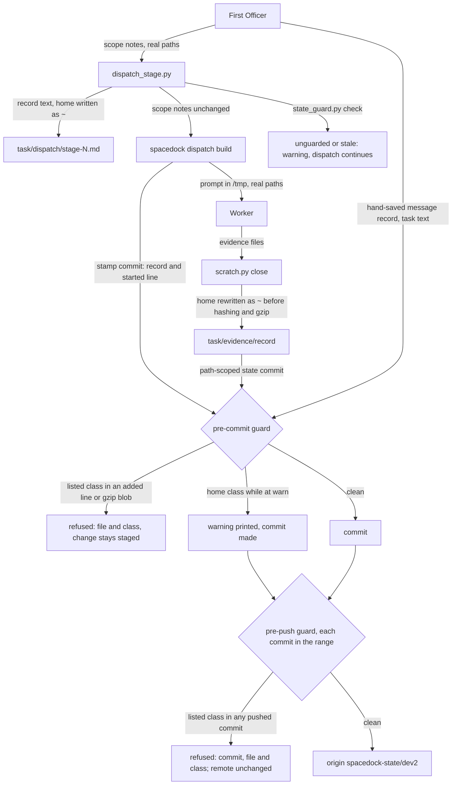

---
id:
title: A dispatch, its record and sealed evidence reach the public state branch without personal or private identifiers, and a hook refuses a push that carries one
status: validation
variant: kc-dev-flow-2
profile: pilot
merge: pr
worktree: .worktrees/spacedock-ensign-state-branch-writes-carry-no-private-identifiers
pr: 871
gates:
    version: 1
    records:
        - id: gate:state-branch-writes-carry-no-private-identifiers:backlog
          stage: backlog
          attempts:
            - id: gate-attempt:state-branch-writes-carry-no-private-identifiers-backlog-1
              briefing:
                id: briefing:state-branch-writes-carry-no-private-identifiers:backlog:attempt-1:revision-1
                digest: sha256:731d2188c766ca0b5a6139d4f2fedb5dac6ab173a3b7c338175ad078ae428247
                room-ref: ./state-branch-writes-carry-no-private-identifiers/review/backlog/briefing-1
              resolution:
                type: Resolution
                id: resolution:spacedock:state-branch-writes-carry-no-private-identifiers:backlog:1
                briefing: briefing:state-branch-writes-carry-no-private-identifiers:backlog:attempt-1:revision-1
                by: agent:first-officer
                at: "2026-11-14T04:42:30.222691Z"
                decision: approve
                reason: Inside scope 1 item D given by the reform session under the Captain's grant; profile pilot justified in the Scope; seed check exit 0; no excluded matter (public merge, outward action, outcome definition, suspected key) is involved in admission.
                conn:
                    quote: 改革工作階段（Paseo 代理 26215d96，就是開你出來的那一個）可以替我給你工作範圍。它給的範圍內，進場、設計、預算、結案這些關卡你不必停下來等我，記為「依艦長授權」，一路做到它指定的終點。
                    source: the Captain, chat with the second dev2 FO, 2026-11-14; scope 1 item D from the reform session, Paseo messages 6ee7ee5b-9ccc-4ef2-8cb6-35f25bfd4e1e and a8df76d7-63cb-4352-9c4b-f44b6004d7f5
              application:
                target-stage: ideation
                state: consumed
        - id: gate:state-branch-writes-carry-no-private-identifiers:ideation
          stage: ideation
          attempts:
            - id: gate-attempt:state-branch-writes-carry-no-private-identifiers-ideation-1
              briefing:
                id: briefing:state-branch-writes-carry-no-private-identifiers:ideation:attempt-1:revision-1
                digest: sha256:2985ea4f9eafc2a37f77734e7c6f84d171456d8ee4e0dabfe6ebc395e107e4d0
                room-ref: ./state-branch-writes-carry-no-private-identifiers/review/ideation/briefing-1
              resolution:
                type: Resolution
                id: resolution:spacedock:state-branch-writes-carry-no-private-identifiers:ideation:1
                briefing: briefing:state-branch-writes-carry-no-private-identifiers:ideation:attempt-1:revision-1
                by: agent:first-officer
                at: "2026-11-14T05:11:35.492612Z"
                decision: approve
                reason: Design check exit 0; writers traced in code and prototyped on a throwaway checkout; the design keeps existing records valid and private names out of every repository; the reform session agreed with deferring D1 and D2 to the Captain at the merge ask (message ea099e94); nothing is installed on the live clone under this gate.
                conn:
                    quote: 改革工作階段（Paseo 代理 26215d96，就是開你出來的那一個）可以替我給你工作範圍。它給的範圍內，進場、設計、預算、結案這些關卡你不必停下來等我，記為「依艦長授權」，一路做到它指定的終點。
                    source: the Captain, chat with the second dev2 FO, 2026-11-14; scope 1 item D from the reform session, Paseo messages 6ee7ee5b-9ccc-4ef2-8cb6-35f25bfd4e1e, a8df76d7-63cb-4352-9c4b-f44b6004d7f5 and ea099e94-9369-49c1-bbeb-d6078ac0cfe8
              application:
                target-stage: implementation
                state: consumed
started: 2026-11-14T04:43:29Z
---

The workflow state branch of this public repository receives new personal and private identifiers with every dispatch from two First Officers. An audit on 2026-11-14 (`.context/dev2-reform/phase1-version-and-path-audit.md` Part B, a research output; its counts are not re-measured here) reports a home-directory prefix in 4,646 files, names of private adopter repositories in up to 1,055 files each, private task slugs in 488, a personal email in 25 and tailnet hostnames in 6, and no token-like hit for the patterns it ran.

## Scope

- Source: the Captain 「先做甲止血。要不要換新分支，等我看過外洩清單再決定。」 and, on the guard, 「我在想的是在這個新的綁定一個hook，裡面過濾掉關鍵字，出現就不準推」 (both chat with the reform session, Paseo 26215d96, 2026-11-14; relayed, not rulings here). Admission is recorded by FO under the Captain's grant to the second dev2 FO (chat, 2026-11-14) and the reform session's scope 1 item D.
- Outcome: new writes only. After the change, a dispatch, its saved record and sealed evidence written to a state branch carry no home-directory prefix, private repository name, private task slug, personal email or tailnet hostname, while the runtime prompt a worker receives keeps real paths. Beside the writers, a git hook on the state checkout refuses a commit or push whose added lines contain a listed identifier.
- Writers the audit names, to verify against the code before designing: `kc-dev-flow-2/scripts/dispatch_records.py` (requires an absolute `Package root:` line), `kc-dev-flow-2/scripts/dispatch_stage.py` (saves FO text verbatim), `kc-dev-flow-2/scripts/scratch.py` evidence sealing and its scratch paths, worker harness output (cwd, argv, tracebacks), and whether the paths `spacedock dispatch build` makes absolute land on the branch.
- Observed by this FO on 2026-11-14 while dispatching in the POC workflow: saved dispatch records and gate briefing rooms carried the home-directory path by tool design.
- Open for the design: how records keep verifying when a path is written relative or as a placeholder; the order (private repository names, slugs and hostnames guarded first, the home-directory prefix after the writers change, since today's records require an absolute path); how the hook is installed, scoped to state branches in a shared hooks directory, and how a session without it is detected; what a refusal prints (the file and the pattern class, never the matched string) and the way forward that is not a bypass; where the identifier list lives (outside every repository).
- Profile: pilot. It changes what one package writes and adds a local guard; it carries no production data, credential, migration or unattended operation, and nothing already on the branch is touched.
Non-goals: changing or removing anything already on the branch or in its history; a new state branch or a history rewrite (the Captain decides that after he reads the leak list); patching around a Spacedock writer (report it; nothing is filed upstream without the Captain); writing any private name into the package, a fixture, this task file, a pull request or this branch as a pattern.
Budget: 2 cycles per stage
Stop condition: a writer turns out to be Spacedock's own; existing records or digests cannot stay valid under any design; a suspected key is found; or the design needs a decision only the Captain can make.

## Acceptance criteria

**AC-1**: After a real dispatch with sealed evidence on a throwaway state checkout, the bytes actually committed contain none of the five identifier classes, and the prompt the worker received still held real paths.
Verified by: a scan of the committed bytes of that throwaway checkout against an identifier list held outside every repository, with the run's commands and exit codes; not an assertion that a function was called and not a test on a hand-made payload.

**AC-2**: Records and `SHA256SUMS` digests written before the change still pass the existing record and evidence checks.
Verified by: the existing checks run over a sample of archived task folders at the candidate, with exit codes.

**AC-3**: On a throwaway state checkout with a remote, a push whose added lines hold a listed identifier is refused and one without is accepted; the refusal names the file and the pattern class and does not print the matched string; a checkout without the hook is reported as unguarded.
Verified by: one real refused push and one real accepted push, the refusal's output, a scan of the bytes that reached the remote, and the detection output on a checkout with no hook.

**AC-4**: The package, its fixtures, this task file and the pull request contain no private identifier, including as a pattern.
Verified by: the same out-of-repository list scanned over the candidate diff and the pull request text, exit code recorded. Limit: the list is only as complete as its owner keeps it.

**AC-5**: On the same throwaway clone, a commit carrying a listed identifier in a worktree that is not on a `spacedock-state/*` branch is not scanned; in the state checkout a line carrying the home directory is warned and committed while the guard runs with the home class at warn, and refused once it is installed with the home class at refuse.
Verified by: real commits in both worktrees and in both modes, with their exit codes and output.

## FO alignment

Alignment: not needed before ideation: outcome, constraints and proof are stated in the scope the reform session gave under the Captain's grant; the open design points return at the ideation gate.
Surfaces: none
Visible change: none
Release review: not needed: workflow maintenance with no release.

## Design

### PRFAQ

**Proposition.** From the release that carries this change, a dispatch record the package builds and sealed evidence write the home directory as `~`, while the prompt the worker reads keeps the real path. A git guard installed on the state checkout checks every commit and push for the five classes; each class either warns or refuses, and a class moves to refuse once recent commits show nothing in flight still writes it. Private task slugs and tailnet hostnames refuse from install. A checkout without the guard is reported as unguarded at every dispatch.

- **Who uses it?** The two First Officers and their workers on `spacedock-state/dev2`, and any adopter whose state branch is public.
- **What does the worker lose?** Nothing: `dispatch_stage.py` builds the prompt from the unredacted scope notes; only the saved record is rewritten.
- **Do existing records stop verifying?** No. The record check accepts `Package root: /…` and `Package root: ~/…`; nothing already on the branch is rewritten, so every saved digest stays as it is.
- **Why not refuse the home directory now?** Every record the 0.41.0 tools write carries it, and so do validation Captain-steps paths that `delivery_gate.py` must resolve. A refusing home class today stops every dispatch (observed below). It switches to refuse in a later step, named under Order.
- **What does a refusal print?** The file, the class and, for a push, the commit; never the matched text. The way forward is to rewrite the line; there is no bypass flag.
- **Where is the list?** In one file under the user's config directory, outside every repository; the installer refuses a list path inside a git work tree.



### Before new work

- **This repository at origin/main (c2f035b66, fetched 2026-11-14).** No identifier scan exists in `kc-dev-flow-2/scripts`; `scratch.py` carries the privacy rule as prose only (`notes_for`). The shared hooks directory of the live clone holds only `.sample` files, so the guard replaces no active hook. Uses and extends `dispatch_stage.py`, `dispatch_records.py` and `scratch.py`; adds `state_guard.py`.
- **Spacedock 0.27.2 (installed binary; source read at `internal/dispatch/build.go` in a local clone at v0.25.1-35).** `dispatch build` makes the entity path and workflow dir absolute and writes them only to the prompt file under `/tmp/spacedock-dispatch/`; its stamp commit adds the record and one `started:` line. `spacedock state commit` and the stamp commit both run git hooks (observed below). Briefing rooms `review/<stage>/briefing-N/index.json` hold FO-authored summary text with home paths; that `gate prepare` writes it verbatim is inferred from where the bytes sit, not traced in the 0.27.2 source. A Spacedock writer of FO text: reported here and covered by the guard, not patched.
- **Siblings.** Not read: the adopters' state branches are private repositories, so their exposure is not this branch's; the writer change applies to them through the package.
- **In-force ADRs.** ADR 0070 (dispatch records are written by a package script): kept; the script now rewrites the home prefix. ADR 0079 (close-out keeps public evidence, never private evidence): kept and enforced by the guard instead of prose alone. ADR 0003 (the package ships no secret-read hook): its reasons were that a plugin `PreToolUse` hook fires in every project, is Claude-only and cannot carry per-adopter patterns. This guard is a git hook that an explicit command installs on one state worktree, runs under every host, and reads a per-machine list, so none of the three reasons applies; the Captain asked for this hook in his own words. ADR 0003 stays in force for secret reads.
- **Override lines.** `git grep -n 'Override:'` on the state branch, filtered for hook, path, private, home, identifier and Package root: none rules against a git guard or a rewritten record path.

### Writers verified at origin/main (c2f035b66)

| Writer | Line that writes the class | Reaches the state branch |
|---|---|---|
| `dispatch_stage.py` `record_text` | `return "\n".join(header) + ... + "\n## Scope notes\n" + notes`: FO scope notes saved verbatim, so `Package root: <home>/…` lands | Yes. Throwaway stamp commit added `tw-task/dispatch/ideation-1.md` with one home hit; the live record of this task carries three. |
| `scratch.py` `notes_for` | `command = shlex.join(['python3', str(package / 'scripts/scratch.py'), 'close', str(folder), record])`: the package path and task folder, both absolute, appended to the notes | Yes, through `record_text` (line 33 of this task's `dispatch/ideation-1.md`). |
| `dispatch_records.py` `PARTS` and `ROOT` | `^Package root:[ \t]*/\S` and `ROOT = re.compile(r"^Package root:[ \t]*(/\S+)", re.M)`: a rule that demands the absolute form; `instruction_error` matches `base + '/' + path` textually | Forces the writer above; reads the record only, never the prompt. |
| `scratch.py` `evidence` | hashes and gzips whatever the worker copied; no scan | Yes; the worker's or FO's state commit adds `evidence/<record>/`. 110 `.gz` files are on the branch today and a line-diff scan does not see inside them (observed). |
| `scratch.py` `close` | `scratch-removed.txt` line with the derived root under `/tmp/dev2/<origin name>-<digest>/` | Yes, but carries none of the five classes for this repository. |
| `replay_dispatch.py` `start` | copies the full prompt into its run folder as `dispatch.md` | Only when a worker copies it into evidence; then `evidence` is the writer. |
| Worker harness output | `cwd`, `argv[0]`, pytest `rootdir:` and traceback frames | Through `evidence` only. |
| `spacedock dispatch build` | `filepath.Abs(entityPath)`, `filepath.Abs(workflowDir)`, then `os.WriteFile(dispatchFilePath, …)` under `/tmp/spacedock-dispatch/` | No: the stamp commit holds the record and `started:` only. |
| `spacedock gate prepare` (inferred) | briefing `summary` from FO text, verbatim | Yes, when FO writes a home path into a gate summary (52 briefing `index.json` files today). Spacedock's own writer of FO text: reported, covered by the guard. |
| git commit identity | author and committer email from the user's git identity, on every state commit | Yes, as commit metadata, not file bytes. A Captain decision (D2). |

No writer of a private repository name, a private task slug or a tailnet hostname is a package or Spacedock tool: those come from text FO and workers write and from evidence they copy.

### Mechanism

**W1. Records write the home directory as `~`.** `dispatch_stage.record_text` passes its text through one function that replaces the home prefix (`Path.home()`, not preceded by a path character, followed by `/` or the end of the path) with `~`. The prompt keeps the real path, because `dispatch_stage` writes the unredacted notes to the scratch `scope-notes.md` that `dispatch build` reads. `select_record` compares against the same rewritten text, so a re-run still reuses the record. Prototype in scratch: a real dispatch committed `Package root: ~/.claude/plugins/cache/…`, the prompt held the real path twice, the added-line scan of the commit and of the remote exited 0, and the patched record check exited 0.

**W2. The record check accepts both forms.** `PARTS` and `ROOT` in `dispatch_records.py` accept `Package root:` followed by `/` or `~/`; `instruction_error` keeps its textual match, which holds because the rewrite is applied to the whole record. No other script reads `PARTS` or `ROOT` (`pr_watch.py` imports `coverage`, `worker_stages` and `named_section`; `design_surfaces.py` imports `find_readme`). Prototype over the seven AC-2 folders with the live README's extensions: the patched check exits 0 on the 55 original records and on copies rewritten to `~`; on a real implementation record that carries the roborev instruction path, the rewritten copy passes and the same copy with its `Package root:` moved fails with `roborev worker instruction is absent`, so the textual match still runs on `~` records. Compatibility hazard: the 0.41.0 check refuses a `~` record (observed: `needs a 'Package root:' line with an absolute path`), and it scans every record of a task folder. Both First Officers drive one workflow, and the README's `package_version.py` hold already stops a session older than the synced README, so the release that writes `~` reaches both sessions through the README sync before either writes one.

**W3. Sealed evidence writes the home directory as `~`.** In `scratch.evidence`, before hashing, each text file (decodes as UTF-8 and holds no NUL byte) that is new or whose digest differs from the existing `SHA256SUMS` line has the home prefix rewritten as `~`; a binary file is never rewritten and is left to the guard, which scans it as bytes; a file whose digest still matches its line is left alone, so re-closing an archived folder changes nothing. The rewrite runs before the 256 KiB gzip step, so compressed evidence is rewritten too. A worker-supplied `.gz` is decompressed, and rewritten and recompressed only when its content is text holding the prefix. Not prototyped in this ideation: the rewrite changes retained patches and scripts by the same `~` substitution, which keeps them readable but may stop a patch applying verbatim.

Limit: a follow-up `-message-N.md` record is saved by FO by hand, not by `dispatch_stage`, so it is FO text: the guard warns on its home path until the home class refuses.

**G1. The guard.** New `kc-dev-flow-2/scripts/state_guard.py` with three commands:

- `install <state checkout> [--refuse <classes>] [--warn <classes>] [--shared]` refuses unless the checkout is a linked worktree on a `spacedock-state/*` branch and the clone has `extensions.worktreeConfig` set (the live clone has it; the installer reports and stops otherwise, since enabling it is a clone-wide config write for the Captain to approve). It writes `pre-commit` and `pre-push` plus a copy of `state_guard.py` into a `state-guard` folder inside that worktree's own git directory, then sets `core.hooksPath` with `git config --worktree`, so the shared hooks directory and every other worktree are untouched. A fresh clone has `extensions.worktreeConfig` off (observed after `spacedock state init`); there the installer stops and prints two routes: enable it (a clone-wide config write; git asks that `core.bare` and `core.worktree`, when set, move to the main worktree's `config.worktree`), or `install --shared`, which writes the hooks into the shared hooks directory where each exits at once on any branch outside `spacedock-state/*`. Each hook runs the shared directory's same-name hook first when one is executable, and checks the branch again. Each class has a mode, `--refuse <classes>` and `--warn <classes>`; the default is warn for every class.
- `check <state checkout>` prints `state guard: guarded (<mode>)`, or `unguarded: <hook> missing`, `stale: installed copy differs from this package`, or `partial: identifier list absent`, exit 0 only when guarded. `dispatch_stage.py` runs it before building and prints its line to stderr when not guarded; it does not refuse, so adopters who never install are unaffected.
- `scan` is what the hooks run. Pre-commit scans the staged diff's added lines; pre-push scans each commit in each pushed `spacedock-state/*` range one by one, not the net diff, because a later commit that deletes a line leaves the earlier commit on the remote (observed: the net diff was clean and the per-commit scan still refused). Both use rename detection (`-M`), so an archive move adds no lines: the archive commit in the replay (822 paths, 411 renames) hit `private-repo` without `-M` and nothing with it. In both, an added or changed blob that is gzip is decompressed and scanned whole (observed: a line-diff guard committed a gzip file holding the home path), and a binary blob is scanned as bytes. Cost in the prototype: median 0.13 s per commit, 17.6 s for the archive commit (40-commit replay).

**G2. Classes and the list.** `home` and `email` are derived on each run: the home directory, and the checkout's `git config user.email` matched in file content. `private-repo`, `private-slug` and `tailnet-host` come from `${XDG_CONFIG_HOME:-$HOME/.config}/kc-dev-flow-2/identifiers.tsv`, or the path in `KC_DEV2_IDENTIFIERS`, one `<class><TAB><literal>` or `<class><TAB>re:<pattern>` per line. The package and its tests carry no entry; tests build their own list from invented names. When the file is absent the guard still checks the derived classes, prints `partial`, and does not refuse for the missing file. The existing names-only lists sit under the product worktree's `.context/`, which git ignores but which is inside a work tree; FO moves them into the config file before installing, and the installer refuses a list path inside a git work tree.

**G3. What a refusal prints and the way forward.** Pre-commit: `state guard: refused; <file> adds a <class> identifier` per hit, then one line: write the home directory as `~` or a path relative to the state checkout, drop a private name, or record `Not archived (private): <what>; reproduce: <command>` (ADR 0079), then commit again. The refused change stays staged (observed), and `dispatch_stage` refuses the next dispatch of that task until it is committed, which keeps the fix in the same turn. Pre-push: the same line with the short commit id, and the unpushed commits listed; when they are all the caller's own, rewrite them locally before pushing; when any is a peer's, stop and ask FO. The guard prints no matched text (observed: zero occurrences of the home path or the hostname in the refusal output) and offers no bypass; `--no-verify` is not a way forward.

### Order

1. **This task's release.** W1–W3 and G1–G2 ship together. Nothing is installed by the release.
2. **After the README sync to that release, with both First Officers on it:** FO moves the list and runs `state_guard.py install` on `spacedock-state/dev2` with `--refuse private-slug,tailnet-host`; `private-repo`, `email` and `home` warn (counts in `### Install evidence`). Refusing a class that recent commits still write would stop in-flight work, so only the two classes with no hit refuse.
3. **Per-class flip:** `private-repo` and `email` move to refuse when the replay counter shows no new hit for them over the last 100 commits; both come from authored text (FO scope notes, a pasted `git log`), so FO can stop writing them at once.
4. **Home class to refuse:** a later task, once validation Captain-steps paths and acceptance scripts can name a path relative to the state checkout (`delivery_gate.py` resolves them today; PR 869 is changing that file, so the follow-up waits for it), and once hand-saved message records write `~`.

### Files this design changes

- `kc-dev-flow-2/scripts/dispatch_stage.py` (W1, the `check` call) — not in PR 869's list.
- `kc-dev-flow-2/scripts/dispatch_records.py` (W2, docstring) — not in PR 869's list.
- `kc-dev-flow-2/scripts/scratch.py` (W3) — not in PR 869's list.
- `kc-dev-flow-2/scripts/state_guard.py` (new, G1–G3).
- `kc-dev-flow-2/scripts/test_dispatch_stage.py`, `test_dispatch_records.py`, `test_scratch.py`, `test_state_guard.py` (new) — none in PR 869's list.
- One ADR under `docs/adr/`, short title "Public state writes carry no personal or private identifiers, and a per-checkout git guard refuses them"; FO reserves the number.

No change to `references/sd/workflow.md`, `delivery_gate.py`, `lint-skills.py`, `test_sd_dispatch.py` or any other file in PR 869's list: the workflow sentence that scope notes carry an absolute `Package root:` stays true (the scope notes and the prompt keep it; only the saved record changes), so the workflow word budget is not raised. `test_sd_dispatch.py` asserts the real path in the prompt body, which is kept.

### ADR draft

**Title:** Public state writes carry no personal or private identifiers, and a per-checkout git guard refuses them.
**Context:** the 2026-11-14 audit of `spacedock-state/dev2` (public) and the writer table above; ADR 0003's reasons against a shipped `PreToolUse` hook.
**Decision:** package writers record the home directory as `~` while prompts keep real paths; `state_guard.py install` puts a pre-commit and pre-push guard on one state worktree through `git config --worktree core.hooksPath`; the identifier list lives outside every repository; refusals print file and class only; each class warns or refuses by its installed mode, and a class moves to refuse once recent commits show nothing in flight writes it.
**Protects:** `dispatch_stage.record_text`, `dispatch_records.PARTS`/`ROOT`, `scratch.evidence`, `state_guard.py`.
**Words:** to be filled from the ideation gate resolution.

### Worth questions

- **W1–W3 (writers).** Serves 「先做甲止血」 (option 2 of the audit, stop new writes). Without it every dispatch adds three home-path lines and every sealed run adds more, and the guard can never turn the home class to refuse. Premise that makes it unneeded: the newest records no longer carry the home path. Cheap test, run: this task's own `dispatch/ideation-1.md` has three hits.
- **G1–G3 (guard).** Serves 「綁定一個hook，裡面過濾掉關鍵字，出現就不準推」. Without it nothing stops a private name typed into a task, a report or copied evidence; the writers cannot rewrite those. Premise that makes it unneeded: no new commit adds a listed class. Cheap test: the last-300-commit count in `### Install evidence`.
- **G2 (list outside repositories).** Serves the same words and the Non-goal that no private name enters the package, a fixture, this task or a pull request. Without it the patterns themselves would have to live in a public file. Premise: the list could be derived. Checked: only `home` and `email` are derivable; repository names and slugs are not.
- No part serves no Captain words.

### Install evidence

Replay of the last 200 commits of `spacedock-state/dev2` before this ideation (from 2026-11-13 16:01 +0800), rename detection on, gzip blobs decompressed; count of commits each class would have refused, by where the hit sits and the commit subject (`evidence/ideation-1/runs/replay-200.txt`):

| Class | Commits | Where |
|---|---|---|
| home | 75 | live: 43 state, 22 dispatch, 9 other; archived: 1 |
| private-repo | 11 | live: 5 dispatch, 2 state, 4 other |
| email | 1 | live state commit: a pasted `git log` in a validation-stage task's evidence |
| private-slug | 0 | |
| tailnet-host | 0 | |

Prototype cost: median 0.10 s, max 9.9 s per commit. A first 40-commit run without rename detection is kept as `replay-40.txt`; its one archived `private-repo` hit was the archive move, gone under `-M`.

### Proof plan per criterion

- **AC-1:** at the candidate, the throwaway workflow from this ideation (bare remote, product repo, orphan `spacedock-state/dev2` worktree) with the package under the home directory, so `notes_for` writes a home path; one real `dispatch_stage.py` dispatch plus one `scratch.py close` with a home-path log file and one over 256 KiB; the scan of the stamp commit's and the evidence commit's blobs (gzip decompressed) exits 0, and the prompt under `/tmp/spacedock-dispatch/` holds the real path. Commit metadata is outside AC-1 (D2).
- **AC-2:** at the candidate, `dispatch_records.py <folder>` and the scratch-compatible digest check over the same seven task folders (the five archived and two active folders that have both `dispatch/` and `evidence/*/SHA256SUMS`), compared with this baseline.
- **AC-3:** the throwaway with a remote; a listed `tailnet-host` and a listed `private-slug` line refused at commit and at push, a clean push accepted, the refusal output scanned for the matched text, the remote's history scanned, and `check` on a fresh clone printing `unguarded`.
- **AC-4:** the candidate diff and the PR text scanned with the out-of-repository list, exit recorded.
- **AC-5:** a commit with a listed identifier in the product worktree of the same clone is not scanned; in the state checkout a home-path line is warned and committed with `home` at warn and refused with `home` at refuse.

### Decisions for the Captain

- **D1. The guard's first install refuses only two classes.** His words were 「出現就不準推」. Recommend: install with private task slugs and tailnet hostnames refusing, and private repository names, the email and the home directory warning, each moving to refuse by the steps under Order. Worse under it: until the flips, a private repository name or the email can still reach the public branch, with a warning printed. The alternative, refusing all five at install, would have stopped 75 of the last 200 commits (22 of them dispatches). Approving also approves FO running the install, a `git config --worktree` write on the live clone, and this task ending with the home class at warn.
- **D2. The email in commit metadata.** Every state commit carries the git identity's personal email as author and committer; the guard reads file content only, and refusing on metadata would stop every push. Recommend (a) leave it, since history already exposes it on every commit; worse: new commits keep adding it. Option (b): set a GitHub noreply address for the state worktree only with `git config --worktree user.email`, one command, no code.

D1 and D2 are independent; D1 is the one this task needs.

### Batch overlap

PR 869 (open, the other First Officer): no shared file (list above). Live tasks whose task file names a file this design changes (named there, not confirmed as their change): `design-check-reads-each-pilot-criterion-for-its-proof-record` (implementation; `dispatch_records.py`, `dispatch_stage.py`); `merge-guard-stops-unasked-merges` (validation; `dispatch_records.py`); `adoption-asks-which-extensions`, `comment-check-reaches-delivery-gate`, `dispatch-carries-reserved-adr-number`, `seed-check-requires-alignment-result`, `step-back-answer-has-a-record-line` (ideation; `dispatch_records.py`); `delivery-gate-s4-skips-removed-scratch` (ideation; `scratch.py`). Shared numbered record: one ADR number from FO's reservation list. The test files `test_dispatch_records.py` and `test_dispatch_stage.py` are the likeliest textual conflicts.
Recommended order: after `design-check-reads-each-pilot-criterion-for-its-proof-record` merges (the only one past ideation that changes both scripts), and independent of PR 869.

## Number guards

ADR: 0087

## Stage Report: ideation

- DONE: The writers verified against the code at origin/main, each with the line that writes the identifier class and whether it reaches the state branch, including a trace of whether the paths `spacedock dispatch build` makes absolute land there; a writer that is Spacedock's own is reported, not designed around
  `### Writers verified at origin/main (c2f035b66)`: `record_text`, `notes_for`, `PARTS`/`ROOT`, `evidence`, `close`, `replay_dispatch`, harness output; `dispatch build`'s absolute paths stay in `/tmp/spacedock-dispatch/` (throwaway stamp commit held the record and `started:` only); Spacedock-side writers reported: briefing summaries (inferred, not traced) and commit identity.
- DONE: A design for the writers and for the refusing hook that answers every "Open for the design" point in the task file, names every file it changes, keeps existing records and digests valid, and keeps the identifier list outside every repository
  `### Mechanism` W1–W3, G1–G3, `### Order`, `### Files this design changes` (none in PR 869's list; no workflow text change), list under the user config directory with the installer refusing a path inside a work tree; per-class install modes from the 200-commit replay, as the other First Officer asked.
- DONE: Each acceptance criterion with its proof run once now where it can be (command, observed exit, retained output path) or listed under `Not provable now` with the reason; the decisions only the Captain can make named; kc-dev-flow-2/scripts/design_surfaces.py check on the task exits 0
  AC-1: baseline at origin/main, throwaway dispatch, added-line scan exit 1 with one home hit (`runs/ac1-baseline-added.txt`); W1 prototype, committed and remote scans exit 0 and the prompt held the real path twice (`runs/ac1-proto-added.txt`, `runs/ac1-proto-remote.txt`). Not provable now: the candidate, and W3 (unprototyped).
  AC-2: baseline over seven folders, record check exit 0 in all seven, digests match in six; one archived folder has one pre-existing mismatch (`runs/ac2-baseline.txt`). Patched W2 check exit 0 on 55 original and 55 rewritten records (`runs/w2-extension-check.txt`), falsified by a moved root (`runs/w2-roborev-summary.txt`). Not provable now: the candidate.
  AC-3: prototype guard on the throwaway: `spacedock state commit` refused, exit 1 (`runs/hook-statecommit.out`); push refused twice, including after a clean-up commit, with the remote unchanged (`runs/push-refused*.out`); clean push exit 0 (`runs/push-accepted.out`); refusal output held no matched text; fresh clone after `spacedock state init` reported unguarded, exit 1 (`runs/check-after-state-init.out`). Not provable now: the candidate's guard.
  AC-4: this task file and the evidence folder scanned with the out-of-repository list, exit 0 (`runs/evidence-scan.txt`). Not provable now: the candidate diff and PR text.
  AC-5: added by this design. Not provable now: needs the candidate's install modes; seen only as the throwaway's main worktree keeping `.git/hooks` while the state worktree used its own hooks path.
  Captain: D1 (first install refuses only slugs and hostnames; FO runs the install) and D2 (email in commit metadata). `design_surfaces.py check` exit 0 (`runs/design-surfaces.txt`).

### Stop conditions and open points for FO

- Two stop conditions are touched. A Spacedock writer exists: briefing summaries with home paths, inferred from where the bytes sit. The identifiers come from FO's text and the guard covers them, so nothing is designed around it. The design also needs D1, a decision only the Captain can make. FO decides whether the standing grant covers this gate.
- No suspected key was found. The list holds no token class, and this run did no token search beyond the audit's.
- AC-2 says "existing evidence checks", but the package has no digest checker. The proof uses `proto/digests.py`, which reads `SHA256SUMS` the way `scratch.py` writes it, and compares against the baseline, pre-existing mismatch included. FO may reword the criterion.
- What FO sees when the guard refuses: `spacedock state commit: git commit failed:` followed by the guard's lines, exit 1, and the change stays staged. A refused stamp commit makes `dispatch_stage` exit 1, and Spacedock rolls the stamp back (observed).

### Scratch close

```
Scratch removed: /private/tmp/dev2/kc-claude-plugins-3042bb224e995ded/state-branch-writes-carry-no-private-identifiers/ideation-1 (7293403 bytes)
Evidence: evidence/ideation-1/ (34 files, 17.6 KiB)
```

### Summary

Every writer is traced at origin/main. The design has the package write the home directory as `~` in records and evidence while prompts keep real paths, and adds a per-worktree git guard with a mode for each class. Prototypes on a throwaway checkout proved the record rewrite, the refusals at commit and at push, and unguarded detection. A 200-commit replay showed that only private slugs and tailnet hostnames can refuse at install without stopping in-flight work; that is Captain decision D1.


## Stage Report: implementation

- DONE: One candidate (Conventional Commit title scoped to the plugin) on the assigned branch off origin/main (c2f035b6612f5edb42220576b3414e993531ffd6) implementing the approved design and acceptance criteria in the task file: writers W1 to W3 and the guard G1 to G3 in the files the design names and no others; the release installs nothing and every class defaults to warn
  Candidate `0c68231ca9147a9833846b47a36e2fc27846cf66`, branch `spacedock-ensign/state-branch-writes-carry-no-private-identifiers`, nine approved files, clean product tree; `evidence/implementation-1/source-context.json` pins their hashes and base.
- DONE: ADR 0087 records the ruling the design names (the task file's ADR draft), quoting the Captain's words from the task file and its gate records
  `docs/adr/0087-public-state-writes-and-an-opt-in-git-guard.md`; records the delegated approval, separate live-install decision, unchanged commit identity and ADR 0003's secret-read boundary.
- DONE: Acceptance criteria exercised on throwaway checkouts with their own remotes; product mutations actually run with python3 -B and caches absent; real sealing includes evidence over 256 KiB
  `evidence/implementation-1/acceptance.json`, `commands.json`, `falsifiers.json` and `falsifiers/`: eight product mutations each cause its named test to exit 1; the synthetic artifact mutation exits 1 too. Historical AC-2's pre-existing mismatch is preserved, detailed below.
- DONE: kc-dev-flow-2/scripts/lint-skills.py (the repository copy CI runs), kc-dev-flow-2/scripts/adr_lint.py docs/adr --since <base> --require 0087 exit 0; kc-dev-flow-2/scripts/number_guards.py check exit 0; kc-dev-flow-2/scripts/comment_ratio.py within its maximum; commit locally, no push; PR text written for FO; CI cost measured or stated as not measured
  All required commands exit 0 at the candidate; `evidence/implementation-1/runs/` retains output. Comment ratio is 1.3%, below 5%; `implementation/pr.md` is prepared, no product publication performed, CI cost per PR not measured and CI configuration unchanged.
- DONE: AC-1: saved and sealed committed bytes omit identifiers while stage and special-role runtime prompts retain real paths
  `acceptance.json` scans stamp/seal blobs and remote history (gzip decompressed), zero hits in all five classes; real record checks and seal close exit 0. Removing the record/evidence rewrite or returning the public record as a role prompt makes the named tests fail.
- DONE: AC-2: historical compatibility compared with the approved baseline without rewriting historical files
  Seven folders: all record checks exit 0 on baseline and candidate; 3,154 evidence digests checked, one pre-existing mismatch remains in the same archived sample and six samples have none. Matching old evidence stays byte-identical; rejecting legacy roots or disabling home-relative binding fails the falsifiers.
- DONE: AC-3 and AC-5: real refusals, accepted clean pushes, private refusal output, missing-hook detection and mode/worktree boundaries
  `commands.json` records slug/hostname commit and push refusals, unchanged refused remote, clean remote history, fresh-clone unguarded detection, home warn/refuse commits and product-worktree isolation. All guard tests pass, including shared-hook chaining, renames, binary and nested gzip; newest-only push or disabled refusal mutations fail.
- DONE: AC-4: candidate additions, fixtures, task text, PR text and retained evidence scanned with the owner's external list
  `runs/ac4-sealed.json`: exit 0, zero hits by class. The list itself is not retained. Limit supplied by FO: four adopters' names-only slug lists; the fifth adopter and hostnames outside its pattern are absent. A synthetic listed identifier makes the scan exit 1.
- DONE: Behavioral regression checks and scratch close-out
  `test-results.json`: 222 distinct checks, 221 passed and one skipped; the changed role prompt/retry/line-ending seams were rerun. Initial failed runs and the role red-to-green check are retained. The close output below confirms deletion and sealed evidence.
- SKIPPED: One builder fixture, product push, Draft PR creation, RoboRev and hosted CI review
  The fixture requires SD_PLUGIN_ROOT (mods/pr-merge.md), not supplied; the real binary dispatch is exercised separately. Publication and RoboRev are delegated to FO, not run by this worker; no live guard installation or git config write occurred on this clone.

### Affected documents

`evidence/implementation-1/doc-verdicts.json` records each output from the candidate's document-impact check:
- `docs/adr/0045-validation-reruns-require-a-later-recorded-captain-ruling.md`: unaffected; ruling order/history predicates unchanged.
- `docs/adr/0048-paseo-stage-workers-complete-by-final-reply-and-hand-publication-to-fo.md`: unaffected; completion/publication boundary unchanged.
- `docs/adr/0070-stage-worker-dispatches-are-built-by-a-package-script-that-writes-their-record.md`: unaffected; write/check/build ordering retained; new representation belongs to ADR 0087.
- `docs/adr/0074-special-role-calls-are-built-by-the-stage-dispatch-script.md`: unaffected; commit-before-prompt and model floor retained; saved/runtime path distinction belongs to ADR 0087.
- `docs/adr/0077-a-task-budget-counts-cycles-and-past-it-the-question-returns-to-the-captain.md`: unaffected; budget header/counters/holds unchanged.
- `docs/adr/0079-dispatch-close-out-retains-public-evidence-and-removes-scratch.md`: unaffected; threshold/cap/retention/old matching digests retained; new text sealing belongs to ADR 0087.
- `docs/adr/0085-a-budget-may-bound-ideation-rounds-and-the-timeline-prints-each-round.md`: unaffected; ideation budget and role predicates unchanged.
- `docs/adr/0087-public-state-writes-and-an-opt-in-git-guard.md`: updated; this ruling.
- `learning.md`: unaffected; no README shortening or new --names output kind; changed folder-mode wording has no parsed caller.

### Scratch close

```text
Scratch removed: /private/tmp/dev2/kc-claude-plugins-3042bb224e995ded/state-branch-writes-carry-no-private-identifiers/implementation-1 (45186974 bytes)
Evidence: evidence/implementation-1/ (46 files, 211.7 KiB)
```

### Summary

Implemented new-write home-path rewriting, backward-compatible record checks and an opt-in per-checkout Git guard. Stage and special-role runtime prompts retain original paths; the real persistence, remote refusal and compatibility checks are retained with eight effective product mutations. The candidate is local only; FO owns publication, review and validation, and the Captain's live-install and commit-email decisions remain open.


## Stage Report: implementation

- DONE: One candidate (Conventional Commit title scoped to the plugin) on the assigned branch off origin/main (c2f035b6612f5edb42220576b3414e993531ffd6) implementing the approved design and acceptance criteria in the task file: writers W1 to W3 and the guard G1 to G3 in the files the design names and no others; the release installs nothing and every class defaults to warn
  Candidate `0c68231ca9147a9833846b47a36e2fc27846cf66`, branch `spacedock-ensign/state-branch-writes-carry-no-private-identifiers`, nine approved files, clean product tree; `evidence/implementation-1/source-context.json` pins their hashes and base.
- DONE: ADR 0087 records the ruling the design names (the task file's ADR draft), quoting the Captain's words from the task file and its gate records
  `docs/adr/0087-public-state-writes-and-an-opt-in-git-guard.md`; records the delegated approval, separate live-install decision, unchanged commit identity and ADR 0003's secret-read boundary.
- DONE: Acceptance criteria exercised on throwaway checkouts with their own remotes; product mutations actually run with python3 -B and caches absent; real sealing includes evidence over 256 KiB
  `evidence/implementation-1/acceptance.json`, `commands.json`, `falsifiers.json` and `falsifiers/`: eight product mutations each cause its named test to exit 1; the synthetic artifact mutation exits 1 too. Historical AC-2's pre-existing mismatch is preserved, detailed below.
- DONE: kc-dev-flow-2/scripts/lint-skills.py (the repository copy CI runs), kc-dev-flow-2/scripts/adr_lint.py docs/adr --since <base> --require 0087 exit 0; kc-dev-flow-2/scripts/number_guards.py check exit 0; kc-dev-flow-2/scripts/comment_ratio.py within its maximum; commit locally, no push; PR text written for FO; CI cost measured or stated as not measured
  All required commands exit 0 at the candidate; `evidence/implementation-1/runs/` retains output. Comment ratio is 1.2%, below 5%; `implementation/pr.md` is prepared, no product publication performed, CI cost per PR not measured and CI configuration unchanged.
- DONE: AC-1: saved and sealed committed bytes omit identifiers while stage and special-role runtime prompts retain real paths
  `acceptance.json` scans stamp/seal blobs and remote history (gzip decompressed), zero hits in all five classes; real record checks and seal close exit 0. Removing the record/evidence rewrite or returning the public record as a role prompt makes the named tests fail.
- DONE: AC-2: historical compatibility compared with the approved baseline without rewriting historical files
  Seven folders: all record checks exit 0 on baseline and candidate; 3,154 evidence digests checked, one pre-existing mismatch remains in the same archived sample and six samples have none. Matching old evidence stays byte-identical; rejecting legacy roots or disabling home-relative binding fails the falsifiers.
- DONE: AC-3 and AC-5: real refusals, accepted clean pushes, private refusal output, missing-hook detection and mode/worktree boundaries
  `commands.json` records slug/hostname commit and push refusals, unchanged refused remote, clean remote history, fresh-clone unguarded detection, home warn/refuse commits and product-worktree isolation. All guard tests pass, including shared-hook chaining, renames, binary and nested gzip; newest-only push or disabled refusal mutations fail.
- DONE: AC-4: candidate additions, fixtures, task text, PR text and retained evidence scanned with the owner's external list
  `runs/ac4-sealed.json`: exit 0, zero hits by class. The list itself is not retained. Limit supplied by FO: four adopters' names-only slug lists; the fifth adopter and hostnames outside its pattern are absent. A synthetic listed identifier makes the scan exit 1.
- DONE: Behavioral regression checks and scratch close-out
  `test-results.json`: 222 distinct checks, 221 passed and one skipped; the changed role prompt/retry/line-ending seams were rerun. Initial failed runs and the role red-to-green check are retained. The close output below confirms deletion and sealed evidence.
- SKIPPED: One builder fixture, product push, Draft PR creation, RoboRev and hosted CI review
  The fixture requires SD_PLUGIN_ROOT (mods/pr-merge.md), not supplied; the real binary dispatch is exercised separately. Publication and RoboRev are delegated to FO, not run by this worker; no live guard installation or git config write occurred on this clone.

### Affected documents

`evidence/implementation-1/doc-verdicts.json` records each output from the candidate's document-impact check:
- `docs/adr/0045-validation-reruns-require-a-later-recorded-captain-ruling.md`: unaffected; ruling order/history predicates unchanged.
- `docs/adr/0048-paseo-stage-workers-complete-by-final-reply-and-hand-publication-to-fo.md`: unaffected; completion/publication boundary unchanged.
- `docs/adr/0070-stage-worker-dispatches-are-built-by-a-package-script-that-writes-their-record.md`: unaffected; write/check/build ordering retained; new representation belongs to ADR 0087.
- `docs/adr/0074-special-role-calls-are-built-by-the-stage-dispatch-script.md`: unaffected; commit-before-prompt and model floor retained; saved/runtime path distinction belongs to ADR 0087.
- `docs/adr/0077-a-task-budget-counts-cycles-and-past-it-the-question-returns-to-the-captain.md`: unaffected; budget header/counters/holds unchanged.
- `docs/adr/0079-dispatch-close-out-retains-public-evidence-and-removes-scratch.md`: unaffected; threshold/cap/retention/old matching digests retained; new text sealing belongs to ADR 0087.
- `docs/adr/0085-a-budget-may-bound-ideation-rounds-and-the-timeline-prints-each-round.md`: unaffected; ideation budget and role predicates unchanged.
- `docs/adr/0087-public-state-writes-and-an-opt-in-git-guard.md`: updated; this ruling.
- `learning.md`: unaffected; no README shortening or new --names output kind; changed folder-mode wording has no parsed caller.

### Scratch close

```text
Scratch removed: /private/tmp/dev2/kc-claude-plugins-3042bb224e995ded/state-branch-writes-carry-no-private-identifiers/implementation-1 (45186974 bytes)
Evidence: evidence/implementation-1/ (46 files, 211.7 KiB)
```

### Summary

This report supersedes the earlier implementation report and corrects its measured comment ratio to 1.2%. Implemented new-write home-path rewriting, backward-compatible record checks and an opt-in per-checkout Git guard. Stage and special-role runtime prompts retain original paths; the real persistence, remote refusal and compatibility checks are retained with eight effective product mutations. The candidate is local only; FO owns publication, review and validation, and the Captain's live-install and commit-email decisions remain open.


## Stage Report: implementation

- DONE: Local review job 1864 on the candidate, finding 1: a changed text blob for which git emits a binary or no-hunk diff yields no added bytes, so a new listed identifier is not scanned at commit or push. Reproduce or refute on a throwaway checkout without changing the candidate: say which ordinary inputs produce such a diff (size threshold, attributes, a NUL byte, an encoding) and the guard's exit on each.
  Reproduced with configured core.bigFileThreshold=64, global `* -diff`, old NUL/new UTF-8, and old UTF-16/new UTF-8: scan, commit and push each exit 0 and the remote contains the literal. Normal text, `*.txt -diff`, new NUL and new Latin-1/non-UTF-8 controls refuse with exit 1. `evidence/implementation-1/investigation-1864/{results.json,matrix.json,commands.json}` retains 16 content-boundary cases and commands; the default large-file threshold was not exercised.
- DONE: Finding 2: identifier patterns are matched against file content and never against the path, so a task folder or file whose name is a listed identifier is committed and pushed in refuse mode. Reproduce or refute the same way, with a listed private-slug as a folder name, which is how a private task's files would arrive.
  Reproduced for a new private-slug folder, basename and pure R100 rename: scan, commit and push each exit 0 and the remote contains the listed path. The rename produces zero entries from `changes()` because the blob id is unchanged; the same evidence records six path-boundary cases with clean content.
- DONE: For each finding report: reproduced or not, the command and exit code, which acceptance criterion it touches, and the smallest fix inside kc-dev-flow-2/scripts/state_guard.py and kc-dev-flow-2/scripts/test_state_guard.py. Change nothing in the candidate; FO authorizes any fix separately.
  `implementation/investigation-1864.md` gives exact reproduction, boundary results, acceptance mapping and proposed two-file repair. Finding 1 affects AC-1/AC-3; finding 2 affects Scope/AC-1 tree paths, while AC-3 currently names added lines rather than paths. Proposed: no-hunk fallback to the full differing new blob; match raw path bytes and retain same-id rename entries; return empty content for equal ids before gzip/binary handling to preserve archive renames. Add real commit/push regressions for these cases and retain controls.
- DONE: Candidate immutability and public-evidence close-out
  Candidate remains `0c68231ca9147a9833846b47a36e2fc27846cf66`, product tree clean; the probe asserts identical before/after HEAD, status and both source hashes. The owner-list artifact scan exits 0 with zero hits by class; only invented test identifiers and local remotes were used. No candidate, test, version, live hook, clone config or PR was changed.
- SKIPPED: Repairing either finding, rerunning product acceptance as fixed, product publication or another review request
  Investigation only; FO explicitly withholds repair authority until a separate message. No corrected-candidate claim is made; job 1864 is FO's review, not a review run by this worker.

### Scratch close

```text
Scratch removed: /private/tmp/dev2/kc-claude-plugins-3042bb224e995ded/state-branch-writes-carry-no-private-identifiers/implementation-1 (120173 bytes)
Evidence: evidence/implementation-1/ (52 files, 329.4 KiB)
```

### Summary

Both High findings are reproduced on the unchanged candidate in 22 independent hook-boundary cases, with retained commands, outcomes and the smallest proposed repair. This report supersedes the earlier implementation report's readiness conclusion: two confirmed defects remain, and no fix is authorized or applied. Earlier passing checks remain bounded historical evidence; FO decides the separate repair authorization.


## Stage Report: implementation

- DONE: FO's two Material findings repaired within the two authorized files only
  Candidate `d2d5bec640f0a61d3e044877b8443cdfdc03faa7`, parent `0c68231ca9147a9833846b47a36e2fc27846cf66`, base `c2f035b6612f5edb42220576b3414e993531ffd6`; `state_guard.py` scans the full differing new blob when Git supplies no hunk, matches raw path bytes, retains same-blob renames for path checks, and skips their unchanged content. Only it and `test_state_guard.py` changed; product tree clean.
- DONE: Each fix fails on the old candidate, passes on the new candidate, and has an effective removal mutation; path diagnostics disclose no matched text
  `evidence/implementation-1/repair-1864/` pins exact old guard/current test hashes in `red-source.json`: two regression methods fail with 14 subcase failures and zero errors on the old guard; all 13 guard tests pass with zero skips on the new candidate. Four actual mutations fail their named tests: removing fallback, path matching, same-id rename retention, or unchanged-content exclusion; `mutations/results.json` and logs retain exits. Path tests assert the class and masked path, absence of the literal, refusal exit 1 and unchanged remote.
- DONE: AC-3, AC-5 and the required repository checks rerun; local commit and PR text updated, with no product push
  `repair-1864/acceptance/{results.json,commands.json}`: ten groups pass through real commit/push hooks, including no-hunk variants, folder/basename/R100 paths, transient pushed history, clean remote path/blob scan, unguarded detection, warn/refuse isolation, shared hooks, old archive renames and deletions. Removing the named repairs makes these boundary tests fail. Repository lint-skills, adr_lint since base requiring 0087, number_guards, comment_ratio, doc_impact and design_surfaces all exit 0 at the candidate; ratio 1.1% against 5%. `implementation/pr.md` names this candidate and bounded evidence. CI cost per PR not measured; CI configuration unchanged.
- DONE: Complete superseding report and public-evidence close-out
  New proof is retained under `repair-1864/`; existing matching evidence digests remain preserved. Scratch close below sealed 79 files and removed the scratch root. The owner-list scan command is `python3 -B "$EVIDENCE/scan_artifacts.py" "$WT" "$BASE" "$TASK" "$PR_TEXT" "$EVIDENCE/repair-1864"`: exit 0, home/email/private-repo/private-slug/tailnet-host counts all zero; no owner-list entry retained. List limit: four adopters' names-only slug lists, excluding the fifth adopter and hostnames outside the supplied pattern.
- SKIPPED: Rerunning unchanged writer and historical-compatibility acceptance, independent review/validation, product publication and live installation
  AC-1/AC-2 evidence remains historical at the parent candidate: seven folders, 3,154 digests and one unchanged pre-existing mismatch. This repair reruns AC-3/AC-5 only. FO owns the next RoboRev run, product push, Draft PR and hosted CI; no live repository hook/config, version, or unrelated product file changed.

### Affected documents

`repair-1864/doc-verdicts.json` records the fresh document-impact review:
- `docs/adr/0045-validation-reruns-require-a-later-recorded-captain-ruling.md`: unaffected; ruling order/history unchanged.
- `docs/adr/0048-paseo-stage-workers-complete-by-final-reply-and-hand-publication-to-fo.md`: unaffected; completion and FO publication ownership unchanged.
- `docs/adr/0070-stage-worker-dispatches-are-built-by-a-package-script-that-writes-their-record.md`: unaffected; record/check/build ordering retained.
- `docs/adr/0074-special-role-calls-are-built-by-the-stage-dispatch-script.md`: unaffected; role ordering/model floor retained; ADR 0087 governs saved/runtime paths.
- `docs/adr/0077-a-task-budget-counts-cycles-and-past-it-the-question-returns-to-the-captain.md`: unaffected; budget counters/holds unchanged.
- `docs/adr/0079-dispatch-close-out-retains-public-evidence-and-removes-scratch.md`: unaffected; retention, thresholds, cap and matching old digests retained.
- `docs/adr/0085-a-budget-may-bound-ideation-rounds-and-the-timeline-prints-each-round.md`: unaffected; ideation budget/role predicates unchanged.
- `docs/adr/0087-public-state-writes-and-an-opt-in-git-guard.md`: updated in the original candidate, unchanged in this repair; the repair enforces its identifier and sanitized-refusal ruling.
- `learning.md`: unaffected; no README shortening or new --names output kind.

### Scratch close

```text
Scratch removed: /private/tmp/dev2/kc-claude-plugins-3042bb224e995ded/state-branch-writes-carry-no-private-identifiers/implementation-1 (12825945 bytes)
Evidence: evidence/implementation-1/ (79 files, 622.6 KiB)
```

### Summary

This report supersedes every earlier implementation report and the investigation's readiness conclusion. Both Material defects are repaired and verified locally on the new candidate, with old-candidate failures and effective mutations; earlier writer/history evidence is retained with its stated limits. The product candidate remains local only; independent FO review, validation and publication remain outstanding, as do the Captain's live-install and commit-email decisions.


## Stage Report: validation

- DONE: An independent verdict at PR 871 head d2d5bec640f0a61d3e044877b8443cdfdc03faa7 against AC-1 to AC-5 and the approved design: run the proofs yourself on throwaway state checkouts with their own remotes (a real dispatch through kc-dev-flow-2/scripts/dispatch_stage.py with sealed evidence, a real refused and a real accepted commit and push, the unguarded report on a fresh checkout), never on the live clone, and scan the bytes actually committed and pushed
  PASSED for the bounded new-write journey; branch `spacedock-ensign/state-branch-writes-carry-no-private-identifiers`, base `c2f035b6612f5edb42220576b3414e993531ffd6`, exact clean candidate in `evidence/validation-1/source-context.json`. Independent replays exit 0; committed/remote blobs have zero hits in all five classes and stage/role prompts keep real paths (`acceptance-acceptance.json`, `acceptance-commands.json`, `repair-acceptance-results.json`, `repair-acceptance-commands.json`, all under `evidence/validation-1/`). Sealing includes text over 256 KiB and supplied gzip; removing record/evidence rewriting fails the retained writer counterexamples.
- DONE: AC-2 historical record and evidence compatibility
  `evidence/validation-1/acceptance-acceptance.json`: seven folders' record checks exit 0 at baseline and candidate; 3,154 digests checked, 3,153 matching and one pre-existing mismatch unchanged. No historical bytes rewritten. This proves preservation of previously valid evidence, not an all-green historical corpus; retained legacy-root/root-binding counterexamples fail when compatibility is removed.
- DONE: Try to get a listed identifier past the guard in refuse mode in ways the author's tests do not cover (file and folder names, renames, a no-hunk or binary diff, gzip inside gzip, a second commit that deletes the line before the push, a merge commit, a symlink), and report each attempt's command and exit; confirm no refusal prints the matched text
  `evidence/validation-1/adversarial-results.json` and `adversarial-commands.json`: 13 independent cases, including newline paths, uppercase folders, same-blob rename, old-binary/size/global-attribute no-hunk cases, binary, nested gzip, symlink, transient deletion and merge. All pushes exit 1 with unchanged remote and no matched text in output; 12 direct commits exit 1. A normal merge creates a local commit (exit 0) without pre-commit, then pre-push refuses its history; this is the observed boundary. The original two repairs hold. Their four removal mutations were read, not rerun (`reused-counterexamples.json` names retained evidence).
- DONE: AC-4 scan of candidate additions, fixtures, task, PR text and retained validation evidence using the owner's external identifier list by path only
  `evidence/validation-1/ac4-final.log` and `commands.jsonl`: exit 0, home/email/private-repo/private-slug/tailnet-host counts all zero; no list entry copied or printed. The list's reported coverage remains four adopters' names-only slug lists, without the fifth adopter or hostnames outside its pattern. Invented identifiers only in throwaway attacks. This is list-bounded, not a claim that every possible private identifier is covered.
- DONE: Read every review comment on PR 871 at its head and the hosted CI result; a minimal acceptance script FO can run; kc-dev-flow-2/scripts/adr_lint.py docs/adr --since <base> --require 0087 with its exit code; the limits of what you checked and unverified obligations
  `evidence/validation-1/github.json`: no PR comments/review submissions returned; five exact-head hosted workflows succeeded, PR open/Draft and head unchanged on final refresh. `captain-steps.md` and `acceptance.py` provide four fresh-shell steps; `captain-fresh-shell.log` records all four PASS, exit 0. `adr-lint.log` records the required command at base above, exit 0. CI cost per PR not measured; CI configuration unchanged.
- DONE: Regression, added comments, affected documents and repository gates at the candidate
  `evidence/validation-1/tests.json`, `test-summary.json`: 226 distinct tests, 225 passed, one skipped, zero failures/errors. `commands.jsonl`: lint-skills, comment_ratio, number_guards, design_surfaces, dispatch_records and doc_impact exit 0; comment ratio 1.1% against 5% (`comment-ratio.log`). Every affected document has a checked verdict in `doc-verdicts.json`; added comments reviewed in `added-comments.json`. All changes map to writer/privacy/compatibility/guard obligations; existing counterexamples establish necessity without extra product changes.
- DONE: Public evidence retained and scratch closed
  All cited validation artifacts are under `evidence/validation-1/`; candidate product bytes and branch remain unchanged, with no product commit, push, PR mutation or live hook/config write. Scratch output is recorded below.
- SKIPPED: One builder fixture, independent local RoboRev, live installation and metadata identity change
  `test_dispatch_records.ContextNoticeTests.test_workflow_strict_preflight_holds_then_repaired_context_reaches_real_builder_fixture` requires SD_PLUGIN_ROOT containing mods/pr-merge.md, not supplied; the separate real-binary dispatch replay passes. RoboRev job 1865 is FO-provided evidence, not run by this validator. Captain decisions D1 (live installation/refusing classes) and D2 (commit-metadata identity) remain open and are not judged here. Warn-mode classes may still reach the remote; gate-summary writes remain outside the package writer. No release or delivery claim.

### Scratch close

```text
Scratch removed: /private/tmp/dev2/kc-claude-plugins-3042bb224e995ded/state-branch-writes-carry-no-private-identifiers/validation-1 (2818339 bytes)
Evidence: evidence/validation-1/ (34 files, 347.7 KiB)
```

### Summary

PASSED at `d2d5bec640f0a61d3e044877b8443cdfdc03faa7` for the approved bounded new-write journey: independent real-dispatch, sealing, remote-push, compatibility and attack proofs hold, including both repaired review findings. The old digest mismatch, one skipped fixture, incomplete owner-list coverage, merge-before-push boundary and FO-provided RoboRev evidence remain explicit limits; no new Material finding is established. FO still owns acceptance/gate/publication, and the Captain's live-install and metadata decisions remain open; validation does not authorize merge or release.


## Stage Report: validation

- DONE: An independent verdict at PR 871 head d2d5bec640f0a61d3e044877b8443cdfdc03faa7 against AC-1 to AC-5 and the approved design: run the proofs yourself on throwaway state checkouts with their own remotes (a real dispatch through kc-dev-flow-2/scripts/dispatch_stage.py with sealed evidence, a real refused and a real accepted commit and push, the unguarded report on a fresh checkout), never on the live clone, and scan the bytes actually committed and pushed
  PASSED for the bounded new-write journey; branch `spacedock-ensign/state-branch-writes-carry-no-private-identifiers`, base `c2f035b6612f5edb42220576b3414e993531ffd6`, exact clean candidate in `evidence/validation-1/source-context.json`. Independent replays exit 0; committed/remote blobs have zero hits in all five classes and stage/role prompts keep real paths (`acceptance-acceptance.json`, `acceptance-commands.json`, `repair-acceptance-results.json`, `repair-acceptance-commands.json`, all under `evidence/validation-1/`). Sealing includes text over 256 KiB and supplied gzip; removing record/evidence rewriting fails the retained writer counterexamples.
- DONE: AC-2 historical record and evidence compatibility
  `evidence/validation-1/acceptance-acceptance.json`: seven folders' record checks exit 0 at baseline and candidate; 3,154 digests checked, 3,153 matching and one pre-existing mismatch unchanged. No historical bytes rewritten. This proves preservation of previously valid evidence, not an all-green historical corpus; retained legacy-root/root-binding counterexamples fail when compatibility is removed.
- DONE: Try to get a listed identifier past the guard in refuse mode in ways the author's tests do not cover (file and folder names, renames, a no-hunk or binary diff, gzip inside gzip, a second commit that deletes the line before the push, a merge commit, a symlink), and report each attempt's command and exit; confirm no refusal prints the matched text
  `evidence/validation-1/adversarial-results.json` and `adversarial-commands.json`: 13 independent cases, including newline paths, uppercase folders, same-blob rename, old-binary/size/global-attribute no-hunk cases, binary, nested gzip, symlink, transient deletion and merge. All pushes exit 1 with unchanged remote and no matched text in output; 12 direct commits exit 1. A normal merge creates a local commit (exit 0) without pre-commit, then pre-push refuses its history; this is the observed boundary. The original two repairs hold. Their four removal mutations were read, not rerun (`reused-counterexamples.json` names retained evidence).
- DONE: AC-4 scan of candidate additions, fixtures, task, PR text and retained validation evidence using the owner's external identifier list by path only
  `evidence/validation-1/ac4-final.log` and `commands.jsonl`: exit 0, home/email/private-repo/private-slug/tailnet-host counts all zero; no list entry copied or printed. The list's reported coverage remains four adopters' names-only slug lists, without the fifth adopter or hostnames outside its pattern. Invented identifiers only in throwaway attacks. This is list-bounded, not a claim that every possible private identifier is covered.
- DONE: Read every review comment on PR 871 at its head and the hosted CI result; a minimal acceptance script FO can run; kc-dev-flow-2/scripts/adr_lint.py docs/adr --since <base> --require 0087 with its exit code; the limits of what you checked and unverified obligations
  `evidence/validation-1/github.json`: no PR comments/review submissions returned; five exact-head hosted workflows succeeded, PR open/Draft and head unchanged on final refresh. `captain-steps.md` and `acceptance.py` provide four fresh-shell steps; `captain-fresh-shell.log` records all four PASS, exit 0. `adr-lint.log` records the required command at base above, exit 0. CI cost per PR not measured; CI configuration unchanged.
- DONE: Regression, added comments, affected documents and repository gates at the candidate
  `evidence/validation-1/tests.json`, `test-summary.json`: 226 distinct tests, 225 passed, one skipped, zero failures/errors. `commands.jsonl`: lint-skills, comment_ratio, number_guards, design_surfaces, dispatch_records and doc_impact exit 0; comment ratio 1.1% against 5% (`comment-ratio.log`). Every affected document has a checked verdict in `doc-verdicts.json`; added comments reviewed in `added-comments.json`. All changes map to writer/privacy/compatibility/guard obligations; existing counterexamples establish necessity without extra product changes.
- DONE: Public evidence retained and scratch closed
  All cited validation artifacts are under `evidence/validation-1/`; candidate product bytes and branch remain unchanged, with no product commit, push, PR mutation or live hook/config write. Scratch output is recorded below.
- SKIPPED: One builder fixture, independent local RoboRev, live installation and metadata identity change
  `test_dispatch_records.ContextNoticeTests.test_workflow_strict_preflight_holds_then_repaired_context_reaches_real_builder_fixture` requires SD_PLUGIN_ROOT containing mods/pr-merge.md, not supplied; the separate real-binary dispatch replay passes. RoboRev job 1865 is FO-provided evidence, not run by this validator. Captain decisions D1 (live installation/refusing classes) and D2 (commit-metadata identity) remain open and are not judged here. Warn-mode classes may still reach the remote; gate-summary writes remain outside the package writer. No release or delivery claim.

- SKIPPED: State commit and sync after the prescribed commit was refused
  `evidence/validation-1/state-commit.log`: `spacedock state commit` exits 1 because the linked state Git index.lock cannot be created (Operation not permitted). No bypass, fallback staging, escalation or push attempted; FO must commit the entity, scratch-removal record and evidence directory, then sync.

### Scratch close

```text
Scratch removed: /private/tmp/dev2/kc-claude-plugins-3042bb224e995ded/state-branch-writes-carry-no-private-identifiers/validation-1 (absent)
Evidence: evidence/validation-1/ (35 files, 348.4 KiB)
```

### Summary

This report supersedes the earlier validation report to record the state-publication blocker; the verdict is unchanged. PASSED at `d2d5bec640f0a61d3e044877b8443cdfdc03faa7` for the approved bounded new-write journey: independent real-dispatch, sealing, remote-push, compatibility and attack proofs hold, including both repaired review findings. The old digest mismatch, one skipped fixture, incomplete owner-list coverage, merge-before-push boundary and FO-provided RoboRev evidence remain explicit limits; no new Material finding is established. FO still owns acceptance/gate/publication, and the Captain's live-install and metadata decisions remain open; validation does not authorize merge or release.
