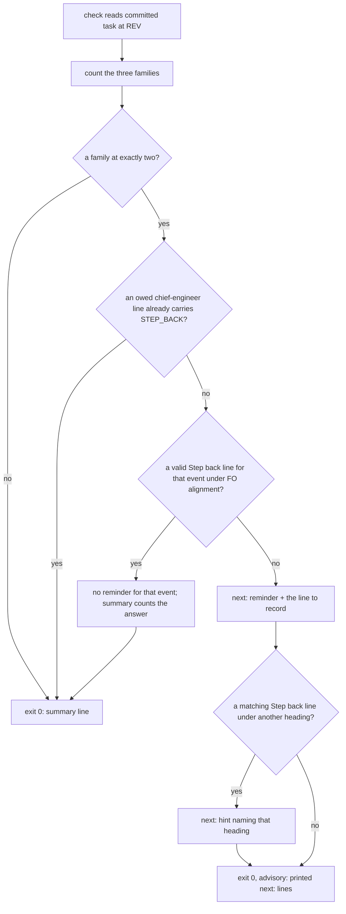

When `role_triggers.py` prints the step-back reminder for a task, FO writes its answers to the three questions on one fixed line in the task, and `role_triggers.py` stops printing the reminder for that round once the line is there.

Source: the Captain, chat 2026-11-05: 「開」, answering 「要開這張改過的第 2 張嗎？我建議開。」, whose proposal read 「給這三題的答案一個固定欄位，寫了之後腳本就不再提醒，觀察員也能核對。」 It applies his step-back rule of 2026-11-02 (a second failed validation or second relaxation stops work until three questions are answered).

Bite: observer reports across every archived task carry 7 violations under the `role_triggers.py` rule (3 in the 12 tasks of batches 12 and 13; grep over `_archive/*/observer.md`, 2026-11-05). For claims-name-their-source, fo-answers-own-worker-permissions-by-listed-id and release-walk-due-trigger, `role_triggers.py <state> <slug> --rev <archive commit>~1` exits 0 and prints only the advisory step-back `next:` line (the `STEP_BACK` text); `delivery_gate.py` forwards exit-0 lines without holding, by design. kc-dev-flow-2 0.35.0 names no place for the answer and no reader checks one, so the reminder repeats and the observer counts each printing as a violation whether or not FO answered.

Consumer: every adopter FO at a second validation round or second relaxation, and the observer, which reads the line to tell an answered step-back from an ignored one.

## Scope

- Upstream first: `role_triggers.py` (`STEP_BACK`, exit-0 advisory `next:` line) and `delivery_gate.py`, which forwards that line without holding; the observer, which reports each printed `next:` line.
- Non-goals: changing when the reminder fires or the three questions themselves.
- Batch 14: the Captain 「可以」 (chat, 2026-11-05), answering 「這 5 張當下一批，可以嗎？」, which named this task.

- Held 2026-11-05 at the ideation gate: the Captain 「可以」 (chat, 2026-11-05), answering 「這張先擱置，下一批手動試，好嗎？」. FO's reasons: the counted triggers miss a step-back owed at first proposal (one of the two this session that the Captain prompted himself); a self-answered line under a hold invites filler, and no record shows an answer changing direction. Trial: for the next batch, when role_triggers.py prints the step-back reminder, FO brings the three questions and its answers to the Captain as one item in the next sitting; after that batch, a direction change keeps this task, none deletes it.

- FO record error, noted 2026-11-05: the ideation hold reason ends "Recommendation followed.", but the bound question recommended approving D1 and D2; FO changed its recommendation after the Captain's questions, so under override-recorded-when-captain-departs's widened rule this resolution departs from FO's recommendation (Override: recommended approve D1-D2; Captain chose hold and a hand trial; area: none). The recorded reason cannot be edited.

## Budget
- One package PR. Workflow word budget unchanged unless the design names a raise for the Captain.

## Stop condition
- `role_triggers.py` keeps printing the step-back reminder for a round until the task carries that round's answer line, then stops; replays of the three batch 12 and 13 tasks without the line still print it, with the line do not, and the observer can tell the two apart.

## FO alignment

Alignment: needed at ideation; the line records his 2026-11-02 rule, so its form is his to accept.
Result: aligned at backlog: Batch 14 backlog sitting, the Captain 「准」 (chat, 2026-11-05), answering 「決定：這批五張（派工交代句的檢查、退一步答案欄位、漏寫 Override、婉拒要寫明、閘門一次問一件事）都用 Pilot，照各自寫下的範圍、預算與停止條件進入構思嗎？其中「婉拒要寫明」照我提的三項範圍（沒寫 Declined 標籤的婉拒、沒有 F 條目的審查者、沒指明接手任務）。要改哪張直接說。」, approved the outcome and bounds in this file.
Surfaces: none
Visible change: none
Release review: not needed: workflow maintenance, on no journey map.

## Design

Read against kc-dev-flow-2 0.35.0 at origin/main (`kc-dev-flow-2/.claude-plugin/plugin.json`, fetched 2026-11-05; the cached package `role_triggers.py` is byte-identical to origin/main's).

### PRFAQ

From the next release, when `role_triggers.py` asks FO the three step-back questions, it also prints the one line FO writes to answer them. FO writes that line under `## FO alignment`; from the next run the reminder for that event is gone at idle and at the merge ask, and the script's summary says how many step-backs are answered. The observer, which already reports every `next:` line the script prints at the archive, sees no line for an answered step-back and a violation for an ignored one.

- *What is "a round"?* One event family reaching its second occurrence: two validations with a Material or Needs decision F bullet (`validations`), two replacing amendments (`amendments`), or two dispatch records of one stage on one symptom (`<stage> symptom "<symptom>"`). Each family reaches two once, because stage reports, amendments and dispatch records are only appended; at three the same family owes a chief-engineer call (ADR 0026), which this line does not clear.
- *Why not reuse the chief-engineer waiver?* A waiver says FO declined a role call; this line is FO's own three answers with no role involved. Today a waiver does not silence the count-two reminder at all (the reminder is suppressed only by an owed line that carries `STEP_BACK`), and sharing the line would leave the observer unable to tell "answered" from "declined a call".
- *Why no date?* Each family reaches two once, so a date distinguishes no rounds; the commit that adds the line dates the answer in state history.
- *Does the merge ask now hold?* No. Round two still advises without a hold (ADR 0026, 2026-11-02 amendment); only the text and its end change.

### The line

One line under `## FO alignment` (its subheadings count too, as for `Reviewer:` lines), outside fenced blocks, in this form:

    Step back: <event> — outcome: <answer>; test: <answer>; delete: <answer>

`<event>` is `validations`, `amendments`, or `implementation symptom "<name>"` / `validation symptom "<name>"`, the name compared after the same trim, space-collapse and casefold `symptom_name` already applies. The three labels follow the order of `STEP_BACK`: is this still the outcome first asked for; can this gap be tested now; what breaks if it is deleted. Each answer must hold a character other than spaces and punctuation, the test the waiver reason already uses. The script reads the labels and the event key only; it never judges an answer's words (ADR 0026: counts and structure, not phrases). A `- ` bullet prefix is accepted, as for `Reviewer:` lines.

### Reader (`role_triggers.py`)

- `check()` collects answered event keys from the FO alignment lines it already keeps (`alignment()`), then prints the count-two reminder only for families not answered. The validations/amendments reminder keeps its current text and appends `Then record `Step back: <event> — outcome: <answer>; test: <answer>; delete: <answer>` under ## FO alignment.` naming each unanswered family; each symptom reminder appends the same sentence with its own key.
- A matching line outside `## FO alignment` adds one `next:` hint naming its heading, mirroring `hint()` for `Reviewer:` lines; the hint compares the normalized key, as the answer test does.
- The exit-0 summary gains `, and N step-back answer(s)` only when N > 0, so every existing output without an answer is unchanged.
- Unchanged: when each family fires, the three questions, the count-three chief-engineer call and its waivers, the merge hold, `pr_watch.py` and `delivery_gate.py` (both forward only `next:` lines, so an answered task forwards none), and `dispatch_records.py` (see D2).

### Observer

No change to `skills/observer/SKILL.md`. It already runs `role_triggers.py STATE TASK --rev TO` and reports each `next:` line as `violation`. With this change an answered step-back prints no `next:` line and the summary line it quotes as `ok` names the answer count; an ignored one still prints the reminder, reported as `violation`. Replays below show both.

### Replays (scratch prototype, 2026-11-05)

Prototype: origin/main `role_triggers.py` patched in `/tmp/stepback-proto/role_triggers.py` (not a repository file); each "with the line" case is the task file at `<archive commit>~1` committed into a fresh `/tmp` repository with one line added, because the script reads committed bytes. Archive commits: claims-name-their-source 8c7ab2f05, fo-answers-own-worker-permissions-by-listed-id c3208cce6, release-walk-due-trigger 086fba54d.

| Task (family at two) | Base script, real state at archive~1 | Candidate, no line | Line under FO alignment | Line under `## Notes` | Line fenced / wrong family / empty answer |
| --- | --- | --- | --- | --- | --- |
| claims-name-their-source (`amendments`) | 1 `next:`, 51 words, exit 0 | reminder + record sentence, 67 words, exit 0 | exit 0, no `next:`; "3 event(s) read at HEAD, each with a call or a waiver, and 1 step-back answer(s)." | reminder + hint `under "## Notes"` | reminder each time |
| fo-answers-own-worker-permissions-by-listed-id (`amendments`) | same, 51 words | same, 67 words | exit 0, no `next:`, "3 event(s) … and 1 step-back answer(s)." | reminder + hint | reminder each time |
| release-walk-due-trigger (`validations`) | same, 51 words | same, 67 words | exit 0, no `next:`, "0 event(s) … and 1 step-back answer(s)." | reminder + hint | fenced and wrong family: reminder (empty answer run on the two `amendments` tasks only) |

Synthetic, same prototype: fo-answers with its `amendments` answer and one more replacing amendment printed the owed chief-engineer line with the three questions, exit 1 (the answer does not clear count three); release-walk with its `validations` answer and two added replacing amendments still printed the reminder naming `Step back: amendments`. Not yet replayed: the symptom family (no archived task reached two on one symptom; AC-5 builds it in a test).

### Existing-code check

Reuse, not replace: `alignment()` (section filter), `outside_fences()`, the waiver's empty-reason test, `symptom_name()` normalization, and the `hint()` pattern. The observation that makes a change necessary: in all three replays the base script prints the same 51-word reminder at every run with no record that can stop it, and a chief-engineer waiver does not stop it either (only an owed line carrying `STEP_BACK` suppresses it). ADR 0026's 2026-11-02 amendment records exactly this: "At count two, questions repeat on each run without an answer record".

### Chain checked (upstream first)

- Spacedock 0.27.3 (installed plugin): `grep -ril "step.back"` finds nothing; no answer record exists upstream.
- kc-dev-flow-2 0.35.0: `STEP_BACK` is printed by `role_triggers.py` (idle and merge) and `dispatch_records.py` (stderr before a dispatch); no file names a place for the answer; `pr_watch.py` and `delivery_gate.py` only forward `role_triggers.py` lines.
- Sibling adopters (read-only `git grep` of `Step back:` / "step-back answer" over the qnow-adopt-dev2, qnow-dev2-poc and subspace-v0 state checkouts at HEAD): 0 files. Nothing to borrow.

### Words FO reads at each moment

Counted with `wc -w` on the script's `next:` output for the three replays (identical for all three).

| Moment | Base | Candidate |
| --- | --- | --- |
| Startup | 0 | 0 |
| Idle on an open PR, family at two, not answered | 51 per run | 67 per run |
| Idle on an open or merged PR, family at two, answered | 51 per run, every run | 0 |
| Merge ask (`delivery_gate.py check`), not answered / answered | 51 / 51 | 67 / 0 |
| Before a dispatch (`dispatch_records.py` stderr) | 48 per dispatch (ADR 0026) | 48, unchanged (D2) |
| After the archive (observer replay) | 51-word `next:` line, reported as violation | answered: summary line, 4 words longer; not answered: 67-word line |
| Adopted README (`references/sd/workflow.md`) | unchanged | unchanged, no edit |

The unanswered moment rises by 16 words, once per event until FO writes the line; every later run of an answered event drops from 51 to 0. Workflow word budget unchanged.

### Changes

- `kc-dev-flow-2/scripts/role_triggers.py`: the answer reader, the record sentence, the misplaced hint, the summary count, and the module docstring.
- `kc-dev-flow-2/scripts/test_role_triggers.py`: tests for AC-1, AC-3, AC-4, AC-5.
- `docs/adr/0026-role-calls-are-owed-on-counts-read-from-task-records-and-a-dated-call-clears-them.md`: one `Amended` paragraph (draft below). No new ADR, so no number to reserve.

### ADR draft: amendment to ADR 0026

Amended <date> (Captain: 「開」, answering 「要開這張改過的第 2 張嗎？我建議開。」, whose proposal read 「給這三題的答案一個固定欄位，寫了之後腳本就不再提醒，觀察員也能核對。」 on 2026-11-05; then his ideation-gate ruling on `step-back-answer-has-a-record-line`): at count two FO records the three answers as one `Step back: <event> — outcome: <answer>; test: <answer>; delete: <answer>` line under `## FO alignment`, `<event>` being `validations`, `amendments` or `<stage> symptom "<symptom>"`. `role_triggers.py` stops printing that event's count-two reminder once the line holds three non-empty answers, and its exit-0 summary counts the answers; it reads the event key and labels, not the answers' words. The line clears only the event it names: the count-three chief-engineer call, its waivers, the merge hold and `dispatch_records.py`'s pre-dispatch reminder are unchanged. The line carries no date, because each event reaches count two once. This replaces "At count two, questions repeat on each run without an answer record" above.

### Not claimed

- Timeliness: an answer written after the next step clears the reminder the same as one written before it; the observer can see the order only from state history. No archived task has an answer at all, so no case shows the need.
- The answers' quality: the script proves three non-empty answers exist, not that they are good.

### Batch overlap

| Task | Shared file, check or record | Conflict |
| --- | --- | --- |
| extension-instruction-check-sees-every-listed-extension (batch 14) | none: changes `dispatch_records.py` extension checks; this task leaves `dispatch_records.py` alone (D2 recommended) | none; if D2 is reversed, both edit `dispatch_records.py` in different functions |
| override-recorded-when-captain-departs (batch 14) | none: README review-finding disposition / `decision_ledger.py`; this task edits no README | none |
| gate-summary-names-each-decline (batch 14) | none: `delivery_gate.py` decline parsing; this task does not edit `delivery_gate.py` | none |
| gate-presentation-asks-one-thing-plainly (batch 14) | none: README gate content / present-gate | none |
| adoption-asks-which-extensions | none (states it leaves `skills/observer/SKILL.md` unchanged, as does this task) | none |
| comment-check-reaches-delivery-gate, fo-write-checks-parse-top-level, captain-ruling-sources-checked | none: `delivery_gate.py`, README | none |
| dispatch-carries-reserved-adr-number, seed-check-requires-alignment-result | none: `dispatch_records.py`, `pr_watch.py` | none |
| archive-waits-for-observer-report | none: `observer_check.py`, `pr_watch.py`; it changes when the observer runs, not what `role_triggers.py` prints | none |
| adr-required-statement | `docs/adr/` (it reads or edits ADR wording rules; this task appends one paragraph to ADR 0026) | possible textual conflict only if it edits ADR 0026; land either first, rebase the other |
| adr-silent-undo-probe, journey-canvas-hosted-poc, journey-server-host-pilot, picky-reviewers-may-run-on-gemini, ops-inbox-r1-setup-and-isolation, pr-review-lite-value-pilot | none (grep of each task file for `role_triggers`, `test_role_triggers`, ADR 0026, step-back, observer skill: no change named; pr-review-lite's one hit is a message id) | none |

Recommended order: any; this task shares no file with the other batch 14 tasks. If adr-required-statement edits ADR 0026, land it first and rebase this task's one paragraph.

## Acceptance criteria

**AC-1** — An answer line clears its event. With `Step back: amendments — outcome: …; test: …; delete: …` under `## FO alignment` on a task at two replacing amendments, `role_triggers.py` exits 0, prints no `next:` line, and its summary ends `and 1 step-back answer(s).`; the same holds for `validations`. Evidence: a test in `test_role_triggers.py`, plus the AC-2 replay script run "with the line" for claims-name-their-source and release-walk-due-trigger. Falsifier: removing the answered-key test from the reminder condition makes the test fail.

**AC-2** — The three batch 12 and 13 tasks without the line still print. `role_triggers.py <state> <slug> --rev <archive commit>~1` for claims-name-their-source (8c7ab2f05), fo-answers-own-worker-permissions-by-listed-id (c3208cce6) and release-walk-due-trigger (086fba54d) prints the reminder with the record sentence naming `amendments`, `amendments` and `validations`, exit 0; the same tasks with that line committed in a scratch repository print no `next:` line. Evidence: the command output for all six runs in the validation folder. Falsifier: a reader that clears on any `Step back:` text would silence the "wrong family" runs of AC-3.

**AC-3** — A line that does not count leaves the reminder: under another heading (plus a `next:` hint naming that heading), inside a fenced block, naming another event, or with an answer that is empty or only punctuation. Evidence: one test per case. Falsifier: dropping the `alignment()` filter makes the other-heading test fail.

**AC-4** — Counts and calls are unchanged. All existing tests in `test_role_triggers.py` pass, with one expectation changed: `test_two_failed_reports_count_once_each_and_passing_reports_do_not_count` pins the reminder at 51 words and moves to 67 (run against the scratch prototype on 2026-11-05: that one assertion fails `67 != 51`, every other test passes; `test_the_space_class_is_the_one_design_surfaces_uses` errors outside the package folder on base and prototype alike, needing `design_surfaces.py` beside it); `test_pr_watch.py` and `test_delivery_gate.py` assert the reminder only as a substring and its order before `record:`, and their word-count pins are on other lines (git grep at origin/main, 2026-11-05), so they pass unchanged; an answered `amendments` event plus a third replacing amendment still owes the chief-engineer line with the three questions, exit 1; with both families at two and one answered, the other still prints. Evidence: test run output. Falsifier: letting an answer clear the owed line makes the third-amendment test fail.

**AC-5** — The symptom family. Two `implementation-N.md` dispatch records naming one symptom, with `Step back: implementation symptom "<name>" — …` (spacing and case differing from the header) under `## FO alignment`, print no reminder for that symptom; a second symptom at two still prints its own. Evidence: a test. Falsifier: comparing the key without normalization fails the differing-case test.

**AC-6** — Readers and words. `pr_watch.py tasks` and `delivery_gate.py check` code is unchanged and forwards no `next:` line for an answered task (they forward only `next:` lines); the package diff touches only `role_triggers.py`, `test_role_triggers.py` and ADR 0026; `references/sd/workflow.md` and `skills/observer/SKILL.md` are byte-unchanged; the reminder word counts match the table above (51 base, 67 unanswered, 0 answered). Evidence: `git diff --stat origin/main`, `wc -w` on the replay outputs. Falsifier: any other file in the diff.

**AC-7** — ADR 0026 gains one `Amended` paragraph carrying the Captain's words and the ruling above, replacing its "questions repeat on each run without an answer record" sentence by reference, with no other line changed. Evidence: `git diff` of the ADR.

## Needs decision

Past rulings read: ADR 0026 (all amendments; the 2026-11-02 one names the missing answer record), ADR 0027 (a FO-write rule is checked by the script FO already runs at the write: here `role_triggers.py` at idle and merge), ADR 0045 (F-bullet form, unchanged). `git -C <state> grep -n 'Override:'` (2026-11-05): no Override in the role-call or step-back area.

- **D1. Accept the line's form?** `Step back: <event> — outcome: <answer>; test: <answer>; delete: <answer>` under `## FO alignment`, one per event, no date. Recommend yes: it follows the `Reviewer:` line FO already writes there and keeps "declined a call" apart from "answered the questions". What gets worse: FO learns one more record kind, and the unanswered reminder grows from 51 to 67 words until the line is written.
- **D2. Leave `dispatch_records.py`'s pre-dispatch reminder as it is?** Recommend yes: it fires at the moment the answer is owed (before the next dispatch), the scope and stop condition name `role_triggers.py`, and no observer report counts it. What gets worse: re-running `dispatch_records.py` on that record after FO has answered still prints its 48 words on stderr; making it stop needs it to read the task file, one more file in the diff and an overlap with extension-instruction-check-sees-every-listed-extension.

## Stage Report: ideation

- DONE: Design the step-back answer line: its form and place in the task, how /Users/kent/.claude/plugins/cache/kc-claude-plugins/kc-dev-flow-2/0.35.0/scripts/role_triggers.py reads it per round to stop the reminder, and how the observer tells an answered step-back from an ignored one, with replays of the three batch 12 and 13 tasks
  `Step back: <event> — outcome: …; test: …; delete: …` under `## FO alignment`, keyed per family (`validations`, `amendments`, `<stage> symptom "<name>"`); scratch-prototype replays at archive~1: no line prints the reminder (67 words), line under FO alignment prints none and the summary counts 1 answer, other heading / fence / wrong family / empty answer still print; observer SKILL unchanged (### Replays, ### Observer).
- DONE: A `### Batch overlap` section naming each file the design would change and each other batch task (extension-instruction-check-sees-every-listed-extension, override-recorded-when-captain-departs, gate-summary-names-each-decline, gate-presentation-asks-one-thing-plainly) and live task of other sessions (adoption-asks-which-extensions, adr-required-statement, adr-silent-undo-probe, captain-ruling-sources-checked, comment-check-reaches-delivery-gate, dispatch-carries-reserved-adr-number, fo-write-checks-parse-top-level, journey-canvas-hosted-poc, journey-server-host-pilot, picky-reviewers-may-run-on-gemini, seed-check-requires-alignment-result, archive-waits-for-observer-report, ops-inbox-r1-setup-and-isolation, pr-review-lite-value-pilot (stalled or driven by other sessions; read only)) that changes the same file or check, so FO can order implementation
  Files: `role_triggers.py`, `test_role_triggers.py`, ADR 0026 (one Amended paragraph); no batch 14 task shares one; only adr-required-statement might touch ADR 0026. Order: any.
- DONE: The words FO reads at each lifecycle moment, before and after, per root learning.md "Measure the words FO reads at each moment, not one file's size"
  Round-two reminder at idle and merge: 51 → 67 words until answered, 51 → 0 every run after; startup, pre-dispatch (48) and workflow.md unchanged (### Words FO reads at each moment).
- DONE: Acceptance criteria with reproducible evidence clauses and falsifiers, and unresolved decisions for the Captain, each with a recommendation and what gets worse under it
  AC-1 to AC-7 each with evidence and falsifier; D1 (line form) and D2 (leave `dispatch_records.py` alone), each recommended with its cost.
- DONE: AC-1 answer line clears its event — current evidence: prototype replays of claims-name-their-source and release-walk-due-trigger with the line print no `next:`; the package test is not yet written.
- DONE: AC-2 three tasks without the line still print — current evidence: base and prototype runs at 8c7ab2f05~1, c3208cce6~1, 086fba54d~1 print the reminder, exit 0; with the line, none.
- DONE: AC-3 lines that do not count — current evidence: prototype runs for other heading (plus hint), fenced, wrong family on all three tasks, empty answer on two; package tests not yet written.
- DONE: AC-4 counts and calls unchanged — current evidence: the existing 43 tests run against the prototype: one assertion `67 != 51` (the expected word-count change), one environment error shared with base; synthetic third-amendment replay owes chief-engineer, exit 1.
- DONE: AC-5 symptom family — not yet verified: no archived task reached two on one symptom; the test is owed at implementation.
- DONE: AC-6 readers and words — current evidence: `pr_watch.py` and `delivery_gate.py` forward only `next:` lines (read at origin/main); word counts measured on replays; the diff scope is a future check.
- DONE: AC-7 ADR 0026 amendment — not yet verified: draft paragraph in ### ADR draft; the ADR edit is implementation's.
- DONE: `design_surfaces.py check` — "step-back-answer-has-a-record-line.md: design surfaces presentable", exit 0.

### Summary

The answer is one `Step back:` line per event family under `## FO alignment`; `role_triggers.py` stops that family's count-two reminder once the line holds three non-empty answers, and the observer needs no change because an answered task no longer prints the `next:` line it reports as a violation. Replays of the three batch 12 and 13 tasks on a scratch prototype show the reminder without the line and silence with it; count three and the other family are unaffected. Two decisions for the Captain: accept the form (D1) and leave the pre-dispatch reminder in `dispatch_records.py` as it is (D2).
