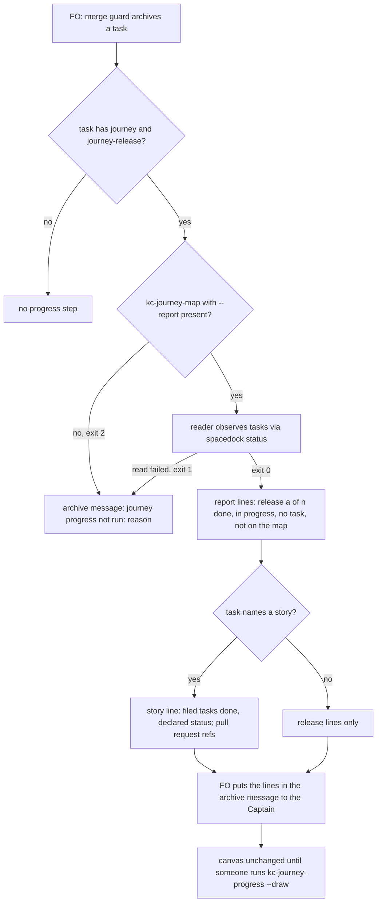

## Scope

- Source: the Captain 「我有個需求/想法，我覺得每張票作完之後，如果有同時有跑地圖ext，那應該要每張故事票做完就告訴我這個切片還剩下多少，這樣我才能知道離終點多遠。因為像是relay那邊一次要做兩個切片，已經做了大概兩天，但我如果沒有主動問就沒辦法知道做到哪裡了。這裡也要評估是否每個故事做完就同步更新畫布與地圖，更快反應狀況。以及，是否地圖應該記錄某個故事是因為哪些pr完成才完成的？等於切片地圖可以連結到完成它的pr？適合嗎？」 (chat with this FO, 2026-11-11).
- Selected for batch 21: the Captain chose 「放 1 到 5（建議）」 (host question dialog, 2026-11-11), answering 「第 21 批要放哪幾張？我建議放清單的 1 到 5：故事做完回報切片進度、發版後鋪開到採用 repo 與法規檢查、超預算要停與重大發現先對照不做清單、狀態提交自動推送與派工單矛盾、拒絕一個指令不等於全停。選完後我只為被選中的建任務檔，再一次請你過待辦關卡；選進來不代表接受任何設計。」.
- Package fact (FO read 2026-11-11): kc-journey-map skill kc-journey-progress runs `lib/journey-progress.mjs <journey.yaml> --workflow-dir <dir> [--draw <room>]` only "when explicitly refreshing"; kc-dev-flow-2 0.38.1 extensions/journey-map/EXTENSION.md joins FO at three points (a ruling answering a map question, before merge guard, after archive) and none runs the progress reader or reports to the Captain. `grep -n "pr\\b\\|pull" kc-journey-map/lib/progress.mjs` printed nothing (FO run 2026-11-11), so the observation carries no pull request.
- Known dependency (the backlog task journey-map-progress-and-provenance, its relay evidence of 2026-10-14, not re-read on relay today): no relay story carried `journey-required-tasks`, so the reader reports every story unverified there. The design says how a task joins its story's declaration when it is approved into the story, or names another way the count becomes real, and says what it takes from that task and what it leaves.
- FO's assessment given to the Captain in chat (not a ruling): report after each archive and redraw the canvas; keep progress derived from task state instead of writing it into the map file; derive story-to-PR links from each task's `pr:` value instead of storing them in the map.
- Surface note: this seed records no surface. If the design adds or changes anything a person sees on the canvas (a link, a mark), ideation records the `ui` surface and what it owes before its gate.
- Non-goals: the evidence ladder, ADR references and drawing provenance of journey-map-progress-and-provenance; one journey spanning several workflows; a background refresh.

## Budget
- One PR to kc-journey-map (reader output and canvas) and one to kc-dev-flow-2 (the journey-map extension step), or one PR if the design shows they cannot be split.

## Stop condition
- On a real adopter map with at least one declared story, archiving that story's last task makes FO report done and remaining stories for the release with each finished story's pull requests; or the design shows why not and says what was learned.

## FO alignment

Alignment: needed at ideation; what FO reports, whether the map file stores anything, and how much of journey-map-progress-and-provenance this takes are the Captain's call.
Result: the Captain chose 「交給設計比較」 (host question dialog, 2026-11-11), answering 「「故事做完回報切片進度」這張任務的設計方向要怎麼定？我建議：每張故事票歸檔後 First Officer 主動回報切片完成與剩餘並重畫畫布；進度和 PR 連結都從任務狀態現算、不寫回地圖檔；並把「任務獲准進入故事時自動記進故事的宣告」包進來，讓 relay 算得出數字。這是設計的方向，細節與證明仍在設計關卡由你核准。」. FO's recommendation was not taken: the design compares the choices and he picks at the ideation gate.
Surfaces: none
Visible change: none
Release review: not needed: workflow maintenance, on no journey map.

## Design

Profile: pilot. Recommended route: after FO archives a task that names a journey release,
FO runs one kc-journey-map command and puts its five-to-seven lines in the archive message:
how many of the release's stories are done and which, with their pull requests, which are
in progress and which have no task. Progress and pull request links
are computed from task state at that moment and are never written into the map file. The
canvas is not redrawn by this step. The story declaration step is not taken; instead the
reader adds a second count, from the tasks filed under each story, beside the declared
status it has today. Three choices below are the Captain's (`### Decisions for the
Captain`); everything else follows from measured facts.

### PRFAQ

**After this ships**, when FO archives a story's task on relay, its archive message says,
for example: "release owner-account: 1 of 4 stories have every filed task done; 1 in
progress; 2 have no task. Story inbox-home: 1 of 1 filed tasks done; pull requests:
spacedock-dev/subspace-relay#999." The Captain learns how far the slice is from its end
without asking, at each archive.

- **Q: Why not just run today's progress reader?** On relay it reads 182 of 184 stories
  as unverified, and on qnow all 190. Its count needs one task per story to declare the
  story's full task list, and relay's declarations go stale (measured below).
- **Q: Is "every filed task done" the same as "story done"?** No. Work not yet filed
  cannot be counted. The report says "filed", and the declared status, the canvas colours
  and the release-walk prompt keep today's meaning.
- **Q: Does the map file change?** No (D2 B1). A map-file record is option B3; ADR 0031,
  a related ruling, rejected a story field written without the Captain accepting an edit.
- **Q: What about qnow?** Of 78 tasks that name the qnow journey, 4 name a story and 21 a
  release. The report counts the release-only tasks under "not on the map", which tells
  the Captain the count is incomplete there. It does not fix that.

### Facts checked (chain order, 2026-11-11)

- **Spacedock 0.27.2** (`spacedock --help`; `merge guard` in fo-merge-core.md of plugin
  0.27.3). Archiving is the merge guard's finalize step, and it prints no story or release
  progress. `spacedock status --set` on an archived task refuses with "archived entity is
  read-only" (scratch copy of relay). No unarchive or reopen command is listed or answers
  `--help`.
- **kc-dev-flow-2 0.38.1** (origin/main). The journey-map extension joins FO after the
  archive only for the footprint fold (50 words, `### Words` below). The progress reader
  runs only inside `release_acceptance.py due`, called by `pr_watch.py tasks`. It prints a
  line only when a whole release reads `pending delivery acceptance` (ADR 0056).
- **kc-journey-map 1.10.0** (origin/main and the installed cache are the same version).
  `lib/progress.mjs` takes six fields, and `pr` is not among them. A story counts only with
  exactly one declaring member whose list equals the members. `journey-progress.mjs` takes
  `--draw <room>`. Its draw check (`drawn.status < 200 || drawn.status >= 300`) does not
  catch `renderToRoom`'s `{refused}` result, which carries no `status`, so a refused
  redraw of a hand-edited room would print as success. This was read in the code, not
  exercised.
- **Siblings.** Relay's interim practice is a "belongs to story <card> (<release>)" line at
  each backlog gate (relay evidence in journey-map-progress-and-provenance). No adopter
  README names a canvas room or `JOURNEY_API`.

### Measurements (read-only clones in a scratch directory, 2026-11-11)

Pins: relay `main` 0fce8229, relay `spacedock-state/dev2` 13ef3567; qnow `next`
ebc59cf9, qnow `spacedock-state/dev2` 78a76aa2; this repository origin/main with state
f55ce76e. Copy the state clone to `<code>/docs/dev2/.spacedock-state`, then count with
`spacedock status --workflow-dir <code>/docs/dev2 --archived --all-fields --limit 0 --json`.
Read progress with `node <kc-journey-map 1.10.0>/lib/journey-progress.mjs <map>
--workflow-dir <code>/docs/dev2`.

| Repository (map) | Map stories | Tasks on the journey | Declaring tasks | Reader today | Counted by filed tasks |
| --- | --- | --- | --- | --- | --- |
| relay (`spacedock-review.yaml`) | 184 | 62 (41 name a story) | 5 | 2 gap, 182 unverified, 27 orphans | 11 all done, 6 in progress, 167 no task |
| qnow (`qnow.yaml`) | 190 | 78 (4 name a story, 21 a release) | 0 | 190 unverified, 77 orphans | 0 all done, 1 in progress (branch-price-copy, implementation, r14/copy-prices-from-branch: the only task on a map story) |
| this repository (`kc-decision-log/journey.yaml`) | 30 | 0; dev2 does not list `journey-map` | 0 | not run: no journey task | none |

- **Why relay's declarations are stale** (full-history clone, `git log --reverse -G`).
  Each of the 3 stale declarations was written on 10-13 before its declaring task was
  archived the same day. Every extra member joined after that archive. For example, for
  get-started-page the declaration was written at 10:34 and the declarer archived at 14:07;
  limit-observability joined at 19:37. agent-reviews-from-link gained 3 members after its
  declarer was archived at 18:57, and owner-sees-all gained 2 after 14:48.
- **Can a stale declaration be repaired?** Not by FO under Spacedock 0.27.2 with reader
  1.10.0. In scratch, setting a superset declaration on the live member
  agent-front-door-publish left get-started-page unverified ("One confirmed complete
  mapping is required"), because the archived declaration cannot be cleared.
- **Positive path.** In scratch, `--set inbox-home status=done pr=pr-merge:999` moved
  owner-account from 0 of 4 stories (2 gap, 2 unverified) to 1 of 4, with inbox-home
  `exists`. Each read took 13.6 to 14.7 s and printed 5186 words of JSON. FO cannot be
  asked to read that at every archive, so this design adds `--report`.
- **`pr:` values on relay's 62 journey tasks.** 40 are `pr-merge:N`, 1 is `owner/repo#N`,
  1 is a URL and 20 are empty. `pr-merge:842` (spacedock-install-beta) is a Spacedock pull
  request; `gh pr view 842 --repo spacedock-dev/subspace-relay` finds none. So a
  `pr-merge:N` value carries no repository, and a link built from the workflow's remote is
  wrong for 1 of 40 values.
- **Was today's after-archive fold step run on relay?** The state cannot say: 12 archived
  `footprints.jsonl` files exist, and no task body records a `journey-map fold:` line,
  because the archive message lives in chat.

### Existing-code check

This change adds a capability: a progress report at archive, and pull request references.
- **Need.** The Captain's words in Scope, and he is the consumer, at each archive.
- **Completeness.** The progress reader works end to end (exercised above). An FO step
  that reports progress was not found, by two bounded searches: `git grep -n
  journey-progress origin/main -- kc-dev-flow-2` finds only `release_acceptance.py due` via
  `pr_watch.py`, and the extension's after-archive bullet names only the fold. Pull request
  data in progress was not found either: `git grep -c '\bpr\b' origin/main --
  kc-journey-map/lib/progress.mjs` prints nothing.
- **Use or repair.** Extend the reader in place (a `--report` mode and an additive
  `members` count). Reuse the extension's existing after-archive join point. Add no new
  tool, schema family or README key.
- **Exclusions.** A manual refresh by a person (kc-journey-progress) remains, and is not a
  consumer FO can rely on.

### Change (recommended choices: D1 A1, D2 B1, D3 C3)

**kc-journey-map PR (merges first, as the producer; ADR 0056 precedent).**
- `lib/progress.mjs` gives every story a `members` object: `{tasks, done, prs}`, counted
  from every task carrying that journey, release and story tuple, whether or not a
  declaration exists. `prs` is a list of `{task, ref}` for done members with a nonempty
  `pr:`. `status`, `requiredTasks`, `doneTasks`, `taskIds`, the release `status` and
  `acceptance` are computed exactly as in 1.10.0.
- Each release row gets `members: {storiesDone, storiesOpen, storiesEmpty}`, from the
  story `members` counts.
- `ref` rules:
  - `pr-merge:N`, `N` or `#N` becomes `<owner>/<repo>#N`, with owner and repo taken from
    the workflow checkout's GitHub `origin` (ssh or https); without one it stays `#N`.
  - `owner/repo#N` is kept as it is.
  - `https://github.com/o/r/pull/N` becomes `o/r#N`.
  - `local-merge:<sha>` becomes `local merge <first 7 of sha>`.
  - Any other nonempty value is kept verbatim.
- `journey-progress.mjs <map> --workflow-dir <dir> --report <slug>` prints text, not
  JSON, built from the same observation:

  ```
  journey progress: <journey>/<release> after <slug> (<status>)
  story <story>: <done> of <tasks> filed tasks done; declared: <exists | gap | unverified | none>
  pull requests: <ref>, <ref>            (or: pull requests: none recorded)
  release <release>: <a> of <n> stories have every filed task done; <p> in progress; <z> have no task
  done: <story> (<ref>, <ref>), ... (stories with every filed task done; at most 5, each with at most 3 refs, then "and <x> more")
  in progress: <story> <done>/<tasks>, ... (at most 5, then "and <x> more")
  not on the map: <k> tasks name this release with no story on the map   (only when k > 0)
  canvas: not redrawn; draw it with kc-journey-progress
  ```

  The two `story`/`pull requests` lines are omitted for a task with a release and no story.
  Exit codes:
  - 0: the report is printed, unverified stories included.
  - 1: the task read failed; it prints one line, `journey progress not run: <diagnostic>`.
  - 2: invalid arguments, or a slug that names no release of this map.
- `lib/schemas.mjs` and `lib/contract-versions.json`: the journey-progress field table
  gains the `members` rows, and its version moves from 1.0.0 to 1.1.0 (an additive change;
  the wire string stays `journey-progress/v1`, whose pin is major only).
  `skills/kc-journey-progress/SKILL.md` gains one paragraph on `--report` and on
  `members` ("filed tasks, not an exhaustive scope").
- `lib/progress.test.mjs` covers the new behavior; `lib/schemas.test.mjs` pins the exact
  story and release keys and `journey-progress 1.0.0`, so it changes with the table.
- Consumer check, unchanged: kc-dev-flow-2's `test_release_acceptance.py` runs the in-repo
  `journey-progress.mjs` and asserts the `acceptance` meaning (its `live_producer` case);
  its fixture `journey-progress-v1.json` carries no `members` and stays valid under an
  additive change.

**kc-dev-flow-2 PR.**
- `extensions/journey-map/EXTENSION.md`: the Needs line names `lib/journey-progress.mjs`
  with `--report` (9 words). "at three points on a journey task" becomes "at four points",
  and the journey-task definition sentence ends ", except the progress report" (5 words),
  because the new step also runs for a task with a release and no story. The Joins list
  gains one bullet after the fold bullet (50 words):

  > Right after archiving a task that has `journey` and `journey-release`, FO runs `node
  > <kc-journey-map>/lib/journey-progress.mjs <journey file> --workflow-dir <dir> --report
  > <slug>` and puts its lines in the archive message to the Captain. A missing
  > kc-journey-map, one without `--report` (exit 2) or a failed read is `journey progress
  > not run: <reason>`.

  kc-journey-map 1.10.0 run with `--report` exits 2 with its usage line (run 2026-11-11),
  so an adopter still on 1.10.0 gets the `not run` line, not a silent pass.
- Unchanged: `references/sd/workflow.md`, `pr_watch.py`, `map_footprint.py` and the
  release-acceptance extension.

### Flow



### Words FO reads at each lifecycle moment (`wc -w`, origin/main, 2026-11-11)

| Moment | Before | After (recommended) | Under C1 instead |
| --- | --- | --- | --- |
| Startup: `references/sd/workflow.md` | 5939 | 5939 | 5960 (+21: a drafted 48-word sentence replaces the 27-word split-step sentence); needs a budget raise in `lint-skills.py` |
| Startup: journey-map `EXTENSION.md` | 612 | 676 (+50 bullet, +9 Needs, +5 definition) | 676 |
| Backlog gate on a journey task: Release review bullet | 420 | 420 | 441 |
| After the archive: instructions | 50 (fold bullet) | 100 | 100 |
| After the archive: script output | fold draft diff (not measured); no progress output | + report, at most 9 lines and 160 words | same |
| Idle looks (`pr_watch.py tasks`) | unchanged | unchanged | unchanged |

Reading the raw JSON instead would add 5186 words at each relay archive. This task adds
reading by design, so the learning.md rule is applied as the per-moment count above, not
as a reduction target.

### Limits

- "Every filed task done" can read done while unfiled work remains. Declared status keeps
  the exhaustive meaning where a declaration exists.
- 1 of 40 relay `pr-merge:` refs names the wrong repository (`#842`). The reader cannot
  tell which, so the report prints `<origin repo>#N` and the limit stands.
- A prose step can be skipped. No check catches a missing report, which is the same
  weakness as today's fold step (see D1).
- About 14 s per archive on relay.
- One workflow per read: relay's subspace-v0 and subspace-web tasks are not counted (gap 3
  of journey-map-progress-and-provenance).
- What this takes from journey-map-progress-and-provenance: nothing of its scope. Its gap 2
  (declaration at approval) is left to it, with the archived-declarer finding above as new
  input. Its gaps 1 and 3, the evidence ladder, ADR references and drawing provenance stay
  there.

### Batch overlap

Read at state commit 045694484 (2026-11-11, after a re-pull). Files the recommended design changes:
- `kc-journey-map/lib/progress.mjs`, `lib/journey-progress.mjs`, `lib/progress.test.mjs`,
  `lib/schemas.mjs`, `lib/schemas.test.mjs`, `lib/contract-versions.json`,
  `skills/kc-journey-progress/SKILL.md`.
- `kc-dev-flow-2/extensions/journey-map/EXTENSION.md`.
- Shared index: none (no ADR, no README budget step).

| Task | Its files or checks (from its task file) | Shared with this design |
| --- | --- | --- |
| release-rollout-reaches-adopters-and-laws-pin (ideation) | release rollout to adopters; mentions workflow.md and `lint-skills.py` as unchanged | no file; this task's stop condition needs the new kc-journey-map and kc-dev-flow-2 to reach relay |
| budget-overrun-holds-and-findings-meet-non-goals (ideation) | `references/sd/workflow.md` | none; under C1, the same file |
| worker-push-words-match-state-commit (ideation) | `extensions/paseo/EXTENSION.md`, workflow.md Dispatch facts, `lint-skills.py` | none (a different EXTENSION.md); under C1, workflow.md and `WORKFLOW_BUDGET_STEPS` |
| denied-command-denies-only-that-command (ideation) | `extensions/paseo/EXTENSION.md`, Dispatch facts; its overlap note names this task's journey-map EXTENSION.md as "no shared file" | none |
| journey-map-progress-and-provenance (backlog, read only) | `progress.mjs`, `journey-progress.mjs`, the journey-progress schema | same files and schema; this task first, so that one designs on journey-progress 1.1.0 |
| adr-required-statement (validation) | workflow.md, `docs/dev2/README.md`, `lint-skills.py` | none; under C1, workflow.md and the budget |
| dispatch-carries-reserved-adr-number (ideation) | `pr_watch.py`, learning.md | none; the `pr_watch.py` trigger alternative in D1 would share `tasks` |
| journey-server-host-pilot (validation) | `render.mjs`, kc-journey-map README, host scripts, `JOURNEY_API` | none; A2 or B2 would share `render.mjs` or `records.mjs` and the host seam |
| merge-guard-stops-unasked-merges (validation) | workflow.md, learning.md, `lint-skills.py` | none |
| ops-inbox-r1-setup-and-isolation (implementation) | kc-ops-inbox's own `contract-versions.json` (cites kc-journey-map's as precedent) | none |
| pr-review-lite-value-pilot (implementation) | `kc-journey-map/lib/storymap.test.mjs`, `kc-journey-map/package.json` | no file; both bump the kc-journey-map component in the same Release PR |

Recommended order: this task's kc-journey-map PR before its kc-dev-flow-2 PR, and before
journey-map-progress-and-provenance is designed. No order constraint against the others
under the recommended choices.

### Decisions for the Captain

D1 and D2 are coupled: a pull request link on the canvas only stays current if the
canvas is redrawn.

**D1: what FO reports after a story's task is archived, and whether the canvas is redrawn.**
- **A1 (recommended).** Report at every archive of a task with a journey release; no
  redraw. Worse: the canvas stays stale until someone runs kc-journey-progress `--draw`.
  The step is prose FO can skip; no check catches a missing report.
- **A2.** A1, plus a redraw at every archive. Worse:
  - It needs a canvas service up and a room name; neither adopter README names one, so a
    new README key is owed.
  - A refused redraw of a hand-edited room prints as success today, so the draw check
    needs a fix.
  - It shares the host seam journey-server-host-pilot is changing.
  - It adds a network write at each archive.
- **A3.** Report only when a story completes. Worse: the two days of silence during a slice
  that the Captain described remain.
- **Alternative trigger home** (applies to A1 or A2): a `next:` line from `pr_watch.py
  tasks` instead of the prose bullet. Worse: it needs a once-per-archived-task marker or it
  repeats at every idle look, and it shares `pr_watch.py` with
  dispatch-carries-reserved-adr-number.

**D2: where progress and story-to-pull-request links live.**
- **B1 (recommended).** Computed from task state at read time; shown in the report and
  the JSON; map file and canvas unchanged. Worse: the canvas does not link a story to its
  pull requests, and a person without the workflow checkout cannot see them.
- **B2.** B1, plus the refs drawn on each story card. Worse: it adds a `ui` surface.
  Choosing it sends this task back through ideation for a `UI proposal:`, an operable
  preview and the design-director review. It needs A2 to stay current.
- **B3.** Written into the map file (a story field listing pull requests) through a
  docs-only map PR. Worse:
  - It is one more PR for the Captain to merge per story.
  - Map and tasks can disagree.
  - Related ruling, not a governing one: ADR 0031 rejected a story field written without
    the Captain accepting an edit and with no consumer; B3 goes through a PR he merges and
    he is its consumer.

**D3: the story declaration step.**
- **C3 (recommended).** Do not take it. Add a count of filed tasks beside the unchanged
  declared status. Worse: two counts exist (filed and declared), and "every filed task
  done" can read done while unfiled work remains. The canvas still shows most stories as
  unverified while the report counts them.
- **C1.** Take it: at each backlog approval into a story, FO sets the story's
  `journey-required-tasks` to all current members, plus a reader rule that a nested,
  newer declaration supersedes an archived one. Worse:
  - It adds a third surface (`references/sd/workflow.md`, +21 words by the drafted
    sentence, a budget raise and `test_sd_dispatch.py` strings) beyond "one PR each".
  - It is forward-only: today's 3 stale relay stories stay unverified until a new task
    joins, and owner-sees-all, whose members are all archived, never recovers.
  - The list FO writes asserts only "approved so far", the same weakness as C3, at more
    cost.
- **C2.** Leave both to journey-map-progress-and-provenance. Worse: the report this task
  adds would read "unverified" for 182 of 184 relay stories and all of qnow, so the
  Captain's question stays unanswered.

Past rulings read: ADR 0031 (related: it rejected an acceptance field written without the
Captain's edit and with no consumer; B3 differs on both); ADR
0056 (directory discovery, producer-first registration, idle-look walk prompt: C3 keeps
its trigger unchanged); `git grep -n '^Override:'` in state finds 5 lines, none in this
area.

## Acceptance criteria

Replay workspace: the pinned clones above, with the state copied under
`<code>/docs/dev2/.spacedock-state`; `<cand>` is the candidate kc-journey-map checkout
with `npm ci` done.

**AC-1** — A declared story's last task completing is reported with its release's remaining stories and its pull requests. Evidence: on the relay replay, run `spacedock status --workflow-dir <relay>/docs/dev2 --set inbox-home status=done pr=pr-merge:999`, then `node <cand>/lib/journey-progress.mjs <relay>/docs/journey/spacedock-review.yaml --workflow-dir <relay>/docs/dev2 --report inbox-home`. It exits 0 and prints `story inbox-home: 1 of 1 filed tasks done; declared: exists`, `pull requests: spacedock-dev/subspace-relay#999`, `release owner-account: 1 of 4 stories have every filed task done; 1 in progress; 2 have no task`, `done: inbox-home (spacedock-dev/subspace-relay#999)` and `in progress: switch-any-account 0/1`. Falsifier: without the `--set`, the same command prints `0 of 1` and `0 of 4`.

**AC-2** — Declared status, release acceptance and the walk prompt are unchanged. Evidence: on the unmodified relay and qnow replays, the `status`, `requiredTasks`, `doneTasks`, `taskIds` of every story and the `status`, `acceptance` of every release from `<cand>` equal kc-journey-map 1.10.0's output field for field (a jq or python diff prints nothing). `release_acceptance.py due` prints the same lines with either `--progress` (continuity-latest is unclaimed, so a status change would add a `next:` line), and kc-dev-flow-2's `test_release_acceptance.py` passes against the candidate checkout. Falsifier: a reader that sets `exists` from member counts changes relay's continuity-latest release (2 stories with only done members) to `pending delivery acceptance`, and the diff names it.

**AC-3** — Filed-task counts match task state. Evidence: on the unmodified relay replay, the `<cand>` JSON `members` gives 11 stories with every member done, 6 in progress and 167 with no task, matching the table in `### Measurements`. agent-reviews-from-link reads `{tasks: 6, done: 5}`. Falsifier: counting only declared members gives 3 for agent-reviews-from-link.

**AC-4** — Pull request refs follow the stated rules. Evidence: `node --test <cand>/lib/progress.test.mjs` includes one case per form (`pr-merge:N`, `N`, `#N`, `owner/repo#N`, a GitHub URL, `local-merge:<sha>`, other, empty) with an ssh and an https `origin`, and one with no `origin`; each asserts the exact `ref`. Falsifier: dropping the URL rule makes the URL case print the raw URL and fail.

**AC-5** — A release-only task and an incomplete map are reported honestly. Evidence: on the qnow replay, `--report production-operations` (archived, release r12, no story) exits 0, prints no `story` line, and prints `not on the map: <k> tasks name this release with no story on the map` with k equal to the count of r12 tasks without a map story in the `spacedock status` listing. Falsifier: omitting orphans from the report drops the line.

**AC-6** — The report stays short. Evidence: on the relay replay, `--report` for a task of second-opinion-later (28 stories) prints at most 9 lines and 160 words (`wc -l -w`); the done and in-progress lists each stop at 5 names with `and <x> more`, and each done story shows at most 3 refs. Falsifier: listing every story or every ref exceeds 160 words.

**AC-7** — FO's step cannot pass silently. Evidence: kc-journey-map 1.10.0 run with `--report inbox-home` exits 2 with its usage line (observed 2026-11-11). `<cand>` with `spacedock` removed from PATH exits 1 and prints exactly one line starting `journey progress not run:`. The candidate EXTENSION.md bullet names both cases. Falsifier: a `<cand>` that prints the report on a failed read with exit 0.

**AC-8** — The schema version moves with the field table. Evidence: `node <cand>/lib/schemas.mjs journey-progress` prints the `members` rows; `contract-versions.json` names `journey-progress` current 1.1.0 with a new hash and keeps 1.0.0. The kc-journey-map schema test exits 0. Falsifier: removing the version entry while keeping the rows makes that test fail.

**AC-9** — The kc-dev-flow-2 step is the bullet as designed, and nothing else in the FO reading changes. Evidence: `git diff origin/main -- kc-dev-flow-2/` touches only `extensions/journey-map/EXTENSION.md`; `wc -w` of that file is 612 before and at most 676 after, and its Joins line says four points; `references/sd/workflow.md` is byte-identical. FO's after-archive step is run by hand on the relay replay of AC-1 by copying the bullet's command verbatim, and it prints AC-1's lines. Falsifier: a candidate that also edits workflow.md fails the diff check.

**AC-10** (stop condition, real use) — On relay, after both releases reach it, the next archive of a task on a declared story has FO's archive message carrying the report lines, or `journey progress not run: <reason>`. Evidence: the archive message quoted with its task slug. Not yet verified: this needs the release and rollout (see release-rollout-reaches-adopters-and-laws-pin); validation may record it as an unverified future check.

## Stage Report: ideation

- DONE: Per the Captain's Result line, compare the choices side by side for him to pick at the gate, each with what gets worse: (a) what FO reports after a story task is archived and whether the canvas is redrawn then; (b) progress and story-to-PR links derived from task state versus written into the map file; (c) taking the story declaration step (a task joins its story's journey-required-tasks when approved into the story) into this task versus leaving it to journey-map-progress-and-provenance. Measure today's declared and undeclared stories on subspace-relay, qnow and this repository read-only, and run the progress reader on at least one real map
  `### Decisions for the Captain` D1 A1–A3, D2 B1–B3, D3 C1–C3, each with what gets worse. `### Measurements`: relay 5 declarations, 2 gap and 182 unverified; qnow 0 declarations, 190 unverified; this repo has no journey task. The reader ran on relay and qnow at the pinned SHAs.
- DONE: A `### Batch overlap` section naming each file the design would change and each other batch task (story-done-reports-release-remaining, release-rollout-reaches-adopters-and-laws-pin, budget-overrun-holds-and-findings-meet-non-goals, worker-push-words-match-state-commit, denied-command-denies-only-that-command) and live task of other sessions (journey-map-progress-and-provenance (backlog, read only), adr-required-statement, dispatch-carries-reserved-adr-number, journey-server-host-pilot, merge-guard-stops-unasked-merges, ops-inbox-r1-setup-and-isolation, pr-review-lite-value-pilot (driven by other sessions or held; read only)) that changes the same file or check, so FO can order implementation
  The design's 8 files plus 11 task rows, re-read at state 045694484. The only shared files under the recommended choices are with journey-map-progress-and-provenance (`progress.mjs` and the schema). The recommended order is given.
- DONE: The words FO reads at each lifecycle moment, before and after, per root learning.md "Measure the words FO reads at each moment, not one file's size"
  The `### Words FO reads` table: EXTENSION.md 612→676, after-archive instructions 50→100, report output at most 160 words (against 5186 words of JSON), workflow.md 5939 unchanged; the C1 column is measured from a drafted sentence (+21 words).
- DONE: Acceptance criteria with reproducible evidence clauses and falsifiers, and unresolved decisions for the Captain, each with a recommendation and what gets worse under it
  AC-1..AC-10 below, each with a command and a falsifier; D1–D3 each carry a recommendation and its cost.
- DONE: AC-1 report on a declared story's completion: not yet verified (needs `--report`). The underlying count was exercised: in scratch, inbox-home set done moved owner-account from 0 to 1 of 4 stories with inbox-home `exists`.
- DONE: AC-2 declared status, acceptance and walk prompt unchanged: not yet verified. The falsifier's premise was measured: continuity-latest has 2 stories whose members are all done, and no task claims its walk.
- DONE: AC-3 filed-task counts: not yet verified on the candidate. The expected values (11, 6, 167; agent-reviews-from-link 6 and 5) come from the current state listing.
- DONE: AC-4 pull request ref rules: not yet verified. The measured `pr:` shapes on relay are 40 `pr-merge:N`, 1 `owner/repo#N`, 1 URL and 20 empty.
- DONE: AC-5 release-only and incomplete maps: not yet verified. qnow has 77 orphans (57 with no release, 17 with a release and no story, 3 off the map), and production-operations is release r12 with no story.
- DONE: AC-6 report length (at most 9 lines, 160 words): not yet verified (no candidate yet).
- DONE: AC-7 cannot run silently: partly verified. kc-journey-map 1.10.0 with `--report` exits 2 with its usage line (2026-11-11). The candidate's exit 1 is not yet verified.
- DONE: AC-8 schema version moves: not yet verified. journey-progress is at 1.0.0 in `contract-versions.json` at origin/main.
- DONE: AC-9 kc-dev-flow-2 diff limited to the extension: not yet verified. The base counts were measured: EXTENSION.md 612 words, bullet 50.
- DONE: AC-10 real archive on relay: not yet verified. It is a future check after release and rollout.
- DONE: design_surfaces.py check
  `python3 <package>/scripts/design_surfaces.py check <task>` printed "design surfaces presentable" and exit 0. Surfaces stays `none`, because the recommended choices draw nothing new; B2 would add `ui`.

### Summary

The measurements show today's progress count is almost entirely unverified on the real adopters. Relay's declarations went stale because members joined after the declarer was archived, and Spacedock 0.27.2 cannot edit an archived task. The recommended design is: a `--report` text mode plus additive filed-task counts and pull request refs in kc-journey-map (journey-progress 1.1.0), and one after-archive bullet in kc-dev-flow-2's journey-map extension. The canvas and the map file stay unchanged, and the declaration step is left to journey-map-progress-and-provenance. Three decisions (D1 report and redraw, D2 where links live, D3 the declaration step) go to the Captain; D2's B2 would add a `ui` surface and another ideation round.
