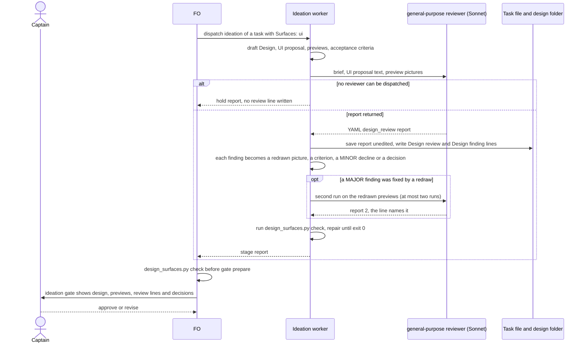
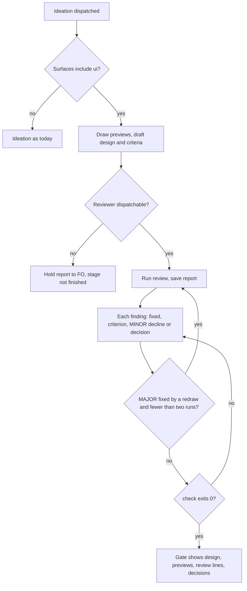

Filed on the Captain's 「同意設計待辦」 (chat, 2026-10-17), to FO's proposal to file the subspace-web FO's design-director proposal as one task that reuses the mechanism of prod-security-review-gates (a specialist review inside ideation; its findings become design requirements and acceptance criteria; `design_surfaces.py check` refuses a design whose review is missing or whose findings have no disposition).

## Scope

- The bite (relayed by the subspace-web FO, dhaka-39, 2026-10-17; to be re-read from state at ideation): subspace-web holder-panel-header-and-polish ideation revised twice for design quality (layout and hierarchy, then a 12-point critique), its refresh button, and disclosure-chevrons-follow-state for inconsistent chevrons; qnow vehicle-based-pricing and reception-holds-slot design defects (column width, a brand-wide apply with no confirm, no non-default cue, a new-booking window with no model picker). Each was visible in the preview before the gate.
- Trigger: `Surfaces: ui` in any profile. The ideation worker runs the review after drawing its previews, over the previews and the operable preview where one exists.
- Brief checklist (from the proposal): hierarchy and redundancy; one spacing, inset and alignment system; design-system conformance; every state (empty, loading, error, long content, many items, overflow); flow logic (the task can be completed, unsafe one-click actions, non-default cues); cross-control consistency; platform conventions; light, dark and phone.
- Disposition per finding: fixed (preview redrawn), an acceptance criterion, declined with a reason (minor only), or a Needs decision; a major finding is never declined by the worker.
- Reviewer: open. Installed `design:design-critique` (Anthropic's design plugin 1.2.0, a 595-word interactive skill, synced from the claude.ai organisation, no licence file in its folder) and e2e-pipeline's `ui-verify` (this repository; checks computed CSS against expected tokens, needs a declarative YAML and agent-browser) are candidates; whether dev2 owns the brief, depends on either, or needs neither is for ideation.
- Order: after prod-security-review-gates lands, reusing its seam.
- Proof before shipping (proposal): replay the brief fresh on the archived holder-panel cycle-1 and cycle-3 previews and the chevron cycle-1 preview; it names at least the duplicated count, the crowded chrome, the off-system refresh button and the opposite chevrons, or it does not ship.

## FO alignment

Alignment: not needed before ideation; the Captain approved filing it (his words are at the top of this file).
Release review: not needed: workflow maintenance, on no journey map.
Surfaces: none
Visible change: none

## Replay pre-registration (written before any replay run, 2026-10-17)

Expected findings per archived preview, from the recorded words of the people who found them, not from any run. Source: subspace-web `origin/spacedock-state/dev2`, `_archive/holder-panel-header-and-polish.md` (Ruling, cycle-3 dispatch `dispatch/ideation-3.md` points 1, 2, 11, Captain amendment 1) and `_archive/disclosure-chevrons-follow-state.md` (Ruling). Preview commits: holder cycle 1 `eb69c1f`, cycle 3 `acc75f5`, chevron cycle 1 `2b2cdd6` (`git log` of that branch).

| Preview | Defect that must be named (any severity, by what it is) | Recorded by |
| --- | --- | --- |
| holder cycle 1 | H1 the same count stated twice: rail header "3 comments" and the "All feedback 3" card | FO critique point 1, approved by the Captain 「可以，退回」 |
| holder cycle 1 | H2 crowded chrome above the first comment (profile card, feedback card, Updated line, lag sentence) | FO critique point 2 |
| holder cycle 1 | H3 the Refresh control is a text button unlike the toolbar's icon buttons | Captain 「refresh 按鈕不好看」 |
| holder cycle 1 | H4 phone: a second feedback surface above the document besides the tray, tray label "Not submitted · 0" | FO critique point 11 |
| holder cycle 3 | H5 phone refresh icon drawn as a visible 44px filled square unlike the 26px toolbar icons | Captain amendment 1 「手機上的重新整理按鈕有點怪」 |
| holder cycle 3 | none of H1 to H4 may be reported as present: they were fixed in cycle 3 (a report of one is a false positive) | cycle-3 stage report, measured D1, F2 |
| chevron cycle 1 | C1 the three disclosure controls draw the same state with opposite chevron directions (closed menu points down, closed tray and drawer point up) | Captain 「chevrons有點怪」 on this preview |

Pass rule from the Captain's relayed proposal: the brief names H1, H2, H3, C1 (the proposal's "duplicated count, crowded chrome, off-system refresh button, opposite chevrons") or it does not ship. Added here: H5 on cycle 3 (the defect a fix introduced), and a count of unfounded findings on cycle 3. A finding "names" a defect when its `seen:` text describes it; I read the reports, so matching is judged by me and stated as such.

## Design

Not repository files: this section is the design; implementation lands it. Sources read 2026-10-17: kc-dev-flow-2 at origin/main (`git show origin/main:kc-dev-flow-2/...`, package 0.24.0: `scripts/design_surfaces.py`, `scripts/test_design_surfaces.py`, `scripts/lint-skills.py`, `skills/ideation/principles.md`, `skills/ideation/profiles/prod.md`, `references/sd/workflow.md`, `skills/observer/SKILL.md`); the seam it reuses is the one `_archive/prod-security-review-gates.md` and ADR 0019 landed; subspace-web `origin/spacedock-state/dev2` by read-only `git show` and `git archive` into `/tmp` (the archived holder-panel and chevron tasks and their preview commits); the three adopters' state branches by read-only `git grep`.

### PRFAQ

**Press release.** Every task whose `Surfaces:` includes `ui` now has its previews reviewed by a fresh reviewer before its ideation gate. The ideation worker draws the previews, dispatches one reviewer with a packaged brief, saves its report, and turns each finding into a redrawn picture, an acceptance criterion, a reasoned decline of a minor finding, or a question for the Captain. FO's existing pre-gate `design_surfaces.py check` refuses a ui design with no review, a review that did not run, a report for a different preview, or a finding with no disposition. The Captain sees fewer designs that he has to send back for something visible in the picture.

**FAQ.**
- *Why a reviewer and not the worker's own look?* The worker drew the preview and the defects the Captain later named (the same count twice, a button unlike its neighbours, two chevrons pointing opposite ways) were all in pictures the worker had already looked at. A fresh context with only the pictures and the stated intent is the cheapest second look.
- *Which reviewer?* A packaged brief, run by a `general-purpose` agent on Sonnet (D1 states the measured limit: it did not meet the relayed bar). `design:design-critique` and `ui-verify` are not used; the table below says why.
- *What does a finding become?* One line per listed finding: `fixed: <what changed in which picture>`, `AC-<id>`, `declined: <reason>` (MINOR only) or `Needs decision: <text>`. A MAJOR finding is never declined by the worker.
- *Does the reviewer see the code or the task file?* No: the brief gives it the `UI proposal:` text as data and the pictures. It reads no source, so a defect that exists only in the running page (hover, focus, an interaction) is outside it; the operable preview is the Captain's.
- *What if no reviewer can be dispatched?* The worker returns a hold report and writes no `Design review:` line; the check refuses `not run` and a missing line, so the gate is not presentable. Never skipped, never clean.
- *Does a task without `ui` change?* No. The check reads `Surfaces:` from `## FO alignment` and `status: ideation` from the frontmatter.
- *Why not wait for validation?* The three bites were all caught by the Captain looking at ideation previews (cycles 1 and 2 of the holder panel, cycle 1 of the chevrons); validation runs against built code.

### Upstream and sibling check, in the chain's order

- **Spacedock 0.27.0 plugin cache** (`~/.claude/plugins/cache/spacedock/spacedock/0.27.0`): no design reviewer, stage or gate; the `ideation` stage text only says the worker authors the artifact each surface owes.
- **kc-dev-flow-2** (origin/main, 0.24.0): `skills/ideation/principles.md` owes a `UI proposal:` and a `Preview:` for `ui` and `design_surfaces.py check` already refuses their absence; nothing reviews them. The prod security review (`skills/ideation/profiles/prod.md`, `check_security` in `design_surfaces.py`) is the seam: worker dispatches a reviewer, saves a YAML report, writes one disposition line per finding, and the check refuses a missing review. Reused: `report_shape`, `report_severities`, `findings_is_direct_child`, the folder and path rules, the `not run` rule, the disposition loop's shape.
- **kc-dev-flow (v1)** and `kc-ship-flow`, `kc-journey-map`, `kc-pr-flow`: `git grep -i "design[- ]critique|design[- ]review|ui[- ]review"` on origin/main finds no design reviewer; the hits are e2e-pipeline's `ui-verify`, `e2e-walkthrough` ("Visual QA ... Human") and unrelated docs.
- **Candidates**, read 2026-10-17:

| Candidate | Licence | Shape | Availability on an adopter | Verdict |
| --- | --- | --- | --- | --- |
| `design:design-critique` (Anthropic design plugin 1.2.0, 595 words) | Apache-2.0 for the public repo `anthropics/knowledge-work-plugins` (`gh api repos/anthropics/knowledge-work-plugins/license`, 2026-10-17); the local folder has no licence file; the local `SKILL.md` is byte-identical to the public `design/skills/design-critique/SKILL.md` (`diff`, 2026-10-17) | an interactive skill ("otherwise, ask the user to describe"), prose and a markdown table, emoji severities; no states, flow or theme-and-size dimension; not shape-lockable | not in any repository; installed here by claude.ai organisation sync (`design.meta.json`: `installation_preference: available`), not by `claude plugin install` and not in `installed_plugins.json`; whether an adopter's machine or a Codex host has it is the organisation's setting, not the package's | measured, not used (control arm below) |
| `ui-verify` (e2e-pipeline 3.3.5, this repository) | MIT | machine equality of computed CSS on selectors and values someone already wrote, in a declarative YAML; needs `agent-browser`, a mapping file with auth and a running server | per user plus a mapping per adopter | cannot find a defect nobody wrote a selector for; belongs to validation, not ideation |
| gstack `design-review` and `plan-design-review` | MIT (`~/gstack/LICENSE`) | 13,069 and 14,708 words; `design-review` edits source and commits, both ask the user questions | per user, symlinked into `~/.claude/skills` | wrong shape for a dispatched read-only reviewer |
| a packaged brief in `kc-dev-flow-2` | MIT with the package | one file (831 words with its procedure); the YAML report is shape-locked by the check | ships with the package an adopter already declares | chosen |

- **Adopters**, read-only `git grep -E '^Surfaces:...ui'` on each `origin/spacedock-state/dev2`, 2026-10-17: subspace-web 19 of 24 task files, subspace-relay 23 of 60, qnow 21 of 107, 63 in all; none of the three has a design-reviewer agent or a design focus file in the state read here (not searched in their source trees).
- **Conclusion**: use and extend what exists. New code: 68 added and 9 changed lines in `design_surfaces.py` (prototype diff against main) and 13 new test cases; new text: one file, `skills/ideation/design-review.md`, and one pointer sentence in `skills/ideation/principles.md`; no new agent, extension, script, workflow word or CI job.

### Flow

### Replay on archived subspace-web previews (read only)

Inputs: subspace-web `origin/spacedock-state/dev2`, read-only `git archive` into `/tmp/rv/<name>/` of only `preview.html` and `shots/` from the preview commits the Captain saw: holder panel cycle 1 (`eb69c1f`, 89 pictures), holder panel cycle 3 (`acc75f5`, 154 pictures), chevron cycle 1 (`2b2cdd6`, 40 pictures). The reviewer got the cycle's own `UI proposal:` line and a file-name pattern naming the proposed design (today's pictures and earlier drafts are context); no task file, no critique, no checks. Expected findings were committed first (`c7a2f1e7`, section "Replay pre-registration"). Reviewer: `general-purpose`, `model: sonnet` (Opus on two cells, below). Prompts and the saved reports are under `ui-design-review-in-ideation/design/replay/`; a report marked "shortened" there is a summary because only the session held its full text.

Limit stated first: I could not stop a reviewer reading other files; the three prompts say not to, and I did not read their tool calls. Matching a finding to a defect is my reading. One run per cell is not a rate. Brief v2 was written after v1 missed three defects, so v2 is fitted to this bite (the prod design said the same of its added sentence).

| Cell | Defect | Brief v1, Sonnet | Brief v1, Opus | `design-critique` verbatim, Sonnet | Brief v2, Sonnet |
| --- | --- | --- | --- | --- | --- |
| holder c1 | H1 count said twice | named (MAJOR) | named (MINOR) | named | named (MINOR) |
| holder c1 | H2 crowded chrome above first comment | not named | not named | not named | named (MINOR: 270 of 800 px, a help line that only explains another) |
| holder c1 | H3 Refresh is a text button unlike the toolbar icons | not named | not named | not named ("phone Refresh about 44px, fine") | **not named** (it notes 72x28 desktop against 80x44 phone only) |
| holder c1 | H4 phone: second surface, tray "Not submitted · 0" | partial (tray label only) | partial | partial | partial (tray label, MAJOR) |
| holder c3 | H5 phone refresh drawn as a 44px filled square unlike 26px toolbar icons | not named | not named | not run | named (MINOR, system-fit) |
| holder c3 | H1 to H4 reported as present | none | none | not run | none; one inventory finding says 3 blocks, 150 of 800 px remain above the first comment (cycle 3 cut it from 266 px), left unscored |
| chevron c1 | C1 opposite chevrons for one state | named (MAJOR, all three controls) | not run | not run | named (MINOR, desktop menu against drawer; keeps the phone tray's up chevron as correct) |
| findings per run | | 13, 16, 9 | 18, 22 | prose tables, not counted | 18, 24, 13 |
| tokens, seconds | | 90,402 / 76; 92,108 / 92; 84,374 / 67 | 101,404 / 147; 98,593 / 147 | 98,069 / 87 | 90,791 / 58; 87,844 / 91; 89,567 / 86 |

Reading it.
- The Captain's relayed bar is H1, H2, H3, C1. Brief v2 names H1, H2, C1 and also H5; it misses H3 on cycle 1. So the bar as written is **not met**. Brief v1 met it on 2 of 4 (H1, C1) and found neither H2 nor H5.
- Opus did not help: on two cells it named exactly what Sonnet v1 named and nothing more (H1 only), at about twice the duration. The lever was the inventory pass in v2, not the model.
- The off-the-shelf `design-critique` named H1 only, and called the phone Refresh button fine; its dimensions have no inventory of controls. This is one run.
- H3 is an aesthetic call (a labelled text button in a toolbar of icons); the three reviewers read it as a plain button. It is the Captain's 「refresh 按鈕不好看」 and was also found in v2's cycle-3 cell as a size mismatch, so the class is reachable but not on cycle 1 in one run. A third brief revision to fit H3 would fit one example; I stopped at two (circuit breaker: v1, then v2 after a miss, with Opus tried as the other lever).
- Every run lists 9 to 24 findings, mostly MINOR. Each needs a disposition line, so the worker's cost is 9 to 24 lines per ui ideation; the brief says "do not pad" and the reports still pad. A cap was not tested.
- Unmeasured: a second preview from another repository (none replayed, so v2's fit to this bite is untested), qnow's pricing and reception bites, and a Codex-hosted worker.

### The check, prototyped

`design/design_surfaces-proto.diff` (under the task folder; 68 added and 9 changed lines in `design_surfaces.py`, 13 new cases and one changed mutation string in `test_design_surfaces.py`, against origin/main): `report_shape(text, root)` and `report_severities(text, scale)` take the root name and severity scale as parameters whose defaults keep today's security behaviour; a new `check_design_review` runs when `Surfaces:` (from `## FO alignment`) includes `ui` and the frontmatter says `status: ideation`, in any profile. It requires a `Design review: design/ideation-<N>.yaml` line naming a `design_review` report inside the task folder, a report whose `preview:` equals the task's `Preview:` line, severities in `MAJOR, MINOR`, and one `Design finding <n>:` line per `severity:` entry: `AC-<id>` declared in `## Acceptance criteria`, `fixed: <text>`, `declined: <reason>` on a MINOR finding, or `Needs decision: <text>`. `not run` is an error. Measured 2026-10-17 with `python3 -B -m unittest test_design_surfaces` in a copy of main plus the diff: main alone 90 of 90; with the diff 103 of 103 (the 13 new cases include six mutations: dropping the design call, the MINOR test, the preview rule, the design scale, the `ui` gate and the `fixed` branch each turn their own case red). One existing mutation string (`if value not in SEVERITY_SCALE:`) had to change to `if value not in scale:`: parametrizing a shared function changes literals other tests mutate, which is the cost `prod-security-validation-gate` would also pay if it edits those functions (see Batch overlap).

### Words FO reads at each lifecycle moment

Counted as `len(text.split())`; `references/sd/workflow.md` is 5495 words at origin/main and the design edits no file under `references/`; the stage text `### ideation` in it is 342 words.

| Moment | Text FO reads | Before | After, ui task | After, other |
| --- | --- | --- | --- | --- |
| startup | mod `kc-dev-flow-2.md` (48) plus `pr_watch.py tasks` output | 48 + output | identical | identical |
| idle, open PR | same | 48 + output | identical | identical |
| idle, merged PR | same | 48 + output | identical | identical |
| after the archive | same | 48 + output | identical | identical |
| ideation gate prep | `### ideation` (342) plus `design_surfaces.py check` output (4) | 346 | 359 (adds one 13-word output line, measured on a passing fixture) | 346 |
| validation gate prep | `### validation` | unchanged | unchanged | unchanged |
| merge ask | the merge-ask passage plus `delivery_gate.py` output | unchanged | unchanged | unchanged |

Not read by FO and so not in the table: the ideation worker reads `skills/ideation/principles.md` (582 words today, 596 with the pointer sentence) on every ideation, and the new `skills/ideation/design-review.md` (831 words in the draft: procedure and brief v2) only on a `ui` task. No moment rises for a task without `ui`. A refusal message FO would read when the check exits 1 is at most 40 words.

### Cost per ui task, measured on the replay

The shipped brief (v2) on Sonnet, harness `subagent_tokens` and `duration_ms`: 90,791 tokens and 58 s (holder cycle 1, 18 findings), 87,844 and 91 s (holder cycle 3, 24 findings), 89,567 and 86 s (chevron cycle 1, 13 findings). Brief v1 on Sonnet: 84,374 to 92,108 tokens, 67 to 92 s; Opus: 98,593 and 101,404 tokens, 147 s. A ui task whose first design has a MAJOR fixed by a redraw runs the reviewer twice. Dollar cost is not stated: I did not measure what the plan bills. Worker: one disposition line per finding, 13 to 24 on the replay; that, not the tokens, is the dominant cost, and no cap on findings was tested.

### Non-goals

A reviewer that holds a gate or veto; `ui-verify` at validation; a design system or tokens check; replaying the qnow bites (vehicle pricing, reception holds: no qnow preview was replayed, the `flow` dimension covers a brand-wide apply with no confirm and a missing model picker by definition, not by measurement); a Captain-ruled aesthetic; any change to POC or to a profile file; an observer sentence; any workflow word.

### Batch overlap

Read 2026-10-17 from origin/main and the five other batch-2 task files as committed at 6abdc678 (`prod-security-validation-gate` holds only its backlog text).

Files this design would change: `kc-dev-flow-2/scripts/design_surfaces.py`, `kc-dev-flow-2/scripts/test_design_surfaces.py`, `kc-dev-flow-2/skills/ideation/principles.md` (one pointer sentence), `kc-dev-flow-2/skills/ideation/design-review.md` (new), `docs/adr/<reserved>-ui-ideation-design-review-binds-design.md` (new; FO reserves the number). Not changed: `references/sd/workflow.md` and its budget, `lint-skills.py`, `references/sd/mods/*`, `extensions/*`, `skills/observer`, `skills/ideation/SKILL.md`, `profiles/*`, `delivery_gate.py`, `dispatch_records.py`, `pr_watch.py`, README.

| File or check | Other batch-2 task on it | What collides |
| --- | --- | --- |
| `design_surfaces.py`, `test_design_surfaces.py` | `workflow-budget-ratchet` (its design pins two message texts in `test_design_surfaces.py` and reads this checker's failure messages for its Shrink rule; it does not edit `design_surfaces.py`) | a message I add is one more it must read; the pin lines are disjoint from mine |
| `design_surfaces.py` functions `report_shape`, `report_severities`, `check_security` and `skills/ideation/profiles/prod.md` | `prod-security-validation-gate` (its backlog text decides refusal handling for the security reviewer, which in the check means the `tob_security_review` root line and `check_security`) | the same functions: I parametrize two of them. Whichever lands second rebases onto the other; the existing mutation strings (`if value not in SEVERITY_SCALE:` became `if value not in scale:`) are the likeliest textual conflict. Order below |
| `skills/ideation/principles.md` word count | `workflow-budget-ratchet` (it measures stage-principles words, 3127 to 3679 across four skills) | my pointer sentence adds 14 words to a file every ideation reads; the long text sits in `design-review.md`, read only on `ui` |
| the token `Reviewer:` in `references/sd/workflow.md` § Stages | `special-role-triggers` (its design says a ui-design review "writes its own `Reviewer:`") | this design writes no `Reviewer:` line; it writes `Design review:` and `Design finding <n>:`, so there is no shared token, and `role_triggers.py` ignores other agents' lines per its AC-2 |
| `.github/workflows/kc-dev-flow-2-tests.yml` | `special-role-triggers`, `merge-gatekeeper` (each may add a test step) | none: the new cases join the existing `test_design_surfaces.py` run |
| `docs/adr/` | all tasks that land an ADR | `number_guards.py reserve` orders the numbers |

Order for FO (recommendation): `workflow-budget-ratchet` first, as its own D2 proposes, then `prod-security-validation-gate`, then this task, so the parametrization lands on the refusal-handling edit once and not twice; if `prod-security-validation-gate` turns out not to edit `design_surfaces.py`, this task may land second after the ratchet. `worker-loads-declared-package`, `special-role-triggers` and `merge-gatekeeper` have no shared file with this design.

### Draft text the implementation lands

`design/design-review-draft.md` (831 words: four numbered steps, the "advises, holds no gate" sentence, and brief v2, whose text is exactly what the replay ran) becomes `kc-dev-flow-2/skills/ideation/design-review.md`; `skills/ideation/principles.md` gains one sentence under its `ui` bullet linking it (582 to 596 words). `python3 -B scripts/lint-skills.py` on a copy of origin/main with both changes (repository `scripts/` copied beside it) printed `PASS ... references/sd/workflow.md: 5495 of 5511 words; no unlisted passage repeats it`, exit 0 (2026-10-17). The step text is: the worker dispatches one `general-purpose` agent with `model: sonnet`; saves the report unedited as `design/ideation-<N>.yaml`; writes `Design review:` and one `Design finding <n>:` line per finding under `### Design review`; treats a `limitations` entry naming a state or size the previews do not show as a finding; reruns once after a MAJOR is fixed by a redraw, at most twice, the line naming the last report.

### Limits

The report is model output on pictures: it cannot operate a preview (hover, focus, a click path), reads no code, and does not prove the design usable. The check proves a disposition exists for each finding and that the report names the task's `Preview:` line; it cannot see that a `fixed:` picture was redrawn, that a named criterion answers its finding, that the reviewed pictures are the ones shown at the gate (the name matches, the bytes are not compared), or that the second run happened. The replay met the relayed bar on 3 of 4 defects and one run per cell is not a rate; brief v2 is fitted to this bite and was not tried on a second repository. A `Preview:` that is a URL is not readable by the reviewer unless it can open it; its report then says so under `limitations`, which the worker's step 3 turns into a finding. A Codex-hosted worker cannot dispatch the Claude agent and so holds (not verified for any adopter). The reviewer's 13 to 24 findings per design make disposition lines the main cost.

### Unresolved decisions (for the Captain)

Past rulings read: `git -C <state checkout> grep -n 'Override:'` (2026-10-17): prose hits only, no gate-record override touching a design review; ADR 0019 (the security seam this reuses) followed.

1. **D1. Ship with the bar met on 3 of 4?** The proposal said the brief names the duplicated count, the crowded chrome, the off-system refresh button and the opposite chevrons "or it does not ship". Brief v2 names three and the cycle-3 phone refresh defect; it does not name the cycle-1 text Refresh button. Recommendation: ship v2 and record that miss as a known limit in `design-review.md`'s closing sentence. What gets worse: a control of the wrong kind among its neighbours (an aesthetic call) still reaches the Captain first, and the whole fit is one bite replayed once. The alternative, a third brief revision aimed at that button, fits one example and I did not take it.
2. **D2. Run the reviewer again after a MAJOR is fixed, at most twice in all?** Recommendation: yes. The cycle-3 phone refresh defect came from redrawing after the cycle-2 critique, and v2 caught it only because it was run on the redrawn previews. What gets worse: about 90,000 tokens and 1 to 1.5 minutes more on a task whose first review found a MAJOR, and the check cannot see whether the second run happened.
3. **D3. Which model reviews.** Recommendation: Sonnet. Opus on two cells with brief v1 found no more than Sonnet (H1 only) at about twice the duration; brief v2 was not run on Opus. What gets worse: if a later bite needs more depth than v2's inventory gives, this default is wrong and nothing here measured Opus on v2.

Not asked: that a MAJOR is never declined by the worker (the relayed proposal says so; the check enforces it); where the text lives (a linked file read only on `ui` tasks keeps the always-read principles file at +14 words, and no word of `workflow.md` changes).

## Acceptance criteria

Evidence commands run from a checkout of the implementation PR head with `python3 -B` and caches cleared; the replay inputs are read-only `git archive` extracts of subspace-web `origin/spacedock-state/dev2` at the three preview commits named in the replay section, in a scratch folder outside the checkout.

**AC-1** The change adds a design-review step to every `ui` task's ideation and enforces it in the existing check; it edits no FO-read workflow text, no extension, no profile file and no observer text.
Verified by: at the candidate, `git diff origin/main --stat` lists only `kc-dev-flow-2/scripts/design_surfaces.py`, `kc-dev-flow-2/scripts/test_design_surfaces.py`, `kc-dev-flow-2/skills/ideation/principles.md`, `kc-dev-flow-2/skills/ideation/design-review.md` and one new file under `docs/adr`; `git diff origin/main -- kc-dev-flow-2/references kc-dev-flow-2/extensions kc-dev-flow-2/skills/observer kc-dev-flow-2/skills/ideation/profiles` prints nothing; `python3 kc-dev-flow-2/scripts/lint-skills.py` prints `references/sd/workflow.md: <main's count> of <main's budget> words`, unchanged by the diff. Falsifier: any other path in the stat, any byte in the empty diff, or a different count. Current evidence: the prototype touches `design_surfaces.py` and its test; the draft files pass `lint-skills.py` on a copy of main (5495 of 5511); the stat is not yet measured.

**AC-2** A task at `status: ideation` whose `Surfaces:` include `ui` cannot pass `design_surfaces.py check` without a recorded review that ran: no `Design review:` line, a `not run: <reason>` line, a path that leaves the task folder, a file that is not a `design_review` report, a report whose `preview:` differs from the task's `Preview:` line, or a severity outside `MAJOR, MINOR` each exit 1 with a distinct message; a ui task past ideation, and a task without `ui`, are unchanged; a `prod` ui task owes this review and the security review.
Verified by: the 13 new cases in `test_design_surfaces.py` (prototype: 103 of 103 pass beside the 90 existing, measured 2026-10-17). Falsifier: deleting the `check_design_review` call from `check_task` makes the missing-line case exit 0 and its case fail (`test_mutation_dropping_the_design_call_lets_a_missing_review_pass`), run with `python3 -B` and `__pycache__` cleared. Current evidence: as stated. Not verified: that a worker with no agent installed holds instead of writing a line; either route exits 1.

**AC-3** Every finding the review lists has a visible disposition: a declared `AC-<id>`, `fixed: <text>`, `declined: <reason>` on a MINOR finding, or `Needs decision: <text>`; a MAJOR finding is never declined.
Verified by: the cases `declined major`, `finding without a line`, `undeclared criterion`, `empty decline`, `empty fixed` and `extra line` in `test_each_refusal_names_its_own_reason`, each exit 1 with its own message. Falsifier: removing the `MINOR` test from the decline branch makes `declined major` exit 0 (`test_mutation_dropping_the_minor_test_lets_a_declined_major_pass`). Limit: the check counts `severity:` entries in `findings` only and cannot judge that a named criterion answers the finding or that a `fixed:` picture was redrawn.

**AC-4** The security review's behaviour is unchanged by the parametrization of `report_shape` and `report_severities`.
Verified by: the 90 existing cases, including the security mutations, pass at the candidate. Falsifier: a changed default for `root` or `scale` fails the existing security cases. Current evidence: 90 of 90 on main, and on the prototype after one mutation string was updated to the parametrized literal.

**AC-5** FO reads no more words at any moment for a task without `ui`, and 13 more at the ideation gate of a `ui` task; the ideation worker reads at most 850 words in `design-review.md`, only on a `ui` task, and `principles.md` grows by at most 20.
Verified by: the empty `references` diff of AC-1; `python3 -I -c 'print(len(open("kc-dev-flow-2/skills/ideation/design-review.md").read().split()))'` printing at most 850; `principles.md` growing by at most 20 words; the candidate `check` on a passing ui fixture printing exactly one added line of at most 14 words, and no added line on a task without `ui`. Falsifier: an 851-word file, a 21-word growth, or an added output line on a task without `ui`. Current evidence: counts in `### Words FO reads at each lifecycle moment` (831 and 14 in the draft); the shipped files are not yet measured.

**AC-6** With the brief taken verbatim from the shipped `design-review.md`, fresh Sonnet runs of a `general-purpose` agent on the archived previews name each of these defects at any severity: on holder cycle 1 (`eb69c1f`) the count stated twice and the crowded chrome above the first comment; on holder cycle 3 (`acc75f5`) the phone refresh icon drawn as a 44px filled square unlike the 26px toolbar icons; on chevron cycle 1 (`2b2cdd6`) opposite chevron directions for one state across the controls; and the holder cycle-3 report does not report a cycle-1 defect (count twice, a second phone surface, a text Refresh button) as present.
Verified by: three saved reports under `<task folder>/design/`, each read for those findings by the validator. Falsifier: a report that does not describe one named defect, or a cycle-3 report that reports a cycle-1 defect as present. Current evidence: with brief v2 and the same prompt shape, one run each named all four defects and none reported a cycle-1 defect on cycle 3 (2026-10-17, `design/replay/*-v2.md`, shortened summaries because only the session held the full text). Stop rule: the implementation worker does not revise the brief; if the falsifier fires it returns the reports to FO as a Needs decision. Not claimed: a rate; that the cycle-1 text Refresh button is named (it was not); anything about a second repository.

**AC-7** The step text states its known limits: the reviewer sees pictures only, cannot operate a preview and reads no code, and a control of the wrong kind among its neighbours (the cycle-1 text Refresh button) was not found by the replay.
Verified by: `git grep -n -i 'sees pictures' kc-dev-flow-2/skills/ideation/design-review.md` and a read of its closing sentences by the validator. Falsifier: no match, or no sentence naming that class as not found. Current evidence: the draft has the first sentence; the second is added at implementation if the Captain accepts D1's recommendation.

**AC-8** The ruling lands as an ADR whose Words line quotes the Captain's answer at the ideation gate and the question he answered.
Verified by: `python3 <package>/scripts/adr_lint.py docs/adr --since <base> --require <reserved number>` exits 0 at the candidate. Falsifier: exit 1 for a missing record or Words line. Not yet verified: the ADR is written at implementation, under the short title `ui-ideation-design-review-binds-design`, with no number here.

## Stage Report: ideation

- DONE: A design (PRFAQ and Mermaid) for a design review in a ui task's ideation over its previews, reusing the prod security seam (a specialist review whose findings become requirements and criteria, with kc-dev-flow-2/scripts/design_surfaces.py check refusing an unreviewed ui ideation); the reviewer choice (design:design-critique, e2e-pipeline ui-verify, or a packaged brief) with its licence and availability on adopters; and the replay proof on archived subspace-web holder-panel cycle-1 and cycle-3 previews and the chevron cycle-1 preview (read only)
  `## Design`: PRFAQ, two Mermaid diagrams, candidate table (licence checked by `gh api`, byte diff of design-critique against upstream), prototype diff `design/design_surfaces-proto.diff` (103 of 103 cases pass, 90 existing), replay table. The relayed bar is NOT met: brief v2 names the count twice, the crowded chrome, the cycle-3 phone refresh icon and the chevrons, but not the cycle-1 text Refresh button; the Captain rules in D1.
- DONE: A `### Batch overlap` section naming each file the design would change and each other batch-2 task (workflow-budget-ratchet, special-role-triggers, worker-loads-declared-package, prod-security-validation-gate, ui-design-review-in-ideation, merge-gatekeeper) that changes the same file or check, so FO can order implementation
  Under `## Design`: five files, a table per shared file or check against the committed peer designs (6abdc678), and a recommended order (ratchet, then prod-security-validation-gate, then this task).
- DONE: The words FO reads at each lifecycle moment, before and after, per root learning.md "Measure the words FO reads at each moment, not one file's size"
  `### Words FO reads at each lifecycle moment`: only the ideation gate of a ui task rises, 346 to 359 (one 13-word output line measured on a fixture); `workflow.md` untouched at 5495 of 5511 (lint-skills.py on a copy with the draft files, exit 0).
- DONE: Acceptance criteria with reproducible evidence clauses and falsifiers, and unresolved decisions for the Captain, each with a recommendation and what gets worse under it
  `## Acceptance criteria` AC-1 to AC-8, each with Verified by, Falsifier and current evidence or an honest not-yet-verified; `### Unresolved decisions` D1 (ship on 3 of 4), D2 (rerun after a fixed MAJOR), D3 (Sonnet).

### Design-surface check

`python3 /Users/kent/.claude/plugins/cache/kc-claude-plugins/kc-dev-flow-2/0.24.0/scripts/design_surfaces.py check ui-design-review-in-ideation.md`: `ui-design-review-in-ideation.md: design surfaces presentable`, exit 0 (2026-10-17, package 0.24.0). This task records `Surfaces: none`, so the check ran the FO-record, criteria and amendment rules only; it does not exercise the new ui rule.

### Summary

Designed a design review for `Surfaces: ui` ideation that reuses the prod security seam: one fresh Sonnet reviewer over the previews, a shape-locked `design_review` report, one disposition line per finding, and the existing pre-gate check refusing an unreviewed ui design, at 68 added script lines and no FO-read workflow word. The replay (nine reviewer runs on three archived previews) shows the packaged brief v2 reaching 3 of the 4 defects the proposal named plus the one a fix introduced, one run per cell and fitted to this bite; the missing one is the cycle-1 text Refresh button, so the proposal's "or it does not ship" bar is unmet and goes to the Captain as D1 with a recommendation to ship and record the miss.
