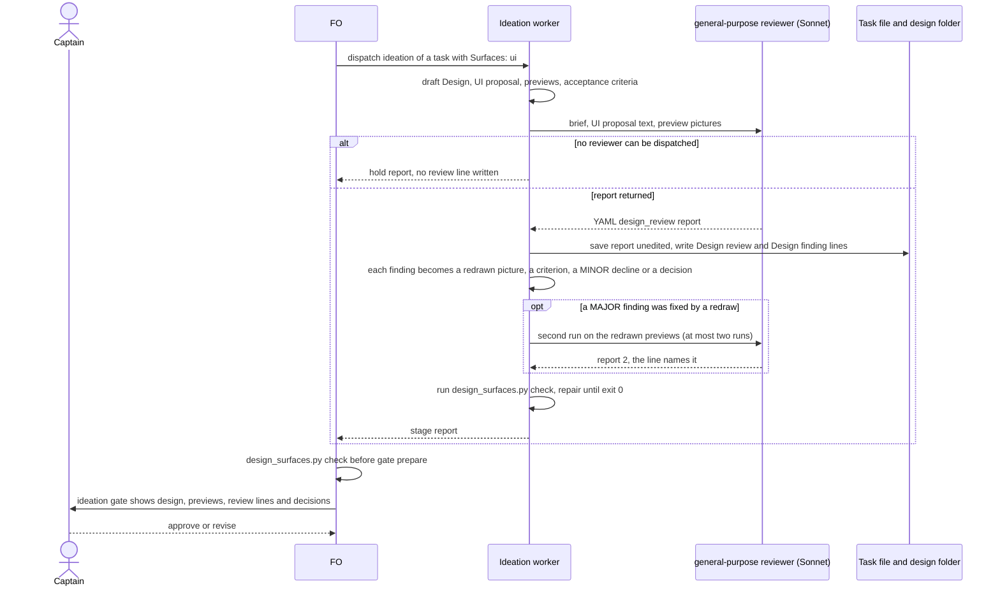
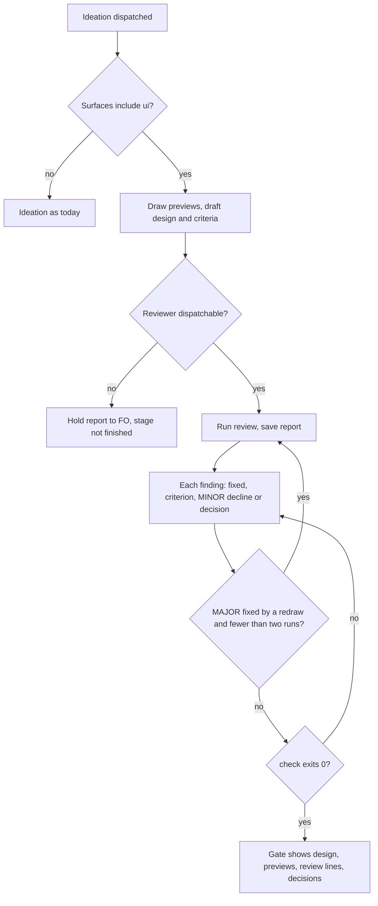

Filed on the Captain's 「同意設計待辦」 (chat, 2026-10-17), to FO's proposal to file the subspace-web FO's design-director proposal as one task that reuses the mechanism of prod-security-review-gates (a specialist review inside ideation; its findings become design requirements and acceptance criteria; `design_surfaces.py check` refuses a design whose review is missing or whose findings have no disposition).

## Scope

- The bite (relayed by the subspace-web FO, dhaka-39, 2026-10-17; to be re-read from state at ideation): subspace-web holder-panel-header-and-polish ideation revised twice for design quality (layout and hierarchy, then a 12-point critique), its refresh button, and disclosure-chevrons-follow-state for inconsistent chevrons; qnow vehicle-based-pricing and reception-holds-slot design defects (column width, a brand-wide apply with no confirm, no non-default cue, a new-booking window with no model picker). Each was visible in the preview before the gate.
- Trigger: `Surfaces: ui` in any profile. The ideation worker runs the review after drawing its previews, over the previews and the operable preview where one exists.
- Brief checklist (from the proposal): hierarchy and redundancy; one spacing, inset and alignment system; design-system conformance; every state (empty, loading, error, long content, many items, overflow); flow logic (the task can be completed, unsafe one-click actions, non-default cues); cross-control consistency; platform conventions; light, dark and phone.
- Disposition per finding: fixed (preview redrawn), an acceptance criterion, declined with a reason (minor only), or a Needs decision; a major finding is never declined by the worker.
- Reviewer: open. Installed `design:design-critique` (Anthropic's design plugin 1.2.0, a 595-word interactive skill, synced from the claude.ai organisation, no licence file in its folder) and e2e-pipeline's `ui-verify` (this repository; checks computed CSS against expected tokens, needs a declarative YAML and agent-browser) are candidates; whether dev2 owns the brief, depends on either, or needs neither is for ideation.
- Order: after prod-security-review-gates lands, reusing its seam.
- Proof before shipping (proposal): replay the brief fresh on the archived holder-panel cycle-1 and cycle-3 previews and the chevron cycle-1 preview; it names at least the duplicated count, the crowded chrome, the off-system refresh button and the opposite chevrons, or it does not ship.

## FO alignment

Alignment: not needed before ideation; the Captain approved filing it (his words are at the top of this file).
Release review: not needed: workflow maintenance, on no journey map.
Surfaces: none
Visible change: none
Reviewer: kc-dev-flow-2:chief-engineer opus 2026-10-17 — third repair cycle on #663 (fence-blind reads: Codex round 3 review:5558271854 and validation-3's Surfaces regression): repair the fence class once, decline to backlog, or narrow the PR?

## Replay pre-registration (written before any replay run, 2026-10-17)

Expected findings per archived preview, from the recorded words of the people who found them, not from any run. Source: subspace-web `origin/spacedock-state/dev2`, `_archive/holder-panel-header-and-polish.md` (Ruling, cycle-3 dispatch `dispatch/ideation-3.md` points 1, 2, 11, Captain amendment 1) and `_archive/disclosure-chevrons-follow-state.md` (Ruling). Preview commits: holder cycle 1 `eb69c1f`, cycle 3 `acc75f5`, chevron cycle 1 `2b2cdd6` (`git log` of that branch).

| Preview | Defect that must be named (any severity, by what it is) | Recorded by |
| --- | --- | --- |
| holder cycle 1 | H1 the same count stated twice: rail header "3 comments" and the "All feedback 3" card | FO critique point 1, approved by the Captain 「可以，退回」 |
| holder cycle 1 | H2 crowded chrome above the first comment (profile card, feedback card, Updated line, lag sentence) | FO critique point 2 |
| holder cycle 1 | H3 the Refresh control is a text button unlike the toolbar's icon buttons | Captain 「refresh 按鈕不好看」 |
| holder cycle 1 | H4 phone: a second feedback surface above the document besides the tray, tray label "Not submitted · 0" | FO critique point 11 |
| holder cycle 3 | H5 phone refresh icon drawn as a visible 44px filled square unlike the 26px toolbar icons | Captain amendment 1 「手機上的重新整理按鈕有點怪」 |
| holder cycle 3 | none of H1 to H4 may be reported as present: they were fixed in cycle 3 (a report of one is a false positive) | cycle-3 stage report, measured D1, F2 |
| chevron cycle 1 | C1 the three disclosure controls draw the same state with opposite chevron directions (closed menu points down, closed tray and drawer point up) | Captain 「chevrons有點怪」 on this preview |

Pass rule from the Captain's relayed proposal: the brief names H1, H2, H3, C1 (the proposal's "duplicated count, crowded chrome, off-system refresh button, opposite chevrons") or it does not ship. Added here: H5 on cycle 3 (the defect a fix introduced), and a count of unfounded findings on cycle 3. A finding "names" a defect when its `seen:` text describes it; I read the reports, so matching is judged by me and stated as such.

## Design

Not repository files: this section is the design; implementation lands it. Sources read 2026-10-17: kc-dev-flow-2 at origin/main (`git show origin/main:kc-dev-flow-2/...`, package 0.24.0: `scripts/design_surfaces.py`, `scripts/test_design_surfaces.py`, `scripts/lint-skills.py`, `skills/ideation/principles.md`, `skills/ideation/profiles/prod.md`, `references/sd/workflow.md`, `skills/observer/SKILL.md`); the seam it reuses is the one `_archive/prod-security-review-gates.md` and ADR 0019 landed; subspace-web `origin/spacedock-state/dev2` by read-only `git show` and `git archive` into `/tmp` (the archived holder-panel and chevron tasks and their preview commits); the three adopters' state branches by read-only `git grep`.

### PRFAQ

**Press release.** Every task whose `Surfaces:` includes `ui` now has its previews reviewed by a fresh reviewer before its ideation gate. The ideation worker draws the previews, dispatches one reviewer with a packaged brief, saves its report, and turns each finding into a redrawn picture, an acceptance criterion, a reasoned decline of a minor finding, or a question for the Captain. FO's existing pre-gate `design_surfaces.py check` refuses a ui design with no review, a review that did not run, a report for a different preview, or a finding with no disposition. The Captain sees fewer designs that he has to send back for something visible in the picture.

**FAQ.**
- *Why a reviewer and not the worker's own look?* The worker drew the preview and the defects the Captain later named (the same count twice, a button unlike its neighbours, two chevrons pointing opposite ways) were all in pictures the worker had already looked at. A fresh context with only the pictures and the stated intent is the cheapest second look.
- *Which reviewer?* A packaged brief, run by a `general-purpose` agent on Sonnet (D1 states the measured limit: it did not meet the relayed bar). `design:design-critique` and `ui-verify` are not used; the table below says why.
- *What does a finding become?* One line per listed finding: `fixed: <what changed in which picture>`, `AC-<id>`, `declined: <reason>` (MINOR only) or `Needs decision: <text>`. A MAJOR finding is never declined by the worker.
- *Does the reviewer see the code or the task file?* No: the brief gives it the `UI proposal:` text as data and the pictures. It reads no source, so a defect that exists only in the running page (hover, focus, an interaction) is outside it; the operable preview is the Captain's.
- *What if no reviewer can be dispatched?* The worker returns a hold report and writes no `Design review:` line; the check refuses `not run` and a missing line, so the gate is not presentable. Never skipped, never clean.
- *Does a task without `ui` change?* No. The check reads `Surfaces:` from `## FO alignment` and `status: ideation` from the frontmatter.
- *Why not wait for validation?* The three bites were all caught by the Captain looking at ideation previews (cycles 1 and 2 of the holder panel, cycle 1 of the chevrons); validation runs against built code.

### Upstream and sibling check, in the chain's order

- **Spacedock 0.27.0 plugin cache** (`~/.claude/plugins/cache/spacedock/spacedock/0.27.0`): no design reviewer, stage or gate; the `ideation` stage text only says the worker authors the artifact each surface owes.
- **kc-dev-flow-2** (origin/main, 0.24.0): `skills/ideation/principles.md` owes a `UI proposal:` and a `Preview:` for `ui` and `design_surfaces.py check` already refuses their absence; nothing reviews them. The prod security review (`skills/ideation/profiles/prod.md`, `check_security` in `design_surfaces.py`) is the seam: worker dispatches a reviewer, saves a YAML report, writes one disposition line per finding, and the check refuses a missing review. Reused: `report_shape`, `report_severities`, `findings_is_direct_child`, the folder and path rules, the `not run` rule, the disposition loop's shape.
- **kc-dev-flow (v1)** and `kc-ship-flow`, `kc-journey-map`, `kc-pr-flow`: `git grep -i "design[- ]critique|design[- ]review|ui[- ]review"` on origin/main finds no design reviewer; the hits are e2e-pipeline's `ui-verify`, `e2e-walkthrough` ("Visual QA ... Human") and unrelated docs.
- **Candidates**, read 2026-10-17:

| Candidate | Licence | Shape | Availability on an adopter | Verdict |
| --- | --- | --- | --- | --- |
| `design:design-critique` (Anthropic design plugin 1.2.0, 595 words) | Apache-2.0 for the public repo `anthropics/knowledge-work-plugins` (`gh api repos/anthropics/knowledge-work-plugins/license`, 2026-10-17); the local folder has no licence file; the local `SKILL.md` is byte-identical to the public `design/skills/design-critique/SKILL.md` (`diff`, 2026-10-17) | an interactive skill ("otherwise, ask the user to describe"), prose and a markdown table, emoji severities; no states, flow or theme-and-size dimension; not shape-lockable | not in any repository; installed here by claude.ai organisation sync (`design.meta.json`: `installation_preference: available`), not by `claude plugin install` and not in `installed_plugins.json`; whether an adopter's machine or a Codex host has it is the organisation's setting, not the package's | measured, not used (control arm below) |
| `ui-verify` (e2e-pipeline 3.3.5, this repository) | MIT | machine equality of computed CSS on selectors and values someone already wrote, in a declarative YAML; needs `agent-browser`, a mapping file with auth and a running server | per user plus a mapping per adopter | cannot find a defect nobody wrote a selector for; belongs to validation, not ideation |
| gstack `design-review` and `plan-design-review` | MIT (`~/gstack/LICENSE`) | 13,069 and 14,708 words; `design-review` edits source and commits, both ask the user questions | per user, symlinked into `~/.claude/skills` | wrong shape for a dispatched read-only reviewer |
| a packaged brief in `kc-dev-flow-2` | MIT with the package | one file (831 words with its procedure); the YAML report is shape-locked by the check | ships with the package an adopter already declares | chosen |

- **Adopters**, read-only `git grep -E '^Surfaces:...ui'` on each `origin/spacedock-state/dev2`, 2026-10-17: subspace-web 19 of 24 task files, subspace-relay 23 of 60, qnow 21 of 107, 63 in all; none of the three has a design-reviewer agent or a design focus file in the state read here (not searched in their source trees).
- **Conclusion**: use and extend what exists. New code: 68 added and 9 changed lines in `design_surfaces.py` (prototype diff against main) and 13 new test cases; new text: one file, `skills/ideation/design-review.md`, and one pointer sentence in `skills/ideation/principles.md`; no new agent, extension, script, workflow word or CI job.

### Flow





### Replay on archived subspace-web previews (read only)

Inputs: subspace-web `origin/spacedock-state/dev2`, read-only `git archive` into `/tmp/rv/<name>/` of only `preview.html` and `shots/` from the preview commits the Captain saw: holder panel cycle 1 (`eb69c1f`, 89 pictures), holder panel cycle 3 (`acc75f5`, 154 pictures), chevron cycle 1 (`2b2cdd6`, 40 pictures). The reviewer got the cycle's own `UI proposal:` line and a file-name pattern naming the proposed design (today's pictures and earlier drafts are context); no task file, no critique, no checks. Expected findings were committed first (`c7a2f1e7`, section "Replay pre-registration"). Reviewer: `general-purpose`, `model: sonnet` (Opus on two cells, below). Prompts and the saved reports are under `ui-design-review-in-ideation/design/replay/`; a report marked "shortened" there is a summary because only the session held its full text.

Limit stated first: I could not stop a reviewer reading other files; the three prompts say not to, and I did not read their tool calls. Matching a finding to a defect is my reading. One run per cell is not a rate. Brief v2 was written after v1 missed three defects, so v2 is fitted to this bite (the prod design said the same of its added sentence).

| Cell | Defect | Brief v1, Sonnet | Brief v1, Opus | `design-critique` verbatim, Sonnet | Brief v2, Sonnet |
| --- | --- | --- | --- | --- | --- |
| holder c1 | H1 count said twice | named (MAJOR) | named (MINOR) | named | named (MINOR) |
| holder c1 | H2 crowded chrome above first comment | not named | not named | not named | named (MINOR: 270 of 800 px, a help line that only explains another) |
| holder c1 | H3 Refresh is a text button unlike the toolbar icons | not named | not named | not named ("phone Refresh about 44px, fine") | **not named** (it notes 72x28 desktop against 80x44 phone only) |
| holder c1 | H4 phone: second surface, tray "Not submitted · 0" | partial (tray label only) | partial | partial | partial (tray label, MAJOR) |
| holder c3 | H5 phone refresh drawn as a 44px filled square unlike 26px toolbar icons | not named | not named | not run | named (MINOR, system-fit) |
| holder c3 | H1 to H4 reported as present | none | none | not run | none; one inventory finding says 3 blocks, 150 of 800 px remain above the first comment (cycle 3 cut it from 266 px), left unscored |
| chevron c1 | C1 opposite chevrons for one state | named (MAJOR, all three controls) | not run | not run | named (MINOR, desktop menu against drawer; keeps the phone tray's up chevron as correct) |
| findings per run | | 13, 16, 9 | 18, 22 | prose tables, not counted | 18, 24, 13 |
| tokens, seconds | | 90,402 / 76; 92,108 / 92; 84,374 / 67 | 101,404 / 147; 98,593 / 147 | 98,069 / 87 | 90,791 / 58; 87,844 / 91; 89,567 / 86 |

Reading it.
- The Captain's relayed bar is H1, H2, H3, C1. Brief v2 names H1, H2, C1 and also H5; it misses H3 on cycle 1. So the bar as written is **not met**. Brief v1 met it on 2 of 4 (H1, C1) and found neither H2 nor H5.
- Opus did not help: on two cells it named exactly what Sonnet v1 named and nothing more (H1 only), at about twice the duration. The lever was the inventory pass in v2, not the model.
- The off-the-shelf `design-critique` named H1 only, and called the phone Refresh button fine; its dimensions have no inventory of controls. This is one run.
- H3 is an aesthetic call (a labelled text button in a toolbar of icons); the three reviewers read it as a plain button. It is the Captain's 「refresh 按鈕不好看」 and was also found in v2's cycle-3 cell as a size mismatch, so the class is reachable but not on cycle 1 in one run. A third brief revision to fit H3 would fit one example; I stopped at two (circuit breaker: v1, then v2 after a miss, with Opus tried as the other lever).
- Every run lists 9 to 24 findings, mostly MINOR. Each needs a disposition line, so the worker's cost is 9 to 24 lines per ui ideation; the brief says "do not pad" and the reports still pad. A cap was not tested.
- Unmeasured: a second preview from another repository (none replayed, so v2's fit to this bite is untested), qnow's pricing and reception bites, and a Codex-hosted worker.

### The check, prototyped

`design/design_surfaces-proto.diff` (under the task folder; 68 added and 9 changed lines in `design_surfaces.py`, 13 new cases and one changed mutation string in `test_design_surfaces.py`, against origin/main): `report_shape(text, root)` and `report_severities(text, scale)` take the root name and severity scale as parameters whose defaults keep today's security behaviour; a new `check_design_review` runs when `Surfaces:` (from `## FO alignment`) includes `ui` and the frontmatter says `status: ideation`, in any profile. It requires a `Design review: design/ideation-<N>.yaml` line naming a `design_review` report inside the task folder, a report whose `preview:` equals the task's `Preview:` line, severities in `MAJOR, MINOR`, and one `Design finding <n>:` line per `severity:` entry: `AC-<id>` declared in `## Acceptance criteria`, `fixed: <text>`, `declined: <reason>` on a MINOR finding, or `Needs decision: <text>`. `not run` is an error. Measured 2026-10-17 with `python3 -B -m unittest test_design_surfaces` in a copy of main plus the diff: main alone 90 of 90; with the diff 103 of 103 (the 13 new cases include six mutations: dropping the design call, the MINOR test, the preview rule, the design scale, the `ui` gate and the `fixed` branch each turn their own case red). One existing mutation string (`if value not in SEVERITY_SCALE:`) had to change to `if value not in scale:`: parametrizing a shared function changes literals other tests mutate, which is the cost `prod-security-validation-gate` would also pay if it edits those functions (see Batch overlap).

### Words FO reads at each lifecycle moment

Counted as `len(text.split())`; `references/sd/workflow.md` is 5495 words at origin/main and the design edits no file under `references/`; the stage text `### ideation` in it is 342 words.

| Moment | Text FO reads | Before | After, ui task | After, other |
| --- | --- | --- | --- | --- |
| startup | mod `kc-dev-flow-2.md` (48) plus `pr_watch.py tasks` output | 48 + output | identical | identical |
| idle, open PR | same | 48 + output | identical | identical |
| idle, merged PR | same | 48 + output | identical | identical |
| after the archive | same | 48 + output | identical | identical |
| ideation gate prep | `### ideation` (342) plus `design_surfaces.py check` output (4) | 346 | 359 (adds one 13-word output line, measured on a passing fixture) | 346 |
| validation gate prep | `### validation` | unchanged | unchanged | unchanged |
| merge ask | the merge-ask passage plus `delivery_gate.py` output | unchanged | unchanged | unchanged |

Not read by FO and so not in the table: the ideation worker reads `skills/ideation/principles.md` (582 words today, 596 with the pointer sentence) on every ideation, and the new `skills/ideation/design-review.md` (831 words in the draft: procedure and brief v2) only on a `ui` task. No moment rises for a task without `ui`. A refusal message FO would read when the check exits 1 is at most 40 words.

### Cost per ui task, measured on the replay

The shipped brief (v2) on Sonnet, harness `subagent_tokens` and `duration_ms`: 90,791 tokens and 58 s (holder cycle 1, 18 findings), 87,844 and 91 s (holder cycle 3, 24 findings), 89,567 and 86 s (chevron cycle 1, 13 findings). Brief v1 on Sonnet: 84,374 to 92,108 tokens, 67 to 92 s; Opus: 98,593 and 101,404 tokens, 147 s. A ui task whose first design has a MAJOR fixed by a redraw runs the reviewer twice. Dollar cost is not stated: I did not measure what the plan bills. Worker: one disposition line per finding, 13 to 24 on the replay; that, not the tokens, is the dominant cost, and no cap on findings was tested.

### Non-goals

A reviewer that holds a gate or veto; `ui-verify` at validation; a design system or tokens check; replaying the qnow bites (vehicle pricing, reception holds: no qnow preview was replayed, the `flow` dimension covers a brand-wide apply with no confirm and a missing model picker by definition, not by measurement); a Captain-ruled aesthetic; any change to POC or to a profile file; an observer sentence; any workflow word.

### Batch overlap

Read 2026-10-17 from origin/main and the five other batch-2 task files as committed at 6abdc678 (`prod-security-validation-gate` holds only its backlog text).

Files this design would change: `kc-dev-flow-2/scripts/design_surfaces.py`, `kc-dev-flow-2/scripts/test_design_surfaces.py`, `kc-dev-flow-2/skills/ideation/principles.md` (one pointer sentence), `kc-dev-flow-2/skills/ideation/design-review.md` (new), `docs/adr/<reserved>-ui-ideation-design-review-binds-design.md` (new; FO reserves the number). Not changed: `references/sd/workflow.md` and its budget, `lint-skills.py`, `references/sd/mods/*`, `extensions/*`, `skills/observer`, `skills/ideation/SKILL.md`, `profiles/*`, `delivery_gate.py`, `dispatch_records.py`, `pr_watch.py`, README.

| File or check | Other batch-2 task on it | What collides |
| --- | --- | --- |
| `design_surfaces.py`, `test_design_surfaces.py` | `workflow-budget-ratchet` (its design pins two message texts in `test_design_surfaces.py` and reads this checker's failure messages for its Shrink rule; it does not edit `design_surfaces.py`) | a message I add is one more it must read; the pin lines are disjoint from mine |
| `design_surfaces.py` functions `report_shape`, `report_severities`, `check_security` and `skills/ideation/profiles/prod.md` | `prod-security-validation-gate` (its backlog text decides refusal handling for the security reviewer, which in the check means the `tob_security_review` root line and `check_security`) | the same functions: I parametrize two of them. Whichever lands second rebases onto the other; the existing mutation strings (`if value not in SEVERITY_SCALE:` became `if value not in scale:`) are the likeliest textual conflict. Order below |
| `skills/ideation/principles.md` word count | `workflow-budget-ratchet` (it measures stage-principles words, 3127 to 3679 across four skills) | my pointer sentence adds 14 words to a file every ideation reads; the long text sits in `design-review.md`, read only on `ui` |
| the token `Reviewer:` in `references/sd/workflow.md` § Stages | `special-role-triggers` (its design says a ui-design review "writes its own `Reviewer:`") | this design writes no `Reviewer:` line; it writes `Design review:` and `Design finding <n>:`, so there is no shared token, and `role_triggers.py` ignores other agents' lines per its AC-2 |
| `.github/workflows/kc-dev-flow-2-tests.yml` | `special-role-triggers`, `merge-gatekeeper` (each may add a test step) | none: the new cases join the existing `test_design_surfaces.py` run |
| `docs/adr/` | all tasks that land an ADR | `number_guards.py reserve` orders the numbers |

Order for FO (recommendation): `workflow-budget-ratchet` first, as its own D2 proposes, then `prod-security-validation-gate`, then this task, so the parametrization lands on the refusal-handling edit once and not twice; if `prod-security-validation-gate` turns out not to edit `design_surfaces.py`, this task may land second after the ratchet. `worker-loads-declared-package`, `special-role-triggers` and `merge-gatekeeper` have no shared file with this design.

### Draft text the implementation lands

`design/design-review-draft.md` (831 words: four numbered steps, the "advises, holds no gate" sentence, and brief v2, whose text is exactly what the replay ran) becomes `kc-dev-flow-2/skills/ideation/design-review.md`; `skills/ideation/principles.md` gains one sentence under its `ui` bullet linking it (582 to 596 words). `python3 -B scripts/lint-skills.py` on a copy of origin/main with both changes (repository `scripts/` copied beside it) printed `PASS ... references/sd/workflow.md: 5495 of 5511 words; no unlisted passage repeats it`, exit 0 (2026-10-17). The step text is: the worker dispatches one `general-purpose` agent with `model: sonnet`; saves the report unedited as `design/ideation-<N>.yaml`; writes `Design review:` and one `Design finding <n>:` line per finding under `### Design review`; treats a `limitations` entry naming a state or size the previews do not show as a finding; reruns once after a MAJOR is fixed by a redraw, at most twice, the line naming the last report.

### Limits

The report is model output on pictures: it cannot operate a preview (hover, focus, a click path), reads no code, and does not prove the design usable. The check proves a disposition exists for each finding and that the report names the task's `Preview:` line; it cannot see that a `fixed:` picture was redrawn, that a named criterion answers its finding, that the reviewed pictures are the ones shown at the gate (the name matches, the bytes are not compared), or that the second run happened. The replay met the relayed bar on 3 of 4 defects and one run per cell is not a rate; brief v2 is fitted to this bite and was not tried on a second repository. A `Preview:` that is a URL is not readable by the reviewer unless it can open it; its report then says so under `limitations`, which the worker's step 3 turns into a finding. A Codex-hosted worker cannot dispatch the Claude agent and so holds (not verified for any adopter). The reviewer's 13 to 24 findings per design make disposition lines the main cost.

### Unresolved decisions (for the Captain)

Past rulings read: `git -C <state checkout> grep -n 'Override:'` (2026-10-17): prose hits only, no gate-record override touching a design review; ADR 0019 (the security seam this reuses) followed.

1. **D1. Ship with the bar met on 3 of 4?** The proposal said the brief names the duplicated count, the crowded chrome, the off-system refresh button and the opposite chevrons "or it does not ship". Brief v2 names three and the cycle-3 phone refresh defect; it does not name the cycle-1 text Refresh button. Recommendation: ship v2 and record that miss as a known limit in `design-review.md`'s closing sentence. What gets worse: a control of the wrong kind among its neighbours (an aesthetic call) still reaches the Captain first, and the whole fit is one bite replayed once. The alternative, a third brief revision aimed at that button, fits one example and I did not take it.
2. **D2. Run the reviewer again after a MAJOR is fixed, at most twice in all?** Recommendation: yes. The cycle-3 phone refresh defect came from redrawing after the cycle-2 critique, and v2 caught it only because it was run on the redrawn previews. What gets worse: about 90,000 tokens and 1 to 1.5 minutes more on a task whose first review found a MAJOR, and the check cannot see whether the second run happened.
3. **D3. Which model reviews.** Recommendation: Sonnet. Opus on two cells with brief v1 found no more than Sonnet (H1 only) at about twice the duration; brief v2 was not run on Opus. What gets worse: if a later bite needs more depth than v2's inventory gives, this default is wrong and nothing here measured Opus on v2.

Not asked: that a MAJOR is never declined by the worker (the relayed proposal says so; the check enforces it); where the text lives (a linked file read only on `ui` tasks keeps the always-read principles file at +14 words, and no word of `workflow.md` changes).

## Acceptance criteria

Evidence commands run from a checkout of the implementation PR head with `python3 -B` and caches cleared; the replay inputs are read-only `git archive` extracts of subspace-web `origin/spacedock-state/dev2` at the three preview commits named in the replay section, in a scratch folder outside the checkout.

**AC-1** The change adds a design-review step to every `ui` task's ideation and enforces it in the existing check; it edits no FO-read workflow text, no extension, no profile file and no observer text.
Verified by: at the candidate, `git diff origin/main --stat` lists only `kc-dev-flow-2/scripts/design_surfaces.py`, `kc-dev-flow-2/scripts/test_design_surfaces.py`, `kc-dev-flow-2/skills/ideation/principles.md`, `kc-dev-flow-2/skills/ideation/design-review.md` and one new file under `docs/adr`; `git diff origin/main -- kc-dev-flow-2/references kc-dev-flow-2/extensions kc-dev-flow-2/skills/observer kc-dev-flow-2/skills/ideation/profiles` prints nothing; `python3 kc-dev-flow-2/scripts/lint-skills.py` prints `references/sd/workflow.md: <main's count> of <main's budget> words`, unchanged by the diff. Falsifier: any other path in the stat, any byte in the empty diff, or a different count. Current evidence: the prototype touches `design_surfaces.py` and its test; the draft files pass `lint-skills.py` on a copy of main (5495 of 5511); the stat is not yet measured.

**AC-2** A task at `status: ideation` whose `Surfaces:` include `ui` cannot pass `design_surfaces.py check` without a recorded review that ran: no `Design review:` line, a `not run: <reason>` line, a path that leaves the task folder, a file that is not a `design_review` report, a report whose `preview:` differs from the task's `Preview:` line, or a severity outside `MAJOR, MINOR` each exit 1 with a distinct message; a ui task past ideation, and a task without `ui`, are unchanged; a `prod` ui task owes this review and the security review.
Verified by: the 13 new cases in `test_design_surfaces.py` (prototype: 103 of 103 pass beside the 90 existing, measured 2026-10-17). Falsifier: deleting the `check_design_review` call from `check_task` makes the missing-line case exit 0 and its case fail (`test_mutation_dropping_the_design_call_lets_a_missing_review_pass`), run with `python3 -B` and `__pycache__` cleared. Current evidence: as stated. Not verified: that a worker with no agent installed holds instead of writing a line; either route exits 1.

**AC-3** Every finding the review lists has a visible disposition: a declared `AC-<id>`, `fixed: <text>`, `declined: <reason>` on a MINOR finding, or `Needs decision: <text>`; a MAJOR finding is never declined.
Verified by: the cases `declined major`, `finding without a line`, `undeclared criterion`, `empty decline`, `empty fixed` and `extra line` in `test_each_refusal_names_its_own_reason`, each exit 1 with its own message. Falsifier: removing the `MINOR` test from the decline branch makes `declined major` exit 0 (`test_mutation_dropping_the_minor_test_lets_a_declined_major_pass`). Limit: the check counts `severity:` entries in `findings` only and cannot judge that a named criterion answers the finding or that a `fixed:` picture was redrawn.

**AC-4** The security review's behaviour is unchanged by the parametrization of `report_shape` and `report_severities`.
Verified by: the 90 existing cases, including the security mutations, pass at the candidate. Falsifier: a changed default for `root` or `scale` fails the existing security cases. Current evidence: 90 of 90 on main, and on the prototype after one mutation string was updated to the parametrized literal.

**AC-5** FO reads no more words at any moment for a task without `ui`, and 13 more at the ideation gate of a `ui` task; the ideation worker reads at most 850 words in `design-review.md`, only on a `ui` task, and `principles.md` grows by at most 20.
Verified by: the empty `references` diff of AC-1; `python3 -I -c 'print(len(open("kc-dev-flow-2/skills/ideation/design-review.md").read().split()))'` printing at most 850; `principles.md` growing by at most 20 words; the candidate `check` on a passing ui fixture printing exactly one added line of at most 14 words, and no added line on a task without `ui`. Falsifier: an 851-word file, a 21-word growth, or an added output line on a task without `ui`. Current evidence: counts in `### Words FO reads at each lifecycle moment` (831 and 14 in the draft); the shipped files are not yet measured.

**AC-6** With the brief taken verbatim from the shipped `design-review.md`, fresh Sonnet runs of a `general-purpose` agent on the archived previews name each of these defects at any severity: on holder cycle 1 (`eb69c1f`) the count stated twice and the crowded chrome above the first comment; on holder cycle 3 (`acc75f5`) the phone refresh icon drawn as a 44px filled square unlike the 26px toolbar icons; on chevron cycle 1 (`2b2cdd6`) opposite chevron directions for one state across the controls; and the holder cycle-3 report does not report a cycle-1 defect (count twice, a second phone surface, a text Refresh button) as present.
Verified by: three saved reports under `<task folder>/design/`, each read for those findings by the validator. Falsifier: a report that does not describe one named defect, or a cycle-3 report that reports a cycle-1 defect as present. Current evidence: with brief v2 and the same prompt shape, one run each named all four defects and none reported a cycle-1 defect on cycle 3 (2026-10-17, `design/replay/*-v2.md`, shortened summaries because only the session held the full text). Stop rule: the implementation worker does not revise the brief; if the falsifier fires it returns the reports to FO as a Needs decision. Not claimed: a rate; that the cycle-1 text Refresh button is named (it was not); anything about a second repository.

**AC-7** The step text states its known limits: the reviewer sees pictures only, cannot operate a preview and reads no code, and a control of the wrong kind among its neighbours (the cycle-1 text Refresh button) was not found by the replay.
Verified by: `git grep -n -i 'sees pictures' kc-dev-flow-2/skills/ideation/design-review.md` and a read of its closing sentences by the validator. Falsifier: no match, or no sentence naming that class as not found. Current evidence: the draft has the first sentence; the second is added at implementation if the Captain accepts D1's recommendation.

**AC-8** The ruling lands as an ADR whose Words line quotes the Captain's answer at the ideation gate and the question he answered.
Verified by: `python3 <package>/scripts/adr_lint.py docs/adr --since <base> --require <reserved number>` exits 0 at the candidate. Falsifier: exit 1 for a missing record or Words line. Not yet verified: the ADR is written at implementation, under the short title `ui-ideation-design-review-binds-design`, with no number here.

## Number guards

ADR: 0022

### Feedback Cycles

- Cycle 1 (FO, 2026-10-17): Codex review on #663 a2093bc1 (review:5558121274) left three P2, to fix (rounds 1 and 2 fix every finding); investigation first, then FO fix authorization, then a fresh validation recheck.
  - P2 `kc-dev-flow-2/scripts/design_surfaces.py` (1) a report with `findings: []` and a limitations entry naming an unshown state or size passes, though design-review.md makes such a limitation a finding; (2) two `Design finding N:` lines for one N collapse to the last, so contradictory dispositions pass; (3) the preview identity is read from any nested `preview:` line, not exactly one direct child of the `design_review` root.
- Cycle 2 (FO, 2026-10-17): Codex review on #663 92b28aa6 (review:5558204896) left one P2, to fix (rounds 1 and 2 fix every finding); investigation first, then FO fix authorization, then a fresh validation recheck.
  - P2 `kc-dev-flow-2/scripts/design_surfaces.py`: two `Design review:` lines in a task (a rerun leaves the old one) and `.search()` takes the first, so a valid older report can pass while the newer one, which step 4 makes the binding report, has unresolved findings.
- Cycle 3 (FO, 2026-10-18): Codex round 3 on #663 3656cd74 (review:5558271854) left one P2 (fenced Preview: examples are collected as candidates) and validation-3 found that the new Surfaces: count reads fenced lines, so _archive/amendment-form-check.md flips from exit 0 to exit 1 (a regression against AC-2, assessed Material by FO on the chief-engineer's evidence). Chief-engineer ruling (opus, 2026-10-18): a narrowed third repair: read the FO alignment lines from unfenced text in check_task, keep the body raw for check_db; one test, one mutation, and a recheck that compares main and candidate verdicts over four corpora (this state, subspace-web, subspace-relay, qnow). The Codex round-3 P2 is declined under the round-3 rule into backlog task ui-design-review-round3-followups (0 fenced Preview: lines in 258 task files). Investigation first, then FO fix authorization, then a fresh validation recheck.

## Stage Report: ideation

- DONE: A design (PRFAQ and Mermaid) for a design review in a ui task's ideation over its previews, reusing the prod security seam (a specialist review whose findings become requirements and criteria, with kc-dev-flow-2/scripts/design_surfaces.py check refusing an unreviewed ui ideation); the reviewer choice (design:design-critique, e2e-pipeline ui-verify, or a packaged brief) with its licence and availability on adopters; and the replay proof on archived subspace-web holder-panel cycle-1 and cycle-3 previews and the chevron cycle-1 preview (read only)
  `## Design`: PRFAQ, two Mermaid diagrams, candidate table (licence checked by `gh api`, byte diff of design-critique against upstream), prototype diff `design/design_surfaces-proto.diff` (103 of 103 cases pass, 90 existing), replay table. The relayed bar is NOT met: brief v2 names the count twice, the crowded chrome, the cycle-3 phone refresh icon and the chevrons, but not the cycle-1 text Refresh button; the Captain rules in D1.
- DONE: A `### Batch overlap` section naming each file the design would change and each other batch-2 task (workflow-budget-ratchet, special-role-triggers, worker-loads-declared-package, prod-security-validation-gate, ui-design-review-in-ideation, merge-gatekeeper) that changes the same file or check, so FO can order implementation
  Under `## Design`: five files, a table per shared file or check against the committed peer designs (6abdc678), and a recommended order (ratchet, then prod-security-validation-gate, then this task).
- DONE: The words FO reads at each lifecycle moment, before and after, per root learning.md "Measure the words FO reads at each moment, not one file's size"
  `### Words FO reads at each lifecycle moment`: only the ideation gate of a ui task rises, 346 to 359 (one 13-word output line measured on a fixture); `workflow.md` untouched at 5495 of 5511 (lint-skills.py on a copy with the draft files, exit 0).
- DONE: Acceptance criteria with reproducible evidence clauses and falsifiers, and unresolved decisions for the Captain, each with a recommendation and what gets worse under it
  `## Acceptance criteria` AC-1 to AC-8, each with Verified by, Falsifier and current evidence or an honest not-yet-verified; `### Unresolved decisions` D1 (ship on 3 of 4), D2 (rerun after a fixed MAJOR), D3 (Sonnet).

### Design-surface check

`python3 /Users/kent/.claude/plugins/cache/kc-claude-plugins/kc-dev-flow-2/0.24.0/scripts/design_surfaces.py check ui-design-review-in-ideation.md`: `ui-design-review-in-ideation.md: design surfaces presentable`, exit 0 (2026-10-17, package 0.24.0). This task records `Surfaces: none`, so the check ran the FO-record, criteria and amendment rules only; it does not exercise the new ui rule.

### Summary

Designed a design review for `Surfaces: ui` ideation that reuses the prod security seam: one fresh Sonnet reviewer over the previews, a shape-locked `design_review` report, one disposition line per finding, and the existing pre-gate check refusing an unreviewed ui design, at 68 added script lines and no FO-read workflow word. The replay (nine reviewer runs on three archived previews) shows the packaged brief v2 reaching 3 of the 4 defects the proposal named plus the one a fix introduced, one run per cell and fitted to this bite; the missing one is the cycle-1 text Refresh button, so the proposal's "or it does not ship" bar is unmet and goes to the Captain as D1 with a recommendation to ship and record the miss.

## Stage Report: implementation

- DONE: One Draft PR (feat(kc-dev-flow-2): ...) from a branch off origin/main implementing D1 to D3 as recommended (design-review.md v2 with the inventory pass, the 14-word pointer in principles.md, the design_review checks in design_surfaces.py with tests); the cycle-1 Refresh button miss recorded in the brief's closing sentence; the ADR under ## Number guards with its Words line quoting the Captain
  Draft PR https://github.com/iamcxa/kc-claude-plugins/pull/663, one commit a2093bc1 on 6ea3a472 (origin/main, includes #658). `design-review.md` 848 words ends with "Known limit: ... text Refresh button among icon buttons went unnamed (holder panel, cycle 1)"; `docs/adr/0022-ui-ideation-design-review-binds-design.md` Words line quotes 「那就照建議」 and the gate question; `adr_lint.py --require 0022` exit 0.
- DONE: AC-1 (files and untouched paths)
  `git diff origin/main --stat` lists the 4 named files plus the ADR; `git diff origin/main -- references extensions skills/observer skills/ideation/profiles` is empty; `lint-skills.py` exit 0, `workflow.md: 5447 of 5447 words` (main's count).
- DONE: AC-2, AC-3, AC-4 falsifiers shown failing by a mutation I ran
  `python3 -B -m unittest test_design_surfaces` 104 of 104 (91 existing, 13 new). Six mutations in copies of the script, caches absent: drop the design call, 19 fail (AC-2); drop the MINOR test, 2 fail, `test_each_refusal_names_its_own_reason` (AC-3); default scale to DESIGN_SCALE, 25 fail; default root to design_review, 61 fail (AC-4); drop the preview rule, 2 fail; drop the `ui` gate, 26 fail.
- DONE: AC-5 words
  `design-review.md` 848 (limit 850); `principles.md` 582 to 596 (+14); CLI `check` on a passing ui fixture prints one added line `design review design/ideation-1.yaml: 3 findings, 1 fixed, 1 criteria, 1 declined, 0 decisions` (14 words), none for `Surfaces: none`.
- FAILED: AC-6 fresh replay names every listed defect with the shipped brief
  One Sonnet run per preview, reports in `design/replay-shipped/`: holder c1 names H1 (MINOR hierarchy) and H2 (MINOR spacing, 270 of 800 px); chevron c1 names C1 (MAJOR consistency); holder c3 run 1 does not describe H5 (it states "a 44px bordered refresh button" on the phone with no comparison to the toolbar icons); a second c3 run, added for variance and not a replacement, names H5 (MINOR platform, 44px bordered phone square against a 24px desktop icon). Neither c3 run reports H1 to H4 as present. Stop rule applied: brief not revised; Needs decision for FO.
- DONE: AC-7 limits stated
  `git grep -n -i 'sees pictures' kc-dev-flow-2/skills/ideation/design-review.md` matches; closing sentence names the text Refresh button miss.
- DONE: AC-8 ADR
  see the first item.
- DONE: No FO-read word added beyond the design; lint-skills.py exit 0
  `references/` diff empty; `lint-skills.py` exit 0 on the candidate.
- DONE: roborev evidence line
  `clean on a2093bc14; evidence=roborev:799` (exit 0, first run).
- DONE: comment_ratio, number_guards, doc_impact
  `comment_ratio.py`: code lines 207, comment lines 4, 1.9%, maximum 5% met; `number_guards.py check` PASS (base 6ea3a4724515, head a2093bc14c84); `doc_impact.py 6ea3a472 HEAD`: 0 documents mention what changed.
- DONE: push without force; CI green on the PR head
  `gh pr checks 663` at a2093bc1: unit tests (python3) pass 56s, version parity pass 53s, multi-profile route gate pass 6s, GitGuardian pass.
- DONE: CI cost measured or stated as not measured
  No CI job or trigger added; the 13 new cases run inside the existing `unit tests (python3)` job (56s wall on this head, per-run job wall time only; billed minutes not measured).

### Summary

Implemented D1 to D3 as one commit and a Draft PR (#663) on origin/main 6ea3a472, adding the packaged brief, a 14-word pointer, `check_design_review` with 13 cases, and ADR 0022; all gates, six mutations, roborev and CI are green. AC-6 is not met on a strict reading: holder cycle 3 run 1 did not describe the phone refresh icon defect, run 2 did; the brief stays unrevised per the stop rule and the call is FO's. Note: the replay inputs live under /tmp/rv (extracts of the preview commits), reports and prompts are saved in `design/replay-shipped/`.

## Stage Report: validation

- DONE: Independent verdict on PR #663 head a2093bc1 against every acceptance criterion in the task file, re-running each evidence command and at least one falsifier per criterion yourself, and judging each limit the implementation report states
  Recommend PASSED for head a2093bc14c84e0d8bf10e4d3ead0906ac6957dc9 (base 6ea3a472, PR Draft, CI green: unit tests, version parity, route gate, GitGuardian). AC-1: `git diff 6ea3a472 --stat` lists the 4 named files plus ADR 0022, the references/extensions/observer/profiles diff is 0 bytes, `lint-skills.py` 5447 of 5447 (same at base), exit 0. AC-2/3/4: `python3 -B -m unittest test_design_surfaces` 104 OK (base 91 OK). I ran 12 mutations on copies; each failed its own case: drop design call 19 failing (AC-2), drop MINOR test 2 (AC-3: `declined major`), default scale to DESIGN_SCALE 25 and default root to design_review 61 (AC-4), preview rule 2, `ui` gate 26, status gate 3, `fixed` branch 5, not-run rule 1, path escape 1, extra line 1. AC-5: design-review.md 848 words (limit 850), principles.md 582 to 596 (+14), CLI line `design review design/ideation-1.yaml: 2 findings, 1 fixed, 0 criteria, 1 declined, 0 decisions` (14 words) on a ui fixture, none for `Surfaces: none` (test). AC-7: closing sentence "Known limit: ... text Refresh button among icon buttons went unnamed" present, "sees pictures" matches. AC-8: ADR 0022 Words line quotes 「那就照建議」 and the gate question; `adr_lint.py --require 0022` exit 0. Stated limits judged: model output on pictures cannot operate a preview (accepted, in the brief); the check cannot see that a `fixed:` picture was redrawn or a second run happened (accepted, in the ADR); Codex-hosted worker holds (not verified, carried as unverified).
- DONE: first validation; AC-6 is reported not met on the strict reading: the shipped brief named the cycle-3 phone refresh defect in 1 of 2 runs (run 1 missed, run 2 named it); re-run the shipped brief on the three archived previews once each (re-extract them from subspace-web read-only) and report per defect; do not revise the brief; classify AC-6 as Needs decision for the Captain if the miss holds, with the Captain's ideation ruling D1 (ship on 3 of 4, record the cycle-1 Refresh miss) as context; the ADR is ADR: 0022
  Previews re-extracted by read-only `git archive` of eb69c1f, acc75f5, 2b2cdd6 (shot counts 90, 155, 40; identical to the implementer's extracts). Prompts built by script from the blockquote of the shipped design-review.md and identical to the implementer's prompts after path normalisation; one fresh `general-purpose` Sonnet run per preview, brief unrevised. Holder c1: H1 named (MINOR hierarchy, "3 comments" and "All feedback 3" badge); H2 named (MINOR spacing, 4 blocks, about 270 of 800px); H3 text Refresh not named (system-fit says only 72x28 desktop against 78x54 phone; the D1 recorded miss). Holder c3: H5 NAMED (MINOR system-fit: "refresh icon button is about 24px on desktop and about 44px with a visible border on the phone ... looks like a different control"); no cycle-1 defect reported present (judged: "2 included" is a different count, "1 / 1 Comment" is a draft-card label, not the rail header; both are my reading). Chevron c1: C1 named (MAJOR consistency, identity chevron down-when-closed against Briefing and phone tray up-when-closed). So the AC-6 falsifier did not fire in this re-run. Across all c3 runs H5 was named 2 of 3 (implementation run 1 missed, run 2 and mine named): the criterion holds on this evidence, but it is a coin-flip on H5, one run per cell, not a rate. Classified Deferred risk (below), not Needs decision, because the miss did not hold; D1 stands as ruled. Full reports are in this session only, not saved to the task folder.
- DONE: A minimal acceptance script the Captain can run (three to six steps, exact commands, expected output), run by you exactly as written in a fresh bash shell, with its observed output; /Users/kent/.claude/plugins/cache/kc-claude-plugins/kc-dev-flow-2/0.24.0/scripts/adr_lint.py docs/adr --since <base> with its exit code; your verdict naming the head, with findings classified by the workflow's Review-finding disposition
  Script below, run with `env -i HOME PATH bash --noprofile --norc` against the real checkout: every step matched its expected output. `adr_lint.py docs/adr --since 6ea3a472`: `21 ADR file(s) checked, 0 legacy`, exit 0 (also with `--require 0022`). Also run: `comment_ratio.py` 207 code, 4 comment lines, 1.9% (the 4 are markdown headings inside test strings, no real comment added), `number_guards.py check` PASS, `doc_impact.py` 0 documents, `design_surfaces.py check` on this task exit 0, `dispatch_records.py` 4 complete. No user-visible surface, so no screenshot is owed. Verdict PASSED on head a2093bc1.
  Findings. Material: none. Deferred risk: (1) AC-6 H5 named in 2 of 3 runs; material if a later ui bite shows the brief missing a defect D1 did not name. (2) A task with several `Preview:` lines (subspace-web tasks have up to 71; `git grep -c '^Preview:'` on its state branch) binds the report only to the FIRST line: a report naming the second line is refused, one naming the first passes (probe on the candidate script). The reviewed pictures are not tied to the others; material if a worker is refused repeatedly or a gate shows pictures the reviewer never saw. Polish: none. Needs decision: none.
  Process note: I used shared /tmp names and may have overwritten a sibling session's `/tmp/val-mut`, `/tmp/val-rv` or `/tmp/val-base`; I removed my worktrees and scratch, re-ran the base numbers (91 tests, 5447 words) in a fresh unique worktree.

### Minimal acceptance script

Run in a fresh bash shell (expected output after each command). The worktree path `/tmp/ui-review-accept` must not exist; clean up with `git -C /Users/kent/conductor/workspaces/kc-claude-plugins/colombo worktree remove --force /tmp/ui-review-accept; rm -rf /tmp/ui-review-fixture`.

    # Step 1: check out the PR head. Expect: "a2093bc1 feat(kc-dev-flow-2): a ui task's ideation runs a design review ..."
    git -C /Users/kent/conductor/workspaces/kc-claude-plugins/colombo worktree add --detach /tmp/ui-review-accept a2093bc14c84e0d8bf10e4d3ead0906ac6957dc9 && git -C /tmp/ui-review-accept log --oneline -1
    # Step 2: tests. Expect "Ran 104 tests" and "OK"
    cd /tmp/ui-review-accept/kc-dev-flow-2/scripts && python3 -B -m unittest test_design_surfaces 2>&1 | grep -E '^(Ran|OK|FAILED)'
    # Step 3: a ui task at ideation with no review is refused. Expect "a ui task needs a 'Design review:' line naming the saved report", exit=1
    rm -rf /tmp/ui-review-fixture && mkdir -p /tmp/ui-review-fixture/task/design && cd /tmp/ui-review-fixture
    printf '<html></html>' > preview.html && cp preview.html task/preview.html
    printf -- '---\ntitle: a ui task\nprofile: pilot\nstatus: ideation\n---\n\n## FO alignment\n\nSurfaces: ui\nVisible change: a person sees a panel.\n\n## Design\n\nUI proposal: a panel.\nPreview: preview.html\n\n## Acceptance criteria\n\n**AC-1**: a.\nVerified by: a test.\n' > task.md
    python3 -B /tmp/ui-review-accept/kc-dev-flow-2/scripts/design_surfaces.py check /tmp/ui-review-fixture/task.md; echo "exit=$?"
    # Step 4: add a report with a MAJOR and a MINOR finding and decline both. Expect "report finding 1 has no 'Design finding 1:' line ...", exit=1; then change finding 1 to fixed. Expect "design surfaces presentable", "design review design/ideation-1.yaml: 2 findings, 1 fixed, 0 criteria, 1 declined, 0 decisions", exit=0
    printf 'design_review:\n  preview: preview.html\n  findings:\n    - severity: MAJOR\n      dimension: hierarchy\n      where: after.png\n      seen: the count is stated twice\n      fix: keep one\n    - severity: MINOR\n      dimension: spacing\n      where: after.png\n      seen: tight inset\n      fix: widen it\n  limitations:\n    - the operable preview was not opened\n' > task/design/ideation-1.yaml
    printf '\n### Design review\n\nDesign review: design/ideation-1.yaml\nDesign finding 1: declined: looks fine\nDesign finding 2: declined: matches the shell\n' >> task.md
    python3 -B /tmp/ui-review-accept/kc-dev-flow-2/scripts/design_surfaces.py check /tmp/ui-review-fixture/task.md; echo "exit=$?"
    sed -i.bak 's/Design finding 1: declined: looks fine/Design finding 1: fixed: one count in the header of after.png/' task.md
    python3 -B /tmp/ui-review-accept/kc-dev-flow-2/scripts/design_surfaces.py check /tmp/ui-review-fixture/task.md; echo "exit=$?"
    # Step 5: brief size and workflow text. Expect "848", then "PASS: ..." and "references/sd/workflow.md: 5447 of 5447 words; ..."
    python3 -I -c 'print(len(open("/tmp/ui-review-accept/kc-dev-flow-2/skills/ideation/design-review.md").read().split()))'
    cd /tmp/ui-review-accept && python3 -B kc-dev-flow-2/scripts/lint-skills.py | grep -E 'PASS|workflow.md'
    # Step 6: ADR lint. Expect "21 ADR file(s) checked, 0 legacy", exit=0
    cd /tmp/ui-review-accept && python3 -B /Users/kent/.claude/plugins/cache/kc-claude-plugins/kc-dev-flow-2/0.24.0/scripts/adr_lint.py docs/adr --since 6ea3a472 --require 0022; echo "exit=$?"

Not covered: that a reviewer finds a defect (the model run, AC-6, is evidence by replay not by this script); hover, focus or operable previews; a second repository; a Codex-hosted worker; a task with several `Preview:` lines.

### Summary

PASSED recommended for a2093bc1: all eight criteria hold on re-run, twelve mutations each fail their own case, and the acceptance script ran clean in a fresh shell. AC-6 held in my re-run (H5 named); across all c3 runs H5 was named 2 of 3, recorded with the first-`Preview:`-line binding as Deferred risks, no Material finding.

## Stage Report: implementation (cycle 2)

- DONE: Apply the proposed fix: duplicate 'Design finding N:' lines refused (Codex P2 2), exactly one 'preview:' directly under 'design_review:' (P2 3), a report naming any of the task's Preview: lines accepted (validation-1 Deferred risk 2)
  Commit 92b28aa6 on a2093bc1: a `Counter` over `Design finding` lines (the #659 shape), one `preview:` at the `findings:` indent inside the `design_review:` block only, and `PREVIEW.findall` for the task's lines. roborev flagged the first version (a `preview:` under another top-level mapping passed); the search is now bounded to the root block and has its own case.
- DONE: Codex P2 1 by option A: check kept, today's-pass test kept, one sentence added to ADR 0022 Consequences; design-review.md within 850 words
  `test_limitations_are_not_read_so_an_unshown_state_beside_no_findings_passes` pins the pass; the ADR says the check does not read `limitations` and step 3 turns such a limitation into a finding; `design-review.md` untouched, 848 words.
- DONE: Each new rule's test fails under its mutation (python3 -B, caches cleared)
  `python3 -B -m unittest test_design_surfaces`: 113 of 113. Mutations in the suite: drop the duplicate rule (`test_mutation_dropping_the_duplicate_rule_lets_two_dispositions_pass`), drop the one-preview count, read `preview:` at any indent, search the whole report instead of the root block, keep only the first Preview line; each makes its own case red.
- DONE: the validation acceptance script still matches
  Steps 2 to 6 re-run in a fresh `env -i` bash on a detached worktree of 92b28aa6: 113 tests OK, the two refusals and the passing line match, `848`, lint PASS and `5447 of 5447`, adr_lint exit 0.
- DONE: kc-dev-flow-2/scripts/lint-skills.py exits 0
  `references/sd/workflow.md: 5447 of 5447 words`; also `comment_ratio.py` 1.6% (4 comment lines, all markdown headings in test strings), `number_guards.py check` PASS, `doc_impact.py` 0 documents.
- DONE: roborev evidence= line
  `clean on 92b28aa6; evidence=roborev:806` (verdict_bool 1; jobs 804 and 806 clean, 805 found the root-block gap above, fixed).
- DONE: push without force; CI green on the new head
  `a2093bc1..92b28aa6`, no force; `gh pr checks 663` at 92b28aa6: unit tests (python3) pass 1m11s, version parity pass 36s, multi-profile route gate pass 6s, GitGuardian pass.
- DONE: commit the stage report
  Committed with `spacedock state commit` (below).

### Summary

Repaired the three Codex P2 and the first-Preview-line risk in one commit (92b28aa6): duplicate finding lines, the direct `preview:` child bound to the `design_review:` block, and any of the task's Preview lines accepted. P2 1 stays as option A with the limit stated in ADR 0022; the remaining bypass is a Deferred risk for FO's gate summary. Not changed: the check still takes only the first Preview line for the existence test in `check_ui`, as on main.

## Stage Report: validation (cycle 2)

- DONE: Independent verdict on PR #663 head 92b28aa6 against every acceptance criterion in the task file, re-running each evidence command and at least one falsifier per criterion yourself, and judging each limit the implementation report states
  Recommend PASSED for head 92b28aa607df06c3826f2ed52f7d8af47d797426 (base 6ea3a472; PR Draft, mergeable CLEAN; CI at this head: unit tests, version parity, route gate, GitGuardian all pass). AC-1: `git diff 6ea3a472 --stat` and `git diff origin/main...92b28aa6 --stat` list only the 4 named files plus ADR 0022; the references/extensions/observer/profiles diff is 0 bytes; `lint-skills.py` 5447 of 5447. AC-2/3/4: `python3 -B -m unittest test_design_surfaces` 113 OK. I ran 21 mutations on copies with caches absent, each killed by its own case: the 12 of cycle 1 (design call 30 fail, MINOR test 2, scale default 25, root default 61, preview rule 5, `ui` gate 26, `ideation` gate 39, fixed branch 11, not-run 2, path escape 3, extra line 1, severity count 2) plus the cycle-2 rules (duplicate line 3; `len(named) != 1` 7; `preview:` at any indent 3; whole-report search instead of the root block 2; first Preview line only 2); no mutation survived. AC-5: design-review.md 848 words, principles.md 582 to 596, CLI line 14 words on a ui fixture. AC-6: `design-review.md` and ADR 0022's decision text are byte-identical between a2093bc1 and 92b28aa6, so the validation-1 replay evidence (H5 named in 2 of 3 runs, no model re-run this cycle) is carried, not refreshed. AC-7: "sees pictures" and the Known-limit sentence present. AC-8: `adr_lint.py --require 0022` exit 0.
  Cycle-2 rules probed on the candidate script: a duplicate `Design finding 1:` (and `01`) is refused, a fenced duplicate is ignored; a `preview:` under another top-level mapping or only nested is refused; two direct previews refused; a report naming the second of two Preview lines passes, a third name is refused. Merge check: `git merge-tree` of origin/main 9b58cd68 (includes #659) with the head is conflict-free; on that merged tree `test_design_surfaces` is 113 OK, `lint-skills.py` exit 0 (5447 of 5447) and every other package test file except `test_sd_dispatch.py` (not run) is OK.
  Limits judged: P2 1 (`limitations` unread, a `findings: []` report beside an unshown-state limitation passes) is pinned by `test_limitations_are_not_read_so_an_unshown_state_beside_no_findings_passes` and stated in ADR 0022 Consequences; accepted as FO's option A, FO's to decline. The check cannot see a redrawn `fixed:` picture or the second run (stated in the ADR). Codex-hosted worker holds: not verified.
  Findings. Material: none. Deferred risk: (1) P2 1 above, material if a ui design reaches a gate with an unshown state the reviewer named only under `limitations` and no finding; (2) AC-6 H5 named in 2 of 3 runs, one run per cell. Polish: a `preview:` value with a trailing YAML comment (`preview: a.html # x`) is refused as naming another preview (probe); the brief tells the reviewer to copy the value exactly. Needs decision: none. Prior Deferred risk 2 (first Preview line only) is fixed and probed.
- DONE: A minimal acceptance script the Captain can run (three to six steps, exact commands, expected output), run by you exactly as written in a fresh bash shell, with its observed output; /Users/kent/.claude/plugins/cache/kc-claude-plugins/kc-dev-flow-2/0.24.0/scripts/adr_lint.py docs/adr --since <base> with its exit code; your verdict naming the head, with findings classified by the workflow's Review-finding disposition
  Script below, run as `env -i HOME PATH bash --noprofile --norc` from /tmp on the real checkout: every step matched. `adr_lint.py docs/adr --since 6ea3a472` (also with `--require 0022`): `21 ADR file(s) checked, 0 legacy`, exit 0. Also: `comment_ratio.py 6ea3a472 92b28aa6` 265 code lines, 4 comment lines, 1.5% (the 4 are markdown headings in test strings), `number_guards.py check` PASS, `doc_impact.py` 0 documents, `dispatch_records.py` 7 complete, `design_surfaces.py check` on this task exit 0. No user-visible surface, so no screenshot is owed. Verdict PASSED on head 92b28aa6. Throwaway worktrees and scratch removed.

### Minimal acceptance script

Run in a fresh bash shell; the path `/tmp/ui-review-accept` must not exist. Clean up with `git -C /Users/kent/conductor/workspaces/kc-claude-plugins/colombo worktree remove --force /tmp/ui-review-accept; rm -rf /tmp/ui-review-fixture`.

    # Step 1: check out the PR head. Expect: "92b28aa6 fix(kc-dev-flow-2): the design check refuses duplicate finding lines and a report not bound to one direct preview line"
    git -C /Users/kent/conductor/workspaces/kc-claude-plugins/colombo worktree add --detach /tmp/ui-review-accept 92b28aa607df06c3826f2ed52f7d8af47d797426 && git -C /tmp/ui-review-accept log --oneline -1
    # Step 2: tests. Expect "Ran 113 tests" and "OK"
    cd /tmp/ui-review-accept/kc-dev-flow-2/scripts && python3 -B -m unittest test_design_surfaces 2>&1 | grep -E '^(Ran|OK|FAILED)'
    # Step 3: a ui task at ideation with no review is refused. Expect "a ui task needs a 'Design review:' line naming the saved report", exit=1
    rm -rf /tmp/ui-review-fixture && mkdir -p /tmp/ui-review-fixture/task/design && cd /tmp/ui-review-fixture
    printf '<html></html>' > preview.html && cp preview.html task/preview.html
    printf -- '---\ntitle: a ui task\nprofile: pilot\nstatus: ideation\n---\n\n## FO alignment\n\nSurfaces: ui\nVisible change: a person sees a panel.\n\n## Design\n\nUI proposal: a panel.\nPreview: preview.html\n\n## Acceptance criteria\n\n**AC-1**: a.\nVerified by: a test.\n' > task.md
    python3 -B /tmp/ui-review-accept/kc-dev-flow-2/scripts/design_surfaces.py check /tmp/ui-review-fixture/task.md; echo "exit=$?"
    # Step 4: add a report with a MAJOR and a MINOR finding and decline both. Expect "report finding 1 has no 'Design finding 1:' line ...", exit=1; then fix finding 1. Expect "design surfaces presentable", "design review design/ideation-1.yaml: 2 findings, 1 fixed, 0 criteria, 1 declined, 0 decisions", exit=0; then add a second line for finding 2. Expect "'Design finding 2:' appears more than once; write one disposition per finding", exit=1
    printf 'design_review:\n  preview: preview.html\n  findings:\n    - severity: MAJOR\n      dimension: hierarchy\n      where: after.png\n      seen: the count is stated twice\n      fix: keep one\n    - severity: MINOR\n      dimension: spacing\n      where: after.png\n      seen: tight inset\n      fix: widen it\n  limitations:\n    - the operable preview was not opened\n' > task/design/ideation-1.yaml
    printf '\n### Design review\n\nDesign review: design/ideation-1.yaml\nDesign finding 1: declined: looks fine\nDesign finding 2: declined: matches the shell\n' >> task.md
    python3 -B /tmp/ui-review-accept/kc-dev-flow-2/scripts/design_surfaces.py check /tmp/ui-review-fixture/task.md; echo "exit=$?"
    sed -i.bak 's/Design finding 1: declined: looks fine/Design finding 1: fixed: one count in the header of after.png/' task.md
    python3 -B /tmp/ui-review-accept/kc-dev-flow-2/scripts/design_surfaces.py check /tmp/ui-review-fixture/task.md; echo "exit=$?"
    printf 'Design finding 2: Needs decision: keep the inset?\n' >> task.md
    python3 -B /tmp/ui-review-accept/kc-dev-flow-2/scripts/design_surfaces.py check /tmp/ui-review-fixture/task.md; echo "exit=$?"
    # Step 5: brief size and workflow text. Expect "848", then "PASS: ..." and "references/sd/workflow.md: 5447 of 5447 words; ..."
    python3 -I -c 'print(len(open("/tmp/ui-review-accept/kc-dev-flow-2/skills/ideation/design-review.md").read().split()))'
    cd /tmp/ui-review-accept && python3 -B kc-dev-flow-2/scripts/lint-skills.py | grep -E 'PASS|workflow.md'
    # Step 6: ADR lint. Expect "21 ADR file(s) checked, 0 legacy", exit=0
    cd /tmp/ui-review-accept && python3 -B /Users/kent/.claude/plugins/cache/kc-claude-plugins/kc-dev-flow-2/0.24.0/scripts/adr_lint.py docs/adr --since 6ea3a472 --require 0022; echo "exit=$?"

Not covered: that a reviewer finds a defect (AC-6 is replay evidence, not this script); hover, focus or operable previews; a second repository; a Codex-hosted worker; `limitations` read by the check (it is not); `test_sd_dispatch.py`.

### Summary

PASSED recommended for 92b28aa6: AC-1 to AC-8 hold, the three Codex P2 repairs and the several-Preview-lines fix each fail under their own mutation (21 mutations, none survived), the head merges cleanly with origin/main including #659 with 113 tests OK, and the acceptance script ran clean in a fresh shell. No Material finding; Deferred risks are the unread `limitations` (FO's option A) and the 2-of-3 H5 rate; one Polish item.

## Stage Report: implementation (cycle 2, round 2)

- DONE: Apply /tmp/uidr-p1-0AR9S8/phase1.patch to kc-dev-flow-2/scripts/design_surfaces.py and kc-dev-flow-2/scripts/test_design_surfaces.py: exactly one Design review: line (Codex P2, review:5558204896), exactly one Security review: line, no repeated Security finding N: number, and exactly one Surfaces: line in FO alignment, each with its refusal test and per-call-site mutation
  Commit 3656cd74 on 92b28aa6, patch applied unchanged. Refusal tests assert the reason text; the P2 repro (`test_two_review_lines_are_refused_even_when_the_first_names_a_valid_report`) failed `0 != 1 : []` on 92b28aa6. One mutation per call site (design count, security count, security finding duplicates via `repeated(...)`, design finding duplicates, surfaces count), each lets its bad input pass. The `Surfaces:` rule also runs in `--seed` mode, so it applies to every task in every adopter; 69 existing task files (45 here, 22 beirut-dev2, 2 montpellier-v2) had 0 duplicates of any of the four rules.
- DONE: Run kc-dev-flow-2/scripts/lint-skills.py, every package test file, kc-dev-flow-2/scripts/comment_ratio.py and kc-dev-flow-2/scripts/number_guards.py check
  `lint-skills.py` exit 0, `workflow.md` 5447 of 5447; all 18 `test_*.py` OK (`test_design_surfaces` 121, was 113); `comment_ratio.py 6ea3a472 3656cd74` 345 code, 4 comment lines, 1.2% (the 4 are markdown headings in test strings); `number_guards.py check --workflow-dir` PASS no findings.
- DONE: the validation acceptance script still matches
  Re-run in a fresh `env -i` bash on a detached worktree of 3656cd74 (script in /tmp/uidr-p1-0AR9S8/accept.sh): 121 tests OK, refusal then "design surfaces presentable" then "'Design finding 2:' appears more than once", `848`, lint PASS and `5447 of 5447`, adr_lint `21 ADR file(s) checked, 0 legacy` exit 0; plus a new step: a second `Design review:` line gives "2 'Design review:' lines, expected exactly 1", exit 1.
- DONE: roborev evidence= line
  `clean on 3656cd74; evidence=roborev:808` (verdict_bool 1, SEVERITY_THRESHOLD_MET).
- DONE: push without force; CI green on the new head
  `92b28aa6..3656cd74`, no force; `gh pr checks 663`: unit tests (python3) pass 1m9s, version parity pass 59s, multi-profile route gate pass 7s, GitGuardian pass.
- DONE: commit the stage report
  Committed with `spacedock state commit` (below).

### Summary

Closed the single-valued-line class in the design and security checks: exactly one `Design review:` line (the P2), one `Security review:` line, no repeated `Security finding N:` number, and one `Surfaces:` line in FO alignment, each with a refusal test and a per-call-site mutation. Left alone, with reasons given in the phase-1 report: `Security focus file:` (presence only), `Preview:` (multi-valued by design), `UI proposal:`, `Migration source:`, `Visible change:`, frontmatter `profile:`/`status:` (engine-owned). Known limit: counts are file-wide over unfenced text, so a column-0 `Design review:` or `Security review:` line quoted in prose at ideation would be refused. No ADR or brief text change.

## Stage Report: validation (cycle 3)

- DONE: Independent verdict on PR #663 head 3656cd74 against every acceptance criterion in the task file, re-running each evidence command and at least one falsifier per criterion yourself, and judging each limit the implementation report states
  Recommend PASSED for head 3656cd7434ebfa42c3d4b9910dfa17e4983f117a (base 6ea3a472; PR Draft, MERGEABLE, headRefOid matches). AC-1: `git diff 6ea3a472 --stat` lists the 4 named files plus ADR 0022; the references/extensions/observer/profiles diff is 0 bytes; `lint-skills.py` from the candidate 5447 of 5447, exit 0. AC-2/3/4: `python3 -B -m unittest test_design_surfaces` 121 OK (base 91 OK). AC-5: design-review.md 848 words, principles.md 582 to 596, CLI line 14 words. AC-6: design-review.md and the ADR decision text are unchanged since a2093bc1, so validation-1's replay (H5 named 2 of 3 runs) is carried, no model re-run. AC-7: "sees pictures" and the Known-limit sentence unchanged. AC-8: `adr_lint.py docs/adr --since 6ea3a472 --require 0022` exit 0. Every other package test file OK (16 files, each ended OK or PASS); `test_sd_dispatch.py` run with `--sd-plugin-root /Users/kent/.claude/plugins/cache/spacedock/spacedock/0.27.0`: I read only its last five lines, all PASS or "Not run: ...", and did not capture its exit code. Limits judged: P2 1 (`limitations` unread) carried as FO's declined Deferred risk, not re-reported; the check cannot see a redrawn `fixed:` picture or the second run (in ADR 0022, accepted); counts are file-wide over unfenced text for the review lines, so a column-0 `Design review:` quoted in prose is refused (implementer's limit; I confirmed a fenced one is ignored); Codex-hosted worker holds, not verified.
- DONE: recheck after Cycle 2: Codex round-2 P2 (review:5558204896) fixed by closing the single-valued-line class in kc-dev-flow-2/scripts/design_surfaces.py: exactly one Design review:, exactly one Security review:, no repeated Security finding N:, exactly one Surfaces: line in FO alignment (the last applies in seed mode to every task; confirm no existing task file here newly fails); each rule's test fails under its own call-site mutation; cycle-1 fixes and AC-1 to AC-8 still hold; the ADR is ADR: 0022; P2 1 stays FO's declined Deferred risk
  Mutations on copies of 3656cd74 (python3 -B, caches absent), each killed by its own case: design review count 2 fail; security review count 2; security repeated finding 4; design repeated finding 3; Surfaces count 2; each count threshold `> 1` to `> 2` (design review 2, Surfaces 2, repeated 7). Cycle-1 mutations still kill: drop the design call 33, MINOR test 2, scale default 30, root default 66, `ui` gate 29, `ideation` gate 3; none survived. The P2 repro: two `Design review:` lines are refused with "2 'Design review:' lines, expected exactly 1" (acceptance Step 5). NOT CONFIRMED: "no existing task file here newly fails". I ran base and candidate `design_surfaces.py check` and `check --seed` over every task .md in the state checkout and `_archive/` (64 files, README excluded): 63 identical, 1 differs. `_archive/amendment-form-check.md` (status done) goes from exit 0 to exit 1, "has 3 'Surfaces:' lines, expected exactly 1", in both modes. Cause: `split_fo` is fence-blind, so `## FO alignment` and `Surfaces:` lines inside that task's fenced bash heredocs (fixture tasks it quotes, around its lines 378 and 493) count as FO lines. Minimal repro: a live ui task with a fenced `Surfaces: none` quoted in its FO alignment passes on base and is refused on the candidate. The implementer reported 45 files here with 0 duplicates; I did not reproduce that scope. Adopter state branches were not re-read. ADR 0022 is the reserved number and its Words line is intact.
- DONE: A minimal acceptance script the Captain can run (three to six steps, exact commands, expected output), run by you exactly as written in a fresh bash shell, with its observed output; /Users/kent/.claude/plugins/cache/kc-claude-plugins/kc-dev-flow-2/0.24.0/scripts/adr_lint.py docs/adr --since <base> with its exit code; your verdict naming the head, with findings classified by the workflow's Review-finding disposition
  Script below, run as `env -i HOME PATH bash --noprofile --norc /tmp/uidr-v3-accept.sh` from /tmp (the script file holds exactly the commands below): every step matched. `adr_lint.py docs/adr --since 6ea3a472` (also `--require 0022`): `21 ADR file(s) checked, 0 legacy`, exit 0. Also at the candidate: `comment_ratio.py 6ea3a472 3656cd74` 345 code, 4 comment lines, 1.2% (the 4 are markdown headings in test strings), `number_guards.py check` PASS, `doc_impact.py` 0 documents, `dispatch_records.py` 10 complete, `design_surfaces.py check` on this task exit 0. No user-visible surface, so no screenshot is owed. Verdict PASSED on head 3656cd74. Throwaway worktrees, mutation copies and fixtures removed; `/tmp/uidr-v3-accept.sh` kept.
  Findings. Material: none. Deferred risk: (1) the Surfaces count is fence-blind: newly refuses the archived `amendment-form-check.md` and any live task quoting a fenced `## FO alignment` fixture; material if such a task reaches seed or the gate (tasks about this checker are the likely ones); it has no value acceptance criterion or ruling behind it, so field 3 is not established; a repair is counting `Surfaces:` over unfenced lines, FO's call whether to send it back since the recheck asked to confirm no newly failing file. (2) P2 1, FO's declined risk, carried. (3) AC-6 H5 named in 2 of 3 runs, one run per cell, carried. Polish: step 4 of design-review.md says the line "names the last report" without "one line" (the refusal message says it); a `preview:` value with a trailing YAML comment is refused (cycle 2). Needs decision: none.

### Minimal acceptance script

Run in a fresh bash shell; the paths `/tmp/ui-review-accept-3` and `/tmp/ui-review-fixture-3` must not exist. Clean up with `git -C /Users/kent/conductor/workspaces/kc-claude-plugins/colombo worktree remove --force /tmp/ui-review-accept-3; rm -rf /tmp/ui-review-fixture-3`.

    # Step 1: check out the PR head. Expect: "3656cd74 fix(kc-dev-flow-2): the design and security checks refuse a second review line, a repeated security finding number and a second Surfaces line"
    git -C /Users/kent/conductor/workspaces/kc-claude-plugins/colombo worktree add --detach /tmp/ui-review-accept-3 3656cd7434ebfa42c3d4b9910dfa17e4983f117a && git -C /tmp/ui-review-accept-3 log --oneline -1
    # Step 2: tests. Expect "Ran 121 tests" and "OK"
    cd /tmp/ui-review-accept-3/kc-dev-flow-2/scripts && python3 -B -m unittest test_design_surfaces 2>&1 | grep -E '^(Ran|OK|FAILED)'
    # Step 3: a ui task at ideation with no review is refused. Expect "a ui task needs a 'Design review:' line naming the saved report", exit=1
    rm -rf /tmp/ui-review-fixture-3 && mkdir -p /tmp/ui-review-fixture-3/task/design && cd /tmp/ui-review-fixture-3
    printf '<html></html>' > preview.html && cp preview.html task/preview.html
    printf -- '---\ntitle: a ui task\nprofile: pilot\nstatus: ideation\n---\n\n## FO alignment\n\nSurfaces: ui\nVisible change: a person sees a panel.\n\n## Design\n\nUI proposal: a panel.\nPreview: preview.html\n\n## Acceptance criteria\n\n**AC-1**: a.\nVerified by: a test.\n' > task.md
    python3 -B /tmp/ui-review-accept-3/kc-dev-flow-2/scripts/design_surfaces.py check /tmp/ui-review-fixture-3/task.md; echo "exit=$?"
    # Step 4: add a report with a MAJOR and a MINOR finding and decline both. Expect "report finding 1 has no 'Design finding 1:' line naming a declared AC-<id>, 'fixed: <what changed>', 'declined: <reason>' (MINOR only) or 'Needs decision: <text>'", exit=1; then fix finding 1. Expect "design surfaces presentable" and "design review design/ideation-1.yaml: 2 findings, 1 fixed, 0 criteria, 1 declined, 0 decisions", exit=0
    printf 'design_review:\n  preview: preview.html\n  findings:\n    - severity: MAJOR\n      dimension: hierarchy\n      where: after.png\n      seen: the count is stated twice\n      fix: keep one\n    - severity: MINOR\n      dimension: spacing\n      where: after.png\n      seen: tight inset\n      fix: widen it\n  limitations:\n    - the operable preview was not opened\n' > task/design/ideation-1.yaml
    printf '\n### Design review\n\nDesign review: design/ideation-1.yaml\nDesign finding 1: declined: looks fine\nDesign finding 2: declined: matches the shell\n' >> task.md
    python3 -B /tmp/ui-review-accept-3/kc-dev-flow-2/scripts/design_surfaces.py check /tmp/ui-review-fixture-3/task.md; echo "exit=$?"
    sed -i.bak 's/Design finding 1: declined: looks fine/Design finding 1: fixed: one count in the header of after.png/' task.md
    python3 -B /tmp/ui-review-accept-3/kc-dev-flow-2/scripts/design_surfaces.py check /tmp/ui-review-fixture-3/task.md; echo "exit=$?"
    # Step 5: three repeated lines are each refused. Expect, in order: "'Design finding 2:' appears more than once; write one disposition per finding"; "2 'Design review:' lines, expected exactly 1; a rerun replaces the old line with the last report"; "'## FO alignment' has 2 'Surfaces:' lines, expected exactly 1"; each exit=1
    cp task.md task-ok.md
    printf 'Design finding 2: Needs decision: keep the inset?\n' >> task.md
    python3 -B /tmp/ui-review-accept-3/kc-dev-flow-2/scripts/design_surfaces.py check /tmp/ui-review-fixture-3/task.md; echo "exit=$?"
    cp task-ok.md task.md && printf 'Design review: design/ideation-1.yaml\n' >> task.md
    python3 -B /tmp/ui-review-accept-3/kc-dev-flow-2/scripts/design_surfaces.py check /tmp/ui-review-fixture-3/task.md; echo "exit=$?"
    cp task-ok.md task.md && sed -i.bak 's/^Visible change: a person sees a panel\.$/Visible change: a person sees a panel.\nSurfaces: none/' task.md
    python3 -B /tmp/ui-review-accept-3/kc-dev-flow-2/scripts/design_surfaces.py check /tmp/ui-review-fixture-3/task.md; echo "exit=$?"
    # Step 6: brief size, workflow text and ADR lint. Expect "848"; "PASS: ..." and "references/sd/workflow.md: 5447 of 5447 words; ..."; "21 ADR file(s) checked, 0 legacy" and exit=0
    python3 -I -c 'print(len(open("/tmp/ui-review-accept-3/kc-dev-flow-2/skills/ideation/design-review.md").read().split()))'
    cd /tmp/ui-review-accept-3 && python3 -B kc-dev-flow-2/scripts/lint-skills.py | grep -E 'PASS|workflow.md'
    cd /tmp/ui-review-accept-3 && python3 -B /Users/kent/.claude/plugins/cache/kc-claude-plugins/kc-dev-flow-2/0.24.0/scripts/adr_lint.py docs/adr --since 6ea3a472 --require 0022; echo "exit=$?"

Not covered: that a reviewer finds a defect (AC-6 is replay evidence, not this script); hover, focus or operable previews; a second repository or adopter state; a Codex-hosted worker; `limitations` read by the check (it is not); a fenced `Surfaces:` line quoted in FO alignment (the Deferred risk above, not exercised by this script).

### Summary

PASSED recommended for 3656cd74: AC-1 to AC-8 hold, the cycle-2 single-valued-line rules each fail under their own call-site mutation (none of 14 survived), all package tests pass, and the acceptance script ran clean in a fresh shell. One item for FO: the recheck's "no existing task file newly fails" is not met for one archived task, because the new Surfaces count reads fenced lines; classified Deferred risk (no value criterion behind it), with a small repair available.

## Stage Report: implementation (cycle 3)

- DONE: Apply the chief-engineer's two-line change in check_task of kc-dev-flow-2/scripts/design_surfaces.py (FO alignment split from unfenced text, body kept raw) and keep FencedFoAlignmentTests in kc-dev-flow-2/scripts/test_design_surfaces.py; the Surfaces exactly-one rule stays as ruled
  Commit e6eb277f on #663 (head was 3656cd74); `git diff` is +2/-1 in check_task plus the 33-line test class; the exactly-one rule untouched.
  Test 1 (quoted fenced `## FO alignment`/`Surfaces: none` task, check and --seed, exit 0): fails at 3656cd74 with "has 2 'Surfaces:' lines", passes with the fix. Test 2 rebuilds the script with the two lines reverted and asserts both modes refuse the task; it fails to even build the mutant without the fix, passes with it.
- DONE: All package test files pass; kc-dev-flow-2/scripts/lint-skills.py exits 0
  18 scripts/test_*.py files OK (test_design_surfaces 123, was 121 plus 2 new; test_learning 47; others unchanged) and the 4 extensions test files OK (journey-map 23, copilot 15, roborev 5, codex 12); lint-skills.py exit 0 (5447 of 5447 words). Commit hooks ran normally.
- FAILED: roborev evidence= line
  `findings on e6eb277fa; evidence=roborev:830` (exit 1). Its one High finding is `Preview:` read from the raw body including fences, which is the Codex round-3 P2 the Cycle 3 ruling declined to backlog task ui-design-review-round3-followups; not in scope, so not fixed and not rerun.
- DONE: push with an explicit remote and branch, no force, no -u; CI green on the new head
  `git push origin spacedock-ensign/ui-design-review-in-ideation` 3656cd74..e6eb277f; checks on e6eb277f: unit tests, version parity, route gate, GitGuardian all pass; PR still Draft.
- DONE: commit the stage report with the four-corpus comparison you ran
  `/tmp/ce663/cmpf.sh` (main vs fix, check and --seed): this state 68 task files 0 verdict changes; subspace-web 24 files 0; qnow 107 files 0; subspace-relay 60 files 3 changes in 2 tasks (extracts in /tmp/ce663/adopt, not re-extracted). Relay `_archive/multi-document-room-picker.md`: two real unfenced `Surfaces: ui` lines under one `## FO alignment` (a correct refusal by the kept rule, archived task); relay `review-ui-room-asks-through-shell.md`: live pilot ui ideation task with no `Design review:` line (the new rule working). Neither was caused by the fix.

### Summary

The Cycle 3 repair is landed as e6eb277f: the Surfaces count now reads the FO alignment from unfenced text, so a task quoting a fenced FO-alignment fixture is no longer refused, and a mutation that reverts the lines fails the new test. The recheck over four corpora shows no verdict change except two relay cases that the ruling already accounts for. roborev reports only the declined Preview P2.

## Stage Report: implementation (cycle 3, roborev 830 repair)

- DONE: Fix the roborev High: build the design-review Preview: candidates in check_task of kc-dev-flow-2/scripts/design_surfaces.py from unfenced text, as the FO alignment read now is; leave check_ui's existing Preview read unchanged; a failing-first test (a fenced 'Preview: fake.html' beside the real Preview line cannot bind a report) and a mutation that reverts it
  Commit ab8b6751 on #663 (previous head e6eb277f): `shown` is built from `unfenced(body.split("\n"))`; check_ui and its PREVIEW.search untouched.
  `test_a_fenced_preview_line_cannot_bind_a_report`: fails before the fix (0 refusals instead of 1 "reviewed preview 'fake.html'"), passes after; also asserts the real-preview report still passes. `test_mutation_reading_preview_candidates_from_the_raw_body_lets_a_fenced_one_bind`: reverts to `PREVIEW.findall(body)` and asserts the mutant lets the fenced one bind. The existing first-preview-only mutation was re-pointed at the new expression (its old text no longer exists).
- DONE: Run the roborev gate again until clean or twice
  Run 1 on ab8b67516: `clean on ab8b67516; evidence=roborev:831` (exit 0). Before the fix: roborev:830 findings on e6eb277fa.
- DONE: rerun /tmp/ce663/cmpf.sh-style comparison over the four corpora and state the counts
  Same script with the worktree's design_surfaces.py as the candidate (/tmp/ce663/cmp9.sh, main vs fix, check and --seed): this state 68 task files 0 verdict changes; subspace-web 24 files 0; qnow 107 files 0; subspace-relay 60 files 3 changes in 2 tasks, unchanged from cycle 3 (archived multi-document-room-picker.md two real Surfaces lines; review-ui-room-asks-through-shell.md no Design review line).
- DONE: all package test files pass
  18 scripts/test_*.py files and 4 extensions test files OK (test_design_surfaces 125, was 123); lint-skills.py exit 0.
- DONE: push with an explicit remote and branch, no -u; CI green on the new head; commit the stage report
  `git push origin spacedock-ensign/ui-design-review-in-ideation` e6eb277f..ab8b6751; checks on ab8b6751: unit tests, version parity, route gate, GitGuardian pass; PR still Draft.

### Summary

A fenced `Preview:` line no longer counts as a design-review preview candidate, so it cannot bind a report; roborev is clean on the new head and the corpus verdicts are unchanged from the fence fix.

## Stage Report: validation (cycle 4)

- DONE: Independent verdict on PR #663 head ab8b6751 against every acceptance criterion in the task file, re-running each evidence command and at least one falsifier per criterion yourself, and judging each limit the implementation report states
  Recommend PASSED for head ab8b675169a8a76f0a3dd97f11a651de3cdcf9f5 (base 6ea3a472 = merge-base; PR Draft, MERGEABLE, headRefOid matches; CI on this head: unit tests, version parity, route gate, GitGuardian pass; origin/main has since moved to 2dad59ca). AC-1: `git diff 6ea3a472 --stat` lists the 4 named files plus ADR 0022; the references/extensions/observer/profiles diff is 0 bytes; `lint-skills.py` from the candidate `5447 of 5447`, exit 0. AC-2/3/4: `python3 -B -m unittest test_design_surfaces` 125 OK (base 91); the diff since 3656cd74 touches only 5 lines of `design_surfaces.py` (check_task) and the tests, and no hunk touches `check_ui` or `check_db`. AC-5: design-review.md 848 words, principles.md +14, CLI line 14 words (acceptance step 4). AC-6: `skills/` and the ADR decision text are byte-identical to a2093bc1 (only the ADR Consequences paragraph changed), so validation-1's replay (H5 named 2 of 3 runs) is carried, no model re-run. AC-7: unchanged. AC-8: `adr_lint.py docs/adr --since 6ea3a472` and with `--require 0022` both exit 0, Words line intact. Also: `comment_ratio.py` 385 code, 6 comment lines, 1.6% (the 6 are markdown headings inside test strings), `number_guards.py check` PASS, `doc_impact.py` 0 documents, `dispatch_records.py` 14 complete, `design_surfaces.py check` on this task exit 0; all 18 `scripts/test_*.py` files exit 0 (`test_sd_dispatch.py` with `--sd-plugin-root /Users/kent/.claude/plugins/cache/spacedock/spacedock/0.27.0`, exit 0). Limits judged: model output on pictures, cannot operate a preview (accepted, in the brief); the check cannot see a redrawn `fixed:` picture or a second run, and does not read `limitations` (both in ADR 0022, accepted, FO-declined P2); counts of review and finding lines are file-wide over unfenced text (a column-0 `Design review:` quoted in prose is refused, implementer's limit); a Codex-hosted worker holds (not verified).
- DONE: recheck after Cycle 3: the FO alignment lines and the design-review Preview: candidates are read from unfenced text in check_task (chief-engineer ruling, then roborev 830 High); check_ui and check_db unchanged; confirm each new test fails under its mutation; rerun the main-vs-candidate comparison over the four corpora (this state, subspace-web, subspace-relay, qnow; scripts under /tmp/ce663/) and confirm the only changes are relay's _archive/multi-document-room-picker.md (two real Surfaces lines) and review-ui-room-asks-through-shell.md (no Design review: line), both already ruled; AC-1 to AC-8 hold; the ADR is ADR: 0022
  Mutations I ran on copies of the candidate (python3 -B, no caches), each killed by its own non-mutation test: FO alignment read from raw text (`fo, body = split_fo(text)`) fails `test_a_task_quoting_a_fenced_fo_alignment_passes_check_and_seed`; Preview candidates from the raw body fails `test_a_fenced_preview_line_cannot_bind_a_report`; Preview candidates cut to the first line fails `test_a_report_naming_any_of_several_preview_lines_passes`; the suite's own mutation tests also fail under each mutant (2, 3 and 3 failing tests in all), none survived. Comparison: `/tmp/ce663/main/design_surfaces.py` is byte-identical to base (`git show 6ea3a472:... | cmp`); my own script `/tmp/uidr-v4-cmp.sh` runs it against the candidate in `check` and `--seed` over fresh read-only extracts (`git archive` of local `origin/spacedock-state/dev2`, not fetched; qnow 6744eccb0, subspace-web 9cbc02a, subspace-relay a5589c71): this state 69 task files 0 verdict changes; subspace-web 24 files 0; qnow 109 files 0 (2 more than the implementer's, same result); subspace-relay 60 files 3 changes in 2 tasks: `_archive/multi-document-room-picker.md` 0 to 1 in both modes (`'## FO alignment' has 2 'Surfaces:' lines`; I read lines 129 and 134, both real `Surfaces: ui` unfenced) and `review-ui-room-asks-through-shell.md` 0 to 1 in full mode (status ideation, pilot, `Surfaces: ui`, no `Design review:` line). No other change. ADR 0022 is the reserved number (`## Number guards`), AC-1 to AC-8 as above.
- DONE: A minimal acceptance script the Captain can run (three to six steps, exact commands, expected output), run by you exactly as written in a fresh bash shell, with its observed output; /Users/kent/.claude/plugins/cache/kc-claude-plugins/kc-dev-flow-2/0.24.0/scripts/adr_lint.py docs/adr --since <base> with its exit code; your verdict naming the head, with findings classified by the workflow's Review-finding disposition
  Script below, run as `env -i HOME PATH bash --noprofile --norc /tmp/uidr-v4-accept.sh` from /tmp (the file holds exactly the commands below): every step matched its expected output. `adr_lint.py docs/adr --since 6ea3a472 --require 0022`: `21 ADR file(s) checked, 0 legacy`, exit=0. No user-visible surface, so no screenshot is owed. Verdict PASSED on head ab8b6751. Throwaway worktrees, mutation copies, extracts and fixtures removed; `/tmp/uidr-v4-accept.sh` and `/tmp/uidr-v4-cmp.sh` kept.
  Findings. Material: none. Deferred risk: (1) AC-6 H5 named in 2 of 3 runs, one run per cell, carried; material if a later ui bite shows the brief missing a defect D1 did not name. (2) P2 1 (`limitations` unread), FO's declined risk, carried. (3) `Design review:` and `Design finding` counts are file-wide over unfenced text, so a column-0 line quoted in prose is refused; material if a task about this checker quotes one at ideation. Polish: step 4 of design-review.md says the line "names the last report" without "one line"; a `preview:` value with a trailing YAML comment is refused. Needs decision: none.

### Minimal acceptance script

Run in a fresh bash shell; the paths `/tmp/ui-review-accept-4` and `/tmp/ui-review-fixture-4` must not exist. Clean up with `git -C /Users/kent/conductor/workspaces/kc-claude-plugins/colombo worktree remove --force /tmp/ui-review-accept-4; rm -rf /tmp/ui-review-fixture-4`.

    # Step 1: check out the PR head. Expect: "ab8b6751 fix(kc-dev-flow-2): a fenced Preview line cannot bind a design review report"
    git -C /Users/kent/conductor/workspaces/kc-claude-plugins/colombo worktree add --detach /tmp/ui-review-accept-4 ab8b675169a8a76f0a3dd97f11a651de3cdcf9f5 && git -C /tmp/ui-review-accept-4 log --oneline -1
    # Step 2: tests. Expect "Ran 125 tests" and "OK"
    cd /tmp/ui-review-accept-4/kc-dev-flow-2/scripts && python3 -B -m unittest test_design_surfaces 2>&1 | grep -E '^(Ran|OK|FAILED)'
    # Step 3: a ui task at ideation with no review is refused. Expect "a ui task needs a 'Design review:' line naming the saved report", exit=1
    rm -rf /tmp/ui-review-fixture-4 && mkdir -p /tmp/ui-review-fixture-4/task/design && cd /tmp/ui-review-fixture-4
    printf '<html></html>' > preview.html && cp preview.html task/preview.html
    printf -- '---\ntitle: a ui task\nprofile: pilot\nstatus: ideation\n---\n\n## FO alignment\n\nSurfaces: ui\nVisible change: a person sees a panel.\n\n## Design\n\nUI proposal: a panel.\nPreview: preview.html\n\n## Acceptance criteria\n\n**AC-1**: a.\nVerified by: a test.\n' > task.md
    python3 -B /tmp/ui-review-accept-4/kc-dev-flow-2/scripts/design_surfaces.py check /tmp/ui-review-fixture-4/task.md; echo "exit=$?"
    # Step 4: add a report with a MAJOR and a MINOR finding and decline both. Expect "report finding 1 has no 'Design finding 1:' line naming a declared AC-<id>, 'fixed: <what changed>', 'declined: <reason>' (MINOR only) or 'Needs decision: <text>'", exit=1; then fix finding 1. Expect "design surfaces presentable" and "design review design/ideation-1.yaml: 2 findings, 1 fixed, 0 criteria, 1 declined, 0 decisions", exit=0
    printf 'design_review:\n  preview: preview.html\n  findings:\n    - severity: MAJOR\n      dimension: hierarchy\n      where: after.png\n      seen: the count is stated twice\n      fix: keep one\n    - severity: MINOR\n      dimension: spacing\n      where: after.png\n      seen: tight inset\n      fix: widen it\n  limitations:\n    - the operable preview was not opened\n' > task/design/ideation-1.yaml
    printf '\n### Design review\n\nDesign review: design/ideation-1.yaml\nDesign finding 1: declined: looks fine\nDesign finding 2: declined: matches the shell\n' >> task.md
    python3 -B /tmp/ui-review-accept-4/kc-dev-flow-2/scripts/design_surfaces.py check /tmp/ui-review-fixture-4/task.md; echo "exit=$?"
    sed -i.bak 's/Design finding 1: declined: looks fine/Design finding 1: fixed: one count in the header of after.png/' task.md
    python3 -B /tmp/ui-review-accept-4/kc-dev-flow-2/scripts/design_surfaces.py check /tmp/ui-review-fixture-4/task.md; echo "exit=$?"
    # Step 5: text inside a code fence is not read. Expect, in order: "reviewed preview 'fake.html' but the task's 'Preview:' line names 'preview.html'" with exit=1 (a fenced "Preview: fake.html" cannot bind a report); then "design surfaces presentable" with exit=0 (a task quoting a fenced "## FO alignment" with "Surfaces: none" is not refused)
    cp task.md task-ok.md
    printf '\n```\nPreview: fake.html\n```\n' >> task.md && sed -i.bak 's/preview: preview.html/preview: fake.html/' task/design/ideation-1.yaml
    python3 -B /tmp/ui-review-accept-4/kc-dev-flow-2/scripts/design_surfaces.py check /tmp/ui-review-fixture-4/task.md; echo "exit=$?"
    cp task-ok.md task.md && printf '\n## Notes\n\n```\n## FO alignment\n\nSurfaces: none\n```\n' >> task.md && sed -i.bak 's/preview: fake.html/preview: preview.html/' task/design/ideation-1.yaml
    python3 -B /tmp/ui-review-accept-4/kc-dev-flow-2/scripts/design_surfaces.py check /tmp/ui-review-fixture-4/task.md; echo "exit=$?"
    # Step 6: brief size, workflow text and ADR lint. Expect "848"; "PASS: ..." and "references/sd/workflow.md: 5447 of 5447 words; ..."; "21 ADR file(s) checked, 0 legacy" and exit=0
    python3 -I -c 'print(len(open("/tmp/ui-review-accept-4/kc-dev-flow-2/skills/ideation/design-review.md").read().split()))'
    cd /tmp/ui-review-accept-4 && python3 -B kc-dev-flow-2/scripts/lint-skills.py | grep -E 'PASS|workflow.md'
    cd /tmp/ui-review-accept-4 && python3 -B /Users/kent/.claude/plugins/cache/kc-claude-plugins/kc-dev-flow-2/0.24.0/scripts/adr_lint.py docs/adr --since 6ea3a472 --require 0022; echo "exit=$?"

Observed (run as written in `env -i`): step 1 printed `ab8b6751 fix(kc-dev-flow-2): a fenced Preview line cannot bind a design review report`; step 2 `Ran 125 tests` and `OK`; step 3 the missing-review line, exit=1; step 4 the finding-1 refusal exit=1, then `design surfaces presentable` and `design review design/ideation-1.yaml: 2 findings, 1 fixed, 0 criteria, 1 declined, 0 decisions` exit=0; step 5 `reviewed preview 'fake.html' but the task's 'Preview:' line names 'preview.html'` exit=1, then `design surfaces presentable` exit=0; step 6 `848`, `PASS: ...`, `references/sd/workflow.md: 5447 of 5447 words; no unlisted passage repeats it`, `21 ADR file(s) checked, 0 legacy`, exit=0.

Not covered: that a reviewer finds a defect (AC-6 is replay evidence, not this script); hover, focus or operable previews; adopter state beyond the read-only comparison; a Codex-hosted worker; `limitations` read by the check (it is not).

### Summary

PASSED recommended for ab8b6751: AC-1 to AC-8 hold, the two cycle-3 fence repairs each fail under their own mutation, the main-vs-candidate comparison over four corpora shows only the two ruled relay changes, and the acceptance script ran clean in a fresh shell. No Material finding; three Deferred risks carried, no Needs decision.
