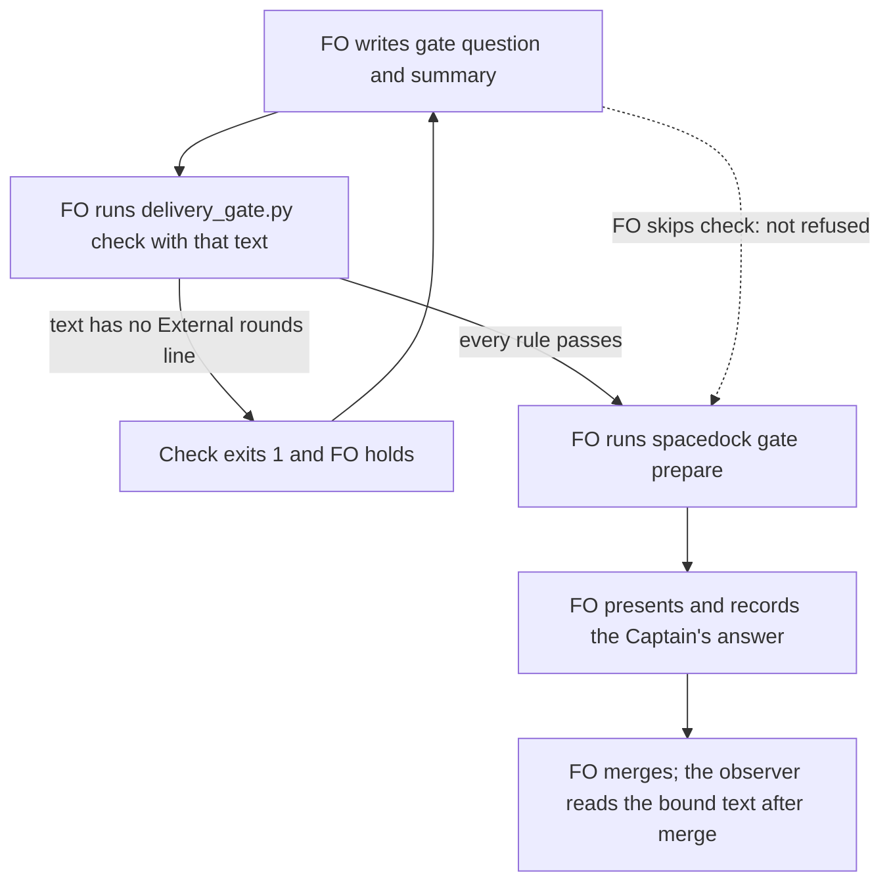

## Scope

- Source: Batch 12 backlog sitting: the Captain 「可以，但不用寫了就報錯，接受 `max` 和 `ultra`沒關係，等於就是不建議，但使用者真的想要也可以」 (chat, 2026-11-02), answering 「決定：五件事都照建議，第 5 項用這張表，並把 xhigh 上限寫進設定檔檢查，可以嗎？」, item 2: 開候選「`gate prepare` 要先擋下沒跑 `delivery_gate question` 的情況」.
- Bite: batch 11, 2026-11-01. FO bound four validation briefings without running `delivery_gate.py question`, and bound #757's on text that had failed it. Only the observers found this, after merge (`_archive/*/observer.md`).
- Consumer: every FO binding a validation gate.
- Upstream first: `spacedock gate prepare` is engine-owned, so check Spacedock first and say what it offers; `scripts/delivery_gate.py`, `scripts/laws_check.py`, `references/sd/workflow.md`.

## Non-goals

- A Spacedock change from this repository; reading the verdict.

## Budget

- One package PR. Workflow word budget unchanged unless the design names a raise for the Captain.

## Stop condition

- A replay of the batch 11 sequence is refused or reported at or before binding, by a check that runs at that moment. If no package seam can run then, stop and return that to FO with the nearest available moment.
- Fired at ideation: no package seam runs at binding. The Captain accepted the nearest moment, `check`, in the revise of 2026-11-02.

## FO alignment

Alignment: needed before ideation; the scope is the Captain's ruling.
Result: aligned at backlog: Batch 12 backlog sitting: the Captain 「可以，但不用寫了就報錯，接受 `max` 和 `ultra`沒關係，等於就是不建議，但使用者真的想要也可以」 (chat, 2026-11-02), answering 「決定：五件事都照建議，第 5 項用這張表，並把 xhigh 上限寫進設定檔檢查，可以嗎？」, approved the outcome and bounds in this file.
Surfaces: none
Visible change: none
Release review: not needed: workflow maintenance, on no journey map.

## Design

Proposed title, for FO to set in frontmatter (the slug stays): "The merge-ask check holds a gate text with no external round count".

**`delivery_gate.py check` holds a gate text with no `External rounds:` line; nothing refuses a binding.** No package seam is verified at the binding moment, and `check`, which FO ran 3 to 24 seconds before six of the seven batch 11 bindings, is the nearest. The Captain accepted this as enough for now (D1).

### PRFAQ

**Proposition.** When FO runs `delivery_gate.py check` on a gate text with no `External rounds:` line, the check holds, so that text does not reach `spacedock gate prepare` in the order batch 11 used.

- *What did batch 11 actually do?* It ran `check`, then bound the text. Each of the four text defects passed `check` because `check` lacks the one rule that `question --summary-file` applies.
- *Does this refuse at binding?* No. Nothing in the package runs at binding (see Chain check). An FO that binds first, or never runs `check`, is not refused; the observer still finds it after merge.
- *Why not read the bound briefing in `check`?* In 6 of 7 bindings `check` ran before the briefing existed, and `merge/` shows no second `check` after any of those bindings, so it would have nothing to read.

### Chain check (read 2026-11-02)

- **Spacedock 0.27.2 binary, plugin source 0.27.3: no seam.** `Prepare` in `internal/gates/prepare.go` runs no external command, and takes question and summary as arguments. Mod hooks are `startup`, `idle` and `merge` only (`first-officer-shared-core.md` § Mod Hook Convention). `fo-gate-lifecycle` runs prepare, state commit, status read and presentation with no package script between them. `gh issue list -R spacedock-dev/spacedock --search "gate prepare hook"` found no request for one.
- **kc-dev-flow-2 0.34.0, `origin/main` 146727de: repair `check`.** `question` holds `summary_round_problems`; `check` shares the other text and reviewer rules but not this one. The package ships no hook.
- **Siblings: nothing to borrow.** `git grep "gate prepare"` over `.claude`, `.codex`, `scripts` and `hooks` found nothing in subspace-relay, subspace-web or qnow; carlove-v1 is not checked out here.

### Measurement (state branch 99e8bb36, package 0.34.0)

Each row replays the question and summary bound in that briefing's `index.json`. "Check time" is `time` in `merge/ask-*.json`.

| Briefing | Bound (UTC) | Check time (UTC) | `question --summary-file` | Combined text, as `check` reads it | Rounds line |
| --- | --- | --- | --- | --- | --- |
| batch10-after-release-obligations 1 | 07:38:14 | 07:37:50 | exit 1 | exit 0 | missing |
| peers-paseo-rule-matches-practice 1 | 07:38:20 | 07:38:01 | exit 1 | exit 0 | missing |
| names-check-says-what-it-skipped 1 | 07:39:41 | 07:39:26 | exit 1 | exit 0 | missing |
| peer-status-reaches-fresh 1 | 07:39:47 | 07:39:33 | exit 1 | exit 0 | missing |
| paseo-human-surfaces 1 (#757) | 09:47:26 | none before it | exit 1 | exit 1 | present |
| paseo-human-surfaces 2 (#757) | 09:48:03 | 09:48:00 | exit 0 | exit 0 | present |
| model-roster-per-repo 1 | 10:07:14 | 10:07:11 | exit 0 | exit 0 | present |

What this settles:

- **The four defects share one cause.** `check` passed text that had no rounds line. The combined `question` form passes it too, so the state cannot tell whether FO skipped `question` or ran it without `--summary-file`. The Scope's "without running" is therefore not provable; the bound text is.
- **`check` read the text that was bound, on the part that can be compared.** The `sufficiency` and `necessity` values saved in all six `merge/ask-*.json` files appear in the bound text.
- **#757 briefing 1 is a different sequence.** FO bound it before any `check`, then withdrew it 27 seconds later with the reason "bound text failed the delivery question check". Today's `check` already refuses that text, so this design adds nothing for it.
- **An idle check would have come too late.** Six of the seven attempts were recorded as approved 23 to 36 seconds after binding, and the seventh was withdrawn in 27; `fo-gate-lifecycle` has no idle step in that pass.

### The change

`check` applies `summary_round_problems` to `outside_fences(gate_text)` and adds its problem and one `next:` line to the existing problem list. Existing-code check: this reuses the function `question` already has and adds no command, file format or stage. `references/sd/workflow.md` already tells FO to give `check` the "question and summary", so the line is in the text FO is told to supply.

Files: `kc-dev-flow-2/scripts/delivery_gate.py` (`check` and one docstring sentence), `kc-dev-flow-2/scripts/test_delivery_gate.py`, and one ADR. No change to `question`, `pr_watch.py`, `references/sd/workflow.md` or any mod.

Existing `check` tests change too, a cost the first design missed. Trial on a throwaway copy of `origin/main` 146727de, 2026-11-02: at base `test_delivery_gate.py` gave 7 errors of 119 tests in that copy, cause not read, so implementation reruns the suite in a real worktree; with the rule, 76 tests failed or errored; adding the line to the shared `CLAUSES` fixture left those 7 errors and 6 failing tests that write their own text. Because `question` tests share `CLAUSES`, the implementation adds the line in the `check` helpers instead, so the `question` tests keep their inputs.

ADR to land, short title "The merge-ask check requires the round count". It amends ADR 0044's "merge checks stay as before" and records the bound claim: `check` reads the text FO supplies, before binding in the observed order, and neither forces that order nor reads the bound briefing.

### Rejected

- **Claude or Codex host hook on `gate prepare`: not designed here; proposed for a POC.** It is the only route to the binding moment itself, and it could read the bound briefing from the `room=` line prepare prints. Claude's docs say `PostToolUse` `decision: "block"` shows its `reason` beside the tool result but cannot undo the call. Codex's docs say plugin hooks exist but each needs the user's trust, while `codex features list` on 0.162.1 prints `plugin_hooks removed false`. Neither host is proven here: a throwaway `claude -p` probe was denied by the auto-mode permission classifier and not retried. Filtering in a shell script before starting Python cost about 9 ms per call against 360 ms for `python3` through this machine's pyenv shim. It would be the package's first hook; ADR 0003 rejected one for secret reads, and its reopen condition ("if Codex gains a pre-tool hook") appears to have fired. `merge-guard-stops-unasked-merges` already owes the same class of POC.
- **`pr_watch.py tasks` replay at idle:** no idle fits the measured pass above.
- **State-law check on push (`laws_check.py`):** it runs after the binding, in CI, and blocks nothing.
- **Git hook on the state checkout:** `spacedock state commit` runs a plain `git commit` so a hook would fire, but it is per-clone setup that the package cannot deliver.
- **A receipt that `question` ran:** replaying text already answers the question, and a receipt would prove only that a command ran.

### Words FO reads at each moment

Counted with `wc -w`; base is 0.34.0.

| Moment | Source | Base | Candidate |
| --- | --- | --- | --- |
| Startup; idle on an open PR; idle on a merged PR; after the archive | workflow README, `pr_watch.py tasks` | unchanged | identical, +0 |
| Before validation `gate prepare` | workflow.md paragraph "Before the validation `gate prepare`" | 41 | identical, +0 |
| Merge ask, text complete | `delivery_gate.py check` output | unchanged | identical, +0 |
| Merge ask, rounds line missing | `delivery_gate.py check` output | no such line | +22: a 10-word problem and a 12-word `next:` line, counted on the trial's text |

Workflow word budget: unchanged, no raise.

### Limits

- An FO that skips `check`, or binds before it, is not refused; the Captain accepted this in D1.
- Presence and form only: the count is not checked for truth (ADR 0044).
- An adopter whose FO text has no rounds line gets a new hold at the merge ask, cleared by adding the line.
- The check runs after the Captain's chat answer when FO asks first, as in the batch 11 sitting; a hold then corrects the bound text, not what he read.

### Batch overlap

Files this design changes: `kc-dev-flow-2/scripts/delivery_gate.py`, `kc-dev-flow-2/scripts/test_delivery_gate.py`, one new file in `docs/adr/`.

- **`second-round-prompts-a-step-back` (batch 12): same function, corrected.** Its design has `check` emit the reminder's `next:` lines after a clean `owed_role_calls`, and it changes `test_delivery_gate.py`. This task's rule sits just before `emit(*problems, *holds)`. A text held here may not show the reminder until the rerun; this rule is unaffected. Its new `check` cases must carry the rounds line once this task lands. The first design's "no shared file" was wrong.
- **`comment-check-reaches-delivery-gate` (other session, ideation): same function.** It changes `check`, `write_record` and `test_delivery_gate.py`; both additions are additive. New `check` cases need the rounds line if it lands after this task.
- **`fo-write-checks-parse-top-level` (same workflow, ideation; outside the dispatch's list):** same script and test file, different function (`declined_items`); no shared lines named.
- **`special-roles-follow-the-model-table` (batch 12):** no file of this design except the ADR index. It changes `role_triggers.py`, which `check` calls; this design leaves that call alone, and its longer `next:` line prints beside this one.
- **ADR index, shared with any task landing a new ADR:** `model-roster-question-needs-both-families`, `special-roles-follow-the-model-table`, `adr-required-statement`, `ops-inbox-r1-setup-and-isolation`. FO reserves the number at dispatch. `second-round-prompts-a-step-back` amends ADR 0026 and takes no number.
- **`worker-completion-reaches-fo-on-paseo`, `picky-reviewers-may-run-on-gemini` (batch 12):** none in their Scopes; neither has a design yet, so FO rechecks when they do.
- **`adoption-asks-which-extensions`, `adr-silent-undo-probe`, `journey-canvas-hosted-poc`, `pr-review-lite-value-pilot`:** none on `delivery_gate.py`, its tests or this rule. `journey-server-host-pilot` has no task file in this workflow's state checkout.

Recommended order: last in batch 12, as the Captain ruled, after `worker-completion-reaches-fo-on-paseo`, `model-roster-question-needs-both-families`, `special-roles-follow-the-model-table`, `second-round-prompts-a-step-back` and `picky-reviewers-may-run-on-gemini`. This task then rebases on their `check` and test edits and gives their new `check` cases the rounds line. His ruling sets no order against `comment-check-reaches-delivery-gate`, which is another session's; whichever of the two lands second rebases.

## Acceptance criteria

**AC-1** `delivery_gate.py check` exits 1 and saves no `merge/ask-N.json` when the text has no top-level `External rounds: N` line, and prints the problem and a `next:` line.
Verified by: a new `test_delivery_gate.py` case on a synthetic text otherwise complete. Falsifier: removing the new `summary_round_problems` call in `check` fails it (mutation run with `python3 -B`).

**AC-2** The same check passes a text carrying the line, including `External rounds: 0` and the `N. detail` form.
Verified by: a new case in the same file. Falsifier: requiring a nonzero count fails it.

**AC-3** Replaying the seven batch 11 briefings gives the same result as the Measurement table: the four rows marked missing hold on the rounds line, #757 briefing 1 holds on its second-reviewer form as it does today, and #757 briefing 2 and model-roster-per-repo gain no problem.
Verified by: the implementer's replay of the question and summary from each `index.json` at state commit `99e8bb36`, recorded in the stage report with the printed lines. Falsifier: running the same replay at the base `check` path shows the four pass.

**AC-4** The real command holds on the real seam: on this task's own PR head, `delivery_gate.py check --pr <its PR>` prints the rounds problem for a text without the line, and does not print it for the same text with the line.
Verified by: both runs at validation, with `gh` reading the real PR. Any other problem the Draft state prints is expected and named.

**AC-5** `question` is unchanged in both forms, and `check`'s output on a complete text is unchanged.
Verified by: the existing `question` tests passing with their inputs unedited, including the legacy combined path that accepts a text with no rounds line, and the existing `check` tests passing with only the rounds line added to their gate text. Falsifier: moving the requirement into `text_problems` fails the legacy test.

**AC-6** `references/sd/workflow.md` and the mods have no diff, and `lint-skills.py` passes with `WORKFLOW_BUDGET_STEPS` unchanged.
Verified by: `git diff --stat origin/main -- kc-dev-flow-2/references/sd/` empty, and the lint run.

**AC-7** The ADR carries the Captain's 「可以」 with the question it answered, 「決定：多開「完成通知」和「挑剔使用者可用 Gemini」兩張票，先前五件事照建議，可以嗎？」, and the Limits above as bounded claims, and `adr_lint.py` passes.
Verified by: the lint run on the candidate.

## Decisions for the Captain

None open.

**D1, settled at the ideation revise of 2026-11-02: yes, the text check at `check` is enough for now.** The original question and its tradeoffs stay below as the record.

**D1. Is stopping the text at `check`, seconds before binding, enough for now, with a separate trial of a host hook for the binding moment itself?** Recommended: yes. His candidate wording was 「`gate prepare` 要先擋下沒跑 `delivery_gate question` 的情況」; this design delivers less than that wording, because `check` is not forced to run first.

- Why: it catches all four text defects in the batch 11 order, works on both hosts, adds no workflow words and fits ADR 0027's rule that FO-write rules live in the script FO already runs at the write.
- What gets worse: an FO that binds first or skips `check` is still found only by the observer after merge, and the merge-ask check gains a hold that ADR 0044 had left out.
- Alternative: hold this task for a hook trial first. That reaches the binding moment on Claude if the trial passes, with Codex depending on the user trusting the hook, at the cost of the package's first hook, one call per Bash command wherever the plugin is enabled, and a defect class that stays open meanwhile.
- Past rulings read: ADR 0027 (followed), ADR 0044 (amended by this), ADR 0003 (its rejection covers secret reads; the hook trial would reopen it). `git grep -n 'Override:'` on the state branch, filtered for hooks, `gate prepare` and the question check, shows no past override against this recommendation.

## Stage Report: ideation

- DONE: A design for this task's Scope: the earliest moment a package check can see a bound validation briefing; read Spacedock's gate prepare and hooks first and report what it offers
  Spacedock runs nothing at binding (`Prepare`, mod hooks `startup`/`idle`/`merge`); nearest verified moment is `delivery_gate.py check`, 3 to 24 seconds before 6 of 7 batch 11 bindings. See `## Design`.
- DONE: A `### Batch overlap` section naming each file the design would change and each other batch task (model-roster-question-needs-both-families, second-round-prompts-a-step-back, validation-gate-requires-the-question-check, special-roles-follow-the-model-table) and live task of other sessions (adoption-asks-which-extensions, adr-required-statement, adr-silent-undo-probe, comment-check-reaches-delivery-gate, journey-canvas-hosted-poc, journey-server-host-pilot, ops-inbox-r1-setup-and-isolation, pr-review-lite-value-pilot (driven by other sessions; read only)) that changes the same file or check, so FO can order implementation
  One direct overlap: `comment-check-reaches-delivery-gate` on `check` and `test_delivery_gate.py`; the ADR index is shared; recommended order is in the section.
- DONE: The words FO reads at each lifecycle moment, before and after, per root learning.md "Measure the words FO reads at each moment, not one file's size"
  +0 at every moment except a failing merge ask, +22 planned there; workflow word budget unchanged.
- DONE: Acceptance criteria with reproducible evidence clauses and falsifiers, and unresolved decisions for the Captain, each with a recommendation and what gets worse under it
  AC-1 to AC-7 and D1; `design_surfaces.py check` printed "design surfaces presentable", exit 0.
- DONE: AC-1 not yet verified; the test and its mutation are future implementation evidence.
  `summary_round_problems` exists in `question`; `check` does not call it at package 0.34.0.
- DONE: AC-2 not yet verified; future implementation test.
  The accepted line forms are read from `summary_round_problems` as it stands.
- DONE: AC-3 not yet verified for the candidate; the base half is measured.
  Replay at state commit 99e8bb36, package 0.34.0: combined path exits 0 on the four rows, exit 1 on #757 briefing 1 with the second-reviewer line.
- DONE: AC-4 not yet verified; needs the candidate's own PR at validation.
  No candidate exists at ideation.
- DONE: AC-5 not yet verified; future test run.
  Replay shows the legacy combined path accepts a text with no rounds line today.
- DONE: AC-6 not yet verified; future diff and lint run.
  The design names no change under `references/sd/`.
- DONE: AC-7 not yet verified; future lint run, and it needs the D1 answer.
  The ADR is named by short title with no number.

### Summary

No package seam is verified at the binding moment, so this returns to FO under the Stop condition with the nearest moment: `check` gains the rounds-line rule that all four batch 11 text defects passed through. The Scope's "without running" is not provable, because the combined `question` form passes the same texts; the fifth case, #757 briefing 1, was bound before any `check` and FO withdrew it in 27 seconds, so this design adds nothing for it. An idle replay and a read of the bound briefing in `check` were both ruled out by the measured order, and D1 asks whether this is enough given the Captain's 「要先擋下」.

Unverified: a host hook. A throwaway `claude -p` probe was denied by the auto-mode permission classifier and not retried. Codex's docs say plugins can bundle hooks, while `codex features list` on 0.162.1 prints `plugin_hooks removed false`, so that POC must settle it.

For FO, outside this task's scope: `references/sd/adoption.md` § Secret reads and ADR 0003 say Codex has no pre-tool hook, while `codex features list` shows `hooks` stable; `merge-guard-stops-unasked-merges` is the natural home for the hook POC if D1 is accepted.

## Stage Report: ideation (cycle 2)

- DONE: Revise the design under the Captain gate revise of 2026-11-02: the asks are in the reason of the newest ideation resolution in this task file; do exactly those asks, and name anything that would go beyond them
  D1 recorded as settled; outcome restated in `## Design`; overlap corrected; order set last. The title is frontmatter, so it is proposed in `## Design` for FO to set. Beyond the asks: the test-cost correction, AC-5's wording and AC-7's exact words, all named in the Summary.
- DONE: A `### Batch overlap` section naming each file the design would change and each other batch task (worker-completion-reaches-fo-on-paseo, model-roster-question-needs-both-families, special-roles-follow-the-model-table, second-round-prompts-a-step-back, validation-gate-requires-the-question-check, picky-reviewers-may-run-on-gemini) and live task of other sessions (adoption-asks-which-extensions, adr-required-statement, adr-silent-undo-probe, comment-check-reaches-delivery-gate, journey-canvas-hosted-poc, journey-server-host-pilot, ops-inbox-r1-setup-and-isolation, pr-review-lite-value-pilot (driven by other sessions; read only)) that changes the same file or check, so FO can order implementation
  `second-round-prompts-a-step-back` and `comment-check-reaches-delivery-gate` share `check` and its tests. `journey-server-host-pilot` has no task file here.
- DONE: The words FO reads at each lifecycle moment, before and after, per root learning.md "Measure the words FO reads at each moment, not one file's size"
  +0 at every moment except a failing merge ask, +22 there, counted with `wc -w` on the trial's two lines; workflow word budget unchanged.
- DONE: Acceptance criteria with reproducible evidence clauses and falsifiers, and unresolved decisions for the Captain, each with a recommendation and what gets worse under it
  AC-1 to AC-7 stand; no decision is open, and D1 stays as the record.
- FAILED: `design_surfaces.py check` passes on this task
  Exit 1, "Scope changed after the backlog gate (1a8b1cb3)": this cycle added two lines to `## Scope`, against that check's rule. FO removes the `- Title for FO to set` and `- Outcome, restated` lines; both are in `## Design`, and no amendment is needed. Not rerun clean.
- DONE: AC-1 not yet verified; future test and mutation.
  The trial's rule ran on a throwaway copy, not a candidate.
- DONE: AC-2 not yet verified; future test.
  The accepted line forms are read from `summary_round_problems` as it stands.
- DONE: AC-3 not yet verified for the candidate; the base half was measured in cycle 1.
  `delivery_gate.py` and its test are unchanged from 146727de, the commit that replay used; `origin/main` is still that commit.
- DONE: AC-4 not yet verified; needs the candidate's own PR at validation.
  No candidate exists at ideation.
- DONE: AC-5 not yet verified; wording corrected because `check` fixtures must change.
  Trial: 76 tests failed or errored with the rule, 13 after a one-line fixture edit, of which 7 also error at base.
- DONE: AC-6 not yet verified; future diff and lint run.
  The design names no change under `references/sd/`.
- DONE: AC-7 not yet verified; future lint run.
  The ADR now has the Captain's words to quote; it stays a short title with no number.

### Summary

The design now says what it delivers: `check` holds a gate text with no round count, and binding is not refused. FO must set the new title in frontmatter, because a worker may not edit it: "The merge-ask check holds a gate text with no external round count".

The gate is not presentable yet, and that is this worker's error: it added two lines to `## Scope`, and `design_surfaces.py check` now exits 1. Its message tells a worker to edit neither Scope nor amendments, so the lines stay for FO to remove; the outcome and title are also in `## Design`, so nothing is lost. After removal, FO reruns the check, which has not been seen to pass in this cycle.

Beyond the four asks: a trial showed the first design missed a cost, since most existing `check` tests would fail until their text carries the line. The design now states that cost and AC-5 allows it; scope is unchanged. Not done and left to FO: filing the host-hook trial that D1's question mentioned. The 7 errors at base in the trial's copy were not diagnosed.
