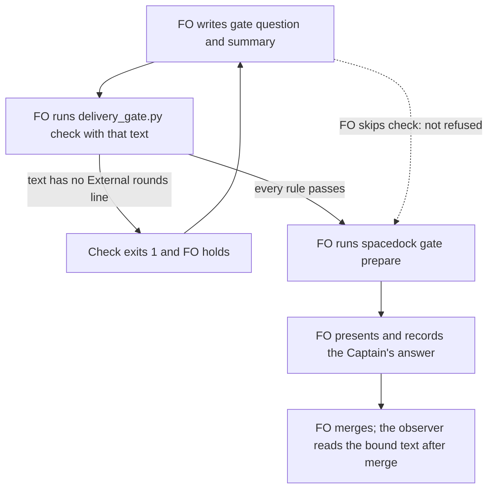

## Scope

- Source: Batch 12 backlog sitting: the Captain 「可以，但不用寫了就報錯，接受 `max` 和 `ultra`沒關係，等於就是不建議，但使用者真的想要也可以」 (chat, 2026-11-02), answering 「決定：五件事都照建議，第 5 項用這張表，並把 xhigh 上限寫進設定檔檢查，可以嗎？」, item 2: 開候選「`gate prepare` 要先擋下沒跑 `delivery_gate question` 的情況」.
- Bite: batch 11, 2026-11-01. FO bound four validation briefings without running `delivery_gate.py question`, and bound #757's on text that had failed it. Only the observers found this, after merge (`_archive/*/observer.md`).
- Consumer: every FO binding a validation gate.
- Upstream first: `spacedock gate prepare` is engine-owned, so check Spacedock first and say what it offers; `scripts/delivery_gate.py`, `scripts/laws_check.py`, `references/sd/workflow.md`.

## Non-goals

- A Spacedock change from this repository; reading the verdict.

## Budget

- One package PR. Workflow word budget unchanged unless the design names a raise for the Captain.

## Stop condition

- A replay of the batch 11 sequence is refused or reported at or before binding, by a check that runs at that moment. If no package seam can run then, stop and return that to FO with the nearest available moment.
- Fired at ideation: no package seam runs at binding. The Captain accepted the nearest moment, `check`, in the revise of 2026-11-02.

## FO alignment

Alignment: needed before ideation; the scope is the Captain's ruling.
Result: aligned at backlog: Batch 12 backlog sitting: the Captain 「可以，但不用寫了就報錯，接受 `max` 和 `ultra`沒關係，等於就是不建議，但使用者真的想要也可以」 (chat, 2026-11-02), answering 「決定：五件事都照建議，第 5 項用這張表，並把 xhigh 上限寫進設定檔檢查，可以嗎？」, approved the outcome and bounds in this file.
Surfaces: none
Visible change: none
Release review: not needed: workflow maintenance, on no journey map.

## Design

Proposed title, for FO to set in frontmatter (the slug stays): "The merge-ask check holds a gate text with no external round count".

**`delivery_gate.py check` holds a gate text with no `External rounds:` line; nothing refuses a binding.** No package seam is verified at the binding moment, and `check`, which FO ran 3 to 24 seconds before six of the seven batch 11 bindings, is the nearest. The Captain accepted this as enough for now (D1).

### PRFAQ

**Proposition.** When FO runs `delivery_gate.py check` on a gate text with no `External rounds:` line, the check holds, so that text does not reach `spacedock gate prepare` in the order batch 11 used.

- *What did batch 11 actually do?* It ran `check`, then bound the text. Each of the four text defects passed `check` because `check` lacks the one rule that `question --summary-file` applies.
- *Does this refuse at binding?* No. Nothing in the package runs at binding (see Chain check). An FO that binds first, or never runs `check`, is not refused; the observer still finds it after merge.
- *Why not read the bound briefing in `check`?* In 6 of 7 bindings `check` ran before the briefing existed, and `merge/` shows no second `check` after any of those bindings, so it would have nothing to read.

### Chain check (read 2026-11-02)

- **Spacedock 0.27.2 binary, plugin source 0.27.3: no seam.** `Prepare` in `internal/gates/prepare.go` runs no external command, and takes question and summary as arguments. Mod hooks are `startup`, `idle` and `merge` only (`first-officer-shared-core.md` § Mod Hook Convention). `fo-gate-lifecycle` runs prepare, state commit, status read and presentation with no package script between them. `gh issue list -R spacedock-dev/spacedock --search "gate prepare hook"` found no request for one.
- **kc-dev-flow-2 0.34.0, `origin/main` 146727de: repair `check`.** `question` holds `summary_round_problems`; `check` shares the other text and reviewer rules but not this one. The package ships no hook.
- **Siblings: nothing to borrow.** `git grep "gate prepare"` over `.claude`, `.codex`, `scripts` and `hooks` found nothing in subspace-relay, subspace-web or qnow; carlove-v1 is not checked out here.

### Measurement (state branch 99e8bb36, package 0.34.0)

Each row replays the question and summary bound in that briefing's `index.json`. "Check time" is `time` in `merge/ask-*.json`.

| Briefing | Bound (UTC) | Check time (UTC) | `question --summary-file` | Combined text, as `check` reads it | Rounds line |
| --- | --- | --- | --- | --- | --- |
| batch10-after-release-obligations 1 | 07:38:14 | 07:37:50 | exit 1 | exit 0 | missing |
| peers-paseo-rule-matches-practice 1 | 07:38:20 | 07:38:01 | exit 1 | exit 0 | missing |
| names-check-says-what-it-skipped 1 | 07:39:41 | 07:39:26 | exit 1 | exit 0 | missing |
| peer-status-reaches-fresh 1 | 07:39:47 | 07:39:33 | exit 1 | exit 0 | missing |
| paseo-human-surfaces 1 (#757) | 09:47:26 | none before it | exit 1 | exit 1 | present |
| paseo-human-surfaces 2 (#757) | 09:48:03 | 09:48:00 | exit 0 | exit 0 | present |
| model-roster-per-repo 1 | 10:07:14 | 10:07:11 | exit 0 | exit 0 | present |

What this settles:

- **The four defects share one cause.** `check` passed text that had no rounds line. The combined `question` form passes it too, so the state cannot tell whether FO skipped `question` or ran it without `--summary-file`. The Scope's "without running" is therefore not provable; the bound text is.
- **`check` read the text that was bound, on the part that can be compared.** The `sufficiency` and `necessity` values saved in all six `merge/ask-*.json` files appear in the bound text.
- **#757 briefing 1 is a different sequence.** FO bound it before any `check`, then withdrew it 27 seconds later with the reason "bound text failed the delivery question check". Today's `check` already refuses that text, so this design adds nothing for it.
- **An idle check would have come too late.** Six of the seven attempts were recorded as approved 23 to 36 seconds after binding, and the seventh was withdrawn in 27; `fo-gate-lifecycle` has no idle step in that pass.

### The change

`check` applies `summary_round_problems` to `outside_fences(gate_text)` and adds its problem and one `next:` line to the existing problem list. Existing-code check: this reuses the function `question` already has and adds no command, file format or stage. `references/sd/workflow.md` already tells FO to give `check` the "question and summary", so the line is in the text FO is told to supply.

Files: `kc-dev-flow-2/scripts/delivery_gate.py` (`check` and one docstring sentence), `kc-dev-flow-2/scripts/test_delivery_gate.py`, and one ADR. No change to `question`, `pr_watch.py`, `references/sd/workflow.md` or any mod.

Existing `check` tests change too, a cost the first design missed. Trial on a throwaway copy of `origin/main` 146727de, 2026-11-02: at base `test_delivery_gate.py` gave 7 errors of 119 tests in that copy, cause not read, so implementation reruns the suite in a real worktree; with the rule, 76 tests failed or errored; adding the line to the shared `CLAUSES` fixture left those 7 errors and 6 failing tests that write their own text. Because `question` tests share `CLAUSES`, the implementation adds the line in the `check` helpers instead, so the `question` tests keep their inputs.

ADR to land, short title "The merge-ask check requires the round count". It amends ADR 0044's "merge checks stay as before" and records the bound claim: `check` reads the text FO supplies, before binding in the observed order, and neither forces that order nor reads the bound briefing.

### Rejected

- **Claude or Codex host hook on `gate prepare`: not designed here; proposed for a POC.** It is the only route to the binding moment itself, and it could read the bound briefing from the `room=` line prepare prints. Claude's docs say `PostToolUse` `decision: "block"` shows its `reason` beside the tool result but cannot undo the call. Codex's docs say plugin hooks exist but each needs the user's trust, while `codex features list` on 0.162.1 prints `plugin_hooks removed false`. Neither host is proven here: a throwaway `claude -p` probe was denied by the auto-mode permission classifier and not retried. Filtering in a shell script before starting Python cost about 9 ms per call against 360 ms for `python3` through this machine's pyenv shim. It would be the package's first hook; ADR 0003 rejected one for secret reads, and its reopen condition ("if Codex gains a pre-tool hook") appears to have fired. `merge-guard-stops-unasked-merges` already owes the same class of POC.
- **`pr_watch.py tasks` replay at idle:** no idle fits the measured pass above.
- **State-law check on push (`laws_check.py`):** it runs after the binding, in CI, and blocks nothing.
- **Git hook on the state checkout:** `spacedock state commit` runs a plain `git commit` so a hook would fire, but it is per-clone setup that the package cannot deliver.
- **A receipt that `question` ran:** replaying text already answers the question, and a receipt would prove only that a command ran.

### Words FO reads at each moment

Counted with `wc -w`; base is 0.34.0.

| Moment | Source | Base | Candidate |
| --- | --- | --- | --- |
| Startup; idle on an open PR; idle on a merged PR; after the archive | workflow README, `pr_watch.py tasks` | unchanged | identical, +0 |
| Before validation `gate prepare` | workflow.md paragraph "Before the validation `gate prepare`" | 41 | identical, +0 |
| Merge ask, text complete | `delivery_gate.py check` output | unchanged | identical, +0 |
| Merge ask, rounds line missing | `delivery_gate.py check` output | no such line | +22: a 10-word problem and a 12-word `next:` line, counted on the trial's text |

Workflow word budget: unchanged, no raise.

### Limits

- An FO that skips `check`, or binds before it, is not refused; the Captain accepted this in D1.
- Presence and form only: the count is not checked for truth (ADR 0044).
- An adopter whose FO text has no rounds line gets a new hold at the merge ask, cleared by adding the line.
- The check runs after the Captain's chat answer when FO asks first, as in the batch 11 sitting; a hold then corrects the bound text, not what he read.

### Batch overlap

Files this design changes: `kc-dev-flow-2/scripts/delivery_gate.py`, `kc-dev-flow-2/scripts/test_delivery_gate.py`, one new file in `docs/adr/`.

- **`second-round-prompts-a-step-back` (batch 12): same function, corrected.** Its design has `check` emit the reminder's `next:` lines after a clean `owed_role_calls`, and it changes `test_delivery_gate.py`. This task's rule sits just before `emit(*problems, *holds)`. A text held here may not show the reminder until the rerun; this rule is unaffected. Its new `check` cases must carry the rounds line once this task lands. The first design's "no shared file" was wrong.
- **`comment-check-reaches-delivery-gate` (other session, ideation): same function.** It changes `check`, `write_record` and `test_delivery_gate.py`; both additions are additive. New `check` cases need the rounds line if it lands after this task.
- **`fo-write-checks-parse-top-level` (same workflow, ideation; outside the dispatch's list):** same script and test file, different function (`declined_items`); no shared lines named.
- **`special-roles-follow-the-model-table` (batch 12):** no file of this design except the ADR index. It changes `role_triggers.py`, which `check` calls; this design leaves that call alone, and its longer `next:` line prints beside this one.
- **ADR index, shared with any task landing a new ADR:** `model-roster-question-needs-both-families`, `special-roles-follow-the-model-table`, `adr-required-statement`, `ops-inbox-r1-setup-and-isolation`. FO reserves the number at dispatch. `second-round-prompts-a-step-back` amends ADR 0026 and takes no number.
- **`worker-completion-reaches-fo-on-paseo`, `picky-reviewers-may-run-on-gemini` (batch 12):** none in their Scopes; neither has a design yet, so FO rechecks when they do.
- **`adoption-asks-which-extensions`, `adr-silent-undo-probe`, `journey-canvas-hosted-poc`, `pr-review-lite-value-pilot`:** none on `delivery_gate.py`, its tests or this rule. `journey-server-host-pilot` has no task file in this workflow's state checkout.

Recommended order: last in batch 12, as the Captain ruled, after `worker-completion-reaches-fo-on-paseo`, `model-roster-question-needs-both-families`, `special-roles-follow-the-model-table`, `second-round-prompts-a-step-back` and `picky-reviewers-may-run-on-gemini`. This task then rebases on their `check` and test edits and gives their new `check` cases the rounds line. His ruling sets no order against `comment-check-reaches-delivery-gate`, which is another session's; whichever of the two lands second rebases.

## Acceptance criteria

**AC-1** `delivery_gate.py check` exits 1 and saves no `merge/ask-N.json` when the text has no top-level `External rounds: N` line, and prints the problem and a `next:` line.
Verified by: a new `test_delivery_gate.py` case on a synthetic text otherwise complete. Falsifier: removing the new `summary_round_problems` call in `check` fails it (mutation run with `python3 -B`).

**AC-2** The same check passes a text carrying the line, including `External rounds: 0` and the `N. detail` form.
Verified by: a new case in the same file. Falsifier: requiring a nonzero count fails it.

**AC-3** Replaying the seven batch 11 briefings gives the same result as the Measurement table: the four rows marked missing hold on the rounds line, #757 briefing 1 holds on its second-reviewer form as it does today, and #757 briefing 2 and model-roster-per-repo gain no problem.
Verified by: the implementer's replay of the question and summary from each `index.json` at state commit `99e8bb36`, recorded in the stage report with the printed lines. Falsifier: running the same replay at the base `check` path shows the four pass.

**AC-4** The real command holds on the real seam: on this task's own PR head, `delivery_gate.py check --pr <its PR>` prints the rounds problem for a text without the line, and does not print it for the same text with the line.
Verified by: both runs at validation, with `gh` reading the real PR. Any other problem the Draft state prints is expected and named.

**AC-5** `question` is unchanged in both forms, and `check`'s output on a complete text is unchanged.
Verified by: the existing `question` tests passing with their inputs unedited, including the legacy combined path that accepts a text with no rounds line, and the existing `check` tests passing with only the rounds line added to their gate text. Falsifier: moving the requirement into `text_problems` fails the legacy test.

**AC-6** `references/sd/workflow.md` and the mods have no diff, and `lint-skills.py` passes with `WORKFLOW_BUDGET_STEPS` unchanged.
Verified by: `git diff --stat origin/main -- kc-dev-flow-2/references/sd/` empty, and the lint run.

**AC-7** The ADR carries the Captain's 「可以」 with the question it answered, 「決定：多開「完成通知」和「挑剔使用者可用 Gemini」兩張票，先前五件事照建議，可以嗎？」, and the Limits above as bounded claims, and `adr_lint.py` passes.
Verified by: the lint run on the candidate.

## Decisions for the Captain

None open.

**D1, settled at the ideation revise of 2026-11-02: yes, the text check at `check` is enough for now.** The original question and its tradeoffs stay below as the record.

**D1. Is stopping the text at `check`, seconds before binding, enough for now, with a separate trial of a host hook for the binding moment itself?** Recommended: yes. His candidate wording was 「`gate prepare` 要先擋下沒跑 `delivery_gate question` 的情況」; this design delivers less than that wording, because `check` is not forced to run first.

- Why: it catches all four text defects in the batch 11 order, works on both hosts, adds no workflow words and fits ADR 0027's rule that FO-write rules live in the script FO already runs at the write.
- What gets worse: an FO that binds first or skips `check` is still found only by the observer after merge, and the merge-ask check gains a hold that ADR 0044 had left out.
- Alternative: hold this task for a hook trial first. That reaches the binding moment on Claude if the trial passes, with Codex depending on the user trusting the hook, at the cost of the package's first hook, one call per Bash command wherever the plugin is enabled, and a defect class that stays open meanwhile.
- Past rulings read: ADR 0027 (followed), ADR 0044 (amended by this), ADR 0003 (its rejection covers secret reads; the hook trial would reopen it). `git grep -n 'Override:'` on the state branch, filtered for hooks, `gate prepare` and the question check, shows no past override against this recommendation.

## Number guards

ADR: 0051

## Captain amendments

### Amendment 1 — 2026-11-02, chat
Captain: 「照建議」 (chat, 2026-11-02)
Asked: 「決定：四件事都照建議嗎？要改哪件直接說。」, which FO had stated as: 「#765、#767 的條件不放寬，等前面合併後再驗」
Supersedes: none

## Stage Report: ideation

- DONE: A design for this task's Scope: the earliest moment a package check can see a bound validation briefing; read Spacedock's gate prepare and hooks first and report what it offers
  Spacedock runs nothing at binding (`Prepare`, mod hooks `startup`/`idle`/`merge`); nearest verified moment is `delivery_gate.py check`, 3 to 24 seconds before 6 of 7 batch 11 bindings. See `## Design`.
- DONE: A `### Batch overlap` section naming each file the design would change and each other batch task (model-roster-question-needs-both-families, second-round-prompts-a-step-back, validation-gate-requires-the-question-check, special-roles-follow-the-model-table) and live task of other sessions (adoption-asks-which-extensions, adr-required-statement, adr-silent-undo-probe, comment-check-reaches-delivery-gate, journey-canvas-hosted-poc, journey-server-host-pilot, ops-inbox-r1-setup-and-isolation, pr-review-lite-value-pilot (driven by other sessions; read only)) that changes the same file or check, so FO can order implementation
  One direct overlap: `comment-check-reaches-delivery-gate` on `check` and `test_delivery_gate.py`; the ADR index is shared; recommended order is in the section.
- DONE: The words FO reads at each lifecycle moment, before and after, per root learning.md "Measure the words FO reads at each moment, not one file's size"
  +0 at every moment except a failing merge ask, +22 planned there; workflow word budget unchanged.
- DONE: Acceptance criteria with reproducible evidence clauses and falsifiers, and unresolved decisions for the Captain, each with a recommendation and what gets worse under it
  AC-1 to AC-7 and D1; `design_surfaces.py check` printed "design surfaces presentable", exit 0.
- DONE: AC-1 not yet verified; the test and its mutation are future implementation evidence.
  `summary_round_problems` exists in `question`; `check` does not call it at package 0.34.0.
- DONE: AC-2 not yet verified; future implementation test.
  The accepted line forms are read from `summary_round_problems` as it stands.
- DONE: AC-3 not yet verified for the candidate; the base half is measured.
  Replay at state commit 99e8bb36, package 0.34.0: combined path exits 0 on the four rows, exit 1 on #757 briefing 1 with the second-reviewer line.
- DONE: AC-4 not yet verified; needs the candidate's own PR at validation.
  No candidate exists at ideation.
- DONE: AC-5 not yet verified; future test run.
  Replay shows the legacy combined path accepts a text with no rounds line today.
- DONE: AC-6 not yet verified; future diff and lint run.
  The design names no change under `references/sd/`.
- DONE: AC-7 not yet verified; future lint run, and it needs the D1 answer.
  The ADR is named by short title with no number.

### Summary

No package seam is verified at the binding moment, so this returns to FO under the Stop condition with the nearest moment: `check` gains the rounds-line rule that all four batch 11 text defects passed through. The Scope's "without running" is not provable, because the combined `question` form passes the same texts; the fifth case, #757 briefing 1, was bound before any `check` and FO withdrew it in 27 seconds, so this design adds nothing for it. An idle replay and a read of the bound briefing in `check` were both ruled out by the measured order, and D1 asks whether this is enough given the Captain's 「要先擋下」.

Unverified: a host hook. A throwaway `claude -p` probe was denied by the auto-mode permission classifier and not retried. Codex's docs say plugins can bundle hooks, while `codex features list` on 0.162.1 prints `plugin_hooks removed false`, so that POC must settle it.

For FO, outside this task's scope: `references/sd/adoption.md` § Secret reads and ADR 0003 say Codex has no pre-tool hook, while `codex features list` shows `hooks` stable; `merge-guard-stops-unasked-merges` is the natural home for the hook POC if D1 is accepted.

## Stage Report: ideation (cycle 2)

- DONE: Revise the design under the Captain gate revise of 2026-11-02: the asks are in the reason of the newest ideation resolution in this task file; do exactly those asks, and name anything that would go beyond them
  D1 recorded as settled; outcome restated in `## Design`; overlap corrected; order set last. The title is frontmatter, so it is proposed in `## Design` for FO to set. Beyond the asks: the test-cost correction, AC-5's wording and AC-7's exact words, all named in the Summary.
- DONE: A `### Batch overlap` section naming each file the design would change and each other batch task (worker-completion-reaches-fo-on-paseo, model-roster-question-needs-both-families, special-roles-follow-the-model-table, second-round-prompts-a-step-back, validation-gate-requires-the-question-check, picky-reviewers-may-run-on-gemini) and live task of other sessions (adoption-asks-which-extensions, adr-required-statement, adr-silent-undo-probe, comment-check-reaches-delivery-gate, journey-canvas-hosted-poc, journey-server-host-pilot, ops-inbox-r1-setup-and-isolation, pr-review-lite-value-pilot (driven by other sessions; read only)) that changes the same file or check, so FO can order implementation
  `second-round-prompts-a-step-back` and `comment-check-reaches-delivery-gate` share `check` and its tests. `journey-server-host-pilot` has no task file here.
- DONE: The words FO reads at each lifecycle moment, before and after, per root learning.md "Measure the words FO reads at each moment, not one file's size"
  +0 at every moment except a failing merge ask, +22 there, counted with `wc -w` on the trial's two lines; workflow word budget unchanged.
- DONE: Acceptance criteria with reproducible evidence clauses and falsifiers, and unresolved decisions for the Captain, each with a recommendation and what gets worse under it
  AC-1 to AC-7 stand; no decision is open, and D1 stays as the record.
- FAILED: `design_surfaces.py check` passes on this task
  Exit 1, "Scope changed after the backlog gate (1a8b1cb3)": this cycle added two lines to `## Scope`, against that check's rule. FO removes the `- Title for FO to set` and `- Outcome, restated` lines; both are in `## Design`, and no amendment is needed. Not rerun clean.
- DONE: AC-1 not yet verified; future test and mutation.
  The trial's rule ran on a throwaway copy, not a candidate.
- DONE: AC-2 not yet verified; future test.
  The accepted line forms are read from `summary_round_problems` as it stands.
- DONE: AC-3 not yet verified for the candidate; the base half was measured in cycle 1.
  `delivery_gate.py` and its test are unchanged from 146727de, the commit that replay used; `origin/main` is still that commit.
- DONE: AC-4 not yet verified; needs the candidate's own PR at validation.
  No candidate exists at ideation.
- DONE: AC-5 not yet verified; wording corrected because `check` fixtures must change.
  Trial: 76 tests failed or errored with the rule, 13 after a one-line fixture edit, of which 7 also error at base.
- DONE: AC-6 not yet verified; future diff and lint run.
  The design names no change under `references/sd/`.
- DONE: AC-7 not yet verified; future lint run.
  The ADR now has the Captain's words to quote; it stays a short title with no number.

### Summary

The design now says what it delivers: `check` holds a gate text with no round count, and binding is not refused. FO must set the new title in frontmatter, because a worker may not edit it: "The merge-ask check holds a gate text with no external round count".

The gate is not presentable yet, and that is this worker's error: it added two lines to `## Scope`, and `design_surfaces.py check` now exits 1. Its message tells a worker to edit neither Scope nor amendments, so the lines stay for FO to remove; the outcome and title are also in `## Design`, so nothing is lost. After removal, FO reruns the check, which has not been seen to pass in this cycle.

Beyond the four asks: a trial showed the first design missed a cost, since most existing `check` tests would fail until their text carries the line. The design now states that cost and AC-5 allows it; scope is unchanged. Not done and left to FO: filing the host-hook trial that D1's question mentioned. The 7 errors at base in the trial's copy were not diagnosed.

## Stage Report: implementation

- DONE: Implement the approved design and acceptance criteria in only the files its implementation section names; no version bump.
  Candidate `2b471f41497483b32397a8286e494c3797ae9ac1`, branch `spacedock-ensign/validation-gate-requires-the-question-check`, base `6cea11d5ce4c8e3dc0d6711f13233b211fd94668` (PR #766); only delivery_gate.py, test_delivery_gate.py and ADR 0051 changed. Worktree root/branch and clean status verified.
- DONE: ADR 0051 records the ruling the design names, quoting the Captain's words from the task file and its gate records.
  `docs/adr/0051-the-merge-ask-check-requires-the-round-count.md` quotes both 「可以」 with its exact question and 「照建議」 with its question, amends ADR 0044, and records supplied-text, ordering, count-truth and already-answered limits; ADR 0023/0027/0044 remain Accepted at the base.
- DONE: AC-1 missing top-level rounds text holds, prints the problem and next step, and saves no ask record.
  `CheckRoundCountTests.test_missing_fenced_or_malformed_count_holds_without_saving_an_ask` covers absent/fenced/bulleted/invalid/duplicate counts. Removing the new call fails the assertions (mutation exit 1, no import errors).
- DONE: AC-2 zero and count-with-detail forms pass.
  `CheckRoundCountTests.test_zero_and_detail_counts_preserve_the_complete_text_output` accepts 0, 2, 003, 1., 2. detail and 1; detail with unchanged success output and one record; requiring nonzero fails the target assertion.
- DONE: AC-3 replay the seven batch 11 briefing texts from state commit 99e8bb36 and show the base falsifier.
  `python3 -B /tmp/validation-gate-prove.py` uses each index.json question plus artifact summaries, unedited; synthetic task/provider/role controls isolate supplied-text behavior, with the four saved Copilot refusals read from that state commit.
  batch10-after-release-obligations 1, peers-paseo-rule-matches-practice 1, names-check-says-what-it-skipped 1, peer-status-reaches-fresh 1: base 0 -> candidate 1; each prints `summary needs one top-level External rounds: N line (nonnegative integer)` and `next: hold the ask; record the external round count in the summary.`, with no ask record.
  paseo-human-surfaces-visible-and-reachable 1: base 1 -> candidate 1, identical output: `second reviewer declaration must name copilot because <nonempty trigger>, or not triggered`; briefing 2 and model-roster-per-repo 1: 0 -> 0, identical output, no added problem.
- SKIPPED: AC-4 the real command on this task's own PR head, with gh reading its real PR.
  Deferred to validation after FO publishes the Draft PR; this worker has no product push/PR grant. Run both supplied-text forms on that PR; name Draft/base/dispatch or CI holds separately from the new rounds problem.
- DONE: AC-5 question is unchanged in both forms and complete check output is unchanged.
  124 delivery tests pass with existing question inputs unedited; question/text_problems AST equals base and complete check stdout equals base. Moving the new rule into text_problems makes the new legacy-no-count question test fail. All three mutations ran on disposable copies using python3 -B with caches cleared; /tmp/validation-gate-evidence/proof-results.json and mutation logs retain results.
- DONE: AC-6 this change leaves workflow/mods and WORKFLOW_BUDGET_STEPS unchanged; repository skill lint passes.
  `git diff --stat 6cea11d5ce4c8e3dc0d6711f13233b211fd94668 HEAD -- kc-dev-flow-2/references/sd/` is empty; lint-skills.py is unchanged from that base and exits 0. Startup/idle/archive, pre-binding instructions and clean-ask output add 0 words; missing-count output adds 22 (10 problem + 12 next).
- SKIPPED: AC-6's literal empty origin/main reference-document comparison.
  The required stacked base already changes adoption.md (4 lines) and workflow.md (8 lines) versus origin/main; this candidate adds none. Those inherited edits belong to earlier approved PRs, so they were preserved.
- DONE: AC-7 and the required ADR lint on the committed candidate.
  `python3 <package>/scripts/adr_lint.py docs/adr --since 6cea11d5ce4c8e3dc0d6711f13233b211fd94668 --require 0051`: exit 0, 50 ADR files checked, 0 legacy; removing Words/Asked/Recommended or the protected code pointer would fail its structural contract.
- DONE: Run the whole suite the CI job runs before reporting, including the repository lint-skills.py.
  `python3 -B /tmp/validation-gate-run-ci.py`: all 26 commands in .github/workflows/kc-dev-flow-2-tests.yml exit 0, including test_sd_dispatch.py and test_observer_recovery.py; /tmp/validation-gate-evidence/ci-results.json and per-command logs retain output. Baseline delivery suite was 121/121; candidate is 124/124.
- SKIPPED: Exact CI-pinned Spacedock plugin source for the dispatch integration run.
  Installed binary is 0.27.2; --sd-plugin-root used /Users/kent/.codex/plugins/cache/spacedock/spacedock/0.27.3. Fetching pinned 4d158a484ec73e184861067f8ed1e20087fdc26a failed with DNS errors and the GitHub connector also failed. This local run does not prove the pinned-source CI run.
- DONE: Number guards, comment ratio, design surfaces and affected-document checks.
  <package> is /Users/kent/.codex/plugins/cache/kc-claude-plugins/kc-dev-flow-2/0.34.0. number_guards.py check with --repo, --workflow-dir, --task and --base 6cea11d5ce4c8e3dc0d6711f13233b211fd94668: exit 0, PASS no findings; no migrations-path. comment_ratio.py <base> HEAD --workflow-dir <workflow>: exit 0, 38 code lines/1 comment, 2.6%, maximum 5% met. design_surfaces.py check: exit 0, presentable; git diff --check: exit 0.
  doc_impact.py <base> HEAD: ADR 0044 unaffected: immutable historical ruling, explicitly amended by ADR 0051 without changing question compatibility; ADR 0051 updated: the new bounded decision and code pointer. Both listed documents have dispositions.
- SKIPPED: RoboRev evidence= line and hosted CI; FO owns review/publication.
  Ran <package>/extensions/roborev/roborev_gate.py --repo <assigned worktree> --base 6cea11d5ce4c8e3dc0d6711f13233b211fd94668 after committing: exit 3, `incomplete: the roborev daemon is not running`; no clean verdict. No hosted CI read or product push performed. CI cost per PR not measured; workflow triggers unchanged.
- DONE: Commit locally and prepare the PR title/body for FO, stacked on PR #766.
  /tmp/impl-validation-gate-requires-the-question-check-pr.md starts `fix(kc-dev-flow-2): require round counts at merge asks`, names base branch spacedock-ensign/second-round-prompts-a-step-back and exact candidate/base; no product push, reviews, comments, ready mark or merge performed.
- SKIPPED: One Draft PR and every acceptance criterion green.
  FO publishes the prepared candidate, opens the Draft PR, runs its real-PR AC-4 checks and pinned-source CI, and obtains RoboRev evidence. Local implementation proof is complete within this worker's publication boundary; those checks remain unverified.

### Summary

The committed three-file change holds missing-round merge-ask text without altering question compatibility or the workflow budget; seven historical supplied texts and three failing mutations exercise the intended difference. FO still owns publication, the real-PR acceptance runs, exact CI-pinned-source proof and RoboRev; this report grants no delivery or gate approval.

## Stage Report: validation

- DONE: Independent verdict on PR #767 head 6c349421 against every acceptance criterion in the task file, re-running each evidence command and at least one falsifier per criterion yourself, and judging each limit the implementation report states
  REJECTED pending F1/F2 disposition at `6c34942164ecec9452c93f915e36241479f19dc5`; no demonstrated product defect. Evidence and all implementation-limit judgments: [validation-1/details.md](validation-gate-requires-the-question-check/validation-1/details.md).
- DONE: Stacked on PR #766 at its current head. Run the whole suite the CI job runs. Do not start agents you were not asked to
  GitHub confirms base `1c0dbb540f354300b75dba5a119d2614c8fb0c02`; all 26 CI commands exit 0 locally (1021 unittest cases plus integration checks), with pinned Spacedock source `4d158a484ec73e184861067f8ed1e20087fdc26a` and binary 0.27.2; exact-head hosted run 41405823880 is successful. No agents started.
- DONE: A minimal acceptance script the Captain can run (three to six steps, exact commands, expected output), run by you exactly as written in a fresh bash shell, with its observed output; /Users/kent/.claude/plugins/cache/kc-claude-plugins/kc-dev-flow-2/0.34.0/scripts/adr_lint.py docs/adr --since <base> with its exit code; your verdict naming the head, with findings classified by the workflow's Review-finding disposition
  Five steps in [acceptance.sh](validation-gate-requires-the-question-check/validation-1/acceptance.sh), copied in full beside observed output in details.md; fresh `bash --noprofile --norc` exits 0 and reproduces F1. Resolved skill package is `/Users/kent/.codex/plugins/cache/kc-claude-plugins/kc-dev-flow-2/0.34.0`; its `adr_lint.py docs/adr --since 1c0dbb540f354300b75dba5a119d2614c8fb0c02 --require 0051` exits 0, 50 records, 0 legacy.
- DONE: AC-1 missing, fenced, bulleted, invalid or duplicate round counts hold without an ask record.
  Candidate delivery suite passes 124 tests; removing the new call fails the count assertions with no import error (`AC-1-remove-call.log`).
- DONE: AC-2 zero and count-with-detail forms pass without changing complete-check output.
  Tested 0, 2, 003, 1., 2. detail and 1; detail; forcing nonzero counts fails the zero case (`AC-2-require-nonzero.log`).
- DONE: AC-3 all seven state-99e8bb36 briefing texts replay with the specified verdicts.
  Four missing-count texts change base 0 to candidate 1 with the count problem and no record; #757 briefing 1 stays 1 for its reviewer form, briefing 2 and model-roster stay 0 with identical stdout; `proof-results.json` records the base falsifier and fixture controls.
- DONE: AC-4 the real command reads this PR through gh and distinguishes the two supplied texts.
  Both exit 1 for Draft and non-trunk base; only missing-count text prints the rounds problem/next line. A removed-call copy loses that problem on the same real PR (`live-missing.log`, `live-present.log`, `live-no-count-rule.log`); no ask record was saved.
- DONE: AC-5 question compatibility and complete-check output are unchanged.
  Base/candidate question and text_problems syntax trees match, complete stdout matches, and existing question inputs are unchanged; moving the rule into text_problems fails the legacy no-count question (`AC-5-move-to-text-problems.log`).
- FAILED: AC-6's literal empty origin/main reference-document comparison.
  Current trunk `146727ded0d4ce8014ea0b41a45dc3409d6b269b` shows inherited adoption.md (4 lines) and workflow.md (8 lines); stacked-base diff is empty, WORKFLOW_BUDGET_STEPS is unchanged, and lint passes at 5781 words. Adding one word in a disposable copy fails lint at 5782; see F1.
- DONE: AC-7 the decision record includes the exact Captain answer/question and all four bounded limits.
  ADR lint exits 0; removing Words, Recommended or its code pointer fails. Contrary to the implementation report, removing Asked alone passes lint: the exact question and limits were therefore manually checked against this task, not inferred from lint (`extra-probes.json`).
- DONE: Required number, comment, document, surface and dispatch checks were exercised and their results retained.
  Number guard 0, comment ratio 38 code/1 comment = 2.6% within 5%, design surfaces 0, diff-check 0; ADR 0044 unaffected as a historical ruling amended by updated ADR 0051. Installed dispatch checker exits 1 while candidate checker exits 0 for all four records; see F2 and `checks.json`.
- SKIPPED: A clean RoboRev verdict and delivery readiness.
  Exact-head RoboRev attempt exits 3: `incomplete: the roborev daemon is not running`; FO owns review. PR remains Draft/stacked; no product push, review request, comment, ready mark or merge. CI cost per PR not measured; CI definitions/triggers unchanged.

### Summary

The supplied-text change is sufficient for the accepted nearest-check boundary and each of its three changed files is necessary for the rule, counterexamples or decision record; it does not enforce binding order or truthful review counts. Validation remains REJECTED for the two explicit dispositions below, with no proposed product repair; the full suite, real GitHub seam and historical replay pass.

- F1 Needs decision: `value-ac[AC-6]` explicitly names an empty origin/main diff while this dispatch requires a stack containing approved parent workflow edits; the actual diff is nonempty, although this task adds none. Recommend FO resolve the accepted baseline wording through the existing scope/ruling route, preserving parent work; do not silently count the literal criterion as passed.
- F2 Needs decision: the required installed 0.34.0 dispatch checker rejects implementation-1.md and validation-1.md for lacking a main-recipient line, while their exact final-reply wording is explicitly authorized here and accepted by the candidate checker inherited from PR #763. Recommend FO record the checker-version disposition; no record rewrite or plugin update was performed. Detailed normal-workflow, impact, boundary and trigger fields for both findings are in details.md.

## Stage Report: validation

- DONE: Independent verdict on PR #767 head 6b680cf8 against every acceptance criterion in the task file, re-running each evidence command and at least one falsifier per criterion yourself, and judging each limit the implementation report states
  PASSED, cycle 2, head `6b680cf89125d75f062ecf198e37b13239cd16ea`, fetched main `820a3f0ef7db1e802f99c13d1608b4c849f400cf`; all seven criteria and implementation limits are assessed in [validation-2/details.md](validation-gate-requires-the-question-check/validation-2/details.md).
- DONE: This rerun's ruling is Captain amendment 1 in the task file, which keeps the criteria and rechecks after the parents merged: all four parents are merged and this head contains main. Re-judge F1 and F2 of validation-1 and run the whole suite CI runs. Do not start agents you were not asked to
  Amendment commit `163fa1181` follows prior report `189ccfb2c`; its criteria remain intact. GitHub and ancestry confirm all four parent merges. All 26 CI commands pass (1024 cases, seven skips), with pinned Spacedock source `4d158a48`; no agents started.
- DONE: A minimal acceptance script the Captain can run (three to six steps, exact commands, expected output), run by you exactly as written in a fresh bash shell, with its observed output; /Users/kent/.claude/plugins/cache/kc-claude-plugins/kc-dev-flow-2/0.34.0/scripts/adr_lint.py docs/adr --since <base> with its exit code; your verdict naming the head, with findings classified by the workflow's Review-finding disposition
  Five-step [acceptance.sh](validation-gate-requires-the-question-check/validation-2/acceptance.sh) ran unchanged under fresh `/bin/bash --noprofile --norc`, exit 0; full commands/output in details.md. Resolved skill root is the .codex 0.34.0 package; its ADR lint with `--since 820a3f0ef7db1e802f99c13d1608b4c849f400cf --require 0051` exits 0, 50 records, 0 legacy.
- DONE: AC-1 missing, fenced, bulleted, malformed and duplicate round counts hold without saving an ask.
  The 124 delivery tests pass; removing the new call fails the count assertions with exit 1 and no import errors (`AC-1-remove-call.log`).
- DONE: AC-2 zero and supported count-with-detail forms pass.
  Zero, integer, leading-zero and detail forms save one record and retain complete stdout; requiring nonzero fails the zero assertion (`AC-2-require-nonzero.log`).
- DONE: AC-3 all seven historical briefing texts give the accepted results.
  Four missing-count texts change main 0 to candidate 1/no record; the invalid reviewer stays 1 and the other two stay 0 with identical output. Historical text is unedited; provider/history/role controls are fixtures (`proof-results.json`).
- DONE: AC-4 real gh reads PR #767 and the actual command distinguishes the two supplied texts.
  Detached actual task-state snapshot: missing exits 1/zero asks; present exits 0/one ask; removed-call control exits 0 with missing text. PR is now ready/main, so no Draft/stack hold; success remains an ask classification, not approval (`live-results.json`).
- DONE: AC-5 question compatibility and complete-check stdout are unchanged.
  question/text_problems syntax trees equal main, existing question inputs remain unchanged, and complete stdout equals main; moving the requirement into text_problems fails legacy no-count question (`AC-5-move-to-text-problems.log`).
- DONE: AC-6 and prior F1's literal origin/main comparison now pass without a waiver.
  Workflow/mod and lint-script diffs against fetched main are empty; lint passes at 5781/5781 words. One extra workflow word fails at 5782 (`AC6-added-workflow-word.log`); prior Needs decision F1 is resolved.
- DONE: AC-7 the ADR carries the exact Captain answer/question and all four bounded limits.
  Manual source comparison and required lint pass. Removing Words, Recommended or the code pointer fails; removing Asked alone passes, contrary to implementation's lint claim, so lint was not treated as proof of exact wording (`extra-probes.json`).
- DONE: Prior F2 is resolved by the required installed dispatch check.
  Installed and candidate checkers both exit 0, five records complete; installed dispatch_records.py is byte-identical to current main and candidate (`identity.json`). No package update or record rewrite was done here.
- DONE: Number guards, comment ratio, document impact, design surfaces, dispatch authority and diff checks pass.
  All exit 0; 38 code/1 comment = 2.6%, within 5%. ADR 0044 unaffected as the historical decision amended by updated ADR 0051; the only added comment is its required pointer (`checks.json`).
- DONE: Exact-head hosted CI and accepted proof limits were checked.
  [Run 41567649139](https://github.com/iamcxa/kc-claude-plugins/actions/runs/41567649139) succeeds including pinned install/integrations. Supplied-text/order/count-truth/chat-answer limits remain accurate; standing and clean-output words add 0, missing-count output adds 22. CI cost per PR not measured; triggers unchanged.
- DONE: Preserve product bytes and remove only validation-owned disposable worktrees.
  Candidate, acceptance and state-snapshot checkouts removed; assigned branch remains clean at the dispatched head and no live ask was saved (`cleanup.json`). Task remains validation; PR remains open.
- SKIPPED: FO-owned exact-head RoboRev review, state publication and delivery.
  No review requested: its wrapper enqueues work and this dispatch forbids review requests. The PR body's older-head clean result is not current evidence. No push, PR comment, ready mark or merge; FO owns those obligations.

### Summary

Cycle 2 supersedes the earlier verdict for the old head: PASSED at `6b680cf89125d75f062ecf198e37b13239cd16ea`, with prior F1 and F2 resolved by current evidence and no new open findings in any disposition class. The accepted nearest-check goal works on the real PR and historical failures; each of the three changed files is necessary for behavior, meaningful tests or its decision record. This report grants no gate or delivery approval.

## Stage Report: validation

- DONE: Independent verdict on PR #767 head 6b680cf8 against every acceptance criterion in the task file, re-running each evidence command and at least one falsifier per criterion yourself, and judging each limit the implementation report states
  PASSED, cycle 2, head `6b680cf89125d75f062ecf198e37b13239cd16ea`, fetched main `820a3f0ef7db1e802f99c13d1608b4c849f400cf`; all seven criteria and implementation limits are assessed in [validation-2/details.md](validation-gate-requires-the-question-check/validation-2/details.md).
- DONE: This rerun's ruling is Captain amendment 1 in the task file, which keeps the criteria and rechecks after the parents merged: all four parents are merged and this head contains main. Re-judge F1 and F2 of validation-1 and run the whole suite CI runs. Do not start agents you were not asked to
  Amendment commit `163fa1181` follows prior report `189ccfb2c`; its criteria remain intact. GitHub and ancestry confirm all four parent merges. All 26 CI commands pass (1024 cases, seven skips), with pinned Spacedock source `4d158a48`; no agents started.
- DONE: A minimal acceptance script the Captain can run (three to six steps, exact commands, expected output), run by you exactly as written in a fresh bash shell, with its observed output; /Users/kent/.claude/plugins/cache/kc-claude-plugins/kc-dev-flow-2/0.34.0/scripts/adr_lint.py docs/adr --since <base> with its exit code; your verdict naming the head, with findings classified by the workflow's Review-finding disposition
  Five-step [acceptance.sh](validation-gate-requires-the-question-check/validation-2/acceptance.sh) ran unchanged under fresh `/bin/bash --noprofile --norc`, exit 0; full commands/output in details.md. Resolved skill root is the .codex 0.34.0 package; its ADR lint with `--since 820a3f0ef7db1e802f99c13d1608b4c849f400cf --require 0051` exits 0, 50 records, 0 legacy.
- DONE: AC-1 missing, fenced, bulleted, malformed and duplicate round counts hold without saving an ask.
  The 124 delivery tests pass; removing the new call fails the count assertions with exit 1 and no import errors (`AC-1-remove-call.log`).
- DONE: AC-2 zero and supported count-with-detail forms pass.
  Zero, integer, leading-zero and detail forms save one record and retain complete stdout; requiring nonzero fails the zero assertion (`AC-2-require-nonzero.log`).
- DONE: AC-3 all seven historical briefing texts give the accepted results.
  Four missing-count texts change main 0 to candidate 1/no record; the invalid reviewer stays 1 and the other two stay 0 with identical output. Historical text is unedited; provider/history/role controls are fixtures (`proof-results.json`).
- DONE: AC-4 real gh reads PR #767 and the actual command distinguishes the two supplied texts.
  Detached actual task-state snapshot: missing exits 1/zero asks; present exits 0/one ask; removed-call control exits 0 with missing text. PR is now ready/main, so no Draft/stack hold; success remains an ask classification, not approval (`live-results.json`).
- DONE: AC-5 question compatibility and complete-check stdout are unchanged.
  question/text_problems syntax trees equal main, existing question inputs remain unchanged, and complete stdout equals main; moving the requirement into text_problems fails legacy no-count question (`AC-5-move-to-text-problems.log`).
- DONE: AC-6 and prior F1's literal origin/main comparison now pass without a waiver.
  Workflow/mod and lint-script diffs against fetched main are empty; lint passes at 5781/5781 words. One extra workflow word fails at 5782 (`AC6-added-workflow-word.log`); prior Needs decision F1 is resolved.
- DONE: AC-7 the ADR carries the exact Captain answer/question and all four bounded limits.
  Manual source comparison and required lint pass. Removing Words, Recommended or the code pointer fails; removing Asked alone passes, contrary to implementation's lint claim, so lint was not treated as proof of exact wording (`extra-probes.json`).
- DONE: Prior F2 is resolved by the required installed dispatch check.
  Installed and candidate checkers both exit 0, five records complete; installed dispatch_records.py is byte-identical to current main and candidate (`identity.json`). No package update or record rewrite was done here.
- DONE: Number guards, comment ratio, document impact, design surfaces, dispatch authority and diff checks pass.
  All exit 0; 38 code/1 comment = 2.6%, within 5%. ADR 0044 unaffected as the historical decision amended by updated ADR 0051; the only added comment is its required pointer (`checks.json`).
- DONE: Exact-head hosted CI and accepted proof limits were checked.
  [Run 41567649139](https://github.com/iamcxa/kc-claude-plugins/actions/runs/41567649139) succeeds including pinned install/integrations. Supplied-text/order/count-truth/chat-answer limits remain accurate; standing and clean-output words add 0, missing-count output adds 22. CI cost per PR not measured; triggers unchanged.
- DONE: Preserve product bytes and remove only validation-owned disposable worktrees.
  Candidate, acceptance and state-snapshot checkouts removed; assigned branch remains clean at the dispatched head and no live ask was saved (`cleanup.json`). Task remains validation; PR remains open.
- DONE: Commit the stage report using the required Spacedock state helper.
  The helper committed and automatically pushed state commit `a283e2766eb1d612ade0655cbfe7882efa06f91f`; only this entity and its validation-2 evidence were included. No product branch was pushed.
- SKIPPED: FO-owned exact-head RoboRev review and delivery.
  No review requested: its wrapper enqueues work and this dispatch forbids review requests. The PR body's older-head clean result is not current evidence. No product push, PR comment, ready mark or merge; FO owns review and delivery.

### Summary

Cycle 2, report correction: this complete report supersedes the preceding cycle-2 report solely to record that the required state helper also pushed state; the evidence and verdict are unchanged. It also supersedes the earlier verdict for the old head: PASSED at `6b680cf89125d75f062ecf198e37b13239cd16ea`, with prior F1 and F2 resolved by current evidence and no new open findings in any disposition class. The accepted nearest-check goal works on the real PR and historical failures; each of the three changed files is necessary for behavior, meaningful tests or its decision record. This report grants no gate or delivery approval.

