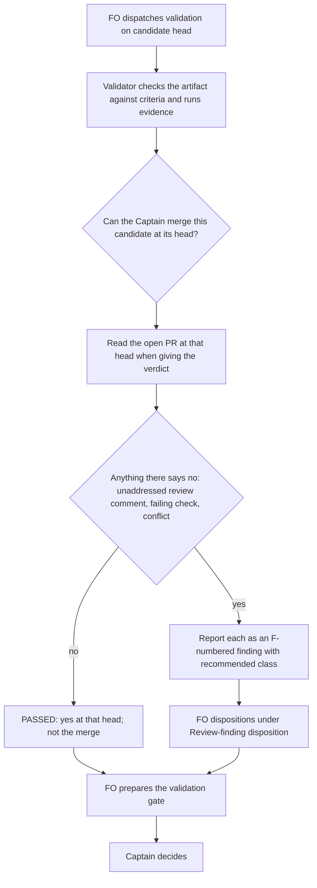

## Scope

- Framing: the Captain 「可以改寫」 (chat, 2026-11-09), answering FO's 「我的建議：第 18 批照原本的五張做，但把第 2 張「驗證必須讀過 PR 意見」改成「驗證回答能不能合併」來寫，這就是第一次實測第 2 種想法。下一批再做「交給工具寫」那一組。這樣到第 19 批結束時，就能用觀察者的違規數字比較，看錯誤有沒有真的變少。」 and 「你決定第 18 批第 2 張要不要改寫」. The validation stage owns the question "can the Captain merge this PR at this head?" rather than a checklist; reading every review comment then follows from the question, not from a new rule.
- Source: the Captain 「驗證不讀 PR 審查意見（建議）, 特別角色派工紀錄手寫（建議）, 改驗收條件沒當下檢查（建議）, 合併檢查時間點看不出（建議）」 (host question dialog, 2026-11-08), answering 「批次 17 觀察者找到的問題，哪些要開成 kc-dev-flow-2 套件問題單（排進下一批的待辦）？建議四張都開，每張都真的發生過。」
- Bite: PR #812 validation-3 passed at 778367add while Codex review comment 4505793059 (P2, posted 09:54Z the same day) stood unread; FO found it at the gate and a fourth repair and validation round followed (batch 17 archive, dispatch-build-writes-the-dispatch-record).
- Non-goals: changing Spacedock; adopter AGENTS.md files.

## Budget
- One package PR; workflow word budget unchanged unless the design names a raise for the Captain.

## Stop condition
- The validation skill states the merge-readiness question, and a replay of the #812 validation-3 situation (an unaddressed review comment on the PR at the candidate head, no instruction to read comments) finds the comment more often with the reframed skill than with the current one, counted per host.

## FO alignment

Alignment: not needed; the Captain chose to file it from the batch 17 observer findings.
Surfaces: none
Visible change: none
Release review: not needed: workflow maintenance, on no journey map.

## Design

### Bite checked against its source

Read 2026-11-09 with `gh api repos/iamcxa/kc-claude-plugins/pulls/812/comments` and the state log. Validation-3 was dispatched at state commit 82f2e963 (2026-11-08T09:52Z) on candidate 778367adde2e20e0b3e51966ddba2d9f77f9e614. Codex review comment 4505793059 (P2, "Forward successful record checks' step-back warnings", original commit 778367add) was posted at 09:54:39Z, two minutes later. The validator committed its reports at 10:10Z and, after FO's message-2, at 11:13Z. Both times it read the PR (its message-2 report says "OPEN/Draft at the same head with CLEAN, 7 SUCCESS and 1 SKIPPED") but no review comments. It recorded "SKIPPED: Local RoboRev and external review disposition — FO owns review/publication". Validation-4's checklist then said "Read every inline review comment on PR #812", and that validator did read them. So the comment existed before each verdict, the validator was looking at the PR, and it treated review as FO's job. It read comments only when a checklist told it to.

### Chain check (upstream first)

- **Spacedock 0.27.3:** its ensign and FO references never mention reading PR review comments (grep `review comment|pulls/.*/comments|inline comment` over the plugin cache). It owns no merge-readiness question for validation.
- **kc-dev-flow-2 0.36.0 (origin/main e7c9381f2):** `skills/validation/principles.md` asks the validator to check the artifact against the approved outcome. Its last paragraph says "Green checks do not prove merge or adoption"; nothing points it at the PR. The PR readers belong to FO: `extensions/codex/codex_review.py`, `extensions/copilot/copilot_review.py` and `scripts/pr_watch.py`, under FO steps: review findings, step 5 (FO counts rounds). ADR 0042 hands publication and RoboRev to FO for Paseo Codex workers, and the paseo extension's implementation scope note says "FO owns those steps and, when roborev is listed, its review". That is the likely source of the validator's "FO owns review". It concerns RoboRev and publication, not reading comments on the head. Review-finding disposition already has validators observe and FO disposition, so a validator that reports a comment takes nothing from FO.
- **Adopters:** subspace-relay, subspace-web and qnow have no validation rule about review comments in their dev docs or AGENTS.md (read-only `git grep`). qnow's `.claude/agents/github-pr-reviewer.md` is a PR reviewer, not a validation stage.
- **Global instructions:** `~/.codex/AGENTS.md` has no line about review comments. `~/.claude/CLAUDE.md` mentions them only as "ask before sending". So a replay under normal HOME carries no copy of the behaviour being tested.

### PRFAQ

**Proposition.** From the next kc-dev-flow-2 release, a validator's verdict answers one question for the Captain: can he merge this candidate at its head? A verdict answers that question only when it accounts for what is on the PR at that head when the verdict is given. So the validator reads the review comments there because the question needs them, not because a checklist line says so. An unaddressed comment becomes a finding for FO's disposition, so FO no longer finds it at the gate.

- *Why a question instead of a rule?* The Captain asked for this framing (「可以改寫」, Scope). A rule names one input; the question covers comments, a late check, a conflicting base and any input nobody has listed yet. It is also the first trial of the "question, not checklist" idea, which FO will compare against batch 19's observer counts.
- *Why no script?* The checklist forbids a new mechanical check. The PR readers FO already runs stay unchanged.
- *Does the validator now disposition review findings or count rounds?* No. It reports what it reads, as `- F<N>` bullets with its recommended class. FO still dispositions them (FO steps: review findings, steps 1–4) and counts rounds (step 5).
- *What if no PR is open yet?* The question still applies to the candidate; with no PR there are no comments to read.

### Flow

### Existing-code check

The capability is wording in one existing skill file, so there is no code to repair or replace. Observation: with today's text the validator read the PR's checks and mergeability but not its comments (Bite, above), and it read comments as soon as a checklist told it to (validation-4). The missing piece is the reason to look, not a tool.

### What changes

One file: `kc-dev-flow-2/skills/validation/principles.md`.

1. Before its first sentence ("Check the exact delivered artifact…"), add wording 1:
   > Your verdict answers one question for the Captain: can he merge this candidate at its head? Answer it from everything that bears on it when you give the verdict, the open pull request included, not only the acceptance criteria.
2. Replace "Green checks do not prove merge or adoption." with:
   > Your PASSED answers that question at that head; it is not the merge, and green checks do not prove adoption.

Wording 2 is a pre-registered reword. It is used only on a host where wording 1 misses the stop condition (Replay below). It inserts "its checks, reviews and review comments at that head," after "the open pull request included,". This is the one allowed reword. If wording 2 also misses, there is no third: implementation returns the structural options to FO for the Captain (maintain-flow, Behaviour replay).

Size, measured with `wc -w` at origin/main e7c9381f2 (2026-11-09) after applying each wording to a copy of the file: principles.md 826 words; wording 1 gives 877 (+51); wording 2 gives 886 (+60). No lint budget covers this file. `references/sd/workflow.md` (5931 words, the budget) is unchanged. The `lint-skills.py` overlap keys on this file ("validation runs python3…", "do not invoke local fallback push the trunk") keep their sentences unchanged.

### Replay (the stop condition's comparison)

Method: maintain-flow § Behaviour replay with `kc-dev-flow-2/scripts/replay_dispatch.py build`, using the same state and code commits for both arms.

- **Situation:** task `dispatch-build-writes-the-dispatch-record`, stage validation, state commit 82f2e963989b61f15c080f48187b0107e7e36460, code commit 778367adde2e20e0b3e51966ddba2d9f77f9e614.
- **Checklist:** items 1 and 3 of `dispatch/validation-3.md`, verbatim. In item 2, the hosted-CI sentence is replaced by message-2 item 1's facts (run 42468880068 attempt 3 green), so a verdict is reachable. It names no review comment.
- **Arms:** base = `kc-dev-flow-2-v0.36.0`; candidate = the implementation commit. The two dispatch files must differ only in principles.md. Their sha256 values and a diff are kept.
- **PR fixture:** PR #812 is now merged at bd9d4abc, so live GitHub cannot show the 778367add state. Implementation captures once, from live GitHub, the responses for `gh pr view 812`, `pulls/812/comments`, `pulls/812/reviews`, `issues/812/comments` and run 42468880068. It keeps only records created by 2026-11-08T11:13Z and rewrites head to 778367add, state to OPEN, draft to true, and `commit_id` on 4505793059 to 778367add (its value then). Every rewrite is listed in the fixture's README. A `gh` shim placed first on PATH serves those responses, logs every call, and exits 1 with `replay fixture: not recorded` on anything else. One difference from the bite remains: the comment exists from the start of the run, not two minutes in. Fixture, shim, grader and outputs live in the task's state folder under `implementation/replay/`, not in the repository.
- **Hosts and runs:** Claude: `claude -p --model claude-opus-5-5` (the template's validation `model: opus`). Codex: `codex exec -m gpt-6-astra -c model_reasoning_effort=xhigh` (this workflow's roster validation row, the bite's host). Both flags were checked with `--help` on 2026-11-09. Normal HOME (see Chain check), a fresh scratch directory per run. Three runs per arm per host: 12 runs, hard stop 16 including retries of runs that returned no report. Tokens are recorded per run where the CLI returns them; cost is not estimated in advance.
- **What it counts:** a run *finds* the comment when its stage report names 4505793059 or its title in a `- F<N>` finding bullet, or gives a non-PASSED verdict that cites it. A run whose shim log shows any refused call (for example `gh pr view 812 --comments` or `gh api graphql` when not recorded) is reported as a fixture gap and left out of the per-host count. Implementation may extend the fixture once from live GitHub, record the extension in the fixture README and rerun that cell within the hard stop. Two secondary counts are reported but are not the stop condition: (a) runs whose shim log shows any call whose recorded response carries the review comments; (b) runs that call the already-fixed comment 4505536959 unaddressed (precision).
- **Pass, per host:** candidate finds > base finds, and candidate finds ≥ 2 of 3.
- **Grader falsifiers, run before the first provider call:** the stored validation-3 report must grade *not found*. The stored validation-4 report, which names the comment but as fixed, must also grade *not found*. A synthetic line `- F1 Material: Codex review comment 4505793059 is unaddressed at 778367add` must grade *found*.

### Words FO reads at each moment

| Moment | Base (0.36.0) | Candidate |
| --- | --- | --- |
| Startup / resume (README + mod) | unchanged | +0: workflow.md and the mod are untouched |
| Building and sending the validation dispatch | unchanged | +0: context sections and the stage passage are untouched |
| Validation gate preparation (reading the report) | report has no review-comment lines; in the bite, FO read the PR comments itself at the gate | one F-bullet per unaddressed comment, or none; implementation measures mean report words per arm from the replay outputs |
| Idle on an open or merged PR, merge ask | unchanged | +0 |
| Validation worker (not FO) reading principles.md | 826 | 877 (wording 1) or 886 (wording 2) |

### Non-goals and limits

- No change to Spacedock, adopter AGENTS.md files, workflow.md, the PR readers, ADR 0042 or the paseo extension's implementation scope note.
- The validator gains no disposition, round-counting, publication or merge authority.
- The replay covers one rebuilt situation on two hosts with three runs per cell. A pass shows the wording changes behaviour there; it does not show the error is gone in real use. FO's batch 19 observer comparison is the field measure.
- The fixture is a reconstruction, with its rewrites listed; the timing difference is stated above.

### Needs decision

- **D1 — if the Codex half cannot run.** Recommendation: run both hosts. If `codex exec` cannot complete a run after one attempt (as in claims-name-their-source, 2026-11-03), implementation stops and returns to FO; do not accept a Claude-only result. The miss happened on Codex, so a Claude-only pass says nothing about the host that missed. What gets worse: the task may stall on a host route, as that earlier task did before amendment 1 cut it to Claude only. This departs from that precedent (Captain amendment 1 of claims-name-their-source); there the bites were FO writes, here the miss was a Codex validator.
- **D2 — ADR now or later.** Recommendation: no ADR in this PR. This is the first trial of "question, not rule", and FO plans to judge it on batch 19's observer counts; record the ruling as an ADR if those numbers hold. What gets worse: until then the reframing lives only in principles.md and this task, so a later maintainer could reword it back without meeting a ruling.

### Batch overlap

| Task | Shared file or check | Overlap |
| --- | --- | --- |
| delivery-gate-ignores-url-paths-and-data-fences | `scripts/delivery_gate.py` and its tests | none: this task does not touch delivery_gate.py |
| delivery-check-before-ask-is-provable | delivery check and merge records (not designed yet) | none known; overlaps only if its design edits validation principles |
| counts-name-the-run-that-produced-them | may add count-sourcing text to `skills/validation/principles.md`, and may use its own behaviour replay | possible same-file textual overlap; no rule overlap |
| merge-guard-stops-unasked-merges (validation) | merge_guard.py, delivery_gate.py, workflow.md, lint-skills.py, adoption.md | none |
| adr-required-statement (closed 2026-10-20) | workflow.md, adoption.md, adr_lint.py | none |
| journey-server-host-pilot | names neither validation file nor workflow.md (grep of its index.md) | none |
| domain-note-reaches-worker-poc (backlog, state remote) | names only `scripts/kc-adr-copy-sync.sh` | none |
| ADR number sequence | this design lands no ADR (D2) | none |

Recommended order: this task first, since it changes one file. counts-name-the-run-that-produced-them rebases onto it if it edits validation principles; the replay's base arm stays the 0.36.0 tag either way.

## Acceptance criteria

**AC-1** The package diff changes only `kc-dev-flow-2/skills/validation/principles.md`, and that file carries wording 1 and the replaced closing sentence (or wording 2 under AC-4). Evidence: `git diff --stat origin/main...<candidate> -- kc-dev-flow-2` lists that one file; `python3 kc-dev-flow-2/scripts/lint-skills.py` exits 0 with the workflow budget at 5931; `wc -w` on the file gives 877 (or 886), the counts measured on 2026-11-09 by applying each wording to origin/main e7c9381f2's file. Falsifier: any edit to workflow.md changes the lint budget count, and lint must fail it.

**AC-2** The replay is pre-registered before the first provider call. The fixture README lists every rewrite. The shim refuses an unrecorded call (exit 1, logged). The grader gives: stored validation-3 report not found, stored validation-4 report not found, synthetic positive found. Both dispatch files differ only in principles.md (sha256s and diff kept). Evidence: `implementation/replay/preregistration.json`, committed before any `runs/` entry (state git log order). Falsifier: a grader that matches the comment id anywhere grades validation-4 *found*, and must be shown failing on it.

**AC-3** The replay meets the stop condition on each host. Claude (claude-opus-5-5) and Codex (gpt-6-astra, xhigh) each get three base runs and three candidate runs, 12 total, hard stop 16. On each host, candidate finds > base finds, and candidate finds ≥ 2/3. Evidence: `implementation/replay/results.md`, with a per-run table of host, arm, verdict, found, read-comments-endpoint, precision miss and tokens, plus the raw reports and shim logs. A run with any refused shim call is a fixture gap, excluded from the count and reported. Falsifier: a run graded *found* whose shim log shows no call returning the review comments is a grader or fixture defect and voids the count.

**AC-4** The reword path is bounded. Wording 2 runs only on a host that missed AC-3, with three candidate runs on that host, inside the hard stop. If it still misses, implementation reports the miss, applies no third wording and returns to FO. Evidence: results.md names the wording each run used. Falsifier: a run using an unregistered wording is a defect.

**AC-5** Precision is reported, not gated. The number of candidate runs per host that call comment 4505536959 unaddressed at 778367add is in results.md. More than one per host goes to FO as a Needs decision. Evidence: the same table.

## Stage Report: ideation

- DONE: Design the validation skill's merge-readiness question (can the Captain merge this PR at this head?) and the replay comparison the stop condition names; reading every review comment must follow from that question, not from a new mechanical check; say what the replay counts, how many runs per host, and on which hosts. Batch overlap: name each file your design changes; siblings delivery-gate-ignores-url-paths-and-data-fences and delivery-check-before-ask-is-provable may touch kc-dev-flow-2/scripts/delivery_gate.py.
  `### What changes` (one file, principles.md, wording 1 +51 words; one pre-registered reword) and `### Replay`: counts F-bullet or verdict naming 4505793059; Claude claude-opus-5-5 and Codex gpt-6-astra, 3 runs per arm per host, 12 runs, hard stop 16; delivery_gate.py not touched.
- DONE: A `### Batch overlap` section naming each file the design would change and each other batch task (validation-reads-pr-review-comments, delivery-gate-ignores-url-paths-and-data-fences, delivery-check-before-ask-is-provable, counts-name-the-run-that-produced-them, merge-guard-stops-unasked-merges) and live task of other sessions (adr-required-statement, journey-server-host-pilot, domain-note-reaches-worker-poc) that changes the same file or check, so FO can order implementation
  Table under `### Batch overlap`; the only possible overlap is counts-name-the-run-that-produced-them on principles.md. Recommended order: this task first.
- DONE: The words FO reads at each moment, before and after, per root learning.md "Measure the words FO reads at each moment, not one file's size"
  `### Words FO reads at each moment`: +0 at startup, dispatch, idle and merge ask (workflow.md 5931 unchanged). Gate preparation: one F-bullet per unaddressed comment, measured at implementation. Worker file: 826 → 877, measured with wc -w at e7c9381f2.
- DONE: Acceptance criteria with reproducible evidence clauses and falsifiers, and unresolved decisions for the Captain, each with a recommendation and what gets worse under it
  AC-1: not yet built (one-file diff, lint 0, word count). AC-2: not yet built (preregistration, grader falsifiers on stored validation-3/-4 reports). AC-3: not yet run (per-host replay). AC-4: not yet run (bounded reword). AC-5: not yet run (precision count). D1: Codex half required. D2: no ADR yet.

### Summary

The bite was confirmed at source. Comment 4505793059 was posted two minutes after validation-3 was dispatched and before both of its reports. The validator read the PR's checks but not its comments, because it took review to be FO's job; validation-4 read the comments only because its checklist said to. The design changes one file: the validation principles now open with the Captain's question (can he merge this candidate at its head?) and say PASSED answers it. Reading the PR's comments follows from that question; there is no new script. Proof is a pre-registered behaviour replay of the validation-3 situation against a frozen PR fixture served by a gh shim: 3 runs per arm on Claude and on Codex. Two decisions go to the Captain: require the Codex half (D1) and defer the ADR (D2). `python3 <package 0.36.0>/scripts/design_surfaces.py check` (2026-11-09) printed `validation-reads-pr-review-comments.md: design surfaces presentable`, exit 0.
