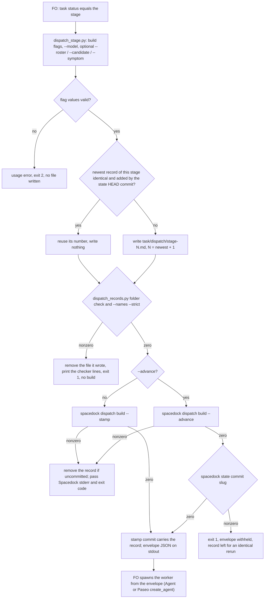

A dispatch built with `dispatch build --stamp` leaves <task>/dispatch/<stage>-<cycle>.md written from the same checklist, scope notes, model and SHA it sends, so the record no longer depends on FO remembering it.

## Scope

- Source: the Captain 「開」 (chat, 2026-11-06), answering 「要開這 4 張嗎？」 after fo-feedback round 005 (.notes/fo-feedback/round-005.md, closed 2026-11-06).
- Bite: kc-paseo-plugins reconstructed every dispatch record of batch r1b-polish-1 after the fact (_archive/project-env-rate-limit-cause/dispatch/ideation-1.md: "Reconstructed by FO on 2026-11-06, after the dispatch"; FO read 2026-11-06); qnow sent a follow-up addendum with no record (observer); the kc-plugin FO wrote one message record late and omitted required lines in batches 14 and 15 (observer reports).
- Upstream first: Spacedock dispatch build --stamp (Spacedock is not the Captain's repository: a change there is an upstream issue, so the dev2 side may be a package wrapper); kc-dev-flow-2 dispatch_records.py, which checks the record.
- Non-goals: follow-up messages to a running worker (a separate record kind).

## Budget
- One package PR; the workflow word budget does not rise unless the design names a raise for the Captain.

## Stop condition
- A stamped dispatch leaves a record that dispatch_records.py accepts without FO writing it, or the design names why Spacedock cannot and what the package does instead.

## FO alignment

Alignment: needed at ideation; the design choice is his to accept.
Result: aligned at backlog: Batch 17 backlog sitting, the Captain 「核准（建議）」 (host question dialog, 2026-11-07), answering 「決定：第 17 批這五張（Paseo 瀏覽器當工人驗收的預設、決策紀錄檢查分清驗證取代與指向依據、派工時自動寫派工紀錄、沒給範圍時設計檢查說沒跑、觀察者列出沒有合併提問紀錄的合併）都用 Pilot，照各自寫下的範圍、預算與停止條件進入構想嗎？建議核准。要改哪張直接說。」, approved the outcome and bounds in this file; the design choice the Alignment line names stays his at the ideation gate.
Surfaces: none
Visible change: none
Release review: not needed: workflow maintenance, on no journey map.

## Design

### Chain check

Read 2026-11-07 at the pins named here.

- **Spacedock** (`spacedock-dev/spacedock` origin/main 324c61588, and tag v0.27.2, the installed and CI-pinned binary): `dispatch build --stamp` (`runStamp` in `internal/dispatch/stamp.go`) stamps `started`/`worktree`, makes one path-scoped state commit `dispatch: <slug> entering <stage>`, publishes it and creates the worktree; `runBuildFields` in `build.go` then writes only `/tmp/spacedock-dispatch/<name>.md`. Nothing writes `<task>/dispatch/`. Mods have four hook points only (`git grep -hoE '## Hook: [a-z-]+'`: startup, merge, idle, shutdown); none runs at dispatch. The build also cannot know the record's `Model:` line: on Claude its envelope `model` is the Agent enum (`opus`), and a Paseo dispatch's model and `Roster:` come from `model_roster.py`, which Spacedock does not read.
- **The seam the design uses:** `entityCommitPaths` puts the task's companion folder `<slug>/` into the stamp commit (`git add -A -- <slug>.md <slug>/`). Probe on 0.27.2 (`/tmp/stamp-probe.3Byi`, split-root fixture with this workflow's README): an uncommitted `probe/dispatch/ideation-1.md` was committed by `dispatch: probe entering ideation`; on a second build for the same stage, with `started` already set, `ideation-2.md` alone was committed by the same subject. `spacedock state commit probe` committed an uncommitted `implementation-1.md` as `state: update probe`, which covers `--advance`, where `--stamp` is refused.
- **kc-dev-flow-2** (origin/main 139feeaee, 0.35.0): `dispatch_records.py` checks a record and writes none; `replay_dispatch.py` wraps `dispatch build` for replays and copies the dispatch file into its run folder, not a record. `git grep 'dispatch build'` finds no other writer.
- **Adopters** (subspace-relay, subspace-web, qnow, `origin/HEAD`, read-only `git grep -lE 'dispatch build|dispatch_records|/dispatch/[a-z]+-'`): their synced `docs/dev2*/README.md`, plus qnow history notes; no wrapper and no record writer.

So Spacedock cannot write the record without an upstream change in a repository the Captain does not own, and it would still lack the model line. The package wraps the build instead.

### PRFAQ

**kc-dev-flow-2 records every worker dispatch as it builds it.** FO now builds a worker dispatch with one package script. The script writes `<task>/dispatch/<stage>-<cycle>.md` from the same checklist and scope-notes files it hands to `spacedock dispatch build --stamp`, adds the model and the workflow checkout's SHA, runs both `dispatch_records.py` checks, and only then builds. The stamp's own state commit carries the record, so a record cannot be missing, written after the fact, or different from what the worker received.

- *What does FO still write?* The checklist and the scope notes, as today, and the model, roster, candidate and symptom values as flags. The script writes the header, the sections and the cycle number.
- *What if a part is missing?* The script removes the file it wrote, prints the checker's lines, and builds nothing. Its message starts `dispatch_stage: dispatch not built;`, so FO does not mistake it for a `dispatch build` failure that allows break-glass dispatch.
- *What if the build fails?* Spacedock's stderr and exit code pass through unchanged. If the record was not committed, the script removes it; an identical immediate rerun reuses the committed number instead of minting a new one.
- *Follow-up messages to a live worker?* Not covered: FO still saves those by hand.
- *Acceptance evidence:* a test against the CI-pinned Spacedock 0.27.2 binary (AC-1 to AC-6), and the README and pinned tests (AC-7).

### Flow

### Existing-code check

Completeness: `dispatch build --stamp` works through the journey and writes no record; `dispatch_records.py` works as a checker; no record writer exists (two bounded searches: the Spacedock `## Hook:` and `dispatch/<stage>` greps, and the package and adopter `dispatch build` greps above; excluded: `_archive/` evidence copies). Need: the Scope bite, three sessions with records written late, reconstructed or short of required lines. The design adds one script and reuses `dispatch_records.py`'s checks unchanged, and `task_folder` from `design_surfaces.py`.

### What changes

One package PR:

- `kc-dev-flow-2/scripts/dispatch_stage.py` (new). Arguments: `--workflow-dir`, `--entity-path`, `--stage`, `--checklist-file`, `--scope-notes-file`, optional `--feedback-context-file`/`--feedback-reflow`/`--advance` passed through, `--model TEXT` (required), `--roster TEXT`, `--candidate SHA` (repeatable, 40 hex or exit 2), `--symptom TEXT`, `--spacedock BIN` (default `$SPACEDOCK_BIN`, then `spacedock`).
  - Writes `# <stage>-<N>`, `Dispatched: <git -C workflow-dir rev-parse HEAD> (workflow checkout)`, `Model:`, then the given `Roster:`, `Candidate:` and `Symptom:` lines, `## Checklist` with the checklist file, `## Scope notes` with the scope-notes file. It never edits either file's text: an omitted `Package root:` or completion line is held by the checker, before any build.
  - N: let M be the highest `<stage>-<M>.md` committed at the state checkout's HEAD (message records excluded). N = M, writing nothing, only when that file's bytes equal what would be written and the state checkout's HEAD commit is the one that added it (an immediate retry after a sync or assembly failure); otherwise N = M + 1, 1 when none, overwriting an uncommitted file at N. Any state commit in between makes an identical dispatch a new record, so `role_triggers.py` still counts a repeated round.
  - `--note TEXT` appends `, TEXT` inside the `Dispatched:` parentheses, for the README version and batch annotations FO writes today.
  - Runs `dispatch_records.py <task folder>` and `--names --strict <record>` as subprocesses with the same Python; on success it prints nothing of theirs.
  - Without `--advance`, runs `<spacedock> dispatch build --stamp` with the build flags; with it, `dispatch build --advance` and then `<spacedock> state commit <slug> --workflow-dir <dir>`. Stdout is the build's envelope.
- `kc-dev-flow-2/scripts/test_dispatch_stage.py` (new): split-root git fixtures with the README from `references/sd/workflow.md`, run against `$SPACEDOCK_BIN`; exits nonzero naming `SPACEDOCK_BIN` when it is unset, so CI cannot pass it by skipping.
- `.github/workflows/kc-dev-flow-2-tests.yml`: one step after "Install pinned Spacedock", `SPACEDOCK_BIN="$HOME/.local/bin/spacedock" python3 kc-dev-flow-2/scripts/test_dispatch_stage.py`. Cost per PR: not measured.
- `kc-dev-flow-2/references/sd/workflow.md` (Stages): three passages replaced, text below.
- `kc-dev-flow-2/scripts/lint-skills.py`: one `WORKFLOW_BUDGET_STEPS` entry, `delta=-2`, why "dispatch_stage.py saves and checks the record; the README names the script and its flags".
- `kc-dev-flow-2/scripts/test_sd_dispatch.py`: the `dispatch-record` and `resumed-dispatch` entries' `need` and `swaps` follow the new text. `kc-dev-flow-2/scripts/test_dispatch_records.py`: `ContextNoticeTests.PARAGRAPH` follows the new third passage.
- ADR, only if the Captain accepts D1 (the number reserved at implementation dispatch), short title `stage-worker-dispatches-are-built-by-a-package-script-that-writes-their-record`. Draft: **Decision:** FO builds each stage-worker dispatch with `dispatch_stage.py`, which writes the record from the build's own inputs, checks it, and lets the stamp commit carry it; Spacedock is unchanged. **Context:** the Scope bite; the Chain check. **Consequences:** like ADR 0014, prose-enforced: an FO that follows Spacedock's skill text instead writes no record, and `dispatch_records.py --coverage` still holds that task after the report. Reopen on ADR 0014's condition, a dispatch-time hook in Spacedock. **Protects:** `kc-dev-flow-2/scripts/dispatch_stage.py` — `main`. **Words:** the Captain's ruling on D1.

New README text, replacing "FO saves those scope notes … fixes each part it lists.", "A follow-up message … never a pointer to another record." and "Before `dispatch build`, FO runs … on stderr.":

> FO builds each worker dispatch with `python3 <package>/scripts/dispatch_stage.py`: `dispatch build`'s flags, `--model`, and `--roster`, `--candidate` or `--symptom` where owed. It saves the checklist, scope notes, model and the SHA it dispatches from as `<task>/dispatch/<stage>-<cycle>.md`, so the instruction a worker followed outlives the session that wrote it, checks it as below, then builds; the build's commit carries the record.
>
> A follow-up message to a worker FO resumes is a dispatch too, saved by hand as `<stage>-<cycle>-message-<n>.md` with a checklist of the items it asks, never a pointer to another record, and committed with `spacedock state commit <slug> --workflow-dir <dir>`.
>
> Each record passes `python3 <package>/scripts/dispatch_records.py <task folder>` and `--names --strict <record>` before a worker reads it; nonzero holds dispatch. Relative script paths are allowed; bare package script names remain errors. Plain `--names` preserves existing historical verdicts and reports skipped context checks on stderr.

Not changed: `dispatch_records.py`, `extensions/paseo/EXTENSION.md` (its "chain … onto that same build command" now chains onto the script, which is that build command), `_mods/`, Spacedock.

### Words FO reads at each moment

Counted as `len(text.split())` over whitespace-normalized text, the count `lint-skills.py` uses; base origin/main 139feeaee (`lint-skills.py` exit 0, "5933 of 5933 words").

| Moment | Base | Candidate |
| --- | --- | --- |
| startup and resume (README read whole) | 5933 | 5931 |
| fresh worker dispatch: README passages | 112 (passages 1 and 3) | 101 (passages 1 and 3) |
| fresh worker dispatch: script output on a complete record | 4 ("N dispatch record(s) complete") | 0 |
| follow-up message: README passages | 143 (all three; passage 2's "the same check" needs passage 1) | 83 (passages 2 and 3) |
| follow-up message: script output | 4 | 4 |
| worker report (`--coverage`), idle, merge ask, archive | unchanged | unchanged |

Spacedock's own dispatch text (`claude-fo-dispatch.md`) is read in both and unchanged. The script's docstring is read only through `--help`.

### Non-goals and limits

- Follow-up messages (Scope non-goal); deriving `Model:` from the roster (D2); moving `package_version.py` and `workflow_checkout.py` into the script (D3); an upstream Spacedock issue; filling omitted scope-note lines.
- An FO that runs `spacedock dispatch build` directly, as Spacedock's skill text says, writes no record; `--coverage` catches it after the report, as today. This PR does not show FO uses the script: the first batch after release shows it (each fresh record's adding commit subject is `dispatch: <slug> entering <stage>`).
- An identical rerun with no state commit since the record was added reuses its number; a re-dispatch after any later state commit, such as a worker report, is a new record.
- The `Model:` and `Roster:` text stays FO-typed; a wrong value is not caught, as today.
- No new profile obligation: no production data, credentials or unattended operation.

### Needs decision

- **D1: build dispatches through a package script (this design), not an upstream Spacedock change, and land the ADR above.** Recommend yes. It is the only route the package owns, and it works on the pinned 0.27.2 today. Worse under it: Spacedock's skill still tells FO to call `dispatch build`, so the README must win that conflict; FO runs one more script per dispatch; a later Spacedock change to `entityCommitPaths` would break the commit seam, caught by AC-1 in CI.
- **D2: keep `--model` and `--roster` as FO-supplied flags rather than have the script run `model_roster.py resolve`.** Recommend keep. Resolving needs `--code-root` and inherits the resolver's exit-1 holds, and FO already runs it before a Paseo spawn. Worse under it: those two lines stay hand-typed.
- **D3: do not move `package_version.py` and `workflow_checkout.py`, which FO runs before each dispatch, into the script in this task.** Recommend not now: no bite is recorded since ADR 0014, and their hold (show the remedy, wait for the Captain) is a different contract. Worse under it: FO still runs three commands per dispatch, and those two checks stay prose-enforced.

Past rulings read: ADR 0014 (pre-dispatch checks; "a check inside Spacedock dispatch build — outside this package"), ADR 0020 (word budget), ADR 0027 (FO-write rules checked by the script FO runs at the write). `git -C <state> grep -n 'Override:'` finds none about dispatch records or wrapping `dispatch build`.

### Batch overlap

| Task | Shared file or check | Note |
| --- | --- | --- |
| worker-browser-checks-use-paseo-browser | `references/sd/workflow.md`, `lint-skills.py` budget steps, only if its design edits the README; not `extensions/paseo/EXTENSION.md`, which this design leaves alone | no design yet; the second to land rebases its budget step |
| adr-lint-tells-supersession-assertion-from-pointer | `scripts/test_sd_dispatch.py` (it may revert the split ADR 0047 path; this task edits the `dispatch-record` and `resumed-dispatch` entries) | different entries; either order |
| design-check-says-not-run-without-a-scope | `design_surfaces.py`: this task imports `task_folder`, unchanged | none unless it renames `task_folder` |
| observer-lists-unasked-merges | none (`delivery_gate.py`, observer) | none |
| merge-guard-stops-unasked-merges (held, read only) | `.github/workflows/kc-dev-flow-2-tests.yml` (both add one step); the ADR number index (it reserves one) | land it first; this task rebases its CI step |
| gate-summary-names-each-decline (held, read only) | none: it leaves `workflow.md` and `lint-skills.py` unchanged; `design_surfaces.py` import only | none |
| journey-map tasks (journey-map FO, read only) | the ADR number index only (journey-map takes 0065+) | FO reserves the number |

Recommended order: merge-guard-stops-unasked-merges, then this task; the batch-17 tasks in any order around it.

## Acceptance criteria

**AC-1** A stamped dispatch leaves a record `dispatch_records.py` accepts, committed by the stamp. Evidence: `test_dispatch_stage.py` against `$SPACEDOCK_BIN` 0.27.2, on a split-root fixture whose README is the raw `references/sd/workflow.md` (its frontmatter carries `state: .spacedock-state` and the stage list), as `test_sd_dispatch.py` uses it, and whose task is at `status: ideation`: exit 0; `<task>/dispatch/ideation-1.md` exists; `dispatch_records.py <task folder>` and `--names --strict <record>` exit 0; `git log -1 --format=%s -- <record>` is `dispatch: <slug> entering ideation`; stdout parses as JSON with `dispatch_file_path`. Falsifiers: building without `--stamp` leaves the record uncommitted and fails the subject assertion; dropping the `Model:` line fails the checker assertion.

**AC-2** The record holds what the worker receives. Evidence: the same test asserts every nonblank line of the checklist and scope-notes files appears in the record's matching section and in the file at `dispatch_file_path`. Falsifier: writing the record from a copy with one scope-notes line dropped fails it.

**AC-3** An incomplete record builds nothing and leaves nothing. Evidence: a scope-notes file without `Package root:` gives exit 1, a first stderr line starting `dispatch_stage: dispatch not built;` followed by the checker's part line, no file under `<task>/dispatch/`, the state checkout's HEAD and the task file unchanged, and no call to a fake `--spacedock` that writes a marker file when run. Falsifiers: skipping the removal leaves `ideation-1.md`; building before checking writes the marker.

**AC-4** A validation dispatch without a candidate is held before the build. Evidence: `--stage validation` without `--candidate` exits 1 with `dispatch_records.py`'s "no 'Candidate: <40-hex head>' line" text and leaves no file; `--candidate abc` exits 2 before writing. Falsifier: ignoring the checker's exit code lets the fake build run.

**AC-5** A failed or repeated build leaves no phantom record. Evidence: (a) a task at `status: backlog` dispatched with `--stage ideation`: Spacedock's stderr line starting `dispatch build --stamp:` and its exit code 1 pass through, and no `ideation-1.md` remains; (b) right after a successful `ideation-1`, an identical rerun exits 0 and adds no `ideation-2.md`, while the same rerun after one unrelated state commit adds `ideation-2.md`; (c) a rerun with one changed checklist line adds `ideation-2.md`, committed by the stamp. Falsifiers: without the removal (a) leaves a file; without the identical-reuse rule the first rerun of (b) adds `ideation-2.md`; reusing on bytes alone makes the second rerun of (b) add none.

**AC-6** A reuse-advance dispatch is recorded and committed. Evidence: a task at `status: implementation` with `--advance` adds `implementation-1.md`, committed with subject `state: update <slug>`, and prints the advance envelope; when `state commit` fails (fake binary), exit 1 and no envelope on stdout. Falsifier: skipping `state commit` leaves the record uncommitted.

**AC-7** The README names the script and costs no words. Evidence: `references/sd/workflow.md` holds the three passages under `### What changes` verbatim; `python3 -B kc-dev-flow-2/scripts/lint-skills.py` exits 0 printing `5931 of 5931 words`, with the `delta=-2` step; `test_sd_dispatch.py --sd-plugin-root <pinned root>` and `test_dispatch_records.py` pass with their updated pins. Falsifier: restoring the base passages makes `lint-skills.py` exit 1 on the count.

**AC-8** CI runs the seam test with the real binary. Evidence: `kc-dev-flow-2-tests.yml` holds the new step after "Install pinned Spacedock", and the PR's run shows it passing; `test_dispatch_stage.py` with `SPACEDOCK_BIN` unset exits nonzero naming it. Falsifier: deleting the step removes the check from the run.

## Number guards

ADR: 0070

## Stage Report: ideation

- DONE: Design how a stamped dispatch leaves a dispatch record that /Users/kent/.claude/plugins/cache/kc-claude-plugins/kc-dev-flow-2/0.35.0/scripts/dispatch_records.py accepts without FO hand-writing it, or why Spacedock cannot and what the package does instead, after reading Spacedock's own dispatch build source
  `### Chain check`: stamp.go/build.go at 324c61588 and v0.27.2 write no record and have no dispatch hook; package script `dispatch_stage.py` writes and checks the record and the stamp commit carries it (0.27.2 probe: record committed by `dispatch: probe entering ideation`, also on a repeat build; `state commit` covers `--advance`).
- DONE: A `### Batch overlap` section naming each file the design would change and each other batch task (worker-browser-checks-use-paseo-browser, adr-lint-tells-supersession-assertion-from-pointer, design-check-says-not-run-without-a-scope, observer-lists-unasked-merges) and live task of other sessions (merge-guard-stops-unasked-merges and gate-summary-names-each-decline (held by the Captain; read only), and journey-map tasks driven by the journey-map FO (read only)) that changes the same file or check, so FO can order implementation
  `### Batch overlap` table: shared CI workflow file and ADR index with merge-guard (land it first), `test_sd_dispatch.py` with adr-lint (different entries), README/budget with worker-browser only if it edits the README; others none.
- DONE: The words FO reads at each lifecycle moment, before and after, per root learning.md "Measure the words FO reads at each moment, not one file's size"
  `### Words FO reads at each moment`: startup 5933→5931; fresh dispatch 116→101; follow-up message 147→87; others unchanged. Base `lint-skills.py` exit 0 at origin/main 139feeaee.
- DONE: Acceptance criteria with reproducible evidence clauses and falsifiers, and unresolved decisions for the Captain, each with a recommendation and what gets worse under it
  AC-1..AC-8 each with evidence and falsifier; D1 (script, not upstream; ADR), D2 (model flags stay FO's), D3 (pre-dispatch checks stay out) under `### Needs decision`.
- DONE: AC-1 stamped record accepted and stamp-committed — not yet verified (implementation test); the 0.27.2 commit seam it rests on was observed in the probe.
- DONE: AC-2 record holds what the worker receives — not yet verified.
- DONE: AC-3 incomplete record builds nothing — not yet verified.
- DONE: AC-4 validation without candidate held — not yet verified; the checker's Candidate hold exists at origin/main (`check_candidates`).
- DONE: AC-5 no phantom record on failure or rerun — not yet verified; stamp refusal before any commit read in `runStamp`.
- DONE: AC-6 reuse-advance recorded — not yet verified; `state commit` sweeping the record observed in the probe.
- DONE: AC-7 README names the script at −2 words — draft counted 141 against 143; lint and pinned tests not yet run on a candidate.
- DONE: AC-8 CI runs the seam test — not yet verified; CI already installs Spacedock v0.27.2 (`kc-dev-flow-2-tests.yml`).

### Summary

Spacedock 0.27.2 cannot write the record (no dispatch hook; it does not know the roster model), so the design adds `kc-dev-flow-2/scripts/dispatch_stage.py`: it writes the record from the build's own input files, runs both existing checks, then runs `dispatch build --stamp`, whose path-scoped commit already sweeps the task folder (observed on 0.27.2). The README passages shrink by 2 words; three Captain decisions are open (D1–D3). `design_surfaces.py check`: "design surfaces presentable", exit 0. The probe's procedure is in `### Chain check`; its `/tmp` fixture is not retained evidence.

## Stage Report: implementation

- DONE: Bounded integrated implementation committed locally on the assigned branch, based on origin/main.
  Candidate afa4523468a2e86e6c6e0467591df00bf8e51d35; base 334d91e3165953b2ca7191e3308d80b6c02c4a99; branch spacedock-ensign/dispatch-build-writes-the-dispatch-record; nine authorized files; clean code worktree; implementation/candidate-tree.txt.
- SKIPPED: One Draft PR (Conventional Commit title scoped to the plugin) from a branch off origin/main (334d91e3165953b2ca7191e3308d80b6c02c4a99) implementing the approved design and acceptance criteria in the task file; D1 as recommended (build dispatches through a package script and land the ADR, reserved as ADR 0070), D2 as recommended (keep --model and --roster as FO-supplied flags) and D3 as recommended (leave /Users/kent/.claude/plugins/cache/kc-claude-plugins/kc-dev-flow-2/0.35.0/scripts/package_version.py and /Users/kent/.claude/plugins/cache/kc-claude-plugins/kc-dev-flow-2/0.35.0/scripts/workflow_checkout.py out of the script), per the Captain's batch 17 ideation approval 「核准（建議）」 (host question dialog, 2026-11-07); only the files the design names
  No PR opened: no push grant. Product push and Draft PR are FO-owned; /tmp/impl-dispatch-build-writes-the-dispatch-record-pr.md is ready, also saved as implementation/prepared-pr.md; no version edits.
- DONE: ADR 0070 records the ruling the design names, quoting the Captain's words from the task file and its gate records
  ADR 0070 quotes 「核准（建議）」 and the task gate's D1/D2/D3 question excerpt, recorded 2026-11-07T15:37:23.875685Z; it protects dispatch_stage.py main with its ADR pointer.
- SKIPPED: Every acceptance criterion green with the evidence each names; each falsifier shown failing by a mutation you run (python3 -B, caches cleared)
  AC-1 through AC-7 and AC-8 local wiring/binary checks pass; hosted AC-8 PR run is not run, delegated to FO. All thirteen local counterexamples are caught; implementation/fresh/falsifiers/results.json and adjacent mutation patches/logs.
- DONE: AC-1 through AC-4: stamp commits a complete record with received inputs; incomplete records and invalid/missing candidates hold before building.
  implementation/fresh/dispatch-stage.json: real 0.27.2 split-root seam tests; no-stamp, no-model, dropped-scope-line, skipped-removal, build-before-check and ignored-checker mutants fail their corresponding assertions.
- DONE: AC-5 and AC-6: failed/repeated builds and reuse-advance dispatches preserve the intended record/commit boundary.
  The same real-binary suite checks immediate reuse, changed checklist, intervening state commit, staged-record cleanup, advance commit and withheld envelope on commit failure; no-removal, no-reuse, bytes-only reuse and no-state-commit mutants fail.
- DONE: AC-7: three README passages match the approved text, delta=-2, and the updated consumers pass.
  implementation/fresh/: lint-skills.log 5931/5931, test-lint-skills.json 47 passes, dispatch-records.json 115 passes, sd-dispatch.log exit 0; restored-base-passages mutant fails at 5933 versus 5931. lifecycle-words.json: startup 5933→5931, fresh dispatch 116→101, follow-up 147→87.
- DONE: AC-8 local source and binary checks: CI runs the real seam test after installing the pinned binary and an unset SPACEDOCK_BIN fails.
  implementation/fresh/falsifiers/: deleting the step removes the seam command; missing-binary log exits 1 naming SPACEDOCK_BIN. Existing package/workflow path triggers retained; CI cost per PR not measured; hosted run not run.
- SKIPPED: kc-dev-flow-2/scripts/lint-skills.py (the repository copy CI runs), /Users/kent/.claude/plugins/cache/kc-claude-plugins/kc-dev-flow-2/0.35.0/scripts/adr_lint.py docs/adr --since <base> --require 0070 exit 0; /Users/kent/.claude/plugins/cache/kc-claude-plugins/kc-dev-flow-2/0.35.0/scripts/number_guards.py check exit 0; /Users/kent/.claude/plugins/cache/kc-claude-plugins/kc-dev-flow-2/0.35.0/scripts/comment_ratio.py within its maximum; commit locally, no push; PR text written for FO; FO pushes, opens the Draft PR, runs RoboRev and reads CI; CI cost measured or stated as not measured
  The installed 0.35.0 ADR command exits 1 on the base's known pre-#806 historical-assertion false positive (adr-lint.log, base-adr-lint.log). Follow-up 2 substitutes the candidate's corrected ADR linter; product publication, RoboRev and hosted CI remain FO-owned.
- DONE: Required local gates and fresh-shell exact-candidate acceptance.
  SPACEDOCK_BIN=/Users/kent/.local/bin/spacedock SD_PLUGIN_ROOT=/tmp/spacedock-0272-source bash --noprofile --norc implementation/acceptance.sh <code-root> <candidate> <output> exited 0; fresh/adr-lint.log, number-guards.log and diff-check.log pass; comment-ratio.log 0.9% ≤ 5%. The runner uses git archive, python3 -B and no exported caches; goal-without-change.log shows the missing base writer.
- DONE: Implementation follow-up 1: change only the observer chat-only command entry forced by the shortened README command.
  Extra file kc-dev-flow-2/skills/observer/SKILL.md authorized in dispatch/implementation-1-message-1.md; lint-skills.log exit 1 before, lint-skills-after-observer.log exit 0 after. No additional observer test pin names that entry.
- DONE: Implementation follow-up 2: keep the historical ADR 0047 assertion unchanged and use the candidate ADR linter.
  dispatch/implementation-1-message-2.md names merged #806 and its linter correction; `python3 -B kc-dev-flow-2/scripts/adr_lint.py docs/adr --since <base> --require 0070` exits 0; the installed command's exit 1 is retained, not called clean.
- SKIPPED: RoboRev review before publication.
  roborev not run: FO runs RoboRev after this report because the worker sandbox cannot reach the local daemon; no review, PR comment, ready action or merge performed.
- DONE: Affected documents checked with doc_impact.py <base> <candidate> --repo <code-root> --json.
  implementation/doc-impact.json and doc-impact-verdicts.json cover every listed document; dispositions follow. Workflow prose and the observer entry are updated; no affected diagram changes.

### Document dispositions

- `docs/adr/0020-a-rise-in-the-workflow-word-budget-needs-a-captain-ruling-recorded-with-it.md` — unaffected: The recorded -2 step follows the existing exact-count rule; no ruling changes.
- `docs/adr/0037-workers-check-shared-work-and-return-to-fo-early.md` — unaffected: The protected +144 step, its quote and loaded moments are unchanged.
- `docs/adr/0049-special-roles-and-stage-defaults-follow-one-model-table.md` — unaffected: Agent effort and model-table comparison are unchanged.
- `docs/adr/0052-fo-answers-its-own-paseo-workers-permission-requests.md` — unaffected: The extension's normalized_words measurement and permission ownership are unchanged.
- `docs/adr/0064-a-round-three-declined-finding-becomes-a-backlog-task-only-with-a-bite.md` — unaffected: ROUND_RULE and follow-up-reason pins are unchanged.
- `docs/adr/0070-stage-worker-dispatches-are-built-by-a-package-script-that-writes-their-record.md` — updated: New accepted ruling and protected writer pointer.
- `docs/dev/artifacts/skill-ablation-harness/sizing-simulation.py` — unaffected: parse_args is this historical artifact's argparse method, unrelated to the new wrapper.
- `docs/dev/artifacts/skill-ablation-harness/span-match-demo.py` — unaffected: parse_args is this historical artifact's argparse method, unrelated to the new wrapper.
- `docs/ship-flow/tools/validate-tdd-ledger.py` — unaffected: parse_args is this separate ledger tool's argparse method, unrelated to the wrapper.
- `kc-dev-flow-2/README.md` — unaffected: Its complete test inventory points to the CI workflow, which now lists the new seam test.
- `kc-dev-flow-2/references/sd/adoption.md` — unaffected: test_sd_dispatch still checks both adapted graphs and split-root transport; invocation unchanged.
- `kc-dev-flow-2/skills/maintain-flow/SKILL.md` — unaffected: The exact-count lint command and separate review obligation remain accurate.
- `learning.md` — unaffected: Per-moment recount and retained follow-up wording pins are exercised, with their obligations unchanged.

### Summary

Implemented and locally committed afa4523468a2e86e6c6e0467591df00bf8e51d35, with a fresh export acceptance run and thirteen caught falsifiers. The approved package wrapper owns record writing/checking/build order; model/roster flags and the two preflights retain their existing ownership. Prepared PR text and all local evidence are ready for FO; product publication, hosted CI, RoboRev and independent validation are not run by this worker.

## Stage Report: validation

- DONE: Independent verdict on PR #812 head afa45234 against every acceptance criterion in the task file, re-running each evidence command and at least one falsifier per criterion yourself, and judging each limit the implementation report states
  PASSED at afa4523468a2e86e6c6e0467591df00bf8e51d35 against base 334d91e3165953b2ca7191e3308d80b6c02c4a99; validation/evidence.md maps AC-1–AC-8, rerun commands, failures and every implementation limit.
- DONE: Two FO rulings during implementation (dispatch/implementation-1-message-1.md and -message-2.md): the observer chat-only entry update is authorized; the installed 0.35.0 ADR lint exit 1 on the ADR 0047 read in kc-dev-flow-2/scripts/test_sd_dispatch.py is the known pre-#806 false positive, so run the candidate's own kc-dev-flow-2/scripts/adr_lint.py for the required ADR check and record both.
  Observer-only revert fails lint (validation/observer-base-mutant.log); installed ADR lint exits 1 at both base and candidate, authorized candidate lint exits 0; historical ADR assertion unchanged.
- DONE: A minimal acceptance script the Captain can run (three to six steps, exact commands, expected output), run by you exactly as written in a fresh bash shell, with its observed output; /Users/kent/.claude/plugins/cache/kc-claude-plugins/kc-dev-flow-2/0.35.0/scripts/adr_lint.py docs/adr --since <base> with its exit code; your verdict naming the head, with findings classified by the workflow's Review-finding disposition
  validation/acceptance.sh has five annotated steps; the exact bash --noprofile --norc command in validation/evidence.md exited 0 with five PASS lines (validation/acceptance.log); no new findings in any disposition class.
- DONE: AC-1 and AC-2 — the stamp commits a complete record carrying the dispatched inputs.
  Nine real-binary seam tests pass; no-stamp/no-model/dropped-scope-line mutants fail the corresponding commit, checker and line-preservation assertions in validation/implementation-rerun/falsifiers/.
- DONE: AC-3 and AC-4 — incomplete records and missing or malformed validation candidates hold before build.
  Tests assert exit 1/2, checker text, unchanged task/HEAD, no residual record and no spy call; skipped cleanup, build-before-check and ignored-checker mutants fail.
- DONE: AC-5 and AC-6 — failure cleanup, immediate retry, later round and advance persistence work.
  Real tests cover changed input/intervening commits, staged-failure cleanup and advance commit failure/retry; no-removal/no-reuse/bytes-only-reuse/no-state-commit mutants fail.
- DONE: AC-7 — approved README passages, word budget and affected consumers agree.
  Three passages match verbatim; lint 5931/5931, 47 lint tests, 115 record tests and real test_sd_dispatch pass; restored base passages fail at 5933/5931; lifecycle recount and 13 document dispositions are independently checked.
- DONE: AC-8 — exact-head hosted CI executes the real-binary seam test.
  validation/ci-run.json: run 42462125244 completed success at afa4523468a2e86e6c6e0467591df00bf8e51d35, including pinned installation and seam/integration steps; deleting the step removes the command and unset SPACEDOCK_BIN exits 1. CI cost per PR not measured; triggers unchanged.
- DONE: Goal sufficiency, minimal necessity and retained-document checks.
  validation/without-writer.json shows direct real build emits no record, then the wrapper commits it; all nine changed files map to the accepted goal or authorized coupling; doc-impact verdicts cover every listed document.
- DONE: Required local gates and candidate preservation.
  validation/gate-results.json: candidate ADR, number guards, design surfaces, dispatch records, doc impact and comment ratio all exit 0; comments 0.9% ≤ 5%; product remains clean on its assigned branch/head; validation/implementation-rerun contains 171 passing unit tests and 13/13 caught falsifiers.
- SKIPPED: Installed 0.35.0 ADR lint success.
  Exact command with --since 334d91e3165953b2ca7191e3308d80b6c02c4a99 --require 0070 exits 1 on ADR 0047; the second implementation ruling explicitly substitutes the candidate checker, which checks 63 ADRs successfully.
- SKIPPED: RoboRev, live model/worker execution, release adoption and delivery actions.
  roborev not run: FO owns review/publication handoff. Local fixtures and hosted CI do not prove actual FO adoption after release; typed model/roster, separate preflights and manual follow-ups remain accepted limits.
- SKIPPED: Independent authentication of the existing local Spacedock source archive.
  The declared /tmp/spacedock-0272-source has no Git metadata and an extra download was denied; exact-head hosted CI separately checks out pinned 4d158a484ec73e184861067f8ed1e20087fdc26a and passes the integration test.

### Summary

PASSED: PR #812 at afa4523468a2e86e6c6e0467591df00bf8e51d35 satisfies all eight accepted criteria, with independent reruns, thirteen caught counterexamples, exact-head hosted CI and a five-step fresh-shell acceptance run. No new Material, Deferred risk, Polish or Needs decision finding; the documented adoption/manual-input/review limits remain, and gate approval, merge and release stay with FO/Captain.

## Stage Report: implementation

- SKIPPED: One Draft PR (Conventional Commit title scoped to the plugin) from a branch off origin/main (334d91e3165953b2ca7191e3308d80b6c02c4a99) implementing the approved design and acceptance criteria in the task file; D1 as recommended (build dispatches through a package script and land the ADR, reserved as ADR 0070), D2 as recommended (keep --model and --roster as FO-supplied flags) and D3 as recommended (leave /Users/kent/.claude/plugins/cache/kc-claude-plugins/kc-dev-flow-2/0.35.0/scripts/package_version.py and /Users/kent/.claude/plugins/cache/kc-claude-plugins/kc-dev-flow-2/0.35.0/scripts/workflow_checkout.py out of the script), per the Captain's batch 17 ideation approval 「核准（建議）」 (host question dialog, 2026-11-07); only the files the design names
  PR #812 exists on the earlier head; repaired candidate 0d84d5d1b96fd674dba3a442d69c2e7898cceccd is committed locally on spacedock-ensign/dispatch-build-writes-the-dispatch-record, parent afa4523468a2e86e6c6e0467591df00bf8e51d35, base 334d91e3165953b2ca7191e3308d80b6c02c4a99. FO owns pushing the new head and the review reply; no product push or PR write performed.
- DONE: ADR 0070 records the ruling the design names, quoting the Captain's words from the task file and its gate records
  ADR 0070 and its protected pointer are unchanged; the candidate's ADR linter passes. The repair changes the writer and its seam test only; follow-up 1's observer correction and follow-up 2's linter substitution remain intact.
- SKIPPED: Every acceptance criterion green with the evidence each names; each falsifier shown failing by a mutation you run (python3 -B, caches cleared)
  All local acceptance checks and original thirteen falsifiers pass at the new head; three preservation falsifiers also fail as intended. Hosted AC-8 and independent validation on this repaired head are not run; the earlier validation/CI evidence applies to afa4523468a2e86e6c6e0467591df00bf8e51d35 only.
- SKIPPED: kc-dev-flow-2/scripts/lint-skills.py (the repository copy CI runs), /Users/kent/.claude/plugins/cache/kc-claude-plugins/kc-dev-flow-2/0.35.0/scripts/adr_lint.py docs/adr --since <base> --require 0070 exit 0; /Users/kent/.claude/plugins/cache/kc-claude-plugins/kc-dev-flow-2/0.35.0/scripts/number_guards.py check exit 0; /Users/kent/.claude/plugins/cache/kc-claude-plugins/kc-dev-flow-2/0.35.0/scripts/comment_ratio.py within its maximum; commit locally, no push; PR text written for FO; FO pushes, opens the Draft PR, runs RoboRev and reads CI; CI cost measured or stated as not measured
  Installed 0.35.0 ADR lint retains the known pre-#806 false positive; the previously authorized candidate linter passes. New-head publication, RoboRev and hosted CI remain FO-owned; CI cost per PR is not measured, and its configuration/triggers did not change.
- DONE: Repair the Codex P2 finding on PR #812 (review comment 4505536959 at afa4523468a2e86e6c6e0467591df00bf8e51d35, "Preserve existing uncommitted dispatch records"): kc-dev-flow-2/scripts/dispatch_stage.py numbers the next record from HEAD only, so it overwrites a record that already exists untracked or staged, and its cleanup then deletes that file and its index entry. FO dispositions it Material and authorizes the fix in this task.
  Reproduced all three data-loss cases against the reviewed writer (repair-1/regressions-before.log), then committed 0d84d5d1b96fd674dba3a442d69c2e7898cceccd; repair-1/preservation-falsifiers-committed restores that old writer and rejects it separately for each regression.
- DONE: Refuse, before writing, when the target record path already exists in the worktree or index and is not the identical committed record the retry rule reuses; name the path and leave its bytes and staging untouched. Cleanup removes only a file this invocation created.
  select_record checks the index, then opens the target with exclusive creation; main reports FileExistsError and the path before checking/building. The existing wrote flag now marks a newly created file, so cleanup does not own a pre-existing file; committed identical retry reuse remains unchanged.
- DONE: Add a test with a falsifier for each: a pre-existing untracked record and a pre-existing staged record both survive a refused run byte for byte with their staging state. Rerun the existing acceptance runner and package tests, commit locally on the same branch, and append an implementation stage report with the new candidate SHA. Reply on nothing in the PR; FO pushes and answers the review.
  repair-1/fresh/dispatch-stage.json: 12 passes, including different staged/worktree bytes and an index-only path. All 28 checked-in CI Python commands exit 0 (1215 tests reported, 11 skipped); repair-1/package-tests/results.json and per-command logs. The final seam file also passes dispatch-stage-final.log. Original acceptance.sh rerun in a fresh bash shell exits 0 at 0d84d5d1b96fd674dba3a442d69c2e7898cceccd; no PR reply or product push.
- DONE: AC-1 through AC-4: complete committed records still carry received input, and malformed dispatches still hold before build.
  repair-1/fresh/dispatch-stage.json and original no-stamp/no-model/dropped-line/no-cleanup/build-before-check/ignored-checker mutants pass their rejection controls; pre-existing records now hold before the checker too.
- DONE: AC-5 and AC-6: owned failure cleanup, committed retry numbering, later rounds and advance envelope/commit boundaries remain covered.
  The seam suite and original failure/reuse/commit mutants pass. Per follow-up 3, a pending record after advance commit failure is now preserved and refused; the test commits it via real spacedock state commit, then verifies identical committed reuse succeeds.
- DONE: AC-7: approved README passages, delta=-2 budget and existing dispatch consumers remain valid.
  repair-1/fresh/: lint-skills.log 5931/5931; 47 lint tests and 115 record tests pass without skips; test_sd_dispatch.py exits 0; restored-base-passages falsifier still fails. Workflow prose is unchanged by this repair.
- DONE: AC-8 local wiring: real-binary step and missing-binary hold are preserved.
  repair-1/fresh/falsifiers retains CI-step deletion and unset-SPACEDOCK_BIN controls; real 0.27.2 seam/integration tests pass locally. The new head's hosted CI is not run by this worker.
- DONE: Required local gates, candidate preservation and document dispositions.
  repair-1/fresh/: candidate ADR lint, number guards and diff check exit 0; comment ratio: code lines 379, comment lines 3, 0.8%, below 5%. Design surfaces are presentable (scope scan not run at validation); doc_impact exits 0. repair-1/doc-impact-verdicts.json covers every listed document against the original base; this repair edits no document, ADR or version and changes no diagram.
- SKIPPED: RoboRev and new-head external review/CI/independent validation.
  roborev not run: FO owns the review and publication handoff. This worker leaves the product branch local and posts nothing to PR #812; prior-head validation is not claimed for the repaired head.

### Document dispositions

- `docs/adr/0020-a-rise-in-the-workflow-word-budget-needs-a-captain-ruling-recorded-with-it.md` — unaffected: The recorded -2 step follows the existing exact-count rule; no ruling changes.
- `docs/adr/0037-workers-check-shared-work-and-return-to-fo-early.md` — unaffected: The protected +144 step, its quote and loaded moments are unchanged.
- `docs/adr/0049-special-roles-and-stage-defaults-follow-one-model-table.md` — unaffected: Agent effort and model-table comparison are unchanged.
- `docs/adr/0052-fo-answers-its-own-paseo-workers-permission-requests.md` — unaffected: The extension's normalized_words measurement and permission ownership are unchanged.
- `docs/adr/0064-a-round-three-declined-finding-becomes-a-backlog-task-only-with-a-bite.md` — unaffected: ROUND_RULE and follow-up-reason pins are unchanged.
- `docs/adr/0070-stage-worker-dispatches-are-built-by-a-package-script-that-writes-their-record.md` — updated: New accepted ruling and protected writer pointer.
- `docs/dev/artifacts/skill-ablation-harness/sizing-simulation.py` — unaffected: parse_args is this historical artifact's argparse method, unrelated to the new wrapper.
- `docs/dev/artifacts/skill-ablation-harness/span-match-demo.py` — unaffected: parse_args is this historical artifact's argparse method, unrelated to the new wrapper.
- `docs/ship-flow/tools/validate-tdd-ledger.py` — unaffected: parse_args is this separate ledger tool's argparse method, unrelated to the wrapper.
- `kc-dev-flow-2/README.md` — unaffected: Its complete test inventory points to the CI workflow, which now lists the new seam test.
- `kc-dev-flow-2/references/sd/adoption.md` — unaffected: test_sd_dispatch still checks both adapted graphs and split-root transport; invocation unchanged.
- `kc-dev-flow-2/skills/maintain-flow/SKILL.md` — unaffected: The exact-count lint command and separate review obligation remain accurate.
- `learning.md` — unaffected: Per-moment recount and retained follow-up wording pins are exercised, with their obligations unchanged.

### Summary

Repaired the existing-record data-loss finding at 0d84d5d1b96fd674dba3a442d69c2e7898cceccd; untracked, staged and index-only records are refused without changing file bytes, index entries, task bytes or state HEAD. This complete implementation report supersedes the earlier implementation report, including its automatic retry over a pending uncommitted record; new-head CI, review response and independent validation remain FO-owned.

## Stage Report: validation

- DONE: Independent verdict on PR #812 head 0d84d5d1 against every acceptance criterion in the task file, re-running each evidence command and at least one falsifier per criterion yourself, and judging each limit the implementation report states
  REJECTED at 0d84d5d1b96fd674dba3a442d69c2e7898cceccd; validation-2/evidence.md maps every criterion, counterexample and limit; base/merge-base 334d91e3165953b2ca7191e3308d80b6c02c4a99.
- DONE: Judge the repair of the Codex P2 finding (review comment 4505536959) at this head as well as every criterion again; the FO rulings in dispatch/implementation-1-message-1.md and -message-2.md still stand, so run the candidate's own kc-dev-flow-2/scripts/adr_lint.py for the required ADR check and record the installed copy's result too. Keep any download under a new /tmp directory, never in the task state folder.
  The three reported new-path preservation cases pass and reject the old writer; F1 exposes the remaining committed-retry index loss. Candidate ADR exit 0; installed exit 1 remains the ruled pre-#806 false positive; fresh pinned-source download stayed under /tmp/pr812-validation2.gfsHcD.
- DONE: A minimal acceptance script the Captain can run (three to six steps, exact commands, expected output), run by you exactly as written in a fresh bash shell, with its observed output; /Users/kent/.claude/plugins/cache/kc-claude-plugins/kc-dev-flow-2/0.35.0/scripts/adr_lint.py docs/adr --since <base> with its exit code; your verdict naming the head, with findings classified by the workflow's Review-finding disposition
  validation-2/acceptance.sh: six steps, run unchanged using bash --noprofile --norc; acceptance.log has PASS 1–5, FAIL 6, exit 1 on F1. Full commands, expected observations, declared dependencies and ADR exits are in evidence.md and gate-results.json.
- DONE: AC-1 and AC-2 — committed complete record and matching worker inputs.
  validation-2/implementation-rerun/dispatch-stage.json: record/checkers/stamp subject/envelope and each input line pass; no-stamp/no-model/dropped-line mutants fail the corresponding assertions.
- DONE: AC-3 and AC-4 — malformed dispatches hold before building.
  Incomplete notes and missing/malformed candidates preserve task/HEAD and leave no record or spy call; no-removal/build-before-check/ignored-checker mutants are rejected.
- DONE: AC-5 and AC-6 — the specified failed-build, retry, new-round and advance cases.
  Failure cleanup, changed input/intervening commit, advance commit/envelope suppression and explicit recovery of a pending record pass; no-removal/no-reuse/bytes-only-reuse/no-state-commit mutants fail. F1 is an additional unsafe retry state.
- DONE: AC-7 — approved passages, reduced word budget and existing consumers.
  Three passages match; lint 5931/5931; 47 lint tests, 115 record tests and real integration pass; restoring base passages fails at 5933/5931. Reverting only the authorized observer entry independently fails its chat-only contract.
- FAILED: AC-8 — passing exact-head hosted real-binary seam evidence.
  Run 42464643158 fails at Install pinned Spacedock: HTTP 504, curl exit 22; seam/integration/recovery steps skipped (validation-2/ci-job.log, ci-jobs.json). Local missing-binary and CI-step deletion controls pass; no hosted mutation or rerun requested.
- FAILED: Existing record staging remains intact on every supported identical retry.
  validation-2/retry-index-probe.json and captain-run/retry-index.json reproduce F1: exit 0, MM becomes clean, staged blob replaced, HEAD unchanged; throwaway refusal control preserves all state and returns 1.
- DONE: Full package replay and original regression falsifiers.
  All 28 CI-listed Python commands exit 0 (1215 tests reported, 11 optional skips); original acceptance runner exits 0; 13 original falsifiers and three preservation falsifiers catch intended defects. validation-2/package-tests/results.json and implementation-rerun/falsifiers/results.json retain evidence.
- DONE: Required local gates, document dispositions, necessity and candidate preservation.
  Number guards, design surfaces, dispatch records, doc impact and diff checks exit 0; comment ratio 3/379 = 0.8% within 5%; 13 document dispositions checked. Direct real builder creates no record; wrapper commits one. Product worktree and exported tracked bytes remain unchanged.
- DONE: Reassess every implementation limit at this head.
  validation-2/evidence.md retains accepted manual model/roster, separate preflights, direct-builder bypass, manual follow-ups and unverified post-release adoption; pending-record recovery now explicitly needs a state commit. CI cost per PR not measured; triggers unchanged.
- SKIPPED: Installed 0.35.0 ADR lint success and live adoption/delivery proof.
  Installed ADR command with --since 334d91e3165953b2ca7191e3308d80b6c02c4a99 --require 0070 exits 1 on ADR 0047; authorized candidate copy exits 0, 63 records. Local fixtures do not prove worker/model execution, adoption, merge or release.
- SKIPPED: Local RoboRev and external review disposition.
  roborev not run: FO owns review/publication. Refreshed Codex summary reports completed/no findings on this head; it does not override the reproduced F1.

### Findings

- F1 Material: Immediate retry discards a staged-only edit to the committed dispatch record (kc-dev-flow-2/scripts/dispatch_stage.py, lines 44–46).
  User/workflow: FO retries a stamped dispatch while that record has different staged bytes but unchanged working bytes. Harm: the real stamp replaces the staged blob silently and returns success.
  Boundary: contract[kc-dev-flow-2/references/profiles/pilot.md#pilot-bounded-real-use] requires data safety at the exposed retry seam; implementation follow-up 3 also requires existing staging be preserved. Trigger: validation-2/retry-index-probe.json and captain-run/retry-index.json; the throwaway index-refusal control preserves it.
  Recommend checking index identity before reuse and covering this retry case; product bytes remain untouched for FO disposition. No other Material, Deferred risk, Polish or Needs decision finding.

### Summary

REJECTED: PR #812 at 0d84d5d1b96fd674dba3a442d69c2e7898cceccd fixes the three reported new-path data-loss cases but still loses staged content on committed-record retry (F1); AC-8 also lacks passing hosted evidence because the pinned download returned 504. This complete cycle-2 validation supersedes the earlier validation report; F1 returns to FO for disposition and repair, while gate, merge and release remain FO/Captain-owned.

## Stage Report: implementation

- SKIPPED: One Draft PR (Conventional Commit title scoped to the plugin) from a branch off origin/main (334d91e3165953b2ca7191e3308d80b6c02c4a99) implementing the approved design and acceptance criteria in the task file; D1 as recommended (build dispatches through a package script and land the ADR, reserved as ADR 0070), D2 as recommended (keep --model and --roster as FO-supplied flags) and D3 as recommended (leave /Users/kent/.claude/plugins/cache/kc-claude-plugins/kc-dev-flow-2/0.35.0/scripts/package_version.py and /Users/kent/.claude/plugins/cache/kc-claude-plugins/kc-dev-flow-2/0.35.0/scripts/workflow_checkout.py out of the script), per the Captain's batch 17 ideation approval 「核准（建議）」 (host question dialog, 2026-11-07); only the files the design names
  Product repair 778367adde2e20e0b3e51966ddba2d9f77f9e614 is local on the assigned branch, parent 0d84d5d1b96fd674dba3a442d69c2e7898cceccd and assigned base 334d91e3165953b2ca7191e3308d80b6c02c4a99. PR #812 remains draft on the parent head (pr-readonly.json); FO owns its push/review/CI. No product push or PR write.
- DONE: ADR 0070 records the ruling the design names, quoting the Captain's words from the task file and its gate records
  ADR 0070, its protected main writer pointer, FO-supplied model/roster, separate preflights and follow-up 1 observer correction are retained; only dispatch_stage.py and test_dispatch_stage.py change in this repair. Candidate ADR lint passes; no new ADR or version change.
- SKIPPED: Every acceptance criterion green with the evidence each names; each falsifier shown failing by a mutation you run (python3 -B, caches cleared)
  All local exact-head acceptance checks and original thirteen mutations pass (fresh/candidate.txt); hosted AC-8 and independent validation of this candidate remain FO-owned. Nine additional whole-scope mutations fail their matching snapshot assertion (exact-scope-falsifiers/).
- SKIPPED: kc-dev-flow-2/scripts/lint-skills.py (the repository copy CI runs), /Users/kent/.claude/plugins/cache/kc-claude-plugins/kc-dev-flow-2/0.35.0/scripts/adr_lint.py docs/adr --since <base> --require 0070 exit 0; /Users/kent/.claude/plugins/cache/kc-claude-plugins/kc-dev-flow-2/0.35.0/scripts/number_guards.py check exit 0; /Users/kent/.claude/plugins/cache/kc-claude-plugins/kc-dev-flow-2/0.35.0/scripts/comment_ratio.py within its maximum; commit locally, no push; PR text written for FO; FO pushes, opens the Draft PR, runs RoboRev and reads CI; CI cost measured or stated as not measured
  Fresh lint, candidate ADR lint, number guards and diff check exit 0; comment ratio is 3/776 = 0.4%, below 5%. Installed 0.35.0 ADR lint still exits 1 for the unchanged historical ADR 0047 assertion; follow-up 2 authorizes the candidate linter. prepared-pr.md is ready; publication/RoboRev/hosted CI are not run and CI cost per PR is not measured; triggers unchanged.
- DONE: Validation-2 found F1 (Material): an immediate retry reuses the committed record without checking the index, and the stamp then replaces a staged-only edit (/Users/kent/conductor/workspaces/kc-claude-plugins/colombo/.context/dev2-adoption/worktree/docs/dev2/.spacedock-state/dispatch-build-writes-the-dispatch-record/validation-2/evidence.md). It is the same class as the Codex P2 repaired at 0d84d5d1b96fd674dba3a442d69c2e7898cceccd. Close the class, not the instance: follow /Users/kent/conductor/workspaces/kc-claude-plugins/colombo/.context/dev2-adoption/worktree/docs/dev2/.spacedock-state/dispatch-build-writes-the-dispatch-record/review/chief-engineer-1.md, which FO adopts as this repair's design.
  regressions-before.log and before-snapshots.jsonl reproduce the previous writer losing the staged-only retry version. The adopted chief-engineer class design is implemented at 778367adde2e20e0b3e51966ddba2d9f77f9e614; no upstream transaction redesign or new Captain ruling is introduced.
- DONE: Add one precondition, called once after read-only scope resolution and before select_record, on fresh dispatch, retry, new round and --advance alike: the stamp's whole commit scope for this task (the task file and its companion directory, as Spacedock's entityCommitPaths defines it) must match HEAD in both the index and the worktree, with no untracked non-ignored file in it. On refusal, name the path and its condition, exit nonzero with "dispatch_stage: dispatch not built;", print no envelope, call neither builder nor cleanup, and change nothing.
  resolve_scope resolves the canonical builder commit unit; check_task_scope runs once before select_record on every route. Literal NUL-safe Git reads compare HEAD/index and raw worktree hashes/executable modes, conflicts/flags and nonignored untracked files; failures name their path, emit no envelope, and invoke neither builder nor cleanup (scope-summary.json; 98 unchanged snapshots).
- DONE: Prove it with the chief-engineer report's matrix (locations, states, refusal oracle with snapshots, allowed paths through the real Spacedock 0.27.2 builder) and its falsifiers (guard removed, index comparison omitted, worktree or untracked check omitted, scope narrowed to the record or dispatch directory, guard placed after record creation, guard bypassed on retry or advance), each failing its matching assertion. State the exclusive-writer limit in the report and the PR text; claim no concurrency safety.
  The 92-row flat/folder matrix covers task/older/reused/new records and nested/literal reports across fresh/retry/new-round/advance, including all three versions, additions/deletions/renames/conflicts/types/modes and hidden flags. Real 0.27.2 builder observers and nine isolated mutations prove each boundary: remove guard/index/worktree/untracked, narrow to record/dispatch, move after creation, bypass retry/advance; each breaks snapshot preservation.
- DONE: Rerun the existing acceptance runner and package tests, commit locally on the same branch, and append an implementation stage report with the new candidate SHA. Reply on nothing in the PR; FO pushes.
  Unchanged acceptance.sh in fresh bash exits 0 at 778367adde2e20e0b3e51966ddba2d9f77f9e614; fresh/ has 20 seam, 47 lint and 115 dispatch-record tests plus real transport and thirteen counterexamples. package-ci/results.json: 28 checked-in CI Python commands exit 0, 1223 tests reported, 11 skipped as recorded; local product commit only, no PR reply.
- DONE: Preserve follow-up 3 and AC-1 through AC-6 success, failure, retry and advance contracts.
  Real controls retain exact received inputs, owned cleanup only, untracked/staged/index-only record refusal, clean immediate reuse, changed-input/later-commit numbering, owner-reconciled dispatch, checker/staged-build failures and committed-then-assembly failure retry. Both layouts preserve unrelated staged/worktree/untracked work outside the dispatch commit; advance commits before emitting its envelope. Removing those boundaries is caught by the original and scope falsifiers.
- DONE: AC-7 and local AC-8: approved workflow budget and consumers, real-binary CI wiring and missing-binary hold.
  fresh/: lint-skills is 5931/5931; restored-base README, deleted CI step and missing-binary controls still reject their mutations; real test_sd_dispatch passes. Workflow prose/diagram/CI configuration are unchanged by this repair; hosted proof remains unclaimed.
- DONE: State the exclusive-writer limit in the report and the PR text; claim no concurrency safety.
  Exclusive same-task ownership must last through check/build/commit/cleanup. This single precondition is not a transaction lock; no concurrent-writer guarantee or overlapping-writer proof is claimed. prepared-pr.md repeats this limit; the refusal tells the owner to preserve/reconcile staged/worktree versions before an intentional commit, never blindly state commit divergent data.
- DONE: Document the inherited pinned-builder no-op retry limitation.
  With unrelated staged work, a no-op retry can fail its empty task-scoped commit because upstream inspects the global cached diff. The allowed-route control proves versions survive, then retries successfully with outside work unstaged; fresh/changed-task dispatches and new-record advance succeed with outside work staged. evidence-notes.md distinguishes this upstream behavior from the repaired loss class.
- DONE: Required document dispositions and design-surface check.
  doc-impact-verdicts.json itemizes all 13 referenced documents below against the assigned base; this repair edits none. design-surfaces.log says presentable; Scope scan is explicitly not run because the task remains validation. The frontmatter and earlier reports are preserved.

### Document dispositions

- `docs/adr/0020-a-rise-in-the-workflow-word-budget-needs-a-captain-ruling-recorded-with-it.md` — unaffected: The recorded -2 step follows the existing exact-count rule; no ruling changes.
- `docs/adr/0037-workers-check-shared-work-and-return-to-fo-early.md` — unaffected: The protected +144 step, its quote and loaded moments are unchanged.
- `docs/adr/0049-special-roles-and-stage-defaults-follow-one-model-table.md` — unaffected: Agent effort and model-table comparison are unchanged.
- `docs/adr/0052-fo-answers-its-own-paseo-workers-permission-requests.md` — unaffected: The extension's normalized_words measurement and permission ownership are unchanged.
- `docs/adr/0064-a-round-three-declined-finding-becomes-a-backlog-task-only-with-a-bite.md` — unaffected: ROUND_RULE and follow-up-reason pins are unchanged.
- `docs/adr/0070-stage-worker-dispatches-are-built-by-a-package-script-that-writes-their-record.md` — updated: New accepted ruling and protected writer pointer.
- `docs/dev/artifacts/skill-ablation-harness/sizing-simulation.py` — unaffected: parse_args is this historical artifact's argparse method, unrelated to the new wrapper.
- `docs/dev/artifacts/skill-ablation-harness/span-match-demo.py` — unaffected: parse_args is this historical artifact's argparse method, unrelated to the new wrapper.
- `docs/ship-flow/tools/validate-tdd-ledger.py` — unaffected: parse_args is this separate ledger tool's argparse method, unrelated to the wrapper.
- `kc-dev-flow-2/README.md` — unaffected: Its complete test inventory points to the CI workflow, which now lists the new seam test.
- `kc-dev-flow-2/references/sd/adoption.md` — unaffected: test_sd_dispatch still checks both adapted graphs and split-root transport; invocation unchanged.
- `kc-dev-flow-2/skills/maintain-flow/SKILL.md` — unaffected: The exact-count lint command and separate review obligation remain accurate.
- `learning.md` — unaffected: Per-moment recount and retained follow-up wording pins are exercised, with their obligations unchanged.

### Summary

This complete implementation report supersedes both earlier implementation reports: candidate 778367adde2e20e0b3e51966ddba2d9f77f9e614 closes the pre-existing task-work class before any record selection, while retaining owned cleanup and committed retry rules. All local exact-head acceptance and package commands pass; same-task exclusive ownership remains required, and FO owns product publication, new-head hosted CI, RoboRev and independent validation. Evidence is under `dispatch-build-writes-the-dispatch-record/implementation/repair-2/`; the inherited no-op retry limit is explicit above and in the prepared PR text.

## Stage Report: validation

- DONE: Independent verdict on PR #812 head 778367ad against every acceptance criterion in the task file, re-running each evidence command and at least one falsifier per criterion yourself, and judging each limit the implementation report states
  REJECTED at `778367adde2e20e0b3e51966ddba2d9f77f9e614` against base `334d91e3165953b2ca7191e3308d80b6c02c4a99`; exact-candidate checks and every criterion are assessed below. Primary evidence: `/tmp/pr812-review-replay.57TMZK/evidence.md`; no product bytes changed.
- DONE: Judge the class repair of validation-2 F1 against review/chief-engineer-1.md (one clean-scope precondition before select_record; its matrix and falsifiers) and every criterion again; the FO rulings in dispatch/implementation-1-message-1.md and -message-2.md still stand. Hosted CI on head 778367adde2e20e0b3e51966ddba2d9f77f9e614 is now green: FO reran the three 504-failed runs at 2026-11-08T11:03Z after three consecutive successful downloads, and run 42468880068 (attempt 3) shows Install pinned Spacedock, and the dispatch-stage, Spacedock dispatch and observer recovery test steps (kc-dev-flow-2/scripts/test_dispatch_stage.py, kc-dev-flow-2/scripts/test_sd_dispatch.py, kc-dev-flow-2/scripts/test_observer_recovery.py) success; PR #812 mergeStateStatus CLEAN, 7 SUCCESS and 1 SKIPPED (gh pr view 812, FO 2026-11-08T11:09:08Z). Report AC-8 from run 42468880068 attempt 3. Keep any download under a new /tmp directory, never in the task state folder.
  Exact-candidate runner: exit 0, 20 tests, all 92 matrix cases / 98 snapshots preserved, no builder or cleanup on refusals; nine scope mutations and thirteen original controls caught their intended errors. AC-8 is supported by recorded run `42468880068`, attempt 3, exact head: pinned install and all three named test steps successful; this is historical transport evidence, not a live refresh.
- DONE: A minimal acceptance script the Captain can run (three to six steps, exact commands, expected output), run by you exactly as written in a fresh bash shell, with its observed output; /Users/kent/.claude/plugins/cache/kc-claude-plugins/kc-dev-flow-2/0.35.0/scripts/adr_lint.py docs/adr --since <base> with its exit code; your verdict naming the head, with findings classified by the workflow's Review-finding disposition
  `bash --noprofile --norc /tmp/pr812-review-replay.57TMZK/acceptance.sh` ran unchanged, exit 0, four expected PASS observations in `acceptance.log`; it deliberately reproduces the blockers. The installed ADR command with `--since 334d91e3165953b2ca7191e3308d80b6c02c4a99 --require 0070` exits 1 on the known ADR-0047 false positive; authorized package ADR check exits 0 (63 records), per follow-up 2.
- DONE: Required workflow checks and document dispositions.
  Number guards exit 0 with a stale-remote-reservation warning; dispatch records exit 0 (10 complete); comment ratio exit 0 (3/776, 0.4%, max 5%); design presentable with scope scan explicitly not run at validation; diff check exit 0; all 13 document-impact rows have latest-report dispositions, and the extra observer edit matches follow-up 1.
- SKIPPED: Application suites, delivery actions and unclaimed implementation-wide replay.
  Application unit/integration/e2e suites, servers, databases, browsers and RoboRev were not run; no remote writes or pushes. The historical acceptance runner binds other checkout/package paths, and the entire 28-command implementation suite was not rerun. Package transport and default lint failed on absent repository-relative prerequisites; detailed limits and alternate explicit candidate lint are recorded below.

### Criteria and falsifiability

AC-1 / AC-2: candidate stamp creates a checker-accepted committed record and received inputs match; removing stamp/model or dropping a notes line fails the matching subject/checker/content assertion.
AC-3 / AC-4: incomplete scope notes and missing/short candidate refuse before builder, clean up only owned files and preserve state; removing cleanup, building first or ignoring checker status each fails the corresponding assertion.
AC-5: clean immediate reuse, later-commit/changed-input numbering and failed-build cleanup pass; no-removal, no-reuse and bytes-only reuse mutations fail. Its unqualified retry promise cannot be accepted with unrelated staged work: F2 records the actual safe failure and recovery.
AC-6: advance commits before returning its envelope; failing state commit withholds stdout and preserves the pending record. Omitting the commit breaks the committed-subject assertion.
AC-7: the three approved passages and -2 step remain; supplied lint module with explicit candidate root and candidate repository frontmatter checker passes at 5931/5931; restored-base mutation fails at 5933. Byte-identical dispatch-record tests: exit 0, 115 tests, one optional skip. The supplied transport command exits 1 at its missing package-relative ADR 0050 before transport completion; default lint exits 1 for missing `package/scripts/skill-frontmatter-lint.sh`. Full local command evidence is incomplete, not a candidate defect.
AC-8: `ci.json` independently confirms run 42468880068 attempt 3 at the candidate; unset binary exits 1 naming SPACEDOCK_BIN, and deleting the step removes the seam invocation. A locally deleted step is not a hosted mutant run. CI cost per PR was not measured; package-path triggers are unchanged.

### Findings

- F1 Material: current-head review comment [4505793059](https://github.com/iamcxa/kc-claude-plugins/pull/812#discussion_r4505793059) is independently reproduced at `kc-dev-flow-2/scripts/dispatch_stage.py:193–201`. Released user/workflow: First Officer using the prescribed second implementation dispatch with the same symptom. Observable harm: the wrapper returns a successful real envelope while suppressing the required three questions. Boundary: contract[docs/adr/0026-role-calls-are-owed-on-counts-read-from-task-records-and-a-dated-call-clears-them.md#consequences], 2026-11-03 amendment, requires the reminder before dispatch. Trigger: `reproduce-warning.py`, `warning-probe.log`, repeated in `acceptance.log`; direct strict checker exits 0 with the questions, wrapper exits 0 without them. No supplied FO decline or Captain waiver covers it; return for authorized repair and exact-head validation.
- F2 Needs decision: the documented no-op retry limitation narrows AC-5. `reproduce-retry.py` shows unrelated staged work causes exit 1/no envelope while HEAD/files/index/outside versions survive; after unstaging the disposable outside sentinel, retry succeeds without record 2. The supplied task contains neither a Captain amendment nor AC-9. FO must route whether to retain the narrower promise through a recorded Captain amendment or repair it; the validator cannot silently accept that scope change.

### Evidence boundaries and implementation limits

The assigned code path resolves to a detached replay checkout; candidate HEAD and tracked bytes stayed unchanged, and the pre-existing untracked `$REPLAY_SHELL_LOG` was preserved. The supplied tooling package already contains a reminder fix and two extra tests: its 22 tests passed (exit 0) is tooling-only evidence. `candidate-tests.py` explicitly binds its fixture to the candidate wrapper/root and uses the original 20 methods; it never substitutes that fixed wrapper for the candidate.
The prior record-loss review comment 4505536959 and validation-2 F1 are addressed by the pre-selection whole-scope check and preservation controls. Exclusive same-task ownership through check/build/commit/cleanup is an accepted limit, not concurrency proof; manual follow-ups, typed model/roster, separate preflights and post-release adoption remain declared limits. The nine changed files map to the goal, safety checks, ADR, CI/pin updates and authorized observer coupling, but F1 means the integrated outcome is insufficient. Diagram rendering, live provider state and adoption remain unverified.
The recorded PR is OPEN/Draft, CLEAN with 7 successful checks and 1 skipped deploy. Both inline review bodies and both review receipts were read through the mandated absolute shim after checking `command -v gh`; the clean receipt on the parent head does not clear the same-head finding (ADR 0039). GitHub was not changed. Number-guard remote reservations remain unrefreshed; the unavailable `ps` read was a sandbox limit.

### Captain steps

The four-step script `/tmp/pr812-review-replay.57TMZK/acceptance.sh` declares its repository, package, Spacedock binary and two adjacent probe files; it runs in a fresh Bash shell without application services. Its expected and observed lines are `PASS 1: exact candidate tracked bytes unchanged`, `PASS 2: current-head reminder defect reproduced`, `PASS 3: retry limit reproduced with state preservation and recovery`, and `PASS 4: authorized ADR check passed; candidate remains REJECTED`. This is a reproducible rejection check, not a full-suite pass or delivery approval; full commands, raw outputs and limits are in the linked evidence file.

### Summary

REJECTED: PR #812 at `778367adde2e20e0b3e51966ddba2d9f77f9e614` has a demonstrated binding-reminder regression despite green historical CI and the repaired data-preservation class. This report supersedes the earlier validation conclusions for the supplied replay snapshot; repair/disposition, the retry-scope decision and any eventual gate, merge or release remain with FO/Captain, with no product repair or remote publication performed here.
