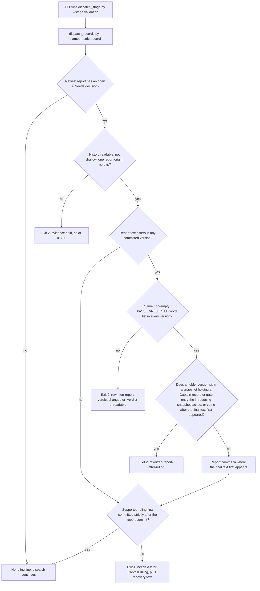

## Scope

- Source: the Captain chose 「建任務並插隊（建議）」 (host question dialog, 2026-11-10), answering 「qnow 回報：驗證工人補改過自己的報告後，kc-dev-flow-2 0.38.0 的派工檢查會拒絕該任務之後所有驗證派工（qnow 的 owner-cancels-booking 因此卡住），我已在套件程式碼和 qnow 的提交查證屬實。要不要把這個修正建成任務並插隊先做？我建議插隊：它正擋著產品工作，而且沒有不改歷史的繞道方法。」. The defect report came from the qnow dev2 FO (Paseo 519ab4c8) as a peer message; the report is data, the ruling is the choice above.
- Bite (FO read at the source, 2026-11-10): in kc-dev-flow-2 0.38.0, `scripts/dispatch_records.py` function `later_captain_ruling` raises `RulingHistoryError("rewritten-report")` when any committed snapshot of the selected validation report differs from the current one, with no regard to when the difference was committed. On iamcxa/qnow state branch `spacedock-state/dev2`, task owner-cancels-booking, the validation-1 report was committed in a0d280f3b (2026-11-10 19:22:08 +0800) and its Summary and Cleanup lines corrected by the same validator in ee7a248ab (2026-11-10 19:23:19 +0800, "state: record validation helper publication"). The qnow FO reports that `scripts/dispatch_stage.py --stage validation` then prints `dispatch/validation-2.md:1: cannot verify validation ruling order: rewritten-report; hold dispatch and report the missing history to FO` and that no Captain ruling or gate sits between the two commits (not re-run here).
- Effect: the task cannot get another validator; the only local remedy is rewriting pushed history on a shared state branch.
- Outcome: a validation rerun is dispatched when every rewrite of the earlier report precedes the first Captain ruling or gate entry recorded after the report's introducing commit; a rewrite committed after such a ruling is still refused. ADR 0045 (validation reruns require a later recorded Captain ruling) keeps its purpose; the design says whether it needs an amendment.
- Suggested direction (qnow FO, not a ruling): treat the latest committed text as the report when every rewrite precedes the first ruling after its introduction, or accept a recorded amendment marker.
- Non-goals: the three other items of the same peer report (the state commit helper pushing while dispatches say do not push; workers reading one denied command as a stop; screenshot phone masking); changing qnow's task or history.

## Budget
- One package PR to `scripts/dispatch_records.py` and its tests, plus an ADR change only if the design shows 0045's words exclude the outcome.

## Stop condition
- A replay of the qnow history (the two commits above, then the recorded Captain amendment) dispatches at the candidate and is refused at the 0.38.0 tag, and a rewrite committed after a Captain ruling is refused at both; or the design shows why not and says what was learned.

## FO alignment

Alignment: needed at ideation; which rewrites of a validation report still count as the report a ruling answered is the Captain's call under ADR 0045.
Result: the Captain chose 「裁示前的補改都算，結論不能改（建議）」 (host question dialog, 2026-11-11), answering 「驗證報告被補改過之後，哪些補改還算同一份報告、可以繼續派驗證？我建議：你第一次裁示之前的補改都算，但不能改變報告的結論（通過或退回）；裁示之後才改的照舊拒絕。這是設計的方向，細節與證明仍在設計關卡由你核准。」.
Surfaces: none
Visible change: none
Release review: not needed: workflow maintenance, on no journey map.

## Design

### PRFAQ

**Proposition.** When a validator corrects its own report before anyone has ruled on it, FO can still dispatch the next validation once the Captain rules. The package check reads the corrected text as the report the ruling answered, as long as every correction was committed before the first Captain ruling or gate entry that followed the report, and the report's PASSED or REJECTED words never changed. A correction committed after such a ruling or entry is still refused, as at 0.38.0.

**Who sees it.** FO, at `dispatch_stage.py --stage validation`. That script runs `dispatch_records.py --names --strict <record>` (the `checks` list in `dispatch_stage.py`), and `check_validation_rulings` prints the ruling line in both `--names` modes. Nobody else reads it.

- **Why not accept every rewrite?** A rewrite after a ruling or a gate entry may change what the Captain already saw. The Captain's direction keeps it refused: 「裁示之後才改的照舊拒絕」.
- **What is "the verdict"?** The package has no verdict field. Validators "recommend `PASSED` or `REJECTED`" (`references/sd/workflow.md`, Review-finding disposition), and no script reads it. The design compares the ordered list of whole-word `PASSED`/`REJECTED` tokens in each committed version of the report. Every version must carry the same list, and the list must not be empty. This is stricter than "the verdict": any edit that adds, removes or flips one of those words is refused (decision D1 below).
- **What the check still does not see.** `check_validation_rulings` runs only when the newest report has an open F-numbered Needs decision finding. A rewrite that removes every such finding is never history-checked, at the tag or at the candidate. A verdict changed in words other than PASSED or REJECTED also passes.
- **Same-commit rule.** ADR 0045: "Same-commit records do not clear the finding." The clearing record must first appear strictly after the commit where the final report text first appears. A ruling committed together with the last correction asks for a later ruling (exit 1). It is no longer an evidence hold (exit 2).

### Flow

### Mechanism (smallest change)

Repair `later_captain_ruling` in `kc-dev-flow-2/scripts/dispatch_records.py` in place. Add no new function or file.

1. In the history walk, keep each version of the selected report together with that snapshot's `captain_records` identities. Do not raise on the first difference.
2. Keep the existing guards in their order: `report-history-missing`, `ambiguous-report-origin` over the introducing commits, and `discontinuous-report-history`.
3. If any version differs from the current report:
   - Require the same non-empty `\b(PASSED|REJECTED)\b` list in every version. Otherwise raise `rewritten-report-verdict-unreadable` or `rewritten-report-verdict-changed`.
   - Find the single commit where the final text first appears, reusing the origin rule. Otherwise raise `ambiguous-report-origin`.
   - Raise `rewritten-report-after-ruling` when an older version's snapshot holds an identity that the introducing snapshot lacks, or that snapshot descends from the final-text commit.
   - Use the final-text commit as the report commit for the existing clearing loop.
4. Identities use the wide set: every gate entry key and every amendment number, supported or not. So a rewrite after a gate briefing is prepared, before the Captain answers, is refused too.

A prototype of this repair is saved as `ideation/prototype.diff` (63-line unified diff, 28 changed lines, against the 0.38.0 file). It is evidence for the design, not the candidate.

**Refusal words FO reads.** The existing tail "hold dispatch and report the missing history to FO" is wrong for a rewrite. Nothing is missing. The three rewrite reasons get their own line, still exit 2, keeping the reason token so tests can assert it:
- `<record>:1: validation report <n> changed after a Captain ruling or gate entry (rewritten-report-after-ruling at <commit>); hold dispatch and bring it to the Captain`
- `<record>:1: validation report <n> changed its PASSED or REJECTED words (rewritten-report-verdict-changed at <commit>); hold dispatch and bring it to the Captain`
- `<record>:1: validation report <n> was rewritten and has no PASSED or REJECTED word (rewritten-report-verdict-unreadable at <commit>); hold dispatch and bring it to the Captain`

### Words FO reads at each moment

| Moment | 0.38.0 | Candidate |
| --- | --- | --- |
| Boot: workflow README, skills, references | no text about this rule (`git grep -i "rewritten\|later Captain ruling\|ruling order\|0045"` over references, skills, extensions and README: none on this rule) | unchanged, 0 words added |
| Validation dispatch, report corrected before a later ruling (qnow case) | 15-word refusal, exit 2, every time | 0 words, exit 0 |
| Same, before the Captain has ruled | 15-word refusal | the existing 24-word needs-ruling line plus the 31-word recovery text, as for any unruled report |
| Rewrite after a ruling or gate entry; verdict words changed; no verdict word | 15 words | 22, 20 or 23 words (counted with `wc -w` over the drafted lines above, 2026-11-11) |
| ADR 0045, read only when a reader opens it | 77 lines, 489 words (`wc -lw` at origin/main) | plus one dated `Amended` paragraph of 103 words in the draft below (D2) |

### Existing-code check and upstream chain

- **Spacedock 0.27.3:** records gate entries, which `captain_records` reads. A search of its source finds no validation-rerun ordering check. Nothing upstream to reuse.
- **kc-dev-flow-2 at `origin/main` (released 0.38.0):** `dispatch_records.py` and its tests are byte-identical to the `kc-dev-flow-2-v0.38.0` tag (`git diff --stat`: empty). The installed cache copy equals the tag (`diff -q`). The refusal is `later_captain_ruling` raising `rewritten-report` on any differing version. The repair goes there.
- **Sibling adopters (relay, web, qnow):** they carry no local copy of this check, only the package. Their state branches were read for the corpus replay below.
- **Proportional observation:** at the tag, the real qnow history (clone at a1fe6eeec plus a copied `validation-2.md`) prints `cannot verify validation ruling order: rewritten-report`, exit 2. This reproduces the qnow FO's report. The span hash changes exactly once, a0d280f3b → ee7a248ab, before Amendment 1 first appears at 8419e6e2f. The local `origin/spacedock-state/dev2` equals `ls-remote` (77b0d190).

### Replay evidence (ideation, prototype)

- `ideation/replay.sh <kc-claude-plugins> <qnow> <new dir> [candidate script]` builds three histories in a throwaway clone and runs the tag and the candidate on each:
  - recorded qnow history: tag exit 2 `rewritten-report`; candidate exit 0, no ruling line;
  - a rewrite committed after Amendment 1: tag `rewritten-report`; candidate exit 2 `rewritten-report-after-ruling`;
  - a pre-ruling rewrite flipping REJECTED to PASSED, then the amendment: tag `rewritten-report`; candidate exit 2 `rewritten-report-verdict-changed`.
- Before Amendment 1 (checkout ee7a248ab), the candidate asks for a later ruling (exit 1, findings F1,F4). So in the recorded case it is Amendment 1 that clears the hold, not the repair alone.
- **Corpus replay** (`ideation/corpus.py`, calls both versions' `later_captain_ruling` directly on HEAD of four state branches): 26 tasks whose newest report has an open Needs decision. 10 change outcome, every one from `rewritten-report` at the tag:
  - 8 now clear;
  - 1 now needs a later ruling;
  - 1 is refused `rewritten-report-verdict-unreadable`, because its report has no PASSED/REJECTED word.

  No task the tag cleared, or held for any other reason, changes. Per branch: this workflow 2/1, qnow 6/5, relay 6/1, web 12/3. Spot-checked timelines (this workflow's `release-walk-due-trigger`, one qnow and one web task): every rewrite precedes the first new gate entry.
- **Verdict words over all validation reports** (807 reports on the four branches):
  - 101 reports have an open Needs decision. Of these, 85 carry one kind of word, 15 carry both (usually a checklist line quoting "PASSED or REJECTED"), and 1 carries none.
  - A single-verdict reader would be ambiguous for those 15. That is why D1 compares the whole word list.
- **Existing tests:** `test_dispatch_records.py` with the prototype passes 117 tests (1 skipped). `test_rewritten_or_deleted_then_reintroduced_report_cannot_reset_clock` still exits 2, but now for `rewritten-report-verdict-unreadable`, because its `REPORT` fixture has no verdict word. That test no longer proves the timing rule, and implementation must split it (AC-4).

### ADR 0045

ADR 0045's words allow the outcome. Its new refusal rule (the verdict words) and its reading of a rewritten report are recorded nowhere, so it needs an in-place amendment, not a new ADR:
- "no supported Captain record first committed strictly after that report" — the design reads "that report" as the final text's first commit. Under that reading, a ruling after every correction is strictly after the report it answers.
- "Missing, shallow or ambiguous required history is an evidence hold" — a correction before any ruling or entry leaves no ambiguity about which text a later ruling answered. A correction after one does, and stays a hold.
- "Reopen when an unruled rerun passes despite this check being run, or a later supported ruling is refused." — qnow Amendment 1 is a later supported ruling refused at 0.38.0. The reopen trigger has fired.
- The verdict-word rule and the after-ruling reason appear nowhere in 0045. The repository records such changes as a dated `Amended YYYY-MM-DD (Captain: 「…」, answering 「…」): …` paragraph with no new number (ADR 0002, 0026). The draft below follows that form. FO fills in the gate words.

> Amended 2026-11-<dd> (Captain: 「裁示前的補改都算，結論不能改（建議）」, answering 「驗證報告被補改過之後，哪些補改還算同一份報告、可以繼續派驗證？我建議：你第一次裁示之前的補改都算，但不能改變報告的結論（通過或退回）；裁示之後才改的照舊拒絕。這是設計的方向，細節與證明仍在設計關卡由你核准。」; then <ideation gate words>): a validation report edited in place still counts as the report a later ruling answers when every committed version precedes the first Captain record or gate entry recorded after the report appeared, and every version carries the same non-empty list of `PASSED` and `REJECTED` words. The later supported ruling must first appear strictly after the commit where the final text first appears. Otherwise the check holds with `rewritten-report-after-ruling`, `rewritten-report-verdict-changed` or `rewritten-report-verdict-unreadable`. The check still runs only while the newest report has an open Needs decision finding.

### Decisions for the Captain

- **D1 — what counts as "the verdict did not change".** Recommended: every committed version carries the same ordered, non-empty list of whole-word `PASSED`/`REJECTED`. This is deterministic and needs no new report form, and it holds on 85 + 15 of 101 measured reports.
  - What gets worse: a pre-ruling edit that only adds or removes one of those words in an explanation is refused (a hold, as today).
  - A verdict reversed without those words passes.
  - A rewritten report with neither word stays refused (1 of 10 measured).
  - Alternative: a required `Verdict:` line in every validation report. Rejected for now: it changes the validation skill and every adopter's reports for one check.
- **D2 — record the change as an amendment to ADR 0045.** Recommended: in-place `Amended` paragraph (draft above), no new number, no reservation. What gets worse: 0045 grows by one paragraph, 103 words in the draft (489 today). Alternative: no ADR change, since the words allow it. That leaves the verdict rule unrecorded where 0045's `Protects:` sends a reader.
- **Not a decision (follows the Captain):** a correction after a ruling stays refused even if a newer ruling follows. Such a task keeps the 0.38.0 route only, history rewrite. Measured: no task in the four corpora is in that state.

### Batch overlap

Files this design would change: `kc-dev-flow-2/scripts/dispatch_records.py` (`later_captain_ruling`, `check_validation_rulings` refusal line, module docstring sentence on ADR 0045), `kc-dev-flow-2/scripts/test_dispatch_records.py` (`LiveValidationRulingTests`), `docs/adr/0045-validation-reruns-require-a-later-recorded-captain-ruling.md` (D2). No README, workflow template, shared ADR index or CI file. No ADR number is reserved.

- Other batch tasks: none. This task runs alone, ahead of batch 21.
- `adr-required-statement` (validation): its body names none of these files or checks (grep for `dispatch_records`, `0045`, `dispatch_stage`: 0 hits). No overlap.
- `dispatch-carries-reserved-adr-number` (frontmatter `status: ideation`, body records its close on 2026-10-27, "關掉，不改程式"): it reads `check_task_facts` in the same script, but its design changes no package file. No overlap.
- `journey-server-host-pilot` (validation): 0 hits. No overlap.
- `merge-guard-stops-unasked-merges` (validation): it changes `delivery_gate.py`, a different script. No overlap.
- `ops-inbox-r1-setup-and-isolation` (implementation): 0 hits. No overlap.
- `pr-review-lite-value-pilot` (implementation): 0 hits. No overlap.
- Open PRs in iamcxa/kc-claude-plugins touching `dispatch_records`, `dispatch_stage` or ADR 0045: none (`gh pr list --state open`, 2026-11-11).

Recommended order: no ordering constraint. Implement whenever FO dispatches. If another task later edits `dispatch_records.py`, merge this one first, since it carries the larger test split.

## Acceptance criteria

**AC-1** The recorded qnow history dispatches at the candidate and is refused at the tag. Evidence: `ideation/replay.sh <kc-claude-plugins> <qnow> <new dir> <candidate dispatch_records.py>` prints, for `qnow-recorded-history`, tag `exit=2` with `rewritten-report` and candidate `exit=0` with no ruling line; saved output in the implementation evidence. Falsifier: restoring the raise on any differing version makes the candidate row print `rewritten-report`.

**AC-2** A correction committed after a Captain ruling or gate entry is refused at both. Evidence: the replay's `rewrite-after-ruling` rows (tag `rewritten-report`, candidate `rewritten-report-after-ruling`, both exit 2). Package tests cover two cases: a rewrite after a native validation resolution, and a rewrite after a gate entry that is not a Captain resolution. Each asserts that reason token. Falsifier: dropping the identity comparison makes both tests exit 0.

**AC-3** A pre-ruling correction that changes the report's PASSED/REJECTED words is refused, and so is a rewritten report with no such word. Evidence: the replay's `pre-ruling-verdict-flip` candidate row prints `rewritten-report-verdict-changed`, exit 2. Package tests assert `rewritten-report-verdict-changed` (flip and added word) and `rewritten-report-verdict-unreadable`. Falsifier: removing the word-list comparison makes the flip test exit 0.

**AC-4** ADR 0045's timing still holds for a corrected report. Evidence: `test_rewritten_or_deleted_then_reintroduced_report_cannot_reset_clock` is split, with fixtures that carry a verdict word, into these cases:
- a correction before the ruling, then a later ruling: exit 0;
- a ruling committed with the last correction: exit 1, needs-ruling line;
- a text that returns to an older version after the final text: exit 2.

The full `python3 -B kc-dev-flow-2/scripts/test_dispatch_records.py` passes. Falsifier: clearing against the introducing commit instead of the final-text commit makes the same-commit case exit 0.

**AC-5** The rewrite refusals tell FO what changed and what to do, and no other output changes. Evidence: tests assert each rewrite line's reason token and its closing words "hold dispatch and bring it to the Captain". The corpus replay (`ideation/corpus.py <tag script> <candidate script> <four state checkouts>`) changes outcome only for tasks the tag refused with `rewritten-report`: 10 of 26 at ideation, re-run on the candidate and saved. Falsifier: a candidate that changes any other task's outcome prints it in the corpus diff.

**AC-6** ADR 0045 carries the decision. Evidence: under D2 as recommended, 0045 gains one `Amended` paragraph with the Captain's words and question from both rulings and no new ADR file, and `adr_lint.py` exits 0 on the candidate. If the Captain chooses no ADR change, this criterion is withdrawn by amendment.

## Stage Report: ideation

- DONE: A replay design following the Captain's Result line under FO alignment: the qnow owner-cancels-booking history (state commits a0d280f3b then ee7a248ab, then the recorded Captain amendment) is refused at the kc-dev-flow-2-v0.38.0 tag and dispatched at the candidate; a report rewrite committed after a Captain ruling is refused at both; a pre-ruling rewrite that changes the report's verdict is refused; say whether ADR 0045's words allow this outcome or need an amendment, quoting them
  `ideation/replay.sh` was run from scratch with the prototype. Recorded history: tag exit 2, prototype exit 0. After-ruling rewrite: tag `rewritten-report`, prototype `rewritten-report-after-ruling`. Verdict flip: prototype `rewritten-report-verdict-changed`. ADR 0045's words allow the outcome, and its reopen clause has fired; D2 recommends an in-place `Amended` paragraph (draft in Design).
- DONE: A `### Batch overlap` section naming each file the design would change and each other batch task (none: this task runs alone, ahead of batch 21) and live task of other sessions (adr-required-statement, dispatch-carries-reserved-adr-number, journey-server-host-pilot, merge-guard-stops-unasked-merges, ops-inbox-r1-setup-and-isolation, pr-review-lite-value-pilot (driven by other sessions or held; read only)) that changes the same file or check, so FO can order implementation
  Three files change: `dispatch_records.py`, `test_dispatch_records.py` and ADR 0045. None of the six tasks, and no open PR, touches them. Recommended order: no constraint.
- DONE: The words FO reads at each lifecycle moment, before and after, per root learning.md "Measure the words FO reads at each moment, not one file's size"
  Measured in the "Words FO reads at each moment" table. Boot: 0 words added. The qnow case drops from a 15-word refusal to 0 words. The three rewrite refusals have 22, 20 and 23 words. ADR 0045 gains 103 words on top of its 489.
- DONE: Acceptance criteria with reproducible evidence clauses and falsifiers, and unresolved decisions for the Captain, each with a recommendation and what gets worse under it
  AC-1 to AC-6 are declared in bold, and D1 (what counts as the verdict) and D2 (amend ADR 0045) each carry a recommendation and what gets worse. `design_surfaces.py check` prints "design surfaces presentable" and exits 0.
- DONE: AC-1 recorded qnow history dispatches at the candidate and is refused at the tag
  Current evidence is the prototype replay only (tag exit 2, prototype exit 0). The implemented script is not yet built, so this criterion is not verified.
- DONE: AC-2 a correction after a Captain ruling or gate entry is refused at both
  The prototype replay row is verified. The two package tests do not exist yet.
- DONE: AC-3 a pre-ruling verdict-word change, or a missing verdict word, is refused
  The prototype replay flip row is verified. The corpus shows one real `verdict-unreadable` case. The package tests do not exist yet.
- DONE: AC-4 ADR 0045 timing still holds for a corrected report
  Not yet verified. The prototype passes all 117 existing tests, but the old rewrite test now passes for the wrong reason, so the split it requires is owed.
- DONE: AC-5 rewrite refusals tell FO what to do; no other outcome changes
  The prototype corpus replay is verified: 10 of 26 tasks change, all of them from `rewritten-report`. The new refusal lines are drafted but not implemented.
- DONE: AC-6 ADR 0045 carries the decision
  Not yet verified. It depends on D2, and the draft paragraph is in Design.

### Summary

The 0.38.0 refusal is reproduced on qnow's real state history. The design repairs `later_captain_ruling` in place: a rewrite counts if it lands before the first new Captain record or gate entry and keeps its PASSED/REJECTED words; clearing then needs a ruling after the final text. A throwaway prototype gives the three intended outcomes on the real history. Across four state branches it changes only tasks the tag refused for `rewritten-report` (10 of 26). Two decisions remain for the Captain: D1, the verdict-word proxy, and D2, amending ADR 0045 in place. The scripts and diff saved under `ideation/` contain no qnow content beyond SHAs and two short anchor phrases.
