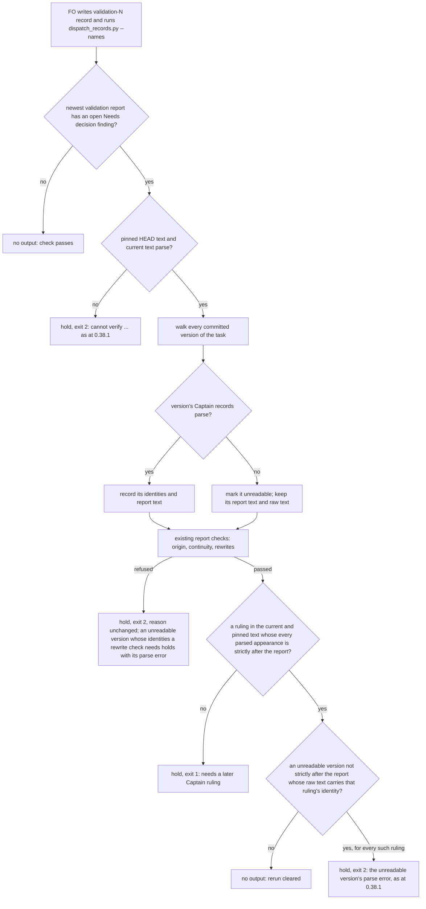

## Scope

- Source: the Captain chose 「建任務並插隊，當成例外（建議）」 (host question dialog, 2026-11-11), answering 「qnow 的 owner-cancels-booking 又被同一個檢查擋住：任務歷史裡有幾個版本的修正案曾經寫錯位置（已修好），套件讀到就拒絕之後所有驗證派工。要不要建任務並插隊，當成「先畫地圖再挑批次」的例外？我建議插隊，而且這次要求設計把「歷史裡已修好的錯誤會永久擋住驗證」當成一類來處理，清點這個檢查還有哪些同類情況，不再一次修一種。」. The defect report came from the qnow dev2 FO through the Chief Engineer session (Paseo 7017a63f) as a peer message; the report is data, the ruling is the choice above.
- Bite (FO reproduced 2026-11-11 with kc-dev-flow-2 0.38.1 `scripts/dispatch_records.py`, read-only on iamcxa/qnow `origin/spacedock-state/dev2`): calling `captain_records` on each of the 42 committed versions of `owner-cancels-booking.md` raises `RulingHistoryError("ambiguous-amendments")` on four of them (03838f912, 3d34b9df7, cc86ce662, a28d69b52, all 2026-11-11) and the current text parses clean. `later_captain_ruling` calls `captain_records` on every historical version with no handling, so one such version refuses every later validation dispatch of the task. The qnow FO reports the refusal line `validation-3.md:1: cannot verify validation ruling order: ambiguous-amendments; hold dispatch and report the missing history to FO`, and that the four versions held amendments 2 to 5 outside `## Captain amendments`, since moved unchanged with a record correction (its report, not re-read here).
- Same function, second time: kc-dev-flow-2 0.38.1 (PR #834, task validation-rerun-accepts-report-fixed-before-ruling) changed the same walk for a report corrected before a ruling. That fix handled one shape. State history is append-only and pushed, so any historical version the walk refuses is a permanent refusal.
- Outcome: a validation rerun is dispatched when every form error in the task's history was repaired before the dispatch and the pinned current text passes; what ADR 0045 protects (a later recorded Captain ruling before a validation rerun) still holds, including which commit counts as a ruling's first appearance.
- The class, not the case: the design lists every reason for which the history walk can refuse because of a past version alone (the module's RulingHistoryError reasons, and any other raise reached from the walk), says for each whether a repaired past can trigger it, and decides each one, so the next shape is not a third task.
- Design question the Chief Engineer session raised, his to gate: a historical version that contributes no identities can change which commit is a ruling's first appearance.
- Non-goals: changing qnow's task or history; relaxing the check on the pinned HEAD or the current text; the other qnow report items.

## Budget
- One implementation and one validation cycle, in one package PR to `scripts/dispatch_records.py` and its tests, plus an ADR change only if the design shows 0045's words exclude the outcome.

## Stop condition
- A replay of the qnow history at its recorded commits is refused at the kc-dev-flow-2-v0.38.1 tag and dispatched at the candidate, a history whose form error is still unrepaired at HEAD is refused at both, and a corpus replay over this workflow's and the adopters' state branches shows which tasks change outcome and that none the tag cleared changes; or the design shows why not and says what was learned.

## FO alignment

Alignment: needed at ideation; how a past version that does not parse is read, and what that does to the first appearance of a ruling under ADR 0045, are the Captain's call.
Result: the Captain chose 「能證明不影響才放行（建議）」 (host question dialog, 2026-11-11), answering 「驗證重跑的檢查回頭讀任務歷史時，碰到讀不懂的舊版本（例如修正案曾經寫錯位置）要怎麼處理？我建議：只有在能證明讀不懂的版本不影響結論時才放行，也就是用來放行的那筆裁示，它第一次出現的版本本身讀得懂、而且排在所有讀不懂的版本之後；其他情況照舊拒絕。設計要量出這樣在各 repo 解開幾張、還擋幾張。這是設計的方向，細節與證明仍在設計關卡由你核准。」.
Surfaces: none
Visible change: none
Release review: not needed: workflow maintenance, on no journey map.

## Design

Read against `iamcxa/kc-claude-plugins` `origin/main` 546a136386c94c58e430c91a6f3457b38bd73880 (fetched 2026-11-11), released kc-dev-flow-2 0.38.1; `kc-dev-flow-2/scripts/dispatch_records.py`, `design_surfaces.py`, `decision_ledger.py` and `role_triggers.py` there are byte-identical to tag `kc-dev-flow-2-v0.38.1` (`git diff --quiet` exit 0).

### PRFAQ

**Proposition.** When a task's history holds a past version whose Captain records do not parse, and that version was later repaired, the validation rerun check still clears the rerun as long as the broken version provably cannot hold the ruling that clears it: it was committed strictly after the validation report, or its raw text does not carry that ruling's identity at all. Every other case is refused exactly as at 0.38.1.

**Who and when.** FO, at a validation dispatch, through `dispatch_records.py --names --strict <record>` (the only caller of `later_captain_ruling`; `references/sd/workflow.md` § dispatch records).

FAQ
- *Does this read the broken version?* No parse of it is trusted. The check only asks two questions of it: is it a strict descendant of the report commit, and does its raw text contain `### Amendment N` (for an amendment) or the gate-attempt id (for a native gate). A record can only be parsed out of a version whose text carries that line or id, so a "no" proves the version cannot hold it, whatever its fences or headings do.
- *What about the pinned HEAD and the current text?* Unchanged: both are parsed strictly before the walk, so a form error still present at HEAD is refused (non-goal kept).
- *What does FO see?* For a cleared rerun, nothing (the same as any clean check). For a blocked one, the same line 0.38.1 prints. One shape changes its line: when no ruling after the report exists at all, FO now gets the 0.38.1 "needs a later Captain ruling" line (exit 1) instead of "cannot verify ... ambiguous-amendments" (exit 2), because the broken version cannot make a ruling later, only earlier.
- *Which commit is a ruling's first appearance (the Chief Engineer's question)?* The walk counts only versions that parse, so the first parsed appearance can be later than the true one. The rule bounds that error: a broken version that could hold the ruling must lie strictly after the report, so the true first appearance is also strictly after the report and ADR 0045's "first committed strictly after that report" holds either way. A broken version not after the report that could hold it blocks the clear.



### The rule, and how it relates to the Captain's direction

The Captain's direction (`## FO alignment`, Result): clear only when it can be proven the unreadable versions do not affect the conclusion, "也就是用來放行的那筆裁示，它第一次出現的版本本身讀得懂、而且排在所有讀不懂的版本之後". The design keeps the first half as the test and replaces the operational second half with a proof, because the corpus and the synthetic histories below show the second half, as worded, both clears an unsound case and holds a real task forever:

- **Proof rule (designed, prototype `v5` below):** a ruling K clears when every parsed appearance of K is strictly after the report (unchanged), and no unreadable version that is not strictly after the report carries K's identity in its raw text.
- **His wording, first-parsed reading (`c`):** every parsed appearance of K comes after every unreadable version. It clears synthetic H (a ruling sitting in a broken pre-report version, removed, re-added after the report), which ADR 0045 forbids ("Editing an older entry does not make it later"), and holds synthetic B (ruling recorded, a later heading typo, repaired).
- **His wording plus an after-report guard (`both`):** also requires every unreadable version to be after the report. Sound, but it holds kc-claude-plugins `fo-interviews-extension` forever: its broken versions (an unmatched fence in `## Captain amendments`, repaired) all predate its validation report.
- **After-report guard alone (`p`):** sound; holds `fo-interviews-extension` like `both`.
- Literal reading, for the record: in qnow `owner-cancels-booking` the clearing rulings are amendments 2 to 5, and the broken version 03838f91 already carries `### Amendment 2` (outside the section). Read literally ("its first version parses"), his wording would still hold qnow; only the first-parsed reading clears it.

### Every refusal the walk can raise from a past version alone

| Reason (raised where) | Can a repaired past trigger it? | Design |
| --- | --- | --- |
| `ambiguous-amendments` from `captain_records` → `parse_amendments` issues: amendment outside `## Captain amendments`, malformed heading, duplicate section, duplicate number, unmatched amendment-region fence, fence before another opening | Yes. Real: qnow `owner-cancels-booking` (outside section), kcp `fo-interviews-extension` (unmatched fence); synthetic A, B, C, G | Version marked unreadable; proof rule |
| `ValueError` (JSONDecodeError) from `gate_entries` → `unquote` on a malformed double-quoted scalar | Yes (hand-edited gate scalar). Synthetic E | Same class: unreadable, proof rule (gate identity searched as raw id) |
| `ambiguous-task-paths` from `task_snapshot` (two of the four task paths in one commit) | Yes (copy-then-delete archive move). Synthetic T | Held, unchanged: no single text to read reports from. 0 hits in the corpus |
| `UnicodeDecodeError` from `git show` decoding in `ruling_git` (caught as ValueError by the caller) | Yes (bad bytes pasted, then removed). Synthetic X | Held, unchanged: the report text is unreadable too. 0 hits in the corpus |
| `discontinuous-report-history` | Yes: an unclosed fence above the report hides it in one version. Synthetic U | Held, unchanged: telling a hidden report from a deleted one needs a fence-state reader the walk lacks. 0 hits in the corpus |
| `ambiguous-report-origin` | Only from two independent report introductions merged together (concurrent writers), not from a form error | Held, unchanged |
| `rewritten-report-verdict-changed`, `-verdict-unreadable`, `-after-ruling` | A report edit, including a typo later reverted, triggers them; the Captain ruled on 2026-11-11 (ADR 0045 amendment) that every version carries the same word list and edits after a ruling hold | Held, unchanged by that ruling. Corpus: 4 tasks, all real word-list changes (checked per version) |
| `report-history-missing`, `uncommitted-report`, `shallow-history`, `git-history-unreadable`, `git-ancestry-unreadable`, `different-task-root` | No: they read HEAD, the repository or the environment, not a past version's content | Unchanged |

Recovery for the held shapes: none in the package. History is append-only and pushed, and no Captain record clears T, U or X; FO can only bring the hold to the Captain. Under the proof rule, a broken version before the report that carries the clearing ruling's own identity (synthetic H, L) is also held with no recovery other than a new ruling with a new identity after the report (a new amendment number or a new gate attempt), which then clears.

### Existing-code check

Upstream first: Spacedock writes the gate records the check reads; ADR 0045 places the order check in kc-dev-flow-2. kc-dev-flow-2 already has the walk; PR #834 (0.38.1) changed it for reports corrected before a ruling. The change repairs the existing walk; no new script, no new parser: the raw search uses the heading form `parse_amendments` already numbers (`^\s*### Amendment ([0-9]+)\b`, case-insensitive) and the gate-attempt id string.

### Replays

Package sides: tag `kc-dev-flow-2-v0.38.1` scripts (`git archive`), and the tag scripts with the prototype diff below applied. Each replay calls `check_validation_rulings([<record>])` (the `--names` predicate alone) in a detached worktree of a fresh clone at the named commit, with an empty `validation-<N>.md` written into `<task>/dispatch/` when the record was never committed (the predicate reads only its path).

qnow `spacedock-state/dev2` at b99a7543, task `owner-cancels-booking`, report 2 first committed at f6c94d50, open findings F1 and F4, unreadable versions 03838f91, 3d34b9df, cc86ce66, a28d69b5 (all strict descendants of f6c94d50), clearing rulings amendments 2 to 5:

| Replayed at | 0.38.1 | Candidate |
| --- | --- | --- |
| f6c94d50, 78a76aa2 (before any amendment after the report) | exit 1, needs a later ruling | exit 1, same line |
| 03838f91, a28d69b5 (still broken at that HEAD: unrepaired control) | exit 2, ambiguous-amendments | exit 2, same line |
| 071fe3b6, cf9560fc, 744eaa08, 5868a574 (repaired) | exit 2, ambiguous-amendments | exit 0 |
| branch HEAD b99a7543 | exit 2, ambiguous-amendments | exit 0 |

Verdict: the proof rule clears qnow `owner-cancels-booking` because every broken version was committed after report 2, so nothing it holds can predate the report. Its own unrepaired versions (03838f91, a28d69b5 as HEAD) stay held, and so do two more unrepaired-at-HEAD controls found in the corpus: subspace-web `number-tag-shows-send-time` (f67a3abe) and `briefing-frame-and-controls` (000a7103), still broken at those records.

Synthetic histories (one small repository each, 13 cases, tag vs candidate): A qnow shape clears; B (ruling, later heading typo, repaired) clears; C (break repaired before the report, newer ruling after) clears; K (native gate ruling after the report, broken pre-report version without its id) clears; E (bad quoted gate scalar, repaired) clears; F control clears at both; H and L (the clearing ruling's identity sits in a broken pre-report version) hold, exit 2; D (still broken at HEAD) holds at both; G (broken and repaired after the report, no later ruling) holds, exit 2 at the tag and exit 1 at the candidate; T, U, X hold at both with their 0.38.1 reasons. Mutations: dropping the after-report clause holds A and B; treating every pre-report broken version as blocking holds C and K; making the raw search always answer "absent" clears H and L. Each clause is falsified by its own cases.

### Corpus replay

Branches (fresh clones, read-only): `spacedock-state/dev2` of iamcxa/kc-claude-plugins at aa7119da, iamcxa/qnow at b99a7543, spacedock-dev/subspace-relay at 916c2d80, spacedock-dev/subspace-web at faf28a25, spacedock-dev/subspace-v0 at 887cd65 and iamcxa/me-company at b98c5f6 — the kc-dev-flow-2 workflow of each repository that has one. Not replayed (a limit, not a finding): the `dev2-poc`, `dev`, `ship` and `plan` state branches.
Events: every committed `validation-N.md` / `validation-N-message-M.md` record replayed at the commit that added it, plus one synthesized next validation record per task at branch HEAD: 1909 events. 161 events on 73 tasks reach the predicate (the newest validation report has an open Needs decision finding); 0.38.1 returns exit 0 on 97, exit 1 on 46 and exit 2 on 18 events, the exit-2 events on 8 tasks (ambiguous-amendments 4 tasks, rewritten-report-verdict-changed 3, rewritten-report-verdict-unreadable 1).

| Variant | Tasks cleared | Tag-held tasks still held | Tasks unchanged (of 73) | Event pairs (tag→variant) |
| --- | --- | --- | --- | --- |
| Proof rule (designed) | 2: qnow `owner-cancels-booking`, kcp `fo-interviews-extension` | 6 | 71 | 0→0 97, 1→1 46, 2→0 3, 2→2 15 |
| His wording plus after-report guard | 1: qnow `owner-cancels-booking` | 7 | 72 | 0→0 97, 1→1 46, 2→0 1, 2→2 17 |
| After-report guard alone | 1: qnow `owner-cancels-booking` | 7 | 72 | same as above |
| His wording, first-parsed reading | 3: the two above and subspace-web `number-tag-shows-send-time` | 5 | 70 | 0→0 97, 1→1 46, 2→0 8, 2→2 10 |

No variant changes an event 0.38.1 returns 0 or 1, and every 2→2 event prints 0.38.1's line byte for byte. The extra clear under the first-parsed reading is unsound: at the archive commit fda02ff5, `number-tag-shows-send-time`'s report 3 first appears at 9db992c5, a version that already carries `### Amendment 1` outside the section and the same three gate attempts; no Captain record was added after it, yet the first-parsed reading clears it because those records first parse at aac8d7bb. That is the "unruled rerun passes" that ADR 0045's Consequences name as its reopen trigger. Still held under the proof rule: that task (correctly), subspace-web `briefing-frame-and-controls` (still broken at HEAD at its records) and the four rewritten-report tasks; their word lists were checked per version and differ (qnow `landing-page-and-trial-requests` 2→3→4 `REJECTED`, subspace-relay `pair-once` 3 `REJECTED` → a six-word mixed list), so they are real rewrites under the 2026-11-11 ruling, not repaired errors.

### ADR 0045

Its words allow the outcome. The rule it protects is "no supported Captain record first committed strictly after that report", and "Missing, shallow or ambiguous required history is an evidence hold". A broken version after the report, or one whose raw text does not carry the ruling's identity, cannot change whether that ruling was first committed strictly after the report, so it is not required history for that predicate; a broken version that could change it still holds. "Editing an older entry does not make it later" stays enforced (synthetic H, L). Its Consequences name this case: "Reopen when an unruled rerun passes despite this check being run, or a later supported ruling is refused" — qnow's amendments 2 to 5 are later supported rulings refused at 0.38.1. The design therefore proposes an in-place amendment paragraph to ADR 0045 (no new number, the 2026-11-11 precedent) recording the Captain's alignment words and this rule; see decision D2.

### Words FO reads at each moment

`references/sd/workflow.md` (startup) is unchanged: +0 words. The predicate runs only inside `--names` at a validation dispatch; no idle, archive or merge-ask moment runs it (`git grep check_validation_rulings` on `origin/main` finds one caller, `main()`). At the validation dispatch moment: a cleared rerun such as qnow's goes from 16 words (`validation-3.md:1: cannot verify validation ruling order: ambiguous-amendments; hold dispatch and report the missing history to FO`) to 0; a held rerun prints the same line as 0.38.1; shape G goes from that 16-word line to the 25-word needs-a-later-ruling line plus the 31-word recovery sentence (56 words), which tells FO the actual next step. Module docstring: one clause added to the sentence ending "missing or ambiguous required history exits 2" (not read by FO at any lifecycle moment).

### Prototype diff (against tag `kc-dev-flow-2-v0.38.1`, `kc-dev-flow-2/scripts/dispatch_records.py`)

```diff
@@ -340,6 +340,16 @@
 
 class RulingHistoryError(Exception):
     pass
+
+
+AMENDMENT_NUMBER = re.compile(r"^\s*### Amendment ([0-9]+)\b", re.I | re.M)
+
+
+def may_hold(snapshot, key):
+    kind, value = key
+    if kind == "amendment":
+        return value in {int(n) for n in AMENDMENT_NUMBER.findall(snapshot)}
+    return value is None or value in snapshot
 
 
 def validation_reports(text):
@@ -423,7 +433,7 @@
     if len(reports) <= ordinal or reports[ordinal] != selected[-1]:
         raise RulingHistoryError("uncommitted-report")
     _, committed = captain_records(pinned, slug)
-    first, introduced, absent, versions = {}, [], [], []
+    first, introduced, absent, versions, unparsed = {}, [], [], [], {}
     commits = ruling_git(root, "log", "--full-history", "--reverse", "--topo-order", "--format=%H",
                          head, "--", *paths).splitlines()
     for commit in commits:
@@ -432,13 +442,16 @@
             absent.append(commit)
             continue
         reports = validation_reports(snapshot)
-        identities, _ = captain_records(snapshot, slug)
+        try:
+            identities, _ = captain_records(snapshot, slug)
+        except (RulingHistoryError, ValueError) as error:
+            identities, unparsed[commit] = None, (error, snapshot)
         if len(reports) > ordinal:
             introduced.append(commit)
             versions.append((commit, reports[ordinal], identities))
         else:
             absent.append(commit)
-        for key in identities:
+        for key in identities or ():
             first.setdefault(key, []).append(commit)
     if not introduced:
         raise RulingHistoryError("report-history-missing")
@@ -459,6 +472,11 @@
     report_commit = origins[0]
     if any(ancestor(report_commit, commit) for commit in absent):
         raise RulingHistoryError("discontinuous-report-history")
+    def parsed(commit, identities):
+        if identities is None:
+            raise unparsed[commit][0]
+        return identities
+
     stale = [(c, ids) for c, report, ids in versions if report != selected[-1]]
     if stale:
         final_commits = [c for c, report, _ in versions if report == selected[-1]]
@@ -473,18 +491,25 @@
                 settled.append(commit)
         if len(settled) != 1:
             raise RulingHistoryError("ambiguous-report-origin")
-        known = next(ids for c, _, ids in versions if c == report_commit)
-        settled_ids = next(ids for c, _, ids in versions if c == settled[0])
+        known = parsed(report_commit, next(ids for c, _, ids in versions if c == report_commit))
+        settled_ids = parsed(settled[0], next(ids for c, _, ids in versions if c == settled[0]))
         if settled_ids - known:
             raise RulingHistoryError(f"rewritten-report-after-ruling at {settled[0]}")
         for commit, identities in stale:
-            if identities - known or ancestor(settled[0], commit):
+            if ancestor(settled[0], commit) or parsed(commit, identities) - known:
                 raise RulingHistoryError(f"rewritten-report-after-ruling at {commit}")
         report_commit = settled[0]
+    blocked = None
     for key in current & committed:
         appearances = first.get(key, [])
         if appearances and all(c != report_commit and ancestor(report_commit, c) for c in appearances):
-            return report_commit, True
+            hiding = [c for c, (_, snapshot) in unparsed.items()
+                      if (c == report_commit or not ancestor(report_commit, c)) and may_hold(snapshot, key)]
+            if not hiding:
+                return report_commit, True
+            blocked = blocked or unparsed[hiding[0]][0]
+    if blocked:
+        raise blocked
     return report_commit, False
 
 
```

### Batch overlap

This task runs alone (Captain-approved exception); no other batch task. Live tasks of other sessions, read on `origin/spacedock-state/dev2` at 749568570 and the PR file lists on 2026-11-11:
- `budget-overrun-holds-and-findings-meet-non-goals` (validation, PR #841): changes `design_surfaces.py` (hunks in `scope_hold`, `check_seed_fields`, `check_task`, none in `parse_amendments`/`amendment_form`), `dispatch_stage.py`, `role_triggers.py`, `references/sd/workflow.md`, ADR 0026 and 0077. This design imports `parse_amendments` and `outside_fences` unchanged and edits neither file. No shared file.
- `denied-command-denies-only-that-command` (implementation, no PR): its design touches `references/sd/workflow.md` and the README word budget. No shared file.
- `dispatch-carries-reserved-adr-number`: closed at ideation 2026-10-27 with no code change. No shared file.
- `merge-guard-stops-unasked-merges` (validation, PR #794): `delivery_gate.py`, `merge_guard.py`, their tests, `references/sd/adoption.md`, ADR 0063, a CI workflow. No shared file.
- `story-done-reports-release-remaining` (PR #839): kc-journey-map only. No shared file.
- `adr-required-statement` (validation): `adr_lint.py` and its tests, `test_poc_readme.py`, `docs/adr/0009`. Shared index only if D2 lands an ADR edit: the ADR 0045 amendment touches `docs/adr/0045-…` alone, not the list or a new number.
- `ops-inbox-r1-setup-and-isolation`, `pr-review-lite-value-pilot` (implementation): no kc-dev-flow-2 script named. No shared file.

Recommended order: none required; this task changes `dispatch_records.py`, `test_dispatch_records.py` and, under D2, `docs/adr/0045-…` only, which no live task edits.

### Decisions for the Captain

- **D1 — which rule clears a rerun past a broken version.** Recommended: the proof rule (a broken version blocks only if it lies at or before the report and its raw text carries the clearing ruling's identity). Over the six state branches it clears the two tasks whose broken versions provably hold no clearing ruling (qnow `owner-cancels-booking`, kcp `fo-interviews-extension`) and nothing else; your wording read as "first parsed appearance" also clears subspace-web `number-tag-shows-send-time`, an unruled rerun. What gets worse: it departs from the literal wording of your direction ("排在所有讀不懂的版本之後"), so shape B (ruling, later typo, repaired) clears where your wording would hold it; and the package gains a second, looser read of the amendment heading line. Alternative: your wording plus the after-report guard (`both`): sound and closest to your words, but `fo-interviews-extension` and every task whose break was repaired before its report stay held forever.
- **D2 — record it as an in-place ADR 0045 amendment.** Recommended: yes, one paragraph in ADR 0045 with your alignment words, as on 2026-11-11, no new number. What gets worse: the budget said an ADR change only if 0045's words exclude the outcome; they do not, so this follows workflow.md § FO steps: decision records (a direction later work must respect is landed as an ADR) and 0045's own reopen sentence instead.
- **D3 — accept three repaired-past shapes still held.** Recommended: accept; an unclosed fence that hides the report (U), two task files in one commit (T) and undecodable bytes (X) stay held with their 0.38.1 reasons and no recovery, at 0 hits over the six state branches. What gets worse: the Scope's Outcome sentence ("dispatched when every form error in the task's history was repaired") is not fully met; the first task that hits one is held until a follow-up task.

## Acceptance criteria

**AC-1** At the candidate, the predicate clears qnow `owner-cancels-booking` at its repaired commits and stays at 0.38.1's output before them. Verified by: in a clone of iamcxa/qnow `spacedock-state/dev2`, detached worktrees at f6c94d50, 78a76aa2, 071fe3b6, cf9560fc, 744eaa08, 5868a574 and b99a7543 with an empty `owner-cancels-booking/dispatch/validation-3.md`, `check_validation_rulings` returns 1, 1, 0, 0, 0, 0, 0 at the candidate and 1, 1, 2, 2, 2, 2, 2 at tag `kc-dev-flow-2-v0.38.1`. Falsifier: removing the `try`/`except` around `captain_records(snapshot, slug)` returns 2 at the five repaired commits. Current evidence: prototype replay above, 2026-11-11.

**AC-2** A form error still present at the pinned HEAD is refused at both versions with the 0.38.1 line. Verified by: the same replay at qnow 03838f91 and a28d69b5, subspace-web `spacedock-state/dev2` f67a3abe (`number-tag-shows-send-time/dispatch/validation-4.md`) and 000a7103 (`briefing-frame-and-controls/dispatch/validation-3.md`) prints `cannot verify validation ruling order: ambiguous-amendments` and returns 2 at both; plus synthetic case D as a unit test. Falsifier: catching the parse error of the pinned text too makes them return 0 or 1. Current evidence: prototype replay and corpus, 2026-11-11.

**AC-3** A broken version that lies at or before the report and whose raw text carries the clearing ruling's identity holds the rerun with exit 2. Verified by: unit tests for synthetic H (amendment) and L (native gate attempt id). Falsifier: `may_hold` always returning False makes both clear. Current evidence: prototype synthetic run and mutation, 2026-11-11.

**AC-4** A broken version strictly after the report does not hold the rerun. Verified by: unit tests for synthetic A (qnow shape) and B. Falsifier: dropping the after-report clause from the blocking filter holds both. Current evidence: prototype synthetic run and mutation, 2026-11-11.

**AC-5** A broken version before the report whose raw text lacks the clearing ruling's identity does not hold the rerun, for an amendment and for a native gate, and a bad quoted gate scalar counts as a broken version. Verified by: unit tests for synthetic C, K and E. Falsifier: treating every pre-report broken version as blocking holds C and K; narrowing the `except` to `RulingHistoryError` holds E. Current evidence: prototype synthetic run and mutation, 2026-11-11.

**AC-6** Over the six kc-dev-flow-2 state branches, no replayed event that 0.38.1 passes (exit 0) or holds for a missing later ruling (exit 1) changes, and the only exit-2 events that change are the ones listed under Corpus replay. Verified by: rerunning the corpus replay at the SHAs listed there and comparing per-event exit codes. Falsifier: any event pair other than those listed. Current evidence: corpus replay, 2026-11-11.

**AC-7** When no ruling after the report exists, a repaired broken version yields the 0.38.1 "needs a later Captain ruling" refusal (exit 1) instead of an evidence hold. Verified by: unit test for synthetic G asserting exit 1 and `needs a later Captain ruling for report`. Falsifier: raising the stored parse error whenever any broken version exists returns 2. Current evidence: prototype synthetic run, 2026-11-11.

**AC-8** Shapes T, U and X keep their 0.38.1 refusals. Verified by: unit tests asserting exit 2 with `ambiguous-task-paths`, `discontinuous-report-history` and the decode error at the candidate. Falsifier: any of them returns 0. Current evidence: prototype synthetic run, 2026-11-11.

**AC-9** The existing `test_dispatch_records.py` suite still passes. Verified by: `python3 -B -m unittest discover -s kc-dev-flow-2/scripts -p test_dispatch_records.py` exit 0 on the candidate. Falsifier: any existing test fails. Current evidence: on an `origin/main` 546a1363 export, `test_dispatch_records.py` ran 125 tests, OK (skipped=1), both unpatched and with the prototype diff applied (2026-11-11); the new tests for AC-3 to AC-8 are not yet written.

**AC-10** Under D2, ADR 0045 carries one in-place amendment paragraph with the Captain's alignment words and the rule, and `adr_lint.py docs/adr --since <base>` exits 0. Falsifier: lint exit 1. Current evidence: not yet verified (implementation).

## Stage Report: ideation

- DONE: Per the Captain's Result line: the rerun is allowed only when the ruling that clears it first appears in a version that parses and that version comes after every version that does not parse; otherwise the refusal stands. List every refusal the history walk in kc-dev-flow-2/scripts/dispatch_records.py can raise from a past version alone (each RulingHistoryError reason and any other raise reached from the walk), say for each whether a repaired past can trigger it and what the design does about it, replay iamcxa/qnow owner-cancels-booking at its recorded commits at the kc-dev-flow-2-v0.38.1 tag and a prototype (read-only; say plainly whether this rule clears that task or still holds it, and why), add an unrepaired-at-HEAD control, and run a corpus replay over this workflow's and the adopters' state branches counting tasks cleared, still held and unchanged; say whether ADR 0045's words allow the outcome, quoting them
  Inventory table (9 rows, synthetic T/U/X/E prove the "yes" rows); qnow cleared at 071fe3b6..b99a7543, held at 03838f91/a28d69b5 (unrepaired controls, plus two web ones); corpus 73 tasks: designed rule clears 2, holds 6 of the tag's 8, 71 unchanged, no exit-0/1 event changes. The Captain's wording read literally still holds qnow (03838f91 carries `### Amendment 2`); read as first parsed appearance it clears an unruled web rerun, so the design uses a proof rule and asks D1. ADR 0045 words allow it (quoted under § ADR 0045).
- DONE: A `### Batch overlap` section naming each file the design would change and each other batch task (none: this task runs alone as a Captain-approved exception) and live task of other sessions (story-done-reports-release-remaining, budget-overrun-holds-and-findings-meet-non-goals, denied-command-denies-only-that-command (batch 21, in implementation or validation; the budget task changes kc-dev-flow-2/scripts/role_triggers.py and kc-dev-flow-2/scripts/dispatch_stage.py, not kc-dev-flow-2/scripts/dispatch_records.py as far as its diff shows, check it), adr-required-statement, dispatch-carries-reserved-adr-number, merge-guard-stops-unasked-merges, ops-inbox-r1-setup-and-isolation, pr-review-lite-value-pilot (driven by other sessions or held; read only)) that changes the same file or check, so FO can order implementation
  `gh pr diff --name-only` of #841/#794/#839 and the task files: no live task edits dispatch_records.py or its test; #841 edits design_surfaces.py outside parse_amendments. Recommended order: none required.
- DONE: The words FO reads at each lifecycle moment, before and after, per root learning.md "Measure the words FO reads at each moment, not one file's size"
  workflow.md +0; only the validation-dispatch moment runs the predicate (one caller, main()); cleared rerun 16 → 0 words, held rerun unchanged, shape G 16 → 56 words.
- DONE: Acceptance criteria with reproducible evidence clauses and falsifiers, and unresolved decisions for the Captain, each with a recommendation and what gets worse under it
  AC-1..AC-10 below each carry a falsifier; D1 rule, D2 in-place ADR 0045 amendment, D3 accept T/U/X held.
- DONE: AC-1 qnow cleared at repaired commits
  Prototype replay 2026-11-11: tag 1,1,2,2,2,2,2 vs candidate 1,1,0,0,0,0,0; falsifier not yet run as a test (implementation).
- DONE: AC-2 unrepaired-at-HEAD refused at both
  qnow 03838f91, a28d69b5 and web f67a3abe, 000a7103: exit 2 at both, same line (replay and corpus).
- DONE: AC-3 broken pre-report version carrying the ruling's identity holds
  Synthetic H, L hold at the prototype; mutation `may_hold`→False clears both.
- DONE: AC-4 broken version after the report does not hold
  Synthetic A, B clear; mutation dropping the after-report clause holds both.
- DONE: AC-5 broken pre-report version without the identity, and bad gate scalar, do not hold
  Synthetic C, K, E clear; mutation "every pre-report broken version blocks" holds C and K. The `except` narrowing falsifier for E is not yet run.
- DONE: AC-6 corpus: no exit-0/1 event changes
  1909 events, 161 checked; pairs 0→0 97, 1→1 46, 2→0 3, 2→2 15 (same line); reproduced on the candidate as a future check.
- DONE: AC-7 shape G yields exit 1 needs-later-ruling
  Synthetic G: tag exit 2, prototype exit 1 with the needs-later line.
- DONE: AC-8 T, U, X keep their refusals
  Synthetic T, U, X: exit 2 with the 0.38.1 reason at both.
- DONE: AC-9 existing suite passes
  125 tests OK (skipped=1) on origin/main 546a1363 export with and without the prototype diff; new tests not yet written.
- SKIPPED: AC-10 ADR 0045 in-place amendment lints
  Not yet verified: implementation work, and only under D2.

### Summary

The walk now treats a past version whose Captain records do not parse as unreadable instead of refusing outright; it blocks a rerun only if that version lies at or before the report and its raw text carries the clearing ruling's identity, which is a proof that it cannot make an earlier ruling look later. Prototype (diff in § Prototype diff, 34 changed lines) clears qnow `owner-cancels-booking` and kcp `fo-interviews-extension`, keeps every other outcome over 73 tasks on six state branches, and passes the existing 125 tests. The Captain's wording as written either still holds qnow (literal) or clears an unruled subspace-web rerun (first-parsed reading), so D1 asks him to accept the proof form; D2 and D3 cover the ADR amendment and three repaired shapes still held.
