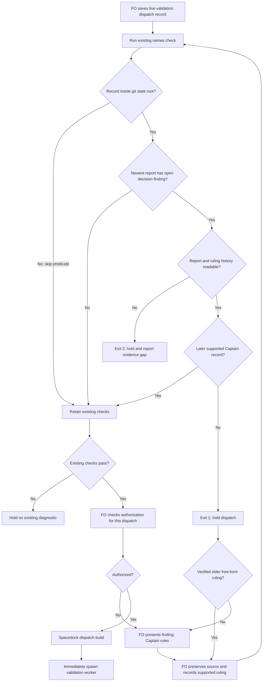

## Scope

- Source: the Captain 「那就a吧」 (chat, 2026-10-29), choosing FO's batch-10 theme "checks for FO's repeated mistakes", whose row named this item: 「新：驗收結果需要你裁決時，我自己重跑驗收」.
- Bite: paseo-codex-dispatch-practice (#742, 2026-10-28): validation-1 returned F1 as Needs decision; FO ran validations 2 and 3 without a Captain ruling; his later approval covered only validation 4 (observer report, paseo-codex-dispatch-practice/observer.md). The README's review-finding disposition already routes a Needs decision to the Captain; nothing checks it before the next validation dispatch.
- Upstream first: README Review-finding disposition, `scripts/dispatch_records.py` (the check FO runs before each dispatch), `scripts/delivery_gate.py`.

## Non-goals

- Judging whether a finding is correctly classed as Needs decision; only that a ruling exists before a rerun.

## Budget

- One package PR inside an existing check; no new script.

## Stop condition

- The #742 event prefixes, exercised as live git-state fixtures, refuse the unauthorized second and third validations and permit the fourth after its supported Captain ruling; native-gate and amendment-backed reruns pass. Non-git copies skip only this new predicate. Historical judging is deferred; older free-form rulings are recorded in a supported home on next touch. The seven outstanding replay judgments and false-hold count must be known before this ideation gate; no automatic backfill or claim that every historical authorized rerun passes.

## FO alignment

Alignment: not needed before ideation: a check for a rule the README already states.
Surfaces: none
Visible change: none
Release review: not needed: workflow maintenance, on no journey map.
Reviewer: kc-dev-flow-2:chief-engineer opus 2026-10-29 — batch-10 review before the joint ideation sitting: approve, revise or cut each task, the Captain's decisions, overlap and order

## Design definition

### PRFAQ

**Proposition.** At the existing saved-record check before a live validation dispatch, refuse a rerun when the newest validation report contains an open F-numbered `Needs decision` finding and no later supported Captain ruling is committed. This Pilot adds one predicate to `dispatch_records.py --names`; it adds no command, host hook, script or automatic migration.

**Revision authority.** The native ideation resolution records Captain 「照建議」 on 2026-10-29, bound to `validation-rerun-waits-for-captain-ruling/review/ideation/briefing-1/index.json`. Its question explicitly chooses decision B (native gates/amendments; free-form rulings recorded on next touch), skips non-git records and defers historical judging. Batch ruling A means the check owns observable structure; the observer retains classification, authenticity, question/reply validity and per-finding coverage. These choices settle the former D1; this revision does not seek them again.

**Who and where?** First Officer (FO), saving a validation record and running the already-required `--names` check before Spacedock dispatch build. The real seams are the saved report, committed task history, native gate/amendment parser and immediate build-to-spawn order. Non-git copies and the history-law temporary snapshots keep their existing checks but skip this new predicate. Running from a git cwd does not make an external record eligible.

**What does passing mean?** A later supported record exists, not that its words settle every finding or permit this particular action. A structural pass can coexist with an observer finding; `pair-once` below demonstrates why. This check is not a proof of Captain identity, an exemption from the review-finding rule, or an unskippable runtime gate.

### Chain checked and bounded existing-code check

1. **Spacedock first.** Read 0.27.3's own `skills/first-officer/references/fo-dispatch-core.md` and `skills/feedback-rejection-flow/SKILL.md`: distinct authorization and a concrete correction assignment precede routing; dispatch build must be followed immediately by spawn. Native gates already retain actor, reason, time, attempt and bound briefing. Spacedock does not interpret this package's F-numbered findings; no upstream runtime edit is proposed.
2. **Package second.** `git fetch origin` succeeded; `origin/main` is still `5725d495bb83a17ec13616bb5421bf5ffdc71f70`, released package **0.33.0** in `kc-dev-flow-2/.claude-plugin/plugin.json`. Read current `dispatch_records.py` task checks, `decision_ledger.py` gate records and `laws_check.py` caller. Existing workflow prose already holds Needs decision findings; the current dispatch checker does not. The history-law caller materializes a non-git temporary folder, so the approved skip leaves it unchanged. Remove the former historical context arguments and new history-law diagnostic from this design.
3. **Adopters third, read-only.** Reproduced the original pinned 27-record prototype replay, then individually read the seven previously unjudged report/dispatch snapshots and intervening task changes. This is a design experiment over saved state, not a historical enforcement feature or a fresh chat-source audit. No adopter was edited. `gh pr view 742 --repo iamcxa/kc-claude-plugins --json number,state,headRefOid,mergedAt` failed with `error connecting to api.github.com`; current provider status is unverified and not needed for the local event evidence.

Relevant architecture decision records (ADRs): 0011 keeps human authority distinct from FO decisions; 0017 preserves event-time history-law semantics; 0020 requires a ruling for workflow-budget increases; 0027 puts structured checks at existing writes and rejects phrase-based authority inference; 0038 separates peer facts from original human authority. Read the `Override:` evidence in `_archive/fo-write-rules-checked.md`: do not resurrect its rejected phrase check. Existing workflow wording and word budget are unchanged. No new ADR number is reserved in ideation.

### Proposed live mechanism

- Add the predicate inside the existing `--names` task-facts route for `validation-N.md` and `validation-N-message-M.md`. Keep ordinary folder mode, `--coverage`, `--newest`, other stages and all existing diagnostics unchanged. Filename numbers identify records, not validation report ordinals; a `validation-1.md` is not exempt merely because of its name.
- Resolve the actual record and task paths using existing flat/folder conventions. Establish their owning git state root from those paths, never from the command's cwd. Outside a git state root, silently skip **only this predicate**, then retain all other checks and their exit status. Non-git temporary snapshots used by `laws_check.py` therefore do not acquire this rule. A known git state root whose required history cannot be read is an evidence error, not the non-git skip.
- Strip fenced examples with the shared reader; select the newest top-level `## Stage Report: validation` section, including cycle suffixes. Recognize F-numbered Needs decision bullets, bold IDs and existing punctuation; an explicitly `CLOSED` finding is not open. Checklist mentions, quotations and earlier reports do not create new obligations. No open finding means no extra output or history work.
- Inspect the current task with its pinned state HEAD. Identify the selected report by ordinal and exact unfenced bytes and locate its committed introduction. If the current selected report is uncommitted, rewritten ambiguously, or unavailable in complete history, hold with exit 2. Supported archive moves keep identity. Do not reset the ruling clock by editing an old report, infer chronology from wall-clock dates, or use `Dispatched:` as a state revision: real adopters use code-base/head SHAs there.
- A supported ruling is (a) a non-withdrawn native **validation** resolution with `by: person:captain`, nonempty reason and time, or (b) a new numbered `## Captain amendments` entry with a nonempty `Captain:` value in the shared amendment grammar. Reuse `decision_ledger.split_task`/`gate_entries` and the shared amendment parser. The ruling's first committed appearance must be strictly after the selected report and present by the pinned HEAD. Old entries edited later, same-commit report/ruling, other-stage or other-task gates, FO/worker resolutions and withdrawn attempts do not clear it. A hold/revise can count structurally; whether it authorizes a rerun stays with FO/observer.
- Missing later supported ruling: exit 1. Unreadable, shallow or ambiguous relevant history in an established state root: exit 2. Success and non-git skip add no output. The current live check does not judge an old record at its original event or mark old events green after a new ruling. There is no new history-law flag, report, waiver list or automatic historical scan.
- **On-touch handling, decision B:** when FO next works on an older task whose ruling is free-form, preserve the original wording and question, verify their source under the existing authority rules, and record that existing ruling in a supported native gate or Captain amendment before the next live rerun. Use the existing supported recording procedure; do not manufacture a gate, backdate a record, rewrite history or turn an FO statement into Captain words. If neither procedure can faithfully record it, or its source is unavailable, return the gap to FO/Captain. This dispatch performs no backfill.

Exact proposed refusal line (one path, hash and finding token): `<record>:1: validation rerun needs a later Captain ruling for report <N> at <sha> findings <ids>; hold dispatch, record the ruling, then run this check again`. When this refusal occurs, print this recovery sentence once per invocation: `For an older free-form ruling, verify its original question and reply, preserve them, and record it as a native gate or Captain amendment before rerunning; if unavailable, hold for the Captain.` Exact evidence-error line: `<record>:1: cannot verify validation ruling order: <reason>; hold dispatch and report the missing history to FO`.

### Flow

The diagram is retained source; render and inspection evidence is recorded in the new stage report. It preserves the skipped-predicate branch, existing refusals, evidence hold, Captain boundary and immediate build-to-spawn order. `Surfaces: none` owes this PRFAQ and diagram, not a UI prototype or schema.

### Replayed evidence and seven adjudications

Pinned corpora: this state `731a165dfdf02549a9d13b0624174351e8a6d7be`; relay `/Users/kent/conductor/workspaces/subspace-relay/beirut-dev2/docs/dev2/.spacedock-state` at `7fbde2c526769e0968d05fac858fc63b31c6274c`; web `/Users/kent/conductor/workspaces/subspace-web/dev2-fo/docs/dev2/.spacedock-state` at `2c3a6dcbfb3a8e178d65151237a0c234351612c0`; qnow `/Users/kent/conductor/repos/qnow-adopt-dev2/docs/dev2/.spacedock-state` at `2b132074819d4eb6890f3bf731be321032a00442`. Prior census found 464 profile-bearing tasks, 22 with an F-numbered Needs decision report; this revision reruns the same bounded 27 saved record additions, not a fresh all-task census.

**Result: 15 structural passes / 12 refusals reproduced. Of the 12, 2 confirmed false holds on saved evidence, 10 retained holds; 0 unjudged records.** Of the two false holds, one is a genuinely authorized rerun with a free-form ruling (`merge-gatekeeper`); one is a retrospective record addition, not a rerun (`agent-review-identity`). Thus the actual-rerun false-hold count is **1**, and the broad record-addition false-hold count is **2**. Retained holds mean the saved evidence does not clear the open decision obligation, not proof about unseen chat or a fresh finding against another FO. The chosen live-only/on-touch boundary accepts this compatibility cost and avoids presenting the historical classifier as production enforcement.

| Previously unjudged record and exact dispatch event | Judgment on saved evidence | Decisive report/delta/dispatch evidence |
| --- | --- | --- |
| relay `agent-review-identity/validation-1.md` at `7ea4bf019eb6a80223ca24c5a53047c0513566fb` | **False hold: retrospective first-dispatch record** | Report snapshot `bfe1238e5d10a9be4deb43a090bead8b6101ee3a` F3 says records were missing and existed in temporary dispatch files; next commit is “FO dispatch records (validation F3)”, no task change, saved checklist matches the already-completed report. No rerun evidenced. |
| relay `pair-once/validation-2.md` at `6cf9d342df3b094fa8e2a5685b072215ab016efc` | **Retain hold: partial ruling** | After report `13a672cb0ae50a450dee37e6d73945583514d00f`, a free-form Captain reply 「可以」 settles F3's site ceiling; the saved validation dispatch explicitly says F4/F5/F6 “wait for the Captain at the gate”. It does not establish permission to rerun with those still open. |
| relay `pair-once/validation-3.md` at `f342c2d6f11150fc8e3f66a3d4afa9395d20f84f` | **Retain hold: no later ruling on newest report** | Selected report bytes at `08d2bed0c05a152980728973988d6799a77d1f9c` introduce F21–F30 decisions; intervening change is implementation cycle 3, while the dispatch leaves F4/F5/F6 for Captain and F23/F24/F25 unchanged. The older F3 reply is not a later ruling on these findings. |
| web `briefing-frame-and-controls/validation-2.md` at `bbbe9d936e967a47f96187d55a7a4c3615aa7d25` | **Retain hold: explicit deferred Captain decisions** | Report `ce5a5b8b21be63bf8d858b9e5e750acaebbac158` F6/F7 remain open; implementation cycle 2 fixes F1–F5 only; dispatch says F6/F7 go to Captain at the gate and “not reopened”. No intervening Captain ruling recorded. |
| web `frame-reaches-window-bottom/validation-2.md` at `c9013a16b010c0930aba55908aca5b0fc0287b8c` | **Retain hold: FO authorization only** | Report `1e881bccfefc7d65592285381738dafc6e8fcb3c` F1 says the older fade is a Captain decision; implementation and dispatch call the repair “FO-authorized” against earlier Captain wording. No later Captain reply appears between report and dispatch. |
| web `hidden-file-draws-diagrams/validation-2.md` at `2bf9fa6d60b66feb122b273f8fbe5c99460d7ac6` | **Retain hold: label not cleared by Captain record** | Report `c1d35f75625d03cbbc9d28ea396b39dcadfbf3a4` F2 is Needs decision; implementation-2 calls it “owned, repaired by FO direction”. Later observer also notes its missing materiality classification. Whether the label was deserved is outside this check; no later Captain ruling is recorded. |
| qnow `production-operations/validation-4.md` at `2c6b40ca75be22340ae7ebe1069b0275246a0169` | **Retain hold: FO ruling is not Captain ruling** | Report `fcb7d2f744c554b05191461aa7eeb7920416e81d` F1 names a product/document choice. `dispatch/implementation-5.md` says “FO ruling, 2026-10-18”; worker report calls it “your 2026-10-17 ruling”. That conflicting worker attribution is not evidence of a Captain reply. |

The previously confirmed false hold remains `merge-gatekeeper/validation-2.md` at `da4d899707f2c74faee906d030d40b547726be14`, after report `d82950c34a85d23dd43551910618faf9552392e6`: `### Feedback Cycles` records Captain ruling 「同意」 and the question authorizing repair/revalidation. Under decision B its next live touch records that existing ruling in a supported home; this revision does not modify it.

The other four retained holds are the archived #742 dispatches: `validation-2.md` at `60d765ac2ed6bda644cd3f94de0c58dae981a860`, `validation-2-message-1.md` at `c9bf77a5e68d1809826044df316ec3d8904bced6`, `validation-4.md` at `ef0ca5a2a6b1ea1fa975ff46872e2b396bd5a6bd`, and `validation-3-message-1.md` at `e5dd5a3e5e4caeb4100db7748399e3b9adcd34ac`. Base `--names` exits 0 for all four; the prototype refuses them. Actual fourth validation (`validation-6.md`, `28b366c0cf8bbf2dedc658543850de5a860834a8`) and its follow-up (`034da3d06c015f9aba60256de9d557fb4944d05f`) pass after native gate hold `d24235a4c`; the filename is not the report ordinal.

Positive controls retain native gates and amendments: `rr-pairs-once`, `review-keyword-invocations`, `review-page-reads-as-an-app`, `owner-picks-visited-branch`, `fo-interviews-extension`, `idle-hook-names-merged-tasks-without-learn` and `branch-hours-generate-starts`. Native-only recognition had 12 passes; amendments restore three legitimate record passes. Recording `pair-once`'s partial F3 reply in an amendment would clear the structural predicate while F4–F6 still require human judgment: batch ruling A explicitly leaves that gap with FO/observer.

Reproduction: with Python 3 and full histories at the pins above, `git show <event>:<task>.md` (or `_archive/<task>.md`), `git diff <report-commit> <event> -- <task>.md`, and `git show <event>:<task>/dispatch/<record>` reproduce each table judgment. The disposable prototype strips fences, walks report/ruling/record introductions in ancestry order, and invokes released `--names` on complete saved folders for the six #742 records; its fresh script/output live under `/tmp/validation-rerun-revision/`. Those files are not a shipped dependency. Implementation must retain sanitized fixtures and full source IDs in existing tests so a teammate needs neither these machine paths nor unseen chat.

### Words FO reads at each moment

Re-executed released 0.33.0 `test_pr_watch.TasksTests` open/merged/archive fixtures and `pr_watch.sittings` with four gates, with Spacedock 0.27.3. Count whitespace words (`len(text.split())`), joining passages and actual output with newline. Equal exclusions: variable task/provider payloads and unchanged extensions other than the full paseo extension. No savings claim; after values below are the explicit proposed contract, not a candidate measurement.

| Moment and included input | Before | Proposed after | Delta |
| --- | ---: | ---: | ---: |
| Startup: workflow, dev skill, dev2 mod, Spacedock startup hook, open-PR output, paseo extension | 7521 | 7521 | 0 |
| Idle/open PR: mod, idle hook, Delivery authority, Extensions, open output, paseo extension | 1424 | 1424 | 0 |
| Idle/merged PR: same with merged output | 1395 | 1395 | 0 |
| After archive: mod, learn extension, archive output, paseo extension | 895 | 895 | 0 |
| Merge ask: Delivery authority, Extensions, gate lifecycle, present gate, four-gate output, paseo extension | 2970 | 2970 | 0 |
| Clean live check or non-git skip: extra stdout | 0 | 0 | 0 |
| Refused live check: one diagnostic plus one on-touch recovery sentence | 0 | 56 | +56 |
| Evidence error: one diagnostic, one-token reason | 0 | 16 | +16 |
| Historical law audit: additional instruction/output from this change | 0 | 0 | 0 |

Fixture output counts remain 29 open, 0 merged, 5 archive and 90 four-gate words; workflow is 5754. Diagnostic counts use one-token path/hash/IDs/reason; multiple findings or a longer reason increase actual output and must be recounted. Recovery is printed only on refusal, not loaded at startup. The new ADR is design/implementation decision reading, not a new mandatory lifecycle load; count its final text if implementation creates an instruction to load it. No workflow, mod, law text or CI trigger changes. CI cost per PR was not measured.

### Resolved decisions and unnumbered ADR draft

No unresolved material decision for this revision. The Captain already selected native gate/amendment records, on-touch free-form recording, non-git skip, deferred historical judging and structure-only coverage. Recommendation: implement this bounded live check. What gets worse: legitimate legacy reruns can pause for source verification/recording; non-git copies have no new protection; a later unrelated/partial supported ruling can structurally pass and still need observer intervention. No historical repair or source-authentication project is implied.

Unnumbered ADR title: **Validation reruns require a later recorded Captain ruling**. Decision draft: Captain 「照建議」, 2026-10-29, responding to the task's native ideation briefing question and its batch sitting, selects the boundaries above. Existing `--names` checks a live record inside its git state root; later native validation resolutions and Captain amendments count, free-form authority is recorded on touch, historical judgment is deferred, and semantic/source judgment remains with FO/observer. Alternatives: history-law integration and unrestricted legacy text matching, both excluded by this revision. Consequences: the measured legacy cost and structural gaps above. Reopen if an observer finds a new unruled rerun despite this predicate being run, or an authorized supported ruling is rejected. FO reserves the number at implementation dispatch; the complete ADR is written in that authorized stage.

### Batch overlap

Proposed runtime/test files: `kc-dev-flow-2/scripts/dispatch_records.py`, `kc-dev-flow-2/scripts/test_dispatch_records.py`, and `kc-dev-flow-2/scripts/test_laws_check.py` (regression proving the non-git historical caller remains unchanged). Decision artifact: `docs/adr/<reserved-at-dispatch>-validation-reruns-require-a-later-recorded-captain-ruling.md`. No `laws_check.py`, `laws.md`, `delivery_gate.py`, workflow, budget, new script, CI file or adopter README edit. Reuse shared parser code; if the parser lacks the necessary interface, coordinate its owning task before expanding this list.

| Named task (read-only snapshot) | Same file/check and ordering |
| --- | --- |
| seed-check-requires-alignment-result — require seed alignment result | No owned file overlap; shared alignment parser consumed by dispatch check. Keep its refusal unchanged. |
| captain-amendment-form-checked — validate amendment form | `dispatch_records.py`, `test_dispatch_records.py`, `test_laws_check.py`; establish shared amendment interface before this predicate. |
| adr-reserved-when-design-names-one — require reservation before implementation | Dispatch checker/tests, law regression tests and ADR number namespace; integrate serially. |
| validation-rerun-waits-for-captain-ruling — this live refusal | Owns the proposed files above; only this entity body/report edited now. |
| gate-requires-recorded-reviews — require reviews at gate | ADR number namespace only; its delivery checker/workflow/budget files are separate. |
| adoption-asks-which-extensions — read event-time extension list | Dispatch checker/tests and law tests; preserve its extension fallback. No shared historical-ruling context is now needed. |
| adr-required-statement — old ruling ledger | Captain closed it on 2026-10-20 despite validation frontmatter; no live dependency, no ledger reuse. |
| adr-silent-undo-probe — measure silent ADR reversals | Fictional scenario harness, now POC; no package checker overlap. |
| comment-check-reaches-delivery-gate — comment evidence at delivery | Captain closed it on 2026-10-20; historical delivery files do not overlap this runtime. |
| journey-canvas-hosted-poc — hosted canvas experiment | No shared checker or check. |
| journey-server-host-pilot — private hosted server | Read live `index.md`; shared ADR number namespace only, no server edit here. |
| ops-inbox-r1-setup-and-isolation — isolated operations inbox | Shared ADR number namespace only; kc-ops-inbox and its CI otherwise separate. |
| pr-review-lite-value-pilot — bounded review experiment | kc-pr-flow/evidence work; no shared checker or check. |

Also read `captain-ruling-sources-checked`: its source-authentication concern remains separate. Recommended order: land adoption's event-time extension change if ready; establish the amendment parser; then serialize the reservation and live-rerun changes, rerunning combined dispatch/law tests after rebases. FO rechecks final sibling file lists and reserves a noncolliding ADR number. Unrelated hosted/ops/review tasks do not block this Pilot.

## Acceptance criteria

**AC-1** The existing live `dispatch_records.py --names <record>` refuses both fresh and follow-up validation records when the newest report has open F-numbered Needs decision findings and lacks a later supported ruling. Evidence: candidate CLI in a temporary git state root, committed report then live record, exit 1 before the ruling and exit 0 after a later native ruling; input bytes unchanged. Falsifier: remove the predicate call and the before-ruling assertion fails. Current evidence: released checker and disposable #742 prototype exercised; candidate integration is future work.

**AC-2** Reproduce #742's second/third validation refusals and fourth allowed run as **live fixture states** built from the six pinned record/report/ruling snapshots above, including filename/report-number mismatch. Evidence: actual CLI in independent git histories at each event prefix, with source IDs retained; four refuse/two pass. Also retain the late-record-addition counterexample as a documented historical non-goal, not a new inference from filename 1. Falsifiers: using a later prefix or assuming filename ordinal makes a named case pass incorrectly. Current evidence: prototype four refuse/two pass; production history judging expressly deferred.

**AC-3** Preserve supported native and amendment reruns; show legacy compatibility cost explicitly. Evidence: both positive forms and three amendment-restored records pass; a free-form-only fixture first holds, then passes after faithful on-touch recording in a new supported entry. The seven adjudications and 2 record-addition / 1 actual-rerun false holds above must be reproducible from pinned saved evidence; no history is rewritten. Falsifiers: gate-only parsing loses amendment cases; accepting arbitrary Captain prose bypasses the initial legacy hold. A partial supported ruling is a deliberate structural pass with an observer-owned semantic gap, not a claim of full authorization. Current evidence: 27 prototype cases and seven individual judgments completed; on-touch candidate exercise remains future work.

**AC-4** Keep order and supported identity honest. Evidence: actual CLI fixtures for old/same-commit rulings, edited old entries, unrelated stages/tasks, withdrawn/non-Captain resolutions, fences, CLOSED findings, rewrites, flat/folder/archive moves and shallow/unreadable established roots; no ruling gives exit 1, missing required history gives exit 2, a properly later ruling passes. Falsifiers: timestamp-only ordering, counting fences or treating unreadable git history as non-git changes a required verdict. Current evidence: real ancestry inspected; defensive candidate cases unverified.

**AC-5** Skip this predicate outside a git state root without suppressing existing checks; defer historical enforcement. Evidence: identical files in a real state fixture and plain copied folder yield new refusal only in the former; invoke from inside and outside another git cwd and get identical path-based outcomes; a bare script name still fails in both. Run `test_laws_check.py` through its real temporary-snapshot caller and assert existing verdict/output unchanged, no new Cannot/parser error and no history-context flag. Falsifiers: cwd-based detection or emitting the new diagnostic in non-git snapshots fails these tests. Current evidence: released caller inspected; candidate execution future work.

**AC-6** Preserve command contracts and measured reading cost. Evidence: candidate dispatch/laws suites, relevant `test_pr_watch.py` consumers, `test_sd_dispatch.py` and package lint pass; recount every lifecycle row and actual refusal/error output; workflow/mod/law/CI diffs remain empty. Falsifiers: new clean output, routing the predicate through `--newest`, or omitting the recovery sentence changes the expected behavior/count. Current evidence: five lifecycle fixture counts rerun; diagnostic proposal counted; candidate checks future work.

## Stage Report: ideation

- FAILED: A design for refusing a validation dispatch while the newest validation report lists a Needs decision finding with no Captain ruling recorded after it, in the check FO runs before each dispatch; the #742 sequence (paseo-codex-dispatch-practice validations 1 to 4, archived) replayed with validation-2 refused, and tasks whose reruns followed a ruling passing
  Design and #742 replay complete: base 0.33.0 accepts all six saved records; prototype refuses the unauthorized second/third passes and permits the fourth after d24235a4c. All-authorized-reruns-pass is unmet: merge-gatekeeper has a later free-form Captain ruling that the structured predicate refuses; D1 requires FO/Captain disposition.
- DONE: A `### Batch overlap` section naming each file the design would change and each other batch task (seed-check-requires-alignment-result, captain-amendment-form-checked, adr-reserved-when-design-names-one, validation-rerun-waits-for-captain-ruling, gate-requires-recorded-reviews) and live task of other sessions (adoption-asks-which-extensions, adr-required-statement, adr-silent-undo-probe, comment-check-reaches-delivery-gate, journey-canvas-hosted-poc, journey-server-host-pilot, ops-inbox-r1-setup-and-isolation, pr-review-lite-value-pilot (driven by other sessions; read only)) that changes the same file or check, so FO can order implementation
  Batch overlap names all requested tasks, five package files plus the conditional unnumbered ADR, shared checker/history consumers and number allocation; adr-required-statement is explicitly closed despite stale validation frontmatter.
- DONE: The words FO reads at each lifecycle moment, before and after, per root learning.md "Measure the words FO reads at each moment, not one file's size"
  Executed 0.33.0 lifecycle fixtures: startup 7521, idle/open 1424, idle/merged 1395, archive 895, merge ask 2970; proposed recurring delta 0, refusal +25/error +16 words. Counts include passages and output; falsifier is a changed output/passage omitted from the recount.
- DONE: Acceptance criteria with reproducible evidence clauses and falsifiers, and unresolved decisions for the Captain, each with a recommendation and what gets worse under it
  AC-1 through AC-6 each state commands/fixtures, expected behavior and a falsifier; D1 recommends bounded ruling formats with on-touch original-source recording and states the false-hold cost and required scope decision.
- SKIPPED: AC-1 candidate dispatch refusal integration.
  Not implemented in ideation; existing CLI and disposable history predicate exercised on real saved records. Removing the future predicate must make the before-ruling negative test fail.
- SKIPPED: AC-2 candidate historical replay integration.
  Ideation replay demonstrates four refused/two permitted #742 dispatch/follow-up records; durable candidate tests remain future work. Reading current HEAD instead of each dispatch commit would incorrectly clear earlier records.
- FAILED: AC-3 every authorized rerun passes.
  Four-corpus prototype: 27 record additions, 15 pass/12 refuse; at least one false hold, seven additional records not fully adjudicated. Do not interpret all 12 as violations or silently weaken the original requirement.
- SKIPPED: AC-4 defensive chronology and parser cases.
  Real commit ordering and native/amendment sources demonstrated; rewrite, withdrawal, shallow-history and same-commit controls await implementation and D1. Timestamp-only ordering would fail the planned counterexample.
- SKIPPED: AC-5 history-law integration.
  Read laws_check.py temporary-snapshot caller and stdout parser; original-history context and parser changes are designed, not tested. Omission of either must produce the planned wrong-event/parser failure.
- SKIPPED: AC-6 candidate regression and reading checks.
  Baseline lifecycle fixtures executed and six installed source files matched origin/main 5725d495; no candidate exists. A new clean output or mandatory instruction must change the recount.
- DONE: Run the selected package design-surface check and verify the required diagram.
  design_surfaces.py check: validation-rerun-waits-for-captain-ruling.md: design surfaces presentable (exit 0); Mermaid CLI 12.0.0 rendered and the image was inspected. This form check does not clear the substantive AC-3 hold.

### Summary

Ideation returns a concrete design on package 0.33.0, a real #742 history replay, four-repository compatibility evidence, reading counts and a coordinated file plan; 4 DONE, 5 SKIPPED, 2 FAILED. Hold implementation: FO must route D1 because the original all-authorized-reruns-pass requirement conflicts with the demonstrated narrow record grammar. Only this task body/report changed; no product code, branch, frontmatter, sibling task, adopter, PR comment or message was changed or sent.

## Stage Report: ideation (cycle 2)

- DONE: Revise the design under the Captain's ideation-gate revise of 2026-10-29 (「照建議」; the asks are in the gate question): judge the 7 replayed records still unjudged and report the false-hold count; skip the check when the record is not inside a git state root; defer historical judging; accept native gate records and Captain amendments as rulings, with a free-form ruling recorded when an older task is next touched (decision B); batch ruling A applies; update criteria and the stop condition to match
  Captain decision B and batch ruling A applied; pinned replay reproduced 27 records (15 pass/12 refuse), all seven judged: 2 confirmed false holds among record additions, of which 1 is an actual rerun. Stop condition, non-git skip and live-only scope updated; prior report preserved.
- DONE: A `### Batch overlap` section naming each file the design would change and each other batch task (seed-check-requires-alignment-result, captain-amendment-form-checked, adr-reserved-when-design-names-one, validation-rerun-waits-for-captain-ruling, gate-requires-recorded-reviews) and live task of other sessions (adoption-asks-which-extensions, adr-required-statement, adr-silent-undo-probe, comment-check-reaches-delivery-gate, journey-canvas-hosted-poc, journey-server-host-pilot, ops-inbox-r1-setup-and-isolation, pr-review-lite-value-pilot (driven by other sessions; read only)) that changes the same file or check, so FO can order implementation
  Batch overlap lists all 13 named tasks and three proposed runtime/test files plus the unnumbered ADR; historical runtime/law edits removed, shared dispatch/parser/test integrations ordered, closed tasks distinguished from stale status.
- DONE: The words FO reads at each lifecycle moment, before and after, per root learning.md "Measure the words FO reads at each moment, not one file's size"
  Reran lifecycle fixtures: 7521/1424/1395/895/2970 before and proposed after; clean/non-git +0, refusal with on-touch recovery +56, error +16, historical audit +0. Candidate must reproduce actual output; omitting the recovery sentence falsifies the count.
- DONE: Acceptance criteria with reproducible evidence clauses and falsifiers, and unresolved decisions for the Captain, each with a recommendation and what gets worse under it
  AC-1 through AC-6 each name reproducible execution, expected outcome, falsifier and current limits; no material Captain decision remains unresolved, and the chosen legacy cost and structural gaps are explicit.
- SKIPPED: AC-1 candidate live dispatch refusal integration.
  Released checker accepts the six #742 records; disposable predicate refuses four and permits two. Candidate CLI is not implemented in ideation; removing its predicate must make the before-ruling fixture fail.
- SKIPPED: AC-2 candidate #742 live-prefix regression fixtures.
  Pinned replay reproduced second/third refusal and fourth permission; candidate tests remain future work. Using a later prefix or equating filenames with report ordinals must change a named verdict.
- SKIPPED: AC-3 candidate supported-ruling and on-touch compatibility tests.
  Seven saved-event judgments completed, with 2 record-addition false holds and 1 actual-rerun false hold; native/amendment prototype 15/27 passes. Candidate free-form-hold then on-touch-pass test is future work; arbitrary prose acceptance must fail its first assertion.
- SKIPPED: AC-4 candidate chronology and defensive parser controls.
  Real report/ruling ancestry and shared parser read; same-commit, withdrawn, rewritten, shallow and fenced candidate controls remain unverified. Timestamp-only ordering or treating unreadable git as non-git must fail them.
- SKIPPED: AC-5 candidate non-git skip and historical caller regressions.
  Read the real laws_check.py non-git temporary-snapshot caller; no historical runtime change proposed. Candidate paired git/plain-folder and cwd-independence tests remain future work; cwd-based eligibility or new non-git output must fail them.
- SKIPPED: AC-6 candidate regressions and final reading counts.
  Released lifecycle fixtures rerun and five inspected package files match origin/main 5725d495; candidate suites remain future work. gh pr view 742 failed: error connecting to api.github.com; git/local evidence used, provider state unverified.
- DONE: Run the selected package design-surface check and verify the required diagram.
  design_surfaces.py check: validation-rerun-waits-for-captain-ruling.md: design surfaces presentable (exit 0). Mermaid CLI rendered the revised flow and its image was inspected: non-git skip, existing checks, holds, Captain boundary and immediate spawn agree.

### Summary

Revised Pilot ideation is ready for FO review: 5 DONE, 6 SKIPPED, 0 FAILED; all seven outstanding records are judged, and the design follows the Captain-selected live-only, non-git-skip and on-touch boundaries. Implementation and independent validation remain future stages; no code, frontmatter, prior report, sibling task or adopter was changed, and no PR/issue comment or peer message was sent.
