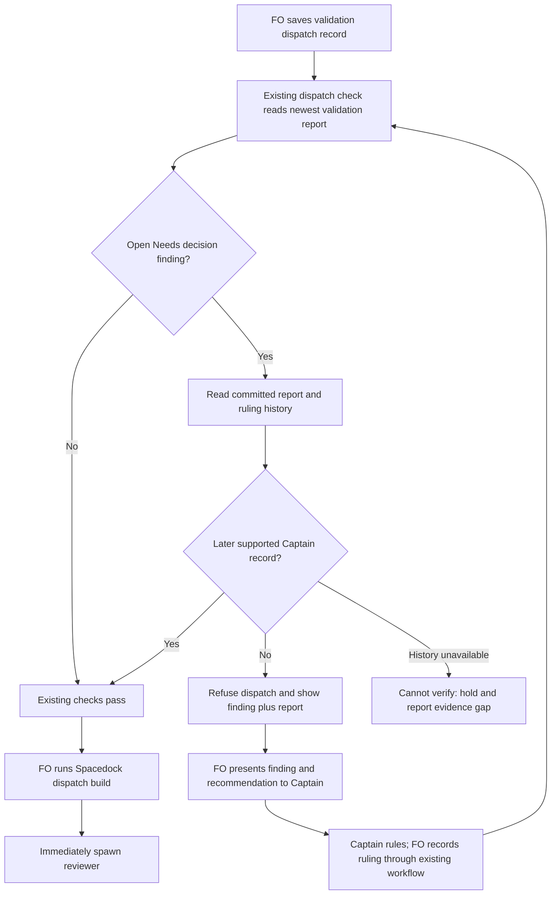

## Scope

- Source: the Captain 「那就a吧」 (chat, 2026-10-29), choosing FO's batch-10 theme "checks for FO's repeated mistakes", whose row named this item: 「新：驗收結果需要你裁決時，我自己重跑驗收」.
- Bite: paseo-codex-dispatch-practice (#742, 2026-10-28): validation-1 returned F1 as Needs decision; FO ran validations 2 and 3 without a Captain ruling; his later approval covered only validation 4 (observer report, paseo-codex-dispatch-practice/observer.md). The README's review-finding disposition already routes a Needs decision to the Captain; nothing checks it before the next validation dispatch.
- Upstream first: README Review-finding disposition, `scripts/dispatch_records.py` (the check FO runs before each dispatch), `scripts/delivery_gate.py`.

## Non-goals

- Judging whether a finding is correctly classed as Needs decision; only that a ruling exists before a rerun.

## Budget

- One package PR inside an existing check; no new script.

## Stop condition

- The #742 sequence replays with validation-2's dispatch refused, and every current task whose reruns followed a ruling passes.

## FO alignment

Alignment: not needed before ideation: a check for a rule the README already states.
Surfaces: none
Visible change: none
Release review: not needed: workflow maintenance, on no journey map.
Reviewer: kc-dev-flow-2:chief-engineer opus 2026-10-29 — batch-10 review before the joint ideation sitting: approve, revise or cut each task, the Captain's decisions, overlap and order

## Design definition

### PRFAQ

**Proposition.** Before the first officer (FO) sends another validation assignment, the existing dispatch check will refuse it when the newest validation report still contains an open `Needs decision` finding and no later recorded Captain ruling is available. The intended benefit is to stop the unapproved second and third validations of PR #742 before another worker starts.

**Who uses it?** FO, at the saved-record check immediately before `spacedock dispatch build`. This is a Pilot slice inside `scripts/dispatch_records.py`, not a Spacedock hook, a scheduler replacement or a new script.

**What does passing mean?** A supported Captain record exists after the report. It does not prove the classification, quote, source authenticity, or semantic coverage of every finding. FO still owes the existing review-finding disposition and question/reply checks. A report-only classifier must not quietly become a source authenticator.

**What is unresolved?** The all-authorized-reruns-pass requirement is not yet met: native gates and Captain amendments are machine-readable, but existing authorized reruns also rely on free-form Captain rulings. The proposed narrow mechanism is demonstrated below; decision D1 must settle that compatibility boundary before implementation. This design is a hold with concrete evidence, not a claim that the stop condition already passes.

### Chain checked and bounded existing-code check

1. **Spacedock 0.27.3 first:** its own `skills/first-officer/references/fo-dispatch-core.md` requires the saved report and authorized review disposition before routing; `skills/feedback-rejection-flow/SKILL.md` holds without distinct authorization and a concrete assignment. Its native gate records already retain `by`, `at`, decision, reason and a bound briefing. The generic orchestrator does not interpret kc-dev-flow-2's `F1 Needs decision` label; extend the package seam, not the third-party runtime.
2. **Package second:** fetched `origin` and pinned `origin/main` to `5725d495bb83a17ec13616bb5421bf5ffdc71f70`; `kc-dev-flow-2/.claude-plugin/plugin.json` says **0.33.0**. The six inspected installed files (`dispatch_records.py`, `decision_ledger.py`, `laws_check.py`, `delivery_gate.py`, `pr_watch.py`, `references/sd/workflow.md`) exactly match that commit. First bounded search: the workflow's `Review-finding disposition` and `FO steps: review findings` already forbid rerun during a decision hold; `dispatch_records.py --names` checks task facts but does not read validation findings. Second bounded search: consumers of `dispatch_records.py` include `laws_check.py`'s dispatch-history law, whose stdout parser must change with a new diagnostic. `delivery_gate.py.findings_join` handles Deferred risk/Polish counts later, at delivery; it is too late to prevent this dispatch. `--newest` intentionally scans bare script names only; preserve that behavior.
3. **Adopters third, read-only:** scanned 464 committed, profile-bearing task files across this state (171), relay (98), web (60), qnow (135), including archives. Twenty-two have an F-numbered Needs decision finding somewhere in their validation history. Replayed 27 saved dispatch/follow-up record additions after an open labelled report, with native-gate-only and native-gate-plus-amendment prototypes. This is a bounded grammar census, not a claim that prose-only findings were absent.

Corpus pins for the first scan: this state `731a165dfdf02549a9d13b0624174351e8a6d7be`; relay `/Users/kent/conductor/workspaces/subspace-relay/beirut-dev2/docs/dev2/.spacedock-state` at `7fbde2c526769e0968d05fac858fc63b31c6274c`; web `/Users/kent/conductor/workspaces/subspace-web/dev2-fo/docs/dev2/.spacedock-state` at `2c3a6dcbfb3a8e178d65151237a0c234351612c0`; qnow `/Users/kent/conductor/repos/qnow-adopt-dev2/docs/dev2/.spacedock-state` at `934789a124e50dd45f37af59bb337573462739ea`. Qnow moved while the independent second scan began; that replay pinned `2b132074819d4eb6890f3bf731be321032a00442`. The other three replay pins stayed the same. No adopter was edited.

Applicable architecture decision records (ADRs): 0011 retains Captain authority; 0017 judges each historical dispatch at its own commit, not a later repaired snapshot; 0020 requires a ruling for a workflow word-budget increase; 0027 puts structured-write checks in the existing script and records the Captain's rejection of a phrase-based authority check; 0038 separates source authentication from peer facts. Read the state's `Override:` records: the relevant precedent is the rejected phrase check in `fo-write-rules-checked`; do not solve the legacy-ruling gap by guessing from words such as "Captain" or "approved". The sibling `adr-required-statement` was explicitly closed by the Captain on 2026-10-20 even though its frontmatter still says validation; its proposed ledger is not an available dependency.

### Proposed mechanism, subject to D1

- Add the refusal to `dispatch_records.py --names` through its existing task-facts path. Cover `validation-N.md` and `validation-N-message-M.md`; record numbers are filenames, not report ordinals. No new FO command. Other stages and the ordinary folder, `--coverage`, and `--newest` modes retain their current contracts.
- Resolve flat/folder task files through the existing `task_folder` convention. Skip fenced examples using the shared fence reader. Select the newest top-level `## Stage Report: validation` section, with cycle suffixes accepted. Recognize the existing F-numbered finding grammar, including bold F IDs and punctuation; a finding explicitly marked `Needs decision, CLOSED` is not open. An ordinary mention in a checklist, quotation or a previous report is not a new finding.
- When no open finding is present, add no output and no history dependency. Otherwise read the committed task history at the dispatch boundary. A report is identified by its ordinal and exact unfenced section bytes, not by the dispatch filename or a date inferred from prose. A changed report must not silently reset its authority requirement; unexpected historical rewrites or ambiguous history produce an evidence hold.
- The demonstrated supported records are (a) a native validation-stage resolution with `by: person:captain`, a nonempty reason and timestamp, and (b) a new numbered entry under `## Captain amendments` with a nonempty `Captain:` field. Reuse `decision_ledger.split_task` / `gate_entries` and the existing amendment parser; do not duplicate a YAML parser. Withdrawn records, an FO or ensign resolution, an old amendment edited later, or a gate from another stage do not count. A `hold` or `revise` may be a ruling: the #742 hold expressly authorized one further validation. Its actual permitted action remains FO's responsibility.
- Prove order from commit ancestry, not wall-clock timestamps: the ruling's first committed appearance must be strictly after the report's committed appearance and no later than this dispatch boundary. A same-commit report and ruling does not establish order. Preserve the original ruling identity across later text edits. Resolve supported flat/folder and archive moves without treating the move as a new report or ruling. Missing/shallow/ambiguous history is exit 2, not permission to rerun.
- For a live uncommitted dispatch, inspect its current bytes and the current task against the pinned state HEAD. A needed report/ruling that exists only on disk is not durable proof; hold until committed. For a historical record, read the task and ruling prefix at that record-add commit. A later gate must never repair the verdict for an earlier dispatch.
- `laws_check.py` currently materializes task/record files in a temporary non-git directory. Pass explicit original state-root, task path and event revision context to the same check when running `--names`; retain the existing saved-file checks. Add narrowly scoped optional history-context arguments rather than making the temporary checkout's absent history pass. Update its stdout parser for the new refusal and propagate exit 2 as Cannot. L2 remains the existing dispatch-record law; introduce no new law or CI trigger.
- Exit 1 names the dispatch, report ordinal/commit and open finding IDs. Proposed line: `<record>:1: validation rerun needs a later Captain ruling for report <N> at <sha> findings <ids>; hold dispatch, record the ruling, then run this check again`. Exit 2: `<record>:1: cannot verify validation ruling order: <reason>; hold dispatch and report the missing history to FO`. Exit 0 adds no success line. The script is effective when FO runs it; this does not claim a host hook prevents bypass.

Do not implement a broad search for a quote, a timestamp-only test, a worker-written "resolved" sentence outside the selected finding, or an approval somewhere in the task. None binds chronology or authority. This slice neither authenticates chat nor creates a new human-ruling ledger. The exact legacy compatibility path is D1, not an implicit repair permission.

### Flow

Rendered with Mermaid CLI 12.0.0 and inspected at `/tmp/validation-rerun-ideation/flow.png`; actors, branch exits, Captain decision and immediate build-to-spawn order agree with the prose. The CLI was a disposable local verification tool, not a package dependency. The Mermaid source above is the retained artifact; there is no ui or db surface.

### Replayed evidence and limits

The #742 archive is `_archive/paseo-codex-dispatch-practice.md` and its `dispatch/` and `observer.md` companions in this state. `gh pr view 742 --repo iamcxa/kc-claude-plugins --json number,state,headRefOid,mergedAt` succeeded: merged at `2026-10-28T16:05:57Z`, head `9a70a3350436fac9e51d0795b3b4299693f020f8`. Provider status is context, not permission for the old reruns.

| Actual validation pass | Saved dispatch at its original commit | Existing 0.33.0 `--names` | Proposed history predicate |
| --- | --- | --- | --- |
| First | report introduced at `1e17be9a0734eb1b122b83335bb7ff96a3a331cb` | No prior report obligation | No prior report obligation |
| Second | `validation-2.md`, `60d765ac2ed6bda644cd3f94de0c58dae981a860` | Exit 0 | REFUSE: report 1 F1, no later ruling |
| Third | `validation-4.md`, `ef0ca5a2a6b1ea1fa975ff46872e2b396bd5a6bd` | Exit 0 | REFUSE: report 2 F1, no later ruling |
| Fourth | `validation-6.md`, `28b366c0cf8bbf2dedc658543850de5a860834a8` | Exit 0 | PASS: report 3 followed by gate hold `d24235a4c` |

The archive's filenames advance differently from the four report ordinals. Follow-up records `validation-2-message-1.md` and `validation-3-message-1.md` also move from base exit 0 to REFUSE; `validation-4-message-1.md` remains PASS. The prototype copied all sibling dispatch records at each revision before executing the existing checker, so its other amendment-coverage checks had their real inputs.

Native gates alone: 27 replayed record additions, 12 pass / 15 refuse. Including Captain amendments: 15 pass / 12 refuse. The additional legitimate passes include this repository's `idle-hook-names-merged-tasks-without-learn` after amendment 2 and qnow's `branch-hours-generate-starts` after amendment 2 (two records). Positive native-ruling controls include relay `rr-pairs-once` validations 2 and 3, relay `review-keyword-invocations`, web `review-page-reads-as-an-app`, qnow `owner-picks-visited-branch`, and this repository's `fo-interviews-extension`.

The 12 remaining refusals are **not 12 proven violations**. Four are the #742 unauthorized dispatch/follow-up records. One concrete false hold is `merge-gatekeeper/dispatch/validation-2.md` at `da4d899707f2c74faee906d030d40b547726be14`: after report `d82950c34a85d23dd43551910618faf9552392e6`, its `### Feedback Cycles` acquired `Captain ruling: 「同意」` with the actual question authorizing repair/revalidation. That is neither a new native gate nor a new amendment. Relay `pair-once` also records a later free-form Captain direction for F3 while other decision findings remain; a single "Captain" match cannot safely declare the report settled. The other seven records need individual disposition: relay `agent-review-identity/validation-1`, `pair-once/validation-2` and `validation-3`; web `briefing-frame-and-controls/validation-2`, `frame-reaches-window-bottom/validation-2`, `hidden-file-draws-diagrams/validation-2`; qnow `production-operations/validation-4`. No historical record was rewritten to make the replay green.

Prototype scripts and JSON outputs are disposable under `/tmp/validation-rerun-ideation/`; they are not shipped implementation. The durable evidence is the pinned source, corpus revisions, event commits, measured counts and counterexample above. Reproduction needs Python 3 and full local state history: enumerate committed profile-bearing task files, strip fences, select open F-numbered Needs decision reports, walk report/ruling/dispatch additions in ancestor order, and execute the installed checker against each record's complete saved folder. Implementation must encode the named cases in the existing test files so a teammate needs no private `/tmp` script or this machine's paths.

### Words FO reads at each moment

Method: whitespace words, `len(text.split())`, joining passages with a newline. Measured on the pinned 0.33.0 bytes and Spacedock 0.27.3; reran the existing `test_pr_watch.TasksTests` fixtures for open PR, merged PR and archive, and `pr_watch.sittings` for four validation gates. No production query, agent or send was made by those fixtures. These are named instruction-load scenarios, not total session tokens. A full enabled paseo-extension reload is charged equally on both sides; unchanged other extensions and variable task/provider payloads are excluded equally. No savings claim.

| Lifecycle moment and included passages/output | Before | Proposed after | Delta |
| --- | ---: | ---: | ---: |
| Startup: full workflow, dev skill, dev2 mod, Spacedock pr-merge startup hook, open-PR output, paseo extension | 7521 | 7521 | 0 |
| Idle/open PR: dev2 mod, pr-merge idle hook, Delivery authority, Extensions, open-PR output, paseo extension | 1424 | 1424 | 0 |
| Idle/merged PR: same passages, merged-PR output | 1395 | 1395 | 0 |
| After archive: dev2 mod, learn extension, archive output, paseo extension | 895 | 895 | 0 |
| Merge ask: Delivery authority, Extensions, Spacedock gate-lifecycle and present-gate skills, four-gate output, paseo extension | 2970 | 2970 | 0 |
| Clean pre-dispatch check: additional stdout | 0 | 0 | 0 |
| Refused pre-dispatch check: additional stdout, one ID and one-token path/hash | 0 | 25 | +25 |
| Unverifiable pre-dispatch check: additional stdout, one-token reason | 0 | 16 | +16 |

Fixture outputs are 29 words for open PR, 0 for merged PR, 5 after archive and 90 for the four-gate sitting. `workflow.md` remains 5754 whitespace words; no workflow-budget step is proposed. After values are a proposed no-prose-change contract, not a candidate measurement. `laws.md` is conditional audit reading, outside these recurring moments: implementation must count its actual changed passage and any resulting law output at that audit moment. The future D1 resolution may add a source-recording instruction; if so, recount that moment and obtain any required budget authority before implementation. CI triggers are unchanged; CI cost per PR was not measured.

### Needs decision

**D1 — Which recorded ruling forms must this check accept?** Recommend the narrow native gate plus Captain-amendment forms, with an explicit on-touch route for a free-form ruling: FO preserves and verifies the original question/reply, then records that existing ruling through the supported native gate procedure before another live rerun; this records existing authority, not a fresh approval. If the original is unavailable or the recording route does not support that use, hold and return the gap to the Captain. Do not infer authority from English phrases and do not backdate a later confirmation to green an old dispatch. Worse: an already authorized task such as `merge-gatekeeper` can pause for source verification and recording, and the assignment's unconditional historical all-authorized-reruns-pass requirement must be explicitly narrowed. If that requirement must remain unchanged, hold this design and commission the source/record-shape alignment first; do not implement the demonstrated predicate as if it met that requirement. This is one compatibility/authority decision, not a request for routine implementation choices.

If the Captain selects the narrow route, record the enduring boundary in an unnumbered ADR draft titled **Validation reruns require a later recorded Captain ruling**; FO reserves a number only at implementation dispatch. Its Decision must quote D1's actual ruling, not this recommendation. The draft's consequences are the false-hold/on-touch recording cost and the fact that the predicate proves record presence and order rather than truth or per-finding semantic coverage. No ADR number is reserved by this design.

### Batch overlap

Proposed files: `kc-dev-flow-2/scripts/dispatch_records.py` (live and historical predicate), `kc-dev-flow-2/scripts/test_dispatch_records.py` (replays/counterexamples), `kc-dev-flow-2/scripts/laws_check.py` (original-history context and diagnostic consumer), `kc-dev-flow-2/scripts/test_laws_check.py` (event-boundary tests), `kc-dev-flow-2/references/sd/laws.md` (the existing dispatch law's rule and limits), and the unnumbered `docs/adr/<reserved-at-dispatch>-validation-reruns-require-a-later-recorded-captain-ruling.md` only after D1. No edits to `delivery_gate.py`, workflow.md, its budget, a new script, CI triggers or adopter READMEs are proposed.

| Task, read as it stands | Shared file/check or index | Coordination |
| --- | --- | --- |
| seed-check-requires-alignment-result — reject missing alignment result | No planned file overlap; shares the dispatch/admission journey through `design_surfaces.py` | Preserve existing missing-Result refusals |
| captain-amendment-form-checked — validate amendment placement and form | Potential `dispatch_records.py`, its tests and `laws_check.py` consumer; amendment parser contract | Settle its parser shape before this integration |
| adr-reserved-when-design-names-one — require reservation before implementation | `dispatch_records.py`, `test_dispatch_records.py`, possible law consumer; shared `docs/adr/` number allocation | Implement serially and rerun combined checker tests |
| validation-rerun-waits-for-captain-ruling — this task | Files listed above | Owns only this task's design/report now |
| gate-requires-recorded-reviews — hold missing review records | No currently proposed implementation file overlap: its scope names `delivery_gate.py`, `role_triggers.py`, gate preparation; common lifecycle | Recheck its design before implementation; do not move this refusal to delivery |
| adoption-asks-which-extensions — use the extension list at dispatch time | `dispatch_records.py`, `test_dispatch_records.py`, `test_laws_check.py`, `laws.md`; its history lookup is adjacent | Agree on historical context once; do not invent two independent context mechanisms |
| adr-required-statement — earlier Captain-ruling ledger proposal | Closed by Captain; candidate would have shared workflow/ADR concerns but is not an active dependency | Do not import its stale ledger or occupied ADR number |
| adr-silent-undo-probe — measure unapproved ADR reversals | No shared file; its fictional scenario harness is state evidence | No ordering dependency |
| comment-check-reaches-delivery-gate — bind comment evidence to PR head | `delivery_gate.py`, its tests and validation principles only; no proposed file overlap | Keep delivery parser unchanged here |
| journey-canvas-hosted-poc — hosted shared-canvas experiment | No shared checker; kc-journey-map hosting design | No ordering dependency |
| journey-server-host-pilot — private hosted journey server | No shared checker; kc-journey-map server and own ADRs | Shared ADR number allocation only if D1 creates an ADR |
| ops-inbox-r1-setup-and-isolation — isolated operations inbox | No shared checker; kc-ops-inbox package, own CI and two ADRs | Shared ADR number allocation only |
| pr-review-lite-value-pilot — bounded PR review runtime | No shared checker; kc-pr-flow review-capability scripts and journey documents | No ordering dependency |

Also read `captain-ruling-sources-checked`: source-authentication scope is adjacent and must not be duplicated by this presence/order check. `adr-required-statement`'s on-disk stage alone is stale evidence of liveness; its explicit closure governs this overlap assessment. Other workers' designs may land after this snapshot; FO rechecks their final file lists.

Recommended order: settle D1; coordinate the historical context with adoption-asks-which-extensions; integrate the amendment/ADR dispatch-check changes serially; then this predicate and its law consumer together. No task or source owned by another session was edited.

## Acceptance criteria

**AC-1** At the existing `dispatch_records.py --names <saved record>` boundary, an open F-numbered Needs decision finding in the newest validation report with no later accepted ruling refuses both fresh and follow-up validation dispatch records before `dispatch build`. Evidence: execute the candidate CLI on a temporary git history containing report, attempted dispatch and later ruling; assert exit 1 before the ruling, exit 0 after it, and unchanged original task/record bytes. Falsifier: remove the new predicate call; the before-ruling case must turn green and fail the test. Current evidence: base exits 0 on the #742 record snapshots; the disposable history predicate refuses them. Candidate integration is not implemented.

**AC-2** Replay the actual #742 passes 1 through 4 at their dispatch commits, preserving the mismatch between report ordinals and filenames: second and third refused, fourth allowed after `d24235a4c`; earlier follow-up records remain refused even when the test fixture also contains later history. Evidence: retain sanitized real record/report/gate excerpts with their full source commit IDs in existing tests, execute the candidate CLI and its history-law caller against exact event revisions. Falsifiers: read HEAD instead of the dispatch revision, equate validation-4 filename with fourth report, or accept any earlier gate; each changes a named expected verdict. Current evidence: six saved records exercised; base all exit 0, predicate four refuse/two pass.

**AC-3** Preserve authorized reruns across the committed task corpus. Evidence: compare base and candidate exit/stdout per validation/follow-up record for all four pinned corpora, classify every changed verdict, and include positive controls for a later native gate and later Captain amendment. The current assignment requires every rerun after a ruling to pass; until D1 changes that requirement, a valid free-form ruling such as merge-gatekeeper must pass too. Falsifiers: gate-only recognition loses the three amendment-backed passes; blindly accepting a later `Captain` mention clears a report with other unresolved findings. Current evidence: 15/27 predicate passes, 12 refuses, including at least one false hold. **Not met; D1 is required.**

**AC-4** Preserve chronology and evidence uncertainty: old or same-commit rulings, a later correction to an old ruling, another task/stage's gate, worker/FO resolutions, withdrawn records, fenced lookalikes and unrelated earlier reports cannot clear the obligation; a properly later ruling can. Evidence: CLI fixtures for flat/folder/archive paths, both supported ruling forms, report rewrites, and missing/shallow/unreadable history; exit 2 is distinct from exit 0. Falsifiers: replace ancestry with a same-day timestamp test, count fenced lines, or default missing git history to success. Current evidence: mechanism and real commit ordering inspected; full defensive cases await implementation.

**AC-5** The existing history-law consumer judges the record at its added event, handles the new refusal as a violation rather than a parser error, and treats unverifiable history as Cannot. Evidence: `test_laws_check.py` feeds the new line through the real `--names` call, then replays a push with an unauthorized dispatch followed by a later ruling; the earlier event stays a violation, an archive move adds no event, and a subsequent unrelated push is not poisoned by old violations. Falsifier: omit the stdout-parser branch or pass present HEAD instead of the event revision. Current evidence: caller and parser read; integration tests not yet written or run.

**AC-6** Retain the existing command contracts and bounded reading cost. Evidence: execute existing `test_dispatch_records.py`, `test_laws_check.py`, relevant `test_pr_watch.py` consumers, `test_sd_dispatch.py`, and package lint against the candidate; independently recount the five named lifecycle scenarios plus refusal/error/audit moments with actual emitted output; verify workflow.md, its budget and CI triggers are unchanged unless D1 explicitly changes scope. Falsifier: route the new check through `--newest`, add a clean success line, or omit a new instruction/output from the reading total. Current evidence: 0.33.0 fixture outputs and five baseline counts measured; proposed recurring delta 0, diagnostic-only increases 25/16 words; candidate checks remain future work.

## Stage Report: ideation

- FAILED: A design for refusing a validation dispatch while the newest validation report lists a Needs decision finding with no Captain ruling recorded after it, in the check FO runs before each dispatch; the #742 sequence (paseo-codex-dispatch-practice validations 1 to 4, archived) replayed with validation-2 refused, and tasks whose reruns followed a ruling passing
  Design and #742 replay complete: base 0.33.0 accepts all six saved records; prototype refuses the unauthorized second/third passes and permits the fourth after d24235a4c. All-authorized-reruns-pass is unmet: merge-gatekeeper has a later free-form Captain ruling that the structured predicate refuses; D1 requires FO/Captain disposition.
- DONE: A `### Batch overlap` section naming each file the design would change and each other batch task (seed-check-requires-alignment-result, captain-amendment-form-checked, adr-reserved-when-design-names-one, validation-rerun-waits-for-captain-ruling, gate-requires-recorded-reviews) and live task of other sessions (adoption-asks-which-extensions, adr-required-statement, adr-silent-undo-probe, comment-check-reaches-delivery-gate, journey-canvas-hosted-poc, journey-server-host-pilot, ops-inbox-r1-setup-and-isolation, pr-review-lite-value-pilot (driven by other sessions; read only)) that changes the same file or check, so FO can order implementation
  Batch overlap names all requested tasks, five package files plus the conditional unnumbered ADR, shared checker/history consumers and number allocation; adr-required-statement is explicitly closed despite stale validation frontmatter.
- DONE: The words FO reads at each lifecycle moment, before and after, per root learning.md "Measure the words FO reads at each moment, not one file's size"
  Executed 0.33.0 lifecycle fixtures: startup 7521, idle/open 1424, idle/merged 1395, archive 895, merge ask 2970; proposed recurring delta 0, refusal +25/error +16 words. Counts include passages and output; falsifier is a changed output/passage omitted from the recount.
- DONE: Acceptance criteria with reproducible evidence clauses and falsifiers, and unresolved decisions for the Captain, each with a recommendation and what gets worse under it
  AC-1 through AC-6 each state commands/fixtures, expected behavior and a falsifier; D1 recommends bounded ruling formats with on-touch original-source recording and states the false-hold cost and required scope decision.
- SKIPPED: AC-1 candidate dispatch refusal integration.
  Not implemented in ideation; existing CLI and disposable history predicate exercised on real saved records. Removing the future predicate must make the before-ruling negative test fail.
- SKIPPED: AC-2 candidate historical replay integration.
  Ideation replay demonstrates four refused/two permitted #742 dispatch/follow-up records; durable candidate tests remain future work. Reading current HEAD instead of each dispatch commit would incorrectly clear earlier records.
- FAILED: AC-3 every authorized rerun passes.
  Four-corpus prototype: 27 record additions, 15 pass/12 refuse; at least one false hold, seven additional records not fully adjudicated. Do not interpret all 12 as violations or silently weaken the original requirement.
- SKIPPED: AC-4 defensive chronology and parser cases.
  Real commit ordering and native/amendment sources demonstrated; rewrite, withdrawal, shallow-history and same-commit controls await implementation and D1. Timestamp-only ordering would fail the planned counterexample.
- SKIPPED: AC-5 history-law integration.
  Read laws_check.py temporary-snapshot caller and stdout parser; original-history context and parser changes are designed, not tested. Omission of either must produce the planned wrong-event/parser failure.
- SKIPPED: AC-6 candidate regression and reading checks.
  Baseline lifecycle fixtures executed and six installed source files matched origin/main 5725d495; no candidate exists. A new clean output or mandatory instruction must change the recount.
- DONE: Run the selected package design-surface check and verify the required diagram.
  design_surfaces.py check: validation-rerun-waits-for-captain-ruling.md: design surfaces presentable (exit 0); Mermaid CLI 12.0.0 rendered and the image was inspected. This form check does not clear the substantive AC-3 hold.

### Summary

Ideation returns a concrete design on package 0.33.0, a real #742 history replay, four-repository compatibility evidence, reading counts and a coordinated file plan; 4 DONE, 5 SKIPPED, 2 FAILED. Hold implementation: FO must route D1 because the original all-authorized-reruns-pass requirement conflicts with the demonstrated narrow record grammar. Only this task body/report changed; no product code, branch, frontmatter, sibling task, adopter, PR comment or message was changed or sent.
