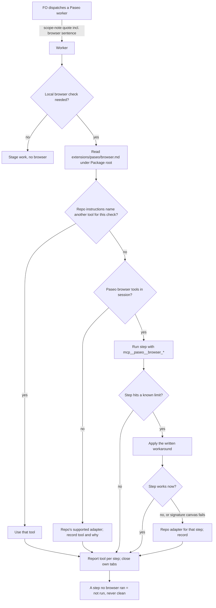

Where the workflow README lists the paseo extension, a worker's local browser verification uses Paseo's browser tools (mcp__paseo__browser_*) by default instead of Chrome for Testing (agent-browser), and the paseo extension states the known limits and their workarounds.

## Scope

- Source: the Captain 「開，然後再給我看一次主題與項目。」 then 「現在不用再強制用 agent-browser，可以叫」 (chat, 2026-11-06, message cut off), answering 「要開這張待辦嗎？」 about this task. His request as relayed earlier by the qnow dev2 FO (Paseo 519ab4c8, 2026-11-06, relayed, confirmed here by his 「開」): 「本輪結束後給 dev2 fo 一個訊息，讓他針對 paseo ext 最佳化，在合適時機不要再用 chrome for testing」.
- Bite (qnow dev2 FO's first-hand report, 2026-11-06, not re-run here): on qnow staging and production, headed agent-browser stayed stuck on Clerk's Cloudflare Turnstile twice and the Captain's manual pass in that window failed too; the Paseo browser passed it and covered a full walk the Captain watched live.
- Known limits to write down (same report): the Captain's IME input can reach a field browser_type is filling (use browser_evaluate with the native value setter plus an input event); some React Native web buttons respond only to browser_click on a snapshot ref; browser_evaluate times out at 15 s (start, park the result on window, poll); signature-canvas drawing untested.
- Facts FO read on 2026-11-06: kc-dev-flow-2 0.35.0 names no agent-browser or Chrome for Testing rule; the paseo extension already routes attended human pages to Paseo; the agent-browser mandates live in adopter AGENTS.md files (qnow: "Run browser work headed") and in the e2e-pipeline plugin.
- Non-goals: CI browser runs (no Paseo; they stay headless); the e2e-pipeline plugin; editing any adopter's AGENTS.md (each adopter's FO changes its own after release).

## Budget
- One package PR; the workflow word budget does not rise unless the design names a raise for the Captain.

## Stop condition
- The paseo extension states the default and the four limits with their workarounds, and one worker browser check on an adopter that lists paseo runs on Paseo's browser tools end to end.

## FO alignment

Alignment: needed at ideation; how the default is stated and which adopter proves it are his to accept.
Result: aligned at backlog: Batch 17 backlog sitting, the Captain 「核准（建議）」 (host question dialog, 2026-11-07), answering 「決定：第 17 批這五張（Paseo 瀏覽器當工人驗收的預設、決策紀錄檢查分清驗證取代與指向依據、派工時自動寫派工紀錄、沒給範圍時設計檢查說沒跑、觀察者列出沒有合併提問紀錄的合併）都用 Pilot，照各自寫下的範圍、預算與停止條件進入構想嗎？建議核准。要改哪張直接說。」, approved the outcome and bounds in this file; the design choice the Alignment line names stays his at the ideation gate.
Surfaces: none
Visible change: none
Release review: not needed: workflow maintenance, on no journey map.

## Design

### PRFAQ

**Proposition.** In a workflow whose README lists the paseo extension, a stage worker that drives a local browser check opens it in Paseo's browser tools (`mcp__paseo__browser_*`) unless the repository's own instructions name another tool for that check, and it already knows the four ways those tools fall short and what to do instead. When the tools are missing or a step still fails, the worker uses the repository's supported adapter for that step and says which tool ran each step.

**FAQ.**
- *Why not just keep agent-browser?* The qnow dev2 FO reported (2026-11-06, first-hand, not re-run here) that headed agent-browser stayed stuck on Clerk's Cloudflare Turnstile twice on qnow staging and production, while Paseo's browser passed it in a walk the Captain watched.
- *Who reads what?* FO copies one more sentence (15 words) as part of the scope-note quote it already copies into every Paseo worker dispatch. The worker reads the new file `extensions/paseo/browser.md` (222 words in the draft) only when it is about to drive a browser. FO reads that file at no moment.
- *Does this override an adopter's AGENTS.md?* No. Repository instructions that name another tool for a check win; each adopter's FO edits its own AGENTS.md (non-goal here). qnow already did on 2026-11-07 (qnow #1342, "Paseo browser tools by default"), without listing paseo.
- *CI?* Unchanged: CI has no Paseo and stays headless.
- *Codex workers?* Not verified. A Claude worker spawned by Paseo reached the tools (probe below); `~/.codex/config.toml` on this host has no paseo MCP entry, and whether Paseo injects its MCP server into a Codex child is unknown. The missing-tools fallback covers it; AC-5 measures it.

### The change (one package PR, kc-dev-flow-2 only)

1. `kc-dev-flow-2/extensions/paseo/EXTENSION.md`, section "Workers through Paseo": append one sentence at the **end** of the existing `Add to scope notes: "…"` quote: `For a local browser check you drive yourself, first read extensions/paseo/browser.md under your Package root.` Placed last on purpose: `dispatch_records.py` (`declared_instructions`) requires only the quote's first sentence in each Paseo spawn record, so the check and every existing record stay valid (see Decision D1).
2. New `kc-dev-flow-2/extensions/paseo/browser.md`, worker-read, text as drafted (222 words; implementation may trim, not grow past 240):

   > **Worker browser checks through Paseo.** For a local browser check you drive yourself, use Paseo's browser tools (`mcp__paseo__browser_*`) unless the repository's own instructions name another tool for that check. CI browser runs are unchanged. Tabs open in the background in your Paseo workspace on the most recently connected browser host; close the tabs you open.
   > If the tools are missing from your session, or cannot perform a step after the workaround below, use the repository's supported adapter for that step and record in your report which tool ran each step and why. A step no browser ran is reported as not run, never clean.
   > Known limits:
   > - The Captain's keyboard, including his input method, can reach a field `browser_type` is filling. Fill with `browser_evaluate` instead: set the value through the element's native value setter, dispatch a bubbling `input` event, and read the value back.
   > - Some React Native web buttons respond only to `browser_click` on a ref from the latest `browser_snapshot`. Refs expire when the page changes, so snapshot again first.
   > - `browser_evaluate` fails with `browser_timeout` after 15 seconds. For longer work, start it in one call, park the result on `window`, and poll it with short calls.
   > - Drawing on a signature canvas is untested. Try `browser_drag`; if the drawing does not register, use the repository's adapter for that step.

   AC-5's result adds one line under Known limits if a Codex worker lacks the tools.
3. Not changed: `references/sd/workflow.md` (no word-budget step, ADR 0020 not engaged), the package README extension table, `lint-skills.py`, `dispatch_records.py`, any adopter file, e2e-pipeline.

### Checks behind the design

- **Chain (2026-11-07).** Spacedock 0.27.3 plugin cache: `grep -rliE 'agent-browser|chrome for testing|browser_'` finds only two Go release tests naming GitHub's `browser_download_url`; no browser-tool rule. kc-dev-flow-2 at origin/main 139feeaee7ce (0.35.0): no agent-browser or Chrome for Testing rule; the paseo extension's "Human terminals and pages" covers attended pages only. Adopters (read-only, `git show <ref>:docs/dev2/README.md`): only kc-claude-plugins dev2 lists paseo (`extensions: [roborev, codex, copilot, learn, peers, paseo, fo-feedback]`); qnow origin/main and origin/next, subspace-relay and subspace-web do not; bridge has no dev2 README. qnow's AGENTS.md "Browser rule" (#1342) already says Paseo by default, agent-browser allowed. Paseo's mechanism read from its own tool schemas (`browser_new_tab`: "this agent's workspace on the most recently connected browser automation host, opened in the background"; refs "expire when the page changes"); the installed paseo skill has no browser text.
- **Existing-code capability check.** Boundary: a stage worker's self-driven local browser check in a paseo-listing workflow. Completeness: "Human terminals and pages" works for attended pages, but its trigger is "each worker needing human interaction" and it says nothing about a worker driving a check alone, the fallback, or the limits; no other package text covers it (two searches: `git grep -i 'browser'` over kc-dev-flow-2 and over the paseo extension). Need: the Captain's request and the Turnstile bite above. So: extend the existing scope-note quote and add one worker-read file, rather than a new extension or a second instruction line.
- **Probe (this ideation worker, a Claude worker spawned by Paseo, 2026-11-07).** My own fixture server never bound: port 8765 was held by an unrelated listener started 2026-10-25 (left untouched), so the tab loaded that server's 404 page and I injected an input and a button with `browser_evaluate`. On it: `browser_snapshot` returned refs `@e1`/`@e2`; `browser_click @e2` fired the button's onclick (title became `clicked`); native-setter fill plus input event set the value (`native-set`); an evaluate awaiting 17 s failed with `browser_timeout` "timed out after 15000ms"; start-park-on-window-poll read `pending` then `done`. Not exercised: IME interference (needs the Captain typing), a React Native web button, signature canvas. Tab closed; my probe directory removed.

### Words FO reads at each moment

Counted with `wc -w` over every passage that instructs a step due at that moment; base = origin/main 139feeaee7ce.

| Moment | Base | Candidate |
| --- | --- | --- |
| Startup / resume (workflow README) | unchanged file | unchanged (0) |
| Idle on an open PR, idle on a merged PR, after the archive, the merge ask | no paseo text instructs a step here | unchanged (0) |
| Before a listed Paseo worker dispatch (`extensions/paseo/EXTENSION.md`) | 1101 | 1116 (+15) |
| `dispatch_records.py` output | unchanged | unchanged: script not changed |
| Worker at spawn (scope notes) | base quote | +15 |
| Worker about to drive a browser (`browser.md`) | 0 | 222 (cap 240); FO never reads it |

The one rise is +15 words at the Paseo dispatch moment; the alternative of putting the limits in EXTENSION.md would add about 222 there instead.

### Batch overlap

| Task | Same file or check | Effect |
| --- | --- | --- |
| dispatch-build-writes-the-dispatch-record (batch 17) | the check reading the paseo `Add to scope notes:` quote in `dispatch_records.py`; no shared file | if it generates records from that quote, it must copy the whole quote, not only the first sentence, or the browser sentence is dropped |
| adr-lint-tells-supersession-assertion-from-pointer (batch 17) | none (`adr_lint.py`, `test_sd_dispatch.py`) | none |
| design-check-says-not-run-without-a-scope (batch 17) | none (`design_surfaces.py`) | none |
| observer-lists-unasked-merges (batch 17) | none | none |
| merge-guard-stops-unasked-merges (Captain hold; read only) | none (`merge_guard.py`, `delivery_gate.py`, `lint-skills.py`, `workflow.md`, `adoption.md`) | none |
| gate-summary-names-each-decline (Captain hold; read only) | none (`workflow.md`, `delivery_gate.py`, `lint-skills.py`) | none |
| adoption-asks-which-extensions (other session, ideation) | none: names package `README.md` and `dispatch_records.py`, neither changed here | none |
| picky-reviewers-may-run-on-gemini (ideation) | none: its stop route changes no file | none |
| journey-map tasks (journey-map FO; read only) | none; AC-4 only runs the canvas from the candidate checkout on unreserved ports | none |

Recommended order: this task before dispatch-build-writes-the-dispatch-record; any order for the rest.

## Acceptance criteria

**AC-1** The paseo extension's scope-note quote ends with the browser sentence, and the quote's first sentence is unchanged.
Evidence: at the candidate, `git show <candidate>:kc-dev-flow-2/extensions/paseo/EXTENSION.md | grep -n '^Add to scope notes:'` shows one line whose quote ends `first read extensions/paseo/browser.md under your Package root."`; `python3 kc-dev-flow-2/scripts/test_dispatch_records.py` passes unchanged (its `test_every_shipped_instruction_is_read_from_its_extension_file` asserts the paseo first sentence). Falsifier: putting the sentence first, or as a second `Add to scope notes:` line, makes that test fail.

**AC-2** `extensions/paseo/browser.md` states the default, the precedence of repository instructions, CI unchanged, the fallback with per-step tool reporting, not-run-is-never-clean, and the four limits each with its workaround, in at most 240 words.
Evidence: `wc -w` on the file; a reviewer maps each of the four limits in `## Scope` to one bullet with its workaround. Falsifier: a limit without a workaround, or over 240 words, fails.

**AC-3** FO's reading rises only at the Paseo dispatch moment, by at most 20 words, and the workflow README and its word budget are untouched.
Evidence: `git diff --stat origin/main...<candidate> -- kc-dev-flow-2/references/sd/workflow.md kc-dev-flow-2/scripts/lint-skills.py kc-dev-flow-2/scripts/dispatch_records.py` is empty; `wc -w` of EXTENSION.md at base 1101, at candidate ≤ 1121; `python3 kc-dev-flow-2/scripts/lint-skills.py` passes. Falsifier: moving the limits into EXTENSION.md exceeds the bound.

**AC-4** End to end on kc-claude-plugins dev2 (the only adopter listing paseo): one fresh Claude worker spawned through Paseo, given scope notes copied from the candidate EXTENSION.md and `Package root:` the candidate checkout's `kc-dev-flow-2`, is asked to verify that the kc-journey-map canvas started from the candidate checkout (on ports no repository doc reserves, as `popup-browser-check.mjs` chooses) renders a board and that one control responds to a click, with no browser tool named in the ask.
Evidence: the worker's report lists the tool per step; its `get_agent_activity` log, saved in the task folder, shows `browser_new_tab`, `browser_snapshot`, a ref-based `browser_click` and `browser_screenshot` on Paseo, no `agent-browser` command, and `browser_close_tab` for each tab it opened. Falsifier: any step run on agent-browser without a recorded reason from browser.md, or no Paseo browser call, fails. Not yet verified.

**AC-5** Codex reachability is measured, not assumed: one Codex worker spawned through Paseo calls `browser_list_tabs` once and reports whether the tool exists in its session.
Evidence: its report and activity log in the task folder. If absent, browser.md gains one Known-limits line saying Codex workers spawned by Paseo lack the tools and use the repository adapter; if present, nothing is added. Falsifier: browser.md claiming either way without this record fails. Not yet verified.

## Decisions for the Captain

- **D1. How the default is stated — recommend: one sentence appended to the end of the existing paseo scope-note quote, pointing workers to a worker-read `browser.md`; repository instructions that name another tool win; not mechanically enforced.** Why: FO reads +15 words at one moment; no ADR lands, and paseo ADRs 0042, 0048 and 0052 do not quote the scope-note paragraph (checked 2026-11-07); no script change; `dispatch_records.py` checks only the quote's first sentence, so every existing record stays valid. Enforcing it (a second `Add to scope notes:` line, which `declared_instructions` would require in every Paseo spawn record) would make FO's whole-folder check before each dispatch, and validation's check refuse every earlier Paseo record that lacks the sentence, in-flight tasks included (the L2 law runner too, if it judges history with the current package; not checked). What gets worse under the recommendation: nothing stops FO from dropping the sentence; a worker without it falls back to habit, visible only in its per-step tool list.
- **D2. Which adopter and check prove it — recommend: kc-claude-plugins dev2 with the kc-journey-map canvas walk in AC-4, plus the Codex probe in AC-5.** Why: it is the only adopter that lists paseo; the canvas is this repository's only real browser UI. What gets worse: the proof is a local page, not the Clerk Turnstile case that motivated the task; that pass stays the qnow dev2 FO's first-hand report, and qnow gets this package rule only if its FO later lists paseo.

## Stage Report: ideation

- DONE: Design how the paseo extension makes Paseo's browser tools (mcp__paseo__browser_*) the default for a worker's local browser verification where the workflow lists paseo, stating the four known limits and their workarounds from the task file, and name the adopter and check that proves it end to end
  `## Design`: one sentence appended to the paseo scope-note quote + worker-read `extensions/paseo/browser.md` (four limits, each with workaround, fallback, not-run-never-clean); proof on kc-claude-plugins dev2 (only adopter listing paseo) via a journey-map canvas walk (AC-4) and a Codex probe (AC-5).
- DONE: A `### Batch overlap` section naming each file the design would change and each other batch task (adr-lint-tells-supersession-assertion-from-pointer, dispatch-build-writes-the-dispatch-record, design-check-says-not-run-without-a-scope, observer-lists-unasked-merges) and live task of other sessions (merge-guard-stops-unasked-merges and gate-summary-names-each-decline (held by the Captain; read only), and journey-map tasks driven by the journey-map FO (read only)) that changes the same file or check, so FO can order implementation
  Only overlap: dispatch-build-writes-the-dispatch-record reads the same paseo scope-note quote; Recommended order: this task first.
- DONE: The words FO reads at each lifecycle moment, before and after, per root learning.md "Measure the words FO reads at each moment, not one file's size"
  `### Words FO reads at each moment`: Paseo dispatch moment 1101 → 1116 (`wc -w`, origin/main 139feeaee7ce); every other moment unchanged; browser.md (222) is worker-read only.
- DONE: Acceptance criteria with reproducible evidence clauses and falsifiers, and unresolved decisions for the Captain, each with a recommendation and what gets worse under it
  AC-1..AC-5 each carry evidence and a falsifier; D1 (how stated, not enforced) and D2 (adopter and check) each with recommendation and cost.
- DONE: AC-1 scope-note quote ends with the browser sentence, first sentence unchanged
  Not yet verified (implementation); falsifier traced to `declared_instructions` taking the quote's first sentence and the test asserting exactly 3 instructions.
- DONE: AC-2 browser.md content and ≤240 words
  Not yet verified in the repository; draft counted 222 words with `wc -w`.
- DONE: AC-3 FO reading rises ≤20 words at one moment, README and budget untouched
  Not yet verified; planned +15 from the draft sentence (`wc -w`).
- DONE: AC-4 end-to-end Claude worker walk on the journey-map canvas through Paseo
  Not yet verified. Precursor only: this Paseo-spawned Claude worker ran new_tab, snapshot, ref click, native-setter fill, a 15 s browser_timeout and park-and-poll on 2026-11-07 (page was an unrelated server's 404 with injected DOM).
- DONE: AC-5 Codex reachability measured
  Not yet verified; `~/.codex/config.toml` has no paseo MCP entry, injection by Paseo unknown.
- DONE: design_surfaces check
  `python3 <package>/scripts/design_surfaces.py check <task>` → "worker-browser-checks-use-paseo-browser.md: design surfaces presentable", exit 0.

### Summary

Designed the smallest route: FO copies one more sentence (+15 words at the Paseo dispatch moment) inside the scope-note quote it already copies, and workers read a new 222-word `browser.md` only before driving a browser. Recommended not enforcing it through `dispatch_records.py`, because a required second instruction would fail every existing Paseo dispatch record. Only kc-claude-plugins dev2 lists paseo, so the end-to-end proof runs there; qnow adopted Paseo-by-default in its own AGENTS.md on 2026-11-07 without listing paseo.
