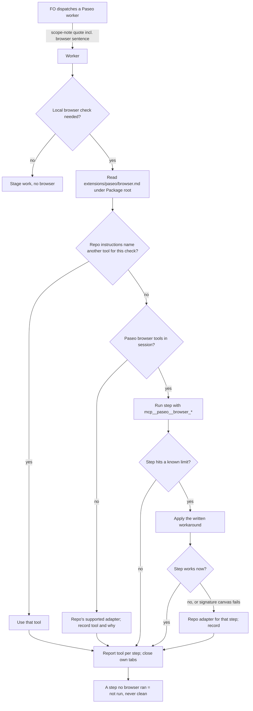

Where the workflow README lists the paseo extension, a worker's local browser verification uses Paseo's browser tools (mcp__paseo__browser_*) by default instead of Chrome for Testing (agent-browser), and the paseo extension states the known limits and their workarounds.

## Scope

- Source: the Captain 「開，然後再給我看一次主題與項目。」 then 「現在不用再強制用 agent-browser，可以叫」 (chat, 2026-11-06, message cut off), answering 「要開這張待辦嗎？」 about this task. His request as relayed earlier by the qnow dev2 FO (Paseo 519ab4c8, 2026-11-06, relayed, confirmed here by his 「開」): 「本輪結束後給 dev2 fo 一個訊息，讓他針對 paseo ext 最佳化，在合適時機不要再用 chrome for testing」.
- Bite (qnow dev2 FO's first-hand report, 2026-11-06, not re-run here): on qnow staging and production, headed agent-browser stayed stuck on Clerk's Cloudflare Turnstile twice and the Captain's manual pass in that window failed too; the Paseo browser passed it and covered a full walk the Captain watched live.
- Known limits to write down (same report): the Captain's IME input can reach a field browser_type is filling (use browser_evaluate with the native value setter plus an input event); some React Native web buttons respond only to browser_click on a snapshot ref; browser_evaluate times out at 15 s (start, park the result on window, poll); signature-canvas drawing untested.
- Facts FO read on 2026-11-06: kc-dev-flow-2 0.35.0 names no agent-browser or Chrome for Testing rule; the paseo extension already routes attended human pages to Paseo; the agent-browser mandates live in adopter AGENTS.md files (qnow: "Run browser work headed") and in the e2e-pipeline plugin.
- Non-goals: CI browser runs (no Paseo; they stay headless); the e2e-pipeline plugin; editing any adopter's AGENTS.md (each adopter's FO changes its own after release).

## Budget
- One package PR; the workflow word budget does not rise unless the design names a raise for the Captain.

## Stop condition
- The paseo extension states the default and the four limits with their workarounds, and one worker browser check on an adopter that lists paseo runs on Paseo's browser tools end to end.

## FO alignment

Alignment: needed at ideation; how the default is stated and which adopter proves it are his to accept.
Result: aligned at backlog: Batch 17 backlog sitting, the Captain 「核准（建議）」 (host question dialog, 2026-11-07), answering 「決定：第 17 批這五張（Paseo 瀏覽器當工人驗收的預設、決策紀錄檢查分清驗證取代與指向依據、派工時自動寫派工紀錄、沒給範圍時設計檢查說沒跑、觀察者列出沒有合併提問紀錄的合併）都用 Pilot，照各自寫下的範圍、預算與停止條件進入構想嗎？建議核准。要改哪張直接說。」, approved the outcome and bounds in this file; the design choice the Alignment line names stays his at the ideation gate.
Surfaces: none
Visible change: none
Release review: not needed: workflow maintenance, on no journey map.

## Design

### PRFAQ

**Proposition.** In a workflow whose README lists the paseo extension, a stage worker that drives a local browser check opens it in Paseo's browser tools (`mcp__paseo__browser_*`) unless the repository's own instructions name another tool for that check, and it already knows the four ways those tools fall short and what to do instead. When the tools are missing or a step still fails, the worker uses the repository's supported adapter for that step and says which tool ran each step.

**FAQ.**
- *Why not just keep agent-browser?* The qnow dev2 FO reported (2026-11-06, first-hand, not re-run here) that headed agent-browser stayed stuck on Clerk's Cloudflare Turnstile twice on qnow staging and production, while Paseo's browser passed it in a walk the Captain watched.
- *Who reads what?* FO copies one more sentence (15 words) as part of the scope-note quote it already copies into every Paseo worker dispatch. The worker reads the new file `extensions/paseo/browser.md` (222 words in the draft) only when it is about to drive a browser. FO reads that file at no moment.
- *Does this override an adopter's AGENTS.md?* No. Repository instructions that name another tool for a check win; each adopter's FO edits its own AGENTS.md (non-goal here). qnow already did on 2026-11-07 (qnow #1342, "Paseo browser tools by default"), without listing paseo.
- *CI?* Unchanged: CI has no Paseo and stays headless.
- *Codex workers?* Not verified. A Claude worker spawned by Paseo reached the tools (probe below); `~/.codex/config.toml` on this host has no paseo MCP entry, and whether Paseo injects its MCP server into a Codex child is unknown. The missing-tools fallback covers it; AC-5 measures it.

### The change (one package PR, kc-dev-flow-2 only)

1. `kc-dev-flow-2/extensions/paseo/EXTENSION.md`, section "Workers through Paseo": append one sentence at the **end** of the existing `Add to scope notes: "…"` quote: `For a local browser check you drive yourself, first read extensions/paseo/browser.md under your Package root.` Placed last on purpose: `dispatch_records.py` (`declared_instructions`) requires only the quote's first sentence in each Paseo spawn record, so the check and every existing record stay valid (see Decision D1).
2. New `kc-dev-flow-2/extensions/paseo/browser.md`, worker-read, text as drafted (222 words; implementation may trim, not grow past 240):

   > **Worker browser checks through Paseo.** For a local browser check you drive yourself, use Paseo's browser tools (`mcp__paseo__browser_*`) unless the repository's own instructions name another tool for that check. CI browser runs are unchanged. Tabs open in the background in your Paseo workspace on the most recently connected browser host; close the tabs you open.
   > If the tools are missing from your session, or cannot perform a step after the workaround below, use the repository's supported adapter for that step and record in your report which tool ran each step and why. A step no browser ran is reported as not run, never clean.
   > Known limits:
   > - The Captain's keyboard, including his input method, can reach a field `browser_type` is filling. Fill with `browser_evaluate` instead: set the value through the element's native value setter, dispatch a bubbling `input` event, and read the value back.
   > - Some React Native web buttons respond only to `browser_click` on a ref from the latest `browser_snapshot`. Refs expire when the page changes, so snapshot again first.
   > - `browser_evaluate` fails with `browser_timeout` after 15 seconds. For longer work, start it in one call, park the result on `window`, and poll it with short calls.
   > - Drawing on a signature canvas is untested. Try `browser_drag`; if the drawing does not register, use the repository's adapter for that step.

   AC-5's result adds one line under Known limits if a Codex worker lacks the tools.
3. Not changed: `references/sd/workflow.md` (no word-budget step, ADR 0020 not engaged), the package README extension table, `lint-skills.py`, `dispatch_records.py`, any adopter file, e2e-pipeline.

### Checks behind the design

- **Chain (2026-11-07).** Spacedock 0.27.3 plugin cache: `grep -rliE 'agent-browser|chrome for testing|browser_'` finds only two Go release tests naming GitHub's `browser_download_url`; no browser-tool rule. kc-dev-flow-2 at origin/main 139feeaee7ce (0.35.0): no agent-browser or Chrome for Testing rule; the paseo extension's "Human terminals and pages" covers attended pages only. Adopters (read-only, `git show <ref>:docs/dev2/README.md`): only kc-claude-plugins dev2 lists paseo (`extensions: [roborev, codex, copilot, learn, peers, paseo, fo-feedback]`); qnow origin/main and origin/next, subspace-relay and subspace-web do not; bridge has no dev2 README. qnow's AGENTS.md "Browser rule" (#1342) already says Paseo by default, agent-browser allowed. Paseo's mechanism read from its own tool schemas (`browser_new_tab`: "this agent's workspace on the most recently connected browser automation host, opened in the background"; refs "expire when the page changes"); the installed paseo skill has no browser text.
- **Existing-code capability check.** Boundary: a stage worker's self-driven local browser check in a paseo-listing workflow. Completeness: "Human terminals and pages" works for attended pages, but its trigger is "each worker needing human interaction" and it says nothing about a worker driving a check alone, the fallback, or the limits; no other package text covers it (two searches: `git grep -i 'browser'` over kc-dev-flow-2 and over the paseo extension). Need: the Captain's request and the Turnstile bite above. So: extend the existing scope-note quote and add one worker-read file, rather than a new extension or a second instruction line.
- **Probe (this ideation worker, a Claude worker spawned by Paseo, 2026-11-07).** My own fixture server never bound: port 8765 was held by an unrelated listener started 2026-10-25 (left untouched), so the tab loaded that server's 404 page and I injected an input and a button with `browser_evaluate`. On it: `browser_snapshot` returned refs `@e1`/`@e2`; `browser_click @e2` fired the button's onclick (title became `clicked`); native-setter fill plus input event set the value (`native-set`); an evaluate awaiting 17 s failed with `browser_timeout` "timed out after 15000ms"; start-park-on-window-poll read `pending` then `done`. Not exercised: IME interference (needs the Captain typing), a React Native web button, signature canvas. Tab closed; my probe directory removed.

### Words FO reads at each moment

Counted with `wc -w` over every passage that instructs a step due at that moment; base = origin/main 139feeaee7ce.

| Moment | Base | Candidate |
| --- | --- | --- |
| Startup / resume (workflow README) | unchanged file | unchanged (0) |
| Idle on an open PR, idle on a merged PR, after the archive, the merge ask | no paseo text instructs a step here | unchanged (0) |
| Before a listed Paseo worker dispatch (`extensions/paseo/EXTENSION.md`) | 1101 | 1116 (+15) |
| `dispatch_records.py` output | unchanged | unchanged: script not changed |
| Worker at spawn (scope notes) | base quote | +15 |
| Worker about to drive a browser (`browser.md`) | 0 | 222 (cap 240); FO never reads it |

The one rise is +15 words at the Paseo dispatch moment; the alternative of putting the limits in EXTENSION.md would add about 222 there instead.

### Batch overlap

| Task | Same file or check | Effect |
| --- | --- | --- |
| dispatch-build-writes-the-dispatch-record (batch 17) | the check reading the paseo `Add to scope notes:` quote in `dispatch_records.py`; no shared file | if it generates records from that quote, it must copy the whole quote, not only the first sentence, or the browser sentence is dropped |
| adr-lint-tells-supersession-assertion-from-pointer (batch 17) | none (`adr_lint.py`, `test_sd_dispatch.py`) | none |
| design-check-says-not-run-without-a-scope (batch 17) | none (`design_surfaces.py`) | none |
| observer-lists-unasked-merges (batch 17) | none | none |
| merge-guard-stops-unasked-merges (Captain hold; read only) | none (`merge_guard.py`, `delivery_gate.py`, `lint-skills.py`, `workflow.md`, `adoption.md`) | none |
| gate-summary-names-each-decline (Captain hold; read only) | none (`workflow.md`, `delivery_gate.py`, `lint-skills.py`) | none |
| adoption-asks-which-extensions (other session, ideation) | none: names package `README.md` and `dispatch_records.py`, neither changed here | none |
| picky-reviewers-may-run-on-gemini (ideation) | none: its stop route changes no file | none |
| journey-map tasks (journey-map FO; read only) | none; AC-4 only runs the canvas from the candidate checkout on unreserved ports | none |

Recommended order: this task before dispatch-build-writes-the-dispatch-record; any order for the rest.

## Acceptance criteria

**AC-6** Amended by Captain, amendment 1. The paseo extension's scope-note quote ends with the browser sentence `Before using Paseo's browser tools, read extensions/paseo/browser.md under your Package root.`, and the quote's first sentence is unchanged.
Evidence: at the candidate, `git show <candidate>:kc-dev-flow-2/extensions/paseo/EXTENSION.md | grep -n '^Add to scope notes:'` shows one line whose quote ends `read extensions/paseo/browser.md under your Package root."`; `python3 kc-dev-flow-2/scripts/test_dispatch_records.py` passes unchanged. Falsifier: putting the sentence first, or as a second `Add to scope notes:` line, makes that test fail.

**AC-7** Amended by Captain, amendment 1. `extensions/paseo/browser.md` sends attended pages, including a login where the Captain performs human verification, to EXTENSION.md's Human terminals and pages; keeps repository instructions first; says unattended checks use the repository's supported adapter with no required Paseo attempt; and keeps CI unchanged, the fallback with per-step tool reporting, not-run-is-never-clean, the visible-tab limit and the four limits each with its workaround, in at most 240 words.
Evidence: `wc -w` on the file; a reviewer maps each of the four limits in `## Scope` to one bullet with its workaround. Falsifier: a sentence requiring a Paseo attempt for an unattended check, a limit without a workaround, or over 240 words fails.

**AC-3** FO's reading rises only at the Paseo dispatch moment, by at most 20 words, and the workflow README and its word budget are untouched.
Evidence: `git diff --stat origin/main...<candidate> -- kc-dev-flow-2/references/sd/workflow.md kc-dev-flow-2/scripts/lint-skills.py kc-dev-flow-2/scripts/dispatch_records.py` is empty; `wc -w` of EXTENSION.md at base 1101, at candidate ≤ 1121; `python3 kc-dev-flow-2/scripts/lint-skills.py` passes. Falsifier: moving the limits into EXTENSION.md exceeds the bound.

**AC-8** Amended by Captain, amendment 1. Paseo's operation on an attended page and the fallback are shown by the two existing runs, with no new browser run: `implementation/attempt-2/` (tab visible in the Captain's Paseo app; Paseo snapshot, screenshots and a ref-based click, no fallback) and `implementation/claude-report.md` (background tab; Paseo screenshot and click failed; agent-browser fallback recorded per step).
Evidence: those saved reports, activity logs and images, cited in the implementation report as runs at 20eb8255daf0f1267a8c0dd16daf0705a7cf82ba. Falsifier: the implementation report claiming either run tested an unattended Paseo default fails.

**AC-5** Codex reachability is measured, not assumed: one Codex worker spawned through Paseo calls `browser_list_tabs` once and reports whether the tool exists in its session.
Evidence: its report and activity log in the task folder. If absent, browser.md gains one Known-limits line saying Codex workers spawned by Paseo lack the tools and use the repository adapter; if present, nothing is added. Falsifier: browser.md claiming either way without this record fails. Not yet verified.

## Decisions for the Captain

- **D1. How the default is stated — recommend: one sentence appended to the end of the existing paseo scope-note quote, pointing workers to a worker-read `browser.md`; repository instructions that name another tool win; not mechanically enforced.** Why: FO reads +15 words at one moment; no ADR lands, and paseo ADRs 0042, 0048 and 0052 do not quote the scope-note paragraph (checked 2026-11-07); no script change; `dispatch_records.py` checks only the quote's first sentence, so every existing record stays valid. Enforcing it (a second `Add to scope notes:` line, which `declared_instructions` would require in every Paseo spawn record) would make FO's whole-folder check before each dispatch, and validation's check refuse every earlier Paseo record that lacks the sentence, in-flight tasks included (the L2 law runner too, if it judges history with the current package; not checked). What gets worse under the recommendation: nothing stops FO from dropping the sentence; a worker without it falls back to habit, visible only in its per-step tool list.
- **D2. Which adopter and check prove it — recommend: kc-claude-plugins dev2 with the kc-journey-map canvas walk in AC-4, plus the Codex probe in AC-5.** Why: it is the only adopter that lists paseo; the canvas is this repository's only real browser UI. What gets worse: the proof is a local page, not the Clerk Turnstile case that motivated the task; that pass stays the qnow dev2 FO's first-hand report, and qnow gets this package rule only if its FO later lists paseo.

## Captain amendments

### Amendment 1 — 2026-11-08, host question dialog
Captain: 「照建議改（建議）」 (host question dialog, 2026-11-08)
Asked: 「#810（工人做瀏覽器驗收預設用 Paseo 分頁）要怎麼處理？我改變建議了：你在場時用 Paseo 本來就有規則規定；#810 新增的是「沒人看著時也預設 Paseo」，但分頁開在背景時截圖、點擊都會失敗，工人會先白試一輪才退回 agent-browser。建議改成：保留四個限制的處理方法，加上「登入要人機驗證時算作有人在場、用 Paseo」，拿掉「沒人看著也預設 Paseo」；改之前先請獨立審查者確認。」 Option chosen: 「照建議改（建議）」 — 「先請獨立審查者確認，再退回實作修改；#810 這輪不合併」
Design: 「保留四個限制的處理方法，加上「登入要人機驗證時算作有人在場、用 Paseo」，拿掉「沒人看著也預設 Paseo」」
Supersedes: AC-1, AC-2, AC-4

Superseded text:
**AC-1** The paseo extension's scope-note quote ends with the browser sentence, and the quote's first sentence is unchanged.
Evidence: at the candidate, `git show <candidate>:kc-dev-flow-2/extensions/paseo/EXTENSION.md | grep -n '^Add to scope notes:'` shows one line whose quote ends `first read extensions/paseo/browser.md under your Package root."`; `python3 kc-dev-flow-2/scripts/test_dispatch_records.py` passes unchanged (its `test_every_shipped_instruction_is_read_from_its_extension_file` asserts the paseo first sentence). Falsifier: putting the sentence first, or as a second `Add to scope notes:` line, makes that test fail.

**AC-2** `extensions/paseo/browser.md` states the default, the precedence of repository instructions, CI unchanged, the fallback with per-step tool reporting, not-run-is-never-clean, and the four limits each with its workaround, in at most 240 words.
Evidence: `wc -w` on the file; a reviewer maps each of the four limits in `## Scope` to one bullet with its workaround. Falsifier: a limit without a workaround, or over 240 words, fails.

**AC-4** End to end on kc-claude-plugins dev2 (the only adopter listing paseo): one fresh Claude worker spawned through Paseo, given scope notes copied from the candidate EXTENSION.md and `Package root:` the candidate checkout's `kc-dev-flow-2`, is asked to verify that the kc-journey-map canvas started from the candidate checkout (on ports no repository doc reserves, as `popup-browser-check.mjs` chooses) renders a board and that one control responds to a click, with no browser tool named in the ask.
Evidence: the worker's report lists the tool per step; its `get_agent_activity` log, saved in the task folder, shows `browser_new_tab`, `browser_snapshot`, a ref-based `browser_click` and `browser_screenshot` on Paseo, no `agent-browser` command, and `browser_close_tab` for each tab it opened. Falsifier: any step run on agent-browser without a recorded reason from browser.md, or no Paseo browser call, fails. Not yet verified.

## Stage Report: ideation

- DONE: Design how the paseo extension makes Paseo's browser tools (mcp__paseo__browser_*) the default for a worker's local browser verification where the workflow lists paseo, stating the four known limits and their workarounds from the task file, and name the adopter and check that proves it end to end
  `## Design`: one sentence appended to the paseo scope-note quote + worker-read `extensions/paseo/browser.md` (four limits, each with workaround, fallback, not-run-never-clean); proof on kc-claude-plugins dev2 (only adopter listing paseo) via a journey-map canvas walk (AC-4) and a Codex probe (AC-5).
- DONE: A `### Batch overlap` section naming each file the design would change and each other batch task (adr-lint-tells-supersession-assertion-from-pointer, dispatch-build-writes-the-dispatch-record, design-check-says-not-run-without-a-scope, observer-lists-unasked-merges) and live task of other sessions (merge-guard-stops-unasked-merges and gate-summary-names-each-decline (held by the Captain; read only), and journey-map tasks driven by the journey-map FO (read only)) that changes the same file or check, so FO can order implementation
  Only overlap: dispatch-build-writes-the-dispatch-record reads the same paseo scope-note quote; Recommended order: this task first.
- DONE: The words FO reads at each lifecycle moment, before and after, per root learning.md "Measure the words FO reads at each moment, not one file's size"
  `### Words FO reads at each moment`: Paseo dispatch moment 1101 → 1116 (`wc -w`, origin/main 139feeaee7ce); every other moment unchanged; browser.md (222) is worker-read only.
- DONE: Acceptance criteria with reproducible evidence clauses and falsifiers, and unresolved decisions for the Captain, each with a recommendation and what gets worse under it
  AC-1..AC-5 each carry evidence and a falsifier; D1 (how stated, not enforced) and D2 (adopter and check) each with recommendation and cost.
- DONE: AC-1 scope-note quote ends with the browser sentence, first sentence unchanged
  Not yet verified (implementation); falsifier traced to `declared_instructions` taking the quote's first sentence and the test asserting exactly 3 instructions.
- DONE: AC-2 browser.md content and ≤240 words
  Not yet verified in the repository; draft counted 222 words with `wc -w`.
- DONE: AC-3 FO reading rises ≤20 words at one moment, README and budget untouched
  Not yet verified; planned +15 from the draft sentence (`wc -w`).
- DONE: AC-4 end-to-end Claude worker walk on the journey-map canvas through Paseo
  Not yet verified. Precursor only: this Paseo-spawned Claude worker ran new_tab, snapshot, ref click, native-setter fill, a 15 s browser_timeout and park-and-poll on 2026-11-07 (page was an unrelated server's 404 with injected DOM).
- DONE: AC-5 Codex reachability measured
  Not yet verified; `~/.codex/config.toml` has no paseo MCP entry, injection by Paseo unknown.
- DONE: design_surfaces check
  `python3 <package>/scripts/design_surfaces.py check <task>` → "worker-browser-checks-use-paseo-browser.md: design surfaces presentable", exit 0.

### Summary

Designed the smallest route: FO copies one more sentence (+15 words at the Paseo dispatch moment) inside the scope-note quote it already copies, and workers read a new 222-word `browser.md` only before driving a browser. Recommended not enforcing it through `dispatch_records.py`, because a required second instruction would fail every existing Paseo dispatch record. Only kc-claude-plugins dev2 lists paseo, so the end-to-end proof runs there; qnow adopted Paseo-by-default in its own AGENTS.md on 2026-11-07 without listing paseo.

## Stage Report: implementation

- DONE: Implement the approved design and D1/D2 recommendations using only the named product files.
  Candidate `90192bb64db4614de9a7a94cc782ee5fa44748db` changes only `kc-dev-flow-2/extensions/paseo/{EXTENSION.md,browser.md}`; no version, workflow, budget, dispatch checker or adopter edits. Existing capability/design audit reused.
- DONE: AC-1 scope-note quote ends with the browser sentence and preserves its original first sentence.
  `implementation/acceptance.log`: exact quote comparison and existing consumer pass; both sentence-first and second-instruction mutations fail the unchanged consumer test in fresh exports with `python3 -B` and caches cleared.
- DONE: AC-2 default, precedence, unchanged CI, fallback/tool-per-step reporting, not-run-never-clean, and four limits with workarounds, within 240 words.
  Final guide is 235 words; `implementation/document-review.md` maps all four limits; removing each workaround or exceeding 240 fails `acceptance.py`. The recorded FO follow-up adds the observed visible-tab requirement.
- DONE: AC-3 FO reading grows only at Paseo dispatch by at most 20 words; workflow README and budget unchanged.
  EXTENSION.md is 1101 -> 1116 words (+15); guide is worker-only. `acceptance.py` checks unchanged workflow/lint/dispatch blobs and rejects moving the guide into FO's extension text; other lifecycle moments are unchanged.
- DONE: AC-4 fresh Claude worker uses Paseo for the real candidate journey-map board, screenshot and ref-based click.
  `implementation/attempt-2/{claude-report.md,claude-activity.json,claude-before.png,claude-after.png}`: visible before/after; ref @e34 opens the minimap. No fallback command; original background failure and documented fallback remain in `implementation/claude-*`.
- DONE: AC-5 fresh Codex worker measures tool reachability rather than assuming it.
  `implementation/codex-activity.json`: worker 07667725-e257-49f7-b859-a1f49e1187c3 calls browser_list_tabs exactly once successfully; no unsupported Codex limitation added. Missing-measurement and missing-Paseo/alternate-adapter record mutations are rejected.
- DONE: Every acceptance criterion and its falsifier is exercised with rerunnable evidence.
  `bash --noprofile --norc implementation/acceptance.sh <absolute-worktree>` gives 27 passed checks at the final SHA; `first-attempt-acceptance*.{json,log}` preserves the earlier AC-4 failure. These evidence mutations test refusal, not a claim that the failed background run passed.
- DONE: Repository lint and the unchanged dispatch-record suite pass on the final candidate.
  Repository `kc-dev-flow-2/scripts/lint-skills.py` exits 0; `test_dispatch_records.py` runs 115 tests, 1 optional skip, exit 0 (`implementation/{lint-skills,dispatch-tests}.log`).
- DONE: Required package ADR, number, comment and design checks complete.
  Package root is dispatch-pinned kc-dev-flow-2 0.35.0; `implementation/checks-results.json` records every command and exit 0. ADR lint checks 62 files; number guards PASS (no migrations-path); comment ratio is 0 code/0 comment lines, 0%, maximum 5%, not enforced below 20 code lines.
- DONE: Affected documents have a disposition and no new decision record is introduced.
  `implementation/doc-impact.json` is []; the two changed documents are updated; no additional retained document is listed. D1 introduces no ADR; all existing ADR bytes stay unchanged.
- DONE: Recorded FO follow-up is executed and both browser runs are retained.
  Fresh Claude worker a0076a47-a29b-4946-b2a3-e2477d4836dc first opens the tab, waits twice at the tool's 30-second cap, then screenshots/clicks successfully. Per `dispatch/implementation-1-message-1.md`, tab 17791416-a299-4675-a6ba-5802db8fe3cb remains open; first worker closed its own tabs.
- DONE: Runtime provenance is explicit and temporary setup has an owner and removal condition.
  `implementation/canvas-provenance.json`: original runtime SHA 20eb8255daf0f1267a8c0dd16daf0705a7cf82ba; final SHA only adds the visibility sentence; kc-journey-map tree equality is asserted. Captured API/Vite PIDs 96411/96412 on 5900/3900 remain for the Captain's retained tab; FO may stop these owned test processes after that review ends.
- DONE: Commit locally and report branch, base, candidate and prepared PR text.
  Branch `spacedock-ensign/worker-browser-checks-use-paseo-browser`; base `139feeaee7ce037a0c6535568cd6bd103155cbae`; candidate `90192bb64db4614de9a7a94cc782ee5fa44748db`; PR title/body at `/tmp/impl-worker-browser-checks-use-paseo-browser-pr.md` and `implementation/prepared-pr.md`; product worktree clean.
- SKIPPED: One Draft PR in iamcxa/kc-claude-plugins and product publication/review/CI.
  no PR opened: no push grant. No product push; `implementation/open-prs.json` is []. FO owns push, Draft PR creation, RoboRev and CI. roborev not run: FO runs RoboRev because the worker sandbox cannot reach its daemon; delegated checks are not run, never clean.
- SKIPPED: CI cost measurement.
  Cost per PR was not measured; no CI file or trigger changed.

### Summary

Implemented the Pilot slice in two local commits, with the pointer adding 15 FO-read words and the worker guide at 235 words. Codex reachability and a fresh Claude all-Paseo visible-tab walk passed; the earlier background failure is preserved, and the FO-authorized follow-up adds its observed visibility workaround. Publication, independent review, CI and the retained browser/service cleanup remain FO-owned; this report does not advance workflow state.

## Stage Report: validation

- DONE: Independent verdict on PR #810 head 90192bb6 against every acceptance criterion in the task file, re-running each evidence command and at least one falsifier per criterion yourself, and judging each limit the implementation report states
  Verdict REJECTED pending F1 Needs decision at 90192bb64db4614de9a7a94cc782ee5fa44748db; AC-1/2/3/5 PASSED, AC-4 not met as written. See validation/report.md and validation/acceptance-results.json: 27 structural replay checks passed, including each criterion's falsifier; their green score does not check prompt neutrality.
- DONE: Judge both recorded browser runs (background-tab failure with fallback, then the visible-tab Paseo run) and the added visible-tab limit; do not open a new Paseo browser tab yourself unless you first tell FO, because a screenshot needs the Captain to bring the tab to the front
  Read both prompts/activity logs/reports and all four screenshots. Run 1 chose Paseo unhinted then fell back after four screenshot failures; run 2 visibly rendered/clicked through Paseo but named tools. Visibility guidance is supported for this host; validation opened no tab.
- DONE: A minimal acceptance script the Captain can run (three to six steps, exact commands, expected output), run by you exactly as written in a fresh bash shell, with its observed output; /Users/kent/.claude/plugins/cache/kc-claude-plugins/kc-dev-flow-2/0.35.0/scripts/adr_lint.py docs/adr --since <base> with its exit code; your verdict naming the head, with findings classified by the workflow's Review-finding disposition
  Five-step validation/captain-acceptance.sh ran unchanged under bash --noprofile --norc, exit 0; validation/captain-acceptance.log names the remaining AC-4 decision. Required ADR command with base 139feeaee7ce037a0c6535568cd6bd103155cbae exits 0, 62 records, 0 legacy.
- FAILED: AC-4 one fresh worker completes the all-Paseo check with no browser tool named in the ask.
  Neither run meets both clauses; dispatch/validation-1-message-1.md confirms no Captain ruling covers the gap and that FO supplied the tool hint. No implementation repair or extra run authorized.
- DONE: Finish every other item and give your verdict on the rest.
  AC-1 exact quote/real consumer + rejected reorder/extra-line mutations; AC-2 235 words + rejected missing-workaround/overflow mutations; AC-3 +15 words + rejected limits-in-FO-text mutation; AC-5 recorded once-only Codex probe + rejected missing measurement. All PASSED.
- DONE: Verify candidate checks, decision records, affected documents and dispatch records.
  Candidate lint exits 0; dispatch tests run 115 tests, 1 optional skip, exit 0; six package checks exit 0 (validation/checks-results.json), final five dispatch records complete. Comment ratio 0/0 lines, 0.0%, 5% maximum not enforced below 20 lines; doc impact [].
- DONE: Check goal sufficiency, minimal necessity, retained claims and exact artifact provenance.
  Only approved extension/pointer and worker guide changed; base lacks the path exercised by run 1; guide/word-budget falsifiers justify the split. Browser runtime was 20eb8255d, whose journey-map tree equals final head; historical process/dependency bytes were not independently attested.
- DONE: Follow the recorded validation follow-up and retain ownership boundaries.
  No new browser check or worker; own Codex list-tabs call succeeded once. Named earlier workers idle; two retained server PIDs still live (validation/retained-processes.log). FO owns Captain decision, retained tab/server cleanup, review and delivery.
- SKIPPED: New live browser run and unrelated delivery checks.
  FO explicitly forbids another browser check. CI cost per PR not measured; no CI files changed. Remote CI, RoboRev, publishing, ready and merge remain FO-owned; no product edit or push occurred.

### Summary

REJECTED pending one Needs decision at candidate 90192bb64db4614de9a7a94cc782ee5fa44748db; all other acceptance criteria and executed checks pass. The successful visible run proves local Paseo screenshots/clicks, while the unhinted run proves default selection plus honest fallback; they do not form the single run the unchanged criterion requires.

- F1 Needs decision: value-ac[AC-4] requires unhinted all-Paseo completion. Run 1 fails the Paseo interaction path and run 2 explicitly names tools; dispatch/validation-1-message-1.md acknowledges FO's dispatch error and no covering Captain ruling. FO must take that evidence to the Captain; this is not an implementation defect or permission for another run.

## Stage Report: implementation

- DONE: Read and apply implementation-1-message-2, Captain amendment 1 and the independent engineering review.
  Amendment 1's attended-page scope governs this repair; `review/engineering-reviewer-1.md` was checked against both historical runs and the existing Human terminals and pages procedure. No runtime repair or new browser check was added.
- DONE: Apply the Captain-amendment record mechanics without rewriting accepted or superseded evidence.
  Old AC-1/2/4 blocks remain verbatim under Superseded text; their active replacements are fresh AC-6/7/8 with “Amended by Captain, amendment 1.” The four precheck defects in `implementation/cycle-2/amendment-precheck.log` clear under design_surfaces.py; Captain/Asked/Design/Supersedes bytes and prior reports are unchanged.
- DONE: AC-6 (amended AC-1): the scope-note quote ends with the exact conditional pointer, and its original first sentence is unchanged.
  Final sentence is “Before using Paseo's browser tools, read extensions/paseo/browser.md under your Package root.” The unchanged dispatch consumer passes; sentence-first and second-instruction mutations fail it in fresh exports using python3 -B with caches cleared.
- DONE: AC-7 (amended AC-2): attended pages and human-verification logins use the existing attended procedure; repository instructions come first; unattended checks use the supported adapter without a required Paseo attempt.
  Guide is 228 words and retains unchanged CI, placement/cleanup, per-step tool/reason fallback reporting, not-run-never-clean, visibility and the four workarounds; it gives no human-challenge automation/bypass instruction. A below-240-word mutant adding an unattended Paseo-first requirement fails; each removed workaround and word overflow fails.
- DONE: AC-3: FO reading rises only at the listed Paseo dispatch moment within the bound.
  EXTENSION.md is 1101 -> 1112 words (+11); worker guide is 228 words. Workflow README, lint budget and dispatch checker blobs remain identical to base; moving the limits into FO's extension text exceeds the bound and is rejected.
- DONE: AC-8 (amended AC-4): preserve and correctly attribute the two existing browser runs.
  Both runs are at `20eb8255daf0f1267a8c0dd16daf0705a7cf82ba`: `implementation/attempt-2/` records attended foreground Paseo screenshots/ref-click; `implementation/claude-report.md` records background failures and per-step agent-browser fallback. Neither run establishes an unattended Paseo default or executes this amended guide; a mutant report claiming such proof is rejected.
- DONE: AC-5: retain the recorded Codex reachability measurement without assuming further browser capability.
  Existing `implementation/codex-activity.json` records exactly one successful browser_list_tabs call. No new Codex probe or unsupported Codex limitation was added; missing-measurement evidence is rejected.
- DONE: Update implementation/acceptance.py and its falsifiers to the amended criteria and historical evidence boundary.
  `bash --noprofile --norc implementation/acceptance.sh <absolute-worktree>` checks the final candidate with 34 assertions/mutations; the old report first fails the new boundary check (`cycle-2/pre-report-acceptance.log`). Fourteen historical evidence files retain their SHA-256 values; neither run was modified or combined into unattended proof.
- DONE: Run existing package tests and repository skill lint from the assigned worktree root.
  `implementation/cycle-2/package-tests.json`: all 26 CI-listed local commands exit 0, including native dispatch/recovery; 1182 unittest cases, 7 optional skips. Native tests use Spacedock binary 0.27.2 with installed plugin root 0.27.3; these are local results, not hosted CI evidence.
- DONE: Run required package checks and assess affected documents and decision records.
  `implementation/cycle-2/checks-results.json` records six exit-0 commands: repository lint, ADR lint (62 records), number guards, comment ratio, design surfaces, doc impact. Ratio is 0 code/0 comment lines, 0%, maximum 5% not enforced below 20 code lines; doc impact is []; no ADR added/edited, both product documents updated.
- DONE: Commit locally on the same branch and prepare the revised PR title/body.
  Branch `spacedock-ensign/worker-browser-checks-use-paseo-browser`; base `139feeaee7ce037a0c6535568cd6bd103155cbae`; candidate `fef21735308e7e807d04a93a5506de5284dde436`. Only the two approved product documents differ from base; product tree is clean. Title: `docs(kc-dev-flow-2): scope browser guidance to attended pages`; text at `/tmp/impl-worker-browser-checks-use-paseo-browser-pr.md` and `implementation/cycle-2/prepared-pr.md`.
- SKIPPED: New browser execution, workers and retained-tab/service cleanup.
  Explicitly forbidden or outside this repair; only saved reports/logs/images were read. Prior retained browser/service ownership stays with FO; no fresh attended, unattended or login success is claimed.
- SKIPPED: Product push, PR retitle/update, fresh external review and hosted CI.
  FO owns these steps for existing open PR #810 (remote head still 90192bb64 at the recorded read); no product push or PR mutation occurred. roborev not run: FO owns review of this new candidate; prior-head review does not clear it.
- SKIPPED: CI cost measurement.
  Cost per PR was not measured; no CI trigger, version, adopter file or workflow budget changed.

### Summary

This complete report supersedes the earlier implementation report at candidate 90192bb64db4614de9a7a94cc782ee5fa44748db. Implemented Captain amendment 1 as attended-page guidance with a 228-word guide and an 11-word dispatch increase, keeping both original runs attributed to 20eb8255daf0f1267a8c0dd16daf0705a7cf82ba; no new browser run occurred. Product publication, PR retitling/update, fresh review, CI and retained-surface cleanup remain FO-owned.

## Stage Report: validation

- DONE: Independent verdict on PR #810 head fef21735 against every acceptance criterion in the task file, re-running each evidence command and at least one falsifier per criterion yourself, and judging each limit the implementation report states
  PASSED at fef21735308e7e807d04a93a5506de5284dde436; active AC-3/5/6/7/8 and all 34 existing assertions/mutations pass. See validation/cycle-2/report.md and acceptance-results.json; candidate execution used git-archive exports, without product edits.
- DONE: Judge Captain amendment 1 and the active criteria AC-3, AC-5, AC-6, AC-7, AC-8; superseded AC-1, AC-2, AC-4 are withdrawn. Run no browser check: AC-8 rests on the two saved runs at 20eb8255daf0f1267a8c0dd16daf0705a7cf82ba.
  Compared the Captain's source words, independent review and amended text; original withdrawn blocks match accepted state aa6670bdd verbatim, ruling fields and AC-3/5 are unchanged. Both runs, all four images and 14 preserved evidence hashes were reviewed; no new browser action.
- DONE: A minimal acceptance script the Captain can run (three to six steps, exact commands, expected output), run by you exactly as written in a fresh bash shell, with its observed output; /Users/kent/.claude/plugins/cache/kc-claude-plugins/kc-dev-flow-2/0.35.0/scripts/adr_lint.py docs/adr --since <base> with its exit code; your verdict naming the head, with findings classified by the workflow's Review-finding disposition
  Five-step validation/cycle-2/captain-acceptance.sh ran unchanged under bash --noprofile --norc, exit 0; captain-acceptance.log retains observed output. Required Claude ADR command at merge base 139feeaee7ce037a0c6535568cd6bd103155cbae exits 0: 62 records, 0 legacy.
- DONE: AC-6 conditional pointer and unchanged dispatch consumer.
  Exact final sentence and retained original quote pass; putting the sentence first or adding a second instruction makes the real consumer fail. Full consumer suite: 115 cases, 1 optional skip, exit 0.
- DONE: AC-7 attended routing, human verification, repository precedence and bounded limits.
  Guide is 228 words; each scope limit maps to its workaround, with visibility/cleanup and honest fallback retained. Missing-workaround, overflow and within-cap unattended-Paseo-first mutations fail; no challenge automation or bypass is instructed.
- DONE: AC-3 reading bound and minimum necessary change.
  Extension is 1101 to 1112 words (+11); limits-in-FO-text mutation exceeds +20. Base lacks the pointer/guide; only those two documents change, with workflow source/budget, package README and dispatch consumer unchanged.
- DONE: AC-8 historical operation/fallback and AC-5 measured tool reachability.
  Attended images show the minimap opening via fresh-ref Paseo click; background run records four screenshot failures then agent-browser page-menu fallback. False unattended-default proof, missing calls and missing Codex measurement are rejected; one historical Codex list-tabs call supports that session only.
- DONE: Candidate package commands and required document, amendment and decision checks.
  All 26 CI-listed local commands exit 0: 1182 unittest cases, 11 skips plus native dispatch/recovery passes; 4 extra skips versus implementation are absent journey-map dependencies in the export. ADR/design checks pass at both installed roots; doc impact []; comment ratio 0/0, 0%, maximum 5% not enforced below 20 lines. No number reserved/added; optional number check uses local refs after fetch warning.
- DONE: Judge the implementation's provenance, runtime and delivery limits.
  Both browser runs remain at 20eb8255daf0f1267a8c0dd16daf0705a7cf82ba; journey-map Git tree equals candidate, historical process/dependency bytes not independently attested. Native binary 0.27.2/plugin 0.27.3 is local proof, not hosted CI; package-script-sha256.json distinguishes differing Claude/Codex 0.35.0 cache bytes.
- DONE: FO repaired dispatch/engineering-reviewer-1.md into the dispatch-record form at state commit cc856a63929c5fc771d3852d0f8667dd00460804; the bytes the reviewer read stay at state commit a113aa3e9a3dad8f16e4a6d8ba638acfe3b3dd96, named in the record's "Original brief:" line. The repair is FO's; it changes no product file and no candidate.
  Read validation-2-message-1.md and the repaired record; earlier six-field refusal is preserved, original brief remains retrievable, candidate still fef21735308e7e807d04a93a5506de5284dde436.
- DONE: Rerun /Users/kent/.claude/plugins/cache/kc-claude-plugins/kc-dev-flow-2/0.35.0/scripts/dispatch_records.py on the task folder, record its exit, and finish the verdict at head fef21735308e7e807d04a93a5506de5284dde436 with the earlier failure and this repair both in your report.
  Initial exit 1 at both installed roots; requested rerun exits 0, 9 dispatch record(s) complete (validation/cycle-2/dispatch-records-after-repair.log). F1 Material is fixed; no open finding remains.
- SKIPPED: New browser execution, login reproduction, cross-host proof and delivery actions.
  No browser call/new worker was run. Scope reports/probes support the retained workarounds; signature drawing stays untested. Named checked workers are closed and recorded server PIDs absent; tab state not queried. FO owns remaining surface cleanup, review, CI, gate and delivery.
- SKIPPED: CI cost measurement.
  Cost per PR was not measured; this candidate changes no CI trigger or file.

### Summary

Cycle 2 PASSED for fef21735308e7e807d04a93a5506de5284dde436 under Captain amendment 1; the former unhinted-all-Paseo requirement is withdrawn, and the retained evidence is not claimed to execute the amended guide. Product worktree remains clean; workflow state remains validation and final review, gate and delivery stay with FO.

- F1 Material — fixed by FO: the normal whole-task dispatch check refused the engineering-review record (observable exit 1; contract[kc-dev-flow-2/skills/validation/principles.md#validation-principles] requires complete dispatch records). State cc856a639 repaired the form and retained the original brief; exact requested recheck exits 0. Details and both failure/recheck logs: validation/cycle-2/report.md.

