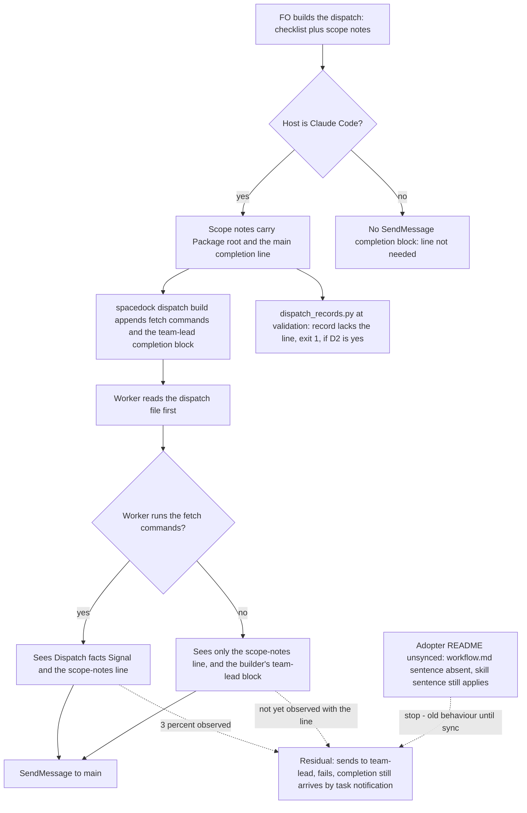

Spacedock's dispatch completion block tells the worker to send `SendMessage(to="team-lead")`; under Claude Code dispatch that name is not registered (spacedock-dev/spacedock #523 and #608, both open on 2026-10-13). The adopter README's Dispatch facts already say to message `main`. On 2026-10-13 the first implementation worker of `journey-map-dev2-contract` still tried `team-lead` first and fell back to its final message; workers whose scope notes carried the explicit line "Send your completion message to `main`" sent to `main`. The root is upstream Spacedock; this task owns only the kc-dev-flow-2 side.

## Captain's words

Captain 2026-10-13, in chat, after the learn result listed this as package-issue candidate 2: 「1-3 回報，且立即排修」

## Scope

- The kc-dev-flow-2 side of the fix (for example, FO's dispatch scope notes always carry the `main` line) and whether to add this evidence to spacedock-dev/spacedock #523 or #608, which is an outward-facing comment for the Captain.
- Non-goals: changing Spacedock.

## Acceptance criteria

`<package>` is the kc-dev-flow-2 package root; paths are relative to `kc-dev-flow-2/` in `iamcxa/kc-claude-plugins`. "Census" means the local transcript read described under Evidence; it is machine-local, so the reproducible proofs below are the tests and exit codes, not the census.

**AC-1** The instruction to put a `main` completion line in every worker dispatch's scope notes sits in the two texts FO reads, one of which an unsynced adopter README cannot withhold.
Verified by: a new entry `scope-notes-main-line` in the `need`/`swaps` table of `scripts/test_sd_dispatch.py` (the pattern of `dispatch-records-check`): `python3 <package>/scripts/test_sd_dispatch.py --sd-plugin-root <active Spacedock root>` exits 0 with the sentence present in `skills/dev/SKILL.md` and in `references/sd/workflow.md`. The sentence covers every worker dispatch and every follow-up message to a live worker.
Falsifier: delete the sentence from `skills/dev/SKILL.md`, then from `references/sd/workflow.md`; the entry fails each time. Limit: proves the instruction exists, not that FO follows it (AC-3 and AC-4).

**AC-2** A scope-notes line naming `main` reaches the dispatch file the worker reads first, ahead of the checklist, and the builder's `team-lead` completion block is still present (so the line is an override, and the dispatch says so).
Verified by: the same test builds an implementation dispatch with `--scope-notes-file` carrying `Send your completion message to \`main\`` and asserts the line is in the dispatch file before `### Completion checklist` and, where the builder emits it on the Claude host, that `SendMessage(to="team-lead"` is also in it. This is a one-string extension of the scope-notes build the test already runs for `Package root:`.
Falsifier: pass `/dev/null` as the scope notes; the line is absent and the assertion fails. Limit: Spacedock 0.27.2 only, Claude host; Codex and Pi completion blocks do not use `SendMessage`.

**AC-3** (only if decision D2 is yes) A dispatch record whose `## Scope notes` has no line naming `main` as the completion recipient fails `dispatch_records.py`, and one with it passes.
Verified by: `scripts/test_dispatch_records.py` builds a task folder with complete records, then the same folder without the line in one record: `python3 <package>/scripts/dispatch_records.py <folder>; echo $?` prints `1` and `<record>.md: needs a scope-notes line naming main as the completion recipient` for the second and `0` for the first. The pattern accepts the wordings FO already writes (`Send your completion message to \`main\``, `Completion message to \`main\``, `completion to \`main\``) and rejects `Send completion to team-lead.` (the wording in `_archive/journey-map-dev2-contract/dispatch/ideation-3.md`).
Falsifier: remove the new entry from `PARTS`; the second folder exits 0 and the test goes red. Cost, measured 2026-10-13 over the 23 records in this state checkout: 9 records in 3 tasks would fail, among them 2 tasks that are not archived (`journey-canvas-hosted-poc`, `release-acceptance`).

**AC-4** The line changes what a worker that skips the fetch does, shown on the exact bytes that failed on 2026-10-13.
Verified by (at validation, a smoke and not a rate): extract the dispatch file that worker read from its transcript (`~/.claude/projects/-Users-kent-conductor-workspaces-kc-claude-plugins-colombo/5c030106-8d82-4542-855e-1498b2563c69/subagents/agent-ab2975ffcefc15426.jsonl`, the tool result of its `Read` of `/tmp/spacedock-dispatch/…-journey-map-dev2-contract-implementation.md`), run it through `scripts/replay_dispatch.py` or a plain `claude -p` with the recorded first prompt and a no-write harness line, three times unchanged and three times with the line added under `## Scope notes`, and read each run's first `SendMessage` `to` value from the stream-json output (the target attempted, not whether it resolved).
Falsifier: any treatment run whose first `SendMessage` goes to `team-lead` fails the criterion. If the unchanged arm shows no `team-lead` first send, report "baseline did not reproduce" and treat AC-4 as not shown; do not claim the line works. Not yet verified; cost per run unmeasured.

## Design

### Chain check (read 2026-10-13)

- **Spacedock** (0.27.2 installed; HEAD of `main` and the 0.27.3 and 0.28.0-pre4 releases read via `gh`): `internal/dispatch/build.go` pins the completion target to `team-lead` ("pinned to the single name", AC-6 of its own task) and `skills/first-officer/references/claude-fo-dispatch.md` says "Do not also accept `to="main"`"; `internal/dispatch/build_merged_mode_test.go` asserts `team-lead`. Bare mode omits the block. #523 (opened 2026-07-17) and #608 (2026-08-03) are both OPEN with 0 comments and no labels; the 2026-06 Spacedock debrief already listed the same noise as cosmetic. `dispatch build` takes `--scope-notes-file` and nothing that changes the recipient. No Spacedock mechanism to reuse; changing it is a non-goal.
- **kc-dev-flow-2**: the rule already exists. `references/sd/workflow.md` `## Dispatch facts` has the `Signal:` bullet (shipped in d0f91b48, AC-3 of the archived `dispatch-and-report-hygiene`), delivered only by the stage-def fetch (`show-stage-def` appends `## Dispatch facts` for ideation, implementation and validation). That task's failure-mode table accepted "Worker ignores the recipient line and tries `team-lead` first" as owned by #523/#608. The same Stages-preamble paragraph already makes FO copy one of the three facts, `Package root:`, into scope notes "which land in the dispatch file the worker reads first". `dispatch_records.py` requires a non-empty `## Scope notes` section but not its content. `test_sd_dispatch.py` already builds dispatches with scope notes and asserts they land.
- **Sibling adopters**: two other adopter workflows show the same symptom in the census below; neither has a local fix. ADRs 0001-0012 in `docs/adr`: only 0003 mentions Dispatch facts (secrets); none governs the recipient. `git grep -n 'Override:'` in the state checkout: no gate override concerns this.

### Existing-code capability check

Boundary: a Claude Code worker dispatched by `spacedock dispatch build` from this package's workflow. The capability (tell the worker `main`) exists and works when the worker sees it (completeness: working through the journey); the gap is placement and enforcement, not a missing capability, so this adds no new mechanism. Two bounded searches: `git grep -n "team-lead" origin/main -- kc-dev-flow-2` (one hit, the `Signal:` bullet) and a read of every `spacedock:ensign` worker transcript under `~/.claude/projects` modified within 6 days of 2026-10-13. Exclusions: Codex and Pi hosts, non-ensign sessions, workers that sent nothing (7). Unknown: whether other machines behave the same.

Evidence (census method: for each worker whose first prompt starts the ensign skill, find the `Read` of its dispatch file, whether any `Bash` call ran `show-stage-def`, whether a fetched result carried `**Signal:**`, and the `to` of its first `SendMessage`; classifier is mine and approximate):
- Workers that fetched the stage definition and saw `**Signal:**`: first send `main` 263, `team-lead` 8 (3.0% of 271 sends), no send 7.
- Workers that never ran `show-stage-def` although their dispatch file carried `### Fetch commands`, in the two workflows whose README had carried `**Signal:**` all window (this one since 2026-10-01, a second adopter since 2026-10-02): first send `team-lead` 12, `main` 1 (that one had an explicit scope-notes line). In those same two workflows the workers that did fetch: `main` 87, `team-lead` 1.
- Dispatch files with an explicit completion line naming `main` (10, all in this workflow on 2026-10-13, one FO session): first send `main` 7, `team-lead` 0, no send 2. Seven trials cannot show improvement over 3.0% (zero failures in seven is the likely result either way); they show only that the line was never overridden by the builder's `team-lead` block.
- 23 further workers in one adopter fetched a stage definition with no `Dispatch facts` at all (README not yet synced) and sent `team-lead` first. That is sync lag, separate from this task (see sibling `workflow-checkout-must-match-trunk-readme` and the refit path); the new `skills/dev/SKILL.md` sentence is the only part of this design that reaches such an adopter before its sync, because the skill loads from the package.
- 2026-10-13 on `journey-map-dev2-contract`, 8 workers: 7 sent `main` first. The one that sent `team-lead` is the implementation-3 worker (record `_archive/journey-map-dev2-contract/dispatch/implementation-3.md`, dispatched 05:58:52 from the 0.21.0 README `e2524e93`, Phase 1 read-only): it never ran `show-stage-def`, sent its Phase 1 report to `team-lead` at 06:00:26 and received `No agent named 'team-lead' is reachable`, then sent `Done` to `main` at 06:05:56 (`agent-ab2975ffcefc15426.jsonl`). Correction to this task's seed text: that worker is not "cycle 1", and the stale 2026-10-08 README was not the cause (the dispatches from `6d344bcb`, whose README already had the `Signal:` bullet, and the implementation worker started at 04:30, `agent-ac8f4ac7dfc8c8`, sent `main`). Later records implementation-4/5/6 and validation-2/3 carry a `main` line; their workers sent `main`.

The mechanism the data supports: the `Signal:` bullet works for a worker that fetches (97%) and the residual 3% is the builder's final `team-lead` block overriding it; a worker that skips the fetch never sees the bullet at all (12 of 13). The scope notes are the one worker-visible text that is always read (the bootstrap fails closed with `DISPATCH_FILE_MISSING` if not) and the package already uses them for `Package root:` for the same reason.

### PRFAQ

**Plain account.** Spacedock tells every dispatched worker to report to a name, `team-lead`, that this setup does not have. The report then fails, the worker wastes a turn, and the answer arrives only because Spacedock also notices the worker finished. The package already tells workers to use `main`, but that sentence travels in a part of the instructions a worker can skip. After this change the person dispatching the worker also writes the same one line into the first file the worker reads, and the validator notices if it is missing.

**Press release (future).** Every kc-dev-flow-2 worker dispatch now opens with its scope notes, and the scope notes say where to send the finish message: `main`. FO writes the line; the package checks it in the dispatch record. Spacedock is unchanged, so the builder's `team-lead` block is still at the bottom of the file; the line above it says so and names the override.

**FAQ.**
- *Why not fix it in Spacedock?* #523 and #608 are the fix; both are open and the maintainers' reference text pins `team-lead` on purpose. Waiting costs one failed call per affected worker.
- *Why repeat what `Dispatch facts` says?* That text arrives only through the fetch, which 12 of 13 observed skippers did not run. Repeating the line where `Package root:` already travels costs one sentence.
- *Why also in `skills/dev/SKILL.md`?* An adopter README gains the new `workflow.md` sentence only on sync; the skill loads from the package at release.
- *Does it fix the 3% who fetched?* Unknown; a worker with the line twice in front of it is the best available test, and AC-4 only smokes it.
- *Wording?* The 12-word duplicate lint (`lint-skills.py`) refuses a run repeated between `workflow.md` and a skill, so the two sentences are worded differently; the scope-notes line itself is the evidence-based text `Send your completion message to \`main\` (the README's Dispatch facts: \`team-lead\` is not registered here).` and may add `and any report` for Phase-style dispatches.

### Flow

Order in prose: FO writes the scope notes with the `Package root:` line and the `main` line for every worker dispatch and every follow-up to a live worker; Spacedock appends fetch commands and its `team-lead` block; the worker reads the file first, fetches or not, and sends to `main`. Stops: a Codex or Pi host (no `SendMessage` block); an unsynced README (skill sentence only); a worker that still sends to `team-lead` (benign; completion arrives by task notification, `Residual` above).

### Files, and what is shared with the other two tasks

Edited by this task: `references/sd/workflow.md` (one sentence in the Stages-preamble paragraph that already mandates `Package root:`, and possibly a wording tweak to the `Signal:` bullet), `skills/dev/SKILL.md` (one sentence after "which FO writes into the scope notes of every worker dispatch"), `scripts/test_sd_dispatch.py` (one `need`/`swaps` entry and the AC-2 build), and if D2 is yes `scripts/dispatch_records.py` and `scripts/test_dispatch_records.py`. The adopter copy `docs/dev2/README.md` changes only by the post-release sync PR, by none of the three tasks.
Shared with `workflow-checkout-must-match-trunk-readme` (read 2026-10-13, its `Files` section): `references/sd/workflow.md` (the block above `### backlog`; it edits the `package_version.py` sentence, so the two sentences sit in one paragraph and the second to land rebases), `skills/dev/SKILL.md` (it also adds one sentence there, a different place), `scripts/lint-skills.py` `WORKFLOW_WORD_BUDGET`: `workflow.md` is exactly 5331 words (`git show origin/main:kc-dev-flow-2/references/sd/workflow.md | wc -w`, 2026-10-13), the budget is 5331, so each task that adds words raises it with a reason or trims; the fix order (1, 2, 3) puts this task last, so it rebases onto both. `observer-before-merge-guard` had no design when read (52 lines); it is expected to touch `extensions/learn/EXTENSION.md` and the delivery text of `workflow.md`, not this paragraph.

### Limits

Benign class: the failure this removes costs one refused call and a fallback; completion still arrives. Not covered: Codex and Pi; a worker that sees the line and still sends `team-lead`; the other fetch-only fact, `Secrets:` (a worker that skips the fetch also loses the secret wrapper; this task does not change it); adopter sync lag. When #523 and #608 land, delete the `Signal:` bullet, both new sentences and the `PARTS` entry together. Profile stays Pilot: no production data, credentials, broad exposure, migration or support duty is added.

### Unresolved decisions for the Captain

- **D2: check the line at validation?** Plainly: should the validator refuse a task whose dispatch records lack the `main` line, so a forgotten line is caught instead of left to a transcript read? Recommend yes (`dispatch_records.py` already runs at validation; the omission was seen twice in one task: `implementation-3` had no line and its worker sent `team-lead`; `ideation-3` named `team-lead` in FO's own text and its worker sent `main` anyway). What gets worse: it fires one dispatch late; 9 of today's 23 records in 3 tasks would fail, 2 of those tasks still open, so the Captain waives per task at the gate once; and the failure it guards is benign. The alternative is AC-1, AC-2 and AC-4 only (drop AC-3), recommended against because the rule is already stated and unenforced.
- **D1: add this evidence to spacedock-dev/spacedock #608 (and mention #523)?** This is an outward-facing comment, so it needs the Captain's yes and runs under his GitHub identity. Recommend yes, one comment on #608 only, after the implementation merges so it can say "workaround shipped, counts attached, asking for the recipient to be configurable or derived from the registered roster", with counts only and no adopter names. What gets worse: it presses against a pin the maintainers wrote on purpose, both issues have had no response for 2 to 3 months, and a public comment cannot be unsent. Not recommended before AC-4 is run, because the comment would then carry only the seven-trial result.
- Ordering: D2 first, because it decides whether AC-3 exists; the two are otherwise independent.

## FO alignment

Alignment: not needed before ideation; the Captain ruled to report and fix now.
Release review: not needed: workflow maintenance, on no journey map.
Surfaces: none
Visible change: none

## Stage Report: ideation

- DONE: A design (PRFAQ and Mermaid) for the kc-dev-flow-2 side of making a dispatched worker send its completion to main, not the unregistered team-lead, without changing Spacedock; upstream spacedock-dev/spacedock #523 and #608 read and their state stated
  `## Design` holds the chain check, existing-code check, PRFAQ and flowchart. #523 and #608 read via `gh` 2026-10-13: both OPEN, 0 comments, no labels; Spacedock `main` still pins `team-lead` in `build.go` and says not to accept `main` in `claude-fo-dispatch.md`.
- DONE: Acceptance criteria with reproducible evidence clauses and falsifiers, citing the 2026-10-13 evidence on journey-map-dev2-contract (cycle-1 worker tried team-lead; later dispatches with an explicit main line sent to main)
  AC-1 to AC-4 each carry Verified-by and Falsifier. The evidence is cited with transcript ids and times, and corrects the seed: the `team-lead` sender was the implementation-3 worker (`agent-ab2975ffcefc15426`), which skipped the fetch; the stale README was not the cause.
- DONE: Unresolved decisions for the Captain, each with a recommendation and what gets worse under it, including whether to add this evidence to the upstream issues (an outward-facing comment)
  D2 (validation-time check, recommend yes) and D1 (comment on #608, recommend yes, after implementation); no past `Override:` contradicts either.
- DONE: AC-1 scope-notes instruction present in `skills/dev/SKILL.md` and `references/sd/workflow.md`
  Not yet verified (future implementation check): `test_sd_dispatch.py` entry `scope-notes-main-line`; falsified by deleting either sentence.
- DONE: AC-2 the `main` line reaches the dispatch file ahead of the checklist beside the builder's `team-lead` block
  Not yet verified (future implementation check): one-string extension of the existing scope-notes build; falsified by `/dev/null` scope notes.
- DONE: AC-3 a record without the line fails `dispatch_records.py` (only if D2 is yes)
  Not yet verified (future implementation check). Legacy cost measured now: 9 of 23 records in 3 tasks (2 not archived) lack the line.
- DONE: AC-4 the line changes the first `SendMessage` target of a fetch-skipping worker on the failing bytes
  Not yet verified (future validation smoke, 3 runs per arm); if the unchanged arm does not reproduce, the criterion stays not shown.
- DONE: design_surfaces.py check
  `python3 <package>/scripts/design_surfaces.py check worker-completion-goes-to-main.md` printed "design surfaces presentable", exit 0; Surfaces is `none`.

### Summary

The rule already exists (the `Signal:` bullet, shipped 2026-09-30) but travels only in the fetched stage definition: workers that fetch it send `main` 263 of 271 times, workers that skip the fetch send `team-lead` 12 of 13 times. The smallest fix is one sentence in `workflow.md` and `skills/dev/SKILL.md` so FO writes a `main` completion line into every dispatch's scope notes, plus an optional `dispatch_records.py` check. Shared files with the sibling tasks: `references/sd/workflow.md` (same Stages-preamble paragraph, and the 5331-word budget it sits at), `skills/dev/SKILL.md` and `scripts/lint-skills.py`; this task lands last and rebases. The census behind the numbers is a local transcript read with an approximate classifier, and seven explicit-line trials cannot show improvement over a 3.0% base rate.

## Stage Report: implementation

- DONE: One Draft PR (fix(kc-dev-flow-2): ...) stacked on #632 (branch off spacedock-ensign/observer-before-merge-guard at 0830a3be) with the sentences the design names in references/sd/workflow.md and skills/dev/SKILL.md, the test_sd_dispatch.py entry, and (D2 accepted) dispatch_records.py and its test failing a record whose scope notes lack the main completion line; AC-1 to AC-4 green with each falsifier shown failing by a mutation run
  PR #633 (Draft, base `spacedock-ensign/observer-before-merge-guard`), commit 4202cdf9. AC-1: `scope-notes-main-line` and `scope-notes-main-line-skill` (two entries, one pinned file each); deleting the skill sentence, then the workflow sentence, makes only that entry report a gap. AC-2: the line sits ahead of `### Completion checklist` with `SendMessage(to="team-lead"` still present on the Claude host; `/dev/null` scope notes fails the assertion (`('claude', 'ideation')`). AC-3: `test_dispatch_records.py` accepts three wordings, rejects `team-lead`, `main-branch` and a line outside Scope notes; removing the `PARTS` entry fails 4 subtests. AC-4: SKIPPED here, it is the validation smoke (not run).
- DONE: roborev_gate.py evidence= line, CI green on the PR head, lint-skills.py green (raise WORKFLOW_WORD_BUDGET from #632's 5411 only by the words this task adds, saying why), and the CI cost per PR measured or stated as not measured
  `findings on 4202cdf9d; evidence=roborev:612` (exit 1, not rerun: neither finding is fixable in scope, see Findings for FO). `lint-skills.py` green, budget 5411 to 5459 (+48, the workflow sentence). `comment_ratio.py 0830a3be HEAD`: 1 comment line of 36 code lines, 2.8%, exit 0. CI cost per PR: measured once, below; the existing `kc-dev-flow-2 tests` workflow runs once per push, no step added. CI on the PR head 4202cdf9: `unit tests (python3)` pass 46s, `multi-profile route gate (live Spacedock)` pass 9s, `version parity` pass 57s, GitGuardian pass. Job durations as GitHub reports them (112s of runner time summed over the three workflow jobs, one run); the cost per PR is that, once per push.
- DONE: The existing dispatch records that the D2 check would fail, listed by task and file in the stage report (the design counted 9 of 23 in 3 tasks), so FO can waive them at their gates
  Run today over this state checkout: 9 of 26 records, 3 tasks. `_archive/journey-map-dev2-contract/dispatch/`: ideation-1, ideation-2, ideation-3 (names `team-lead`), implementation-1, implementation-2, implementation-3, validation-1. `journey-canvas-hosted-poc/dispatch/`: ideation-1. `release-acceptance/dispatch/`: ideation-1.

### Findings for FO (roborev:612)

- Declined, out of scope by design: `replay_dispatch.py` omits the `main` line. It passes `--scope FILE` through so the AC-4 smoke can build the unchanged and the with-line arms; adding the line unconditionally would remove the control arm. The file is also outside the design's list.
- Accepted D2 cost, not a defect: the new check rejects the 9 historical records above; FO waives them per task at the gate. A grandfathering mechanism is outside the design.

### Summary

FO is told, in `workflow.md` and `skills/dev/SKILL.md`, to write a `main` completion line into every dispatch's scope notes, and `dispatch_records.py` now refuses a record without it. The two test entries and the dispatch build assertion carry mutation-shown falsifiers. AC-4 is left to validation; CI is green on the PR head.

## Stage Report: validation

- DONE: Independent verdict on #633 head 4202cdf9 against AC-1 to AC-4, re-running each evidence command and at least one falsifier per criterion yourself rather than citing the implementation report, including AC-4's validation smoke
  AC-1: `test_sd_dispatch.py --sd-plugin-root <0.27.0>` exit 0; in a copy, deleting the skill sentence, then the workflow sentence, made only `scope-notes-main-line-skill`, then only `scope-notes-main-line`, report a gap. AC-2: deleting the `{MAIN_LINE}` line from the test's scope notes fails `assert MAIN_LINE in body and body.index(MAIN_LINE) < body.index("### Completion checklist")` at ('claude','ideation'); `/dev/null` scope notes fails the earlier `Package root:` assertion at the same cell. AC-3: `test_dispatch_records.py` 5 tests OK; with the new `PARTS` entry removed in a copy, 4 subtests fail and a record without the line exits 0 (candidate exits 1). AC-4: unchanged dispatch (bytes of the failed 2026-10-13 read, md5 equals the transcript extract) first SendMessage `team-lead` in 3 of 3 runs; same bytes with the `main` line added before `### Completion checklist`, first SendMessage `main` in 3 of 3 runs. Smoke only: Sonnet, headless `claude -p` limited to Skill/Read/SendMessage (so the fetch cannot run), harness line asking for the one message to FO; the treatment worker's second send went to `team-lead` after `main` was unreachable in isolation, which is not the first send. Baseline reproduced, so the criterion is shown for this smoke, not as a rate.
- DONE: A minimal acceptance script the Captain can run (three to six steps, exact commands, expected output), run by you exactly as written in a fresh shell from a named checkout, with its observed output
  Below under `### Minimal acceptance script`; each step run in a fresh `env -i ... bash --noprofile --norc`, all exits 0, outputs as listed.
- DONE: adr_lint.py docs/adr --since <base> run with its exit code; the implementation's declined roborev:612 findings checked independently; the list of existing dispatch records the D2 check fails confirmed; verdict PASSED or REJECTED with findings classified by the workflow's Review-finding disposition
  `adr_lint.py docs/adr --since 0830a3be`: "13 ADR file(s) checked, 0 legacy", exit 0. Also at 4202cdf9: `comment_ratio.py 0830a3be 4202cdf9` 1 of 36 (2.8%), exit 0; `design_surfaces.py check` exit 0; `dispatch_records.py` on this task's 3 records exit 0; the 15 test scripts `kc-dev-flow-2-tests.yml` names (less `test_sd_dispatch`, run above) all exit 0; no `## Number guards` section. Verdict PASSED, findings below.

### Findings (Review-finding disposition)

- Polish: `doc_impact.py 0830a3be 4202cdf9` lists `kc-dev-flow-2/README.md`, `references/sd/adoption.md`, `skills/maintain-flow/SKILL.md` and the implementation report records none as `updated` or `unaffected`. I read them: each names `lint-skills.py` / `test_sd_dispatch.py` only as commands to run (README.md:279-280, adoption.md:147, maintain-flow/SKILL.md:24,28), none states the 5411 budget or a fix count, so all three are `unaffected: they name the scripts as commands, not their budget or entries`. FO can append that to the report; no user-visible loss.
- Deferred risk: roborev:612 finding 1 (`replay_dispatch.py` omits the `main` line) decline stands: it passes `--scope FILE` through, which AC-4 needs for its control arm, and adding the line unconditionally would remove that arm. Becomes Material if a behaviour replay is used to judge completion routing without `--scope`.
- Deferred risk: the AC-3 pattern matches a negated line (`Do not send completion to main.` exits 0, run). Becomes Material if FO writes a negated wording; no record or ruling does.
- Accepted cost, settled by the 2026-10-13 ideation approval (D2): roborev:612 finding 2. Confirmed the D2 check fails 9 records in 3 tasks, of 36 records now in the state checkout (26 when implementation counted): `_archive/journey-map-dev2-contract/dispatch/` ideation-1, ideation-2, ideation-3, implementation-1, implementation-2, implementation-3, validation-1; `journey-canvas-hosted-poc/dispatch/ideation-1.md`; `release-acceptance/dispatch/ideation-1.md`. The two open tasks need FO's per-task waiver at their gates.
- Unverified: Codex and Pi hosts (no `SendMessage` block); a rate for the 3% fetch-and-still-`team-lead` case; CI on the PR head showed `unit tests` and `version parity` pending and the other two pass when I looked, so I rely on the local runs above. The ensign skill's own runtime adapter still tells a worker `SendMessage(to="team-lead")`, which is upstream Spacedock text outside this task.

### Minimal acceptance script

Needs: `git`, `python3`, network to github.com, and the Spacedock 0.27.x plugin install at `$HOME/.claude/plugins/cache/spacedock/spacedock/0.27.0`. Run from any directory in a fresh shell; it clones into `/tmp/accept-633`.

1. `rm -rf /tmp/accept-633 && git clone --quiet --filter=blob:none https://github.com/iamcxa/kc-claude-plugins /tmp/accept-633 && cd /tmp/accept-633 && git fetch --quiet origin pull/633/head && git checkout --quiet 4202cdf9d76d3f0b4ea81b00bc952df070e05ef7 && git rev-parse HEAD` prints `4202cdf9d76d3f0b4ea81b00bc952df070e05ef7`.
2. `cd /tmp/accept-633 && python3 -B kc-dev-flow-2/scripts/test_dispatch_records.py 2>&1 | tail -3` prints `Ran 5 tests in 0.0Ns`, a blank line, `OK`.
3. `cd /tmp/accept-633 && python3 -B kc-dev-flow-2/scripts/test_sd_dispatch.py --sd-plugin-root "$HOME/.claude/plugins/cache/spacedock/spacedock/0.27.0" > /tmp/accept-633-sd.log 2>&1; echo "test_sd_dispatch exit $?"; grep -c "^PASS" /tmp/accept-633-sd.log; grep -o "scope notes with the package root and the .main. completion line carried into the dispatch file ahead of the checklist" /tmp/accept-633-sd.log` prints `test_sd_dispatch exit 0`, `6`, then the quoted phrase.
4. `cd /tmp/accept-633 && T=$(mktemp -d) && mkdir $T/dispatch && printf "Dispatched: 4202cdf9d76d3f0b4ea81b00bc952df070e05ef7\nModel: sonnet\n\n## Checklist\n\n1. x\n\n## Scope notes\n\nPackage root: /x\n" > $T/dispatch/a-1.md && python3 -B kc-dev-flow-2/scripts/dispatch_records.py $T; echo "without the line: exit $?"; printf "Send your completion message to \`main\`.\n" >> $T/dispatch/a-1.md && python3 -B kc-dev-flow-2/scripts/dispatch_records.py $T; echo "with the line: exit $?"` prints `a-1.md: needs a scope-notes line naming main as the completion recipient`, `without the line: exit 1`, `1 dispatch record(s) complete`, `with the line: exit 0`.
5. `cd /tmp/accept-633 && python3 -B kc-dev-flow-2/scripts/lint-skills.py; echo "lint exit $?"` prints a `PASS: basic frontmatter...` line, `references/sd/workflow.md: 5459 of 5459 words; no unlisted passage repeats it`, `Not checked: ...`, `lint exit 0`.

Does not cover: that a live FO follows the new sentence (this task's own three records carry the line, three of three), that a worker with the line never sends to `team-lead` (AC-4 is a six-run smoke), Codex and Pi hosts, and the 9 historical records that step 4's check would refuse.

### Summary

PASSED at 4202cdf9: AC-1 to AC-3 hold with each falsifier shown failing, and the AC-4 smoke reproduced the baseline (3 of 3 `team-lead` first) and turned it (3 of 3 `main` first) on the exact failing bytes. One Polish item (the three `doc_impact` records), two Deferred risks and the accepted D2 cost; nothing returns through feedback. Throwaway worktree, copies and clone removed; AC-4 run files remain in `/tmp/val633-ac4`. The dispatch said both to commit the report here and that the state checkout is read only; I committed only this entity file, path-scoped.

## Stage Report: implementation (cycle 2, same-stage conflict handoff)

- DONE: Merge (never rebase) origin/spacedock-ensign/observer-before-merge-guard at 40c714a6 into #633's branch, resolving the conflict in scripts/test_sd_dispatch.py (and any other) so both PRs' edits survive; this PR's own hunks over its new base must equal `git diff 0830a3be 4202cdf9` except where a conflict forced a change, each such change named
  New head a7fa7f1b0 (merge, parents 9a2793d1 and 40c714a6, fast-forwarded local from 4202cdf9 first). Only conflict: kc-dev-flow-2/scripts/lint-skills.py (test_sd_dispatch.py, workflow.md, dev/SKILL.md auto-merged). Comparison of added/removed lines in `git diff 40c714a6 HEAD` against `git diff 0830a3be 4202cdf9` differs only in the budget lines named below.
- DONE: All test suites and lint-skills.py green on the merged head (raise WORKFLOW_WORD_BUDGET only if the merge requires it, saying why); push (never force); CI green on #633's new head
  All 16 scripts/test_*.py exit 0 (test_sd_dispatch.py run with --sd-plugin-root at local spacedock 0.27.0, 6 PASS lines incl. scope-notes-main-line; CI pins 0.27.2); lint-skills.py "5463 of 5463 words". Pushed 9a2793d1..a7fa7f1b, no force. CI on a7fa7f1b: unit tests, multi-profile route gate, version parity, GitGuardian all pass.
- DONE: Stage report: new head, the conflict resolution line by line, `git diff <new base>...<new head>` compared with the validated diff, roborev_gate.py evidence= line
  See below.

### Conflict resolution, line by line (lint-skills.py only)

- HEAD side: comment `# 5459: +48 for the scope-notes completion line...` and `WORKFLOW_WORD_BUDGET = 5459`.
- Theirs (#632 at 40c714a6): comment `# 5415: +4 for python3 before four script names...` and `WORKFLOW_WORD_BUDGET = 5415`.
- Resolution: keep both comment lines in order (5415 then 5463) and set `WORKFLOW_WORD_BUDGET = 5463`. Reason the budget must rise: the two sides are additive (5411 + 4 from #632 + 48 from this PR); measured workflow.md is exactly 5463 words, so no slack was added. The 48-word comment text now says 5463 instead of 5459; that is the only forced change versus the validated diff.

### Diff comparison

`git diff 40c714a6...HEAD --stat`: 6 files, 45 insertions, 6 deletions (workflow.md, dispatch_records.py, lint-skills.py, test_dispatch_records.py, test_sd_dispatch.py, dev/SKILL.md), the same six files and counts as `git diff 0830a3be 4202cdf9`. Changed lines identical except lint-skills.py: `-5411/+5459` became `-5415/+5463`.

### roborev gate

`clean on a7fa7f1b0; evidence=roborev:618` (base 40c714a6, exit not 1, no fix rounds used).

### Summary

Reconciled #633 with #632's round 2 by a merge commit; one conflict in the word budget, resolved additively to 5463. Behaviour is unchanged. Validation acceptance script step 5 in the validation report expects 5459 at 4202cdf9; on this head it prints 5463, which is the forced difference above.

## Stage Report: validation (cycle 2, recheck at a7fa7f1b)

- DONE: Independent recheck of #633 at head a7fa7f1b after the merge of #632's repaired head 40c714a6 (same-stage conflict handoff, implementation-2): this PR's own hunks over its new base equal the validated `git diff 0830a3be 4202cdf9` except the forced WORKFLOW_WORD_BUDGET line (5459 to 5463), confirmed; AC-1 to AC-3 re-run at the new head with one falsifier each; AC-4's smoke result carried from validation cycle 1 unless a byte it depends on changed
  Confirmed: the +/- lines of `git diff 40c714a6 a7fa7f1b` and `git diff 0830a3be 4202cdf9` differ only in the budget lines (`-5411/+5459` became `-5415/+5463`, comment `5459` became `5463`); 6 files, 45 insertions, 6 deletions. AC-1: `test_sd_dispatch.py` exit 0, 6 PASS; deleting the skill sentence in a copy reports a gap only for `scope-notes-main-line-skill`, deleting the workflow sentence only for `scope-notes-main-line`. AC-2: removing the `{MAIN_LINE}` line from the test's scope notes fails `assert MAIN_LINE in body and body.index(MAIN_LINE) < body.index("### Completion checklist")` at ('claude','ideation'); `/dev/null` scope notes fails the `Package root:` assertion at the same cell. AC-3: `test_dispatch_records.py` 5 tests OK; with the `PARTS` entry removed in a copy 4 subtests fail and a record without the line exits 0 (candidate exits 1 with the message; with `Completion message to \`main\`.` exits 0). AC-4 carried: the dispatch file bytes, `MAIN_LINE` and both package sentences are byte-identical to the validated diff, and the merge touched none of them; the smoke (3 of 3 `team-lead` unchanged, 3 of 3 `main` with the line) stands, smoke only.
- DONE: The minimal acceptance script updated to the new head (its lint step now expects 5463), run by you exactly as written in a fresh shell from a named checkout, with its observed output
  Below; run under `env -i ... bash --noprofile --norc`, all steps as listed. Step 3 changed beyond the pin: it now sets `SPACEDOCK_BIN` because in a fresh shell `spacedock` resolved to a 0.26.0 Homebrew binary and the test failed (exit 1).
- DONE: adr_lint.py docs/adr --since <base> run at the new head with its exit code; verdict PASSED or REJECTED with findings classified by the workflow's Review-finding disposition
  `adr_lint.py docs/adr --since 40c714a6` from the package root: "13 ADR file(s) checked, 0 legacy", exit 0. Also at a7fa7f1b: `comment_ratio.py 40c714a6 a7fa7f1b` 1 of 36 code lines (2.8%), exit 0; `design_surfaces.py check` exit 0; `dispatch_records.py` on this task's folder "5 dispatch record(s) complete", exit 0; all 16 `scripts/test_*.py` exit 0 (`test_sd_dispatch.py` with `--sd-plugin-root` 0.27.0 and `SPACEDOCK_BIN`); CI on a7fa7f1b: GitGuardian, multi-profile route gate, unit tests, version parity all pass. Verdict PASSED.

### Findings (Review-finding disposition)

- Polish: the cycle 1 acceptance script step 3 assumed `spacedock` on PATH is 0.27.x; fixed in the script below by naming `SPACEDOCK_BIN="$HOME/.local/bin/spacedock"`. The adopter needs Spacedock 0.27.x at that path (or sets `SPACEDOCK_BIN`).
- Polish: `doc_impact.py 40c714a6 a7fa7f1b` lists the same three documents as cycle 1 (`kc-dev-flow-2/README.md`, `references/sd/adoption.md`, `skills/maintain-flow/SKILL.md`); cycle 1 read them as `unaffected: they name the scripts as commands, not their budget or entries`; the merge changed none of those bytes, so the finding is unchanged and FO can append it to the implementation report.
- Deferred risk and accepted D2 cost: unchanged from cycle 1 (negated-wording match; `replay_dispatch.py` omits the line by design; 9 historical records in 3 tasks fail the check and are waived per task).
- Unverified: Codex and Pi hosts; a rate for the fetch-and-still-`team-lead` case; AC-4 was not rerun (carried).

### Minimal acceptance script

Needs: `git`, `python3`, network to github.com, the Spacedock 0.27.x plugin install at `$HOME/.claude/plugins/cache/spacedock/spacedock/0.27.0`, and a Spacedock 0.27.x executable at `$HOME/.local/bin/spacedock`. Run from any directory in a fresh shell; it clones into `/tmp/accept-633`.

1. `rm -rf /tmp/accept-633 && git clone --quiet --filter=blob:none https://github.com/iamcxa/kc-claude-plugins /tmp/accept-633 && cd /tmp/accept-633 && git fetch --quiet origin pull/633/head && git checkout --quiet a7fa7f1b0951d0a08af1bb54eb0d0510d9513c72 && git rev-parse HEAD` prints `a7fa7f1b0951d0a08af1bb54eb0d0510d9513c72`.
2. `cd /tmp/accept-633 && python3 -B kc-dev-flow-2/scripts/test_dispatch_records.py 2>&1 | tail -3` prints `Ran 5 tests in 0.0Ns`, a blank line, `OK`.
3. `cd /tmp/accept-633 && SPACEDOCK_BIN="$HOME/.local/bin/spacedock" python3 -B kc-dev-flow-2/scripts/test_sd_dispatch.py --sd-plugin-root "$HOME/.claude/plugins/cache/spacedock/spacedock/0.27.0" > /tmp/accept-633-sd.log 2>&1; echo "test_sd_dispatch exit $?"; grep -c "^PASS" /tmp/accept-633-sd.log; grep -o "scope notes with the package root and the .main. completion line carried into the dispatch file ahead of the checklist" /tmp/accept-633-sd.log` prints `test_sd_dispatch exit 0`, `6`, then the quoted phrase (with backticks around `main`).
4. `cd /tmp/accept-633 && T=$(mktemp -d) && mkdir $T/dispatch && printf "Dispatched: a7fa7f1b0951d0a08af1bb54eb0d0510d9513c72\nModel: sonnet\n\n## Checklist\n\n1. x\n\n## Scope notes\n\nPackage root: /x\n" > $T/dispatch/a-1.md && python3 -B kc-dev-flow-2/scripts/dispatch_records.py $T; echo "without the line: exit $?"; printf "Send your completion message to \`main\`.\n" >> $T/dispatch/a-1.md && python3 -B kc-dev-flow-2/scripts/dispatch_records.py $T; echo "with the line: exit $?"` prints `a-1.md: needs a scope-notes line naming main as the completion recipient`, `without the line: exit 1`, `1 dispatch record(s) complete`, `with the line: exit 0`.
5. `cd /tmp/accept-633 && python3 -B kc-dev-flow-2/scripts/lint-skills.py; echo "lint exit $?"` prints a `PASS: basic frontmatter...` line, `references/sd/workflow.md: 5463 of 5463 words; no unlisted passage repeats it`, `Not checked: ...`, `lint exit 0`.

Observed (fresh `env -i` bash): step 1 `a7fa7f1b0951d0a08af1bb54eb0d0510d9513c72`; step 2 `Ran 5 tests in 0.063s` / `OK`; step 3 `test_sd_dispatch exit 0`, `6`, the phrase; step 4 the message, `exit 1`, `1 dispatch record(s) complete`, `exit 0`; step 5 `5463 of 5463 words`, `lint exit 0`.

Does not cover: that a live FO follows the new sentence, that a worker with the line never sends to `team-lead` (AC-4 is a six-run smoke from cycle 1), Codex and Pi hosts, and the 9 historical records that step 4's check would refuse.

### Summary

PASSED at a7fa7f1b: the merge changed only the forced budget line (5459 to 5463); AC-1 to AC-3 re-run green with one falsifier each failing, AC-4 carried because no byte it depends on changed. Two Polish items (the acceptance script's missing `SPACEDOCK_BIN`, fixed in the script above; the `doc_impact` records), nothing returns through feedback. Throwaway worktree, copies and clone removed; `/tmp/val633-ac4` from cycle 1 remains.

### Feedback Cycles

- Cycle 1 (FO, 2026-10-13): validation cycle 2 recommended PASSED on #633 a7fa7f1b. Codex review round 2 (review:5501183844) left one P2, to fix (rounds 1 and 2 fix every finding); investigation first, then FO fix authorization, then a fresh validation recheck. The repair also merges #632's reconciled head once #632's merge with main lands.
  - P2 #633 `references/sd/workflow.md` (around line 100): `replay_dispatch.py build` without `--scope` builds `scope.txt` with only the package root and harness text, so a candidate replay lacks the new completion-recipient line and cannot exercise the fix. Add the line to the helper's generated scope (the implementation's roborev:612 decline named the AC-4 control arm, which needs a way to build without the line).

## Stage Report: implementation (cycle 3, repair for Codex round 2 P2, review:5501183844)

- DONE: Investigation first, with no candidate change: reproduce the P2 on a7fa7f1b, reconcile with roborev:612 decline, send FO result and proposed fix, wait for authorization
  Reproduced with the fixture in `test_replay_dispatch.py`: a plain `build` wrote `scope.txt` with only `Package root:` and the HARNESS paragraph, no `main` line. The decline stands only for the control arm, so the fix is default-on with `--no-completion-line`. Worktree untouched until FO's authorization.
- DONE: Merge (never rebase) 7679ab7a, apply the authorized fix with a mutation-failing test, keep this PR's own hunks equal to the validated ones, push, CI green
  Merge ce67ebf0 was clean (no conflicts); `git diff 7679ab7a ce67ebf0` is the same 6 files, 45 insertions, 6 deletions as before (budget stays 5463). Fix commit 01eaf231, 3 files: `replay_dispatch.py` (`MAIN_LINE`, appended after `--scope` and before HARNESS unless `--no-completion-line`), `test_replay_dispatch.py` (3 tests), `skills/maintain-flow/SKILL.md` (one sentence). No budget raised: `WORKFLOW_WORD_BUDGET` counts only `workflow.md`, unchanged at 5463. Pushed a7fa7f1b..01eaf231, no force. CI at 01eaf231: unit tests pass 46s, multi-profile route gate pass 5s, GitGuardian pass; version parity was still pending when this was written.
  Mutations (all restored): dropping the append fails the default-build test and the beside-`--scope` test; making the flag a no-op fails only the control-arm test; changing the line to `Report to \`team-lead\`` fails the default-build test through `dispatch_records.PARTS`.
- DONE: roborev_gate.py evidence= line
  `clean on 01eaf2314; evidence=roborev:620` (exit 0, base 7679ab7a). `comment_ratio.py 7679ab7a HEAD` meets the 5% maximum. `test_replay_dispatch.py` 8 OK, `test_dispatch_records.py` 5 OK, `lint-skills.py` PASS at 5463 of 5463.

### Left for FO

- A fresh validation recheck at 01eaf231 (per Feedback Cycle 1). AC-4's smoke is unaffected: the dispatch bytes it used come from the unchanged builder, not this helper.
- The maintain-flow sentence says the helper adds the line by default; any behaviour replay built before this commit lacks it.

### Summary

`replay_dispatch.py build` now writes the `main` completion-recipient line into `scope.txt` by default, so a candidate replay exercises the fix; `--no-completion-line` keeps the AC-4 control arm. #632's head is merged and this PR's own hunks are unchanged; the gate is clean.

## Stage Report: validation (cycle 3, recheck at 01eaf231)

- DONE: Independent recheck of #633 at head 01eaf231: the Codex round-2 P2 (replay_dispatch.py build without --scope omitted the completion-recipient line) reproduced fixed against a7fa7f1b, the new tests shown failing under mutations you run yourself (append removed; --no-completion-line made a no-op), the merge of #632's 7679ab7a confirmed to leave this PR's other hunks equal to the validated ones, and AC-1 to AC-4 re-run at the new head with any change from validation cycle 2 named
  P2: the fixture in `test_replay_dispatch.py` run against a7fa7f1b's `replay_dispatch.py` wrote `scope.txt` with the package root and TEST HARNESS only (no completion line); against 01eaf231 it holds `Package root`, the `main` line, then TEST HARNESS (`build` exit 0 both). The cycle-3 test file against a7fa7f1b's script fails 3 of 8 (2 errors, 1 failure). Mutations in copies: append removed fails the default-build test and the beside-`--scope` test; `if not a.no_completion_line` made `if True` fails only the control-arm test; line text changed to `team-lead` fails the default-build test through `dispatch_records.PARTS`. Merge: `git diff 7679ab7a ce67ebf0` and `git diff 40c714a6 a7fa7f1b` have identical +/- lines (6 files, 45 insertions, 6 deletions), and the cycle-2 diff differs from the cycle-1 diff only in the budget lines, so the hunks equal the validated ones. AC-1: `test_sd_dispatch.py` exit 0, 6 PASS; deleting the skill sentence in a copy reports a gap only for `scope-notes-main-line-skill`, deleting the workflow sentence only for `scope-notes-main-line`. AC-2: removing the `{MAIN_LINE}` line from the test's scope notes fails the placement assertion at ('claude','ideation'). AC-3: `test_dispatch_records.py` 5 tests OK; with the `PARTS` entry removed 4 subtests fail. AC-4: carried; `replay.MAIN_LINE` equals the test's `MAIN_LINE` string, and the smoke ran on the builder's bytes plus that line, none of which cycle 3 touched. Change from cycle 2: only `replay_dispatch.py`, its test, and one sentence in `skills/maintain-flow/SKILL.md`; the 6 files the earlier cycles validated are unchanged.
- DONE: The minimal acceptance script updated to the new head, run by you exactly as written in a fresh shell from a named checkout, with its observed output
  Below; each step run from its own file under `env -i HOME=... PATH=/usr/bin:/bin:/usr/local/bin:/opt/homebrew/bin bash --noprofile --norc`, all as listed. A first run of step 5 with the short SHA in `Dispatched:` exited 1 (the check needs 40 characters); the script below carries the full SHA.
- DONE: adr_lint.py docs/adr --since <base> run at the new head with its exit code; verdict PASSED or REJECTED with findings classified by the workflow's Review-finding disposition
  `adr_lint.py docs/adr --since 7679ab7a` from the repository root: "14 ADR file(s) checked, 0 legacy", exit 0. Also at 01eaf231: `comment_ratio.py 7679ab7a 01eaf231 --workflow-dir <dev2>` 1 comment line of 67 code lines (1.5%), max 5% met, exit 0; `design_surfaces.py check` exit 0; `dispatch_records.py` on this task's folder "8 dispatch record(s) complete", exit 0; the 18 test scripts `kc-dev-flow-2-tests.yml` names exit 0, with `test_sd_dispatch.py` run with `--sd-plugin-root` 0.27.0 and `test_observer_recovery.py` with `SPACEDOCK_BIN`; CI on 01eaf231: GitGuardian, multi-profile route gate, unit tests, version parity all pass (`gh pr checks 633`); no `## Number guards` section. Verdict PASSED.

### Findings (Review-finding disposition)

- Polish: `replay_dispatch.py build --scope FILE` appends the line again when the file already carries it (run: a scope file holding `MAIN_LINE` gives a `scope.txt` with it twice, exit 0). A duplicated sentence harms no replay; no tested wording depends on it.
- Polish: `doc_impact.py 7679ab7a 01eaf231` lists `README.md`, `references/sd/adoption.md` and `skills/maintain-flow/SKILL.md`. `skills/maintain-flow/SKILL.md` is `updated` by this repair (the sentence on the helper's default and `--no-completion-line`); the other two are `unaffected: they name the scripts as commands, not their budget or entries`, as read in cycle 1. FO can append both to the implementation report.
- Deferred risk: the AC-3 pattern matches a negated line, and 9 historical records in 3 tasks fail the check (accepted D2 cost, waived per task): unchanged from cycles 1 and 2.
- Deferred risk: the helper now puts the `main` line into every replay arm it builds, including the release-tag arm of an unrelated rule's replay; only a replay that judges completion routing needs `--no-completion-line` on its control arm, and the maintain-flow sentence says so. Becomes Material if a routing replay is run without the flag and its baseline is read as the unchanged behaviour.
- Unverified: Codex and Pi hosts; a rate for the fetch-and-still-`team-lead` case; AC-4 not rerun (carried); the replay helper was exercised with the fake `spacedock` in its test, not a live `dispatch build` through `replay_dispatch.py`.

### Minimal acceptance script

Needs: `git`, `python3`, network to github.com, the Spacedock 0.27.x plugin install at `$HOME/.claude/plugins/cache/spacedock/spacedock/0.27.0`, and a Spacedock 0.27.x executable at `$HOME/.local/bin/spacedock`. Run from any directory in a fresh shell; it clones into `/tmp/accept-633`.

1. `rm -rf /tmp/accept-633 && git clone --quiet --filter=blob:none https://github.com/iamcxa/kc-claude-plugins /tmp/accept-633 && cd /tmp/accept-633 && git fetch --quiet origin pull/633/head && git checkout --quiet 01eaf23143af7353615a4b6d8394a628a556682f && git rev-parse HEAD` prints `01eaf23143af7353615a4b6d8394a628a556682f`.
2. `cd /tmp/accept-633 && python3 -B kc-dev-flow-2/scripts/test_replay_dispatch.py -v 2>&1 | grep -E "completion|beside|^Ran|^OK"` prints three `... ok` lines (`test_a_default_build_names_main_as_the_completion_recipient_in_a_form_the_validator_accepts`, `test_no_completion_line_builds_the_unchanged_control_arm`, `test_the_line_appears_once_beside_a_scope_file`), then `Ran 8 tests in N.Ns` and `OK`.
3. `cd /tmp/accept-633 && python3 -B kc-dev-flow-2/scripts/test_dispatch_records.py 2>&1 | tail -3` prints `Ran 5 tests in 0.0Ns`, a blank line, `OK`.
4. `cd /tmp/accept-633 && SPACEDOCK_BIN="$HOME/.local/bin/spacedock" python3 -B kc-dev-flow-2/scripts/test_sd_dispatch.py --sd-plugin-root "$HOME/.claude/plugins/cache/spacedock/spacedock/0.27.0" > /tmp/accept-633-sd.log 2>&1; echo "test_sd_dispatch exit $?"; grep -c "^PASS" /tmp/accept-633-sd.log; grep -o "scope notes with the package root and the .main. completion line carried into the dispatch file ahead of the checklist" /tmp/accept-633-sd.log` prints `test_sd_dispatch exit 0`, `6`, then the quoted phrase (with backticks around `main`).
5. `cd /tmp/accept-633 && T=$(mktemp -d) && mkdir $T/dispatch && printf "Dispatched: 01eaf23143af7353615a4b6d8394a628a556682f\nModel: sonnet\n\n## Checklist\n\n1. x\n\n## Scope notes\n\nPackage root: /x\n" > $T/dispatch/a-1.md && python3 -B kc-dev-flow-2/scripts/dispatch_records.py $T; echo "without the line: exit $?"; printf "Send your completion message to \`main\`.\n" >> $T/dispatch/a-1.md && python3 -B kc-dev-flow-2/scripts/dispatch_records.py $T; echo "with the line: exit $?"` prints `a-1.md: needs a scope-notes line naming main as the completion recipient`, `without the line: exit 1`, `1 dispatch record(s) complete`, `with the line: exit 0`.
6. `cd /tmp/accept-633 && python3 -B kc-dev-flow-2/scripts/lint-skills.py; echo "lint exit $?"` prints a `PASS: basic frontmatter...` line, `references/sd/workflow.md: 5463 of 5463 words; no unlisted passage repeats it`, `Not checked: ...`, `lint exit 0`.

Observed (fresh `env -i` bash, each step): step 1 `01eaf23143af7353615a4b6d8394a628a556682f`; step 2 the three `ok` lines, `Ran 8 tests in 7.4s`, `OK`; step 3 `Ran 5 tests in 0.022s`, `OK`; step 4 `test_sd_dispatch exit 0`, `6`, the phrase; step 5 the message, `without the line: exit 1`, `1 dispatch record(s) complete`, `with the line: exit 0`; step 6 the PASS line, `5463 of 5463 words`, the Not checked line, `lint exit 0`.

Does not cover: that the replay helper builds the line through a live `dispatch build` (its test uses a fake `spacedock`; placement in a real dispatch is step 4's build), that a live FO follows the new sentence, that a worker with the line never sends to `team-lead` (AC-4 is a six-run smoke from cycle 1), Codex and Pi hosts, and the 9 historical records that step 5's check would refuse.

### Summary

PASSED at 01eaf231: the P2 reproduces on a7fa7f1b (no line in the default `scope.txt`) and is fixed on 01eaf231, the new tests fail under each of the three mutations I ran, the merge of 7679ab7a leaves this PR's other hunks equal to the validated ones, and AC-1 to AC-3 re-ran green with a falsifier each (AC-4 carried; none of its bytes changed). Two Polish items (a scope file already carrying the line doubles it; the `doc_impact` records) and the carried Deferred risks, nothing returns through feedback. Throwaway worktree, copies and clone removed; `/tmp/val633-ac4` from cycle 1 remains. The dispatch said both to commit the report here and that the state checkout is read only; I committed only this entity file, path-scoped.

## Stage Report: implementation (conflict handoff, merge of origin/main 37ed4fe7)

- DONE: Merge (never rebase) origin/main at 37ed4fe7 into #633's branch, keeping main's #631 and #632 text and this PR's edits; this PR's hunks over origin/main equal its validated hunks over 7679ab7a
  New head 84de8242 (merge commit, parents 01eaf231 and 37ed4fe7). `git diff 7679ab7a 01eaf231` and `git diff 37ed4fe7 84de8242` are identical once the `index <hash>` lines are removed (blob hashes differ because the base differs); no forced difference.
- DONE: Conflict resolution, line by line
  One conflicted file: kc-dev-flow-2/scripts/lint-skills.py. HEAD had comment `# 5463: +48 ...` and `WORKFLOW_WORD_BUDGET = 5463`; main had `WORKFLOW_WORD_BUDGET = 5415`. Kept main's comment lines through `# 5415 ...`, kept this PR's `# 5463: +48` comment and `= 5463` (main 5415 + 48). All other files merged automatically.
- DONE: All test suites and lint-skills.py green on the merged head; push (never force); CI green on #633's new head
  lint-skills.py PASS (workflow.md 5463 of 5463 words). Every scripts/test_*.py passed (pytest; test_observer_recovery.py and test_sd_dispatch.py run directly, the latter with --sd-plugin-root spacedock 0.27.0 and asserting the `main` completion line). Pushed 01eaf231..84de8242, no force. PR #633 MERGEABLE; four CI checks pass on 84de8242.
- DONE: Stage report: new head, conflict resolution, hunk comparison, roborev_gate.py evidence= line
  roborev_gate.py --base 37ed4fe7 exit 1: `findings on 84de8242d; evidence=roborev:622`. One High finding, not a conflict-resolution finding, so not fixed: dispatch_records.py (this PR's own validated hunk) now requires the main completion line in scope notes, so pre-change dispatch records for active tasks would fail the checker; suggests a version or date gate or a legacy exemption. Returned to FO as a decision (behaviour change).

### Summary

Merged main into #633 with a one-line budget conflict resolved to main's 5415 plus 48. The PR's own diff is unchanged. roborev raised one finding on the PR's own behaviour, left for FO.
