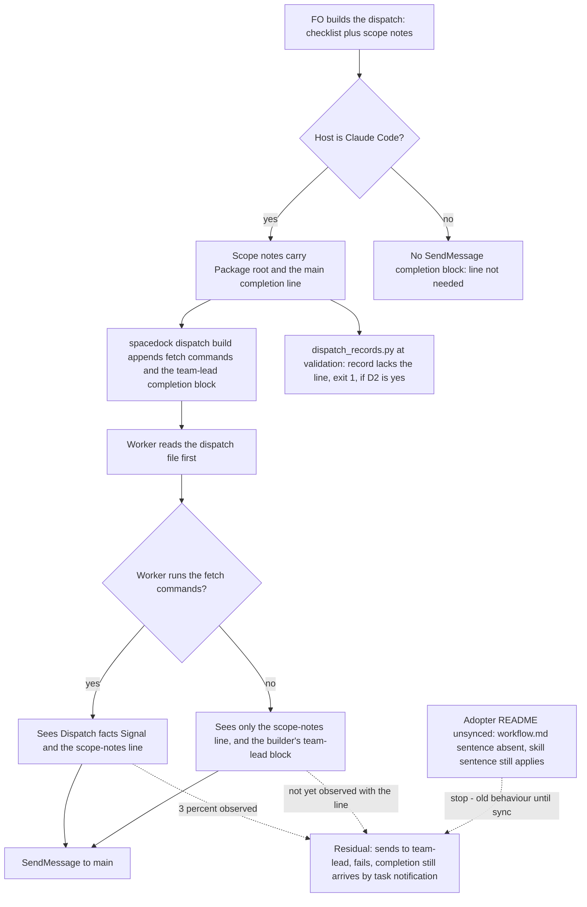

Spacedock's dispatch completion block tells the worker to send `SendMessage(to="team-lead")`; under Claude Code dispatch that name is not registered (spacedock-dev/spacedock #523 and #608, both open on 2026-10-13). The adopter README's Dispatch facts already say to message `main`. On 2026-10-13 the first implementation worker of `journey-map-dev2-contract` still tried `team-lead` first and fell back to its final message; workers whose scope notes carried the explicit line "Send your completion message to `main`" sent to `main`. The root is upstream Spacedock; this task owns only the kc-dev-flow-2 side.

## Captain's words

Captain 2026-10-13, in chat, after the learn result listed this as package-issue candidate 2: 「1-3 回報，且立即排修」

## Scope

- The kc-dev-flow-2 side of the fix (for example, FO's dispatch scope notes always carry the `main` line) and whether to add this evidence to spacedock-dev/spacedock #523 or #608, which is an outward-facing comment for the Captain.
- Non-goals: changing Spacedock.

## Acceptance criteria

`<package>` is the kc-dev-flow-2 package root; paths are relative to `kc-dev-flow-2/` in `iamcxa/kc-claude-plugins`. "Census" means the local transcript read described under Evidence; it is machine-local, so the reproducible proofs below are the tests and exit codes, not the census.

**AC-1** The instruction to put a `main` completion line in every worker dispatch's scope notes sits in the two texts FO reads, one of which an unsynced adopter README cannot withhold.
Verified by: a new entry `scope-notes-main-line` in the `need`/`swaps` table of `scripts/test_sd_dispatch.py` (the pattern of `dispatch-records-check`): `python3 <package>/scripts/test_sd_dispatch.py --sd-plugin-root <active Spacedock root>` exits 0 with the sentence present in `skills/dev/SKILL.md` and in `references/sd/workflow.md`. The sentence covers every worker dispatch and every follow-up message to a live worker.
Falsifier: delete the sentence from `skills/dev/SKILL.md`, then from `references/sd/workflow.md`; the entry fails each time. Limit: proves the instruction exists, not that FO follows it (AC-3 and AC-4).

**AC-2** A scope-notes line naming `main` reaches the dispatch file the worker reads first, ahead of the checklist, and the builder's `team-lead` completion block is still present (so the line is an override, and the dispatch says so).
Verified by: the same test builds an implementation dispatch with `--scope-notes-file` carrying `Send your completion message to \`main\`` and asserts the line is in the dispatch file before `### Completion checklist` and, where the builder emits it on the Claude host, that `SendMessage(to="team-lead"` is also in it. This is a one-string extension of the scope-notes build the test already runs for `Package root:`.
Falsifier: pass `/dev/null` as the scope notes; the line is absent and the assertion fails. Limit: Spacedock 0.27.2 only, Claude host; Codex and Pi completion blocks do not use `SendMessage`.

**AC-3** (only if decision D2 is yes) A dispatch record whose `## Scope notes` has no line naming `main` as the completion recipient fails `dispatch_records.py`, and one with it passes.
Verified by: `scripts/test_dispatch_records.py` builds a task folder with complete records, then the same folder without the line in one record: `python3 <package>/scripts/dispatch_records.py <folder>; echo $?` prints `1` and `<record>.md: needs a scope-notes line naming main as the completion recipient` for the second and `0` for the first. The pattern accepts the wordings FO already writes (`Send your completion message to \`main\``, `Completion message to \`main\``, `completion to \`main\``) and rejects `Send completion to team-lead.` (the wording in `_archive/journey-map-dev2-contract/dispatch/ideation-3.md`).
Falsifier: remove the new entry from `PARTS`; the second folder exits 0 and the test goes red. Cost, measured 2026-10-13 over the 23 records in this state checkout: 9 records in 3 tasks would fail, among them 2 tasks that are not archived (`journey-canvas-hosted-poc`, `release-acceptance`).

**AC-4** The line changes what a worker that skips the fetch does, shown on the exact bytes that failed on 2026-10-13.
Verified by (at validation, a smoke and not a rate): extract the dispatch file that worker read from its transcript (`~/.claude/projects/-Users-kent-conductor-workspaces-kc-claude-plugins-colombo/5c030106-8d82-4542-855e-1498b2563c69/subagents/agent-ab2975ffcefc15426.jsonl`, the tool result of its `Read` of `/tmp/spacedock-dispatch/…-journey-map-dev2-contract-implementation.md`), run it through `scripts/replay_dispatch.py` or a plain `claude -p` with the recorded first prompt and a no-write harness line, three times unchanged and three times with the line added under `## Scope notes`, and read each run's first `SendMessage` `to` value from the stream-json output (the target attempted, not whether it resolved).
Falsifier: any treatment run whose first `SendMessage` goes to `team-lead` fails the criterion. If the unchanged arm shows no `team-lead` first send, report "baseline did not reproduce" and treat AC-4 as not shown; do not claim the line works. Not yet verified; cost per run unmeasured.

## Design

### Chain check (read 2026-10-13)

- **Spacedock** (0.27.2 installed; HEAD of `main` and the 0.27.3 and 0.28.0-pre4 releases read via `gh`): `internal/dispatch/build.go` pins the completion target to `team-lead` ("pinned to the single name", AC-6 of its own task) and `skills/first-officer/references/claude-fo-dispatch.md` says "Do not also accept `to="main"`"; `internal/dispatch/build_merged_mode_test.go` asserts `team-lead`. Bare mode omits the block. #523 (opened 2026-07-17) and #608 (2026-08-03) are both OPEN with 0 comments and no labels; the 2026-06 Spacedock debrief already listed the same noise as cosmetic. `dispatch build` takes `--scope-notes-file` and nothing that changes the recipient. No Spacedock mechanism to reuse; changing it is a non-goal.
- **kc-dev-flow-2**: the rule already exists. `references/sd/workflow.md` `## Dispatch facts` has the `Signal:` bullet (shipped in d0f91b48, AC-3 of the archived `dispatch-and-report-hygiene`), delivered only by the stage-def fetch (`show-stage-def` appends `## Dispatch facts` for ideation, implementation and validation). That task's failure-mode table accepted "Worker ignores the recipient line and tries `team-lead` first" as owned by #523/#608. The same Stages-preamble paragraph already makes FO copy one of the three facts, `Package root:`, into scope notes "which land in the dispatch file the worker reads first". `dispatch_records.py` requires a non-empty `## Scope notes` section but not its content. `test_sd_dispatch.py` already builds dispatches with scope notes and asserts they land.
- **Sibling adopters**: two other adopter workflows show the same symptom in the census below; neither has a local fix. ADRs 0001-0012 in `docs/adr`: only 0003 mentions Dispatch facts (secrets); none governs the recipient. `git grep -n 'Override:'` in the state checkout: no gate override concerns this.

### Existing-code capability check

Boundary: a Claude Code worker dispatched by `spacedock dispatch build` from this package's workflow. The capability (tell the worker `main`) exists and works when the worker sees it (completeness: working through the journey); the gap is placement and enforcement, not a missing capability, so this adds no new mechanism. Two bounded searches: `git grep -n "team-lead" origin/main -- kc-dev-flow-2` (one hit, the `Signal:` bullet) and a read of every `spacedock:ensign` worker transcript under `~/.claude/projects` modified within 6 days of 2026-10-13. Exclusions: Codex and Pi hosts, non-ensign sessions, workers that sent nothing (7). Unknown: whether other machines behave the same.

Evidence (census method: for each worker whose first prompt starts the ensign skill, find the `Read` of its dispatch file, whether any `Bash` call ran `show-stage-def`, whether a fetched result carried `**Signal:**`, and the `to` of its first `SendMessage`; classifier is mine and approximate):
- Workers that fetched the stage definition and saw `**Signal:**`: first send `main` 263, `team-lead` 8 (3.0% of 271 sends), no send 7.
- Workers that never ran `show-stage-def` although their dispatch file carried `### Fetch commands`, in the two workflows whose README had carried `**Signal:**` all window (this one since 2026-10-01, a second adopter since 2026-10-02): first send `team-lead` 12, `main` 1 (that one had an explicit scope-notes line). In those same two workflows the workers that did fetch: `main` 87, `team-lead` 1.
- Dispatch files with an explicit completion line naming `main` (10, all in this workflow on 2026-10-13, one FO session): first send `main` 7, `team-lead` 0, no send 2. Seven trials cannot show improvement over 3.0% (zero failures in seven is the likely result either way); they show only that the line was never overridden by the builder's `team-lead` block.
- 23 further workers in one adopter fetched a stage definition with no `Dispatch facts` at all (README not yet synced) and sent `team-lead` first. That is sync lag, separate from this task (see sibling `workflow-checkout-must-match-trunk-readme` and the refit path); the new `skills/dev/SKILL.md` sentence is the only part of this design that reaches such an adopter before its sync, because the skill loads from the package.
- 2026-10-13 on `journey-map-dev2-contract`, 8 workers: 7 sent `main` first. The one that sent `team-lead` is the implementation-3 worker (record `_archive/journey-map-dev2-contract/dispatch/implementation-3.md`, dispatched 05:58:52 from the 0.21.0 README `e2524e93`, Phase 1 read-only): it never ran `show-stage-def`, sent its Phase 1 report to `team-lead` at 06:00:26 and received `No agent named 'team-lead' is reachable`, then sent `Done` to `main` at 06:05:56 (`agent-ab2975ffcefc15426.jsonl`). Correction to this task's seed text: that worker is not "cycle 1", and the stale 2026-10-08 README was not the cause (the dispatches from `6d344bcb`, whose README already had the `Signal:` bullet, and the implementation worker started at 04:30, `agent-ac8f4ac7dfc8c8`, sent `main`). Later records implementation-4/5/6 and validation-2/3 carry a `main` line; their workers sent `main`.

The mechanism the data supports: the `Signal:` bullet works for a worker that fetches (97%) and the residual 3% is the builder's final `team-lead` block overriding it; a worker that skips the fetch never sees the bullet at all (12 of 13). The scope notes are the one worker-visible text that is always read (the bootstrap fails closed with `DISPATCH_FILE_MISSING` if not) and the package already uses them for `Package root:` for the same reason.

### PRFAQ

**Plain account.** Spacedock tells every dispatched worker to report to a name, `team-lead`, that this setup does not have. The report then fails, the worker wastes a turn, and the answer arrives only because Spacedock also notices the worker finished. The package already tells workers to use `main`, but that sentence travels in a part of the instructions a worker can skip. After this change the person dispatching the worker also writes the same one line into the first file the worker reads, and the validator notices if it is missing.

**Press release (future).** Every kc-dev-flow-2 worker dispatch now opens with its scope notes, and the scope notes say where to send the finish message: `main`. FO writes the line; the package checks it in the dispatch record. Spacedock is unchanged, so the builder's `team-lead` block is still at the bottom of the file; the line above it says so and names the override.

**FAQ.**
- *Why not fix it in Spacedock?* #523 and #608 are the fix; both are open and the maintainers' reference text pins `team-lead` on purpose. Waiting costs one failed call per affected worker.
- *Why repeat what `Dispatch facts` says?* That text arrives only through the fetch, which 12 of 13 observed skippers did not run. Repeating the line where `Package root:` already travels costs one sentence.
- *Why also in `skills/dev/SKILL.md`?* An adopter README gains the new `workflow.md` sentence only on sync; the skill loads from the package at release.
- *Does it fix the 3% who fetched?* Unknown; a worker with the line twice in front of it is the best available test, and AC-4 only smokes it.
- *Wording?* The 12-word duplicate lint (`lint-skills.py`) refuses a run repeated between `workflow.md` and a skill, so the two sentences are worded differently; the scope-notes line itself is the evidence-based text `Send your completion message to \`main\` (the README's Dispatch facts: \`team-lead\` is not registered here).` and may add `and any report` for Phase-style dispatches.

### Flow

Order in prose: FO writes the scope notes with the `Package root:` line and the `main` line for every worker dispatch and every follow-up to a live worker; Spacedock appends fetch commands and its `team-lead` block; the worker reads the file first, fetches or not, and sends to `main`. Stops: a Codex or Pi host (no `SendMessage` block); an unsynced README (skill sentence only); a worker that still sends to `team-lead` (benign; completion arrives by task notification, `Residual` above).

### Files, and what is shared with the other two tasks

Edited by this task: `references/sd/workflow.md` (one sentence in the Stages-preamble paragraph that already mandates `Package root:`, and possibly a wording tweak to the `Signal:` bullet), `skills/dev/SKILL.md` (one sentence after "which FO writes into the scope notes of every worker dispatch"), `scripts/test_sd_dispatch.py` (one `need`/`swaps` entry and the AC-2 build), and if D2 is yes `scripts/dispatch_records.py` and `scripts/test_dispatch_records.py`. The adopter copy `docs/dev2/README.md` changes only by the post-release sync PR, by none of the three tasks.
Shared with `workflow-checkout-must-match-trunk-readme` (read 2026-10-13, its `Files` section): `references/sd/workflow.md` (the block above `### backlog`; it edits the `package_version.py` sentence, so the two sentences sit in one paragraph and the second to land rebases), `skills/dev/SKILL.md` (it also adds one sentence there, a different place), `scripts/lint-skills.py` `WORKFLOW_WORD_BUDGET`: `workflow.md` is exactly 5331 words (`git show origin/main:kc-dev-flow-2/references/sd/workflow.md | wc -w`, 2026-10-13), the budget is 5331, so each task that adds words raises it with a reason or trims; the fix order (1, 2, 3) puts this task last, so it rebases onto both. `observer-before-merge-guard` had no design when read (52 lines); it is expected to touch `extensions/learn/EXTENSION.md` and the delivery text of `workflow.md`, not this paragraph.

### Limits

Benign class: the failure this removes costs one refused call and a fallback; completion still arrives. Not covered: Codex and Pi; a worker that sees the line and still sends `team-lead`; the other fetch-only fact, `Secrets:` (a worker that skips the fetch also loses the secret wrapper; this task does not change it); adopter sync lag. When #523 and #608 land, delete the `Signal:` bullet, both new sentences and the `PARTS` entry together. Profile stays Pilot: no production data, credentials, broad exposure, migration or support duty is added.

### Unresolved decisions for the Captain

- **D2: check the line at validation?** Plainly: should the validator refuse a task whose dispatch records lack the `main` line, so a forgotten line is caught instead of left to a transcript read? Recommend yes (`dispatch_records.py` already runs at validation; the omission was seen twice in one task: `implementation-3` had no line and its worker sent `team-lead`; `ideation-3` named `team-lead` in FO's own text and its worker sent `main` anyway). What gets worse: it fires one dispatch late; 9 of today's 23 records in 3 tasks would fail, 2 of those tasks still open, so the Captain waives per task at the gate once; and the failure it guards is benign. The alternative is AC-1, AC-2 and AC-4 only (drop AC-3), recommended against because the rule is already stated and unenforced.
- **D1: add this evidence to spacedock-dev/spacedock #608 (and mention #523)?** This is an outward-facing comment, so it needs the Captain's yes and runs under his GitHub identity. Recommend yes, one comment on #608 only, after the implementation merges so it can say "workaround shipped, counts attached, asking for the recipient to be configurable or derived from the registered roster", with counts only and no adopter names. What gets worse: it presses against a pin the maintainers wrote on purpose, both issues have had no response for 2 to 3 months, and a public comment cannot be unsent. Not recommended before AC-4 is run, because the comment would then carry only the seven-trial result.
- Ordering: D2 first, because it decides whether AC-3 exists; the two are otherwise independent.

## FO alignment

Alignment: not needed before ideation; the Captain ruled to report and fix now.
Release review: not needed: workflow maintenance, on no journey map.
Surfaces: none
Visible change: none

## Stage Report: ideation

- DONE: A design (PRFAQ and Mermaid) for the kc-dev-flow-2 side of making a dispatched worker send its completion to main, not the unregistered team-lead, without changing Spacedock; upstream spacedock-dev/spacedock #523 and #608 read and their state stated
  `## Design` holds the chain check, existing-code check, PRFAQ and flowchart. #523 and #608 read via `gh` 2026-10-13: both OPEN, 0 comments, no labels; Spacedock `main` still pins `team-lead` in `build.go` and says not to accept `main` in `claude-fo-dispatch.md`.
- DONE: Acceptance criteria with reproducible evidence clauses and falsifiers, citing the 2026-10-13 evidence on journey-map-dev2-contract (cycle-1 worker tried team-lead; later dispatches with an explicit main line sent to main)
  AC-1 to AC-4 each carry Verified-by and Falsifier. The evidence is cited with transcript ids and times, and corrects the seed: the `team-lead` sender was the implementation-3 worker (`agent-ab2975ffcefc15426`), which skipped the fetch; the stale README was not the cause.
- DONE: Unresolved decisions for the Captain, each with a recommendation and what gets worse under it, including whether to add this evidence to the upstream issues (an outward-facing comment)
  D2 (validation-time check, recommend yes) and D1 (comment on #608, recommend yes, after implementation); no past `Override:` contradicts either.
- DONE: AC-1 scope-notes instruction present in `skills/dev/SKILL.md` and `references/sd/workflow.md`
  Not yet verified (future implementation check): `test_sd_dispatch.py` entry `scope-notes-main-line`; falsified by deleting either sentence.
- DONE: AC-2 the `main` line reaches the dispatch file ahead of the checklist beside the builder's `team-lead` block
  Not yet verified (future implementation check): one-string extension of the existing scope-notes build; falsified by `/dev/null` scope notes.
- DONE: AC-3 a record without the line fails `dispatch_records.py` (only if D2 is yes)
  Not yet verified (future implementation check). Legacy cost measured now: 9 of 23 records in 3 tasks (2 not archived) lack the line.
- DONE: AC-4 the line changes the first `SendMessage` target of a fetch-skipping worker on the failing bytes
  Not yet verified (future validation smoke, 3 runs per arm); if the unchanged arm does not reproduce, the criterion stays not shown.
- DONE: design_surfaces.py check
  `python3 <package>/scripts/design_surfaces.py check worker-completion-goes-to-main.md` printed "design surfaces presentable", exit 0; Surfaces is `none`.

### Summary

The rule already exists (the `Signal:` bullet, shipped 2026-09-30) but travels only in the fetched stage definition: workers that fetch it send `main` 263 of 271 times, workers that skip the fetch send `team-lead` 12 of 13 times. The smallest fix is one sentence in `workflow.md` and `skills/dev/SKILL.md` so FO writes a `main` completion line into every dispatch's scope notes, plus an optional `dispatch_records.py` check. Shared files with the sibling tasks: `references/sd/workflow.md` (same Stages-preamble paragraph, and the 5331-word budget it sits at), `skills/dev/SKILL.md` and `scripts/lint-skills.py`; this task lands last and rebases. The census behind the numbers is a local transcript read with an approximate classifier, and seven explicit-line trials cannot show improvement over a 3.0% base rate.

## Stage Report: implementation

- DONE: One Draft PR (fix(kc-dev-flow-2): ...) stacked on #632 (branch off spacedock-ensign/observer-before-merge-guard at 0830a3be) with the sentences the design names in references/sd/workflow.md and skills/dev/SKILL.md, the test_sd_dispatch.py entry, and (D2 accepted) dispatch_records.py and its test failing a record whose scope notes lack the main completion line; AC-1 to AC-4 green with each falsifier shown failing by a mutation run
  PR #633 (Draft, base `spacedock-ensign/observer-before-merge-guard`), commit 4202cdf9. AC-1: `scope-notes-main-line` and `scope-notes-main-line-skill` (two entries, one pinned file each); deleting the skill sentence, then the workflow sentence, makes only that entry report a gap. AC-2: the line sits ahead of `### Completion checklist` with `SendMessage(to="team-lead"` still present on the Claude host; `/dev/null` scope notes fails the assertion (`('claude', 'ideation')`). AC-3: `test_dispatch_records.py` accepts three wordings, rejects `team-lead`, `main-branch` and a line outside Scope notes; removing the `PARTS` entry fails 4 subtests. AC-4: SKIPPED here, it is the validation smoke (not run).
- DONE: roborev_gate.py evidence= line, CI green on the PR head, lint-skills.py green (raise WORKFLOW_WORD_BUDGET from #632's 5411 only by the words this task adds, saying why), and the CI cost per PR measured or stated as not measured
  `findings on 4202cdf9d; evidence=roborev:612` (exit 1, not rerun: neither finding is fixable in scope, see Findings for FO). `lint-skills.py` green, budget 5411 to 5459 (+48, the workflow sentence). `comment_ratio.py 0830a3be HEAD`: 1 comment line of 36 code lines, 2.8%, exit 0. CI cost per PR: measured once, below; the existing `kc-dev-flow-2 tests` workflow runs once per push, no step added. CI on the PR head 4202cdf9: `unit tests (python3)` pass 46s, `multi-profile route gate (live Spacedock)` pass 9s, `version parity` pass 57s, GitGuardian pass. Job durations as GitHub reports them (112s of runner time summed over the three workflow jobs, one run); the cost per PR is that, once per push.
- DONE: The existing dispatch records that the D2 check would fail, listed by task and file in the stage report (the design counted 9 of 23 in 3 tasks), so FO can waive them at their gates
  Run today over this state checkout: 9 of 26 records, 3 tasks. `_archive/journey-map-dev2-contract/dispatch/`: ideation-1, ideation-2, ideation-3 (names `team-lead`), implementation-1, implementation-2, implementation-3, validation-1. `journey-canvas-hosted-poc/dispatch/`: ideation-1. `release-acceptance/dispatch/`: ideation-1.

### Findings for FO (roborev:612)

- Declined, out of scope by design: `replay_dispatch.py` omits the `main` line. It passes `--scope FILE` through so the AC-4 smoke can build the unchanged and the with-line arms; adding the line unconditionally would remove the control arm. The file is also outside the design's list.
- Accepted D2 cost, not a defect: the new check rejects the 9 historical records above; FO waives them per task at the gate. A grandfathering mechanism is outside the design.

### Summary

FO is told, in `workflow.md` and `skills/dev/SKILL.md`, to write a `main` completion line into every dispatch's scope notes, and `dispatch_records.py` now refuses a record without it. The two test entries and the dispatch build assertion carry mutation-shown falsifiers. AC-4 is left to validation; CI is green on the PR head.
