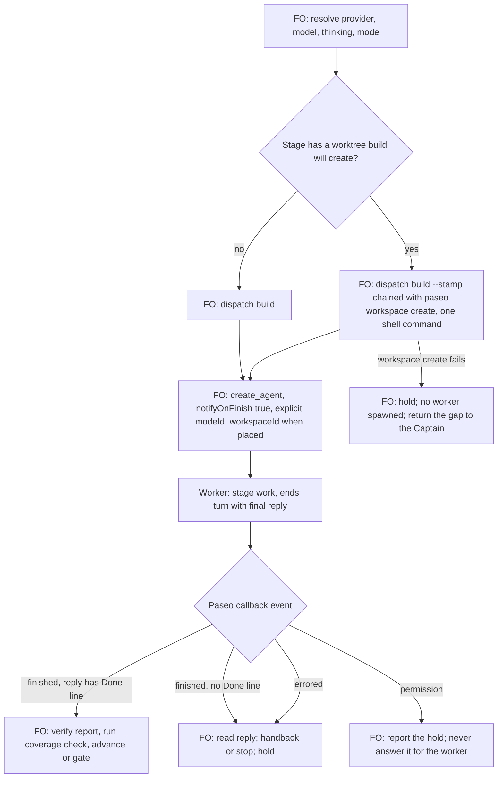

## Scope

- Source: Batch 12 sitting: the Captain 「可以」 (chat, 2026-11-02), answering 「決定：多開「完成通知」和「挑剔使用者可用 Gemini」兩張票，先前五件事照建議，可以嗎？」. FO had stated: 「工作者完成時要確實通知到 FO」, 「排第一」.
- Bite: batch 12, 2026-11-01. Four Claude ideation workers spawned with `paseo agent run --no-wait` were told to send completion to `main`; all four `SendMessage(to="main")` calls were refused because `main` resolves to the worker itself. Three fell back to `send_agent_prompt`; the roster worker ended with no signal, and the Captain asked 「卡住了嗎」 about nine hours later. `agent run` has no notify option; `create_agent` defaults `notifyOnFinish` true.
- Consumer: every FO dispatching a worker through Paseo.
- `main` is enforced by the `dispatch_records.py` regex, a `references/sd/workflow.md` sentence pinned in `test_sd_dispatch.py`, and `MAIN_LINE` in `replay_dispatch.py`. A Claude worker through Paseo hands publication to FO as a Codex worker does.
- Upstream first: Spacedock's completion contract, Paseo's own skill, `extensions/paseo/EXTENSION.md`.

## Non-goals

- A polling watcher; a change to Spacedock or Paseo; workers on non-Paseo hosts.

## Budget

- One package PR. Keep the rule in `extensions/paseo/EXTENSION.md`; workflow word budget unchanged unless the design names a raise for the Captain.

## Stop condition

- A real Claude worker and a real Codex worker through Paseo each deliver a completion the FO receives, with no fallback improvised by the worker. If `create_agent`'s callback does not reach the FO on a stage worker, stop and return that evidence to FO.

## FO alignment

Alignment: needed before ideation; the scope is the Captain's ruling.
Result: aligned at backlog: Batch 12 sitting: the Captain 「可以」 (chat, 2026-11-02), answering 「決定：多開「完成通知」和「挑剔使用者可用 Gemini」兩張票，先前五件事照建議，可以嗎？」, approved the outcome and bounds in this file.
Surfaces: none
Visible change: none
Release review: not needed: workflow maintenance, on no journey map.

## Design

**Proposition.** After this release, a First Officer (FO) in a workflow listing the `paseo` extension spawns every stage worker with `create_agent` and `notifyOnFinish: true`, and the worker ends its turn with the `Done:` line as its final reply. Paseo delivers that reply to the FO. The worker sends nothing itself, so no name can be refused and no fallback is improvised. A worker that stops early, errors or waits on a permission also reaches the FO, which today's command-line spawn does not do.

**FAQ**

- *Why not keep the worker's own message?* It only fires if the worker gets that far and picks a working address. In batch 12 one worker did not. The callback fires on finish, error and permission whatever the worker did.
- *Is this new behaviour for Spacedock?* No. Its Codex ensign runtime already makes "one minimal final message" the completion signal, and its Codex FO runtime says that signal "starts completion verification, not completion itself". This applies the same contract to a Claude worker through Paseo.
- *Does a finish mean the stage is done?* No. A finish with no `Done:` line is a handback or a stop. FO reads the reply and the report as it does today, then runs `dispatch_records.py --coverage`.
- *What about the worktree?* `create_agent` needs a registered workspace, and `dispatch build --stamp` is what creates the worktree. See D1.
- *What does a Claude worker publish?* Nothing: it hands publication to FO as a Codex worker does, per the Scope. The section stops naming a provider, and a new ADR records that this widens ADR 0042.



### Upstream check

- Spacedock 0.27.3: `references/codex-ensign-runtime.md` makes the final message the signal; `references/claude-ensign-runtime.md` makes it `SendMessage(to="team-lead")`; `references/fo-dispatch-core.md` says "On exit 0, the next host action MUST be `«worker.spawn»`". Used unchanged.
- kc-dev-flow-2 0.34.0 at origin/main 146727de: `extensions/paseo/EXTENSION.md` says only "Preserve worker completion notifications" and offers the command-line spawn for placement. `dispatch_records.py` `PARTS` refuses a record without the `main` line. `replay_dispatch.py` already has `--no-completion-line` and `--scope`, so it needs no change.
- Sibling adopters, read-only 2026-11-02: `subspace-relay` and `kc-paseo-plugins` do not list `paseo`, and neither has a completion rule to borrow. The qnow checkout, last commit 2026-10-25, showed no `extensions:` list under `docs/*/README.md`. See D2.
- Paseo 0.14.0 own docs and bundle: "Agent-scoped `create_agent` defaults `notifyOnFinish` to true"; "top-level calls have no parent callback"; `paseo agent run --help` has no notify option.
- Existing-code check: nothing new is built. The change reuses Paseo's callback, `create_workspace`'s command-line twin and `dispatch_records.py`'s README lookup.

### Evidence: what the receiver actually gets

Live probes, 2026-11-02, Paseo 0.14.0. This worker was the stand-in receiver and was running at the time, because the assignment bars messaging the FO. Each dispatch file carried Spacedock's completion block verbatim.

| Worker | Spawn | Scope line | What arrived |
| --- | --- | --- | --- |
| Claude Sonnet low | `paseo agent run --no-wait` | `main` | Nothing. `SendMessage(to="main")` was refused: "You are the main conversation — 'main' addresses you". The worker ended saying it could not send. |
| Codex Sol low | `paseo agent run --no-wait` | `main` | Nothing. It sat on a permission prompt, found only by `list_pending_permissions`. Cancelling it also sent nothing. |
| Claude Sonnet low | `create_agent` | new line | `event="finished"` carrying the `Done:` line; no `SendMessage`. |
| Codex Sol low | `create_agent` | new line | `event="finished"` carrying the `Done:` line. |
| Claude Opus high | `create_agent` | new line, plus the real Signal fact through a fetch command | `event="finished"`, reply exactly the `Done:` line; no send. |
| Codex Astra high | `create_agent` | same | `event="finished"`, the `Done:` line after a `---`; no send. |

Received text, Claude Opus row, ids shortened:

```text
<paseo-system version="1" kind="agent-notification" source-agent-id="f0976afd…" message-id="bb615f7d…" source-server-id="srv_Vu_g…" source-agent-title="wc probe cc-sig tool" event="finished">
Agent f0976afd… (wc probe cc-sig tool) finished.

Server: srv_Vu_g…

&lt;agent-response&gt;
Done: Probe task cc-sig completed ideation. Report written to /tmp/wc-probe-b12/cc-sig/report.md.
&lt;/agent-response&gt;
</paseo-system>
```

Real workers in the FO's own session transcript (`5c030106…jsonl`), counted by agent id over raw rows, read 2026-11-02, excluding batch 12's latest spawns:

| Spawn route | Agents | Got a callback |
| --- | --- | --- |
| `create_agent`, notify not false | 125 | 125 |
| `create_agent`, notify false, no later send | 3 | 0 |
| Command line, no later `send_agent_prompt` | 22 | 0 |
| Command line, later `send_agent_prompt` | 12 | 12 |

The transcript holds 204 distinct callbacks: 192 finished, 8 errored, 4 permission. An idle FO started a new turn on them; a running FO got them queued mid-turn. Stage-worker callbacks were 42.5 words at the median, 73 at p90 and 301 at most, over 114. Bound: command-line ids were matched as UUIDs in the spawn call's output, so the 22 may include an id that was not a spawned agent.

Other observations:

- `create_agent` from this Claude session with a Codex provider and no mode was refused: "cannot inherit mode 'auto' from caller … Pass an explicit mode". Mode `auto` is what a command-line Codex spawn got (`paseo agent inspect`), so it preserves today's permissions.
- Placement: `paseo workspace create --isolation local --path <real git worktree> --background --json`, then `create_agent` with that `workspaceId`, gave `pwd` and `git rev-parse --show-toplevel` both equal to the worktree. `git worktree list` showed no extra worktree.
- Not verified: a Codex FO as receiver. The probe's Codex parent held on an MCP approval prompt for `create_agent`; this worker does not answer permission prompts and cancelled it. Also not verified: delivery across hosts, and `dispatch build --stamp` in the same chain. This dispatch's own spawn is `create_agent`, `notifyOnFinish: true`, so FO holds one real stage-worker callback from this task's completion.

The stop condition did not fire: real stage workers' callbacks reach the FO.

### Change

1. `kc-dev-flow-2/extensions/paseo/EXTENSION.md`. The heading becomes `## Workers through Paseo`; the opening line and "the Paseo Codex exception" stop naming Codex. New paragraph:

   > Spawn with create_agent, notifyOnFinish true and an explicit modeId, because a Codex child will not inherit a Claude FO's mode. In scope notes and follow-ups, replace the main line with: "Your final reply is your completion message: Paseo delivers it to FO when your turn ends. End your turn with the Done line below as that reply; do not send it with SendMessage or send_agent_prompt." A finished callback starts verification, as in Spacedock's Codex contract; without a Done line it is a handback or a stop, so read it and the report before advancing. Errored and permission callbacks are holds, never completion.

   The placement sentences about the command-line spawn become:

   > If Spacedock creates the worktree during dispatch build, chain paseo workspace create --isolation local --path <worktree> --background --json onto that same build command, so create_agent stays the next host action. Paseo's CLI spawn has no finish callback; do not use it for a stage worker. Check current Paseo help before use.

2. `kc-dev-flow-2/scripts/dispatch_records.py`: a constant holding that scope line. The `PARTS` entry for the completion recipient also passes when a record's scope notes hold the constant and the README found by `find_readme` lists `paseo`. A record with the line in a workflow not listing `paseo`, or with no README found, still reports the same `needs a scope-notes line naming main …` message, so `laws_check.py`'s parser needs no change.
3. `kc-dev-flow-2/scripts/test_dispatch_records.py`: those cases, and one asserting `EXTENSION.md` contains the constant.
4. `kc-dev-flow-2/README.md` extension row and `kc-dev-flow-2/references/sd/adoption.md` paseo mention: drop "Codex".
5. New ADR, short title "Paseo stage workers complete by final reply and hand publication to FO", number reserved by FO at implementation dispatch. Words: 「可以」 (chat, 2026-11-02), asked 「決定：多開「完成通知」和「挑剔使用者可用 Gemini」兩張票，先前五件事照建議，可以嗎？」. It widens ADR 0042 to Claude workers.

Unchanged: `references/sd/workflow.md` and its word budget, the `test_sd_dispatch.py` pins, `skills/dev/SKILL.md`, `replay_dispatch.py`, and the Signal fact. Other hosts keep the `main` line. No new obligation requires a profile change.

### Words FO reads at each moment

Counted with Python `str.split()` over origin/main and over the drafted text.

| Moment | Source | Before | After | Change |
| --- | --- | --- | --- | --- |
| Startup, resume, each stage definition | `references/sd/workflow.md` | 5781 | 5781 | 0 |
| Before a Paseo worker dispatch | `extensions/paseo/EXTENSION.md` | 713 | 819 | +106 |
| Writing scope notes, Codex worker | completion line | 15 | 35 | +20 |
| Writing scope notes, Claude worker | `main` line plus this dispatch's 25-word `send_agent_prompt` line | 40 | 35 | -5 |
| Worker completes, command-line spawn | worker's message, when it sends | 20 or nothing | 33 | +13 |
| Worker completes, `create_agent` plus worker's message | callback and message | 53 | 33 | -20 |

Reading rises overall, by 106 words on the dispatch moment. This task adds a duty rather than cutting text, so no moment is required to fall; the rise is named for the Captain. A long final reply costs FO more: 301 words is the observed worst case.

### Batch overlap

| Task | Shared file or check | Effect |
| --- | --- | --- |
| model-roster-question-needs-both-families | `extensions/paseo/EXTENSION.md`, ADR index | Its design has dropped its edit to this section and its D2 points here. It lands after this and uses the same spawn route for a Claude row. |
| special-roles-follow-the-model-table | `workflow.md`, `lint-skills.py`, `test_sd_dispatch.py` | This task changes none of them. None. |
| second-round-prompts-a-step-back | `dispatch_records.py` named only in its overlap table | None. |
| validation-gate-requires-the-question-check | `workflow.md`, `lint-skills.py` | None. |
| picky-reviewers-may-run-on-gemini | `extensions/release-acceptance/EXTENSION.md` | None: reviewers are not stage workers. |
| adoption-asks-which-extensions (other session) | `dispatch_records.py`, `test_dispatch_records.py` | Same file, adjacent question: it judges a record against the extensions listed when dispatched; this reads `paseo` from the current README. Whichever lands second rebases and should reuse its helper. |
| adr-required-statement (other session, validation) | `references/sd/adoption.md`, ADR index | Different section; number by FO. |
| comment-check-reaches-delivery-gate (other session) | `delivery_gate.py` | None. |
| adr-silent-undo-probe, journey-canvas-hosted-poc, journey-server-host-pilot, ops-inbox-r1-setup-and-isolation, pr-review-lite-value-pilot (other sessions) | none found by search of their task files | None. |

Recommended order: this task first, as FO stated 「排第一」; then model-roster-question-needs-both-families; the rest as their designs state.

### Needs decision

- **D1. May the worktree registration share the shell command with `dispatch build --stamp`?** Recommended: yes. `create_agent` stays Spacedock's next host action, and the only added step runs in that same command with no FO judgment. Past ruling: validation of paseo-codex-dispatch-practice failed FO for two operations between build and spawn, counting operations rather than seconds; no `Override:` line touches this, and that case was FO reading and committing as separate host actions. What gets worse: a registration failure leaves a stamped dispatch with no worker, which FO must hold on. The alternative, command-line spawn then an arming `send_agent_prompt`, keeps one-call placement (12 of 12 got callbacks) but steers every new worker with a second message and needs its own dispatch record.
- **D2. Does the rule stay only in the listed `paseo` extension?** Recommended: yes, as the Budget says. The roster question already requires `paseo` listed, so a Claude stage worker through Paseo normally has it. What gets worse: `subspace-relay` and `kc-paseo-plugins` do not list `paseo`, so an FO there that spawns a Claude worker through Paseo still gets the refused `main`. The alternative is about 20 more words in the workflow's Signal fact, a word-budget raise that loads on every dispatch for all adopters.

## Acceptance criteria

**AC-1** On the candidate package, one real Claude stage worker and one real Codex stage worker, spawned as the extension says, each deliver a `finished` callback to the real FO whose reply holds that task's `Done:` line.
Verified by: the FO transcript rows quoted in the task, plus each worker's timeline showing no `SendMessage`, `send_agent_prompt` or `team-lead` attempt. Falsifier: the same worker with the `main` line through `paseo agent run --no-wait` gives no callback, and the Claude one shows the refusal; both observed 2026-11-02.

**AC-2** A worker that ends without a `Done:` line, one cancelled and one holding on permission each reach the FO as a callback with the matching event.
Verified by: three live spawns recording the event each produces. Falsifier: the command-line route produces none of them; the permission and cancel cases were observed 2026-11-02.

**AC-3** `dispatch_records.py` accepts a record with the Paseo line when the README lists `paseo`, and refuses it when the README does not list `paseo` or none is found.
Verified by: new `test_dispatch_records.py` cases asserting the printed reason. Falsifier: removing the listed-`paseo` condition makes the not-listed case pass, so the test fails; removing the new branch makes the listed case fail.

**AC-4** The accepted line in `dispatch_records.py` is the one `EXTENSION.md` tells FO to write.
Verified by: a test reading both. Falsifier: changing one word in either fails it.

**AC-5** A stage whose worktree `dispatch build --stamp` creates starts its worker in that worktree with `create_agent` as the next host action after that one command, under the design's D1 ruling.
Verified by: one real run recording the command, `pwd`, `git rev-parse --show-toplevel` and `git worktree list`. Falsifier: omit `workspaceId` and the worker starts in the FO's workspace, so the check fails.

**AC-6** `references/sd/workflow.md`'s word count and `WORKFLOW_BUDGET_STEPS` in `lint-skills.py` are unchanged, the `scope-notes-main-line` pins still pass, and a non-Paseo dispatch still carries the `main` line.
Verified by: `lint-skills.py` and `test_sd_dispatch.py` exit 0 with `git diff` showing neither file changed. Falsifier: any edit to the `main` sentence fails its pin.

**AC-7** The words FO reads recount at no more than the table's After column, 819 for the extension, by a recount independent of the design's.
Verified by: the validator's own count over the candidate's `EXTENSION.md`. Falsifier: a candidate over 819 fails unless the Captain names a rise.

**AC-8** A new ADR with the design's short title records the Captain's words and the question asked, and states it widens ADR 0042.
Verified by: `adr_lint.py` on the candidate and reading the file. Falsifier: removing the `Asked:` line fails the lint.

## Stage Report: ideation

- DONE: A design for this task's Scope, with real evidence from one Claude and one Codex worker of what the FO actually receives
  `## Design`: six live probes across both models and routes, 162 of FO's real workers counted by spawn route; the stand-in receiver's limit is stated.
- DONE: A `### Batch overlap` section naming each file the design would change and each other batch task (worker-completion-reaches-fo-on-paseo, model-roster-question-needs-both-families, special-roles-follow-the-model-table, second-round-prompts-a-step-back, validation-gate-requires-the-question-check, picky-reviewers-may-run-on-gemini) and live task of other sessions (adoption-asks-which-extensions, adr-required-statement, adr-silent-undo-probe, comment-check-reaches-delivery-gate, journey-canvas-hosted-poc, journey-server-host-pilot, ops-inbox-r1-setup-and-isolation, pr-review-lite-value-pilot (driven by other sessions; read only)) that changes the same file or check, so FO can order implementation
  Real file overlap only with model-roster-question-needs-both-families and adoption-asks-which-extensions; adr-required-statement shares `adoption.md` in another section; order given.
- DONE: The words FO reads at each lifecycle moment, before and after, per root learning.md "Measure the words FO reads at each moment, not one file's size"
  `### Words FO reads at each moment`: workflow 5781 unchanged, extension 713 to 819, completion 53 to 33 where a worker also sent.
- DONE: Acceptance criteria with reproducible evidence clauses and falsifiers, and unresolved decisions for the Captain, each with a recommendation and what gets worse under it
  AC-1 to AC-8 below; D1 and D2 in `### Needs decision`.
- DONE: AC-1 current evidence: not yet verified on the candidate; the probes used a drafted line and a stand-in receiver, and the falsifier arms were observed 2026-11-02.
- DONE: AC-2 current evidence: not yet verified for the `create_agent` route live; the transcript holds 8 errored and 4 permission callbacks; the command-line arm was observed.
- DONE: AC-3 current evidence: not yet verified; no code exists.
- DONE: AC-4 current evidence: not yet verified; no code exists.
- DONE: AC-5 current evidence: placement through `paseo workspace create` observed on a real worktree; not yet verified with `dispatch build --stamp` in the chain.
- DONE: AC-6 current evidence: not yet verified on a candidate; the design changes neither file.
- DONE: AC-7 current evidence: 819 counted on the drafted text, not on a candidate.
- DONE: AC-8 current evidence: not yet verified; no ADR exists.

### Summary

The design makes Paseo's finish callback the completion signal: `create_agent` with notify on, the worker's final reply as the `Done:` line, the rule in the paseo extension, and `dispatch_records.py` accepting that line only where `paseo` is listed. The callback reached the receiver from real Claude and Codex workers with no send attempted; the old route gave nothing on both models, and 125 of 125 real FO spawns with notify on got callbacks. `design_surfaces.py check` printed "design surfaces presentable", exit 0. A Codex FO as receiver remains unverified, and D1 and D2 are for the Captain. All probe workspaces and temporary files are removed.
